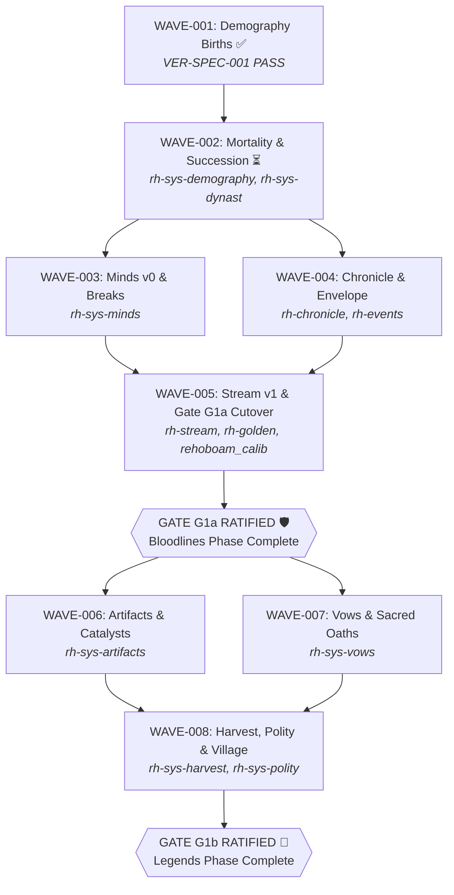

# 🐕‍🦺 ARCHITECT BACKLOG (`BCK-002` — Continuous Spec Wave Buffer)

> **BLUF:** Specification-Driven Development (SDD v2.0) continuous wave queue for `BigRigVibeCoder/Rehoboam` on Forgejo Edge (`cerberus-runner`). The Lead Architect Agent (`claude-architect`) is **never idle** while OpenRouter workers implement leaf tasks. Whenever the Forgejo `status:ready` queue drops below the **Low-Water Mark (`< 3` issues)**, `cerberus_orchestrator.py` signals `architect:replenish_needed = 1` and `claude-architect` executes the next queued wave below.

---

## 1. Architect Continuous Responsibilities (`AGT-001`)

| Category | Code | Trigger Condition | Action Executed by `claude-architect` |
|:--|:--|:--|:--|
| **Wave Spec Prep** | `ARCH-SPEC` | `status:ready < 3` (Low-Water Mark) | Draft next `.spec/active/SPEC-XXX.md`, commit frozen Rust traits & failing test stubs to `main`, spawn 2–10 leaf Forgejo Issues with explicit allowed write paths and test commands. |
| **Discrepancy Fix** | `ARCH-AMBIG` | `VERDICT: REJECT_SPEC_AMBIGUITY` or `EVO` filed | Clarify ambiguous contract in `.spec/active/SPEC-XXX.md`, update shared crate traits (`rh-core`, `rh-ids`), re-queue leaf issue. |
| **Strike-1 Triage** | `ARCH-STRIKE1` | Worker hits 15-turn / $1.50 fuse | Inspect `wip/issue-N` branch, split overly complex task into two smaller leaf issues or patch the blocker. |
| **Wave Integration Audit** | `ARCH-AUDIT` | All leaf issues in `SPEC-XXX` reach `status:shipped` | Run `python3 cerberus_orchestrator.py audit-wave --spec SPEC-XXX`, generate `VER-SPEC-XXX_WaveAudit.md`, and archive spec into `.spec/archive/`. |

---

## 2. Master Spec Wave Queue (`Rehoboam` SDD Roadmap)

| Wave ID | Phase | Spec Target | Domain Crate(s) | Status | Audit Reference |
|:---|:---|:---|:---|:---|:---|
| **WAVE-001** | P1a | `SPEC-001`: Demography Births & Spec-Lint Verification | `specs/demography/*`, `crates/rh-sys-demography/*` | `COMPLETED ✅` | `VER-SPEC-001_WaveAudit.md` (PASS) |
| **WAVE-002** | P1a | `SPEC-002`: Mortality, Succession & Cohort Aging Invariants | `crates/rh-sys-demography/*`, `crates/rh-sys-dynast/*`, `specs/demography/*` | `QUEUED ⏳ (Replenish Next)` | Pending execution |
| **WAVE-003** | P1a | `SPEC-003`: Minds v0 & Mental Break Invariants | `crates/rh-sys-minds/*`, `specs/minds/*` | `PLANNED` | Pending execution |
| **WAVE-004** | P1a | `SPEC-004`: Chronicle Writer & Cinematic Event Envelope Integration | `crates/rh-chronicle/*`, `crates/rh-events/*`, `specs/annals/*` | `PLANNED` | Pending execution |
| **WAVE-005** | P1a Cutover | `SPEC-005`: World Stream v1 & Gate G1a Golden Run Verification | `crates/rh-stream/*`, `crates/rh-golden/*`, `python/rehoboam_calib/*` | `PLANNED (Gate G1a)` | Pending Gate G1a |
| **WAVE-006** | P1b | `SPEC-006`: Artifacts & Mythic Catalysts (`S6.artifacts`) | `crates/rh-sys-artifacts/*`, `specs/artifacts/*` | `PLANNED` | Pending execution |
| **WAVE-007** | P1b | `SPEC-007`: Vows, Sacred Oaths & Loyalty Invariants (`S7.vows`) | `crates/rh-sys-vows/*`, `specs/vows/*` | `PLANNED` | Pending execution |
| **WAVE-008** | P1b Cutover | `SPEC-008`: Harvest F0/F1, Polity-Lite & Village Scale-up | `crates/rh-sys-harvest/*`, `crates/rh-sys-polity/*`, `worlds/village/` | `PLANNED (Gate G1b)` | Pending Gate G1b |

---

## 3. Wave Specification Profiles

### WAVE-001: Demography Births & Spec-Lint Verification (`SPEC-001`) — COMPLETED ✅
- **Phase:** P1a Bloodlines
- **Spec Path:** `.spec/archive/SPEC-001_demography_births.md`
- **Domain Crates / Specs:** `specs/demography/*`, `crates/rh-sys-demography/*`
- **Frozen Interface Target:** `selftest_m2_f1.py` parity, pregnancy and partnering transitions, tick-0 through tick-61 demographic determinism.
- **Deterministic Verification Command:**
  ```bash
  python3 -I specs/demography/selftest_m2_f1.py
  ```
- **Audit Artifact:** `.spec/archive/VER-SPEC-001_WaveAudit.md` (Verdict: `PASS`).

---

### WAVE-002: Mortality, Succession & Cohort Aging Invariants (`SPEC-002`) — QUEUED ⏳
- **Phase:** P1a Bloodlines
- **Spec Path:** `.spec/active/SPEC-002_mortality_succession.md` (to be drafted upon replenish trigger)
- **Domain Crates / Specs:** `crates/rh-sys-demography/*`, `crates/rh-sys-dynast/*`, `specs/demography/*`, `specs/dynasty/*`
- **Frozen Interface Targets:**
  - `ScheduleDeath` drain at Day/`Vital` pulse (`REV-P1a MAJ-4`).
  - `SuccessionF1` dynastic heir selection and title claims.
  - `RulerExitsDormancyF1` dormant ruler title resumption.
  - Cohort aging invariant across year and day boundaries.
- **Deterministic Verification Command:**
  ```bash
  python3 -I specs/demography/selftest_m2_f1.py && cargo test -p rh-sys-demography -p rh-sys-dynast
  ```
- **Acceptance Criteria:** Rungs 0–2 mortality drains complete without event loss; title inheritance passes determinism check.

---

### WAVE-003: Minds v0 & Mental Break Invariants (`SPEC-003`) — PLANNED
- **Phase:** P1a Bloodlines
- **Spec Path:** `.spec/active/SPEC-003_minds_stress_breaks.md`
- **Domain Crates / Specs:** `crates/rh-sys-minds/*`, `specs/minds/*`
- **Frozen Interface Targets:**
  - `T1.minds` traits (I-step and S-step evaluation).
  - Typed `[mental_breaks]` enum with refractory cooldowns.
  - `FLED` and `DESPAIR_PACT` verb programs.
  - Exact grief and stress accounting (`V-SAGA-16b` non-vacuous assertions).
- **Deterministic Verification Command:**
  ```bash
  cargo test -p rh-sys-minds
  ```
- **Acceptance Criteria:** 30+ mental breaks observed in stress court without divergence; zero float comparisons in plane A.

---

### WAVE-004: Chronicle Writer & Cinematic Event Envelope Integration (`SPEC-004`) — PLANNED
- **Phase:** P1a Bloodlines
- **Spec Path:** `.spec/active/SPEC-004_chronicle_envelope.md`
- **Domain Crates / Specs:** `crates/rh-chronicle/*`, `crates/rh-events/*`, `specs/annals/*`
- **Frozen Interface Targets:**
  - Cinematic Event Envelope schema (SPR-020).
  - Canonical `EventId` typing and provenance links.
  - Family annals Markdown / Parquet templates for births, deaths, marriages, successions, claims, and feuds (plane C).
- **Deterministic Verification Command:**
  ```bash
  cargo test -p rh-chronicle -p rh-events
  ```
- **Acceptance Criteria:** Reconstructed annals match golden event logs with 100% hash parity.

---

### WAVE-005: World Stream v1 & Gate G1a Golden Run Verification (`SPEC-005`) — PLANNED
- **Phase:** P1a Cutover (Gate G1a)
- **Spec Path:** `.spec/active/SPEC-005_world_stream_g1a.md`
- **Domain Crates / Specs:** `crates/rh-stream/*`, `crates/rh-golden/*`, `python/rehoboam_calib/*`
- **Frozen Interface Targets:**
  - World Stream v1 live edge socket protocol (`stream.subscribe`, `control.sock`).
  - Materializer scrubber replay (`V-STR-02`).
  - M9 isolation harness verification (`V-SF-22`).
  - Full Gate G1a golden run suite (solo, household, hamlet).
- **Deterministic Verification Command:**
  ```bash
  cargo test -p rh-stream -p rh-golden && python3 -m pytest python/tests/test_calib.py
  ```
- **Acceptance Criteria:** Gate G1a ratified: dynasty lives, dies, and inherits deterministically; chronicle reads as a family history.

---

### WAVE-006: Artifacts & Mythic Catalysts (`SPEC-006`) — PLANNED
- **Phase:** P1b Legends
- **Spec Path:** `.spec/active/SPEC-006_artifacts_catalysts.md`
- **Domain Crates / Specs:** `crates/rh-sys-artifacts/*`, `specs/artifacts/*`
- **Frozen Interface Targets:**
  - `S6.artifacts` plane A invariants.
  - Relic durability, attunement, and title-regalia transfer upon succession (`V-SAGA-02`).
  - Mythic catalyst triggers and catalytic event emission.
- **Deterministic Verification Command:**
  ```bash
  cargo test -p rh-sys-artifacts
  ```
- **Acceptance Criteria:** Relics persist across dynastic transitions without memory leakage or state divergence.

---

### WAVE-007: Vows, Sacred Oaths & Loyalty Invariants (`SPEC-007`) — PLANNED
- **Phase:** P1b Legends
- **Spec Path:** `.spec/active/SPEC-007_vows_oaths.md`
- **Domain Crates / Specs:** `crates/rh-sys-vows/*`, `specs/vows/*`
- **Frozen Interface Targets:**
  - `S7.vows` plane A invariants.
  - Sacred oath covenants, loyalty bindings, and breach consequences.
  - Blood feud initiation and debt settling mechanics.
- **Deterministic Verification Command:**
  ```bash
  cargo test -p rh-sys-vows
  ```
- **Acceptance Criteria:** Vows correctly alter agent decision paths; breaches trigger expected dynastic hostility.

---

### WAVE-008: Harvest F0/F1, Polity-Lite & Village Scale-up (`SPEC-008`) — PLANNED
- **Phase:** P1b Cutover (Gate G1b)
- **Spec Path:** `.spec/active/SPEC-008_harvest_polity_village.md`
- **Domain Crates / Specs:** `crates/rh-sys-harvest/*`, `crates/rh-sys-polity/*`, `worlds/village/`
- **Frozen Interface Targets:**
  - M3 harvest cycles, agricultural yields, seasonal grain storage, spoilage.
  - M6 polity-lite jurisdiction, taxes, and boundary enforcement.
  - Rung 3 (`village`, ~1,000 actors) scaling and plausibility bands (`V-SF-22`, `V-SF-23`).
- **Deterministic Verification Command:**
  ```bash
  cargo test -p rh-sys-harvest -p rh-sys-polity
  ```
- **Acceptance Criteria:** Gate G1b ratified: sagas form under resource stress; plausibility bands hold across 32-seed ensembles.

---

## 4. Wave Dependency & Gate Flow



---

## 5. Wave Audit & Archival Registry (`VER-001` Pattern)

| Spec ID | Wave ID | Audit File | Date | Verdict | Auditor |
|:---|:---|:---|:---|:---|:---|
| `SPEC-001` | `WAVE-001` | `.spec/archive/VER-SPEC-001_WaveAudit.md` | 2026-10-21 | `PASS` | `claude-architect` |
