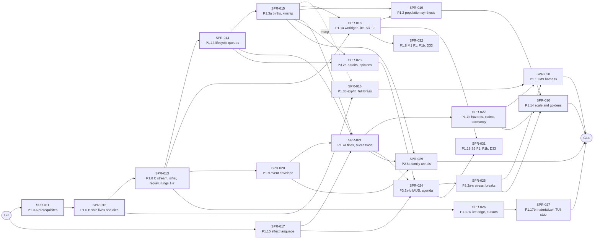

# PRJ-002 — P1a "Bloodlines": sprint plan

> **BLUF:** APPROVED by the director at G0 (D30, 2026-10-16; `docs/decisions_pending.md` D30 to D36); the rulings of §7 are binding. P1a "Bloodlines" runs as 20 sprints, SPR-011 to SPR-030, each at most about 3 agent-days; SPR-031 and SPR-032 moved to P1b (D33) and keep their numbers. The critical path is the dynasty chain: walking skeleton (SPR-011–013) → lifecycle queues (014) → births (015) → M7 (021–022) → the scale run (030) → G1a. Effect language, the event envelope, stream v1 and minds run beside it in two more lanes. 15 of the 20 sprints are C3, so the binding limit is the one-C3-at-a-time merge rule, not agent time. Most of the specs these sprints need do not exist yet; `M7.dynasty` and `T1.minds` are frozen on `main` (D36, PR #32), and the two others that exist (the M2 rung-0 slice, the chronicle schema) have gaps (§6). Section 2 replaces BCK-001 §2; sections 3–9 support it. §10 marks the inconsistencies the G0 rulings resolve; the Architect corrects the others that are within the Architect's authority.

## 1. How to read this

- **Class** is the class this plan expects; CI's detection wins (`docs/13` §4.2).
- **Priority** follows GOV-007 §4: P1 blocks G1a; P2 is needed in P1a but does not block the gate; P3 is proposed for a later phase.
- **Specs** name each spec the sprint needs and say whether it exists today on `main`.
- Numbering follows the rulings of §7, approved at G0 (D30): P1.0 runs as three sprints, SPR-011 to SPR-013 (SPR-011 ruling 1).

## 2. Next phase: P1a "Bloodlines" (replaces BCK-001 §2; approved at G0, D30)

Goal (ADR-0035): a dynasty lives, dies and inherits deterministically, and the templated chronicle reads as a family history (G1a). Rungs 0–2 (`solo`, `household`, `hamlet`) and a dynastic fixture world.

| Sprint | WP (`docs/11`) | Title | Depends on | Class | Specs needed (status) | Priority |
|---|---|---|---|---|---|---|
| SPR-011 | P1.0 (A) | Walking skeleton A: engine prerequisites. Engine-purity lint (A-14); a 32-bit probability type and keyed uniform draws (A-21); epoch-keyed draws (A-29); ledger rows and the life-course log; authored numbers into plane A | G0; SPR-007, SPR-008 merged | C3 (machinery; regenerates the `smoke` baseline) | `05.1` §2, §6 (exist; Prob32 in v1.8 §6); `05.5` §3.2 (exists); `CODEX/05_PROJECT/SPR-011_WalkingSkeleton.md` (issued) | P1 |
| SPR-012 | P1.0 (B) | Walking skeleton B: `solo` lives and dies. M2 schedule in fixed point, `rh-worldgen` stub, `rh-sys-demography` rung-0 slice, `rh-cli run`, the `solo` golden ladder | SPR-011 | C3 (first real system crate; first real golden world) | M2 rung-0 slice (frozen 0.2.0, PR #37); Registry `DEATH`, `EXTINCTION`, verb `tellability`, system `defaults` (exist, PR #37); `solo.yaml` (exists); `SPR-012_WalkingSkeletonB.md` (issued) | P1 |
| SPR-013 | P1.0 (C) | Walking skeleton C: World Stream v0 and the Parquet chronicle (`rh-stream`), `rh-cli tail`, the `life_ends` pattern and its twin (`rh-sifter` v0), journal replay, rungs 1–2 on the same binary | SPR-012; A-06 | C3 (stream format; two new golden worlds) | `schema.sql` (exists; EventId fixed, roles to P1.9); channel-A segment DDL (exists, PR #37); channel-C DDL (missing); `life_ends` (exists, PR #37); `household.yaml`, `hamlet.yaml` (exist, PR #37); `SPR-013_WalkingSkeletonC.md` (issued) | P1 |
| SPR-014 | P1.13 | Lifecycle queues for P1a: same-instant delivery of a command to its owner at a later phase; M2's Day/`Vital` drain of `ScheduleDeath` and `Marry` (REV-P1a MAJ-4); ledger row inserts for births; dead-person drop (A-30); queue-age invariant (A-31); the absent-owner registration rule: `rh-core` drops a declared read or send whose owner is not registered, reports it, and gives the step view the coupling's neutral value, so specs declare every read unconditionally (REV-P1a NEW-4); the value comes from the `neutral` on the spec's `[[reads]]` entry, a spec prerequisite of SPR-017 (§6); readers of `life_course.*` read it `same_instant`, not `lagged` (in `Vital` the scheduler orders M2 before T1; M7 reads in `Polity`), and SPR-015's births write `life_course.birth_tick` and `life_course.sex` at entry (REV-P1a NEW-6, NEW-7; D36); the `rh-core` merge rewrites event-typed command payload fields (`cause_event`, `source_event`) as it rewrites `Command::cause` (REV-SPR-017 N3); `rh-contracts` v0 for M2's columns | SPR-013 | C3 (scheduler semantics) with C2 (contract crate) | `05.1` §2 rule 2 (exists; same-instant delivery, the absent-owner rule and the payload rewrite unstated: one EVO for all three) | P1 |
| SPR-015 | P1.3 (a) | M2 F1 births: age-specific fertility, partnering (fathers), households and kinship (each birth appends its life-course row with `mother` and `father`, the genealogy every kinship relation walks), `H64(mother, parity)` ids at runtime, marriage intervals | SPR-014 | C3 | M2 F1 births, partnering, households (missing; spec is the rung-0 slice); fertility schedule source (missing); ADR-0026 (exists) | P1 |
| SPR-016 | P1.3 (b) | M2 F1 mortality: fixed-point `exp` and `ln`, Brass at any (α, β), infant sub-schedule and old-age tail, density modifier (entitlement hook stubbed) | SPR-012 (code); merges after SPR-015 | C3 (machinery and model) | M2 F1 mortality (missing); `exp`/`ln` ruling and reference (missing); `specs/demography/` (exists) | P1 |
| SPR-017 | P1.15 | Registry effect language v0: the typed, total evaluator in `rh-registry`; succession-law eligibility and ordering; the kinship relations `kin(a, b, n)`, ancestors, descendants and the agnatic and cognatic lines, walked over M2's life-course log so they reach through the dead (REV-P1a NEW-1, NEW-3); verb effects as queued commands; golden test | G0 | C2 (Registry schema); no hash change until a system uses it | `05.5` §2.1 (exists, prose); grammar and golden cases (missing); `neutral` on `[[reads]]` (missing; §6) | P1 |
| SPR-018 | P1.1a + S3 F0 | Worldgen-lite: regions, a few settlements, routes and the region graph from a heightmap template; `S3.migration` F0 (residence at genesis and birth, no moves); bench 4 baseline | SPR-013; SPR-015 for residence at birth | C3 (genesis changes every rung's golden) | `M1.regions` F0 (missing); worldgen-lite (missing); `S3.migration` F0 (missing); Registry heightmap templates (exist) | P1 |
| SPR-019 | P1.2 | Population synthesis: IPF from manifest marginals; founders with pre-epoch births and genealogical kin; great houses with 3-generation genealogies. For a dynastic world, `rh-worldgen` back-fills pre-epoch history: life-course rows with parent links for each dynasty's ancestors, back to the manifest's dynasty `generations`, and tenure rows for each title's past holders. The effect language's title-blood rule assumes this precondition (REV-SPR-017 N5) | SPR-015, SPR-018 | C3 | population synthesis, with the dynastic back-fill (missing); `M7.dynasty` houses, titles and the tenure log (frozen 0.3.1, D36) | P1 |
| SPR-020 | P1.9 | Event envelope and Chronicle Writer: `EventDraft` roles, anchored snapshots, typed and motive edges; `event_role`, `event_snapshot`, `causal_edge` tables; DuckDB views; provenance of change; typed `[event_roles]` and `[motive_edges]` (A-24, part) | SPR-013 | C2 (event schema) with C3 (the event-log hash is in `state_hash`) | `05.2` §4.1a (exists); `schema.sql` (exists; role codes conflict with the Registry) | P1 |
| SPR-021 | P1.7 (a) | M7 F1: titles, succession law, immediate succession (V-SAGA-19), titles inherited through the death path | SPR-014, SPR-015, SPR-017, SPR-020 | C3 | `M7.dynasty` (missing; drafting) | P1 |
| SPR-022 | P1.7 (b) | M7 F1: ruler-exit hazards at the reference institutional state, feud stock after a regicide, claims, regencies, great-house dormancy (SIM-9) | SPR-021 | C3 | `M7.dynasty` (missing) | P1 |
| SPR-023 | P3.2a (a) | Minds v0: named actors promoted by simulation criteria; HEXACO traits, ambition, relationships, opinion modifiers; `rh-minds` | SPR-014, SPR-015 | C3 | `T1.minds` (missing; drafting); `bevy_ecs` plane-A review (missing) | P1 |
| SPR-024 | P3.2a (b) | Minds v0: event-driven IAUS for a few decisions, with the Registry's typed `[considerations]` and `[response_curves]` (REV-P1a MAJ-6); same-instant agenda semantics (`05.1` §4.3) | SPR-023, SPR-017, SPR-021 (`seek_office` and `press_claim` send to M7, and the court sets need titles: REV-P1a MAJ-7) | C3 | `T1.minds` (missing) | P1 |
| SPR-025 | P3.2a (c) | Minds v0: stress and mental breaks (V-SAGA-16); typed break table (A-24, part); grief damping and refractory period (red-team item 1) | SPR-024 | C3 | `T1.minds` (missing); `[mental_breaks]` typed (A-24) | P1 |
| SPR-026 | P1.17 (a) | World Stream v1: live edge over a local socket, viewer cursors, `stream.subscribe` / `stream.status`, catch-up from sealed segments, channel C live | SPR-013 | C2 (IF-0); channel A unchanged | `05.10`, `05.9` IF-0 (exist, prose); wire format, `rh-protocol` (missing) | P1 |
| SPR-027 | P1.17 (b) | World Stream v1: the materializer (V-STR-02), the pace command, `tail` filters and the regional digest, the Textual TUI stub | SPR-026 | C2 / C1 | `05.10` (exists) | P1 |
| SPR-028 | P1.10 | M9 harness v0: isolation harness (V-SF-22) for M2, M7, `T1.minds`; demography and dynasty bands; censoring-aware lifespans; 32-seed ensembles; the run report; coverage gates (A-15) | SPR-016, SPR-022, SPR-025 | C1 (tools) | `09` §3.1 (exists); `[isolation]` of M7 and T1 (missing with their specs) | P1 |
| SPR-029 | P2.8a | Family annals v0: templates for births, marriages, deaths, successions, claims and feuds, with provenance links (plane C, `python/`) | SPR-015, SPR-020, SPR-021 | C1 | template set (missing); `05.11` (exists) | P1 |
| SPR-030 | P1.14 | Determinism and performance at scale: allocations to budget (A-32), benches 1–3, the dynastic fixture world's goldens, CRN pairing (V-DET-17), the G1a performance run | SPR-019, SPR-022, SPR-025 | C1 with C3 (new golden worlds) | dynastic fixture and 10k dynastic manifests (missing); `08` §9 (exists) | P1 |
| SPR-031 | P1.18 | **Moved to P1b (D33).** `S5.daily_life` F1: virtual telemetry, `rh-cli where` / `who`, `DECISION_TRACE`; exact lags (A-28) | SPR-018, SPR-024 | C3 (lags) with C2 | `S5.daily_life` (draft); its reads of `person.residence` (S3), `person.occupation` (M4), `region.conditions` (M6) have no owner in P1a | P3: in P1b (D33; ruling M-4) |
| SPR-032 | P1.8 | **Moved to P1b (D33).** M1 Regions F1: route modes and costs, settlement growth | SPR-018 | C3 | `M1.regions` F1 (missing) | P3: in P1b (D33; ruling M-5) |

**Out of P1a:** P1.4 and P1.5a (M3, M4: P1b in `docs/11`, although the old §2 listed "household food for `solo`" here; SPR-011 ruling 2, D31); P1.8 and P1.18 (P1b, D33: SPR-032 and SPR-031 keep their rows above); P1.11 (P1b); P1.16 (P1b).

## 3. Dependency graph

The heavy-bordered nodes are the critical path.

## 4. Recommended order

Three development lanes. The director set 3–4 active agent sessions as the normal limit (decisions log, G0 rulings) and relaxes it when the usage limit allows. At most one C3 PR is open for merge at a time (GOV-005 §4.1), so lanes are arranged so that their C3 merges interleave.

| Wave | Lane 1 (critical path) | Lane 2 | Lane 3 | Why |
|---|---|---|---|---|
| 0 (Architect, before P1a) | M2 rung-0 freeze; Registry deltas; probability ruling | `M7.dynasty`, `T1.minds` (A-17, drafting) | A-06 manifests; segment DDL; `life_ends` | No code without a spec (GOV-005 §2). The skeleton's specs block the first week; M7 and T1 block the second half |
| 1 | SPR-011 | SPR-017 | — | The skeleton is the critical path. The effect language depends only on P0 and is C2, so it merges between C3s |
| 2 | SPR-012 | SPR-017 (cont.) | SPR-016's `exp`/`ln` task | `exp`/`ln` is machinery with no consumer yet; starting it early takes it off the path |
| 3 | SPR-013 | — | — | Every later sprint keeps this loop green (`docs/11` build strategy 5), so nothing else system-level starts before it merges |
| 4 | SPR-014 | SPR-020 | SPR-026 | The envelope and the live edge need only the skeleton's stream; both are C2 and merge around SPR-014's C3 |
| 5 | SPR-015 | SPR-016 | SPR-027 | Births unblock M7, minds, population synthesis and residence |
| 6 | SPR-021 | SPR-023 | SPR-018 | M7 needs births, delivery, the effect language and roles. Minds start as soon as there are relatives to have opinions about |
| 7 | SPR-022 | SPR-024 | SPR-019 | Population synthesis needs settlements and houses, and feeds the dynastic world |
| 8 | SPR-030 (prep: A-32, benches) | SPR-025 | SPR-029 | Annals need successions and the envelope; A-32 is hash-neutral (C1) and can start before the goldens |
| 9 | SPR-030 (goldens, G1a runs) | SPR-028 | — | The harness and the scale run read everything the systems produce, so they come last |
| P1b | SPR-031, SPR-032 (D33) | — | — | Not on the G1a path (rulings M-4, M-5) |

## 5. What each sprint gives Gate G1a

The G1a list is one list, the same in `docs/11` and `docs/09` §5, with P1a variants for tests that need systems or worlds P1a does not build (D34; ruling M-7).

| G1a criterion (`docs/11`) | Tests | Delivered by |
|---|---|---|
| Determinism on `smoke`, rungs 0–2 and a dynastic fixture world | V-DET-01, V-DET-02, V-DET-12 | SPR-011–013 (rungs 0–2); SPR-030 (fixture) |
| Invariants over a 1,000-year soak | V-INV-01, -02, -03, -11, -12 | SPR-012, SPR-013 (01, 02, 11); SPR-021 (03, with succession); SPR-019, SPR-022 (12); 03 and 12 in their P1a variants (D34) |
| Identity and life course | V-DATA-04 (P1a variant, D34), V-DATA-05 | SPR-012 (founders); SPR-015 (births); SPR-018 (residence) |
| CRN pairing | V-DET-17 | SPR-030 |
| Demography bands | V-SF-01, V-SF-02, V-SF-02b | SPR-016 with SPR-028 |
| Isolation | V-SF-22 for M2, M7, `T1.minds` | SPR-028 |
| Minds | V-COG-03, V-COG-04 | SPR-024 |
| Succession | V-SF-06, V-SF-06b reported; V-SAGA-19 | SPR-022 with SPR-028; SPR-021 |
| Stream | V-STR-01–03, V-STR-05, V-PERF-09 | SPR-013 (01); SPR-026 (03, 05); SPR-027 (02); SPR-030 (V-PERF-09, P1a variant: D34) |
| Envelope and stress | V-SAGA-15 (P1a variant: the 10k dynastic world, 100 years); V-SAGA-16's stress-accounting identity (its break band is reported at G1a and gates G1b: D34); V-SAGA-16b, no runaway grief chain on the isolation fixture court | SPR-020; SPR-025 |
| Performance: 10k persons, ≤ 500 named actors, 1,000 years in ≤ 60 s on 8 cores | (G1a default) | SPR-030 |
| [H] the family history of 3 seeds | — | SPR-029, then the director |

## 6. Specs to write before their sprints (replaces BCK-001 §3 for P1a)

| Spec | Needed by | Status today |
|---|---|---|
| `M2.demography` rung-0 completion and freeze; Registry verbs, verb `tellability`, system `defaults`; probability-type ruling | SPR-011, SPR-012 | M2 draft (gaps listed in SPR-011); the rest missing |
| Channel-A segment DDL (`specs/stream/channel_a_v0.sql`); `life_ends`; `household.yaml`, `hamlet.yaml` (A-06) | SPR-013 | Missing |
| Channel C segment DDL (`specs/stream/channel_c_v0.sql`) (PR #37 Q10) | SPR-013 | Missing |
| EVO: same-instant command delivery, the absent-owner registration rule, and the merge's rewrite of event-typed payload fields (`05.1` §2 rule 2; REV-P1a NEW-4; D36) | SPR-014 | EVO-001, PR #49 (round 2; D39 pending): `05.1` v1.10 applied with it. SPR-014's acceptance gains "the smoke ladder is unchanged" (REV-EVO-001 R1) |
| M2 F1: fertility, partnering, households, kinship | SPR-015 | Missing |
| M2 F1 mortality (infant sub-schedule, old-age tail, density modifier); fixed-point `exp`/`ln` ruling and reference | SPR-016 | Missing |
| Effect-language grammar and golden cases, with the kinship relations (REV-P1a NEW-3) | SPR-017 | Drafting (`05.5` §2.1 is prose) |
| `neutral` on `[[reads]]` in `lint_odd.py`'s schema and in M7's and T1's foreign reads: the effect language's loader needs it, and SPR-014's absent-owner rule supplies it (D36) | SPR-017 | PR #49 (EVO-001): `required` on every foreign read, `neutral` on the rate and mode reads of absent owners, enum codes on `[[owns]]`, typed `[[applies]]` with `drained_by` and `key`; M7 0.3.2, T1 0.3.2, M2 0.2.1 |
| `M1.regions` (F0 graph; F1 routes); worldgen-lite; `S3.migration` F0 | SPR-018; SPR-032 (P1b, D33) | Missing |
| Population synthesis, with the dynastic back-fill: pre-epoch life-course rows with parent links back to each dynasty's `generations`, and tenure rows for each title's past holders (REV-SPR-017 N5) | SPR-019 | Missing |
| Role codes reconciled (`schema.sql` vs `[event_roles]`) | SPR-020 | Conflict |
| `M7.dynasty` (with immediate succession, `[isolation]`, `title.holder`, seats and vocations from red-team item 12) | SPR-019, SPR-021, SPR-022 | Frozen 0.3.1 on `main` (D36; PR #32, `c41de52`); 0.3.2 in PR #49 (EVO-001: `required`, `neutral`, enum codes, typed `[[applies]]`, the `Day`/`Vital` murder timer) |
| `T1.minds` (with the commands it accepts, stress and breaks, grief damping from red-team item 1, practices from item 10a evaluated) | SPR-023–025 | Frozen 0.3.1 on `main` (D36; PR #32, `c41de52`); 0.3.2 in PR #49 (EVO-001: `required`, `neutral`, enum codes, typed `[[applies]]`, undated `Marry` and `ScheduleDeath`) |
| Stream v1 wire format (`rh-protocol`) | SPR-026 | Missing |
| Family-annals template set | SPR-029 | Missing |
| Dynastic fixture world; 10k dynastic manifest (extend A-06) | SPR-030 | Missing |
| Owners or neutral stand-ins for S5's reads | SPR-031 (P1b, D33) | Missing |
| `M3.agriculture`, `M4.economy`, `M6.polity`, `S6`/`S7` freeze | P1b | M3, M4, M6 missing; S6, S7 drafts |

## 7. Architect rulings for the map

Approved with the plan at G0 (D30, 2026-10-16) and binding. The director decided the ones that change the roadmap: M-1 (D30), M-4 and M-5 (D33), M-7 (D34) and M-8 (D35).

| # | Ruling | Confidence |
|---|---|---|
| M-1 | **Approved (D30).** P1.0 runs as three sprints (SPR-011 ruling 1) | 70% |
| M-2 | P1.3 splits into births (SPR-015) and mortality with fixed-point `exp`/`ln` (SPR-016): two different specs and one is machinery | 75% |
| M-3 | P1.7 splits into two sprints and P3.2a into three, along their spec sections; each half is still about 3 agent-days | 70% |
| M-4 | **Approved (D33).** P1.18 (S5 F1) moves to P1b. Its reads of `person.occupation` (M4) and `region.conditions` (M6) have no owner in P1a, so S5 F1 would run on neutral values only (registration reports an unowned read and refuses only sends: REV-P1a MAJ-2). G1a does not gate V-STR-07, and ADR-0031 had placed it in P1b. A director decision: it changes `docs/11` | 70% |
| M-5 | **Approved (D33).** P1.8 (M1 F1) moves to P1b with fugitives, its first consumer. P1a needs only M1 F0, inside worldgen-lite | 60% |
| M-6 | `S3.migration` F0 (residence at genesis and at birth, no moves) enters P1a inside SPR-018, so V-DATA-04 has residence intervals at G1a | 65% |
| M-7 | **Approved (D34).** G1a's tests are made runnable before P1a starts (`docs/11`: numbers before the phase). V-INV-12 runs on the dynastic fixture world, not `val_khor` (optional under ADR-0035). V-DATA-04 at G1a checks identity, parents, death and residence; occupation waits for M4 (P1b). V-INV-03 at G1a kills through M2, M7 and agenda actions; M5 and M8 are P4. V-PERF-09 gets a P1a variant: the 10k dynastic world, `rh-cli tail`, the TUI stub and a stalled consumer, with no hydration bubble and no 100k world. V-SAGA-16: its stress-accounting identity gates G1a, and its break band (0.5–5 per 100 named-actor-years, declared on the kingdom ensemble) is reported at G1a and gates G1b (REV-P1a MAJ-8). V-SAGA-15 at G1a measures its stored bytes on SPR-030's 10k dynastic world for 100 years, not on a kingdom run. The G1a lists of `docs/11` and `docs/09` §5 become one list. A director decision | 75% |
| M-8 | **Approved (D35).** Inheritance in P1a is titles and claims only. Property inheritance waits for M4 F0 holdings (P1b), although P1.7's text says "titles and property" | 70% |
| M-9 | The rung-1 and rung-2 manifests are BCK-002 A-06 (Architect), not P1.11, which is a P1b WP | 85% |
| M-10 | BCK-002 A-15 (coverage gates, owned by no sprint since SPR-002) joins SPR-028, the P1a tools sprint | 60% |

## 8. P0 carry-forwards (BCK-002) and where they land

| Item | Lands in |
|---|---|
| A-14 engine-purity lint | SPR-011 T-00 |
| A-21 `UniformDraw` for `RngStream` | SPR-011 T-01 |
| A-29 epoch-keyed draws | SPR-011 T-02 |
| A-30 dead-person command drop; A-31 queue-age invariant | SPR-014 (P1.0's M2 sends no lifecycle command, SPR-011 ruling 6; the smoke world does: `Settle` from X3, X5 and X7, keyed by the person who just died in X3's case, and `Audit` from X4, all `key = "any"`, so they keep flowing and the smoke ladder is unchanged: REV-EVO-001 R1) |
| A-28 exact lags | P1b: SPR-031 (S5, D33), before S6 and S7 |
| A-32 allocations to budget | SPR-030, before benches 1 and 2 |
| A-24 typed saga vocabularies | SPR-020 (`event_roles`, `motive_edges`); SPR-025 (`mental_breaks`); P1b for the rest |
| A-22 `f32_field` rule | Not due if worldgen-lite keeps `u16` elevations (red-team item 11); otherwise SPR-018 |
| A-15 coverage gates | SPR-028 (ruling M-10) |
| A-06 rung manifests; dynastic fixture and 10k manifests | Architect, before SPR-013 and SPR-030 |
| A-17 `T1.minds`, `M7.dynasty` | Architect, before SPR-019, SPR-021, SPR-023 |
| A-04 sealed held-out bands | Before P1b tuning; not P1a |
| A-19, A-23, A-25, A-26 | Not P1a (A-23 only if a hand-written manifest hits it) |
| Bench 4 baseline (G0 ruling) | SPR-018, the first sprint that builds a raster |

## 9. Load on the director

- **Plan approvals:** 18 of the 20 P1a sprints are C2 or C3, so the director approves their plans (GOV-005 §2). At ≤ 15 minutes each over 10–14 weeks, that is about 0.3–0.5 h a week, inside the 6 h budget.
- **Golden-corpus announcements** (veto possible): SPR-011 (`smoke`), SPR-012, SPR-013, SPR-015, SPR-016, SPR-018, SPR-019, SPR-020, SPR-021–SPR-025, SPR-030.
- **Roadmap decisions** before P1a starts: made at G0 (D30 to D36, 2026-10-16).
- **Rating:** the G1a read of 3 seeds (about 2–4 h), plus rung checkpoints of 15–30 minutes when `solo`, `household`, `hamlet` and the dynastic world first run green (GOV-007 §3.5).
- **The real constraint** is serial C3 merging: about 15 C3 merges in 10–14 weeks is 1.1–1.5 a week, each after a Tester pass and an audit. Any C3 sprint that slips delays the lane behind it.

## 10. Inconsistencies found in the existing documents

| # | Where | What |
|---|---|---|
| 1 | `05.2` §1, `05.9` IF-1, `schema.sql`, `specs/chronicle/selftest.py` vs `rh-events` (SPR-006) | **Resolved** (`ab0b2b1`, on `main`). Docs say `EventId = (day_index << 24) \| seq_in_day`; the code uses one counter per timeline. `05.9` IF-1 also has `ctx.emit` return an `EventId`; since SPR-006 a step gets a `DraftRef` and ids are assigned at the merge (`05.1` v1.6) |
| 2 | `schema.sql` `event_role.concrete_role` vs Registry `[event_roles]` | Initiator, target, partner, bystander, instrument vs actor, target, witness, instrument |
| 3 | `schema.sql` `regional_aggregate.value DOUBLE` | **Resolved** (`80c6f7d`, on `main`). A float column in a plane-A table, against "floats in plane A live in `rh-sample` only" |
| 4 | `M2.demography.odd.toml` vs Registry `[verbs]` | **Resolved by PR #37 when it merges (D36);** S5's `ENCOUNTER` stays a draft warning (SPR-011 ruling 11). M2 emits `DEATH`, which is not a Registry verb; `lint_odd.py` does not check emits against verbs. S5's `ENCOUNTER` has the same gap |
| 5 | `M2.demography.odd.toml` | **Resolved by PR #37 when it merges (D36).** Owns no `person.id` and no `life_course.*` although `05.0` §6 gives the life-course log to its crate; `INV-M2-01` (conservation) cites V-DET-01 instead of V-INV-01; `era_state = ["medical_level"]` while "none at rung 0" |
| 6 | Registry `[systems.*]` vs `solo.yaml` | **Resolved by PR #37 when it merges (D36).** Parameters have bounds but no defaults, and `solo` sets none |
| 7 | `docs/11` rung 0 and PRJ-001 §3 vs `05.1` §3 and `docs/11` P1a | **Resolved (D31);** `solo.yaml`'s unbuilt systems by SPR-011 ruling 3. Rung 0 includes "a household's food" and "every minute authoritative", but M3 and M4 are P1b and S5 at `minutes` is Later; `solo.yaml` names M4 F1 and S5 F2, which P1a does not build |
| 8 | BCK-001 §2 (old) vs `docs/11` | **Resolved (D30):** §2 replaces BCK-001 §2. The old §2 lists P1.4 and P1.5a (household food) and "rung 1–2 manifests, P1.11" in P1a; `docs/11` puts P1.4, P1.5a and P1.11 in P1b, and BCK-002 A-06 gives the manifests to the Architect |
| 9 | ADR-0028 Consequences; `docs/12` Q12; `docs/09` V-SCALE-01 | **Resolved (D32).** P1.0 at N = 100k (and 1M in V-SCALE-01) predates ADR-0035, which makes 100k and 1M optional and Later |
| 10 | `docs/09` §1.1 | **Resolved (D34).** V-STR cadence says 02, 03 and 05 from P1b; G1a gates them and P1.17 moved to P1a |
| 11 | `docs/09` V-INV-12 | **Resolved (D34):** P1a variant. Method "300 years on `val_khor`", gated at G1a; `val_khor` is optional and Later under ADR-0035 |
| 12 | `docs/09` V-PERF-09 | **Resolved (D34):** P1a variant. Needs a 100k world, `rh-tui` and a hydration bubble; G1a gates it, but none exists in P1a |
| 13 | `docs/09` V-DATA-04, V-INV-03 | **Resolved (D34):** P1a variants. Occupation intervals (M4, P1b) and deaths by M5 and M8 (P4) cannot exist at G1a |
| 14 | `docs/11` G1a vs `docs/09` §5 G1a | **Resolved (D34):** one list in both. The two test lists differed: `09` adds V-SAGA-15 and V-SAGA-16 and omits V-DET-01/02/12, V-INV-01/11, V-DATA-04/05, V-SF-06 |
| 15 | `docs/11` P1.7 | **Resolved (D35).** "Titles and property inherited"; property belongs to M4 (P1b) |
| 16 | `S5.daily_life.odd.toml` vs `docs/11` P1a | **Resolved (D33):** S5 F1 is in P1b. S5 F1 reads M4 and M6 columns, both P1b; registration refuses a read without an owner |
| 17 | Engine-crate lists in `docs/13` §3, `05.0` §6, ADR-0035 §6, BCK-002 A-14, `docs/09` V-INSP-05 | **Resolved** (`e945583`, on `main`). They differ (`rh-sample`, `rh-manifest`, `rh-minds`, `rh-worldgen` are in some and not others); `docs/09` V-INSP-03 also omits `rh-sample`, which `bin/lint_arch.py` allows |
| 18 | GOV-002 tier 9 vs `docs/13` §4.3 | **Resolved** (`d0b1f6c`, this branch: one CI-tier text, from SPR-011 ruling 16). "`solo` on every PR; higher rungs nightly" vs "200 years for the other worlds on PRs" |
| 19 | `docs/09` V-SCALE-04 | **Resolved** (`8fec382`, on `main`). "A journaled end event", but the journal holds inputs only |
| 20 | `05.9` IF-0 channel-A kinds vs `05.10` §4 | No record kind carries the life-course log, yet every birth and death must be in channel A and DATA-5 keeps commoner deaths out of `event` rows |
| 21 | `specs/README.md` | **Resolved** (`a58c243`, on `main`). Calls `uz_job` "reference world 3" and `aethelgard` "reference world 2", which clashes with rung numbering (`uz_job` sits at rung 2) |
| 22 | BCK-001 §1, `VER-G0` | Status lags the branches: BCK-001 does not mark SPR-005 and SPR-006 closed; `VER-G0` says SPR-008 "waits", while its branch has T-00 and T-01 |
