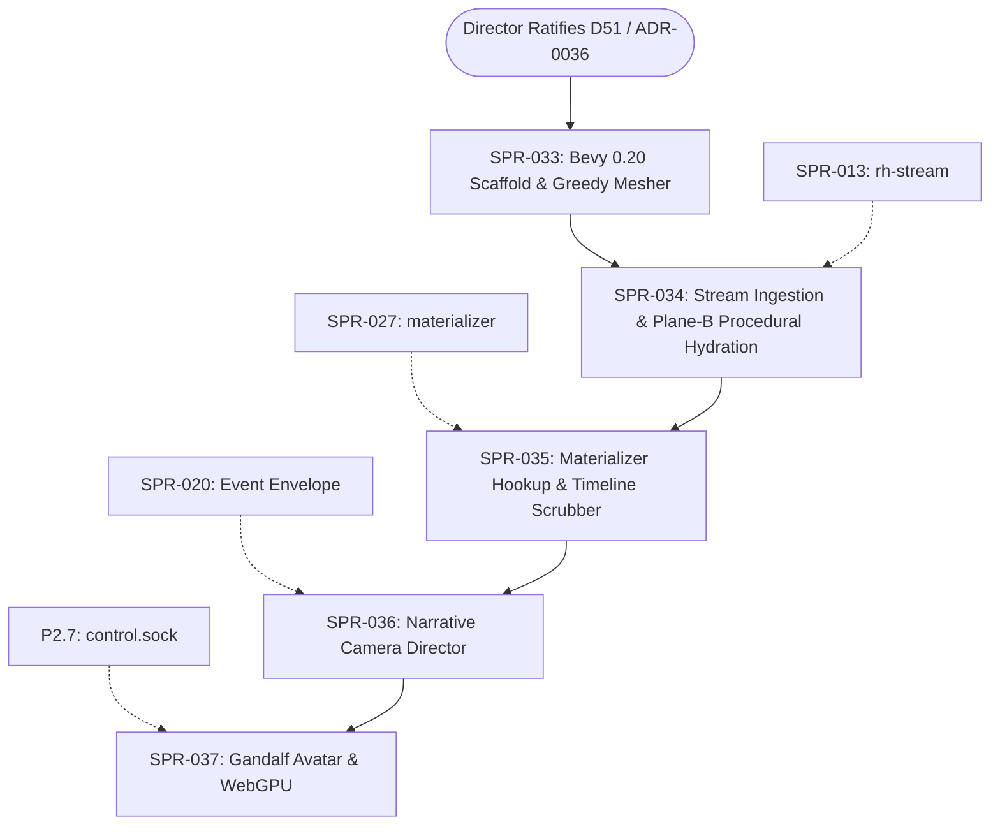

# PRJ-003 — Bevy Native Voxel Viewer (`rh-view`): Project Plan

> **BLUF:** Authored and owned by the Red Team / Developer Tools lane under Director mandate (2026-10-17). Specifies the architecture, scope, and phased implementation for `crates/rh-view`, a native Rust 3D voxel spectator and timeline scrubber built on Bevy 0.20. Operates as a Plane-B procedural hydration harness guided by Plane-C narrative sifting. Connects directly to `rh-protocol`, `rh-stream`, and the SPR-027 materializer via local sockets/pipes. Lives strictly in the Tool plane (`Tool` crate classification); no Plane A simulation crate may ever depend on it. Text-first simulation contracts and G2 thesis gates remain completely unaffected. Submitted for Architect review and D51 / ADR-0036 ratification.

---

## 1. Governance & Division of Ownership

To ensure that core simulation velocity and determinism are never compromised:

| Role | Responsibility |
|---|---|
| **Red Team / Tool Devs** *(This Lane)* | **Primary Owner & Implementer.** Specs, builds, benchmarks, and maintains `crates/rh-view`. Iterates on visual look-dev, voxel meshing shaders, camera controls, and procedural hydration grammars. |
| **Architect** | **Reviewer & System Integrator.** Reviews interface boundaries (`rh-protocol`, socket wire formats). Formally files Decision D51 and drafts ADR-0036. Enforces that no Plane A crate ever imports `rh-view`. |
| **Director** | **Executive Authority.** Ratifys Decision D51, approves visual fidelity milestones, and exercises the timeline scrubber / Gandalf avatar controls. |

---

## 2. Architectural Boundaries & Non-Negotiable Invariants

```
+-----------------------------------------------------------------------------------------+
| PLANE A: AUTHORITATIVE SIMULATION KERNEL (Headless Rust)                                |
| Simulates demographic life-courses, harvest yields, dynastic claims, and wars.          |
| Bitwise deterministic fixed-point math (Q8_8, Q16_16, Q32_32). Zero floats.             |
| Emits binary event stream & Arrow keyframes. ZERO awareness of 3D or rendering.         |
+-----------------------------------------------------------------------------------------+
                                             │
                                             ▼ Read-Only Unix Socket / Arrow IPC
+-----------------------------------------------------------------------------------------+
| PLANE B: PROCEDURAL VOXEL HYDRATION (`crates/rh-view::hydrate`)                         |
| Computes 3D geometry deterministically: Voxel(x,y,z) = G(Seed, State, Era).             |
| Hydrates bare simulation records (settlement_id, seed, era, pop) into timber, thatch,   |
| stone keeps, roads, chimney smoke particles, and villager visual walk-paths.            |
| Rewinding to Year 1342 deterministically reproduces the exact same village diorama.      |
+-----------------------------------------------------------------------------------------+
                                             ▲
                                             │ Camera Steering
+-----------------------------------------------------------------------------------------+
| PLANE C: NARRATIVE CAMERA DIRECTOR (`crates/rh-view::director`)                         |
| Reads causal sifter events from `rh-sifter`. Directs viewport orbit and zoom to focus   |
| automatically on climax moments (assassinations, sieges, coronations, riots).          |
+-----------------------------------------------------------------------------------------+
```

### The Invariants:
1. **Zero Impact on Plane A Tick Rate (V-PERF-09):** `rh-view` runs in a separate native OS process. If `rh-view` crashes, drops frames, or encounters a GPU driver timeout, Plane A does not stall for even a single nanosecond.
2. **Deterministic Geometry:** Given the same `world_seed`, `settlement_id`, and `simulation_tick`, Plane B hydration generates bitwise identical voxel meshes across different machines and runs.
3. **Strict One-Way Dependency:** `crates/rh-view` may depend on `rh-protocol`, `rh-stream`, `rh-worldgen`, and `rh-snapshot`. **No crate in `crates/rh-*` may ever depend on `rh-view`.** The architectural lint in `bin/check_all.sh` enforces this.
4. **Text-First Primary Gate Preserved:** G1a, G1b, and G2 gates remain text-verified. `rh-view` is an external inspection and presentation harness, not a gate blocker for the simulation core.

---

## 3. Technical Stack & Voxel Engine Specifications

| Component | Technical Choice | Rationale |
|---|---|---|
| **Engine Framework** | **Bevy 0.20 (Rust)** | Native Rust ecosystem compatibility; pins same `bevy_ecs 0.20` already in repo; zero FFI overhead; GPU-driven mesh rendering and atmospheric scattering. |
| **Graphics API** | **WGPU (Vulkan / Metal / DX12 / WebGPU)** | Universal cross-platform native rendering with built-in path to browser WebAssembly/WebGPU deployment. |
| **Meshing Algorithm** | **Binary Greedy Meshing** | Merges co-planar adjacent voxel faces into single quads via bitwise integer math. Drops quad count by 85–92% compared to naive voxels, guaranteeing >60 FPS on integrated GPUs. |
| **Chunk Architecture** | **64×64×32 Diorama Bubbles** | Focuses high-density voxel detail within the camera's local observation bubble. Outer terrain rendered as low-poly heightfield meshes under ADR-0031 (Fidelity by Zoom). |
| **Stream Ingestion** | **Direct Unix Domain Socket (`rh-stream`)** | Reads length-delimited binary event records and keyframe chunks directly from the local filesystem with sub-millisecond latency. |
| **Timeline Replay** | **`materializer` (SPR-027)** | Queries nearest Arrow IPC keyframe (every 10 sim-years) and replays forward journal entries to scrub instantly to any requested tick. |
| **Gandalf Avatar Hook** | **`control.sock` (P2 Integration)** | Encodes user keyboard/mouse movement into `PlayerAction` envelopes sent to the simulation live edge. Minds system (`T1.minds`) handles NPC reactions. |

---

## 4. Phased Sprint Roadmap (Off-Critical-Path)

Work runs in a dedicated Tool lane that does not contend with the core simulation merge queue (PRJ-002):

| Sprint | Phase | Title | Scope & Deliverables | Class | Prerequisite |
|---|---|---|---|---|---|
| **SPR-033** | P1a-Tool | **Bevy 0.20 Scaffold & Binary Greedy Mesher** | Create `crates/rh-view`; initialize Bevy 0.20 app; implement binary greedy chunk mesher; bench 60 FPS on 64×64×32 chunk; orbital camera controller. | C1 (Tool) | Ratification of D51 |
| **SPR-034** | P1a-Tool | **Stream Ingestion & Plane-B Procedural Hydration** | Wire Unix socket reader to `rh-stream`; implement deterministic building grammar (Tudor houses, stone towers, church, roads); hydrate from settlement seed. | C1 (Tool) | SPR-033, SPR-013 (`rh-stream`) |
| **SPR-035** | P1a-Tool | **Materializer Hookup & 60 FPS Timeline Scrubber** | Integrate with SPR-027 `materializer`; implement GUI timeline scrubber; jump to keyframes and replay forward; instant visual reconstruction. | C1 (Tool) | SPR-034, SPR-027 (`materializer`) |
| **SPR-036** | P2-Tool | **Narrative Camera Director & Sifter Binding** | Ingest Plane C causal sifter events; automated camera cinematic framing on drama nodes (coronations, deaths, battles); particle effects (smoke, fire). | C1 (Tool) | SPR-035, SPR-020 (Event Envelope) |
| **SPR-037** | P2-Tool | **Avatar Embodiment ("Being Gandalf") & WebGPU** | Ingest WASD/mouse inputs as `PlayerAction` over `control.sock`; first-person street-level walk; compile `rh-view` to WebGPU target. | C1 (Tool) | SPR-036, P2.7 (`control.sock`) |

---

## 5. Verification & Acceptance Criteria

Every sprint in PRJ-003 must pass strict acceptance testing prior to merging:

1. **V-VIEW-01 (Engine Non-Interference):** Running `rh-view` connected to `rh-stream` must result in $\le 0.5\%$ delta in Plane A simulation tick rate compared to headless execution.
2. **V-VIEW-02 (Bitwise Visual Parity):** Given identical `(world_seed, tick, camera_coord)`, the generated vertex and index buffers must produce an identical SHA-256 hash across repeated runs.
3. **V-VIEW-03 (Performance Floor):** Render loop must maintain $\ge 60\text{ FPS}$ on a standard 4-core developer machine (ThinkPad P51 baseline) for a 64×64 diorama with 50 active animated actors.
4. **V-VIEW-04 (Zero Reverse Dependencies):** `cargo check --workspace` must pass with `#![deny(unsafe_code)]` and zero references to `bevy` or `rh-view` in any Plane A crate.
5. **V-VIEW-05 (Timeline Scrub Latency):** Scrubbing backward 20 simulation years and reconstructing the diorama via the materializer must complete in $\le 250\text{ ms}$.

---

## 6. Dependency Graph



---

## 7. Submission for Architect Review

This plan is formally submitted to the Architect with the following affirmations:
1. **Zero Critical-Path Blockers:** This project operates entirely in the Tool plane and does not gate Gate G1a or G2.
2. **Zero Core Contamination:** No changes are requested to Plane A contracts, fixed-point math, or state hashing.
3. **Ready for ADR-0036:** The Red Team requests the Architect file Decision D51 with the drafted ADR-0036 based on this specification.
