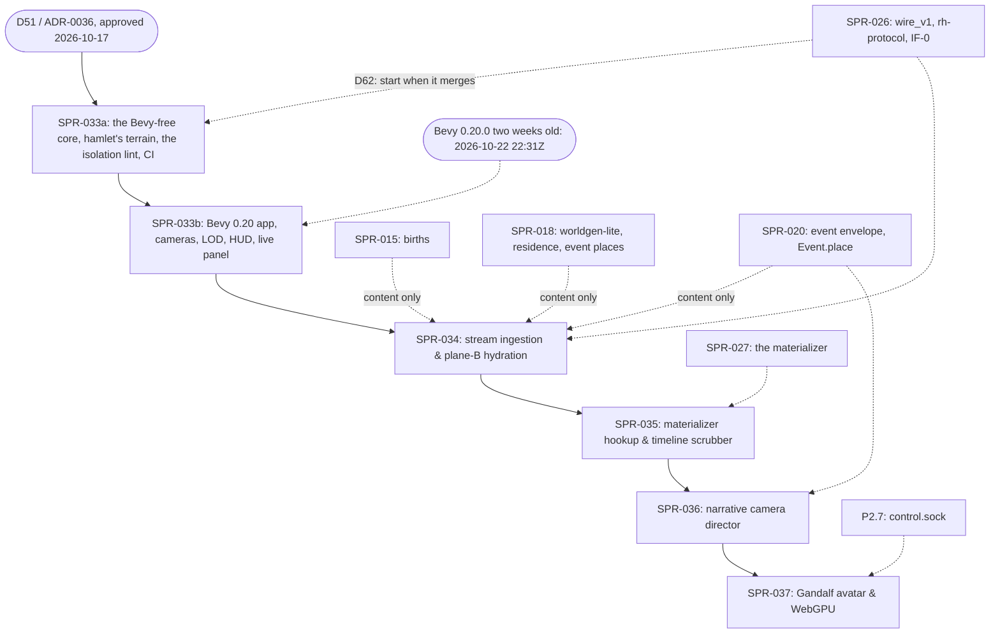

# PRJ-003 — Bevy Native Voxel Viewer (`rh-view`): Project Plan

> **BLUF:**
> - **What it is.** The Red Team wrote this plan under the director's mandate (D51, 2026-10-17). It is the execution plan for `rh-view`, a native Rust 3D voxel spectator and timeline scrubber built on Bevy 0.20. AGT-002-TOOLS implements it.
> - **Why.** It is the Red Team's and the director's **visual testing and observability harness**. Text logs alone leave external auditors blind to spatial layouts, demographic emergence and dynastic drama. We need to see the simulation to test it.
> - **How it connects.** `rh-view` reads the World Stream (IF-0, `specs/stream/wire_v1.md`, through `rh-protocol`), sealed segments (through `rh-stream`'s reader) and SPR-027's materializer.
> - **Where it lives.** In the tool plane, in its own Cargo workspace (`viewer/`). No engine crate may depend on it.
> - **What it does not touch.** The text-first simulation contracts and the G2 thesis gate.
> - **Priority (D62, 2026-10-18).** The viewer lane is the director's priority 2, behind the engine core (P1a, P1b). SPR-033's first stage, SPR-033a, starts when SPR-026 merges; SPR-035's scrubber waits for SPR-027. Priority 1 wins every contention for CI minutes, caches, review time and merge slots.
> - **Decision.** ADR-0036 (D51, approved 2026-10-17) governs this plan. v1.2.0 aligns v1.1.0 with ADR-0036; the Architect's changes are listed in §8.

---

## 1. Governance & Division of Ownership

To ensure that core simulation velocity and determinism are never compromised:

| Role | Responsibility |
|---|---|
| **Developer (`AGT-002-TOOLS`)** | **Primary implementer.** Writes the Rust code for `viewer/rh-view`: the binary greedy chunk mesher, the Bevy 0.20 render pipelines, and the stream reader over `rh-protocol` and `rh-stream` |
| **Architect (`AGT-001`)** | **System integrator and gatekeeper.** Reviews the interface boundaries (`rh-protocol`, the socket wire formats), issues the sprints into the merge pipeline, and enforces that no engine crate imports `rh-view`. D51 and ADR-0036 are filed |
| **Tester (AGT-003, a session on a different model from the Developer's)** | **Independent verification** of each sprint (`VER-SPR-0NN-TEST`), as for every sprint |
| **Red Team** | **Requirements author and quality auditor.** Defined `PRJ-003` and `SPR-033`. Audits visual fidelity, tests non-interference and timeline scrub latency, and uses the diorama viewer as the primary visual inspection harness for demographic and spatial emergence. Under ADR-0036 §4, a visual finding is closed only by an automated check that reproduces it |
| **Director** | **Executive authority.** Ratified D51. Approves visual fidelity milestones, and uses the timeline scrubber and, from P2, the Gandalf avatar controls |

---

## 2. Architectural Boundaries & Non-Negotiable Invariants

```
+-----------------------------------------------------------------------------------------+
| PLANE A: AUTHORITATIVE SIMULATION KERNEL (Headless Rust)                                |
| Simulates demographic life-courses, harvest yields, dynastic claims, and wars.          |
| Bitwise deterministic fixed-point math (Q8_8, Q16_16, Q32_32). Zero floats.             |
| Emits the World Stream (channel A) and Arrow keyframes. ZERO awareness of rendering.    |
+-----------------------------------------------------------------------------------------+
                                             │
                                             ▼ Read-only: IF-0 live edge (wire_v1), sealed segments, materializer
+-----------------------------------------------------------------------------------------+
| PLANE B: PROCEDURAL VOXEL HYDRATION (`viewer/rh-view::hydrate`)                         |
| Computes 3D geometry deterministically: Voxel(x,y,z) = G(Seed, State, Era, version).    |
| Hydrates bare simulation records (settlement_id, seed, era, pop) into timber, thatch,   |
| stone keeps, roads, chimney smoke particles, and villager visual walk-paths.            |
| Rewinding to Year 1342 deterministically reproduces the exact same village diorama.     |
+-----------------------------------------------------------------------------------------+
                                             ▲
                                             │ Camera Steering
+-----------------------------------------------------------------------------------------+
| PLANE C: NARRATIVE CAMERA DIRECTOR (`viewer/rh-view::director`)                         |
| Reads channel C sift matches (`rh-sifter`). Directs viewport orbit and zoom to focus    |
| automatically on climax moments (assassinations, sieges, coronations, riots).           |
+-----------------------------------------------------------------------------------------+
```

### The Invariants (ADR-0036 §2)
1. **Zero impact on plane A (V-PERF-09, V-R3D-14).** `rh-view` runs in a separate native OS process. If it crashes, drops frames or hits a GPU driver timeout, plane A does not stall. With `rh-view` attached as one harness, throughput stays ≥ 95% of headless and the `state_hash` ladder is identical.
2. **Deterministic geometry (V-R3D-13).** Given the same `world_seed`, the same state at the tick, the Registry and the generator version, plane-B hydration gives byte-identical **voxel content** across machines, runs, thread counts and builds, and whether the tick is reached by rewind or by forward play. Rendering (lighting, frame timing) is not hashed.
3. **Strict one-way dependency.** `viewer/rh-view` lives in its **own Cargo workspace** with its own `Cargo.lock`. It may depend by path on `rh-protocol`, `rh-stream`, `rh-worldgen`, `rh-snapshot`, `rh-golden` (SPR-027's materializer, `rh_golden::materialize`; Architect ruling D-7 at the wave-5 plans, 2026-10-17) and `rh-ids`, for reading, and on `rh-core` as a dev-dependency only; that list is a forward allow-list (rule (e) of the `viewer-isolation` lint, SPR-033 T-06; REV-VIEWER A11). **No crate under `crates/` may depend on it**, and the render and window stack (`bevy`, `bevy_internal`, `bevy_render`, `bevy_winit`, `bevy_window`, `bevy_pbr`, `bevy_core_pipeline`, `bevy_ui*`, `wgpu*`, `winit`, `naga`) never enters the engine's lock or its `cargo deny` run. `bevy_ecs` may: an engine PR adopting it must not be blocked by a viewer rule (REV-VIEWER A3). `bin/lint_arch.py` enforces this.
4. **Text-first primary gate preserved.** G1a, G1b and G2 stay text-verified. `rh-view` is an inspection and presentation harness, not a gate on the simulation core.
5. **Procedural assets only** (ADR-0035 directive 5 as amended by ADR-0036). Every block, texture and particle is generated by `rh-view`'s own versioned plane-B generators, or comes from a CC0 source. No art extracted from third-party games enters `rh-view` or the repository's main line.

---

## 3. Technical Stack & Voxel Engine Specifications

| Component | Technical Choice | Rationale |
|---|---|---|
| **Engine framework** | **Bevy 0.20 (Rust)**, the exact pin `=0.20.0`, entering `viewer/Cargo.lock` at or after 2026-10-22 22:31Z (SPR-033b), with the viewer's own `viewer/rust-toolchain.toml` at rustc 1.97.1, which 0.20.0 requires; the engine's toolchain does not move. **The two-week rule** is the viewer workspace's own (the red team's text in the old SPR-033 T-01, as REV-VIEWER A12 scopes it; the engine's lock is not covered, and GOV-003 is not edited: V3). It applies to the viewer's direct pins: a crate the viewer names in a `Cargo.toml` enters the lock only when it is at least 14 days old; transitive versions are what cargo resolves, recorded in `viewer/lock_age.txt` | Native Rust, zero FFI overhead, GPU-driven mesh rendering. The engine does not use `bevy_ecs` today (no bevy package is in the root lock; D59 item 4 proposes columns, not `bevy_ecs`, for P1a's named actors), so the viewer shares a language with the engine, not an ECS |
| **Graphics API** | **WGPU (Vulkan / Metal / DX12 / WebGPU)**, through Bevy | Cross-platform native rendering, with a later path to WebAssembly and WebGPU |
| **Meshing algorithm** | **Binary greedy meshing**, the crate `binary-greedy-meshing` `=0.5.2` (MIT, no dependencies, no `unsafe`), checked against an oracle of our own (SPR-033 T-02) | Merges coplanar adjacent voxel faces into single quads with bitwise integer math. Drops the quad count by 85–92% against naive voxels, aiming at ≥ 60 FPS on integrated GPUs |
| **Voxel size** | **0.35 m by default** (D62), with a level-of-detail fallback to 0.70 and 1.40 m by a surface-preserving reduction (a coarse voxel is solid if any child is, with its top solid layer's material, so thin roads survive), driven by measured render work, not the presented frame interval (SPR-033 T-04; REV-VIEWER A2, A7) | The director's choice; the fallback keeps the frame rate when 0.35 m is too dense |
| **Chunk architecture** | **62³ chunks** (stored padded to 64³), the largest shape binary greedy meshing holds: one 64-bit mask per column with a voxel of padding at each end (SPR-033 F2); v1.4.0's 64×64×32 cannot be meshed that way | Block detail only in the camera's observation bubble; outer terrain as a low-poly heightfield with settlement seats and routes drawn as render-only overlay lines, and the seams between them stated (ADR-0031, fidelity by zoom; REV-VIEWER A7) |
| **Stream ingestion** | **IF-0's live edge** (`wire_v1.md`; canonical lines, D43) over a Unix socket through `rh-protocol` (SPR-026), and sealed segments through `rh-stream`'s reader. The socket is on `adjutant`; the director's laptop reaches it through an SSH tunnel (D62) | The engine's own stream code, in the same language. The viewer never parses Parquet or frames by hand |
| **Timeline replay** | **The materializer (SPR-027)**, run as the run's own `rh-cli materialize`, locally or on `adjutant` over SSH, and digest-checked by the viewer (SPR-035 F1) | The nearest keyframe (every 10 sim-years) plus deterministic replay gives the exact state at any tick, from the binary that wrote the run |
| **Watched-history cache** (D62) | **The viewer keeps the states it has already shown in a bounded local cache** (its size and eviction set in SPR-035) | Scrubbing back within watched history needs no materializer call, so it is immediate; jumps into unwatched history go through the materializer. The cache is plane B and never authoritative; it may live in `/dev/shm`, while authoritative runs keep disk and fsync |
| **Camera** | **A free spectator camera, including first-person roaming at ground level, in V.1**; acting on the world in V.3 (D62) | Seeing the world from inside it needs no input path; acting does (`control.sock`, P2.7) |
| **Gandalf avatar hook** | **`control.sock` (P2.7)** | Keyboard and mouse actions become journaled `PlayerAction` and `SpeechAct` inputs at the tip. An act in the past is a fork (ADR-0025). `T1.minds` decides the NPCs' reactions |

---

## 4. Phased Sprint Roadmap (off the critical path; `docs/11` viewer lane V.1–V.3)

The work runs in a dedicated tool lane that does not contend with the core simulation merge queue (PRJ-002). GOV-005 §3 guides a sprint to about 3 agent-days: SPR-033 runs as two stages, each its own PR, and SPR-034 (4–4.5 days) and SPR-035 (about 4) each hold a checkpoint, a Tester's interim pass (REV-VIEWER A1, B7, C9). SPR-033 to SPR-035 total about 13–14 agent-days; the Red Team estimated about 2 agent-weeks.

| Sprint | Phase | Title | Scope & Deliverables | Class | Prerequisite |
|---|---|---|---|---|---|
| **SPR-033** | V.1 | **Bevy 0.20 scaffold, binary greedy mesher & the first real world**, in two stages | **Stage a, SPR-033a** (Bevy-free, about 2.5 agent-days): the `viewer/` workspace with `rh-view-core` (integer: 62³ chunks, the mesher, digests); `hamlet`'s real terrain, regions, settlement seats and routes from a written definition (`specs/viewer/terrain_v0.md`) with a Python reference as a differential, exported from worldgen-lite's exact reference and checked against its golden (no procedural demo diorama); the `viewer-isolation` lint (V-R3D-14); the viewer's CI job. **Stage b, SPR-033b** (about 2.2–2.7 days): `rh-view` (the Bevy 0.20 app); orbital, fly and first-person walking cameras; 0.35 m voxels with the render-work level-of-detail fallback; the HUD and the FPS bench; a live panel over `A.sock`, local or tunnelled over SSH from `adjutant` | C1 (tool), per stage | D51 (ratified); 033a starts when SPR-026 merges (D62); 033b's Bevy 0.20.0 enters the viewer's lock at or after 2026-10-22 22:31Z (two weeks after its release) |
| **SPR-034** | V.1 | **Stream ingestion & plane-B procedural hydration** | The IF-0 reader through `rh-protocol`, with catch-up from the sealed segments (`rh-stream`), local or over SSH; the view state folded from the stream and checked against every `STEP_DIGEST`; a deterministic building grammar for E1 (cruck and box-framed dwellings, a stone church, earth roads) hydrated from the settlement seed and the residents per settlement (channel A carries no household record: SPR-034 F1); the hydration determinism gate (V-R3D-13) across runs, threads, builds and rewind by re-reading | C1 (tool) | SPR-033, SPR-026 (`rh-protocol`). Content only, not a precondition: SPR-015 (births), SPR-018 and SPR-020 (residence and event places) |
| **SPR-035** | V.1 | **Materializer hookup & timeline scrubber** | SPR-027's materializer, run as the run's own `rh-cli materialize` (locally, or on `adjutant` over SSH) and digest-checked by the viewer; a timeline scrubber (live, history and play modes; keyframe-snapped previews into unwatched history, the exact tick on release); the watched-history cache (D62: view-state checkpoints and deltas, hydrated content by its inputs; RAM, with `/dev/shm` opt-in); rewind equal to forward play (V-R3D-13); the scrub latency reported against world size (V-VIEW-05) | C1 (tool) | SPR-034, SPR-027 |
| **SPR-036** | V.1–V.2 | **Narrative camera director & sifter binding** | Channel C sift matches drive the camera (R3D-7); cinematic framing on drama nodes (coronations, deaths, battles); smoke and fire particles | C1 (tool) | SPR-035, SPR-020 (the event envelope) |
| **SPR-037** | V.3 | **Avatar embodiment ("Being Gandalf") & WebGPU** | WASD and mouse inputs become `PlayerAction` over `control.sock`; the embodied avatar's street-level walk (the spectator's first-person camera is SPR-033's, D62); a WebGPU build of `rh-view` | C1 (tool) | SPR-036, P2.7 (`control.sock`) |

V.2 (people moving, fields, mills, famine) follows P1b's systems and is planned when they land.

---

## 5. Verification & Acceptance Criteria

Each sprint passes these before merging. The `docs/09` IDs are the gates; the Red Team's V-VIEW names are kept as labels.

| Check | Gate (`docs/09`) | Criterion |
|---|---|---|
| **V-VIEW-01, engine non-interference** | V-R3D-14 with V-PERF-09 | With `rh-view` attached as one harness, throughput is at least 95% of headless and the `state_hash` ladder is identical. The measured delta is reported; the Red Team's target of ≤ 0.5% is a report, not a gate, because a shared CI runner cannot resolve it |
| **V-VIEW-02, deterministic content** | V-R3D-13 | The voxel content digest of a fixed bubble at a fixed tick is equal across runs, thread counts, builds, and rewind against forward play, and so is the view-state digest (the persons sorted by `PersonId`, then the settlement counts), with a non-vacuity floor on the distinct digests sampled (REV-VIEWER B2, C3). The mesh's vertex and index buffers are hashed too, as a second check bound to the mesher's version |
| **V-VIEW-03, performance floor** | Reported (D62) | Mean ≥ 60 FPS with at most 2% of frames over 17.5 ms on the director's ThinkPad P51, on SPR-033b's bench scene (F3): the focus settlement's bubble at 0.35 m, a fixed 120-second camera path (orbit at 60 m, flight at 120 m, a walk through the plaza and along a route) and 50 placeholder figures labelled "load test, not simulation", with the level-of-detail fallback's steps reported. v1.4.0's "64×64 diorama" was one 22.4 m plot at 0.35 m. The report's header records the session type, refresh rate and PRIME mode. Neither CI nor `adjutant` has a GPU |
| **V-VIEW-04, zero reverse dependencies** | V-R3D-14 | No crate under `crates/` depends on `viewer/`, and the engine's `Cargo.lock` is unchanged. `rh-view`'s own code carries `#![deny(unsafe_code)]` |
| **V-VIEW-05, timeline scrub latency** | Reported (D62; depends on V-STR-02) | Within watched history, from the viewer's cache: ≤ 250 ms (the red team's aim is one frame). Into unwatched history, through the materializer: reported with the world's size, because at 10,000 people a jump means a keyframe plus up to 10 sim-years of replay |

**CI** (REV-VIEWER A4, B1): the viewer's job builds `viewer/` and runs headless: the hydration data path, the mesher, and the determinism and isolation gates, with no window and no GPU, with cargo run from `viewer/`. It runs on pull requests that touch viewer paths, on a daily schedule and on manual dispatch, **never on a push to `main`**; a daily run when `main` has not moved only restores its cache. Its cache is keyed on `viewer/Cargo.lock` and saved by the schedule only; the engine's caches win any contention. On PR #89's scope framework, a viewer-only PR skips the engine's golden and stream parts (core always runs), and a rename out of `crates/` still runs them. The cost is estimated on the 2-vCPU hosted runner in each plan, counting `ci.yml`'s part core that every viewer PR push also runs (V4). **If two of five consecutive runs are cold** (a rule of this plan, REV-VIEWER B1 and V4b; ADR-0036 says only that the job may move to the nightly), the job's Bevy half drops to a weekly hosted schedule plus manual dispatch, and its Bevy-free half keeps running on PRs. `adjutant` is not the fallback: its workflow runs only when the director starts the VM. This narrows ADR-0036's trigger ("when `viewer/` or a crate it reads changes"), which the director's approval of D63 covers. A red viewer job never blocks a priority-1 merge (D62).

---

## 6. Dependency Graph



Dotted edges come from the engine lanes. An edge marked "content only" is not a precondition: SPR-034 builds and gates without that sprint, and shows what it adds once it is on `main`.

---

## 7. Submission for Architect Review (Red Team, v1.1.0)

This plan was submitted to the Architect with the following affirmations:
1. **Zero critical-path blockers:** the project operates in the tool plane and does not gate G1a or G2.
2. **Zero core contamination:** no change is requested to plane-A contracts, fixed-point math or state hashing.
3. **Ready for ADR-0036:** the Red Team asked the Architect to file D51 with ADR-0036 based on this specification. **Done:** PR #71, merged 2026-10-17.

## 8. Architect's changes at v1.2.0 (2026-10-17), aligning v1.1.0 with ADR-0036

1. `crates/rh-view` in the root workspace becomes `viewer/rh-view`, its own Cargo workspace (ADR-0036 §2.2). Bevy then never enters the engine's lock, `cargo deny`, the engine-purity deny-list, or every PR's compile.
2. The reference to ADR-0037 (a "view protocol") is replaced by IF-0's wire, `specs/stream/wire_v1.md` through `rh-protocol` (SPR-026). The viewer needs no protocol of its own, so there is no ADR-0037.
3. Stream ingestion is IF-0's canonical lines on the live edge, sealed segments through `rh-stream`, and the materializer. It does not read "binary records from the filesystem".
4. The V-VIEW checks map to `docs/09` gates (V-R3D-13, V-R3D-14, V-PERF-09). FPS and the ≤ 0.5% delta are reported, not gated.
5. Sprints are at most about 3 agent-days (GOV-005 §3); SPR-033's own estimate is corrected.
6. A Tester on a different model verifies each sprint. The Red Team audits, and its findings close only with automated checks (ADR-0036 §4).
7. **Procedural assets only** (Invariant 5). No art extracted from third-party games enters `rh-view` or `main`.
8. The schedule follows the director: SPR-033 starts after SPR-027 lands. (Superseded by D62, item 10.)
9. (v1.2.1, 2026-10-17; the Architect's rulings at the wave-5 plans, D-7 and W40.) The path list of §2 invariant 3 gains `rh-golden`, where SPR-027's materializer lives on SPR-013's replay path; §5 notes that this widens the viewer's CI trigger.
10. (v1.3.0, 2026-10-18; D62, the director's priorities.) The viewer lane is priority 2, behind the engine core, and loses every contention to it. SPR-033 starts when SPR-026 merges; SPR-035 waits for SPR-027. FPS and scrub latency stay reported targets, measured on the director's P51. New in §3: the 0.35 m default voxel size with a level-of-detail fallback, the SSH tunnel to `adjutant`, the watched-history cache (`/dev/shm` allowed for it), and the first-person free camera in V.1. V-VIEW-03 and V-VIEW-05 are restated in §5.
11. (v1.4.0, 2026-10-18; the viewer sprint plans SPR-033 v1.3.0, SPR-034 and SPR-035, for the director as D63.)
    - **§4, SPR-033:** shows `hamlet`'s real terrain, regions, seats and routes from worldgen-lite's exact reference, checked against its golden, instead of a procedural demo diorama. It adds the live HUD, the fly and walking cameras beside the orbital one, and the level-of-detail fallback. Bevy 0.20.0 enters its lock no earlier than 2026-10-22, with the viewer's own toolchain at rustc 1.97.1.
    - **§4, SPR-034:** its grammar reads residents per settlement, not households, because channel A carries no household record. Its "Tudor houses" become E1's cruck and box-framed dwellings.
    - **§4, SPR-035:** materializes through the run's own `rh-cli`, locally or on `adjutant` over SSH.
    - **§4, SPR-037:** its walk is the embodied avatar's; the spectator's first-person camera is SPR-033's.
    - **§6:** content-only edges from SPR-015, SPR-018 and SPR-020 to SPR-034, and SPR-027 named.
    - **Open for the Architect, not edited here** (the plans' findings):
      - §3's 64×64×32 chunk, which binary greedy meshing cannot hold (62³: SPR-033 F2);
      - §5's V-VIEW-03 scene (SPR-033 F3) and the CI trigger split (SPR-033 F7);
      - §2's path list gaining `rh-ids` (SPR-034 F3);
      - §3's materializer row: the run's own `rh-cli` by default (SPR-035 F1).
12. (v1.4.1, 2026-10-18; the Architect's close of REV-VIEWER, on the viewer plans' revision 1: SPR-033 v1.4.0, SPR-034 v1.1.0, SPR-035 v1.1.0.)
    - **§2 invariant 3:** the path list gains `rh-ids`, and `rh-core` as a dev-dependency only, as a forward allow-list (A11); the banned set is the render and window stack, named, never `bevy_*`, so `bevy_ecs` may enter the engine's lock (A3).
    - **§3:** 62³ chunks (F2); the levels 0.35, 0.70 and 1.40 m by a surface-preserving reduction, the controller measuring render work (A2, A7); the `binary-greedy-meshing` pin; Bevy `=0.20.0` from 2026-10-22 22:31Z with the viewer's toolchain at 1.97.1, and the two-week rule for the viewer's direct pins only (A12, V3); the `bevy_ecs` rationale corrected (A17); the materializer as the run's own `rh-cli` (SPR-035 F1).
    - **§4:** SPR-033 in two stages, 033a and 033b, each its own PR (A1); the sizes stated honestly (B7, C9).
    - **§5:** V-VIEW-02 adds the view-state digest and non-vacuity (B2, C3); V-VIEW-03 is the bench scene with a tolerance (F3, A10); the CI rule has no push trigger, a daily schedule, a cache saved by the schedule, the scope skip and the two-in-five rule (A4, B1).
    - **§6:** SPR-033a and SPR-033b as nodes, with the Bevy date.
    - **The font (SPR-033 F11), ruled (80%):** D53 (procedural assets only) covers world content: blocks, textures, particles, buildings. A font that a dependency embeds, such as Bevy's `default_font` (Fira Mono, SIL OFL 1.1), is that dependency's code, recorded in the viewer's licence ledger (`artifacts/viewer_licence_ledger.txt`), and is allowed under ADR-0021 as amended (personal use). If the HUD ships its own font file, it is public domain or CC0 (Unscii 16, not `unscii-16-full`).
13. (v1.4.2, 2026-10-18; the Architect's edits after the viewer plans' re-check, REV-VIEWER round 2, with the plans' revision 2.)
    - **§3, the two-week rule:** the viewer workspace's own, for its direct pins, checked offline by `viewer/tools/lock_age.py`. "The repository's practice" was wrong (the engine's `twox-hash` 2.1.5 entered the root lock 12 days old), and **GOV-003 is not edited** (V3).
    - **§5, CI:** the plans count `ci.yml`'s part core on every viewer PR push; the fallback when caches churn is a weekly hosted schedule for the Bevy half, not `adjutant` (dispatch-only, started by the director); the narrowing of ADR-0036's trigger is stated (V4, V4b, V9, V17).
