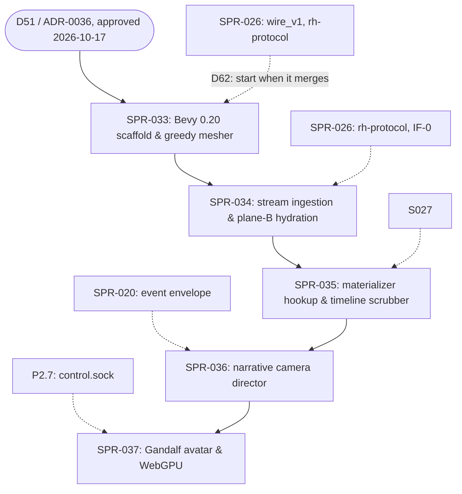

# PRJ-003 — Bevy Native Voxel Viewer (`rh-view`): Project Plan

> **BLUF:**
> - **What it is.** The Red Team wrote this plan under the director's mandate (D51, 2026-10-17). It is the execution plan for `rh-view`, a native Rust 3D voxel spectator and timeline scrubber built on Bevy 0.20. AGT-002-TOOLS implements it.
> - **Why.** It is the Red Team's and the director's **visual testing and observability harness**. Text logs alone leave external auditors blind to spatial layouts, demographic emergence and dynastic drama. We need to see the simulation to test it.
> - **How it connects.** `rh-view` reads the World Stream (IF-0, `specs/stream/wire_v1.md`, through `rh-protocol`), sealed segments (through `rh-stream`'s reader) and SPR-027's materializer.
> - **Where it lives.** In the tool plane, in its own Cargo workspace (`viewer/`). No engine crate may depend on it.
> - **What it does not touch.** The text-first simulation contracts and the G2 thesis gate.
> - **Priority (D62, 2026-10-18).** The viewer lane is the director's priority 2, behind the engine core (P1a, P1b). SPR-033 starts when SPR-026 merges; SPR-035's scrubber waits for SPR-027. Priority 1 wins every contention for CI minutes, review time and merge slots.
> - **Decision.** ADR-0036 (D51, approved 2026-10-17) governs this plan. v1.2.0 aligns v1.1.0 with ADR-0036; the Architect's changes are listed in §8.

---

## 1. Governance & Division of Ownership

To ensure that core simulation velocity and determinism are never compromised:

| Role | Responsibility |
|---|---|
| **Developer (`AGT-002-TOOLS`)** | **Primary implementer.** Writes the Rust code for `viewer/rh-view`: the binary greedy chunk mesher, the Bevy 0.20 render pipelines, and the stream reader over `rh-protocol` and `rh-stream` |
| **Architect (`AGT-001`)** | **System integrator and gatekeeper.** Reviews the interface boundaries (`rh-protocol`, the socket wire formats), issues the sprints into the merge pipeline, and enforces that no engine crate imports `rh-view`. D51 and ADR-0036 are filed |
| **Tester (AGT-003, a session on a different model from the Developer's)** | **Independent verification** of each sprint (`VER-SPR-0NN-TEST`), as for every sprint |
| **Red Team** | **Requirements author and quality auditor.** Defined `PRJ-003` and `SPR-033`. Audits visual fidelity, tests non-interference and timeline scrub latency, and uses the diorama viewer as the primary visual inspection harness for demographic and spatial emergence. Under ADR-0036 §4, a visual finding is closed only by an automated check that reproduces it |
| **Director** | **Executive authority.** Ratified D51. Approves visual fidelity milestones, and uses the timeline scrubber and, from P2, the Gandalf avatar controls |

---

## 2. Architectural Boundaries & Non-Negotiable Invariants

```
+-----------------------------------------------------------------------------------------+
| PLANE A: AUTHORITATIVE SIMULATION KERNEL (Headless Rust)                                |
| Simulates demographic life-courses, harvest yields, dynastic claims, and wars.          |
| Bitwise deterministic fixed-point math (Q8_8, Q16_16, Q32_32). Zero floats.             |
| Emits the World Stream (channel A) and Arrow keyframes. ZERO awareness of rendering.    |
+-----------------------------------------------------------------------------------------+
                                             │
                                             ▼ Read-only: IF-0 live edge (wire_v1), sealed segments, materializer
+-----------------------------------------------------------------------------------------+
| PLANE B: PROCEDURAL VOXEL HYDRATION (`viewer/rh-view::hydrate`)                         |
| Computes 3D geometry deterministically: Voxel(x,y,z) = G(Seed, State, Era, version).    |
| Hydrates bare simulation records (settlement_id, seed, era, pop) into timber, thatch,   |
| stone keeps, roads, chimney smoke particles, and villager visual walk-paths.            |
| Rewinding to Year 1342 deterministically reproduces the exact same village diorama.     |
+-----------------------------------------------------------------------------------------+
                                             ▲
                                             │ Camera Steering
+-----------------------------------------------------------------------------------------+
| PLANE C: NARRATIVE CAMERA DIRECTOR (`viewer/rh-view::director`)                         |
| Reads channel C sift matches (`rh-sifter`). Directs viewport orbit and zoom to focus    |
| automatically on climax moments (assassinations, sieges, coronations, riots).           |
+-----------------------------------------------------------------------------------------+
```

### The Invariants (ADR-0036 §2)
1. **Zero impact on plane A (V-PERF-09, V-R3D-14).** `rh-view` runs in a separate native OS process. If it crashes, drops frames or hits a GPU driver timeout, plane A does not stall. With `rh-view` attached as one harness, throughput stays ≥ 95% of headless and the `state_hash` ladder is identical.
2. **Deterministic geometry (V-R3D-13).** Given the same `world_seed`, the same state at the tick, the Registry and the generator version, plane-B hydration gives byte-identical **voxel content** across machines, runs, thread counts and builds, and whether the tick is reached by rewind or by forward play. Rendering (lighting, frame timing) is not hashed.
3. **Strict one-way dependency.** `viewer/rh-view` lives in its **own Cargo workspace** with its own `Cargo.lock`. It may depend by path on `rh-protocol`, `rh-stream`, `rh-worldgen`, `rh-snapshot` and `rh-golden` (SPR-027's materializer, `rh_golden::materialize`; Architect ruling D-7 at the wave-5 plans, 2026-10-17), for reading. **No crate under `crates/` may depend on it**, and Bevy's dependency graph never enters the engine's lock or its `cargo deny` run. `bin/lint_arch.py` enforces this.
4. **Text-first primary gate preserved.** G1a, G1b and G2 stay text-verified. `rh-view` is an inspection and presentation harness, not a gate on the simulation core.
5. **Procedural assets only** (ADR-0035 directive 5 as amended by ADR-0036). Every block, texture and particle is generated by `rh-view`'s own versioned plane-B generators, or comes from a CC0 source. No art extracted from third-party games enters `rh-view` or the repository's main line.

---

## 3. Technical Stack & Voxel Engine Specifications

| Component | Technical Choice | Rationale |
|---|---|---|
| **Engine framework** | **Bevy 0.20 (Rust)**, an exact pin in `viewer/Cargo.lock` | Native Rust compatibility (the same `bevy_ecs` line as the engine); zero FFI overhead; GPU-driven mesh rendering and atmospheric scattering |
| **Graphics API** | **WGPU (Vulkan / Metal / DX12 / WebGPU)**, through Bevy | Cross-platform native rendering, with a later path to WebAssembly and WebGPU |
| **Meshing algorithm** | **Binary greedy meshing** | Merges coplanar adjacent voxel faces into single quads with bitwise integer math. Drops the quad count by 85–92% against naive voxels, aiming at ≥ 60 FPS on integrated GPUs |
| **Voxel size** | **0.35 m by default** (D62), with a measured level-of-detail fallback for distant terrain | The director's choice; the fallback keeps the frame rate when 0.35 m is too dense |
| **Chunk architecture** | **64×64×32 diorama bubbles** | Block detail only in the camera's observation bubble; outer terrain as low-poly heightfield meshes (ADR-0031, fidelity by zoom) |
| **Stream ingestion** | **IF-0's live edge** (`wire_v1.md`; canonical lines, D43) over a Unix socket through `rh-protocol` (SPR-026), and sealed segments through `rh-stream`'s reader. The socket is on `adjutant`; the director's laptop reaches it through an SSH tunnel (D62) | The engine's own stream code, in the same language. The viewer never parses Parquet or frames by hand |
| **Timeline replay** | **The materializer (SPR-027)** | The nearest keyframe (every 10 sim-years) plus deterministic replay gives the exact state at any tick |
| **Watched-history cache** (D62) | **The viewer keeps the states it has already shown in a bounded local cache** (its size and eviction set in SPR-035) | Scrubbing back within watched history needs no materializer call, so it is immediate; jumps into unwatched history go through the materializer. The cache is plane B and never authoritative; it may live in `/dev/shm`, while authoritative runs keep disk and fsync |
| **Camera** | **A free spectator camera, including first-person roaming at ground level, in V.1**; acting on the world in V.3 (D62) | Seeing the world from inside it needs no input path; acting does (`control.sock`, P2.7) |
| **Gandalf avatar hook** | **`control.sock` (P2.7)** | Keyboard and mouse actions become journaled `PlayerAction` and `SpeechAct` inputs at the tip. An act in the past is a fork (ADR-0025). `T1.minds` decides the NPCs' reactions |

---

## 4. Phased Sprint Roadmap (off the critical path; `docs/11` viewer lane V.1–V.3)

The work runs in a dedicated tool lane that does not contend with the core simulation merge queue (PRJ-002). Each sprint is at most about 3 agent-days (GOV-005 §3). The Red Team's estimate of about 2 agent-weeks is the total of SPR-033 to SPR-035.

| Sprint | Phase | Title | Scope & Deliverables | Class | Prerequisite |
|---|---|---|---|---|---|
| **SPR-033** | V.1 | **Bevy 0.20 scaffold & binary greedy mesher** | The `viewer/` workspace and `rh-view`; a Bevy 0.20 app; the binary greedy chunk mesher; a procedural demo diorama; an orbital camera; the isolation gate (V-R3D-14) | C1 (tool) | D51 (ratified); starts when SPR-026 merges (D62) |
| **SPR-034** | V.1 | **Stream ingestion & plane-B procedural hydration** | The IF-0 reader through `rh-protocol` and the sealed-segment reader; a deterministic building grammar (Tudor houses, stone towers, church, roads) hydrated from the settlement seed; the hydration determinism gate (V-R3D-13) | C1 (tool) | SPR-033, SPR-026 (`rh-protocol`) |
| **SPR-035** | V.1 | **Materializer hookup & timeline scrubber** | SPR-027's materializer; a timeline scrubber that jumps to keyframes and replays forward; the watched-history cache (D62); rewind equal to forward play (V-R3D-13) | C1 (tool) | SPR-034, SPR-027 |
| **SPR-036** | V.1–V.2 | **Narrative camera director & sifter binding** | Channel C sift matches drive the camera (R3D-7); cinematic framing on drama nodes (coronations, deaths, battles); smoke and fire particles | C1 (tool) | SPR-035, SPR-020 (the event envelope) |
| **SPR-037** | V.3 | **Avatar embodiment ("Being Gandalf") & WebGPU** | WASD and mouse inputs become `PlayerAction` over `control.sock`; a first-person street-level walk; a WebGPU build of `rh-view` | C1 (tool) | SPR-036, P2.7 (`control.sock`) |

V.2 (people moving, fields, mills, famine) follows P1b's systems and is planned when they land.

---

## 5. Verification & Acceptance Criteria

Each sprint passes these before merging. The `docs/09` IDs are the gates; the Red Team's V-VIEW names are kept as labels.

| Check | Gate (`docs/09`) | Criterion |
|---|---|---|
| **V-VIEW-01, engine non-interference** | V-R3D-14 with V-PERF-09 | With `rh-view` attached as one harness, throughput is at least 95% of headless and the `state_hash` ladder is identical. The measured delta is reported; the Red Team's target of ≤ 0.5% is a report, not a gate, because a shared CI runner cannot resolve it |
| **V-VIEW-02, deterministic content** | V-R3D-13 | The voxel content digest of a fixed bubble at a fixed tick is equal across runs, thread counts, builds, and rewind against forward play. The mesh's vertex and index buffers are hashed too, as a second check bound to the mesher's version |
| **V-VIEW-03, performance floor** | Reported (D62) | ≥ 60 FPS on a 4-core developer machine (the ThinkPad P51 baseline) for a 64×64 diorama with 50 animated actors, at the default 0.35 m voxel size, with the level-of-detail fallback's trigger reported. Measured on the director's machine; neither CI nor `adjutant` has a GPU |
| **V-VIEW-04, zero reverse dependencies** | V-R3D-14 | No crate under `crates/` depends on `viewer/`, and the engine's `Cargo.lock` is unchanged. `rh-view`'s own code carries `#![deny(unsafe_code)]` |
| **V-VIEW-05, timeline scrub latency** | Reported (D62; depends on V-STR-02) | Within watched history, from the viewer's cache: ≤ 250 ms (the red team's aim is one frame). Into unwatched history, through the materializer: reported with the world's size, because at 10,000 people a jump means a keyframe plus up to 10 sim-years of replay |

**CI:** the viewer's job builds `viewer/` and runs headless: the hydration data path, the mesher, and the determinism and isolation gates, with no window and no GPU. It runs only when `viewer/` or a crate it reads changes, because compiling Bevy is expensive and CI minutes are billed. `rh-golden` on the path list widens that trigger to the crates `rh-golden` itself reads (the engine crates, `rh-sys-*`, `rh-worldgen`, `rh-snapshot`), so the job fires on more engine changes than before (W40 of the wave-5 review). If its cost exceeds its budget, it moves to the nightly (ADR-0036).

---

## 6. Dependency Graph



---

## 7. Submission for Architect Review (Red Team, v1.1.0)

This plan was submitted to the Architect with the following affirmations:
1. **Zero critical-path blockers:** the project operates in the tool plane and does not gate G1a or G2.
2. **Zero core contamination:** no change is requested to plane-A contracts, fixed-point math or state hashing.
3. **Ready for ADR-0036:** the Red Team asked the Architect to file D51 with ADR-0036 based on this specification. **Done:** PR #71, merged 2026-10-17.

## 8. Architect's changes at v1.2.0 (2026-10-17), aligning v1.1.0 with ADR-0036

1. `crates/rh-view` in the root workspace becomes `viewer/rh-view`, its own Cargo workspace (ADR-0036 §2.2). Bevy then never enters the engine's lock, `cargo deny`, the engine-purity deny-list, or every PR's compile.
2. The reference to ADR-0037 (a "view protocol") is replaced by IF-0's wire, `specs/stream/wire_v1.md` through `rh-protocol` (SPR-026). The viewer needs no protocol of its own, so there is no ADR-0037.
3. Stream ingestion is IF-0's canonical lines on the live edge, sealed segments through `rh-stream`, and the materializer. It does not read "binary records from the filesystem".
4. The V-VIEW checks map to `docs/09` gates (V-R3D-13, V-R3D-14, V-PERF-09). FPS and the ≤ 0.5% delta are reported, not gated.
5. Sprints are at most about 3 agent-days (GOV-005 §3); SPR-033's own estimate is corrected.
6. A Tester on a different model verifies each sprint. The Red Team audits, and its findings close only with automated checks (ADR-0036 §4).
7. **Procedural assets only** (Invariant 5). No art extracted from third-party games enters `rh-view` or `main`.
8. The schedule follows the director: SPR-033 starts after SPR-027 lands. (Superseded by D62, item 10.)
9. (v1.2.1, 2026-10-17; the Architect's rulings at the wave-5 plans, D-7 and W40.) The path list of §2 invariant 3 gains `rh-golden`, where SPR-027's materializer lives on SPR-013's replay path; §5 notes that this widens the viewer's CI trigger.
10. (v1.3.0, 2026-10-18; D62, the director's priorities.) The viewer lane is priority 2, behind the engine core, and loses every contention to it. SPR-033 starts when SPR-026 merges; SPR-035 waits for SPR-027. FPS and scrub latency stay reported targets, measured on the director's P51. New in §3: the 0.35 m default voxel size with a level-of-detail fallback, the SSH tunnel to `adjutant`, the watched-history cache (`/dev/shm` allowed for it), and the first-person free camera in V.1. V-VIEW-03 and V-VIEW-05 are restated in §5.
