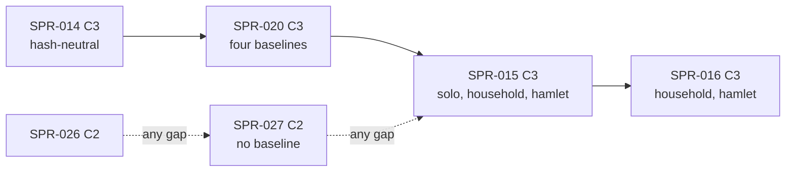

> [!NOTE]
> **ARCHIVED BASELINE:** Traditional sprint-based tracking has been superseded by Specification-Driven Development (SDD v2.0). All future deliverables are tracked as Spec Waves in `.spec/ARCHITECT_BACKLOG.md`.

> **BLUF:** Builds the F1 births slice of the next-version M2 spec (`specs/systems/next/M2.demography.odd.toml` 0.3.0, PR #50, REV-SPR-015 closed) in `rh-core`, `rh-sys-demography`, `rh-worldgen`, `rh-ids` and `rh-contracts`:
> - **the derived per-system index in `rh-core`** (C2; the Architect's W4 ruling): a system declares an index built from its own columns at construction and at restore, kept by a serial post-merge `&mut` hook, never hashed or keyframed; F9's issued-id table and the kinship, spouse and children-by-parent lookups live in it, and M7 reuses it;
> - **fertility** (`[algorithm.fertility_f1]` F0–F10): Coale–Trussell conception probabilities per band at level M from `tfr`, one keyed Bernoulli per susceptible married woman per month, births as timers nine months on, the pregnancy as state a re-sample never changes;
> - **`apply_birth`:** `H64(mother, parity)` ids with the deterministic rehash, the sex keyed by the child alone, the row insert through SPR-014's plumbing, the life-course row with `mother` and `father`, `BIRTH`;
> - **partnering** (`[algorithm.partnering_f1]` N1–N7): a monthly nuptiality hazard, the husband as the least `husband_pick` draw among the eligible men (CRN-stable), marriage timers, `apply_marry` as the single marriage path for M2's timers and T1's `Marry` commands, `MARRIAGE`;
> - **households** (`[algorithm.households_f1]` H1–H6): `HouseholdId`s, the household table and the marriage log, genesis households and marriages from the manifest, headship and dissolution on death.
>
> **The spec is promoted in this PR** (the Architect's D-1 ruling, 85%: the code cannot compile against a draft), with the full promotion checklist of T-01. The Registry delta joins `registry_v0.toml`. **Three baselines move** (`solo`, `household`, `hamlet`); `smoke` is unchanged. They are re-recorded in the final `[C3]` commit by `bin/regen_baseline.sh`, with `registry_version` bumped there; the tail snapshots and the per-rung allocation budgets are re-recorded by their tools, so the PR title ends `[perf-baseline] [C3]`. Every baseline move is announced to the director before the merge.
>
> - **Developer:** AGT-002-CORE, with AGT-002-TOOLS for the two reference generators and the gates (one Developer session may hold both roles).
> - **Testers:** AGT-003-DET and AGT-003-IF (one session may hold both, on a different model from the Developer's), and AGT-003-STAT for T-06's reported bands.
> - **Size and class:** **about 5 agent-days** (W14), as **one sprint with a hard stage-A checkpoint**: stage A is T-01 to T-03 (the promotion, the derived index, births and the generators), and a Tester's interim pass on stage A is required before stage B starts. The size is a director item (D54). **C3**: a model change that moves three goldens. It contains C2 work: the spec promotion, the Registry delta, the derived index in `rh-core`, `rh-ids`' household layout, `rh-contracts` v0.1.
> - **Status:** PLANNING, revision 1: the Architect's rulings on the independent review are applied (W1–W17, W42, D-1 to D-12). It needs the director's plan approval (D54; GOV-005 §2).

# SPR-015 — M2 F1 births (WP P1.3, part a)

- **Roadmap item:** `docs/11` P1.3 (a) · **Phase / rung:** P1a, rungs 0–2
- **Depends on:**
  - **SPR-014 merged:** the core row insert (`05.1` v1.14 §2 rule 2), the `Day`/`Vital` drain and its minimal `Marry` path (which T-04 replaces with N7), `rh-contracts` v0, `EventRef`, typed payloads, the absent-owner rule with the keyed neutral lookup, M2 0.2.3.
  - **SPR-013 merged:** the `household` and `hamlet` baselines, channel A's `LIFE_ENTRY` and `STEP_DIGEST` (whose `births` the writer already counts), `bin/regen_baseline.sh` covering all four worlds, the tail snapshots and the per-rung allocation budgets.
  - **SPR-020 merged: a recommendation, not a dependency** (D-11, W16; "Merge route"). With SPR-020 first, `BIRTH` and `MARRIAGE` carry their declared `roles` through the envelope's checked `emit` and its `ROLE_*` skeleton constants from the first segment they appear in. In either order the three baselines move once for births and once for the envelope; what the order buys is one path for the two new call sites.
  - Independent of SPR-017 (`effect_ref.py` is on `main`, so T-04's cross-check is unconditional), SPR-026 and SPR-027.
- **Binding contracts:**
  - `specs/systems/next/M2.demography.odd.toml` 0.3.0 (promoted by T-01): `[algorithm.fertility_f1]`, `[algorithm.parameters_f1]` (P1's interim rule), `[algorithm.partnering_f1]`, `[algorithm.households_f1]`, `[algorithm.lifecycle_f1]`, S12 as amended, the `[[rng]]` purposes `conception`, `marriage_time`, `birth_sex`, `husband_pick`, INV-M2-06 to INV-M2-13, `[initialization]` as amended, `[isolation]`, the 19 `[[amends]]` records and `amendments.lock.toml`; `specs/systems/next/registry_delta.toml`.
  - `specs/demography/selftest_m2_f1.py`: the check values, `report_ratios`, checks 1–8.
  - `05.1` §2 rule 2 (v1.14: the row insert, event-typed slots; **this sprint's T-02 adds the derived-index text**, the Architect's wording in the PR), rule 4, §4.3, §6 items 2 and 9; `05.2` §1 (`PersonId`, `HouseholdId`), §4.0 (D38's ceiling: every P1a draft admitted); `05.10` §4 (`STEP_DIGEST.births`).
  - `specs/chronicle/envelope_v0.md` §3 (M2's roles); `specs/stream/channel_a_v0.sql` R6 (`verb_id` is the index in `[verbs]` sorted by name), `LIFE_ENTRY`, `STEP_DIGEST`; `specs/stream/canonical_v0.md`.
  - SPR-013's `crates/rh-golden/tests/tail.rs` (the `snapshot()` helper and `tests/snapshots/`) and `crates/rh-bench/baselines/allocations_v1.txt` (the `rung solo|household|hamlet` budgets).
  - ADR-0006, ADR-0024, ADR-0025 (item 3: re-sampling), ADR-0026 (items 1, 3, 4), ADR-0033.
  - `docs/09` V-INV-01, V-DATA-04 (P1a variant), V-DATA-05, V-DET-01, V-DET-02, V-DET-05, V-DET-12, V-DET-14, V-DET-17 (its ingredients), V-SF-24 and V-SF-25 (reported, D41), V-SF-01 (reported here; gated with SPR-028), V-SCALE-04, V-GOLD-01, V-PERF-11.
- **System spec:** M2 goes from frozen 0.2.3 to **frozen 0.3.0** in this PR (T-01; an Architect-approved C2 change inside the C3 PR). M7 0.3.4, T1 0.3.3 and the S3 0.1.0 draft are read by registration tests only; S6's draft read of `household.head` is re-pointed at M2 (T-01).
- **Rulings (binding):**
  - REV-SPR-015 R1–R22, above all R2 (pregnancy state), R3 (the band formula), R4 and R20 (V-SF-24's identity and the 2.03), R8 (Wulf), R9 (MIN-5 ages, MIN-6 servants, MIN-8 argmin), R12 (shape (b)), R13 (S12 amended: dead-row drops, the cancel, the newborn-aware `EXTINCTION`), R16 (`husband_pick`), R17.1–R17.7, R21 (INV-M2-13 gates), R22;
  - REV-EVO-001 R1, R3, R9, R12; REV-SPR-018 R8 (the bride's settlement); REV-SPR-019 R14 (`last_birth_tick` at genesis); REV-SPR-029 R6 and decision 1 (no `parent` role; the father is in `LIFE_ENTRY`);
  - REV-SPR-016-FOLD R2 (the M4 read deferred), R6 (the promotion checklist), and R3 **as withdrawn by D-1**;
  - **the Architect's rulings on the independent review of this plan (2026-10-17): W1–W17, W42, D-1 to D-12** (the specs table marks each row they decide).
- **Director items:** D40 (approved: `tfr` 4.9 and the early pattern; its revisit is pre-registered on SPR-030) and D41 (approved: V-SF-24 and V-SF-25 reported at G1a). For this plan, in D54: the size (W14) and Q1 (D-9).
- **Requirements covered:** DATA-8 (the life-course log for everyone, genealogical ids: the birth path); SIM-1 (ledger rows and genealogical IDs, N ≤ 60 here); SIM-5 (binomial draws for conception and marriage); DET-2 (keyed RNG only: four new purposes); DET-13 (no back-dating: F8's and N6's re-samples).

## Specs this sprint needs

| Spec | Exists? | Gap | Architect ruling | Needed by |
|---|---|---|---|---|
| **Where 0.3.0 is promoted** | `next/README.md` step 4, the spec's header and REV-SPR-016-FOLD R3 say "in SPR-016's PR, after SPR-015's; SPR-015 builds against the draft under P1's interim rule" | **Conflict.** `rh-sys-demography` `include!`s `crates/rh-core/tests/generated/M2_demography.rs`, which `gen_skeletons.py` writes from `specs/systems/*.odd.toml` only (`SPEC_VERSION = "0.2.2"`, `RngPurpose { DeathTime }`, one `SCHEDULE` binding), and registration compares the code's purposes (rule `rng-purpose`), bindings and `DRAINS` with the frozen spec. Four new purposes, new owned columns and two new `[[emits]]` kinds cannot register against 0.2.3 | **Ruled (Architect, 2026-10-17; 8.5/10; D-1): M2 0.3.0 is promoted in SPR-015's PR (T-01) with W1's full checklist; REV-SPR-016-FOLD R3's "promoted in SPR-016" is withdrawn; SPR-016 bumps the spec to 0.3.1.** PRJ-002 §6 already says "supersedes the frozen file in SPR-015's PR" | T-01 |
| **The promotion checklist** | `next/README.md` step 4 lists the file move, the delta merge, the skeleton, the status and two `CLAUDE.md` lines | **Incomplete** (W1; the reviewer simulated the promotion): (a) the frozen lint and `--next` fail on S6's draft read of `household.head` from `M4.economy` (S6 `:186–190`), which 0.3.0 owns; (b) `selftest_population_synthesis.py:129` raises `FileNotFoundError` on `NEXT_SPEC`; (c) `specs/annals/fixtures/gen_fixtures.py` reads the delta (lines 45, 83) and hardcodes the dictionary `0.2.0+next` (line 46); (d) `selftest_annals_v0.py --check` fails on the `+next` dictionary, and a `registry_version` bump alone fails it too (`work/bump`); (e) `odd_next_control algorithm` has no M7 equivalent; (f) P1 (`:628`, "frozen in SPR-016's PR"), F1 (`:582`, "before 0.3.0 freezes") and the `CLAUDE.md` `--next` line are stale | **Ruled (Architect, 2026-10-17; 9/10; W1, D-10): items (a) to (f) join T-01's deliverable and acceptance:** S6's read re-pointed at `M2.demography`; population synthesis gets a fallback to the frozen spec; `gen_fixtures` reads the Registry's verbs and version, and the annals fixtures and goldens are regenerated by the tools; the `algorithm` control is rendered from a synthetic next of the promoted M2 (as the `clean` control renders one of T1); P1, F1, F2 and the `CLAUDE.md` line are fixed. `next/README.md` step 4 carries the full list | T-01 |
| **The Registry delta** | `registry_delta.toml`: F1 bounds, `tfr`, `elite_fertility_mult`, `density_capacity`, `density_mortality_slope` defaults, verbs `BIRTH` and `MARRIAGE` | The engine compiles `tfr` from the Registry default (`compile.rs`), `rh-stream`'s `verb` dictionary and `lint_odd.py`'s emits-against-verbs check read the Registry | **Ruled (Architect, 2026-10-17; 8/10; D-2): the delta merges in T-01 without the `registry_version` bump; the bump lands in the final `[C3]` commit with the baselines** (SPR-020 T-07's pattern). Adding `BIRTH` moves `verb_id` by one on every verb sorted after it (`DEATH` 14 → 15, `EXTINCTION` 17 → 18; channel A R6), which T-07's channel-A criterion names (W2) | T-01, T-07 |
| **M2's runtime indexes** | The spec's `restart` and H6: "M2 keeps no index: the children-by-parent and spouse lookups it needs are rebuilt from the log at construction (a cache with a rebuild rule)"; F9: the table of every id ever issued | **Gap** (W4): `step`, `fire` and `invariants` take `&self` (`system.rs`), `PersonIdTable::issue` takes `&mut self`, and no per-system scratch exists; interior mutability in a system is banned (W31) | **Ruled (Architect, 2026-10-17; 7.5/10; W4): a derived per-system index in `rh-core`, C2, in T-02 before any M2 code.** A system declares an index type, built from its columns at construction and at restore; a serial post-merge hook with `&mut` applies the step's merged writes to it; it is not hashed and never written to a keyframe; a debug and test invariant checks that the incrementally kept index equals a rebuild from the columns, at every keyframe and at the end of every test run, with a planted mutant that drops one update; F9's issued-id table and the spouse and children-by-parent lookups use it; M7 (SPR-021) reuses it; INV-M2-13 checks the rows with `start_tick = now`. REV-P1a NEW-1 already says the children-by-parent index is derived state, rebuilt at restore and outside the hash | T-02 |
| **`HouseholdId` in `rh-ids`** | REV-SPR-015 R11 Q3 accepts the `household/v1` H64 layout as additive; `rh-ids` has `EntityKind::Household` and "no typed id yet" | The type, its table and the rehash domain are new `rh-ids` surface | Proposed (8/10): `HouseholdId(u64)`, `household_base(head, formed_tick)`, `household/rehash/v1`; the table of issued household ids is a derived index (W4), as the person table is; golden vectors through `bin/gen_rng_golden.py`. C2 inside the C3 PR | T-03 |
| **`rh-contracts::m2` v0.1** | v0 covers M2 0.2.3's columns (SPR-014 T-06) | The five new `person.*` columns, `household.*` and `marriage.*` have no accessors | Proposed (8/10): one typed accessor per new column, the drift test covering 0.3.0's full `[[owns]]`. C2 inside the C3 PR; M7's `on_birth` (SPR-021) and T1 (SPR-023) are its first consumers | T-03 |
| **`kin(w, 2)` in M2** | N4 and N7: "the set `kin(w, 2)` of the effect language, which M2 computes over its own mother and father columns, the dead included" | `effect_ref.py`'s `kin_within(world, ident, 2)` counts parent-or-child steps, so a co-parent is within two degrees; M2's exclusion must match it exactly | **Ruled (Architect, 2026-10-17; 8.5/10; W10): the comparison is on the candidate predicate, unconditionally:** for every eligible woman at every pulse of the fixture worlds, M2's excluded set equals `kin_within(w, 2)` of `effect_ref.py` on the same log (`effect_ref.py` is on `main`; the "where it is on `main`" hedge was stale) | T-04 |
| **V-SF-24's "plane-A observer of the fertility step"** | `docs/09` V-SF-24: the declared aggregates (conceptions and susceptible woman-months per band, split by the level table used) | "`StepCtx`'s observability hook" does not exist: `rh-core/src/observe.rs` is boundary notices with no payload from a step (W6) | **Ruled (Architect, 2026-10-17; 8.5/10; W6): a generalised counter in `rh-core`:** `StepCtx::count(name, labels, delta)` buffered in the step and delivered to the attached `Observer` as a `Notice::Counter` at `JobEnd`, with copies only, outside every hash and keyframe (GOV-006 §3; the `dropped{…}` counter of SPR-014 T-03 is its first use if SPR-014 lands first, else this sprint names it) | T-06 |
| **INV-M2-13 before S3 exists** | INV-M2-13 gates every run; `person.residence` has no owner until SPR-018 (wave 6) | In every wave-5 world the read is dropped and the neutral 0 makes the filter vacuous | Proposed (7/10): tested under a test-only owner of `person.residence` (SPR-014 T-04's stub-owner technique) running the `[isolation]` two-settlement step series; on the real worlds the invariant holds vacuously and is still checked. **Ruled (W4): the check reads the marriage rows with `start_tick = now` through the derived index** | T-04 |
| **The `[isolation]` expectations and V-SF-22** | `[isolation].expect` (1)–(5); PRJ-002 §5 gives V-SF-22 for M2 to SPR-028 | What this sprint runs, and what the harness runs | **Ruled (Architect, 2026-10-17; 8/10; D-8): keep the split.** This sprint delivers the observers and a sanity run; V-SF-22 is SPR-028's and runs nightly here as evidence | T-06 |
| **Q1: the Coale–Trussell `n(a)` and the sex ratio** | REV-SPR-015 R11 Q1: cited-pending; "a research batch confirms before SPR-015 is planned" | No confirmation is recorded in `research/`; Barrett's 11 months is cited (R12 §9), `n(a)` and 105 : 100 are not (W5) | **Ruled (Architect, 2026-10-17; 7/10; D-9): a director item in D54:** freeze with `n(a)` and the sex ratio as design values pending citation; F1 and F2 are amended at freeze to say so. Freezing reverses R11 Q1, which GOV-005 §6 makes the director's call | T-01 |
| **`STEP_DIGEST.births`** | `channel_a_v0.sql`: "0 in P1.0, live from SPR-015"; INV-M2-12 ties it to `LIFE_ENTRY` rows with `origin = born` | `rh-stream`'s writer already counts it (`writer.rs`, `count`) | **Ruled (Architect, 2026-10-17; 9/10; W15): nothing to build; T-03 tests it** against the month's born entries, and the digest clause leaves INV-M2-12 for the stream check (W17) | T-03 |
| **Planted skeleton refusals** | T-01's draft said a planted `HusbandPick = 2` is "refused by name" | Registration checks purpose names (rule `rng-purpose`), not discriminants (W11) | **Ruled (Architect, 2026-10-17; 8.5/10; W11): a planted purpose name is refused under rule `rng-purpose`; a planted discriminant is STALE in `gen_skeletons --check`** | T-01, T-03 |
| **What else moves with the baselines** | SPR-013's tail snapshots (`crates/rh-golden/tests/snapshots/hamlet_deaths.txt`, `hamlet_follow_job.txt`, `solo_digests_year_57.txt`, `solo_story.txt`) and the `rung solo|household|hamlet` budgets of `crates/rh-bench/baselines/allocations_v1.txt` | Births change both (W12) | **Ruled (Architect, 2026-10-17; 8.5/10; W12): T-07 lists them; the snapshots are rewritten locally under `RH_UPDATE_SNAPSHOTS` and reviewed in the diff; the budgets are re-recorded by `perf_gate.py alloc-record`; the PR title ends `[perf-baseline] [C3]` with a `perf-baseline-reason:` line** | T-07 |
| **The divergence record's form** | My draft's channel-A criterion was false for a correct build, and the `household`/`hamlet` robust form was vacuous (W2, W3) | — | **Ruled (Architect, 2026-10-17; 9/10 and 8.5/10; W2, W3):** the channel-A criterion in SPR-020 T-07's form, and the robust form in two parts: (a) the frozen roots are equal before the first conception or marriage timer; (b) a model reproduces every `BIRTH`, `MARRIAGE` and `DEATH` instant, child id and sex on `household` and `hamlet` over 200 years. T-07 states both | T-07 |

**D56 (e) is adopted (the director, 2026-10-17; BCK-002 A-62, PR `arch/M2-elite-couple`), and the amended F3–F6 are in this sprint's slice.** The draft's `[algorithm.fertility_f1]`, now `m2-f1-fertility-v2`, reads the elite table on the couple: F6 gives a susceptible woman `c_i^e` when a `house_member` row names her or her husband (`person.spouse` at the fertility step, the man F7 records as `unborn_father`), once, at the k = 0 draw, one multiplier whether one spouse or both are members; nothing after the draw re-reads it. Two existing `[[amends]]` texts change (`params.elite_fertility_mult.meaning`, `design.sensing`; the lock regenerated, still 45 records); no read, column, purpose, bound or check value changes. **T-02** (the derived index) builds nothing new for it. **T-03's** Month/Vital fertility step reads `house_member.person` for the woman and for her spouse through the same keyed lookup (neutral `0`), `bin/gen_m2_f1_reference.py` takes the rule from `selftest_m2_f1.py`'s `draws_elite` (check 9; the `--control woman-row` mutant must fail it), and `bin/gen_m2_f1_draws_reference.py`'s model applies it. The rung worlds register no M7, so the read takes its neutral and no baseline moves for (e). The same PR re-states a third `[[amends]]` text, `isolation.expect` (the wave-8 review's G10; still 45 records): clause (1)'s 1,000-founder run gates on the seed-mean r, inside the 99.9% t-interval `r_exp ± 3.633 s_r / √32` against M2's expected r (about +0.114% a year), and reports each seed's N_1000 / N_0 against its expected spread instead of gating a range a correct build fails in about 69% of 32-seed runs. **T-06** builds nothing new for it: its nightly evidence (32 seeds × 1,000 years with r) is what that gate reads, and the gate stays SPR-028's.

## Compliance (every task)

| Rule | This sprint |
|---|---|
| Change class (`docs/13` §4.2) | **C3**: a model change (births, marriages, households) that moves `state_hash` on `solo`, `household` and `hamlet`. It contains C2: the frozen spec 0.3.0, the Registry delta, the derived per-system index in `rh-core` (W4), `rh-ids`' `HouseholdId`, `rh-contracts` v0.1. The PR title is `SPR-015: … [perf-baseline] [C3]` (W12) |
| Planes touched (ADR-0024) | **A:** `rh-core` (the derived index and its invariant; the counter), `rh-sys-demography`, `rh-worldgen` (H2 genesis), `rh-ids` (`HouseholdId`), `rh-contracts`. **Tool:** `bin/gen_m2_f1_reference.py`, `bin/gen_m2_f1_draws_reference.py` (new), `bin/gen_rng_golden.py`, `bin/gen_skeletons.py` (regenerated output), `specs/` (the promotion, the annals fixtures' tools), `rh-golden` (tail snapshots), `rh-bench` (budgets). **B, C:** none |
| Owned columns written | `M2.demography`: the frozen columns plus `person.household`, `person.parity`, `person.last_birth_tick`, `person.conceived_tick`, `person.unborn_father`; `household.id`, `.head`, `.formed_tick`, `.dissolved_tick`; `marriage.husband`, `.wife`, `.start_tick`, `.end_tick`, `.source`; `life_course.*` for born rows. No other system's column. The derived index is not a column: it is rebuilt from these |
| Reads (via `rh-contracts`) | Four `mode` reads with typed neutrals through SPR-014's keyed lookup: `person.named` (T1; `false`), `person.vocation` (M7; `none`), `house_member.person` (M7; `0`), `person.residence` (S3; `0`). Every wave-5 world registers none of the owners, so each read is dropped and reported and the neutral applies |
| RNG purposes added | `conception` (person, month; `resample_on_fork`), `marriage_time` (person, month; `resample_on_fork`), `birth_sex` (person; not re-sampled), `husband_pick` (person, month; not re-sampled), at discriminants 2–5 after `death_time` (1). Keys as the spec's `[[rng]]` states them; `husband_pick`'s epoch follows BCK-002 A-29 (done) |
| Golden-hash effect | **`solo`, `household` and `hamlet` move; `smoke` does not** (no M2; its header is the overlay's). Re-recorded by `bin/regen_baseline.sh` in the final commit, whose subject ends `[C3]`; announced to the director before the merge; the divergence record is T-07's (W2, W3) |
| Fixed-point quantities | `tfr`, `elite_fertility_mult` as `Q16_16` bits from exact decimals (SPR-011 ruling 9); `TFR1_BITS = 615614`, `m = rhe(T · 65536 / TFR1_BITS)`; `c_i`, `mu_i`, `SEX_M` as `Prob32`; `b_i`, `den_i` as the spec's widths. No float anywhere |
| Determinism lints (GOV-003 §2, §6) | Must pass. No new rule, no new plane-A dependency. Every scan in ascending `person.id`; no `HashMap`; the per-step matched set is a `BTreeSet`; **no interior mutability in a system** (W31): derived state lives in the `rh-core` index |
| Tests that gate this sprint | V-DET-01, V-DET-02 (1, 2, 4, N threads on the three rungs), V-DET-05 (pending birth and marriage timers, and the index's rebuild, through a keyframe), V-DET-12, V-DET-14 (F8 and N6 re-samples), V-INV-01 (INV-M2-06, 08, 09, 12, 13), V-DET-12 (INV-M2-03 as amended, 10, 11), V-DATA-04 (P1a variant: parents on born rows), V-DATA-05 (two branches, forced collisions), V-SCALE-04 (`EXTINCTION` once with births), V-GOLD-01 (three new baselines), V-WC-04 (re-pinned manifests), V-PERF-04 and V-PERF-11 (the rung budgets re-recorded), plus `bin/check_all.sh`. V-SF-24, V-SF-25, V-SF-01 are reported (D41; SPR-028) |
| Docs updated in the same sprint | `bin/check_all.sh` and `python/tests/test_check_all_inventory.py` (same commit); the `CLAUDE.md` checks (the promotion checklist's lines, the `--next` line, the new generators); `next/README.md` step 4 and "Current contents"; `05.1` §2 rule 2 (the derived index; the Architect's text); the spec header, F1, F2, P1 and companion §8 (the promotion, Q1's design values); `specs/README.md`; `docs/09` V-SF-24, V-SF-25, V-DATA-05 method lines with the test names; `05.0` §6 (`rh-contracts` v0.1; the index); `worlds/household/README.md`, `worlds/hamlet/README.md`, `worlds/solo/README.md` (what moved); BCK-002: A-06's rung manifests now carry F1 (recorded) |

**Rules carried from P0–SPR-014 (every task):**
- **Property tests vary world size and seed:** at least three sizes (6, 60, 600 founders) and eight seeds, fixed-seed SplitMix64, no new crate. The 600-founder size runs nightly (W42).
- **A positive control fails for the right reason:** its `check_all` line matches the message (`fail:<text>`); every planted mutant fails its named cases.
- **A test input exercises the path it claims, and a probe asserts it:** a re-sampled birth timer was pending at the input; the c = 0 fallback was reached; a marriage timer was dropped by N6; a mother died in the slot of her birth timer; the two-branch case really changed the birth day (W7).
- **Python tests read no CI environment variable.**
- **No statistical gate in this sprint.** T-06 reports; a band becomes a gate in SPR-028 with its power stated (A-53 GAP-9).
- **CI time (W42):** the PR tier's reference is SPR-013's merged head `e5082d0`, **core 7:58 and golden 10:21**; golden is the tighter part. Each part stays at or under 12 minutes (15 hard), reported in the PR; T-07 states this sprint's added time per part after wave 4 and what leaves which part for the nightly tier. A third PR-tier job is the director's call (D54).
- **Merge `origin/main` when main moves,** and re-run both parts.
- **Batch pushes at task boundaries;** T-01 to T-03 are pushed together (the code does not register between them).
- **Every new gate is in exactly one `check_all.sh` part,** with the inventory test updated in the same commit.
- **Baselines are regenerated only by `bin/regen_baseline.sh`,** in the final commit, with `[C3]` at the end of its subject. Test goldens are regenerated by their own tools, snapshots under `RH_UPDATE_SNAPSHOTS` locally (never in CI), never typed. **Mutants never make a baseline:** every mutant is a `mutant-*` Cargo feature (BCK-002 A-52's refusal covers them).
- **One commit per task** (GOV-005 §4).

## Tasks

**Stage A** is T-01 to T-03 and ends at a **hard checkpoint**: the Tester's interim pass on stage A (`VER-SPR-015-TEST`, phase 1) is required before T-04 starts (W14). **Stage B** is T-04 to T-06. T-07 comes last.

#### T-01: The promotion of 0.3.0, the Registry delta and the full checklist (Architect, with the Developer; C2 inside the C3 PR; W1; `next/README.md` step 4; REV-SPR-016-FOLD R6)
- **Deliverable:**
  - `specs/systems/next/M2.demography.odd.toml` moves over `specs/systems/M2.demography.odd.toml` with `status = "frozen"`, `spec_version = "0.3.0"`; its header, `next/README.md` step 4 and "Current contents" say "promoted in SPR-015's PR; SPR-016 bumps to 0.3.1"; the companion `docs/05_architecture/systems/M2.demography_F1.md` §8 follows. `next/` keeps the M7 0.4.0 draft only; `amendments.lock.toml` is regenerated by the tool (M2's section gone).
  - **The text fixes at freeze (W1 (f), D-9, D-12):** P1 loses "0.3.0 is frozen in SPR-016's PR, after SPR-015's" for "frozen in SPR-015's PR; SPR-016 bumps it to 0.3.1"; F1 and F2 call `n(a)` and the 105 : 100 sex ratio design values pending citation (Barrett's 11 months stays cited, R12 §9), under an `[[amends]]`-free edit, since the text is no longer a next version; H2's `hamlet.yaml` parenthetical reads "the 18 others each their own household" (60 = 2 + 10 + 30 + 18).
  - `registry_delta.toml` is merged into `specs/manifest/registry_v0.toml` (the F1 `fidelity_levels`, the two new parameters' bounds, the defaults `tfr = 4.9`, `elite_fertility_mult = 1.0`, `density_capacity = 10000000`, `density_mortality_slope = 1.0`, the verbs `BIRTH` and `MARRIAGE`). **Only M2's section and the verbs are merged** (REV-WAVE7 F-28, Architect at the wave-7 close; 85%): the file is deleted only when nothing else remains in it. If T-00a has merged first, M7's `[systems."M7.dynasty"]` defaults stay in the delta until SPR-021a T-01 moves them, because the frozen M7 0.3.4 has no `default` lines and the frozen lint's two-way check (`lint_odd.py:1171–1179`) would refuse them in the Registry; T1's, from the T1-I/S spec PR, likewise until SPR-024a T-01. **`registry_version` is not bumped here** (T-07).
  - **W1 (a):** `specs/systems/S6.artifacts.odd.toml`'s `[[reads]] household.head` names `M2.demography` as its owner (the draft's follow-up `next/README.md` recorded).
  - **W1 (b):** `specs/worldgen/selftest_population_synthesis.py` loads the M2 spec through the births reference's fallback (`NEXT_SPEC` if it exists, else the frozen spec), as `selftest_m2_f1.py` and `selftest_m2_f1_mortality.py` do.
  - **W1 (c), (d):** `specs/annals/fixtures/gen_fixtures.py` and `selftest_annals_v0.py` read the verbs and the version from the Registry alone (no delta, no `+next` dictionary); the annals fixtures and goldens are regenerated by the tools (`gen_fixtures.py`, `selftest_annals_v0.py --write`).
  - **W1 (e):** `bin/check_all.sh`'s `odd_next_control algorithm` renders its control from a synthetic next version of the promoted M2 (status `draft`, version bumped, S0 reworded), as the `clean` control renders T1's; the `rng` and `bound` controls follow the same synthetic next; the `lock` control uses the M7 draft; the `--next` gate's pinned self-check line is the M7 draft's.
  - `m2_f1_stale_control` and `m2_f1_mortality_stale_control` render from the promoted spec; the births and mortality references read it through their fallback.
  - The M2 skeleton is regenerated: `SPEC_VERSION = "0.3.0"`, `SCHEDULE` with `Month/Vital` and `Day/Vital`, `DRAINS`, `RngPurpose { DeathTime = 1, Conception = 2, MarriageTime = 3, BirthSex = 4, HusbandPick = 5 }`, `Params` with `density_capacity: u64`, the `ROLE_*` constants (if SPR-020 is on `main`).
  - The `CLAUDE.md` lines: the `--next` gate line (the M7 draft), the births and mortality references' lines (the promoted spec).
- **Acceptance:**
  - `lint_odd.py` in frozen mode passes with 0.3.0 frozen and S6 re-pointed; `lint_odd.py --next … --overlay …` passes on the M7 draft alone and the pinned self-check line is the M7 one; the `algorithm`, `rng`, `bound` and `lock` controls fail for their planted reasons on the synthetic next and the M7 draft.
  - `gen_skeletons.py --check` is green; the stale-skeleton control still fails for its one reason.
  - `selftest_m2_f1.py`, `selftest_m2_f1_mortality.py --check`, `selftest_population_synthesis.py` (with its `--effect-ref` differential) and `selftest_fixture_worlds.py` pass with no `next/M2` file, and the two stale-value controls fail by name against the promoted spec.
  - `gen_fixtures.py --check` and `selftest_annals_v0.py --check` pass against the regenerated fixtures and goldens, whose dictionary is the Registry's version with no `+next`; `lint_templates.py` passes.
  - `manifest_v0.py validate` passes on every example (`density_capacity` is now a known parameter; `kingdom_10k.yaml` does not set it yet: SPR-030's R1a change) and `manifest_parity.py` agrees; `rh-cli manifest schema --diff` and `rh-cli ownership` pass, the latter listing the new columns under M2.
  - `gen_manifest.py --check` passes. The `smoke` ladder is unchanged. **`next/README.md` step 4 carries every item above as its checklist.**
- **Status:** [ ] not started

#### T-02: The derived per-system index in `rh-core` (C2; W4; `05.1` §2 rule 2; REV-P1a NEW-1; W31)
- **Deliverable:**
  - **The declaration.** `SystemModel` gains an associated derived-index type (or a boxed `DerivedIndex` the descriptor names), with `build(&WorldTables) -> Index` (construction and restore) and `apply(&mut Index, &MergedWrites)` (the step's merged writes of the system's own columns, including the core row insert and compaction).
  - **The hook.** After each level's merge, `rh-core` calls `apply` serially, in system order, on the owner's index only, with `&mut`; a step reads its index through `StepCtx` (`&`), never writes it.
  - **Outside history.** The index is in no plane hash and in no keyframe; `rh_snapshot::resume` and `Engine::new` rebuild it with `build`.
  - **Per-instant cost (SPR-038; REV-SPR-038 ruling T6).** `MergedWrites` is built from the engine's write set (SPR-038a); M2 0.3.0's new invariants are O(N+L) in stage A's pattern, with its oracle.
  - **The invariant** (debug builds and tests): the incrementally kept index equals `build` from the columns, checked at every keyframe write and at the end of every test run; a failure names the system and the first differing entry.
  - **The `05.1` §2 rule 2 text** (the Architect's wording, in the PR): what a derived index is, when `apply` runs, that it is never hashed or keyframed, and the ban on interior mutability in a system.
  - **A planted mutant** `mutant-index-drop-update` (a feature of `rh-core`'s test harness): the hook skips one update.
- **Acceptance:**
  - On stub systems with an index of their own columns (SPR-014's `agenda_events.rs` worlds; three sizes, eight seeds): the invariant holds at every keyframe and run end; a keyframe round trip rebuilds an equal index; thread invariance at 1, 2, 4 and N.
  - The planted mutant fails the invariant by name at the first dropped update.
  - **Not in history:** a run with the index built and one with it rebuilt at every instant give the same ladder; the keyframe bytes do not change (the V-DET-05 harness; `bin/gen_hash_golden.py --check` unchanged).
  - `lint_arch` and `lint_forbidden` are green; no `RefCell`, `Mutex` or `Atomic*` appears in a system crate (the rule itself is SPR-027's `hidden-state`; here a grep in the test).
  - The smoke ladder is unchanged (no smoke system declares an index).
- **Status:** [ ] not started

#### T-03: The substrate, births and the generators (stage A's end; F0–F10, H1, H2, H5, H6; S12 as amended; INV-M2-06, 07, 10, 12; V-DATA-05; REV-SPR-015 R2, R3, R8, R9 MIN-6, R13, R17.1, NIT-5; REV-SPR-019 R14; W7, W11, W13, W15, W17)
- **Deliverable:**
  - **`rh-ids`:** `HouseholdId`, `household_base(head, formed_tick)` over `rehoboam/rh-ids/household/v1`, the rehash over `household/rehash/v1`; `bin/gen_rng_golden.py` gains the vectors. The tables of issued person and household ids are M2's derived index (T-02), rebuilt from the life-course log and the household table.
  - **M2's declarations:** `AccessSpec` with the 0.3.0 `[[owns]]` (fourteen `person.*`, four `household.*`, five `marriage.*`, ten `life_course.*` columns), the four `mode` reads with their neutrals, both bindings, the five purposes, the `[[emits]]` kinds with their roles; registration against 0.3.0 under rule `spec`. **P1's interim rule as code:** `mortality_rung0` for everyone, `rh_manifest::compile` still refusing `brass_beta ≠ 1` (`DEMOGRAPHY_READS` grows to `e0`, `brass_beta`, `tfr`, `elite_fertility_mult`), the density parameters not compiled.
  - **The tables:** `household.*` and `marriage.*` as owned world columns sorted by id, rows never removed; `person.household`, `parity`, `last_birth_tick`, `conceived_tick`, `unborn_father` with their sentinels (`0`, `0`, `i64::MIN`, `i64::MIN`, `0`); the children-by-parent, parent, spouse and open-marriage-row lookups as M2's derived index (H6).
  - **`rh-worldgen` H2:** for each manifest household in manifest order, the row `{H64(household/v1, [head, 0]), head, 0, i64::MAX}`; members per `household`, `children` and servants; the genesis marriage of the head and the one other adult of the other sex (spouse columns, a marriage row `source = genesis`, the children's `mother` and `father` in `person.*` and `life_course.*`, the wife's `parity` and `last_birth_tick` by REV-SPR-019 R14's one rule); every other founder in a one-person household. `household.yaml`: Oswin and Maren married, their three children's parents set, Wulf alone; `hamlet.yaml`: Job's household (Job, his wife, their ten children and the 30 servants), every other founder alone; `solo.yaml`: Ada alone.
  - **`rh-contracts::m2` v0.1:** one typed accessor per new column; the drift test against 0.3.0.
  - **Construction:** the band function F0; `N_i`, `G`, `P`, `SEX_M` from the spec's `constants`; `m`, `m_e` (F3); the fourteen `c_i` (F4).
  - **The Month/Vital fertility step** (F5–F7): the susceptible scan in ascending `person.id`; k = 0 against `c_i` or `c_i^e` by `house_member.person`; on a hit the due day (F6), the `BIRTH_TIMER` with payload `t_m`, `conceived_tick := t_m`, `unborn_father := spouse`. The lookup is a membership test on the lagged column: a binary search where M7 keeps `house_member` sorted by person (M7 0.6.0, cross-plan ruling X3), else a host index. The husband is looked up only if the woman's own lookup misses.
  - **F8 in `resample_timer`:** the due month from the payload, the day starts after `max(t_in, t_(m+G))`, the c = 0 fallback; nothing written; a birth never dropped by a re-sample.
  - **`apply_birth`** (F9) in the Day/Vital timer pass: the absent-mother drop (counted), the dead-in-this-slot mother still bears; `child_base(mother, parity)` with the rehash over the index's issued-id table; `father = unborn_father`; the sex at `t = 0` keyed by the child; the row insert through SPR-014's plumbing with M2's fourteen values; the household re-open; the `life_course` append; the mother's `parity`, `last_birth_tick`, `conceived_tick`, `unborn_father`; `BIRTH` with `actor` = mother, `target` = child, payload `[sex, p + 1]`.
  - **S12 as amended:** the dead or absent row dropped and counted; the newborn-aware `EXTINCTION` test (rows inserted earlier in the step, and a woman with `conceived_tick ≠ i64::MIN` and no pending own `BIRTH_TIMER`: F10's test).
  - **`bin/gen_m2_f1_reference.py`** (TOOLS): the F1 vectors from `selftest_m2_f1.py`'s own functions (one reference): `c_i` tables at the Registry corners and pseudo-random `(tfr, E)`, `band_of` on both calendars, F6 days and F8 re-sample days with the c = 0 fallback, `SEX_M`; read by `crates/rh-sys-demography/tests/f1_golden.rs`.
  - **`bin/gen_m2_f1_draws_reference.py`** (TOOLS): the independent model, in the style of `gen_m2_draws_reference.py` (the RNG reference, the rung-0 schedule, now F0–F10 and H2 too, never the Rust): fixture worlds with inputs that scope a pregnant woman mid-pregnancy, on or after the due month's last day start (the fallback), a mother who dies in the slot of her birth timer, a mother compacted before it, a genesis mother with a newborn; it writes every conception, birth instant, child id and sex, and the genesis of every fixture world and of `household.yaml` and `hamlet.yaml` (W13). Read by `tests/f1_draws_golden.rs`.
- **Acceptance:**
  - **Ids.** The `rh-ids` golden vectors reproduce (`gen_rng_golden.py --check`); a forced household collision resolves to the same rehash in two runs; `HouseholdId` 0 is never issued.
  - **Genesis, pinned (W13).** `rh-worldgen`'s genesis of `household.yaml` and `hamlet.yaml` is bit-equal twice and across threads, and equals the draws golden's genesis section (every `person.*` column, every household and marriage row). REV-SPR-019 R14's rule holds: Maren's `parity = 3`, `last_birth_tick` = her youngest's birth tick; a genesis mother with a newborn does not conceive at the first pulse (a fixture).
  - **Registration (W11).** M2 registers against 0.3.0 under rule `spec` in worlds `{M2}` and `{M2, S3-stub}`; the four reads are dropped and reported in `solo`, `household` and `hamlet`; a planted code purpose `husband_pick2` is refused under rule `rng-purpose` naming it; a planted skeleton with `HusbandPick = 2` is STALE in `gen_skeletons --check`.
  - **Interim rule.** A manifest with `brass_beta: 1.3` is refused by name at `compile`; a planted `tfr: 8` fails bounds; a world's compiled `WorldSpec` holds `tfr` and `elite_fertility_mult` and not the density parameters.
  - **Contracts.** The drift test passes; its planted control (a reordered `marriage.source` enum) fails naming the column; `lint_arch` keeps `rh-contracts` (A, contract).
  - **Bit-equality** with both goldens, in debug and release; the altered-line controls fail by name (`f1 c_i differs`, `birth 0 differs: engine`).
  - **Planted mutants, each failing its golden by name:** `mutant-birth-k-swap` (the re-sample's draw from k = 1); `mutant-sex-by-instant` (the sex keyed by the birth instant), observable because the two-branch case below re-samples the mother's birth day (W7); `mutant-newborn-extinction` (S12 without the newborn-aware test: a last mother dying in childbirth emits `EXTINCTION`).
  - **V-INV-01 on random worlds** (three sizes, eight seeds; the 600-founder size nightly): INV-M2-06, 07, 10, 12 (its plane-A half, W17: each `BIRTH` matches one born life-course row at its tick) hold at every Bookkeeping; INV-M2-02 and 04 still hold; the `EXTINCTION`-once rule holds on worlds that die out with pregnancies pending; the derived index's invariant holds throughout (T-02).
  - **V-DATA-05 (W7):** two branches diverge at a journaled input that scopes a pregnant mother (her birth day is re-sampled; a probe asserts the day differs); her n-th child has the same id and sex in both branches; a forced collision rehashes identically; no id is reused over 1,000 years on the 600-founder world (nightly).
  - **V-DET-05, V-DET-01/02:** pending birth timers, `conceived_tick` and the index round-trip through a keyframe; the three rungs equal at 1, 2, 4 and N threads.
  - **Channel A (W15, W17).** Every `BIRTH` has a `LIFE_ENTRY` with `origin = born`, `mother`, `father` and `birth_tick` = the event's tick (INV-M2-12, plane A); the writer's `STEP_DIGEST.births` equals the month's born entries and counts no founder (the stream check), read with DuckDB; the canonical lines round-trip.
  - **Checkpoint (stage A).** The Tester's interim pass on T-01 to T-03 is recorded in `VER-SPR-015-TEST` before T-04 lands.
- **Status:** [ ] not started

#### T-04: Partnering, `apply_marry` and the households' marriage and death rules (N1–N7, H3, H4; INV-M2-08, 11, 13; REV-SPR-015 R9 MIN-5, MIN-8, R16, R17.6, R17.7, R21; REV-SPR-018 R8; W8, W9, W10)
- **Deliverable:**
  - **Construction:** `mu_i` from `constants.nuptiality_thousandths`; `MIN_AGE_F`, `MIN_AGE_M`, the gap.
  - **The Month/Vital partnering step** (N3–N5): the eligible scan; k = 0 against `mu_i`; on a hit the candidates (alive, male, unmarried, `age ≥ 18`, `named = 0`, not `holy_orders`, not matched this step, not in `kin(w, 2)` over the index, of her settlement when both residences are non-zero, in the gap tier, else without the gap); the husband as the least `husband_pick` draw at k = h; the day (k = 1); the `MARRIAGE_TIMER` with payload h; the per-step matched set.
  - **N6 in `resample_timer`:** the remaining day starts after `t_in`, the husband kept, the drop when none is left.
  - **`apply_marry(a, b, now, source)`** (N7) replacing SPR-014's minimal drain: the preconditions for both sources (ages re-checked for M2's timers only), the drop with a report naming the source, both spouse columns, the marriage row (`source = partnering | command`), H3's household rule, `MARRIAGE` with `actor` = husband, `target` = wife.
  - **H4** after S12 for each dead row: the spouse widowed and the row closed once, headship to the surviving spouse else the oldest living member (the newborns of the slot counted), dissolution when empty; pending birth and marriage timers left to F9 and N7.
  - **INV-M2-13** checked at Bookkeeping over the marriage rows with `start_tick = now`, read through the derived index (W4).
  - The differential model gains N1–N7, H3 and H4, with fixture worlds that cover: a widow remarrying, a candidate pool emptied by kin, the gap tier fallback, a marriage timer dropped by N6, both parties dying before the timer, two settlements under a stub owner of `person.residence`, T1's `Marry` through the drain (a stub sender) racing M2's own timer for the same man and pairing two settlements, and a planted marriage timer whose husband is under 18 (W9).
- **Acceptance:**
  - **Bit-equality** with the extended draws golden (every marriage instant and husband); the altered-line control fails by name.
  - **CRN (V-DET-17's ingredient; R16; W8), gated:** on 10⁴ random pools with |c| ≥ 4 (fixed-seed SplitMix64), removing a non-winning candidate never changes the match; adding one changes it only when he is the least draw; **under another branch salt the pick changes in at least 50% of the pools** (the expected share is 1 − 1/|c|). The Tester reports uniformity (χ²).
  - **Kin (W10).** For every eligible woman at every pulse of the fixture worlds, M2's excluded set equals `effect_ref.py`'s `kin_within(w, 2)` on the same log, co-parents included; a planted `mutant-kin-degree-1` lets a sibling marriage through and INV-M2-08's "no row pairs kin within two degrees" fails by name.
  - **Planted mutants:** `mutant-husband-unsalted` (the argmin hash without the branch salt) fails the gated fork check above; `mutant-candidate-no-age` (N4 without `age ≥ MIN_AGE_M`) picks an under-age husband at the pulse and N7's re-check drops the timer, which the model does not, so the draws golden fails by name; the planted under-age timer is dropped by N7 and reported (W9).
  - **Commands.** A stub T1 `Marry` applied under the sender's rule (a 16-year-old husband accepted from a command, refused from M2's timer); a command racing M2's timer for one man is dropped and reported; a cross-settlement command is applied (R17.7) and INV-M2-13 exempts `source = command`.
  - **INV-M2-13** under the two-settlement forcing with newborns inheriting the mother's residence (R17.6): no partnering row pairs two non-zero settlements over 200 years; a planted filter that ignores residence fails by name.
  - **V-INV-01:** INV-M2-08, 09, 11, 13 on random worlds; INV-M2-03 as amended and INV-M2-11 at every Bookkeeping; V-DET-05 and thread invariance as T-03.
  - **Channel A:** every `MARRIAGE` matches one marriage row with `start_tick` = its tick (INV-M2-12, plane A); `MARRIAGE` lines parse and round-trip.
- **Status:** [ ] not started

#### T-05: Deaths with births: the single death path end to end (S12 as amended, H4, L1–L3; V-INV-03 subset; V-SCALE-04; REV-SPR-015 R13, MIN-3)
- **Deliverable:** the composed behaviour of SPR-014's drain and this sprint's births and marriages, tested where they meet: a commanded death (stub sender) of a pregnant woman, of a household head, of a husband with a marriage timer pending; a natural death and a birth of one mother in one slot in both orders (after a re-sample); the cancel of the victim's own later `DEATH_TIMER` after a commanded death; `EXTINCTION` with the slot's births.
- **Acceptance:**
  - Each case gives the model's consequence set: one life-course exit, the household bookkeeping, the dropped timers counted, the `DEATH` cast, no `SimError`, no double death.
  - **V-SCALE-04 with births:** `household` dies out in a 1,000-year debug soak with invariants on (nightly), emits one `EXTINCTION`, and the chronicle, tail and replay stay consistent after it.
  - The `dropped{…}` and the T-06 counters change no hash (the SPR-014 T-03 observer check, repeated here).
- **Status:** [ ] not started

#### T-06: The counters and the reported bands (D41; D-8; W6; `[isolation]`; V-SF-24, V-SF-25, V-SF-01 reported; AGT-003-STAT)
- **Deliverable:**
  - **The generalised counter** (W6): `StepCtx::count(name, labels, delta)` in `rh-core`, buffered per step and delivered to the attached `Observer` as `Notice::Counter` at `JobEnd`, copies only, outside every hash and keyframe (GOV-006 §3); `rh-cli run --vitals` prints the counters.
  - **M2's counters:** per-band conceptions and susceptible woman-months split by the level table used; births per married woman-day banded by the mother's exact age at the birth instant; first marriages and ages; mean household size.
  - **The sanity run** in `rh-worldgen`'s release tests (nightly, W42): 1,000 founders (ages uniform in [0, 60)), e0 30, `tfr` 4.9, four seeds × 200 years: not extinct, under 5× its start, r printed; and one seed × 100 years on the 10,000-founder fixture (the spec's "confirms the default on the 10,000-founder fixture").
  - **The nightly evidence** (`nightly.yml`, ignored tests; V-SF-22 is SPR-028's): 32 seeds × 1,000 years with r, the V-SF-24 identity against `c_i`'s binomial 99.9% interval per band, the age-shape report against `report_ratios` within 5% (15% at 45–49), V-SF-25, q(15) of the birth cohorts, and `household.yaml`'s extinction-time distribution over 64 replicas against the reviewer's model (alive at 100 years about 39%, median extinction year 88). INSUFFICIENT is reported where the sample minimums are not met.
- **Acceptance:**
  - The counters change no hash: the `solo`, `household` and `hamlet` ladders with `--vitals` equal those without; a planted counter in a smoke system changes nothing in the smoke ladder.
  - The sanity run passes its two hard conditions; r is printed with its 95% interval; a value outside V-SF-01's band is a finding for the Architect, not a tuning.
  - The nightly report exists and is read by AGT-003-STAT before the audit; its figures go into `VER-SPR-015` as the evidence SPR-028 will gate on.
- **Status:** [ ] not started

#### T-07: The three baselines, the snapshots and budgets, `registry_version`, the divergence record and CI (W2, W3, W12, W42; SPR-020 T-07's pattern)
- **Deliverable:**
  - **The final commit,** subject ending `[C3]`: `registry_version` bumped to the next free number; the example manifests' pins and the worlds' pinned SHA-256s follow; `solo`, `household` and `hamlet` regenerated by `bin/regen_baseline.sh`; the four tail snapshots (`hamlet_deaths`, `hamlet_follow_job`, `solo_digests_year_57`, `solo_story`) rewritten locally under `RH_UPDATE_SNAPSHOTS` and reviewed in the diff; the `rung solo|household|hamlet` lines of `allocations_v1.txt` re-recorded by `perf_gate.py alloc-record` with a `perf-baseline-reason:` line in the PR body. The bump alone is measured as a separate step first.
  - **The divergence record,** in the PR body and in `VER-SPR-015`, per world: the bisect's first divergence on a monthly ladder, and the differing tables at every yearly rung.
  - **The gates:** part `core`: the `rh-core` index tests, the `rh-ids`, `rh-contracts`, `rh-sys-demography` (`f1_golden`, `f1_draws_golden` with one mutant, `invariants_f1`, `partnering`, `households`) and `rh-worldgen` (`genesis_f1`) targets, the two generators' `--check` lines and their altered-line controls, the re-pointed lint gates. Part `golden`: the three ladders as today, the re-recorded budgets. Nightly: the other mutants (each a rebuild), the 600-founder property size, the sanity run, the 10,000-founder run, the V-SCALE-04 soak and T-06's evidence. The inventory test in the same commit.
  - The docs of the compliance table.
- **Acceptance:**
  - **Robust form (W3).** `smoke` is byte-identical at 1 and N threads. For `solo`, at every rung the differing tables are a subset of {the five new `person.*` columns, `household.*`, `marriage.*`} plus the header: Ada draws `marriage_time` every month she is eligible and never finds a husband, so `events.meta`, `agenda.timers`, `engine.commands` and the frozen `person.*` columns are unchanged; any of them differing is a defect. For `household` and `hamlet`: (a) the roots of the frozen columns and of `events.meta`, `agenda.timers` and `engine.commands` are equal at every rung before the first conception or marriage timer of the run (the genesis changes touch only the new columns and tables); and (b) the differential model (or the Tester's) reproduces every `BIRTH`, `MARRIAGE` and `DEATH` instant, child id and sex of both worlds over their 200 years. The record names the first new timer's month.
  - **Channel A (W2), in SPR-020 T-07's form.** On `solo`, only these differ from SPR-013's segments: `verb_id` +1 on `DEATH` and `EXTINCTION` lines, the `verb` dictionary (two new rows, two re-indexed), `STEP_DIGEST`'s and `KEYFRAME`'s `state_hash`, and the header's `registry_version`; nothing else. On `household` and `hamlet`: those changes, plus the genesis `LIFE_ENTRY` lines' `mother_id` and `father_id`, up to the first new record; from it on, a projection of the records without `seq` and `event_id` is compared, and every record not about a birth, a marriage or the digest's `births` is byte-identical under it.
  - **Ladders.** The three PR-tier ladders equal the new baselines at 1 and N threads; the nightly monthly ladders at 1, 2, 4 and N threads × 3 equal on the PR head (`bin/golden_nightly.sh`); `--require-parallel` floors hold or are restated by the Architect with the measured figure, never lowered silently.
  - **Manifests.** V-WC-04 on the re-pinned manifests.
  - **Performance.** V-PERF-04 within budget (the smoke world has no M2); V-PERF-11's smoke budget unchanged and the rung budgets re-recorded, each equal to the tool's output (`perf_gate.py integrity --exact`).
  - **CI time (W42).** Against `e5082d0`'s core 7:58 and golden 10:21, after wave 4's additions, this sprint adds **about +1.0 minute to part core** (the index tests, the F1 goldens in debug, one mutant, the generators' `--check`) and **about +0.3 minute to part golden** (the three ladders grow with births; the budgets' recording is unchanged). **What leaves for the nightly tier:** from part core, the other four mutant rebuilds and the 600-founder property size; from part golden, the sanity and 10,000-founder runs and the V-SCALE-04 soak, which never enter it. Both parts at 12 minutes or less, reported; if golden exceeds 12 minutes the Architect decides between moving `hamlet`'s ladder to the nightly and the director's third job (D54).
- **Status:** [ ] not started

## Director items, and what changes under the alternative

| Item | Planned | Under the alternative |
|---|---|---|
| **Size: about 5 agent-days against GOV-005 §3's ~3** (W14; recommendation 6/10: one sprint with a hard checkpoint) | One sprint and one C3 PR, staged: the Tester's interim pass on T-01 to T-03 (the promotion, the derived index, births alone on the real rungs, the generators) is required before T-04 lands. One rebaseline of the three worlds, one announcement, one audit | **Split:** SPR-015a (T-01 to T-03, T-07: the promotion, the index, births, households at genesis; C3, three baselines) and SPR-015b (T-04 to T-06, T-07 again: partnering; C3, the same three baselines again). Two C3 merges in the one-at-a-time slot, two announcements, two audits, and `hamlet` with births but no marriages in between: a world state no test cares about. The schedule gains nothing: SPR-016 waits for the whole of P1.3 (a) either way |
| **Q1: freezing with `n(a)` and the 105 : 100 sex ratio as design values pending citation** (D-9; recommendation 7/10) | T-01 freezes 0.3.0 with F1 and F2 amended to call them design values pending citation; Barrett's 11 months stays cited (R12 §9). Freezing reverses REV-SPR-015 R11 Q1 ("a research batch confirms before 0.3.0 freezes"), which is why it is the director's (GOV-005 §6) | Waiting for the research batch holds the critical path (SPR-021, SPR-023, SPR-019 and SPR-018's residence at birth all wait on SPR-015). A later correction is C3 and moves the same three baselines, which it would in any case |
| **D40's pre-registered revisit** | Nothing to decide now. `tfr` 4.9 and the early pattern are built as approved. T-06 prints r; the revisit is SPR-030's, on the dynastic world | If T-06's r falls outside V-SF-01's band on the rung and fixture worlds, the Architect brings the revisit forward with the figures (a default change is C3 on every rung's golden). No tuning in this sprint |

## Out of scope (explicit)
- **F1 mortality** (SPR-016): MR0–MR13, the newborn's first draw, the infant knots, the tail, the density modifier, `brass_beta ≠ 1`, the 0.3.1 bump. Under P1's interim rule newborns draw as rung 0 draws them (`not_yet` item 2).
- **M7's and T1's code** (SPR-021, SPR-023): `on_birth`, the `Marry` decision, `holy_orders`. Their reads of the newborn and spouse columns are exercised by stub systems only; M7's reuse of the derived index is SPR-021's.
- **Residence at birth** (S3 F0, SPR-018) and the settlement filter on real worlds; **population synthesis and the dynastic back-fill** (SPR-019), whose `[initialization]` text is frozen here and implemented there.
- **The full isolation gate** V-SF-22 for M2 and the V-SF-01/24/25 bands as gates (SPR-028; D41; D-8). This sprint reports.
- **The CRN pairing protocol** V-DET-17 and the 32-seed CRN-paired ensemble (SPR-030). This sprint proves the per-rule CRN properties it rests on.
- **The `hidden-state` lint** (SPR-027 T-02); here the ban is a test grep.
- **Marriage spells in channel A** (R11 Q4: P1.11); a `parent` role (REV-SPR-029 decision 1: the father is in `LIFE_ENTRY`); maternal mortality, twins, remarriage rates, the Hajnal marriage market (F2).
- **The M4 entitlement read** (P1.5a; REV-SPR-016-FOLD R2).
- **BCK-002 A-48** (SPR-016's director item).

## Verification assignment (Testers)

| Tester | What to verify, from which contract | Report |
|---|---|---|
| AGT-003-DET | T-02, T-03, T-05, T-07, written from the spec's F0–F10, H1–H6, S12 as amended, ADR-0025 item 3 and ADR-0026 before reading the code:<ul><li>**the stage-A interim pass** (T-01 to T-03), required before T-04: an independent model of their own (as the SPR-012 Tester's S8–S12 model) predicting every birth instant, child id and sex on the fixture worlds, re-samples included; the index invariant with their own dropped-update mutant;</li><li>V-DATA-05's two-branch case with the re-sampled mother, and a forced collision;</li><li>keyframe round trips and thread invariance on the three rungs;</li><li>the three mutants of T-03 killed for their reasons, plus three of their own;</li><li>the divergence record re-measured, checked against T-07's two-part robust form and the channel-A projection;</li><li>the nightly ladders on the head</li></ul> | `VER-SPR-015-TEST` (phase 1 at the checkpoint, phase 2 at the end) |
| AGT-003-IF | T-01, T-02 (the C2 surface), T-03, T-04, written from 0.3.0's `[[owns]]`, `[[reads]]`, `[[applies]]`, `[[emits]]`, N1–N7, `05.1` §2 rule 2's new text and the lint's contract:<ul><li>the promotion checklist's every item (W1), on a copy, before T-01 is pushed;</li><li>registration against the promoted spec, with the `rng-purpose` and STALE plants and a planted `AccessSpec` mismatch;</li><li>the derived index's API: a step cannot write it; a keyframe holds none of it;</li><li>the `rh-contracts` drift test and a consumer test of their own;</li><li>`apply_marry` under both sources with their own stub sender, including the preconditions the spec lists and two it does not;</li><li>the candidate predicate against `kin_within` on their own fixture logs;</li><li>channel-A `LIFE_ENTRY`, `BIRTH`, `MARRIAGE` and `STEP_DIGEST.births` through DuckDB and the canonical parser</li></ul> | As above |
| AGT-003-STAT | T-06, written from `docs/09` V-SF-24, V-SF-25, V-SF-01 and the spec's `[isolation]` and `report_ratios`:<ul><li>the identity and the age-shape report with their own counting from the counters' output, INSUFFICIENT stated honestly;</li><li>r on the 1,000-founder and 10,000-founder runs with intervals;</li><li>`household.yaml`'s extinction-time distribution;</li><li>no band adjusted, nothing tuned</li></ul> | As above |

## Merge route

- **Class and conditions.** C3, merged by the Architect after the Tester passes, the audit and the announcement of the three baseline changes to the director, who may veto (GOV-005 §6). The PR title is `SPR-015: … [perf-baseline] [C3]` and the final commit's subject ends `[C3]`. The 32-seed CRN-paired ensemble is not built yet (SPR-030), so the divergence record and the Tester's model are the C3 evidence.
- **One C3 open for merge at a time (GOV-005 §4.1).** The wave's recommended order (7/10):

  - **SPR-015 after SPR-020, a recommendation (D-11, W16).** With SPR-020 first, `BIRTH` and `MARRIAGE` are emitted through the envelope's checked `emit` with their declared `roles` and `ROLE_*` constants from the first segment they appear in. In either order each world's baseline moves once for the envelope and once for births. **The fallback:** if SPR-020 is not on `main` when this sprint is ready, SPR-015 emits the two kinds in SPR-006's `subjects` shape (no `ROLE_*` constants exist yet), merges first, and SPR-020's T-03 moves the two call sites with M2's others and re-measures its divergence from these baselines.
  - **SPR-016 after SPR-015** (PRJ-002): its newborn rule has newborns to act on, and its 0.3.1 bump follows this promotion. SPR-016's T-01 and T-02 may start at once; its PR stays a draft until this one merges.
  - **SPR-027 (C2)** merges in any gap; it conflicts only textually (`check_all.sh`, the inventory test, `CLAUDE.md`).
- **What this sprint re-verifies after merging `origin/main`:** both CI parts; the writer's `births` count against SPR-020's writer; the `DRAINS` and `ROLE_*` constants in the regenerated skeleton; the divergence measured from the baselines then on `main`.
- **Rung checkpoint** (GOV-007 §3.5): when `household` first runs green with births and marriages, the director may watch it through `rh-cli tail` for 15–30 minutes; the Architect records the notes as `EVO-` or `DEF-` items.

## Blockers

| # | Blocker | Status |
|---|---|---|
| 1 | SPR-013 not merged (the `household` and `hamlet` baselines, the snapshots, the rung budgets) | Open |
| 2 | SPR-014 not merged (the row insert, the drain, `rh-contracts` v0) | Open |
| 3 | SPR-020 not merged (recommended order; not a dependency: D-11) | Open |
| 4 | The Architect's rulings of the specs table | **Closed:** ruled 2026-10-17 (W1–W17, D-1 to D-12); the `HouseholdId`, `rh-contracts` and INV-M2-13 rows stay as proposed |
| 5 | Q1: the director's ruling to freeze pending citation (D54) | Open |
| 6 | The director's plan approval, with the size (D54; GOV-005 §2) | Open |

## Completion

- [ ] All tasks meet their acceptance criteria; the stage-A checkpoint (the Tester's interim pass on T-01 to T-03) was held before T-04 landed.
- [ ] `bin/check_all.sh` passes; the report is attached.
- [ ] Tester verdicts are PASS (DET, IF, STAT).
- [ ] Architect audit `VER-SPR-015` is PASS, with the divergence record of T-07 and the nightly evidence of T-06.
- [ ] No open DEF- against this sprint.
- [ ] The merge route matches the CI-detected change class (C3); the three baseline changes were announced to the director first; `smoke` is unchanged; the PR title carried `[perf-baseline] [C3]`.
- [ ] M2 0.3.0 is frozen on `main`, `next/` holds M7's draft only, the Registry carries the delta, `registry_version` moved in the `[C3]` commit, and `05.1` §2 rule 2 states the derived index.
