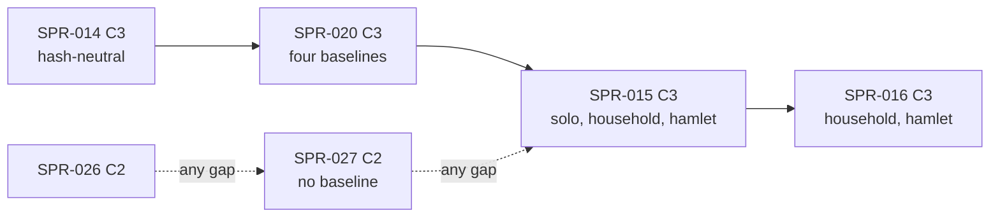

> **BLUF:** Builds the F1 births slice of the next-version M2 spec (`specs/systems/next/M2.demography.odd.toml` 0.3.0, PR #50, REV-SPR-015 closed) in `rh-sys-demography`, `rh-worldgen`, `rh-ids` and `rh-contracts`:
> - **fertility** (`[algorithm.fertility_f1]` F0–F10): Coale–Trussell conception probabilities per band at level M from `tfr`, one keyed Bernoulli per susceptible married woman per month, births as timers nine months on, the pregnancy as state a re-sample never changes;
> - **`apply_birth`:** `H64(mother, parity)` ids with the deterministic rehash, the sex keyed by the child alone, the row insert through SPR-014's plumbing, the life-course row with `mother` and `father`, `BIRTH`;
> - **partnering** (`[algorithm.partnering_f1]` N1–N7): a monthly nuptiality hazard, the husband as the least `husband_pick` draw among the eligible men (CRN-stable), marriage timers, `apply_marry` as the single marriage path for M2's timers and T1's `Marry` commands, `MARRIAGE`;
> - **households** (`[algorithm.households_f1]` H1–H6): `HouseholdId`s, the household table and the marriage log, genesis households and marriages from the manifest, headship and dissolution on death.
>
> **The spec is promoted in this PR,** not in SPR-016's (the specs table, row 1: the code cannot compile against a draft). The Registry delta joins `registry_v0.toml`. **Three baselines move** (`solo`, `household`, `hamlet`); `smoke` is unchanged. They are re-recorded in the final `[C3]` commit by `bin/regen_baseline.sh`, with `registry_version` bumped there, and announced to the director before the merge.
>
> - **Developer:** AGT-002-CORE, with AGT-002-TOOLS for the two reference generators and the gates (one Developer session may hold both roles).
> - **Testers:** AGT-003-DET and AGT-003-IF (one session may hold both, on a different model from the Developer's), and AGT-003-STAT for T-06's reported bands.
> - **Size and class:** about 4 agent-days, above GOV-005 §3's ~3: staged, with a checkpoint after T-03 (see "Director items"). **C3**: a model change that moves three goldens. It contains C2 work: the spec promotion, the Registry delta, `rh-ids`' household layout, `rh-contracts` v0.1.
> - **Status:** PLANNING. It needs the Architect's rulings in the specs table and the director's plan approval (D54; GOV-005 §2).

# SPR-015 — M2 F1 births (WP P1.3, part a)

- **Roadmap item:** `docs/11` P1.3 (a) · **Phase / rung:** P1a, rungs 0–2
- **Depends on:**
  - **SPR-014 merged:** the core row insert (`05.1` v1.14 §2 rule 2), the `Day`/`Vital` drain and its minimal `Marry` path (which T-04 replaces with N7), `rh-contracts` v0, `EventRef`, typed payloads, the absent-owner rule with the keyed neutral lookup, M2 0.2.3.
  - **SPR-013 merged:** the `household` and `hamlet` baselines, channel A's `LIFE_ENTRY`, `STEP_DIGEST`, `bin/regen_baseline.sh` covering all four worlds.
  - **SPR-020 merged, recommended** (7/10; "Merge route"): `BIRTH` and `MARRIAGE` then carry their `roles` through the envelope's checked `emit` from the first segment they appear in, and the three baselines move once for births instead of twice.
  - Independent of SPR-017 (the kinship walk M2 needs is its own, over `person.mother`/`person.father`; T-04 cross-checks it against `effect_ref.py` where that is on `main`), SPR-026 and SPR-027.
- **Binding contracts:**
  - `specs/systems/next/M2.demography.odd.toml` 0.3.0 (promoted by T-01): `[algorithm.fertility_f1]`, `[algorithm.parameters_f1]` (P1's interim rule), `[algorithm.partnering_f1]`, `[algorithm.households_f1]`, `[algorithm.lifecycle_f1]`, S12 as amended, the `[[rng]]` purposes `conception`, `marriage_time`, `birth_sex`, `husband_pick`, INV-M2-06 to INV-M2-13, `[initialization]` as amended, `[isolation]`, the 19 `[[amends]]` records and `amendments.lock.toml`; `specs/systems/next/registry_delta.toml`.
  - `specs/demography/selftest_m2_f1.py`: the check values, `report_ratios`, checks 1–8.
  - `05.1` §2 rule 2 (v1.14: the row insert, event-typed slots), rule 4, §4.3, §6 items 2 and 9; `05.2` §1 (`PersonId`, `HouseholdId`), §4.0 (D38's ceiling: every P1a draft admitted); `05.10` §4 (`STEP_DIGEST.births`).
  - `specs/chronicle/envelope_v0.md` §3 (M2's roles); `specs/stream/channel_a_v0.sql` (`LIFE_ENTRY`, `STEP_DIGEST`); `specs/stream/canonical_v0.md`.
  - ADR-0006, ADR-0024, ADR-0025 (item 3: re-sampling), ADR-0026 (items 1, 3, 4), ADR-0033.
  - `docs/09` V-INV-01, V-DATA-04 (P1a variant), V-DATA-05, V-DET-01, V-DET-02, V-DET-05, V-DET-12, V-DET-14, V-DET-17 (its ingredients), V-SF-24 and V-SF-25 (reported, D41), V-SF-01 (reported here; gated with SPR-028), V-SCALE-04, V-GOLD-01.
- **System spec:** M2 goes from frozen 0.2.3 to **frozen 0.3.0** in this PR (T-01; an Architect-approved C2 change inside the C3 PR). M7 0.3.4, T1 0.3.3 and the S3 0.1.0 draft are read by registration tests only.
- **Rulings (binding):**
  - REV-SPR-015 R1–R22, above all R2 (pregnancy state), R3 (the band formula), R4 and R20 (V-SF-24's identity and the 2.03), R8 (Wulf), R9 (MIN-5 ages, MIN-6 servants, MIN-8 argmin), R12 (shape (b)), R13 (S12 amended: dead-row drops, the cancel, the newborn-aware `EXTINCTION`), R16 (`husband_pick`), R17.1–R17.7, R21 (INV-M2-13 gates), R22;
  - REV-EVO-001 R1, R3, R9, R12; REV-SPR-018 R8 (the bride's settlement); REV-SPR-019 R14 (`last_birth_tick` at genesis);
  - REV-SPR-016-FOLD R2 (the M4 read deferred), R3 **as changed by this plan's specs table row 1**, R6 (the promotion checklist);
  - the Architect's rulings at this plan (the specs table).
- **Director items:** D40 (approved: `tfr` 4.9 and the early pattern; its revisit is pre-registered on SPR-030) and D41 (approved: V-SF-24 and V-SF-25 reported at G1a). For this plan: the size (see "Director items").
- **Requirements covered:** DATA-8 (the life-course log for everyone, genealogical ids: the birth path); SIM-1 (ledger rows and genealogical IDs, N ≤ 60 here); SIM-5 (binomial draws for conception and marriage); DET-2 (keyed RNG only: four new purposes); DET-13 (no back-dating: F8's and N6's re-samples).

## Specs this sprint needs

| Spec | Exists? | Gap | Proposed Architect ruling | Needed by |
|---|---|---|---|---|
| **Where 0.3.0 is promoted** | `next/README.md` step 4, the spec's header and REV-SPR-016-FOLD R3 say "in SPR-016's PR, after SPR-015's; SPR-015 builds against the draft under P1's interim rule" | **Conflict.** The code cannot build against a draft: `rh-sys-demography` `include!`s `crates/rh-core/tests/generated/M2_demography.rs`, which `gen_skeletons.py` writes from `specs/systems/*.odd.toml` only (`SPEC_VERSION = "0.2.2"`, `RngPurpose { DeathTime }`, one `SCHEDULE` binding), and registration compares the code's purposes, `SCHEDULE` and `DRAINS` with that skeleton under rule `spec`. Four new purposes, new owned columns and two new `[[emits]]` kinds cannot register against 0.2.3 | **Promote 0.3.0 in SPR-015's PR (T-01), with P1's interim rule as frozen text; SPR-016 bumps it to 0.3.1 and removes the interim sentences** (8/10). The alternative, a `--next` build mode for `gen_skeletons.py` and registration, adds machinery to carry one draft for one sprint and still leaves `BIRTH` and `MARRIAGE` without Registry verbs. The README's step 4, the spec header and the companion §8 are corrected in T-01; REV-SPR-016-FOLD R3's "promoted in SPR-016's PR" is superseded by this ruling, which is the Architect's to make (R3 was 7/10) | T-01 |
| **The Registry delta** | `registry_delta.toml`: F1 bounds, `tfr`, `elite_fertility_mult`, `density_capacity`, `density_mortality_slope` defaults, verbs `BIRTH` and `MARRIAGE` | The engine compiles `tfr` from the Registry default, `rh-stream`'s `verb` dictionary and `lint_odd.py`'s emits-against-verbs check read the Registry: the delta must be on `main` for the code to run | **Merge the delta into `registry_v0.toml` in T-01, without the `registry_version` bump; the bump lands in the final `[C3]` commit with the baselines** (8/10), the SPR-020 T-07 pattern: the bump alone changes only the `tuple` header line and the manifest pins. The density parameters ride along (they are bounds and defaults; the interim rule keeps them uncompiled until SPR-016) | T-01, T-07 |
| **`HouseholdId` in `rh-ids`** | REV-SPR-015 R11 Q3 accepts the `household/v1` H64 layout as additive; `rh-ids` has `EntityKind::Household` and "no typed id yet" | The type, its table and the rehash domain are new `rh-ids` surface | **`HouseholdId(u64)`, `household_base(head, formed_tick)`, `household/rehash/v1`, a `HouseholdIdTable` with the same rebuild rule as `PersonIdTable`; golden vectors through `bin/gen_rng_golden.py`** (8/10). C2 inside the C3 PR | T-02 |
| **`rh-contracts::m2` v0.1** | v0 covers M2 0.2.3's columns (SPR-014 T-06) | The five new `person.*` columns, `household.*` and `marriage.*` have no accessors | **Extend the crate with one typed accessor per new column, the drift test covering 0.3.0's full `[[owns]]`** (8/10). C2 inside the C3 PR; M7's `on_birth` (SPR-021) and T1 (SPR-023) are its first consumers | T-02 |
| **`kin(w, 2)` in M2** | N4 and N7: "the set `kin(w, 2)` of the effect language, which M2 computes over its own mother and father columns, the dead included" | M2's walk and the effect language's `kin` must agree; SPR-017 may not be on `main` | **M2 walks `life_course.mother`/`father` through its own children-by-parent and parent indexes, dead rows included; the differential model carries an independent Python `kin`, and where `effect_ref.py`'s `kin` is on `main` a test shows both agree on the model's fixture logs** (7/10) | T-04 |
| **V-SF-24's "plane-A observer of the fertility step"** | `docs/09` V-SF-24: the declared aggregates (conceptions and susceptible woman-months per band, split by the level table used) | How the counts leave plane A without entering a hash | **A host observer in the style of SPR-009 ruling 4 (the vitals observer): M2's step reports its per-band counters through `StepCtx`'s observability hook, printed with the vitals, outside every hash and keyframe** (7/10; GOV-006 §3) | T-06 |
| **INV-M2-13 before S3 exists** | INV-M2-13 gates every run; `person.residence` has no owner until SPR-018 (wave 6) | In every wave-5 world the read is dropped and the neutral 0 makes the filter vacuous | **Test it under a test-only owner of `person.residence` (SPR-014 T-04's stub-owner technique) running the `[isolation]` two-settlement step series, in `rh-sys-demography`'s tests; on the real worlds the invariant holds vacuously and is still checked** (7/10) | T-04 |
| **The `[isolation]` expectations and V-SF-22** | `[isolation].expect` (1)–(5); PRJ-002 §5 gives V-SF-22 for M2 to SPR-028 | What this sprint runs, and what the harness runs | **This sprint delivers the observers and a sanity run (4 seeds × 200 years in the PR tier: not extinct, under 5× its start, r printed); the 32-seed × 1,000-year isolation run, the V-SF-24/25 reports and the household extinction-time distribution are SPR-028's, run nightly here as evidence** (7/10) | T-06 |
| **The gates the promotion re-points** | `bin/check_all.sh` pins "self-check (next of M2.demography): 33 planted changes … 19 amendments"; `odd_next_control` renders its controls from the next M2 spec; `m2_f1_stale_control` and `m2_f1_mortality_stale_control` render stale copies of it | After T-01 `next/` holds M7 0.4.0 only | **The `--next` gate line is re-pinned to M7's draft (the T1 precedent at the REV-SPR-020 R26 line); the three `odd_next_control` renders move to the M7 draft (`algorithm`, `rng`, `bound` have M7 equivalents) and the two stale-value controls render from the promoted spec; both references read the promoted spec through their existing fallback** (8/10) | T-01, T-07 |
| **Q1: the Coale–Trussell `n(a)` transcription** | REV-SPR-015 R11: cited-pending; "a research batch confirms before SPR-015 is planned" | No confirmation is recorded in `research/` in this tree | **Freeze with the values as they stand, marked design values pending citation; a later correction is a C3 that moves every check value and three baselines, which is what it would be in any case** (7/10). The Architect confirms the batch's status before T-01 | T-01 |
| **Where `STEP_DIGEST.births` is counted** | `channel_a_v0.sql`: `births` is "0 in P1.0, live from SPR-015"; INV-M2-12 ties it to `LIFE_ENTRY` rows with `origin = born` in the month | Silent on who counts | `rh-stream`'s writer counts `LIFE_ENTRY` records with `origin = born` since the previous digest, as it counts `deaths` from `LIFE_EXIT` (8/10; tool-side, no format change) | T-03 |

## Compliance (every task)

| Rule | This sprint |
|---|---|
| Change class (`docs/13` §4.2) | **C3**: a model change (births, marriages, households) that moves `state_hash` on `solo`, `household` and `hamlet`. It contains C2: the frozen spec 0.3.0, the Registry delta, `rh-ids`' `HouseholdId`, `rh-contracts` v0.1 |
| Planes touched (ADR-0024) | **A:** `rh-sys-demography`, `rh-worldgen` (H2 genesis), `rh-ids` (`HouseholdId`), `rh-contracts`, `rh-stream` (`STEP_DIGEST.births`, a count). **Tool:** `bin/gen_m2_f1_reference.py`, `bin/gen_m2_f1_draws_reference.py` (new), `bin/gen_rng_golden.py`, `bin/gen_skeletons.py` (regenerated output), `specs/`, `rh-cli` (nothing new). **B, C:** none |
| Owned columns written | `M2.demography`: the frozen columns plus `person.household`, `person.parity`, `person.last_birth_tick`, `person.conceived_tick`, `person.unborn_father`; `household.id`, `.head`, `.formed_tick`, `.dissolved_tick`; `marriage.husband`, `.wife`, `.start_tick`, `.end_tick`, `.source`; `life_course.*` for born rows. No other system's column |
| Reads (via `rh-contracts`) | Four `mode` reads with typed neutrals through SPR-014's keyed lookup: `person.named` (T1; `false`), `person.vocation` (M7; `none`), `house_member.person` (M7; `0`), `person.residence` (S3; `0`). Every wave-5 world registers none of the owners, so each read is dropped and reported and the neutral applies |
| RNG purposes added | `conception` (person, month; `resample_on_fork`), `marriage_time` (person, month; `resample_on_fork`), `birth_sex` (person; not re-sampled), `husband_pick` (person, month; not re-sampled), appended after `death_time` at discriminants 2–5. Keys as the spec's `[[rng]]` states them; `husband_pick`'s epoch follows BCK-002 A-29 (done) |
| Golden-hash effect | **`solo`, `household` and `hamlet` move; `smoke` does not** (no M2; its header is the overlay's). Re-recorded by `bin/regen_baseline.sh` in the final commit, whose subject ends `[C3]`; announced to the director before the merge; the divergence record is T-07's |
| Fixed-point quantities | `tfr`, `elite_fertility_mult` as `Q16_16` bits from exact decimals (SPR-011 ruling 9); `TFR1_BITS = 615614`, `m = rhe(T · 65536 / TFR1_BITS)`; `c_i`, `mu_i`, `SEX_M` as `Prob32`; `b_i`, `den_i` as the spec's widths. No float anywhere |
| Determinism lints (GOV-003 §2, §6) | Must pass. No new rule, no new plane-A dependency. Every scan in ascending `person.id`; no `HashMap`; the per-step matched set is a `BTreeSet` |
| Tests that gate this sprint | V-DET-01, V-DET-02 (1, 2, 4, N threads on the three rungs), V-DET-05 (pending birth and marriage timers through a keyframe), V-DET-12, V-DET-14 (F8 and N6 re-samples), V-INV-01 (INV-M2-06, 08, 09, 12, 13), V-DET-12 (INV-M2-03 as amended, 10, 11), V-DATA-04 (P1a variant: parents on born rows), V-DATA-05 (two branches, forced collisions), V-SCALE-04 (`EXTINCTION` once with births), V-GOLD-01 (three new baselines), V-WC-04 (re-pinned manifests), V-PERF-04 and V-PERF-11, plus `bin/check_all.sh`. V-SF-24, V-SF-25, V-SF-01 are reported (D41; SPR-028) |
| Docs updated in the same sprint | `bin/check_all.sh` and `python/tests/test_check_all_inventory.py` (same commit); the `CLAUDE.md` checks (the promotion checklist's two lines, the new generators); `next/README.md` step 4 and "Current contents"; the spec header and companion §8 (the promotion); `specs/README.md`; `docs/09` V-SF-24, V-SF-25, V-DATA-05 method lines with the test names; `05.0` §6 (`rh-contracts` v0.1); `worlds/household/README.md`, `worlds/hamlet/README.md`, `worlds/solo/README.md` (what moved); BCK-002: A-06's rung manifests now carry F1 (recorded) |

**Rules carried from P0–SPR-014 (every task):**
- **Property tests vary world size and seed:** at least three sizes (6, 60, 600 founders) and eight seeds, fixed-seed SplitMix64, no new crate.
- **A positive control fails for the right reason:** its `check_all` line matches the message (`fail:<text>`); every planted mutant fails its named cases.
- **A test input exercises the path it claims, and a probe asserts it:** a re-sampled birth timer was pending at the input; the c = 0 fallback was reached; a marriage timer was dropped by N6; a mother died in the slot of her birth timer.
- **Python tests read no CI environment variable.**
- **No statistical gate in this sprint.** T-06 reports; a band becomes a gate in SPR-028 with its power stated (A-53 GAP-9).
- **CI time:** each part at or under 12 minutes (15 hard), reported in the PR. Both parts are near the limit after SPR-013, SPR-029 and SPR-030; T-07 says what moves to the nightly tier.
- **Merge `origin/main` when main moves,** and re-run both parts.
- **Batch pushes at task boundaries;** T-01 and T-02 are pushed together (the code does not register between them).
- **Every new gate is in exactly one `check_all.sh` part,** with the inventory test updated in the same commit.
- **Baselines are regenerated only by `bin/regen_baseline.sh`,** in the final commit, with `[C3]` at the end of its subject. Test goldens are regenerated by their own tools, never typed. **Mutants never make a baseline:** every mutant is a `mutant-*` Cargo feature (BCK-002 A-52's refusal covers them).
- **One commit per task** (GOV-005 §4).

## Tasks

T-01 and T-02 are the substrate and are pushed together. T-03 (births alone) ends stage A, the checkpoint. T-04 to T-06 are stage B. T-07 comes last.

#### T-01: The promotion of 0.3.0 and the Registry delta (Architect, with the Developer; C2 inside the C3 PR; `next/README.md` step 4; REV-SPR-016-FOLD R6)
- **Deliverable:**
  - `specs/systems/next/M2.demography.odd.toml` moves over `specs/systems/M2.demography.odd.toml` with `status = "frozen"`, `spec_version = "0.3.0"`; its header and `next/README.md` step 4 and "Current contents" say "promoted in SPR-015's PR; SPR-016 bumps to 0.3.1"; the companion `docs/05_architecture/systems/M2.demography_F1.md` §8 follows. `next/` keeps the M7 0.4.0 draft only; `amendments.lock.toml` is regenerated by the tool (M2's section gone).
  - `registry_delta.toml` is merged into `specs/manifest/registry_v0.toml` (the F1 `fidelity_levels`, the two new parameters' bounds, the defaults `tfr = 4.9`, `elite_fertility_mult = 1.0`, `density_capacity = 10000000`, `density_mortality_slope = 1.0`, the verbs `BIRTH` and `MARRIAGE`) and deleted. **`registry_version` is not bumped here** (T-07).
  - The M2 skeleton is regenerated: `SPEC_VERSION = "0.3.0"`, `SCHEDULE` with `Month/Vital` and `Day/Vital`, `DRAINS`, `RngPurpose { DeathTime = 1, Conception = 2, MarriageTime = 3, BirthSex = 4, HusbandPick = 5 }`, `Params` with `density_capacity: u64`, the `ROLE_*` constants.
  - The gates the promotion re-points (specs table) and the two `CLAUDE.md` lines.
- **Acceptance:**
  - `lint_odd.py` in frozen mode passes with 0.3.0 frozen; `lint_odd.py --next … --overlay …` passes on the M7 draft alone and its pinned self-check line is the M7 one; the four `odd_next_control` cases fail for their planted reasons on the M7 draft (or the Architect records which M7 equivalents exist).
  - `gen_skeletons.py --check` is green; the stale-skeleton control still fails for its one reason.
  - `selftest_m2_f1.py` and `selftest_m2_f1_mortality.py --check` pass with no `next/M2` file (the fallback path), and their stale-value controls fail by name against the promoted spec.
  - `manifest_v0.py validate` passes on every example (`density_capacity` is now a known parameter; `kingdom_10k.yaml` does not set it yet: that is SPR-030's R1a change) and `manifest_parity.py` agrees; `rh-cli manifest schema --diff` and `rh-cli ownership` pass, the latter listing the new columns under M2.
  - `gen_manifest.py --check` passes. The `smoke` ladder is unchanged.
- **Status:** [ ] not started

#### T-02: The substrate: declarations, `HouseholdId`, the tables, `rh-contracts` v0.1 and genesis (H1, H2, H6; `[initialization]` as amended; REV-SPR-019 R14; REV-SPR-015 R8, R9 MIN-6)
- **Deliverable:**
  - **`rh-ids`:** `HouseholdId`, `household_base(head, formed_tick)` over `rehoboam/rh-ids/household/v1`, the rehash over `household/rehash/v1`, a `HouseholdIdTable` rebuilt from the household table (the `PersonIdTable` rule); `bin/gen_rng_golden.py` gains the vectors.
  - **`rh-sys-demography`'s declarations:** `AccessSpec` with the 0.3.0 `[[owns]]` (the fourteen `person.*`, four `household.*`, five `marriage.*`, ten `life_course.*` columns), the four `mode` reads with their neutrals, both bindings, the five purposes, the `[[emits]]` kinds with their roles; registration against 0.3.0 under rule `spec`. **The interim rule of P1 as code:** `mortality_rung0` for everyone, `rh_manifest::compile` still refusing `brass_beta ≠ 1`, the density parameters not compiled.
  - **The tables:** `household.*` and `marriage.*` as owned world columns sorted by id, rows never removed; `person.household`, `parity`, `last_birth_tick`, `conceived_tick`, `unborn_father` with their sentinels (`0`, `0`, `i64::MIN`, `i64::MIN`, `0`); the restart caches (children-by-parent, spouse, the open marriage row by person) rebuilt at construction (H6).
  - **`rh-worldgen` H2:** for each manifest household in manifest order, the row `{H64(household/v1, [head, 0]), head, 0, i64::MAX}`; members per `household`, `children` and servants; the genesis marriage of the head and the one other adult of the other sex (spouse columns, a marriage row `source = genesis`, the children's `mother` and `father` in `person.*` and `life_course.*`, the wife's `parity` and `last_birth_tick` by REV-SPR-019 R14's one rule); every other founder in a one-person household. `household.yaml`: Oswin and Maren married, their three children's parents set, Wulf alone; `hamlet.yaml`: Job's household (Job, his wife, their ten children and the 30 servants), every other founder alone; `solo.yaml`: Ada alone.
  - **`rh-contracts::m2` v0.1:** one typed accessor per new column; the drift test against 0.3.0.
- **Acceptance:**
  - **Ids.** The `rh-ids` golden vectors reproduce (`gen_rng_golden.py --check`); a forced household collision resolves to the same rehash in two runs; `HouseholdId` 0 is never issued.
  - **Genesis, pinned.** `rh-worldgen`'s genesis of `household.yaml` and `hamlet.yaml` is bit-equal twice and across threads, and equals a genesis section of T-03's differential golden (every `person.*` column, every household and marriage row). The REV-SPR-019 R14 rule holds: Maren's `parity = 3`, `last_birth_tick` = her youngest's birth tick; a genesis mother with a newborn does not conceive at the first pulse (a fixture).
  - **Registration.** M2 registers against 0.3.0 under rule `spec` in worlds `{M2}` and `{M2, S3-stub}`; the four reads are dropped and reported in `solo`, `household` and `hamlet`; a planted skeleton with `HusbandPick = 2` is refused by name.
  - **Interim rule.** A manifest with `brass_beta: 1.3` is refused by name; a planted `tfr: 8` fails bounds; a world's compiled `WorldSpec` holds `tfr` and `elite_fertility_mult` and not the density parameters.
  - **Contracts.** The drift test passes; its planted control (a reordered `marriage.source` enum) fails naming the column; `lint_arch` keeps `rh-contracts` (A, contract).
  - **Keyframes.** The new columns and both tables round-trip through a keyframe at three sizes (the V-DET-05 harness).
- **Status:** [ ] not started

#### T-03: Fertility and `apply_birth` (F0–F10, H5; S12 as amended; INV-M2-06, 07, 10, 12; V-DATA-05; REV-SPR-015 R2, R3, R13, R17.1, NIT-5)
- **Deliverable:**
  - **Construction:** the band function F0; `N_i`, `G`, `P`, `SEX_M` from the spec's `constants`; `m`, `m_e` (F3); the fourteen `c_i` (F4).
  - **The Month/Vital fertility step** (F5–F7): the susceptible scan in ascending `person.id` (alive, female, married, band not none, not pregnant, `vocation ≠ holy_orders`, `last_birth_tick < t_(m−P)`); k = 0 against `c_i` or `c_i^e` by `house_member.person`; on a hit the due day (F6), the `BIRTH_TIMER` with payload `t_m`, `conceived_tick := t_m`, `unborn_father := spouse`.
  - **F8 in `resample_timer`:** the due month from the payload, the day starts after `max(t_in, t_(m+G))`, the c = 0 fallback; nothing written; a birth never dropped by a re-sample.
  - **`apply_birth`** (F9) in the Day/Vital timer pass: the absent-mother drop (counted), the dead-in-this-slot mother still bears; `child_base(mother, parity)` with the rehash over the table of every id ever issued; `father = unborn_father`; the sex at `t = 0` keyed by the child; the row insert through SPR-014's plumbing with M2's fourteen values; the household re-open; the `life_course` append; the mother's `parity`, `last_birth_tick`, `conceived_tick`, `unborn_father`; `BIRTH` with `actor` = mother, `target` = child, payload `[sex, p + 1]`.
  - **S12 as amended:** the dead or absent row dropped and counted; the newborn-aware `EXTINCTION` test (rows inserted earlier in the step, and a woman with `conceived_tick ≠ i64::MIN` and no pending own `BIRTH_TIMER`: F10's test).
  - **`STEP_DIGEST.births`** live in `rh-stream`.
  - **`bin/gen_m2_f1_reference.py`** (TOOLS): the F1 vectors from `selftest_m2_f1.py`'s own functions (one reference): `c_i` tables at the Registry corners and pseudo-random `(tfr, E)`, `band_of` on both calendars, F6 days and F8 re-sample days with the c = 0 fallback, `SEX_M`; read by `crates/rh-sys-demography/tests/f1_golden.rs`.
  - **`bin/gen_m2_f1_draws_reference.py`** (TOOLS): the independent model, in the style of `gen_m2_draws_reference.py` (the RNG reference, the rung-0 schedule, now F0–F10 and H2 too, never the Rust): fixture worlds with inputs that scope a pregnant woman mid-pregnancy, on or after the due month's last day start (the fallback), a mother who dies in the slot of her birth timer, a mother compacted before it, a genesis mother with a newborn; it writes every conception, birth instant, child id, sex and the genesis of T-02. Read by `tests/f1_draws_golden.rs`.
- **Acceptance:**
  - **Bit-equality** with both goldens, in debug and release; the altered-line controls fail by name (`f1 c_i differs`, `birth 0 differs: engine`).
  - **Planted mutants, each failing its golden by name:** `mutant-birth-k-swap` (the re-sample's draw from k = 1); `mutant-sex-by-instant` (the sex keyed by the birth instant: the two-branch V-DATA-05 case changes the sex); `mutant-newborn-extinction` (S12 without the newborn-aware test: a last mother dying in childbirth emits `EXTINCTION`).
  - **V-INV-01 on random worlds** (three sizes, eight seeds): INV-M2-06, 07, 10, 12 hold at every Bookkeeping; INV-M2-02 and INV-M2-04 still hold; the `EXTINCTION`-once rule holds on worlds that die out with pregnancies pending.
  - **V-DATA-05:** the same mother's n-th child has the same id and sex in two branches that diverge away from her (an input scoping another person); a forced collision rehashes identically; no id is reused over 1,000 years on the 600-founder world.
  - **V-DET-05, V-DET-01/02:** pending birth timers and `conceived_tick` round-trip through a keyframe; the three rungs equal at 1, 2, 4 and N threads.
  - **Channel A:** every `BIRTH` has a `LIFE_ENTRY` with `origin = born`, `mother`, `father` and `birth_tick` = the event's tick; `STEP_DIGEST.births` equals the month's born entries (INV-M2-12), read with DuckDB; the canonical lines round-trip.
  - **Checkpoint (stage A):** the Tester's first pass covers T-01 to T-03 before T-04 lands.
- **Status:** [ ] not started

#### T-04: Partnering, `apply_marry` and the households' marriage and death rules (N1–N7, H3, H4; INV-M2-08, 11, 13; REV-SPR-015 R9 MIN-5, MIN-8, R16, R17.6, R17.7, R21; REV-SPR-018 R8)
- **Deliverable:**
  - **Construction:** `mu_i` from `constants.nuptiality_thousandths`; `MIN_AGE_F`, `MIN_AGE_M`, the gap.
  - **The Month/Vital partnering step** (N3–N5): the eligible scan (alive, female, unmarried, band not none, `named = 0`, `vocation ≠ holy_orders`); k = 0 against `mu_i`; on a hit the candidates (alive, male, unmarried, `age ≥ 18`, `named = 0`, not `holy_orders`, not matched this step, not in `kin(w, 2)`, of her settlement when both residences are non-zero, in the gap tier, else without the gap); the husband as the least `husband_pick` draw at k = h; the day (k = 1); the `MARRIAGE_TIMER` with payload h; the per-step matched set.
  - **N6 in `resample_timer`:** the remaining day starts after `t_in`, the husband kept, the drop when none is left.
  - **`apply_marry(a, b, now, source)`** (N7) replacing SPR-014's minimal drain: the preconditions for both sources (ages for M2's timers only), the drop with a report naming the source, both spouse columns, the marriage row (`source = partnering | command`), H3's household rule, `MARRIAGE` with `actor` = husband, `target` = wife.
  - **H4** after S12 for each dead row: the spouse widowed and the row closed once, headship to the surviving spouse else the oldest living member (the newborns of the slot counted), dissolution when empty; pending birth and marriage timers left to F9 and N7.
  - **`kin(w, 2)`** over M2's own log, the dead included, through the T-02 caches.
  - **INV-M2-13** checked at Bookkeeping over the rows opened since the last check.
  - The differential model gains N1–N7, H3 and H4, with fixture worlds that cover: a widow remarrying, a candidate pool emptied by kin, the gap tier fallback, a marriage timer dropped by N6, both parties dying before the timer, two settlements under a stub owner of `person.residence`, and T1's `Marry` through the drain (a stub sender) racing M2's own timer for the same man and pairing two settlements.
- **Acceptance:**
  - **Bit-equality** with the extended draws golden (every marriage instant and husband); the altered-line control fails by name.
  - **CRN (V-DET-17's ingredient; R16):** on random pools, removing a non-winning candidate never changes the match (0 of ≥ 10⁴ trials), adding one changes it only when he is the least draw, and another branch salt re-ranks in about 1/|candidates| of trials (reported, not gated); the Tester reports uniformity (χ²).
  - **Kin.** The model's independent `kin` and M2's agree on every fixture; where `effect_ref.py` is on `main`, its `kin(a, b, 2)` agrees too; a planted `mutant-kin-degree-1` lets a sibling marriage through and INV-M2-08's "no row pairs kin within two degrees" fails by name.
  - **Planted mutants:** `mutant-husband-unsalted` (the argmin hash without the branch salt) fails the fork re-rank test; `mutant-marry-no-age-rule` (M2's own timer skipping N2's ages) fails the model.
  - **Commands.** A stub T1 `Marry` applied under the sender's rule (a 16-year-old husband accepted from a command, refused from M2's timer); a command racing M2's timer for one man is dropped and reported; a cross-settlement command is applied (R17.7) and INV-M2-13 exempts `source = command`.
  - **INV-M2-13** under the two-settlement forcing with newborns inheriting the mother's residence (R17.6): no partnering row pairs two non-zero settlements over 200 years; a planted filter that ignores residence fails by name.
  - **V-INV-01:** INV-M2-08, 09, 11, 13 on random worlds; INV-M2-03 as amended and INV-M2-11 (marriage timers inside their month) at every Bookkeeping; V-DET-05 and thread invariance as T-03.
  - **Channel A:** every `MARRIAGE` matches one marriage row (INV-M2-12); `MARRIAGE` lines parse and round-trip.
- **Status:** [ ] not started

#### T-05: Deaths with births: the single death path end to end (S12 as amended, H4, L1–L3; V-INV-03 subset; V-SCALE-04; REV-SPR-015 R13, MIN-3)
- **Deliverable:** the composed behaviour of SPR-014's drain and this sprint's births and marriages, tested where they meet: a commanded death (stub sender) of a pregnant woman, of a household head, of a husband with a marriage timer pending; a natural death and a birth of one mother in one slot in both orders (after a re-sample); the cancel of the victim's own later `DEATH_TIMER` after a commanded death; `EXTINCTION` with the slot's births.
- **Acceptance:**
  - Each case gives the model's consequence set: one life-course exit, the household bookkeeping, the dropped timers counted, the `DEATH` cast, no `SimError`, no double death.
  - **V-SCALE-04 with births:** `household` dies out in a 1,000-year debug soak with invariants on, emits one `EXTINCTION`, and the chronicle, tail and replay stay consistent after it.
  - The `dropped{…}` counters change no hash (the SPR-014 T-03 observer check, repeated here).
- **Status:** [ ] not started

#### T-06: Observers and the reported bands (D41; `[isolation]`; V-SF-24, V-SF-25, V-SF-01 reported; AGT-003-STAT)
- **Deliverable:**
  - **The fertility and partnering observers:** per-band conceptions and susceptible woman-months split by the level table used; births per married woman-day banded by the mother's exact age at the birth instant; first marriages and ages; mean household size; printed with the vitals (`rh-cli run --vitals`), outside every hash and keyframe.
  - **The sanity run** in `rh-worldgen`'s release tests: 1,000 founders (ages uniform in [0, 60)), e0 30, `tfr` 4.9, four seeds × 200 years: not extinct, under 5× its start, r printed; the same on the 10,000-founder fixture for one seed × 100 years (the spec's "confirms the default on the 10,000-founder fixture").
  - **The nightly evidence** (`nightly.yml`, ignored tests): 32 seeds × 1,000 years with r, the V-SF-24 identity (conceptions per susceptible woman-month against `c_i`'s binomial 99.9% interval per band), the age-shape report against `report_ratios` within 5% (15% at 45–49), V-SF-25 (mean age at first marriage, the share ever married by 50, every born row with a father), q(15) of the birth cohorts, and `household.yaml`'s extinction-time distribution over 64 replicas against the reviewer's model (alive at 100 years about 39%, median extinction year 88). INSUFFICIENT is reported where the sample minimums are not met.
- **Acceptance:**
  - The observers change no hash: the `solo`, `household` and `hamlet` ladders with `--vitals` equal those without.
  - The sanity run passes its two hard conditions; r is printed with its 95% interval across the four seeds, and lies in V-SF-01's band in this run or the audit explains why not (a failure here is a finding for the Architect, not a tuning).
  - The nightly report exists and is read by AGT-003-STAT before the audit; its figures go into `VER-SPR-015` as the evidence SPR-028 will gate on.
- **Status:** [ ] not started

#### T-07: The three baselines, `registry_version` and the divergence record (R23's form; SPR-020 T-07's pattern)
- **Deliverable:**
  - **The final commit,** subject ending `[C3]`: `registry_version` bumped to the next free number; the example manifests' pins and the worlds' pinned SHA-256s follow; `solo`, `household` and `hamlet` regenerated by `bin/regen_baseline.sh`. The bump alone is measured as a separate step first: it changes only the ladders' `tuple` header line (and `journal` if the journal anchors the tuple).
  - **The divergence record,** in the PR body and in `VER-SPR-015`, per world: the bisect's first divergence on a monthly ladder, and the differing tables at every yearly rung.
  - **The gates:** part `core`: the `rh-ids`, `rh-contracts`, `rh-sys-demography` (`f1_golden`, `f1_draws_golden` and the mutants, `invariants_f1`, `partnering`, `households`), `rh-worldgen` (`genesis_f1`) targets, the two generators' `--check` lines and their altered-line controls, the re-pointed lint gates. Part `golden`: the three ladders as today, the sanity run (release). Nightly: T-06's runs. The inventory test in the same commit.
  - The docs of the compliance table.
- **Acceptance:**
  - **Robust form.** `smoke` is byte-identical at 1 and N threads. For `solo`, at every rung the differing tables are a subset of {the five new `person.*` columns, `household.*`, `marriage.*`} plus the header: Ada draws `marriage_time` every month she is eligible and never finds a husband, so `events.meta`, `agenda.timers`, `engine.commands` and the frozen `person.*` columns are unchanged; any of them differing is a defect. For `household` and `hamlet` the bisect names a first divergent month at or before the first conception or marriage of the run, and from it on every table may differ; the record names that month and the first `BIRTH` or `MARRIAGE`.
  - **Ladders.** The three PR-tier ladders equal the new baselines at 1 and N threads; the nightly monthly ladders at 1, 2, 4 and N threads × 3 equal on the PR head (`bin/golden_nightly.sh`); `--require-parallel` floors hold or are restated by the Architect with the measured figure, never lowered silently.
  - **Channel A.** On the three rungs every line not about births, marriages, the digest's `births` or the header is byte-identical to the pre-sprint segments; the new `LIFE_ENTRY`, `BIRTH` and `MARRIAGE` lines parse.
  - **Manifests.** V-WC-04 on the re-pinned manifests.
  - **Performance.** V-PERF-04 and V-PERF-11 within budget (the smoke world has no M2); if a recorded count on a rung moves, the tool re-baselines in a `[perf-baseline]` commit with a reason line.
  - **CI time.** Both parts at 12 minutes or less, reported. Estimate: core +1.5 min (the new `nextest` targets and generators), golden +1.5 min (the sanity run; the rung ladders grow a little with births). If a part exceeds 12 minutes, the sanity run drops to one seed × 100 years in the PR tier and the rest moves to the nightly, by the Architect's ruling recorded in the audit.
- **Status:** [ ] not started

## Director items, and what changes under the alternative

| Item | Planned | Under the alternative |
|---|---|---|
| **Size: about 4 agent-days against GOV-005 §3's ~3** (recommendation 6/10: one sprint with a checkpoint) | One sprint and one C3 PR, staged: the Tester's first pass on T-01 to T-03 (births alone, on the real rungs) before T-04 lands, as D52 does for SPR-017. One rebaseline of the three worlds, one announcement, one audit | **Split:** SPR-015a (T-01 to T-03, T-07: births, households at genesis, the promotion; C3, three baselines) and SPR-015b (T-04 to T-06, T-07 again: partnering; C3, the same three baselines again). Two C3 merges in the one-at-a-time slot, two announcements, two audits, and `hamlet` with births but no marriages in between: a world state no test cares about. The schedule gains nothing: SPR-016 waits for the whole of P1.3 (a) either way |
| **D40's pre-registered revisit** | Nothing to decide now. `tfr` 4.9 and the early pattern are built as approved. T-06 prints r on the 1,000-founder sanity run and the 10,000-founder fixture; the revisit is SPR-030's, on the dynastic world | If T-06's r falls outside V-SF-01's band on the rung and fixture worlds, the Architect brings the revisit forward with the figures (a default change is C3 on every rung's golden). No tuning in this sprint |
| **Q1: freezing with cited-pending constants** | T-01 freezes 0.3.0 with the Coale–Trussell `n(a)` thousandths, the 105 : 205 sex ratio and Barrett's 11 months as design values pending citation, as the spec marks them | Waiting for the research batch holds the critical path (SPR-021, SPR-023, SPR-019 and SPR-018's residence at birth all wait on SPR-015). A later correction is C3 and moves the same three baselines, which it would in any case |

## Out of scope (explicit)
- **F1 mortality** (SPR-016): MR0–MR13, the newborn's first draw, the infant knots, the tail, the density modifier, `brass_beta ≠ 1`, the 0.3.1 bump. Under P1's interim rule newborns draw as rung 0 draws them (`not_yet` item 2).
- **M7's and T1's code** (SPR-021, SPR-023): `on_birth`, the `Marry` decision, `holy_orders`. Their reads of the newborn and spouse columns are exercised by stub systems only.
- **Residence at birth** (S3 F0, SPR-018) and the settlement filter on real worlds; **population synthesis and the dynastic back-fill** (SPR-019), whose `[initialization]` text is frozen here and implemented there.
- **The full isolation gate** V-SF-22 for M2 and the V-SF-01/24/25 bands as gates (SPR-028; D41). This sprint reports.
- **The CRN pairing protocol** V-DET-17 (SPR-030). This sprint proves the per-rule CRN properties it rests on.
- **Marriage spells in channel A** (R11 Q4: P1.11); a `parent` role (SPR-029 decided against it: the father is in `LIFE_ENTRY`); maternal mortality, twins, remarriage rates, the Hajnal marriage market (F2).
- **The M4 entitlement read** (P1.5a; REV-SPR-016-FOLD R2).
- **BCK-002 A-48** (SPR-016's director item).

## Verification assignment (Testers)

| Tester | What to verify, from which contract | Report |
|---|---|---|
| AGT-003-DET | T-02, T-03, T-05, T-07, written from the spec's F0–F10, H1–H6, S12 as amended, ADR-0025 item 3 and ADR-0026 before reading the code:<ul><li>an independent model of their own (as the SPR-012 Tester's S8–S12 model) predicting every birth instant, child id and sex on the fixture worlds, re-samples included;</li><li>V-DATA-05's two-branch case and a forced collision;</li><li>keyframe round trips and thread invariance on the three rungs;</li><li>the three mutants of T-03 killed for their reasons, plus three of their own;</li><li>the divergence record re-measured, checked against T-07's robust form (`solo`'s table set; `smoke` unchanged);</li><li>the nightly ladders on the head</li></ul> | `VER-SPR-015-TEST` |
| AGT-003-IF | T-01, T-02, T-04, written from 0.3.0's `[[owns]]`, `[[reads]]`, `[[applies]]`, `[[emits]]`, N1–N7 and the lint's contract:<ul><li>registration against the promoted spec, with planted skeleton and `AccessSpec` mismatches;</li><li>the re-pointed lint gates and the amendments lock;</li><li>the `rh-contracts` drift test and a consumer test of their own;</li><li>`apply_marry` under both sources with their own stub sender, including the preconditions the spec lists and two it does not;</li><li>`kin(w, 2)` against a hand-enumerated fixture and `effect_ref.py`;</li><li>channel-A `LIFE_ENTRY`, `BIRTH`, `MARRIAGE` and `STEP_DIGEST.births` through DuckDB and the canonical parser</li></ul> | As above |
| AGT-003-STAT | T-06, written from `docs/09` V-SF-24, V-SF-25, V-SF-01 and the spec's `[isolation]` and `report_ratios`:<ul><li>the identity and the age-shape report with their own counting from the observers' output, INSUFFICIENT stated honestly;</li><li>r on the 1,000-founder and 10,000-founder runs with intervals;</li><li>`household.yaml`'s extinction-time distribution;</li><li>no band adjusted, nothing tuned</li></ul> | As above |

## Merge route

- **Class and conditions.** C3, merged by the Architect after the Tester passes, the audit and the announcement of the three baseline changes to the director, who may veto (GOV-005 §6). The PR title and the final commit's subject end `[C3]`. The CRN-paired ensemble is not built yet (SPR-030).
- **One C3 open for merge at a time (GOV-005 §4.1).** The wave's recommended order (7/10):

  - **SPR-015 after SPR-020.** `BIRTH` and `MARRIAGE` are emitted through the envelope's checked `emit` with their declared `roles` from the first segment they appear in; the three baselines move once for births. If SPR-020 slips past this sprint's readiness, SPR-015 merges first with the cast in SPR-006's shape, and SPR-020's T-03 moves the two new call sites with the others and re-measures its divergence from these baselines.
  - **SPR-016 after SPR-015** (PRJ-002): its newborn rule has newborns to act on, and its 0.3.1 bump follows this promotion. SPR-016's T-01 and T-02 (`exp`/`ln`, the schedule compile) may start at once; its PR stays a draft until this one merges.
  - **SPR-027 (C2)** merges in any gap; it conflicts only textually (`check_all.sh`, the inventory test, `CLAUDE.md`).
- **What this sprint re-verifies after merging `origin/main`:** both CI parts; the `rh-stream` writer's `births` count against SPR-020's writer; the `DRAINS` and role constants in the regenerated skeleton; the divergence measured from the baselines then on `main`.
- **Rung checkpoint** (GOV-007 §3.5): when `household` first runs green with births and marriages, the director may watch it through `rh-cli tail` for 15–30 minutes; the Architect records the notes as `EVO-` or `DEF-` items.

## Blockers

| # | Blocker | Status |
|---|---|---|
| 1 | SPR-013 not merged (the `household` and `hamlet` baselines) | Open |
| 2 | SPR-014 not merged (the row insert, the drain, `rh-contracts` v0) | Open |
| 3 | SPR-020 not merged (recommended order; not a hard dependency) | Open |
| 4 | The Architect's rulings of the specs table, above all row 1 (the promotion in this PR) | Open |
| 5 | Q1's research batch: its status, and the ruling to freeze pending it | Open |
| 6 | The director's plan approval (D54; GOV-005 §2) | Open |

## Completion

- [ ] All tasks meet their acceptance criteria; the stage A checkpoint was held before T-04 landed.
- [ ] `bin/check_all.sh` passes; the report is attached.
- [ ] Tester verdicts are PASS (DET, IF, STAT).
- [ ] Architect audit `VER-SPR-015` is PASS, with the divergence record of T-07 and the nightly evidence of T-06.
- [ ] No open DEF- against this sprint.
- [ ] The merge route matches the CI-detected change class (C3); the three baseline changes were announced to the director first; `smoke` is unchanged.
- [ ] M2 0.3.0 is frozen on `main`, `next/` holds M7's draft only, the Registry carries the delta, and `registry_version` moved in the `[C3]` commit.
