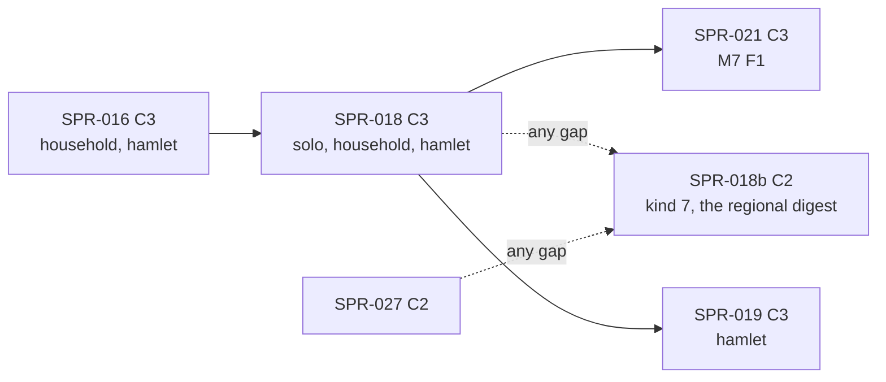

> **BLUF:** Builds the two genesis specs of `REV-SPR-018` (PR #52, closed) and their stream record:
> - **worldgen-lite** (`specs/systems/M1.regions.odd.toml` `[algorithm.worldgen_lite]` W0–W10): a u16 elevation raster from a heightmap template, K regions by keyed seeds, one per land component, and an integer Dijkstra flood, one seat per region, one route per adjacency, in `rh-worldgen`, bit-equal to `specs/worldgen/golden/worldgen_lite_v0.txt` (ten cases, 119 lines);
> - **`M1.regions` F0** in a new `rh-sys-regions`: the 18 owned columns, no binding, INV-M1-01 to 06; `WorldSpec` gains `geography`;
> - **`S3.migration` F0** in a new `rh-sys-migration` (`[algorithm.residence_f0]` R0–R6): one keyed, land-weighted settlement per manifest household or loose founder at genesis, the mother's settlement for every newborn in the same Vital slot, one `residence_interval` row per person; M2 F1's husband draw is bounded to the bride's settlement on real worlds for the first time (REV-SPR-018 R8), and M2's events carry a `place`;
> - **the manifest validator's two household refusals** (R9) in `manifest_v0.py` and the Rust loader (V-WC-04 parity); `S3.migration` in every template's `default_systems` with the `registry_version` bump (R3);
> - **channel A's kind-7 `RESIDENCE_INTERVAL` record** (R11 Q1), its fields, its canonical line and the format bump it forces; **`rh-cli tail --digest region`**, the regional digest that left SPR-027 (D-4), as a reader-side fold over the stream;
> - **bench 4** (`bench/raster_8x512`) recorded for the first time (the director's G0 ruling; `docs/08` §9).
>
> **Three baselines move** (`solo`, `household`, `hamlet`: genesis gains M1's and S3's tables); `smoke` is unchanged. They are re-recorded in the final `[C3]` commit by `bin/regen_baseline.sh`, with `registry_version` bumped there; bench 4 and the per-rung allocation budgets are recorded by their tools, so the PR title ends `[perf-baseline] [C3]`. The channel-A format moves to v1 (a Registry-like announcement). Every baseline move is announced to the director before the merge.
>
> - **Developer:** AGT-002-CORE (`rh-worldgen`, the two system crates, `rh-stream`, `rh-registry`), with AGT-002-TOOLS for the validator, `tail`, bench 4, the references and the gates (one Developer session may hold both roles).
> - **Testers:** AGT-003-DET (bit-equality with the golden, the divergence, thread and keyframe invariance) and AGT-003-IF (the C2 surfaces: the frozen specs, the validator, the record format, the contracts). One session may hold both, on a different model from the Developer's.
> - **Size and class:** **about 5 agent-days** by the task inventory (T-01 1.5, T-02 0.75, T-03 1.0, T-04 0.5, T-05 1.0, T-06 0.5, T-07 0.75; W14's rule), above GOV-005 §3's ~3. **Recommended: the split at the stage boundary** (the director item below, 65%): **SPR-018** proper is stage A, plane A and the baselines (T-01 to T-04 and T-07; **C3**; about 3.5 days), and **SPR-018b** is stage B, the stream record and the regional digest (T-05, T-06; **C2**, no baseline moves; about 1.5 days, mergeable in any gap). The alternative is one sprint with a hard checkpoint after T-02. **C3**: genesis adds plane-A tables to every rung. It contains C2: M1 0.1.0 and S3 0.1.0 frozen, `rh-contracts` v0.2, the Registry templates and version, two validator rules, channel A v1, `WorldSpec.geography`.
> - **Status:** PLANNING, revision 0 (the drafter's; the Architect's rulings on the specs table are marked "proposed" until given). It needs the director's plan approval (D57; GOV-005 §2).

# SPR-018 — Worldgen-lite, M1 F0, S3 F0, the residence record and the regional digest (WP P1.1a; ruling M-6; D-4)

- **Roadmap item:** `docs/11` P1.1a, with S3 F0 by PRJ-002 ruling M-6 and the regional digest by D-4 · **Phase / rung:** P1a, rungs 0–2 (every rung's genesis gains a map)
- **Depends on (the precondition head):**
  - **SPR-013 merged** (on `main`, `8f7edb4`): the run directory, `rh-stream`'s writer and `LifeTracker` (`crates/rh-stream/src/convert.rs:150–215`), `rh-cli tail` and its file snapshots (`crates/rh-golden/tests/snapshots/`), the `household` and `hamlet` baselines, `bin/regen_baseline.sh` over four worlds (`:31`).
  - **SPR-014 merged:** the core row insert that writes the type's zero into every other owner's column, which is S3's newborn selector (`S3.migration.odd.toml:134`, R4; REV-SPR-018 R4), `rh-contracts` v0 and the absent-owner rule with keyed neutrals (`05.1` §2 rule 2 v1.12), under which M2 registers without S3 and S3 is refused without M1 (identity reads require their owner, EVO-001 R12).
  - **SPR-015 merged:** births, so `residence_at_birth` has rows to act on (`S3.migration.odd.toml:136`: "nothing before SPR-015 merges"); M2 0.3.0's `mode` read of `person.residence` with neutral 0 (`specs/systems/next/M2.demography.odd.toml:388–393`, N4 at `:640`), which this sprint makes live; INV-M2-13 (`:872`), vacuous until now; the derived per-system index (W4) if S3 wants one (it does not: `restart` at `S3.migration.odd.toml:115`); the `H2` households, whose membership S3's R2 follows.
  - **SPR-016 merged:** no surface is used; it is on `main` before wave 6 by PRJ-002 §4, so the baselines this sprint re-records are SPR-016's.
  - **SPR-020 merged (wave 4):** channel A v0 as amended (16 files per segment, `specs/stream/selftest_channel_a.py:54`), on which the kind-7 record is defined; `rh_events::Event.place` (`specs/chronicle/envelope_v0.md:39`: "None until places exist, SPR-018"), which T-03 fills. If SPR-020 is not on `main` when stage B starts, the record is defined on SPR-013's shape and `place` waits for it.
  - **SPR-026 merged (wave 4, C2):** `rh-protocol`'s kind table, "a `const` copied from `canonical_v0.py`'s `CHANNEL`" (`specs/stream/wire_v1.md` §7; `SPR-026` plan `:108`), gains the new kind in T-05. If it is not on `main`, nothing.
  - **SPR-027: not a dependency.** It adds `tail --digest` (the world digest) and refuses `--digest region` (`SPR-027` T-04); this sprint's T-06 replaces the refusal. Whichever merges second resolves `crates/rh-golden/src/tail.rs`.
  - Independent of SPR-017 and SPR-019 (SPR-019 depends on this sprint: `founder_residence`, M1's settlements, the genesis order).
- **Binding contracts:**
  - `specs/systems/M1.regions.odd.toml` 0.1.0 (frozen by T-02): `[[owns]]` `:44–181`, no binding `:202–208`, `[algorithm.worldgen_lite]` `:225–245`, the facts `:246–255`, `[initialization]` `:257–259`, INV-M1-01 to 06 `:286–309`, `[isolation]` `:327–330`; `specs/worldgen/templates_v0.toml` (`worldgen-lite-templates-v0`); `specs/worldgen/worldgen_lite.md` §3, §5, §6.
  - `specs/systems/S3.migration.odd.toml` 0.1.0 (frozen by T-03): `person.residence` `:46–52`, `residence_interval.*` `:61–81`, the four `[[reads]]` `:90–109`, the Day/Vital binding `:130–136`, `[algorithm.residence_f0]` R0–R6 `:156–168`, `[initialization]` `:170–172`, INV-S3-01 to 05 `:185–204`, the M2 out-coupling `:229–232`, `[isolation]` `:239–244`.
  - `specs/worldgen/selftest_worldgen_lite.py` and `specs/worldgen/golden/worldgen_lite_v0.txt`: the ten cases (`:713`), the R = 64 sweep (`:94–96`), the bench-4 lines (`:765–767`), `STALE` (`:828`).
  - `specs/stream/channel_a_v0.sql` (R3–R7; kind 7 reserved `:64–65`; the step-digest note `:235–236`; the status rule `:6–8`), `specs/stream/canonical_v0.md` (the status rule in its header; §1 the frozen prefix and the file header; §5 the refusal of an unknown kind), `specs/stream/canonical_v0.py` (`KINDS` `:512`, `CHANNEL` `:589`), `specs/stream/selftest_channel_a.py`, `specs/stream/check_segments.py`, `specs/stream/differential_v0.py`, `specs/stream/wire_v1.md` §2.2 and §7.
  - `05.10` §4 (the fidelity promise: every move in channel A), §6 as noted at D-4 (`docs/05_architecture/05.10_world_stream.md:106–108`); `05.9` IF-0; `05.1` §2 rule 2 (ruling 10 extended: genesis writes a column only when its owner's `[initialization] from_manifest` names the section; `crates/rh-worldgen/src/lib.rs:246–268`), §2 rule 4 (the `same_instant` edge M2 → S3), §5 (raster fields), §6 items 2 and 5; `05.2` §1 (`RegionId(u16)`, `SettlementId(u32)` in world-gen order: `docs/05_architecture/05.2_world_model_and_data.md:29–30`); `05.5` §5 (validators).
  - `specs/manifest/manifest_v0.py` (`:468–491`: the cast and household checks, where the two refusals go), `specs/manifest/registry_v0.toml` (`registry_version` `:7`; the S3 entry and its note `:14–19`; `default_systems` `:462–483`; `[heightmap_templates]` `:495`), `tests/manifest_parity/README.md`.
  - `docs/08` §9 bench 4 (`docs/08_performance_and_capacity.md:239`), `bin/perf_gate.py` (`BENCH_TARGETS`, `SLOTS` `:70–73`), `crates/rh-bench/baselines/instructions_v1.txt:12` (the empty slot).
  - ADR-0004, ADR-0006, ADR-0007 (the interval table is append-only), ADR-0024, ADR-0025, ADR-0026 item 3, ADR-0030, ADR-0031, ADR-0033; `docs/09` V-INV-10 (`:134`), V-DATA-04 P1a variant (`:267`), V-INV-01, V-DET-01, V-DET-02, V-DET-05, V-DET-12, V-DET-19, V-WC-04 (`:337`), V-GOLD-01 (`:148`), V-STR-01, V-SCALE-01 (`:659`), V-SCALE-04, V-PERF-02 (`:208`, bench 4), V-PERF-04, V-PERF-11.
- **System specs:** M1 0.1.0 and S3 0.1.0 go from `draft` to **frozen** in this PR (T-02, T-03; Architect-approved C2 changes inside the C3 PR). Their skeletons exist on `main` (`crates/rh-core/tests/generated/M1_regions.rs`, `S3_migration.rs`, `SPEC_VERSION = "0.1.0"`); registration under rule `spec`. M2 0.3.1 (after SPR-016) is read: its `person.residence` read becomes live, nothing in its text changes.
- **Rulings (binding):**
  - REV-SPR-018 R1–R14, above all R3 (S3 into every template's `default_systems` and the bump in this PR), R4 (newborns by `person.residence = 0`), R5 (one seed per land component), R6 (bench 4 measures the genesis pass), R7 (back-filled ancestors exempt from the tiling), R8 (the husband draw bounded to the bride's settlement; neutral 0), R9 and R12 (the two validator refusals, Python and Rust, in this sprint), R11 Q1 (kind 7's fields defined here, C2), Q3 (V-DATA-04's span `[entry_tick, exit_tick)`), Q4 (focus slugs deferred), R13, R14 (the facts, the components line, NIT-A to NIT-C);
  - REV-SPR-015 R17.6 and R21 (INV-M2-13 gates every run; its two-settlement forcing); REV-EVO-001 R4 and R12; REV-SPR-026 R10 and R23; the Architect's D-4 at the wave-5 plans (REV-WAVE5 §0: the regional digest is this sprint's; `05.10` §6 v1.6); SPR-011 rulings 3, 5, 10, 13, 16; SPR-013's `--expect-serial` ruling (`SPR-013` T-13);
  - **the Architect's rulings on this plan's specs table, once given** (each row below is marked "proposed" with a confidence; the independent review and the Architect decide them before the sprint is ACTIVE).
- **Director items:** D57 (this plan: the size and the split, the channel-A format bump, the two Python gates moving to part golden). D-4 (the regional digest here) is already in D54.
- **Requirements covered:** SIM-2 (the region graph and raster: V-INV-10); SIM-15 (K ≥ 1 regions at every N); DATA-8 (residence intervals in the life-course log: V-DATA-04 P1a); DET-13 (no outcome is scheduled: F0 has no moves); STR-2 and STR-7's ingredient (residence in channel A for the virtual telemetry of P1b); PERF-2's bench 4.

## Specs this sprint needs

| Spec | Exists? | Gap | Architect ruling (proposed) | Needed by |
|---|---|---|---|---|
| **The freeze of M1 0.1.0 and S3 0.1.0** | Both are `status = "draft"` in `specs/systems/` (REV-SPR-018 closed on `f27b33b`); their skeletons are generated already (`gen_skeletons.py` reads every `specs/systems/*.odd.toml`) | GOV-005 §2: no code without a spec; D-1's reasoning (SPR-015): the code is built against the frozen file. Nothing is in `next/` for them, so the "promotion" is the status flip | **Proposed (8.5/10):** T-02 freezes M1 and T-03 freezes S3 at 0.1.0 (the number does not move at a freeze: M2 0.2.0 froze at its own number, PR #37), with the three NIT fixes of REV-SPR-018 round 2 (NIT-A at `S3.migration.odd.toml:221`, the `birth_tick` residue; NIT-B at `M1.regions.odd.toml:329`, K = 64 is not swept on every check; NIT-C: `worldgen_lite.md:71` and S3 `not_yet` `:39` name kind 7) applied as text at the freeze, since the texts are not yet frozen | T-02, T-03 |
| **Where the templates live in the build** | `worldgen_lite.md` §6 item 1: "templates loaded from `specs/worldgen/templates_v0.toml` at build time (`include_str!`)", which means a TOML parse at genesis in plane A | `rh-worldgen` has no TOML dependency (`crates/rh-worldgen/Cargo.toml:18–21`); `rh-registry` has `toml = "=1.1.8"` and is plane A, so a parse is allowed, but a runtime parse of a data file in the genesis path is a second way for a number to enter plane A | **Proposed (7/10): a generated constant table,** `crates/rh-worldgen/src/generated/templates.rs`, written by `bin/gen_templates.py` from `templates_v0.toml` with a `--check` gate in part core (the `gen_skeletons.py` pattern: never typed, a stale copy is STALE), so the data is in the engine build, in the history tuple through `engine_build`, and a changed template is a reviewed diff; the Registry's `[heightmap_templates]` ids and the table's keys are checked equal by the gate. Alternative: `include_str!` and `rh-registry`'s parser at genesis (one fewer tool, one more parse in plane A) | T-01 |
| **`WorldSpec` has no `geography`** | `crates/rh-registry/src/world.rs:20–36`: `seed`, `calendar`, `horizon_years`, `systems`, `demography`, `founders`; `rh_manifest::compile` reads M2's two parameters only (`compile.rs:35`) | Genesis needs R, K and the template id; W5's refusal needs them at load | **Proposed (8.5/10):** `WorldSpec.geography: Geography { raster_resolution: u16, region_count: u16, heightmap_template: HeightmapTemplateId }` compiled from the validated manifest (bounds are the validator's, `manifest_v0.py:113`); a template id not in the build's table is a compile error naming it (cannot happen on a validated manifest: V-WC-04 checks the Registry). C2 inside the C3 PR | T-02 |
| **M1 registers with no binding** | `M1.regions.odd.toml:13–15` (`schedule = []`), `:202–208`; `register.rs` has no rule against an empty binding set (grep: none), and `invariants()` runs for every registered system at Bookkeeping (`crates/rh-core/src/engine.rs:780`) | Not yet exercised: every registered system so far binds a pulse | **Proposed (8/10):** T-02 confirms it with a test; if `rh-core` refuses, the smallest additive change (a system may bind nothing; its invariants still run) is made in T-02 and stated as a `05.1` §2 rule 2 line (the Architect's wording) | T-02 |
| **`--expect-serial` on `household` and `hamlet`** | `bin/regen_baseline.sh:46`; it "fails, naming the floor to set, once a second system arrives" (SPR-013 T-13) | Two new systems arrive. M1 binds nothing (no job); S3's Day/Vital binding sits at a later level than M2's by the `same_instant` edge of `person.mother` (`05.1` §2 rule 4), so every level still holds one job | **Proposed (8/10):** the flag stays; T-07 asserts it on both worlds. If a level ever holds two jobs, the Architect restates the floor with the measured figure (`--require-parallel`), never silently | T-03, T-07 |
| **M2's events gain a `place`** | `specs/chronicle/envelope_v0.md:39, :55`: "`place` ... the draft sets it (None until places exist, SPR-018)"; "a `DEATH` at the deceased's residence once S3 tracks it"; `EVENT.place_id` "NULL until places exist (P1.1a)" (`channel_a_v0.sql:143`); SPR-027's `--place` filter then has real ids on the rungs | Not in the M1/S3 specs; it is an M2 emit-site change (M2 already declares the `person.residence` read) | **Proposed (6.5/10): in scope of T-03,** since every rung's hash moves in this sprint anyway and a later change would be a second C3: `DEATH` carries the deceased's residence, `BIRTH` the mother's (= the newborn's), `MARRIAGE` the wife's (the husband's is equal by N4 on a partnering row; a command row keeps the wife's), `EXTINCTION` none; the `place` is a `SettlementId` (`05.2` §1). An M2 0.3.1 text line (`[[emits]]`, the `place` of each kind) is an Architect text edit at T-03, not an amendment (the `place` slot is new since SPR-020). Alternative: out of scope; `--place` filters nothing on the rungs until P1b | T-03 |
| **Kind 7's fields** | `channel_a_v0.sql:64–65`: "Kind 7 is reserved for `RESIDENCE_INTERVAL` ... SPR-018 defines its fields (REV-SPR-018 R11)"; S3 `not_yet` `:39`: "one record per `residence_interval` row at genesis and at each birth"; `schema.sql:145–152` `life_interval` (kind 0 residence, settlement id) | The fields, the R4 class and order key, and whether the record carries the region (the digest groups by region; channel A has no settlement → region map, M1 writes no stream record: `M1.regions.odd.toml:221`) | **Proposed (7/10): `RESIDENCE_INTERVAL` (kind 7, R4 class 2 with the life records):** `timeline_id, seq, tick, kind, person_id u64, settlement u32, region u16, from_tick i64` with `tick = from_tick` (0 at genesis, the birth instant at a birth); R4's `k` for class 2 is `(person_id, 0 entry \| 1 exit)` today, and the record takes `k = (person_id, 2)`: within an instant it follows its person's `LIFE_ENTRY` and any `LIFE_EXIT` of the same person (none can share a birth instant: a newborn's first death draw is the next Month pulse's), and the `record_header` view gains its arm. `region` is denormalised from `settlement.region`, which S3 already reads (`S3.migration.odd.toml:100–104`) and never changes at F0 (INV-M1-06), so a reader needs no map; the canonical line is `RESIDENCE_INTERVAL tl seq tick person_id settlement region from_tick`. Table `residence_interval.parquet`, 17 files per segment. Alternative: no `region` field, the reader using F0's identity `settlement = region`, which F1 breaks | T-05 |
| **The format bump (finding F-1)** | `channel_a_v0.sql:6–8`: "Until the first build writes a segment, a change to a column, a code or the order is an in-place amendment of v0 ... from then on it is a new format version (`segment.format`), announced like a Registry change"; the same rule heads `canonical_v0.md`; SPR-013 merged on 2026-10-17, so builds write segments; the self-test counts 16 files (`selftest_channel_a.py:54`) and the canonical parser refuses an unknown kind (`canonical_v0.md` §5) | REV-SPR-018 R11 Q1 called the reservation "no format change" (true) and the fields "C2" without naming the version consequence. A v0 reader refuses a v1 segment (file count, unknown kind), so this is a format change by the DDL's own rule | **Proposed (7/10): the strings move in place,** `segment.format = 'rehoboam/stream/channel-a/v1'` and the canonical header's `format=` token `rehoboam/stream/canonical/v1`, in the existing files (`channel_a_v0.sql`, `canonical_v0.md/.py`: the file names are historical, as `05.1`'s version lines are), with a change-log row in each; `rh-stream` writes v1 and reads v1; no v0 chronicle exists that must stay readable (no release is tagged: GOV-005 §7, V-GOLD-04 binds releases), so no v0 reader is kept. The director is told in the merge summary (a Registry-like announcement; D57 names it). Alternative: an Architect ruling that an additive record kind amends v0 in place, which contradicts the DDL's rule and leaves the 16-file count wrong | T-05 |
| **The regional digest's source** | `05.10` §6 and its D-4 note (`05.10:106–108`): `--digest region` "prints the per-step population, prices and Ψ per region"; `channel_a_v0.sql:235–236`: region-level digests "join when their owners exist; they are new columns or a child table in a later format" | Whether the digest needs a new child table of `STEP_DIGEST` (a second format change, with nothing but population to carry until P1b), or is derived by the reader | **Proposed (7/10): a reader-side fold, no new table.** At each `STEP_DIGEST`, `tail` folds the `LIFE_ENTRY`, `LIFE_EXIT` and `RESIDENCE_INTERVAL` records read so far: residents per region = placements + births − deaths of residents (exactly INV-S3-05's reconciliation, `S3.migration.odd.toml:201–204`); the digest row is `date, region → living, births, deaths` and the sum equals `STEP_DIGEST.living`. Prices and Ψ join as a child table when M4 and M6 own them (P1b). T-06 cross-checks the fold against the engine's `person.residence` histogram at every pulse. Alternative: a `step_digest_region` child table written by the host (a format change now and again in P1b) | T-06 |
| **The two validator refusals (R9, R12)** | `manifest_v0.py:468–491` checks that a head is a cast member and a household id exists; nothing refuses a cast member who heads two households or a head whose `household` names another household; REV-SPR-018 round 2 R9: "PARTLY APPLIED ... deferred to the SPR-018 sprint", with probe manifests `two_heads.yaml` and `head_names_other.yaml` | The reference's `Population.check` (`selftest_worldgen_lite.py:490`) raises on both; the validators accept both; the Rust loader must agree line for line (V-WC-04) | **Proposed (8.5/10):** two `[ERROR]` rules, `households[i].head` "'x' heads two households" and `cast[i].household` "'x' heads 'h' but names 'g'", in `manifest_v0.py` and `rh-manifest`, with two must-FAIL fixtures under `tests/manifest_parity/` (named by the README's rule) and `invalid_draft_style`-style lines in `CLAUDE.md`; the JSON Schema is unchanged (`rh-cli manifest schema --diff` stays green: the rules are cross-field, not structural) | T-04 |
| **S3 in every template and the bump (R3)** | `registry_v0.toml:14–19`: the S3 entry "bumps when the spec freezes in SPR-018's PR"; `:462–483`: no template lists S3; every template already lists `M1.regions` | A world registers only what its manifest or template names (ruling 3; REV-SPR-018 MAJ-3) | **Ruled (REV-SPR-018 R3, R12):** T-07's final `[C3]` commit adds `S3.migration` to the five templates' `default_systems` and bumps `registry_version` to the next free number (SPR-020 and SPR-015 bump it too: the next free number at merge, REV-EVO-001 R14's precedent); the example manifests' pins and the worlds' SHA-256s follow; the annals fixtures and goldens regenerate with their tools (W1 (d)); the bump alone is measured as a separate step (SPR-020 T-07's form) | T-07 |
| **What the baselines' tuple line shows** | `crates/rh-golden/src/world.rs:46` `BUILT = ["M2.demography"]`; `:256–260`: `engine_build` is `rh-golden <version> built:<BUILT>` | `BUILT` gains `M1.regions` and `S3.migration`, so every manifest world's ladder header changes by the built list, independently of the hash | Stated in T-07's divergence record (the header's `tuple` line moves on `solo`, `household`, `hamlet`; `smoke`'s header is the overlay's) | T-07 |
| **The raster in plane-A state** | `WorldTables` stores `i64` columns (`crates/rh-worldgen/src/lib.rs:325`); the plane hash covers every column with dirty tracking (`crates/rh-snapshot/src/hash.rs:1, :394–494`); keyframes store every table (`05.2:276`) | `hamlet` gains 65,536 × 2 cells (about 1 MiB in state); the first hash pays for it once, later hashes skip unchanged chunks; keyframes grow; a 4096² manifest would carry 268 MiB, which no P1a world uses | **Proposed (8/10):** accepted for P1a as the specs say (`M1.regions.odd.toml:191` `restart`; A-22 stays not due, elevation is u16); T-07 reports the keyframe sizes per rung and the first-hash cost; a compact raster encoding is M1 F1's with `05.2`'s typed keyframe batches. V-PERF-11's rung budgets measure steady-state ticks, where S3's daily scan allocates nothing (an iterator over the ledger) and M1 does nothing; any moved count is re-recorded by the tool | T-02, T-07 |
| **V-INV-10's "two machines"** | `docs/09:134`: "Same seed and generator version on two machines: identical raster, region graph and routes" | No cross-machine harness runs the rungs (`bin/cross_machine.sh` runs `smoke` only, nightly on `adjutant`) | **Proposed (8/10):** satisfied by construction at the PR tier: the golden file was rendered by the Python reference on the drafter's machine, the Rust port reproduces every line on the Developer's machine and on the GitHub runner (three machines, two implementations); `bin/cross_machine.sh` gains the rung ladders for the next `adjutant` session (RUN-002), reported, not gated | T-01, T-07 |
| **`EntityKind::Settlement` has "no typed id yet"** | `crates/rh-ids/src/entity.rs:27–33`: `Household = 2`, `Settlement = 3` ("no typed id yet"), `Region = 4` (`RegionId`) | A `SettlementId(u32)` newtype is wanted by `place`, the record and `rh-contracts` | **Proposed (8/10):** `rh_ids::SettlementId(u32)` additive, in world-gen order (`05.2` §1), no hash layout (settlement ids are M1's small integers, never hashed); C2 inside the C3 PR | T-02 |
| **Bench 4's recording** | `instructions_v1.txt:12` holds the empty `slot raster_8x512`; `perf_gate.py:70–73` lists it in `SLOTS`; `worldgen_lite.md` §5 defines the fixture; `docs/08:239` | A recorded baseline comes only from `perf_gate.py record` in a `[perf-baseline]` PR with a reason line (SPR-009 ruling 3) | **Ruled (G0; REV-SPR-018 R6; `docs/08` §9):** T-07 records it; `BENCH_TARGETS` gains `raster_8x512`, `SLOTS` loses it; the bench asserts both digests of the golden file before it measures; `rh-bench` depends on `rh-worldgen` as it does on `rh-snapshot` (a non-engine tool crate, `bin/lint_arch.py:404`) | T-07 |
| **CI: part core at 11:46 with no headroom** | Measured on `main` at `772478f`: core 11:46, golden 9:01 (the Architect's figures for this plan). The three worldgen references run in part core today (`bin/check_all.sh:1277–1285`): `selftest_population_synthesis.py` about 26 s, `selftest_fixture_worlds.py --tier pr` 10–20 s, both pure Python with no build | This sprint adds Rust tests to core; a gate over about 5 s belongs in part golden (the Architect's rule for this plan); REV-SPR-030 R27 already foresaw moving Python gates when core passes 12 minutes | **Proposed (8/10):** T-07 moves `population_synthesis_gate` (and its two `--control rounding-*` lines) and `fixture_worlds_gate` (and `--control dormancy-one`) to part golden, which has 3 minutes of headroom, and puts this sprint's release-only goldens there too; the inventory test's part assertion follows (`test_check_all_inventory.py:880–892`). The third job stays the director's call (D54 item 6) | T-07 |
| **The divergence record's form** | W2, W3: the channel-A criterion in SPR-020 T-07's form; the robust form in two parts, non-vacuous | `hamlet` has four regions, so M2's husband draw is restricted from the first pulse: the frozen roots diverge at the first partnering hit whose unrestricted argmin lives outside the bride's settlement; `solo` and `household` have one region, so nothing M2 does changes | **Proposed (8.5/10):** T-07 states both parts: (a) on every world, at every rung, the differing roots are exactly the new tables and columns (M1's six tables, S3's `person.residence` and `residence_interval`) plus the header, until, on `hamlet` alone, the month of the first restricted hit, which the record names with the pair; (b) from that month on the differential model (SPR-015's `bin/gen_m2_f1_draws_reference.py`, extended with R1–R4 and N4's settlement condition) reproduces every `BIRTH`, `MARRIAGE` and `DEATH` instant, child id and sex over 200 years | T-07 |

## Compliance (every task)

| Rule | This sprint |
|---|---|
| Change class (`docs/13` §4.2) | **C3**: genesis writes M1's six tables (18 columns) and S3's `person.residence` column and `residence_interval` table (4 columns) into every rung, so `state_hash` moves on `solo`, `household` and `hamlet` from the genesis keyframe on; M2's husband draw is bounded on `hamlet`. It contains C2: the frozen M1 0.1.0 and S3 0.1.0, `rh-contracts` v0.2 (`m1`, `s3`), `rh_ids::SettlementId`, `WorldSpec.geography`, two validator rules, the templates and `registry_version`, channel A and canonical v1 (kind 7), M2's `place`. The PR title is `SPR-018: … [perf-baseline] [C3]` (bench 4's first record, the rung budgets). **Under the split,** SPR-018b's class is **C2** (a record format and a `tail` option; no plane-A hash moves, no baseline) |
| Planes touched (ADR-0024) | **A:** `rh-worldgen` (W0–W10, R1–R4 at genesis, the generated templates, three purposes), `rh-sys-regions` and `rh-sys-migration` (new, `[package.metadata.rehoboam]` A/system), `rh-registry` (`WorldSpec.geography`), `rh-ids` (`SettlementId`), `rh-contracts` (`m1`, `s3`), `rh-stream` (kind 7: record, convert, writer, reader, canonical), `rh-sys-demography` (`place` on three emits), `rh-core` only if a binding-free system needs an additive line. **Tool:** `rh-manifest` (`compile`, two validator rules), `rh-cli` (`tail --digest region`), `rh-golden` (`BUILT`, `world.rs`'s setup, `tail.rs`), `rh-bench` (`raster_8x512`), `rh-protocol` (the kind table, if on `main`), `bin/gen_templates.py` (new), `bin/perf_gate.py`, `specs/` (the two freezes, the DDL and canonical references and goldens, `selftest_channel_a.py`, `check_segments.py`, `manifest_v0.py`, `registry_v0.toml`). **B, C:** none (`rh-sifter`'s twin reads event tables only) |
| Owned columns written | `M1.regions`: `raster.resolution`, `raster.sea_level`, `cell.elevation`, `cell.region`, `region.id`, `region.land_cells`, `region.seed_cell`, `region.seat`, `settlement.id`, `settlement.region`, `settlement.cell`, `region_edge.a`, `region_edge.b`, `region_edge.route`, `route.id`, `route.a`, `route.b`, `route.length_cells` (at genesis only, by `rh-worldgen` under `[initialization] from_manifest = ["geography"]`; INV-M1-06). `S3.migration`: `person.residence`, `residence_interval.person_id`, `.settlement`, `.from_tick` (genesis by `rh-worldgen` under `from_manifest = ["cast", "households", "peoples"]`; births by `residence_at_birth`). `M2.demography`: no column; the `place` of its drafts is an event field, not a column |
| Reads (via `rh-contracts`) | S3: `person.mother` (M2, `same_instant`, identity: the edge that orders S3 after M2 in Vital), `settlement.id`, `settlement.region` (M1, lagged, identity), `region.land_cells` (M1, lagged, rate; neutral "equal land cells", used only at genesis through `rh-worldgen`). M2's declared `mode` read of `person.residence` (neutral 0) becomes a real read on every rung. Registration (EVO-001 R12): S3 is refused in a world without M1 (identity reads require their owner); M2 still registers without S3 |
| RNG purposes added | `rh-worldgen`'s, under the reserved id (`register.rs:67`), after `founder_sex`, `founder_age`, `founder_birthday` (`rng_purposes.rs:8–16`): `heightmap_blob` (entity = the blob ordinal, k = 0..3 for a dome, 0..4 for a ring), `region_seed` (entity 0, k = 0), `founder_residence` (entity = the household head's or the loose founder's `PersonId`, k = 0). Keys as W0 and R0 (`world_seed`, the canonical salt, `system_id("rh-worldgen")`, epoch 0, t = 0). None for M1 or S3 (`rng = []`). Not re-sampled on a fork (genesis) |
| Golden-hash effect | **`solo`, `household` and `hamlet` move; `smoke` does not** (no manifest, no `rh-worldgen`). Re-recorded by `bin/regen_baseline.sh` in the final commit, whose subject ends `[C3]`; announced to the director before the merge; the divergence record is T-07's. **SPR-018b (the split) moves nothing** |
| Fixed-point quantities | **None.** Integers in stated widths (`worldgen_lite.md` §3): u16 elevation, i64 accumulator, u64 Dijkstra distances and centroid sums, u128 for `pick(u, n)` and the weighted placement. No float anywhere (V-DET-19); `cell.elevation` stays u16, so BCK-002 A-22 is not due |
| Determinism lints (GOV-003 §2, §6) | Must pass. The two new crates are `rh-sys-*` (A, system) by name (`bin/lint_arch.py:117`); `rh-worldgen` keeps its pin; no new plane-A dependency (`gen_templates.py` removes the need for a TOML parse); no `HashMap` (the edge set is a `BTreeSet`, the queue a `BinaryHeap` on `(dist, cell, region)` with the lexicographic order W7 states, so the push order does not matter); no interior mutability (W31); every tie broken as W6–W9 say |
| Tests that gate this sprint | V-INV-10 (the golden's every line, in debug and release; the R = 64 sweep), V-DET-01, V-DET-02 (1, 2, 4, N threads on the three rungs with the map), V-DET-05 (the raster and the intervals through a keyframe), V-DET-12, V-INV-01 (INV-M1-01 to 06, INV-S3-01 to 05, INV-M2-13 non-vacuous), V-DATA-04 (P1a variant: residence tiling, `[entry_tick, exit_tick)`), V-WC-04 (the two refusals in both validators; every example still VALID), V-GOLD-01 (three baselines), V-STR-01 (segments byte-identical with kind 7), V-SCALE-01 and V-SCALE-04 (the rungs past extinction with S3; `--expect-serial` holds), V-PERF-04 (bench 4 recorded; benches 7 and 8 unchanged), V-PERF-11 (the rung budgets), plus `bin/check_all.sh`. V-SF-22 for M1 and S3 is the generation itself (`M1.regions.odd.toml:327–330`) and S3's scripted-ledger run (`S3.migration.odd.toml:239–244`), both run here; the chi-square of S3's neutral forcing is reported |
| Docs updated in the same sprint | `bin/check_all.sh` and `python/tests/test_check_all_inventory.py` (same commit, the part moves included); the `CLAUDE.md` checks (the new gates, the two freezes' lint lines, the two `invalid_*` manifests, `gen_templates.py --check`, bench 4); `channel_a_v0.sql` (kind 7, the format line, the change log), `canonical_v0.md` §3 and §8, `05.10` §6 (the digest as built), `05.9` IF-0 (kind 7, format v1), `05.0` §6 (the two crates; `rh-contracts` v0.2), `05.1` §2 rule 2 if a binding-free line is needed; `docs/09` V-INV-10, V-DATA-04, V-STR-01 method lines with the test names; `docs/08` §9 (bench 4 recorded); `worlds/solo/README.md`, `worlds/household/README.md`, `worlds/hamlet/README.md` (what moved); the M1 and S3 headers (frozen; the NIT fixes); `worldgen_lite.md` §6 (done) and §7 row 1 (the format bump); `specs/README.md`; BCK-002 A-22 (recorded: not due); PRJ-002's row |

**Rules carried from P0–SPR-016 (every task):**
- **Property tests vary world size and seed:** at least three sizes (6, 60, 600 founders) and eight seeds, fixed-seed SplitMix64, no new crate; three raster sizes (64, 128, 256) and K ∈ {1, 4} in the PR tier; the 600-founder size, R = 512 and K = 64 nightly (W42).
- **A positive control fails for the right reason:** its `check_all` line matches the message (`fail:<text>`); every planted mutant fails its named golden line.
- **A test input exercises the path it claims, and a probe asserts it:** a newborn's row really had `person.residence = 0` before S3's step; a partnering hit really had its unrestricted argmin outside the bride's settlement; a land component really had no seed before R5's pass; a `KEYFRAME` really carried the raster (W7).
- **Python tests read no CI environment variable.**
- **No statistical gate in this sprint.** S3's neutral-forcing chi-square is reported.
- **CI time (W42):** the reference is `main` at `772478f`, **core 11:46 and golden 9:01**; core has no headroom. Each part stays at or under 12 minutes (15 hard), reported in the PR; T-07 states this sprint's added time per part and what leaves which part. A new gate over about 5 s goes in part golden. A third PR-tier job is the director's call (D54 item 6).
- **Merge `origin/main` when main moves,** and re-run both parts.
- **Batch pushes at task boundaries;** T-01 and T-02 are pushed together (the raster has no owner before M1 registers).
- **Every new gate is in exactly one `check_all.sh` part,** with the inventory test updated in the same commit.
- **Baselines are regenerated only by `bin/regen_baseline.sh`,** in the final commit, with `[C3]` at the end of its subject. Test goldens are regenerated by their own tools (`selftest_worldgen_lite.py --write` only if the golden must move, which it must not: the Rust port reproduces it); snapshots under `RH_UPDATE_SNAPSHOTS` locally (never in CI), never typed. **Mutants never make a baseline:** every mutant is a `mutant-*` Cargo feature (BCK-002 A-52).
- **One commit per task** (GOV-005 §4).

## Tasks

**Stage A** is T-01 to T-04 and T-07 (plane A, the validator, the baselines: SPR-018 proper under the split). **Stage B** is T-05 and T-06 (the stream record and the digest: SPR-018b under the split). Under one sprint, a **hard checkpoint** follows T-02: the Tester's interim pass on the raster and M1 (`VER-SPR-018-TEST`, phase 1) is required before T-03 lands (W14's pattern).

#### T-01: Worldgen-lite in `rh-worldgen`: W0–W10, the templates, the purposes, the bench-4 kernel (`[algorithm.worldgen_lite]`; `worldgen_lite.md` §3, §5; REV-SPR-018 R5, R10, R13)
- **Deliverable:**
  - **The generated template table** (`bin/gen_templates.py` → `crates/rh-worldgen/src/generated/templates.rs`, `--check` in part core): one `const` per `[templates.<id>]` of `templates_v0.toml` (base, sea level, smoothing passes, the ops with their integer ranges), the file's `version` string, and a check that the ids equal the Registry's `[heightmap_templates]`.
  - **`rh_worldgen::map`:** W0's keys (`heightmap_blob`, `region_seed` in `rng_purposes.rs`, after the three of SPR-012) and `pick(u, n)` as a u128 product; W1–W3 blobs and clamp (a dome takes 4 draws, a ring 5, whatever their values); W4 Jacobi smoothing with clamped edges, the pass as a function `smooth_pass(&[u16], R) -> Vec<u16>` that bench 4 calls; W5 land and the refusal naming the template, the seed, `n_L` and K; W6 seeds (the first keyed, then one per seedless 4-component in order of lowest cell, then farthest-point over L, ties to the lowest index, `dmin` kept incrementally); W7 the multi-source Dijkstra with the lexicographic queue and `c = 1 + (|ΔE| >> 8)`; W8 seats by floor centroid (u64 sums); W9 edges as a sorted set and routes with `isqrt`; W10 the write order into `WorldTables` (`raster.*`, `cell.*` in index order, `region.*`, `settlement.*`, `region_edge.*`, `route.*`).
  - **The bench-4 fixture function:** the eight shifted layers of `worldgen_lite.md` §5 and the SHA-256 over them, for `rh-bench` (T-07).
  - **Three planted mutants** (`mutant-*` features of `rh-worldgen`): `mutant-smooth-in-place` (Gauss–Seidel instead of Jacobi), `mutant-dome-three-draws` (a dome takes 3 draws, so every later blob's draws shift), `mutant-seed-no-components` (R5's per-component pass skipped).
- **Acceptance:**
  - **The golden, every line** (`specs/worldgen/golden/worldgen_lite_v0.txt`, 119 lines: elevation and region SHA-256s, land counts, seeds, region sizes, seats, edges, routes, `graph components`, the two bench-4 digests) reproduced by the Rust port for all ten cases, in debug (R ≤ 256 cases, part core) and in release (all ten with the 512² bench fixture, part golden); the altered-golden control (`worldgen_lite_golden_control`, already in `check_all.sh:399–404`) still fails `STALE:` against the reference, and a Rust twin of it fails by name against the port.
  - **The sweep:** every template at R = 64, seeds 1–8, K ∈ {1, 4} generates or is refused by W5 with its counts, and INV-M1-01 to 05 hold on each (the reference's `check_sweep`, in Rust); `desert_fringe` at R = 128, K = 4 gives a connected graph for seeds 1, 2, 4–8 and two components at seed 3 (`M1.regions.odd.toml:330`). Nightly: R = 256 and 512, K = 64, seeds 1–8 (`[isolation].horizon`).
  - **Draw structure (CRN):** a dome's 4 and a ring's 5 draws are taken whatever their values (a probe counts the draws per blob); the seeds of a template at seed s are unchanged by a change to another template's ops.
  - **Mutants:** each fails a named golden line: `mutant-smooth-in-place` the `continental_plains` elevation digest; `mutant-dome-three-draws` every multi-blob case's seeds; `mutant-seed-no-components` the `archipelago 7 96 6` case's `seeds`, `regions_sha256`, `land_cells` and `graph components 6 connected no` lines (`worldgen_lite_v0.txt:62–71`; REV-SPR-018 R5's case, where the old W6 left islands unregioned).
  - **Lints:** `gen_templates.py --check` is green and a planted stale table is STALE; `lint_forbidden` and `lint_arch` green on the crate (no float, no `HashMap`, no file I/O).
  - **V-INV-10:** the lines above were rendered by the reference on another machine (the committed golden) and are reproduced on the Developer's machine and on the runner; T-07 records it as the two-machine evidence.
- **Status:** [ ] not started

#### T-02: `M1.regions` F0 (`rh-sys-regions`), `WorldSpec.geography`, `SettlementId`, the raster in state; the freeze of M1 (stage A's checkpoint)
- **Deliverable:**
  - **`crates/rh-registry`:** `WorldSpec.geography` (the specs table) compiled by `rh_manifest::compile` from the validated manifest; `rh_ids::SettlementId(u32)` (additive; `EntityKind::Settlement` gets its typed id).
  - **`crates/rh-sys-regions`** (A, system): `AccessSpec` with the 18 `[[owns]]` columns, no read, no binding, no purpose; `invariants()` for INV-M1-01 to 06 (06 as a per-table root equality against the genesis roots, checked at every Bookkeeping in debug and tests); registration against the frozen 0.1.0 under rule `spec`; the skeleton `M1_regions.rs` included as M2 includes its own (`crates/rh-sys-demography/src/demography.rs:40`).
  - **Genesis order:** `rh_worldgen::genesis` writes M1's tables first (W10), then M2's founders, then (T-03) S3's columns; `crates/rh-golden/src/world.rs` `BUILT` gains `M1.regions`; every template already lists M1, so M1 registers in every manifest world.
  - **`rh-contracts::m1` v0.2:** one typed accessor per column; the drift test against 0.1.0.
  - **The freeze:** `M1.regions.odd.toml` `status = "frozen"` at 0.1.0, with NIT-B's text fix (`:329`); the skeleton regenerated (nothing but the status changes); the `CLAUDE.md` line.
  - **A test** that a system with no binding registers and runs its invariants (the specs table); if `rh-core` refuses it, the additive line in `register.rs` and the `05.1` §2 rule 2 sentence (the Architect's wording).
- **Acceptance:**
  - `solo` and `household` (flat, R = 64, K = 1) and `hamlet` (desert_fringe, seed 42, R = 256, K = 4) build the golden's cases at genesis: the M1 tables of the engine equal the reference's lines (the Rust port of T-01 through the engine's `WorldTables`, compared cell for cell), so the facts of `M1.regions.odd.toml:246–255` hold on the real worlds (hamlet: 53,859 land cells, regions 27,691 / 6,711 / 5,996 / 13,461, seats 18078, 55338, 54904, 26409, five edges, routes 78 to 148).
  - **V-DET-05:** the raster and every M1 table round-trip a keyframe (the SPR-012 V-INV-11 harness, `crates/rh-worldgen/tests/keyframe.rs`), and a run resumed from it continues as the continuous one; **V-DET-01/02:** the three rungs equal at 1, 2, 4 and N threads for 50 years (the ladders of this task; T-07 re-records the 200-year baselines); INV-M1-06's roots are equal at every hash point.
  - **Registration:** M1 registers under rule `spec` with no binding; a planted `AccessSpec` with a read fails the `spec` comparison by name; a planted extra column fails `single-writer`; `rh-cli ownership` lists the 18 columns under M1.
  - **Refusals by name:** a fixture manifest with more regions than the raster has cells (R = 64, `region_count: 4097`, inside the validator's bound of 5,000 and above `n_L ≤ 4,096` for every template) fails `rh-cli run` at genesis naming the template, the seed, `n_L` and K, and `manifest_v0.py validate` still passes it (W5 is a genesis rule, not a validator rule).
  - **Reported:** the keyframe size per rung before and after (hamlet's grows by the raster), the first `state_hash` cost on hamlet, and that later hashes skip the unchanged chunks (`hash.rs`'s chunk counter, `:547`).
  - **Checkpoint (stage A, one-sprint form).** The Tester's interim pass on T-01 and T-02 is recorded in `VER-SPR-018-TEST` before T-03 lands.
- **Status:** [ ] not started

#### T-03: `S3.migration` F0 (`rh-sys-migration`): residence at genesis and at birth, the husband draw bounded, `place` on M2's events; the freeze of S3 (R0–R6; INV-S3-01 to 05; INV-M2-13; REV-SPR-018 R4, R7, R8; REV-SPR-015 R17.6, R21)
- **Deliverable:**
  - **Genesis (R0–R4 in `rh-worldgen`):** after M1's tables and M2's founder rows: the weights `w_s = region.land_cells` of `settlement.region` in ascending `settlement.id`, the cumulative `C_s` (u64), one draw per manifest household keyed by its head's `PersonId` and one per loose founder keyed by its own (`founder_residence`), the least `s` with `C_s > pick(u, W)`; every member of a household (the head, the cast members whose `household` names it, its children and servants) takes its settlement; `person.residence := s` and one `residence_interval` row `{person_id, s, 0}` per founder in ascending `PersonId`. The founder order is ruling 10's (`selftest_worldgen_lite.py:501` `founder_order`; R2).
  - **`crates/rh-sys-migration`** (A, system): `AccessSpec` with the four owned columns, the four declared reads (`person.mother` same-instant; M1's three lagged), the Day/Vital binding; the step `residence_at_birth`: for each ledger row with `person.residence = 0` in ascending `PersonId`, `person.residence := the mother's` and a row `{person_id, s, now}` appended (R4; a mother dead in this slot is still readable, ruling 5); `invariants()` for INV-S3-01 to 05 (01 over the rows whose `entry_tick ≥ 0`: R7; 05 per settlement at every month end); registration against the frozen 0.1.0 under rule `spec`; the skeleton `S3_migration.rs` included.
  - **`rh-contracts::s3` v0.2:** `person.residence` and the three interval columns; the drift test. `BUILT` gains `S3.migration`.
  - **M2 (`rh-sys-demography`):** nothing in N4 changes (the read and its neutral are SPR-015's); the `place` of `BIRTH`, `MARRIAGE` and `DEATH` drafts (the specs table), read through `rh-contracts::s3`; the M2 0.3.1 `[[emits]]` text lines for the `place` (an Architect text edit at this task).
  - **The differential model:** `bin/gen_m2_f1_draws_reference.py` (SPR-015's, SPR-016's fold) gains R1–R4 (the residence of every founder and newborn) and N4's settlement condition, and a fixture world with two settlements where a bride's unrestricted argmin lives in the other one (a probe asserts it).
  - **Two planted mutants** (`mutant-*` of `rh-sys-migration`): `mutant-residence-at-birth-skip` (the step writes nothing), `mutant-founder-residence-loose-head` (a household's draw keyed by its first member, not its head).
- **Acceptance:**
  - **The golden's residence lines** (`worldgen_lite_v0.txt`: `solo`, `household`, `hamlet` at R = 256, `hamlet` at R = 128, the six synthetic lines) reproduced by the engine's genesis from the real manifests: on hamlet, Job's 42 in settlement 1, the four friends in 4, 2, 1, 3, the 14 others `1 2 1 2 4 3 2 1 1 4 1 1 4 1`, per-settlement counts 50 / 4 / 2 / 4 (`M1.regions.odd.toml:250–252`).
  - **Births:** on random worlds (three sizes, eight seeds; the 600-founder size nightly) every newborn has its mother's settlement after the Vital phase of its birth instant and one interval row opening at its birth tick; a probe asserts the row had `person.residence = 0` before S3's step and that no founder is ever re-placed (R4; a founder with `birth_tick = 0` is in one fixture); INV-S3-02 at every Vital end, INV-S3-03 and 04 at every Bookkeeping, INV-S3-05 at every month end, INV-S3-01's tiling at the end of every test run.
  - **V-DATA-04 (P1a variant):** the 1,000-year release test (`crates/rh-worldgen/tests/m2_system.rs` `v_data_04`, `check_all.sh:1220`) gains the residence clause: for every person who entered at or after the epoch, the intervals tile `[entry_tick, exit_tick)` with no gap or overlap, one row at F0; per settlement and month the counts reconcile (placements + births − deaths of residents).
  - **INV-M2-13, non-vacuous:** on `hamlet` over 200 years no partnering row pairs two settlements, and a probe asserts that at least one partnering hit's unrestricted argmin lived outside the bride's settlement (otherwise the filter was never exercised and the test fails); the two-settlement forcing of M2's `[isolation]` (`next/M2:969`) now runs under the real S3 instead of a stub owner; a planted N4 that ignores residence fails INV-M2-13 by name (SPR-015 T-04's control, repeated under the real owner).
  - **Registration:** S3 registers in `{M1, M2, S3}`; S3 is refused in `{M2, S3}` naming the missing owner M1 (identity reads); M2 still registers in `{M2}` with the read dropped and reported; a planted `AccessSpec` without the `same_instant` lag on `person.mother` fails the `spec` comparison by name; the scheduler orders S3's Day/Vital job after M2's (a probe reads the level table); `--expect-serial` still holds on `household` and `hamlet`.
  - **`place`:** every `DEATH` on hamlet carries the deceased's settlement, every `BIRTH` the mother's, every `MARRIAGE` the wife's; `EXTINCTION` none; on `solo` and `household` every place is 1; the canonical `EVENT` lines carry the `place_id` token instead of `~`.
  - **Bit-equality** with the extended draws golden on the fixture worlds (every residence, every marriage under the restriction); the altered-line control fails by name. **Mutants:** `mutant-residence-at-birth-skip` fails INV-S3-02 at the first birth by name; `mutant-founder-residence-loose-head` fails the hamlet residence line (Job's household keyed by Job: a different key moves the 42).
  - **V-SCALE-04:** `household` and `hamlet` run past extinction with S3 registered, one `EXTINCTION`, tail, sift and replay consistent (`crates/rh-golden/tests/rungs.rs`).
  - The S3 freeze: `lint_odd.py` green in frozen mode with S6's draft read of `person.residence` (`S3.migration.odd.toml:233–237`) resolving to a frozen owner; the skeleton unchanged but for the status; NIT-A and NIT-C fixed.
- **Status:** [ ] not started

#### T-04: The validator's two household refusals, Python and Rust (REV-SPR-018 R9, R12; V-WC-04)
- **Deliverable:** in `specs/manifest/manifest_v0.py` (`:468–491`) and `crates/rh-manifest`'s validator: `households[i].head` "'x' heads two households" (a cast member named as `head` by two households) and `cast[i].household` "'x' heads 'h' but names 'g'" (a head whose `household` names a household other than the one it heads); a head without a `household` field is valid (its household is the one it heads, R2). Two must-FAIL fixtures under `tests/manifest_parity/` (the README's naming rule), and their `CLAUDE.md` lines beside `invalid_draft_style.yaml`'s.
- **Acceptance:** both fixtures fail in both validators with the same `[ERROR]` line, in order (`bin/manifest_parity.py`); every example manifest and every existing fixture keeps its verdict; `rh-cli manifest schema --diff specs/manifest/manifest_v0.schema.json` is unchanged (no structural rule); REV-SPR-018 round 2's probe manifests (`two_heads`, `head_names_other`) are the fixtures' content; `selftest_worldgen_lite.py`'s `Population.check` and the validators agree on both cases.
- **Status:** [ ] not started

#### T-05: Channel A kind 7 `RESIDENCE_INTERVAL` and the format bump to v1 (stage B; REV-SPR-018 R11 Q1; the specs table's two rows; `05.10` §4)
- **Deliverable:**
  - **The DDL** (`channel_a_v0.sql`): the `residence_interval` table (the specs table's fields), `record_kind` row `(7, 'RESIDENCE_INTERVAL', 2)`, the `record_header` view's new arm with k = `(person_id, 2)`, R4's text (the record follows its person's `LIFE_ENTRY` in the same instant), `segment.format` `rehoboam/stream/channel-a/v1`, 17 files per segment, the change-log row; `selftest_channel_a.py` (`FILES_PER_SEGMENT = 17`, the table in `TABLES`, a synthetic run with a residence record per founder and per birth, the R4 order check with the new class member).
  - **The canonical form** (`canonical_v0.md` §3, §8; `canonical_v0.py` `KINDS`, `CHANNEL`): the line `RESIDENCE_INTERVAL tl seq tick person_id settlement region from_tick`, the domain checks (`settlement ≥ 1`, `region ≥ 1`, `from_tick = tick`), the header's `format=` token v1, the golden file regenerated by the reference (with generated and planted lines for the kind; a `settlement 0` line among the refusals).
  - **`rh-stream`:** `Kind::ResidenceInterval` (code 7, class 2, name), `Body::ResidenceInterval`, a `ResidenceTracker` beside `LifeTracker` (`convert.rs:150–215`: rows beyond the last seen of `residence_interval.*` become records at their `from_tick`, region read through `settlement.region`), the writer's R4 placement after the person's entry, the Parquet table in the segment, the reader, the canonical printer and parser; `rh-cli canonical parse` covers it.
  - **The gates:** `specs/stream/differential_v0.py` (both parsers on the new lines), `specs/stream/check_segments.py` (the 17th table read by DuckDB; a `--plant residence-order` control: a kind-7 row before its person's entry must FAIL the order view), the SQL twin untouched (`specs/sifting/twins/` reads event tables only; `twin_check.py` still equal); `rh-protocol`'s kind table and `golden/wire_v1.txt` regenerated by `selftest_wire_v1.py` if SPR-026 is on `main` (its record lines come from the canonical golden, `wire_v1.md` §10).
  - **`tail`'s display line** for the kind (`crates/rh-golden/src/tail.rs:125`): `<date> <person> lives at settlement <s> (region <r>)`; `--follow P` keeps a person's residence records.
- **Acceptance:**
  - On `solo`, `household` and `hamlet`: every founder has exactly one kind-7 record at tick 0 immediately after its `LIFE_ENTRY` (R4 order), every born person one at its birth tick after its entry, and nobody else; the `order_violation` view is empty; DuckDB reads every table with the DDL's types; `check_segments.py` recomputes every `canonical_digest`; `--plant residence-order` fails by name.
  - The canonical golden's kind-7 lines round-trip in both parsers; the differential finds 0 disagreements; the planted refusals (`settlement 0`, `from_tick ≠ tick`, an extra field) are refused by both.
  - **V-STR-01:** `crates/rh-golden/tests/stream.rs` (two runs and 1, 2, 4 threads on `solo` and `hamlet`) is byte-identical with the new table; the `kill -9` and resume line (SPR-013 T-09) re-emits no seq below the first unsealed year and the resumed year's lines, kind 7 included, equal the unbroken run's (a `ResidenceTracker::resumed` as `LifeTracker::resumed`).
  - A v0 segment (no 17th file, `format` v0) is refused by the reader naming the format (no v0 chronicle exists on `main`; the specs table).
  - **Channel A (W2), in SPR-020 T-07's form.** Against the stage-A segments: the only new lines are the kind-7 lines; every other record is byte-identical under a projection that drops `seq`; the `STEP_DIGEST` and `KEYFRAME` lines are byte-identical (stage B moves no hash); the header's `format` is the one changed token. (Against SPR-016's segments, stage A's own criterion is T-07's.)
  - The read-only test in SPR-013 T-10's form for `tail` with the new kind; the four existing snapshots rewritten locally under `RH_UPDATE_SNAPSHOTS` (they gain kind-7 lines) and reviewed in the diff (W12).
- **Status:** [ ] not started

#### T-06: `rh-cli tail --digest region` (stage B; D-4; `05.10` §6; REV-SPR-026 R10; W32, W36, W39)
- **Deliverable:** `--digest region` prints, at each `STEP_DIGEST`, one row per region: the world date, `region`, `living`, `births`, `deaths` since the previous digest, folded by the reader from the `LIFE_ENTRY`, `LIFE_EXIT` and `RESIDENCE_INTERVAL` records up to that digest (the specs table), followed by the `STEP_DIGEST`'s own `living` and `state_hash`; the sum over regions equals `living`. It composes with `--from-seq`, `--to-seq`, `--wait` and, when SPR-027 is on `main`, with `--digest` (the world rows) and the filters; on `--live` lines (SPR-026) the fold reads the frozen prefix plus the fields it needs, before any full parse (W36). `--digest region` is refused with its reason on a run whose segments are v0.
- **Acceptance:**
  - On `hamlet` for 200 years: one block per Month pulse with four region rows; at every pulse the fold's `living` per region equals the engine's count of ledger rows by `person.residence` grouped through `settlement.region` (a test drives the engine beside the reader and compares at every pulse; at every 10-year keyframe the keyframe's tables give the same histogram); the sum equals `STEP_DIGEST.living`; births and deaths per region sum to the digest's. On `solo` and `household`: one region, equal to the world digest.
  - The display is pinned as a file snapshot (`crates/rh-golden/tests/snapshots/hamlet_digest_region.txt`, through `tests/tail.rs`'s `snapshot()`; W32); `tail` writes nothing (the read-only test, SPR-013 T-10's form; W39); the per-line cost of the fold on a live line is reported beside SPR-026's 0.3 µs (not gated).
  - `05.10` §6's note is replaced by the digest as built (regions now; prices and Ψ when M4 and M6 own them).
- **Status:** [ ] not started

#### T-07: Bench 4, the three baselines, the budgets, `registry_version`, the divergence record and CI (stage A's end; W2, W3, W12, W42; SPR-020 T-07's pattern; REV-SPR-018 R3, R6)
- **Deliverable:**
  - **Bench 4:** `crates/rh-bench/benches/raster_8x512.rs` (`smooth/layers_8x512`: one W4 pass over the eight shifted layers of the `continental_plains` 512² raster at seed 1, fixed chunking of 65,536 cells, 1 thread), asserting `bench4_elevation_sha256` and `bench4_smoothed_layers_sha256` of the golden file before measuring; `perf_gate.py`'s `BENCH_TARGETS` gains it and `SLOTS` loses it; the baseline recorded by `python -I bin/perf_gate.py record` with a `perf-baseline-reason:` line (never by hand).
  - **The final commit,** subject ending `[C3]`: `S3.migration` in every template's `default_systems`; `registry_version` bumped to the next free number; the example manifests' pins and the worlds' pinned SHA-256s follow; the annals fixtures and goldens regenerated by their tools (`gen_fixtures.py`, `selftest_annals_v0.py --write`; W1 (d)); `solo`, `household`, `hamlet` regenerated by `bin/regen_baseline.sh` (`--expect-serial` holding); the four tail snapshots rewritten locally under `RH_UPDATE_SNAPSHOTS` (the `place` token, and in stage B the kind-7 lines) and reviewed in the diff; the `rung solo|household|hamlet` lines of `allocations_v1.txt` re-recorded by `perf_gate.py alloc-record` if any count moved. The bump alone is measured as a separate step first.
  - **The divergence record,** in the PR body and in `VER-SPR-018`, per world: the bisect's first divergence on a monthly ladder, the differing tables at every yearly rung, the month of `hamlet`'s first restricted hit and the pair.
  - **The gates.** Part `core`: `gen_templates.py --check` and its stale control; the debug `rh-worldgen` golden at R ≤ 256 (about 5 s) with one mutant; `rh-sys-regions` and `rh-sys-migration` tests (registration, invariants on three sizes, the two S3 mutants: about 10 s); the parity fixtures; `rh-contracts` drift tests; `selftest_channel_a.py`, `canonical_v0.py --check`, `differential_v0.py` (stage B; already there, regenerated). Part `golden`: the release `rh-worldgen` golden with the 512² fixture and the R = 512 / K = 64 subset (about 10 s); bench 4 under callgrind (about 20 s); the three ladders (grown by the map and S3); the `population_synthesis_gate` and `fixture_worlds_gate` lines with their controls, **moved here from part core** (the specs table); the re-recorded budgets. Nightly: the full R = 256/512 × K = 64 sweep on the port, the 600-founder property size, the remaining mutant rebuilds, the 1,000-year tiling soak under V-INV-02, `bin/cross_machine.sh`'s rung ladders on `adjutant`. The inventory test in the same commit.
  - The docs of the compliance table.
- **Acceptance:**
  - **Robust form (W3).** `smoke` is byte-identical at 1 and N threads, header included. On `solo` and `household` (one region), at every rung the differing roots are exactly M1's six tables and S3's `person.residence` and `residence_interval`, plus the header's `tuple` line (the built list and `registry_version`); every pre-existing root (`person.*`, `life_course.*`, `household.*`, `marriage.*`, `events.meta`, `agenda.timers`, `engine.commands`, `engine.inputs`) is byte-identical: anything else differing is a defect. On `hamlet`: (a) the same holds at every rung before the month of the first partnering hit whose unrestricted argmin lives outside the bride's settlement (the record names the month and the pair, and a probe in the differential model asserts the restriction changed the match); (b) from that month on, the differential model reproduces every `BIRTH`, `MARRIAGE` and `DEATH` instant, child id and sex over 200 years.
  - **Channel A (W2), in SPR-020 T-07's form,** stage A against SPR-016's segments: on every rung, `EVENT` lines differ only in `place_id` (`~` → a settlement), `STEP_DIGEST`'s and `KEYFRAME`'s `state_hash`, and the header's `registry_version` and `engine_build`; nothing else before `hamlet`'s named month; from it on, a projection without `seq` and `event_id` is compared and every record not about a birth, a marriage or a death is byte-identical. Stage B's criterion is T-05's.
  - **Ladders.** The three PR-tier ladders equal the new baselines at 1 and N threads; the nightly monthly ladders at 1, 2, 4 and N × 3 equal on the PR head (`bin/golden_nightly.sh`); `--expect-serial` holds on `household` and `hamlet`.
  - **Manifests.** V-WC-04 on the re-pinned manifests and the two new fixtures; every world's `world.toml` pin equals its manifest's SHA-256.
  - **Performance.** Bench 4's baseline equals the tool's output (`perf_gate.py integrity`); benches 7 and 8 within budget (unchanged: no synthetic bench reads the map); V-PERF-11's smoke budget unchanged and the rung budgets equal the tool's output (`--exact`); the keyframe sizes and the first-hash cost reported (T-02).
  - **CI time (W42).** Against `772478f`'s core 11:46 and golden 9:01, after wave 5: part core **about −0.1 minute** (+0.6 of new debug tests and the generator check, −0.7 by moving the two Python gates and their four controls to part golden), part golden **about +1.4 minutes** (+0.7 the moved gates, +0.3 bench 4 under callgrind, +0.2 the release golden and sweep subset, +0.2 the ladders' growth), so core about 11:40 and golden about 10:25; stage B adds about +0.2 to core (the stream references' new lines) and +0.1 to golden (the digest test). **What leaves for the nightly tier:** the large sweep, the 600-founder size, the other mutants' rebuilds, the tiling soak. If a measured part passes 12 minutes, the Architect moves the release golden to the nightly first, then raises the third job (D54 item 6).
- **Status:** [ ] not started

## Director items, and what changes under the alternative

| Item | Planned | Under the alternative |
|---|---|---|
| **Size: about 5 agent-days, and the split** (W14's rule; recommendation 65%: the split) | **The split:** SPR-018 proper is stage A (T-01 to T-04, T-07: plane A, the validator, the baselines; C3; about 3.5 days), merged in the C3 slot after SPR-016; SPR-018b is stage B (T-05, T-06: the stream record and the regional digest; C2; about 1.5 days), merged in any gap after it. The record moves no plane-A hash, so the split costs no second rebaseline (the argument that kept SPR-015 whole does not apply), and `rh-golden/src/tail.rs` conflicts with SPR-027 only in the smaller PR. The stage-B document is this one's T-05, T-06 and their rows, under a number the Architect assigns | **One sprint** of about 5 days with a hard checkpoint after T-02 (the Tester's interim pass on the raster and M1). One C3 merge, one audit, one announcement; the stream record lands with the plane-A tables, so the fidelity promise (every residence in channel A) never has a gap on `main`. The same work, in one larger review |
| **The channel-A format bump, v0 → v1** (finding F-1; recommendation 7/10: bump in place) | The format strings move to v1 inside the existing files with a change-log row; readers refuse v0; no v0 chronicle exists that must stay readable (no release is tagged). The director is told in the merge summary, as a Registry change would be | An Architect ruling that an additive record kind amends v0 in place: no bump, but the DDL's own status rule and the 16-file count are contradicted, and a v0 reader meeting a v1 segment fails on the file count |
| **Two Python gates move from part core to part golden** (W42; recommendation 8/10) | `population_synthesis_gate` (about 26 s) and `fixture_worlds_gate` (10–20 s), with their four controls, move to part golden, which has about 3 minutes of headroom; this sprint's own gates follow the 5-second rule. Core stays at or under 12 minutes | A third PR-tier job (D54 item 6: more billed minutes), or the gates stay and core passes 12 minutes with this sprint's additions |
| **The baseline announcements** (GOV-005 §6) | Three worlds move (stage A); announced before the merge with the divergence record | — |

## Out of scope (explicit)
- **M1 F1** (SPR-032, P1b, D33): route modes and costs, settlement growth, rivers, sea routes between islands (an archipelago's graph stays disconnected at F0, R5); **the full Azgaar-style P1.1** (P4).
- **S3 F1 and F2:** moves as timers, marriage co-residence, fugitives (P1.23), `urban_share`, emigration and immigration (`S3.migration.odd.toml:34–41`). Households never span two settlements in P1a because M2 marries within one (R8), not because S3 moves anyone.
- **Population synthesis and the dynastic back-fill** (SPR-019): the anonymous rest keeps ruling 10's draws and R3's own-draw placement here; SPR-019 replaces them.
- **`world.focus[].settlement` by slug** (R11 Q4; a `settlements:` naming section when S5 F1 needs it, P1b).
- **Prices and Ψ in the regional digest** (M4, M6; P1b), **a `step_digest_region` child table** (only if a reader-side fold proves insufficient then), **significance filters** (P2.1).
- **A compact raster encoding** in keyframes (`05.2` §6's typed batches) and the `f32_field` rule (A-22): not due while elevation is u16.
- **The per-step stencil budget** of `docs/08` §1 (waits for M3, P1b; REV-SPR-018 R6); **`bin/cross_machine.sh` as a gate** (reported on `adjutant`).
- **Any change to M2's model:** the settlement condition and the `place` read columns M2 already declares; N4's draws are untouched.

## Verification assignment (Testers)

| Tester | What to verify, from which contract | Report |
|---|---|---|
| AGT-003-DET | T-01, T-02, T-03, T-07, written from `[algorithm.worldgen_lite]` W0–W10, `[algorithm.residence_f0]` R0–R6, `05.1` §6 items 2 and 5 and ADR-0006 before reading the code:<ul><li>**the stage-A interim pass** (one-sprint form; under the split, the sprint's pass): their own re-implementation of W1–W9 from the TOML text (as REV-SPR-018's reviewer did) against the Rust port's `WorldTables` on the ten cases and on the R = 64 sweep, and of R1–R3 from the YAML in ruling 10's order against the engine's genesis residences;</li><li>the three worldgen mutants and the two S3 mutants killed for their reasons, plus three of their own (a seat tie broken high, a route length rounded up, a newborn given its father's settlement);</li><li>keyframe round trips of the raster, thread invariance on the three rungs, `--expect-serial`;</li><li>the probe that `hamlet`'s first restricted hit was real, and the divergence record re-measured against T-07's two-part form and the channel-A projection;</li><li>the nightly ladders and the large sweep on the head</li></ul> | `VER-SPR-018-TEST` (phase 1 at the checkpoint, phase 2 at the end; one report under the split) |
| AGT-003-IF | T-02, T-03, T-04, T-05, T-06, written from the frozen M1 and S3 texts, `channel_a_v0.sql` R3–R7, `canonical_v0.md` §1–§5, `05.5` §5 and the `rh-contracts` drift contract:<ul><li>registration of M1 (no binding) and S3 (the lag and the reads) with planted `AccessSpec` mismatches of their own; S3 refused without M1; M2 registering without S3;</li><li>the two validator rules with fixtures of their own (a head with no `household` field is VALID; a head naming its own household is VALID), Python and Rust line for line;</li><li>the kind-7 record: every founder and every birth has exactly one, in R4's place, through DuckDB and the canonical parser; a fuzz of the new line's tokens against both parsers (the differential's corpus extended); a v0 segment refused;</li><li>the regional digest against a DuckDB query over the sealed tables (the twin: the rows `tail` prints are the query's) at every digest, and against the keyframe's `person.residence` histogram at every ten-year mark;</li><li>the `place` of every M2 event equals the person's residence in the keyframe of that year;</li><li>`rh-contracts` v0.2's accessors and a consumer test of their own</li></ul> | As above |

## Merge route

- **Class and conditions.** Stage A (SPR-018 proper): C3, merged by the Architect after the Tester passes, the audit and the announcement of the three baseline moves to the director, who may veto (GOV-005 §6). The PR title is `SPR-018: … [perf-baseline] [C3]` and the final commit's subject ends `[C3]`. The 32-seed CRN-paired ensemble is not built yet (SPR-030), so the divergence record and the Tester's re-implementation are the C3 evidence. Stage B (SPR-018b): C2, after the Tester pass and the audit; the format bump is in the merge summary.
- **One C3 open for merge at a time (GOV-005 §4.1).** The wave's order (7/10):

  - **After SPR-016** (PRJ-002 §4: wave 5 before wave 6): the baselines this sprint re-records are SPR-016's; its PR stays a draft until SPR-016 is on `main`, then `origin/main` is merged and the divergence is measured from those baselines.
  - **Before SPR-021** in the C3 slot (PRJ-002 §4 wave 6, lanes 1 and 3): SPR-021 reads nothing of this sprint, so either order works; this sprint is the shorter C3 and its baselines are the ones SPR-019 and SPR-021 then move. If SPR-021 is ready first, it merges first and this sprint re-measures from its baselines.
  - **SPR-018b (C2)** merges in any gap after stage A, before or after SPR-027; whichever of the two merges second resolves `crates/rh-golden/src/tail.rs` (`--digest` and `--digest region` are one option with two forms) and `check_all.sh`.
- **Shared files.** With SPR-015 and SPR-016 (on `main` first): `rh-sys-demography` (the `place` lines), `bin/gen_m2_f1_draws_reference.py` (the fold's model gains R1–R4), `check_all.sh`, the inventory test, `CLAUDE.md`. With SPR-020 and SPR-026 (on `main` first): `channel_a_v0.sql`, `canonical_v0.*`, `rh-stream`, `rh-protocol`'s kind table. With SPR-027: `tail.rs`, `check_all.sh`, the inventory test, `CLAUDE.md`. With SPR-019 (after this sprint): `rh-worldgen`'s genesis order and `founder_residence`.
- **What this sprint re-verifies after merging `origin/main`:** both CI parts; the divergence measured from the baselines then on `main`; the tail snapshots if SPR-020's or SPR-027's lines have arrived; `--expect-serial` on the two rungs.
- **Rung checkpoint** (GOV-007 §3.5): when `hamlet` first runs green with four settlements and residences, the director may watch `rh-cli tail --digest region` for 15–30 minutes; the Architect records the notes as `EVO-` or `DEF-` items.

## Blockers

| # | Blocker | Status |
|---|---|---|
| 1 | SPR-014 not merged (the row insert's zero, `rh-contracts` v0, the absent-owner rule) | Open |
| 2 | SPR-015 not merged (births; the `person.residence` read; `household.*`) | Open |
| 3 | SPR-016 not merged (the baselines this sprint re-records; merge order) | Open |
| 4 | The Architect's rulings of the specs table (the templates' home, kind 7's fields, the format bump, the digest's source, `place`, the gate moves) | Open: proposed in this plan; ruled after the independent review |
| 5 | The director's plan approval, with the size and the split (D57; GOV-005 §2) | Open |

## Completion

- [ ] All tasks meet their acceptance criteria; under one sprint, the stage-A checkpoint (the Tester's interim pass on T-01 and T-02) was held before T-03 landed.
- [ ] `bin/check_all.sh` passes; the report is attached, with each part's time.
- [ ] Tester verdicts are PASS (DET, IF).
- [ ] Architect audit `VER-SPR-018` is PASS, with the divergence record of T-07, bench 4's first record and the keyframe sizes.
- [ ] No open DEF- against this sprint.
- [ ] The merge route matches the CI-detected change class (C3; C2 for SPR-018b); the three baseline changes were announced to the director first; `smoke` is unchanged; the PR title carried `[perf-baseline] [C3]`.
- [ ] M1 0.1.0 and S3 0.1.0 are frozen on `main`; `S3.migration` is in every template; `registry_version` moved in the `[C3]` commit; channel A and the canonical form are v1 with kind 7; `rh-cli tail --digest region` prints the regional digest; bench 4 has a recorded baseline; BCK-002 A-22 is recorded as not due.
