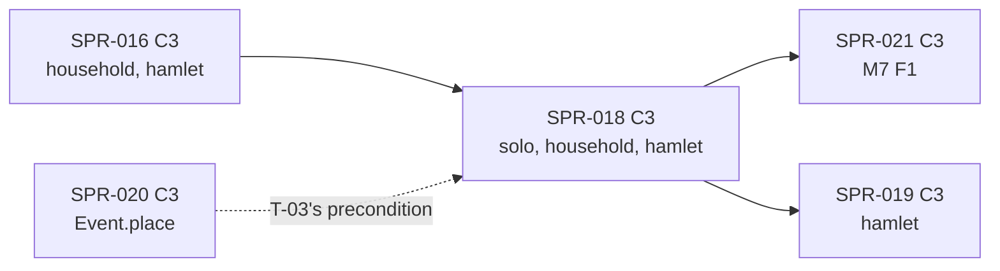

> **BLUF:** Builds the two genesis specs of `REV-SPR-018` (PR #52, closed):
> - **worldgen-lite** (`specs/systems/M1.regions.odd.toml` `[algorithm.worldgen_lite]` W0–W10): a u16 elevation raster from a heightmap template, K regions by keyed seeds, one per land component, and an integer Dijkstra flood, one seat per region, one route per adjacency, in `rh-worldgen`, bit-equal to `specs/worldgen/golden/worldgen_lite_v0.txt` (ten cases, 119 lines);
> - **`M1.regions` F0** in a new `rh-sys-regions`: the 18 owned columns, no binding, its invariants checked at genesis and restore and as the ladder's roots (never per instant: X1); `WorldSpec` gains `geography`;
> - **`S3.migration` F0** in a new `rh-sys-migration` (`[algorithm.residence_f0]` R0–R6): one keyed, land-weighted settlement per manifest household or loose founder at genesis, the mother's settlement for every newborn in the same Vital slot, one `residence_interval` row per person; M2 F1's husband draw is bounded to the bride's settlement on real worlds for the first time (REV-SPR-018 R8), and M2's events carry a `place` once SPR-020's `Event.place` exists;
> - **the manifest validator's two household refusals** (R9) in `manifest_v0.py` and the Rust loader (V-WC-04 parity); `S3.migration` in every template's `default_systems` with the `registry_version` bump (R3);
> - **bench 4** (`bench/raster_8x512`) recorded for the first time (the director's G0 ruling; `docs/08` §9).
>
> **Deferred to S3 F1 (P1b), under D57 item 2 (65%):** channel A's kind-7 `RESIDENCE_INTERVAL` record and `rh-cli tail --digest region` (the regional digest that left SPR-027 under D-4). The record would be the first real format bump of channel A and the canonical form, with a wide ripple while waves 4 and 5 are in flight (the specs table; BCK-002 A-61). Residence stays in plane-A state, which the materializer (SPR-027) shows.
>
> **Three baselines move** (`solo`, `household`, `hamlet`: genesis gains M1's and S3's tables); `smoke` is unchanged. They are re-recorded in the final `[C3]` commit by `bin/regen_baseline.sh`, with `registry_version` bumped there; bench 4 and the per-rung allocation budgets are recorded by their tools (V-PERF-11 moves: X7), so the PR title ends `[perf-baseline] [C3]`. Every baseline move is announced to the director before the merge.
>
> - **Developer:** AGT-002-CORE (`rh-worldgen`, the two system crates, `rh-registry`, `rh-contracts`), with AGT-002-TOOLS for the validator, bench 4, the generator and the gates (one Developer session may hold both roles).
> - **Testers:** AGT-003-DET (bit-equality with the golden, the divergence, thread and keyframe invariance) and AGT-003-IF (the C2 surfaces: the frozen specs, the validator, the contracts). One session may hold both, on a different model from the Developer's.
> - **Size and class:** **about 4.25–4.5 agent-days** by the task inventory (T-01 1.5, T-02 0.75, T-03 1.0, T-04 0.5, T-05 0.75; X10), as **one C3 sprint with a hard checkpoint after T-02** (the Tester's interim pass on the raster and M1 is required before T-03 lands; W14's pattern). **C3**: genesis adds plane-A tables to every rung. It contains C2: M1 0.1.0 and S3 0.1.0 frozen, `rh-contracts` v0.2, `rh_ids::SettlementId`, `WorldSpec.geography`, two validator rules (T-04), the Registry templates and version.
> - **Status:** PLANNING, revision 2: REV-WAVE6's rulings on revision 0 (`a1d25d9`: X1–X10, the NITs, Z1, Z2) and its re-check of revision 1 (`f6bf6d2`: V1–V8, N1–N12) are applied. It needs the director's plan approval (D57; GOV-005 §2).

# SPR-018 — Worldgen-lite, M1 F0, S3 F0, the validator's refusals and bench 4 (WP P1.1a; ruling M-6)

- **Roadmap item:** `docs/11` P1.1a, with S3 F0 by PRJ-002 ruling M-6 · **Phase / rung:** P1a, rungs 0–2 (every rung's genesis gains a map)
- **Depends on (the precondition head):**
  - **SPR-013 merged** (on `main`, `8f7edb4`): the run directory, the `household` and `hamlet` baselines, `bin/regen_baseline.sh` over four worlds (`:31`), the tail snapshots (`crates/rh-golden/tests/snapshots/`).
  - **SPR-014 merged:** the core row insert that writes the type's zero into every other owner's column, which is S3's newborn selector (`S3.migration.odd.toml:134`, R4; REV-SPR-018 R4), `rh-contracts` v0 and the absent-owner rule with keyed neutrals (`05.1` §2 rule 2 v1.12), under which M2 registers without S3 and S3 is refused without M1 (identity reads require their owner, EVO-001 R12); its A-60 slice of the per-instant engine cost, against which T-05 measures this sprint's (X1).
  - **SPR-015 merged:** births, so `residence_at_birth` has rows to act on (`S3.migration.odd.toml:136`: "nothing before SPR-015 merges"); M2 0.3.0's `mode` read of `person.residence` with neutral 0 (`specs/systems/next/M2.demography.odd.toml:388–393`, N4 at `:640`), which this sprint makes live; INV-M2-13 (`:872`), vacuous until now; the `H2` households, whose membership S3's R2 follows.
  - **SPR-016 merged:** no surface is used; it is on `main` before wave 6 by PRJ-002 §4, so the baselines this sprint re-records are SPR-016's.
  - **SPR-020 merged (wave 4): T-03's precondition for `place`** (X6). `rh_events::Event.place` (`specs/chronicle/envelope_v0.md:39`: "None until places exist, SPR-018") and the rule that the draft sets it (`:55`: "a `DEATH` at the deceased's residence once S3 tracks it"). **Fallback (N3):** if SPR-020 is not on `main` when T-03 lands, `place` is not set in this sprint, and T-03's `place` clause moves to a follow-up C3 PR by this sprint's Developer once SPR-020 merges (it moves `rh-core/events.meta` on every rung through digest v2). SPR-020 has no scope to fill it: its emit-site work (T-02, `SPR-020_EventEnvelope.md:137`) adds the field and leaves it `None`. The plan's order (wave 4 before wave 6) makes the fallback unlikely.
  - **SPR-027: not a dependency.** Nothing of `tail` changes here; the `05.10` §6 note that sent `--digest region` to this sprint is re-pointed to S3 F1 by the Architect at this plan's approval.
  - Independent of SPR-017 and SPR-019 (SPR-019 depends on this sprint: `founder_residence`, M1's settlements, the genesis order, and `"dynasties"` in S3's `from_manifest`: T-03).
- **Binding contracts:**
  - `specs/systems/M1.regions.odd.toml` 0.1.0 (frozen by T-02): `[[owns]]` `:44–181`, no binding `:202–208`, `[algorithm.worldgen_lite]` `:225–245`, the facts `:246–255`, `[initialization]` `:257–259`, INV-M1-01 to 06 `:286–309`, `[isolation]` `:327–330`; `specs/worldgen/templates_v0.toml` (`worldgen-lite-templates-v0`); `specs/worldgen/worldgen_lite.md` §3, §5, §6.
  - `specs/systems/S3.migration.odd.toml` 0.1.0 (frozen by T-03): `person.residence` `:46–52`, `residence_interval.*` `:61–81`, the four `[[reads]]` `:90–109`, the Day/Vital binding `:130–136`, `[algorithm.residence_f0]` R0–R6 `:156–168`, `[initialization]` `:170–172`, INV-S3-01 to 05 `:185–204`, the M2 out-coupling `:229–232`, `[isolation]` `:239–244`.
  - `specs/worldgen/selftest_worldgen_lite.py` and `specs/worldgen/golden/worldgen_lite_v0.txt`: the ten cases (`:713`), the R = 64 sweep (`:94–96`), the bench-4 lines (`:765–767`), `STALE` (`:828`).
  - `05.1` §2 rule 2 (ruling 10 extended: genesis writes a column only when its owner's `[initialization] from_manifest` names the section; `crates/rh-worldgen/src/lib.rs:246–268`), §2 rule 4 (the `same_instant` edge M2 → S3), §5 (raster fields), §6 items 2 and 5; `05.2` §1 (`RegionId(u16)`, `SettlementId(u32)` in world-gen order: `docs/05_architecture/05.2_world_model_and_data.md:29–30`); `05.5` §5 (validators); `specs/chronicle/envelope_v0.md:39, :55` (the `place` rule).
  - `specs/manifest/manifest_v0.py` (`:468–491`: the cast and household checks, where the two refusals go), `specs/manifest/registry_v0.toml` (`registry_version` `:7`; the S3 entry and its note `:14–19`; `default_systems` `:462–483`; `[heightmap_templates]` `:495`), `tests/manifest_parity/README.md`.
  - `docs/08` §9 bench 4 (`docs/08_performance_and_capacity.md:239`), `bin/perf_gate.py` (`BENCH_TARGETS`, `SLOTS` `:70–73`), `crates/rh-bench/baselines/instructions_v1.txt:11` (the empty slot), `crates/rh-bench/baselines/allocations_v1.txt` (the rung budgets).
  - `crates/rh-core/src/engine.rs:847–852` (the per-instant snapshot clones every lagged column: X7), `:914–916` (`check_invariants` at every instant's Bookkeeping, in release too: X1), `:1021`, `:1051` (`check_invariants` runs every registered system's `invariants(&self, &WorldTables)`, with no time); `crates/rh-core/src/system.rs:800–807` (`step` and `invariants` take `&self`: a system keeps no per-instant state outside the tables, W31).
  - ADR-0004, ADR-0006, ADR-0007 (the interval table is append-only), ADR-0024, ADR-0025, ADR-0026 item 3, ADR-0031, ADR-0033; `docs/09` V-INV-10 (`:134`), V-DATA-04 P1a variant (`:267`), V-INV-01, V-DET-01, V-DET-02, V-DET-05, V-DET-12, V-DET-19, V-WC-04 (`:337`), V-GOLD-01 (`:148`), V-SCALE-01 (`:659`), V-SCALE-04, V-PERF-02 (`:208`, bench 4), V-PERF-04, V-PERF-11.
- **System specs:** M1 0.1.0 and S3 0.1.0 go from `draft` to **frozen** in this PR (T-02, T-03; Architect-approved C2 changes inside the C3 PR), with the text fixes the specs table lists (NIT-C, since NIT-A and NIT-B are already fixed on `main`; X3; Y2's `"dynasties"`; V3's cadence statements). Their skeletons exist on `main` (`crates/rh-core/tests/generated/M1_regions.rs`, `S3_migration.rs`, `SPEC_VERSION = "0.1.0"`); registration under rule `spec`. M2 0.3.1 (after SPR-016) is read, not changed: its `person.residence` read becomes live and its `place` rule is the envelope's (`envelope_v0.md:55`), not an M2 text edit (X6).
- **Rulings (binding):**
  - REV-SPR-018 R1–R14, above all R3 (S3 into every template's `default_systems` and the bump in this PR), R4 (newborns by `person.residence = 0`), R5 (one seed per land component), R6 (bench 4 measures the genesis pass), R7 (back-filled ancestors exempt from the tiling), R8 (the husband draw bounded to the bride's settlement; neutral 0), R9 and R12 (the two validator refusals, Python and Rust, in this sprint), R11 Q3 (V-DATA-04's span `[entry_tick, exit_tick)`), Q4 (focus slugs deferred), R13, R14 (the facts, the components line, NIT-A to NIT-C);
  - REV-SPR-015 R17.6 and R21 (INV-M2-13 gates every run; its two-settlement forcing); REV-EVO-001 R4 and R12; SPR-011 rulings 3, 5, 10, 16; SPR-013's `--expect-serial` ruling (`SPR-013` T-13); the Architect's Y2 at the wave-6 review (`"dynasties"` joins S3's `from_manifest` at its freeze, for SPR-019);
  - **REV-WAVE6 (2026-10-17): the Architect's rulings on revision 0 (X1–X10, the NITs, Z1, Z2) and the re-check of revision 1 (V1–V8, N1–N12)**; every X-, Z-, V- and N- id in this plan is REV-WAVE6's (the specs table marks each row they decide; the rows still marked "proposed" are ruled with the plan's approval).
- **Director items:** D57 (this plan: the size as one sprint; the deferral of kind 7 and the regional digest to S3 F1, with the alternative; CI through D54 item 6).
- **Requirements covered:** SIM-2 (the region graph and raster: V-INV-10); SIM-15 (K ≥ 1 regions at every N); DATA-8 (residence intervals in the life-course log: V-DATA-04 P1a); DET-13 (no outcome is scheduled: F0 has no moves); PERF-2's bench 4.

## Specs this sprint needs

| Spec | Exists? | Gap | Architect ruling | Needed by |
|---|---|---|---|---|
| **The freeze of M1 0.1.0 and S3 0.1.0** | Both are `status = "draft"` in `specs/systems/` (REV-SPR-018 closed on `f27b33b`); their skeletons are generated already (`gen_skeletons.py` reads every `specs/systems/*.odd.toml`) | GOV-005 §2: no code without a spec; D-1's reasoning (SPR-015): the code is built against the frozen file. Nothing is in `next/` for them, so the "promotion" is the status flip | **Proposed (8.5/10):** T-02 freezes M1 and T-03 freezes S3 at 0.1.0 (the number does not move at a freeze: M2 0.2.0 froze at its own number, PR #37), with the text fixes applied at the freeze, since the texts are not yet frozen. REV-SPR-018 round 2's NIT-A (`S3.migration.odd.toml:221`) and NIT-B (`M1.regions.odd.toml:329`) are already fixed on `main`; **only NIT-C remains** (`worldgen_lite.md:71` and S3 `not_yet` `:39` say SPR-018 defines kind 7, now deferred to F1: the specs table's deferral row; N2); **X3:** S3's `[[reads]]` of `region.land_cells` (`:105–109`, a `rate` read) gains the typed **`neutral = 1`** (every region weighs the same: the coupling's "equal land cells", `:213`; N7), since a flipped-status lint reports "read region.land_cells from M1.regions needs a neutral value"; **Y2:** `"dynasties"` joins S3's `[initialization] from_manifest` (`:172`), so SPR-019's back-fill may write `person.residence` for the living dynasts (`rh-worldgen/src/lib.rs:246–268` refuses a column whose owner's list lacks the section); **V3:** every invariant keeps a docs/09 V-id in `test` (`lint_odd.py:1203–1204` refuses anything else) and states its cadence in `statement` (X1's places: genesis, restore, the ladder's roots, the step, an observer) | T-02, T-03 |
| **Where the invariants run (X1; finding F-13)** | `engine.rs:914–916` calls `check_invariants` at every instant's Bookkeeping, in release too (SPR-014 makes that about 360 instants a year), and `:1051` runs every registered system's `invariants(&self, &WorldTables)` there, with no time, no genesis roots and no list of the instant's rows (SPR-014's row insert reports nothing to another system) | INV-M1-02's connectivity check is O(cells) (about 0.5–1 ms per instant on `hamlet` at R = 256: +36–72 s per 200-year run); INV-M1-06 needs the genesis roots, but M1 is constructed before genesis; `rh-snapshot` is not an allowed system dependency (`bin/lint_arch.py:115`); INV-S3-01 (the tiling), 02 (every ledger row placed), 04 (descent) and 05 (the month-end reconciliation) are O(rows) | **Ruled (X1): nothing in M1 or S3 runs O(cells) or O(rows) per instant.** INV-M1-01 to 05 are checked at genesis and at restore, in `rh-worldgen` and in the tests (never by `invariants()`); INV-M1-06 becomes the ladder's per-column root test (V-DET-01: the M1 roots are equal at every rung and across thread counts, which the baseline comparison already asserts). **S3's `invariants()` is O(1):** column lengths only (the three interval columns equal; at least one interval row per ledger row). **Incremental, in the step:** `residence_at_birth` asserts INV-S3-02 and 04 on each row it writes (the mother's residence ≥ 1 and a settlement that exists; a named `SimError` otherwise: O(births)), and INV-S3-03 holds by construction (the step writes only rows whose residence is 0 and only appends). **In full, by test observers:** INV-S3-01 to 05 over the whole tables at every month end and at the run's end (an `Observer` in `rh-golden`'s and the crate's tests), and at genesis and restore. T-05 measures the per-instant cost with SPR-014 merged and cross-references BCK-002 A-60 (per-instant engine cost; filed by the Architect at SPR-014's audit). **One O(persons) pass remains, flagged for the Architect:** R4's newborn selector compares `person.residence` with 0 once per ledger row at each day start (`S3.migration.odd.toml:154` accepts it: 3.6 × 10^6 compares a year at 10,000 persons); T-05 reports its share of A-60's figure, and if it shows, the hand-off of the instant's inserted rows that `:154` allows (hash-neutral) becomes an A-60 item, not this sprint's | T-02, T-03, T-05 |
| **Where the templates live in the build** | `worldgen_lite.md` §6 item 1: "templates loaded from `specs/worldgen/templates_v0.toml` at build time (`include_str!`)", which means a TOML parse at genesis in plane A | `rh-worldgen` has no TOML dependency (`crates/rh-worldgen/Cargo.toml:18–21`); `rh-registry` has `toml = "=1.1.8"` and is plane A, so a parse is allowed, but a runtime parse of a data file in the genesis path is a second way for a number to enter plane A | **Proposed (7/10): a generated constant table,** `crates/rh-worldgen/src/generated/templates.rs`, written by `bin/gen_templates.py` from `templates_v0.toml` with a `--check` gate in part core (the `gen_skeletons.py` pattern: never typed, a stale copy is STALE), so the data is in the engine build, in the history tuple through `engine_build`, and a changed template is a reviewed diff; the Registry's `[heightmap_templates]` ids and the table's keys are checked equal by the gate. Alternative: `include_str!` and `rh-registry`'s parser at genesis | T-01 |
| **`WorldSpec` has no `geography`** | `crates/rh-registry/src/world.rs:20–36`: `seed`, `calendar`, `horizon_years`, `systems`, `demography`, `founders`; `rh_manifest::compile` reads M2's two parameters only (`compile.rs:35`) | Genesis needs R, K and the template id; W5's refusal needs them at load | **Proposed (8.5/10):** `WorldSpec.geography: Geography { raster_resolution: u16, region_count: u16, heightmap_template: HeightmapTemplateId }` compiled from the validated manifest (bounds are the validator's, `manifest_v0.py:113`); a template id not in the build's table is a compile error naming it (cannot happen on a validated manifest: V-WC-04 checks the Registry). C2 inside the C3 PR | T-02 |
| **M1 registers with no binding** | `M1.regions.odd.toml:13–15` (`schedule = []`), `:202–208`; `register.rs` has no rule against an empty binding set (grep: none), and `invariants()` runs for every registered system at Bookkeeping (`engine.rs:1051`) | Not yet exercised: every registered system so far binds a pulse | **Proposed (8/10):** T-02 confirms it with a test; if `rh-core` refuses, the smallest additive change (a system may bind nothing; its `invariants()` still runs, and is O(1) for M1 under X1) is made in T-02 and stated as a `05.1` §2 rule 2 line (the Architect's wording) | T-02 |
| **`--expect-serial` on `household` and `hamlet`** | `bin/regen_baseline.sh:46`; it "fails, naming the floor to set, once a second system arrives" (SPR-013 T-13) | Two new systems arrive. M1 binds nothing (no job); S3's Day/Vital binding sits at a later level than M2's by the `same_instant` edge of `person.mother` (`05.1` §2 rule 4), so every level still holds one job | **Proposed (8/10):** the flag stays; T-05 asserts it on both worlds. If a level ever holds two jobs, the Architect restates the floor with the measured figure (`--require-parallel`), never silently | T-03, T-05 |
| **M2's events gain a `place` (X6)** | `specs/chronicle/envelope_v0.md:39, :55`: the draft sets `place`; "a `DEATH` at the deceased's residence once S3 tracks it"; `EVENT.place_id` "NULL until places exist (P1.1a)" (`channel_a_v0.sql:143`); SPR-027's `--place` filter then has real ids on the rungs | Not in the M1/S3 specs; it is an M2 emit-site change (M2 already declares the `person.residence` read); `Event.place` arrives with SPR-020's code | **Ruled (X6): in scope of T-03, with SPR-020 as its precondition** (the dependency head states the fallback). No frozen M2 text is edited. **`envelope_v0.md:55` rules `DEATH` only:** it carries the deceased's residence. **Proposed (8/10; N4) for the rest:** `BIRTH` the mother's (= the newborn's), `MARRIAGE` the wife's (the husband's is equal by N4 on a partnering row; a command row keeps the wife's), `EXTINCTION` none. The `place` is a `SettlementId` (`05.2` §1) | T-03 |
| **Kind 7 and the regional digest: deferred (X2; finding F-1)** | `channel_a_v0.sql:64–65` reserves kind 7 and sends its fields to this sprint (R11 Q1); `05.10` §6's D-4 note sends `--digest region` here | `channel_a_v0.sql:6–8` calls the v0 shape "final for P1a" and makes any later change a new format version (SPR-020's tables were folded into v0 before any segment was written; SPR-013 has written segments); the review simulated the record and found the ripple wide: `specs/annals/fixtures/gen_fixtures.py:169` goes STALE, `selftest_annals_v0.py` crashes on the v0 fixtures, `specs/stream/golden/wire_v1.txt:18, :20` go STALE, SPR-026's `rh-protocol/src/control.rs:32` hardcodes `CANONICAL_FORMAT` v0, `rh-stream/tests/canonical.rs:766` and `wire_v1.md:132–133` pin v0; and it would land while waves 4 and 5 are in flight | **Ruled (X2, 65%; D57 item 2): deferred to S3 F1 (P1b).** Residence at birth stays in state (`person.residence`, `residence_interval.*`), which the materializer (SPR-027) shows; nothing in `rh-stream`, the canonical form or `tail` changes here. **The alternative, stated in D57:** a v1 bump of channel A and the canonical form with the full ripple list, landed first as a reviewed spec change (W30's route), then the code. **BCK-002 A-61**, recorded with this revision, carries the P1b item: kind 7's fields (`person_id, settlement, region, from_tick`), the regional digest as a reader-side fold, X8's start state (seed the fold from the latest `KEYFRAME` at or before the cursor, not from seq 0) and X9's k order (entry 0, residence 1, exit 2) | — |
| **The two validator refusals (R9, R12)** | `manifest_v0.py:468–491` checks that a head is a cast member and a household id exists; nothing refuses a cast member who heads two households or a head whose `household` names another household; REV-SPR-018 round 2 R9: "PARTLY APPLIED ... deferred to the SPR-018 sprint", with probe manifests `two_heads.yaml` and `head_names_other.yaml` | The reference's `Population.check` (`selftest_worldgen_lite.py:490`) raises on both; the validators accept both; the Rust loader must agree line for line (V-WC-04) | **Proposed (8.5/10):** two `[ERROR]` rules, `households[i].head` "'x' heads two households" and `cast[i].household` "'x' heads 'h' but names 'g'", in `manifest_v0.py` and `rh-manifest`, with two must-FAIL fixtures under `tests/manifest_parity/` (named by the README's rule) and `invalid_draft_style`-style lines in `CLAUDE.md`; the JSON Schema is unchanged (`rh-cli manifest schema --diff` stays green: the rules are cross-field, not structural). C2 inside the C3 PR | T-04 |
| **S3 in every template and the bump (R3)** | `registry_v0.toml:14–19`: the S3 entry "bumps when the spec freezes in SPR-018's PR"; `:462–483`: no template lists S3; every template already lists `M1.regions` | A world registers only what its manifest or template names (ruling 3; REV-SPR-018 MAJ-3) | **Ruled (REV-SPR-018 R3, R12):** T-05's final `[C3]` commit adds `S3.migration` to the five templates' `default_systems` and bumps `registry_version` to the next free number (SPR-020 and SPR-015 bump it too: the next free number at merge, REV-EVO-001 R14's precedent); the example manifests' pins and the worlds' SHA-256s follow; the annals fixtures and goldens regenerate with their tools (W1 (d)); the bump alone is measured as a separate step (SPR-020 T-07's form) | T-05 |
| **What the baselines' header shows** | `crates/rh-golden/src/world.rs:46` `BUILT = ["M2.demography"]`; `:256–260`: `engine_build` is `rh-golden <version> built:<BUILT>`; `:264` the `systems` line lists the built and not-built systems | `BUILT` gains `M1.regions` and `S3.migration`, so every manifest world's ladder header changes in its `tuple` line (the built list, `registry_version`) **and its `systems` line** (M1 and S3 leave `not_built`), independently of the hash (the review's NIT) | Stated in T-05's divergence record (`smoke`'s header is the overlay's) | T-05 |
| **The raster in plane-A state, and the per-instant cost (X7)** | `WorldTables` stores `i64` columns (`crates/rh-worldgen/src/lib.rs:325`); the plane hash covers every column with dirty tracking (`crates/rh-snapshot/src/hash.rs:1, :394–494`); keyframes store every table (`05.2:276`); **`engine.rs:847–850` clones every lagged column into the instant's snapshot** | `hamlet` gains 65,536 × 2 cells (about 1 MiB in state); the first hash pays for it once, later hashes skip unchanged chunks; keyframes grow. **Four lagged columns are cloned per instant** once M2's `person.residence` read and S3's three M1 reads are live (M1's tables are small: 3 + K + m rows; `person.residence` is N rows), so V-PERF-11's rung budgets move | **Ruled (X7): the budgets are expected to move;** `perf_gate.py alloc-record` runs in the `[C3] [perf-baseline]` commit with a `perf-baseline-reason:` line, and T-05 records the per-instant cost under BCK-002 A-60. The raster in state is accepted for P1a as the specs say (`M1.regions.odd.toml:191` `restart`; A-22 stays not due, elevation is u16); T-05 reports the keyframe sizes per rung and the first-hash cost; a compact raster encoding is M1 F1's with `05.2`'s typed keyframe batches | T-02, T-05 |
| **V-INV-10's "two machines"** | `docs/09:134`: "Same seed and generator version on two machines: identical raster, region graph and routes" | No cross-machine harness runs the rungs (`bin/cross_machine.sh` runs `smoke` only, nightly on `adjutant`) | **Proposed (8/10):** satisfied by construction at the PR tier: the golden file was rendered by the Python reference on the drafter's machine, the Rust port reproduces every line on the Developer's machine and on the GitHub runner (three machines, two implementations); `bin/cross_machine.sh` gains the rung ladders for the next `adjutant` session (RUN-002), reported, not gated | T-01, T-05 |
| **`EntityKind::Settlement` has "no typed id yet"** | `crates/rh-ids/src/entity.rs:27–33`: `Household = 2`, `Settlement = 3` ("no typed id yet"), `Region = 4` (`RegionId`) | A `SettlementId(u32)` newtype is wanted by `place` and `rh-contracts` | **Proposed (8/10):** `rh_ids::SettlementId(u32)` additive, in world-gen order (`05.2` §1), no hash layout (settlement ids are M1's small integers, never hashed); C2 inside the C3 PR | T-02 |
| **Bench 4's recording** | `instructions_v1.txt:12` holds the empty `slot raster_8x512`; `perf_gate.py:70–73` lists it in `SLOTS`; `worldgen_lite.md` §5 defines the fixture; `docs/08:239` | A recorded baseline comes only from `perf_gate.py record` in a `[perf-baseline]` PR with a reason line (SPR-009 ruling 3) | **Ruled (G0; REV-SPR-018 R6; `docs/08` §9):** T-05 records it; `BENCH_TARGETS` gains `raster_8x512`, `SLOTS` loses it; the bench asserts both digests of the golden file before it measures; `rh-bench` depends on `rh-worldgen` as it does on `rh-snapshot` (a non-engine tool crate, `bin/lint_arch.py:404`) | T-05 |
| **The observable mutants (X4, V2; the NIT on draws)** | `job` is `cast[0]` and heads `job_house`; `oswin` is `cast[0]` and heads `oswin_house`; a draw is keyed by `(blob, k)`, so a dome that takes 3 draws shifts nothing later | Keyed by the first member, the mutant is unobservable on every real world; keyed by the last (revision 1: founder k = 45), Job's household still lands in settlement 1, which holds 51% of hamlet's land, so hamlet's line does not move (V2, reproduced on the reference); "every later blob's draws shift" was wrong | **Ruled (X4, V2):** `mutant-founder-residence-second-dependant` keys a household's draw by its **second child or servant** (its head when it has fewer than two). On hamlet that is founder k = 7, which puts Job's household in settlement 2 at R = 256 and at R = 128, so hamlet's residence line differs (the drafter's probe on `selftest_worldgen_lite.py`: k = 7 and 8 move it, k = 6 and 45 do not). The six synthetic cases are the second kill: under the same mutant all six residence lines differ (`SYNTHETIC`, `selftest_worldgen_lite.py:712`, `cast=("a", None, "b")`, has household `b` headed by `cast[2]`), and the engine test builds that fixture; the draws mutant becomes `mutant-blob-k-shift` (the dome's radius read from k = 2 instead of k = 3), which moves every dome's shape and so the elevation digest of every case with a dome | T-01, T-03 |
| **The divergence record's form (W2, W3; X5)** | The channel-A criterion in SPR-020 T-07's form; the robust form in two parts, non-vacuous | `hamlet` has four regions, so M2's husband draw is restricted from the first pulse: the frozen roots diverge at the first partnering hit whose unrestricted argmin lives outside the bride's settlement; `solo` and `household` have one region, so nothing M2 does changes. **After that month `STEP_DIGEST`'s `living`, `births` and `deaths` differ, and so do `EXTINCTION`'s tick and seq (X5)** | **Ruled (X5):** T-05 states both parts: (a) on every world, at every rung, the differing roots are exactly M1's 18 per-column ladder roots, S3's four (`person.residence`, the three `residence_interval` columns) and, when SPR-020 is on `main`, `rh-core/events.meta` from the first event that carries a `place` (digest v2 hashes `has_place, place`: `envelope_v0.md:136`; V1), plus the header, until, on `hamlet` alone, the month of the first restricted hit, which the record names with the pair; (b) from that month on **only W3 (b) binds:** the differential model (SPR-015's `bin/gen_m2_f1_draws_reference.py`, extended with R1–R4 and N4's settlement condition) reproduces every `BIRTH`, `MARRIAGE` and `DEATH` instant, child id and sex over 200 years, and no channel-A clause is asserted after the named month | T-05 |
| **CI (Z1)** | Revision 0 measured against `main` at `772478f` (core 11:46, golden 9:01), which predates SPR-014 and SPR-026. **The Architect's current figures:** part core's step about 11:30–12:05 (SPR-014 moved its M2 debug gate to part golden: the Architect's SPR-014 ruling, condition 5); part golden 12:46 with SPR-026, plus about 2.5 minutes from SPR-014, so about 15:15 after wave 4 (SPR-020 not yet measured); wave 5 then adds about +2.5 and +1.3 minutes (D54). Runner variance is large (`main`'s golden ran 6:28 and SPR-026's 12:46 within one hour) | Revision 0's remedy (moving two pure-Python gates to part golden) is withdrawn: golden is already the tighter part; path-scoping the pure-Python references is the Architect's own BCK item, and the third PR-tier job is D54 item 6 (put to the director, recommended 70%) | **Ruled (Z1):** T-05 states this sprint's added time per part against the state after wave 4, budgeted for slow runners (×1.5), and names its own nightly candidates; no gate moves part; D57 item 4 is withdrawn in favour of D54 item 6 | T-05 |

## Compliance (every task)

| Rule | This sprint |
|---|---|
| Change class (`docs/13` §4.2) | **C3**: genesis writes M1's six tables (18 columns) and S3's `person.residence` column and `residence_interval` table (4 columns) into every rung, so `state_hash` moves on `solo`, `household` and `hamlet` from the genesis keyframe on; M2's husband draw is bounded on `hamlet`; M2's events carry a `place` (with SPR-020). It contains C2: the frozen M1 0.1.0 and S3 0.1.0, `rh-contracts` v0.2 (`m1`, `s3`), `rh_ids::SettlementId`, `WorldSpec.geography`, two validator rules, the templates and `registry_version`. The PR title is `SPR-018: … [perf-baseline] [C3]` (bench 4's first record, the rung budgets: X7) |
| Planes touched (ADR-0024) | **A:** `rh-worldgen` (W0–W10, R1–R4 at genesis, INV-M1-01 to 05 at genesis and restore, the generated templates, three purposes), `rh-sys-regions` and `rh-sys-migration` (new, `[package.metadata.rehoboam]` A/system), `rh-registry` (`WorldSpec.geography`), `rh-ids` (`SettlementId`), `rh-contracts` (`m1`, `s3`), `rh-sys-demography` (`place` on three emits, with SPR-020), `rh-core` only if a binding-free system needs an additive line. **Tool:** `rh-manifest` (`compile`, two validator rules), `rh-golden` (`BUILT`, `world.rs`'s setup, the test observers for INV-S3-01 to 05), `rh-bench` (`raster_8x512`), `bin/gen_templates.py` (new), `bin/perf_gate.py`, `specs/` (the two freezes, `manifest_v0.py`, `registry_v0.toml`). **B, C:** none. **`rh-stream`, `rh-cli tail` and `rh-protocol`: untouched** (X2) |
| Owned columns written | `M1.regions`: `raster.resolution`, `raster.sea_level`, `cell.elevation`, `cell.region`, `region.id`, `region.land_cells`, `region.seed_cell`, `region.seat`, `settlement.id`, `settlement.region`, `settlement.cell`, `region_edge.a`, `region_edge.b`, `region_edge.route`, `route.id`, `route.a`, `route.b`, `route.length_cells` (at genesis only, by `rh-worldgen` under `[initialization] from_manifest = ["geography"]`; INV-M1-06). `S3.migration`: `person.residence`, `residence_interval.person_id`, `.settlement`, `.from_tick` (genesis by `rh-worldgen` under `from_manifest = ["cast", "households", "peoples", "dynasties"]` after Y2; births by `residence_at_birth`). `M2.demography`: no column; the `place` of its drafts is an event field, not a column |
| Reads (via `rh-contracts`) | S3: `person.mother` (M2, `same_instant`, identity: the edge that orders S3 after M2 in Vital), `settlement.id`, `settlement.region` (M1, lagged, identity), `region.land_cells` (M1, lagged, rate, with `neutral = 1` from X3; used only at genesis through `rh-worldgen`). M2's declared `mode` read of `person.residence` (neutral 0) becomes a real read on every rung. Registration (EVO-001 R12): S3 is refused in a world without M1 (identity reads require their owner); M2 still registers without S3. **Four lagged columns are cloned per instant** (`engine.rs:847–850`): X7 |
| RNG purposes added | `rh-worldgen`'s, under the reserved id (`register.rs:67`), after `founder_sex`, `founder_age`, `founder_birthday` (`rng_purposes.rs:8–16`): `heightmap_blob` (entity = the blob ordinal, k = 0..3 for a dome, 0..4 for a ring), `region_seed` (entity 0, k = 0), `founder_residence` (entity = the household head's or the loose founder's `PersonId`, k = 0). Keys as W0 and R0 (`world_seed`, the canonical salt, `system_id("rh-worldgen")`, epoch 0, t = 0). None for M1 or S3 (`rng = []`). Not re-sampled on a fork (genesis) |
| Golden-hash effect | **`solo`, `household` and `hamlet` move; `smoke` does not** (no manifest, no `rh-worldgen`). Re-recorded by `bin/regen_baseline.sh` in the final commit, whose subject ends `[C3]`; announced to the director before the merge; the divergence record is T-05's |
| Fixed-point quantities | **None.** Integers in stated widths (`worldgen_lite.md` §3): u16 elevation, i64 accumulator, u64 Dijkstra distances and centroid sums, u128 for `pick(u, n)` and the weighted placement. No float anywhere (V-DET-19); `cell.elevation` stays u16, so BCK-002 A-22 is not due |
| Determinism lints (GOV-003 §2, §6) | Must pass. The two new crates are `rh-sys-*` (A, system) by name (`bin/lint_arch.py:117`); `rh-worldgen` keeps its pin; no new plane-A dependency (`gen_templates.py` removes the need for a TOML parse); no `HashMap` (the edge set is a `BTreeSet`, the queue a `BinaryHeap` on `(dist, cell, region)` with the lexicographic order W7 states, so the push order does not matter); no interior mutability (W31); every tie broken as W6–W9 say; **no O(cells) or O(rows) work per instant in M1 or S3** (X1) |
| Tests that gate this sprint | V-INV-10 (the golden's every line, in debug and release; the R = 64 sweep), V-DET-01, V-DET-02 (1, 2, 4, N threads on the three rungs with the map; INV-M1-06 as the ladder's roots), V-DET-05 (the raster and the intervals through a keyframe; INV-M1-01 to 05 re-checked at restore), V-DET-12, V-INV-01 (INV-M1-01 to 05 at genesis, INV-S3-02 and 04 asserted by the step on the rows it writes, INV-S3-01 to 05 in full by test observers at month ends and the run's end, INV-M2-13 non-vacuous), V-DATA-04 (P1a variant: residence tiling, `[entry_tick, exit_tick)`), V-WC-04 (the two refusals in both validators; every example still VALID), V-GOLD-01 (three baselines), V-SCALE-01 and V-SCALE-04 (the rungs past extinction with S3; `--expect-serial` holds), V-PERF-04 (bench 4 recorded; benches 7 and 8 unchanged), V-PERF-11 (the rung budgets re-recorded: X7), plus `bin/check_all.sh`. V-SF-22 for M1 and S3 is the generation itself (`M1.regions.odd.toml:327–330`) and S3's scripted-ledger run (`S3.migration.odd.toml:239–244`), both run here; the chi-square of S3's neutral forcing is reported |
| Docs updated in the same sprint | `bin/check_all.sh` and `python/tests/test_check_all_inventory.py` (same commit); the `CLAUDE.md` checks (the new gates, the two freezes' lint lines, the two `invalid_*` manifests, `gen_templates.py --check`, bench 4); `05.0` §6 (the two crates; `rh-contracts` v0.2), `05.1` §2 rule 2 if a binding-free line is needed; `docs/09` V-INV-10, V-DATA-04 method lines with the test names; `docs/08` §9 (bench 4 recorded); `worlds/solo/README.md`, `worlds/household/README.md`, `worlds/hamlet/README.md` (what moved); the M1 and S3 headers (frozen; the text fixes); `worldgen_lite.md` §6 (done) and §7 row 1 (the deferral); `specs/README.md`; BCK-002 A-22 (recorded: not due), **A-60** (the measured per-instant cost of M1 and S3, the four clones and R4's selector pass); A-61 stays open (P1b); PRJ-002's row. **By the Architect at this plan's approval** (listed here, not edited by this plan; N8): the regional digest's move to S3 F1 (P1b) in `docs/11_roadmap.md:190` (P1.17's `tail` filters), `SPR-027_Materializer.md:18, :47, :59, :202, :209`, `05.10_world_stream.md:109` (the D-4 note) and D54 item 4; and `channel_a_v0.sql:64–65` (kind 7 stays reserved; its fields are S3 F1's) |

**Rules carried from P0–SPR-016 (every task):**
- **Property tests vary world size and seed:** at least three sizes (6, 60, 600 founders) and eight seeds, fixed-seed SplitMix64, no new crate; three raster sizes (64, 128, 256) and K ∈ {1, 4} in the PR tier; the 600-founder size, R = 512 and K = 64 nightly (W42).
- **A positive control fails for the right reason:** its `check_all` line matches the message (`fail:<text>`); every planted mutant fails a named golden line (X4).
- **A test input exercises the path it claims, and a probe asserts it:** a newborn's row really had `person.residence = 0` before S3's step; a partnering hit really had its unrestricted argmin outside the bride's settlement; a land component really had no seed before R5's pass; a `KEYFRAME` really carried the raster; the mutant's key really moves hamlet's household (founder k = 7 lands in settlement 2, the head's draw in 1), and the synthetic fixture's household `b` really is headed by `cast[2]` (W7, X4, V2).
- **Python tests read no CI environment variable.**
- **No statistical gate in this sprint.** S3's neutral-forcing chi-square is reported.
- **Nothing per instant in M1 or S3 is O(cells) or O(rows)** (X1): the invariants run at genesis, at restore, as ladder roots and in test observers; T-05 measures the per-instant cost.
- **CI time (Z1):** the reference is the state after wave 4 by the Architect's figures (part core about 11:30–12:05; part golden about 15:15, 12:46 with SPR-026 plus about 2.5 minutes from SPR-014; SPR-020 not yet measured), then wave 5's D54 additions (about +2.5 and +1.3 minutes). Golden is already past 12 minutes, so the third PR-tier job is D54 item 6. Each part's added time is stated against that state, budgeted ×1.5 for slow runners, with this sprint's own nightly candidates if a part is over (T-05); no gate moves part.
- **Merge `origin/main` when main moves,** and re-run both parts.
- **Batch pushes at task boundaries;** T-01 and T-02 are pushed together (the raster has no owner before M1 registers).
- **Every new gate is in exactly one `check_all.sh` part,** with the inventory test updated in the same commit.
- **Baselines are regenerated only by `bin/regen_baseline.sh`,** in the final commit, with `[C3]` at the end of its subject. Test goldens are regenerated by their own tools (`selftest_worldgen_lite.py --write` only if the golden must move, which it must not: the Rust port reproduces it); snapshots under `RH_UPDATE_SNAPSHOTS` locally (never in CI), never typed. **Mutants never make a baseline:** every mutant is a `mutant-*` Cargo feature (BCK-002 A-52).
- **One commit per task** (GOV-005 §4).

## Tasks

A **hard checkpoint** follows T-02: the Tester's interim pass on the raster and M1 (`VER-SPR-018-TEST`, phase 1) is required before T-03 lands (X10; W14's pattern). T-05 comes last.

#### T-01: Worldgen-lite in `rh-worldgen`: W0–W10, the templates, the purposes, the bench-4 kernel (`[algorithm.worldgen_lite]`; `worldgen_lite.md` §3, §5; REV-SPR-018 R5, R10, R13; X4's NIT)
- **Deliverable:**
  - **The generated template table** (`bin/gen_templates.py` → `crates/rh-worldgen/src/generated/templates.rs`, `--check` in part core): one `const` per `[templates.<id>]` of `templates_v0.toml` (base, sea level, smoothing passes, the ops with their integer ranges), the file's `version` string, and a check that the ids equal the Registry's `[heightmap_templates]`.
  - **`rh_worldgen::map`:** W0's keys (`heightmap_blob`, `region_seed` in `rng_purposes.rs`, after the three of SPR-012) and `pick(u, n)` as a u128 product; W1–W3 blobs and clamp (a dome takes 4 draws, a ring 5, whatever their values); W4 Jacobi smoothing with clamped edges, the pass as a function `smooth_pass(&[u16], R) -> Vec<u16>` that bench 4 calls; W5 land and the refusal naming the template, the seed, `n_L` and K; W6 seeds (the first keyed, then one per seedless 4-component in order of lowest cell, then farthest-point over L, ties to the lowest index, `dmin` kept incrementally); W7 the multi-source Dijkstra with the lexicographic queue and `c = 1 + (|ΔE| >> 8)`; W8 seats by floor centroid (u64 sums); W9 edges as a sorted set and routes with `isqrt`; W10 the write order into `WorldTables` (`raster.*`, `cell.*` in index order, `region.*`, `settlement.*`, `region_edge.*`, `route.*`); **INV-M1-01 to 05 as a `check_map(&WorldTables)` function** run at genesis and at restore (X1).
  - **The bench-4 fixture function:** the eight shifted layers of `worldgen_lite.md` §5 and the SHA-256 over them, for `rh-bench` (T-05).
  - **Three planted mutants** (`mutant-*` features of `rh-worldgen`): `mutant-smooth-in-place` (Gauss–Seidel instead of Jacobi), `mutant-blob-k-shift` (the dome's radius read from k = 2 instead of k = 3: the draws are keyed by `(blob, k)`, so this moves each dome's shape and nothing later), `mutant-seed-no-components` (R5's per-component pass skipped).
- **Acceptance:**
  - **The golden, every line** (`specs/worldgen/golden/worldgen_lite_v0.txt`, 119 lines: elevation and region SHA-256s, land counts, seeds, region sizes, seats, edges, routes, `graph components`, the two bench-4 digests) reproduced by the Rust port for all ten cases, in debug (R ≤ 256 cases, part core) and in release (all ten with the 512² bench fixture, part golden); the altered-golden control (`worldgen_lite_golden_control`, already in `check_all.sh:425–432`, run at `:1332`) still fails `STALE:` against the reference, and a Rust twin of it fails by name against the port.
  - **The sweep:** every template at R = 64, seeds 1–8, K ∈ {1, 4} generates or is refused by W5 with its counts, and INV-M1-01 to 05 hold on each (`check_map`, the reference's `check_sweep` in Rust); `desert_fringe` at R = 128, K = 4 gives a connected graph for seeds 1, 2, 4–8 and two components at seed 3 (`M1.regions.odd.toml:330`). Nightly: R = 256 and 512, K = 64, seeds 1–8 (`[isolation].horizon`).
  - **Draw structure (CRN):** a dome's 4 and a ring's 5 draws are taken whatever their values (a probe counts the draws per blob); the seeds of a template at seed s are unchanged by a change to another template's ops.
  - **Mutants:** each fails a named golden line: `mutant-smooth-in-place` the `continental_plains` elevation digest; `mutant-blob-k-shift` the elevation digest of every case with a dome; `mutant-seed-no-components` the `archipelago 7 96 6` case's `seeds`, `regions_sha256`, `land_cells` and `graph components 6 connected no` lines (`worldgen_lite_v0.txt:62–71`; REV-SPR-018 R5's case, where the old W6 left islands unregioned).
  - **Lints:** `gen_templates.py --check` is green and a planted stale table is STALE; `lint_forbidden` and `lint_arch` green on the crate (no float, no `HashMap`, no file I/O).
  - **V-INV-10:** the lines above were rendered by the reference on another machine (the committed golden) and are reproduced on the Developer's machine and on the runner; T-05 records it as the two-machine evidence.
- **Status:** [ ] not started

#### T-02: `M1.regions` F0 (`rh-sys-regions`), `WorldSpec.geography`, `SettlementId`, the raster in state, the invariants' cadence; the freeze of M1 (the checkpoint; X1)
- **Deliverable:**
  - **`crates/rh-registry`:** `WorldSpec.geography` (the specs table) compiled by `rh_manifest::compile` from the validated manifest; `rh_ids::SettlementId(u32)` (additive; `EntityKind::Settlement` gets its typed id).
  - **`crates/rh-sys-regions`** (A, system): `AccessSpec` with the 18 `[[owns]]` columns, no read, no binding, no purpose; **`invariants()` is O(1)** (it returns no per-instant check: INV-M1-01 to 05 are `check_map`'s at genesis and restore, and INV-M1-06 is the ladder's root test, X1); registration against the frozen 0.1.0 under rule `spec`; the skeleton `M1_regions.rs` included as M2 includes its own (`crates/rh-sys-demography/src/demography.rs:40`).
  - **Genesis order:** `rh_worldgen::genesis` writes M1's tables first (W10) and runs `check_map`, then M2's founders, then (T-03) S3's columns; `rh_snapshot::resume`'s caller in `rh-golden` runs `check_map` on the restored tables (the test harness, not the engine); `crates/rh-golden/src/world.rs` `BUILT` gains `M1.regions`; every template already lists M1, so M1 registers in every manifest world.
  - **`rh-contracts::m1` v0.2:** one typed accessor per column; the drift test against 0.1.0.
  - **The freeze:** `M1.regions.odd.toml` `status = "frozen"` at 0.1.0, (NIT-B is already on `main`), INV-M1-01 to 06 keeping their docs/09 V-ids in `test` (V-INV-10; V-DET-01 for 06) with each `statement` stating its cadence (at genesis and at restore; 06 as the ladder's per-column roots: V3); the skeleton regenerated (nothing but the status changes); the `CLAUDE.md` line.
  - **A test** that a system with no binding registers (the specs table); if `rh-core` refuses it, the additive line in `register.rs` and the `05.1` §2 rule 2 sentence (the Architect's wording).
- **Acceptance:**
  - `solo` and `household` (flat, R = 64, K = 1) and `hamlet` (desert_fringe, seed 42, R = 256, K = 4) build the golden's cases at genesis: the M1 tables of the engine equal the reference's lines (the Rust port of T-01 through the engine's `WorldTables`, compared cell for cell), so the facts of `M1.regions.odd.toml:246–255` hold on the real worlds (hamlet: 53,859 land cells, regions 27,691 / 6,711 / 5,996 / 13,461, seats 18078, 55338, 54904, 26409, five edges, routes 78 to 148).
  - **V-DET-05:** the raster and every M1 table round-trip a keyframe (the SPR-012 V-INV-11 harness, `crates/rh-worldgen/tests/keyframe.rs`), `check_map` passes on the restored tables, and a run resumed from it continues as the continuous one; **V-DET-01/02:** the three rungs equal at 1, 2, 4 and N threads for 50 years (the ladders of this task; T-05 re-records the 200-year baselines); **INV-M1-06** holds as the ladder's roots: M1's 18 per-column ladder roots are equal at every rung of the 50-year ladders and across thread counts (a test that compares the roots rung by rung, not the engine).
  - **Per-instant cost (X1):** a probe asserts that M1's `invariants()` returns in O(1) (no table is read) and that the 200-year `hamlet` run's wall time with M1 registered is within noise of the run without it (reported, with the figure).
  - **Registration:** M1 registers under rule `spec` with no binding; a planted `AccessSpec` with a read fails the `spec` comparison by name; a planted extra column fails `single-writer`; `rh-cli ownership` lists the 18 columns under M1.
  - **Refusals by name:** a fixture manifest with more regions than the raster has cells (R = 64, `region_count: 4097`, inside the validator's bound of 5,000 and above `n_L ≤ 4,096` for every template) fails `rh-cli run` at genesis naming the template, the seed, `n_L` and K, and `manifest_v0.py validate` still passes it (W5 is a genesis rule, not a validator rule).
  - **Reported:** the keyframe size per rung before and after (hamlet's grows by the raster), the first `state_hash` cost on hamlet, and that later hashes skip the unchanged chunks (`hash.rs`'s chunk counter, `:547`).
  - **Checkpoint.** The Tester's interim pass on T-01 and T-02 is recorded in `VER-SPR-018-TEST` before T-03 lands.
- **Status:** [ ] not started

#### T-03: `S3.migration` F0 (`rh-sys-migration`): residence at genesis and at birth, the husband draw bounded, `place` on M2's events; the freeze of S3 (R0–R6; INV-S3-01 to 05; INV-M2-13; REV-SPR-018 R4, R7, R8; REV-SPR-015 R17.6, R21; X1, X3, X4, X6; Y2)
- **Deliverable:**
  - **Genesis (R0–R4 in `rh-worldgen`):** after M1's tables and M2's founder rows: the weights `w_s = region.land_cells` of `settlement.region` in ascending `settlement.id`, the cumulative `C_s` (u64), one draw per manifest household keyed by its head's `PersonId` and one per loose founder keyed by its own (`founder_residence`), the least `s` with `C_s > pick(u, W)`; every member of a household (the head, the cast members whose `household` names it, its children and servants) takes its settlement; `person.residence := s` and one `residence_interval` row `{person_id, s, 0}` per founder in ascending `PersonId`. The founder order is ruling 10's (`selftest_worldgen_lite.py:501` `founder_order`; R2).
  - **`crates/rh-sys-migration`** (A, system): `AccessSpec` with the four owned columns, the four declared reads (`person.mother` same-instant; M1's three lagged, `region.land_cells` with `neutral = 1`), the Day/Vital binding; the step `residence_at_birth`: for each ledger row with `person.residence = 0` in ascending `PersonId`, `person.residence := the mother's` and a row `{person_id, s, now}` appended (R4; a mother dead in this slot is still readable, ruling 5); **`invariants()` O(1) (X1):** column lengths only, reported under INV-S3-02's name (the three interval columns equal; at least one interval row per ledger row); **the step asserts INV-S3-02 and 04 on each row it writes** (the mother's residence ≥ 1 and an existing settlement, else a named `SimError`: O(births)), and INV-S3-03 holds by construction (it writes only rows whose residence is 0, and only appends); **INV-S3-01 to 05 in full are test observers** in `rh-golden`'s and the crate's tests (at every month end and at the run's end), never in `invariants()`; registration against the frozen 0.1.0 under rule `spec`; the skeleton `S3_migration.rs` included.
  - **`rh-contracts::s3` v0.2:** `person.residence` and the three interval columns; the drift test. `BUILT` gains `S3.migration`.
  - **M2 (`rh-sys-demography`), with SPR-020's `Event.place` (X6):** nothing in N4 changes (the read and its neutral are SPR-015's); the `place` of `BIRTH`, `MARRIAGE` and `DEATH` drafts by the envelope's rule (`envelope_v0.md:55`), read through `rh-contracts::s3`; no M2 text is edited.
  - **The differential model:** `bin/gen_m2_f1_draws_reference.py` (SPR-015's, SPR-016's fold) gains R1–R4 (the residence of every founder and newborn) and N4's settlement condition, and a fixture world with two settlements where a bride's unrestricted argmin lives in the other one (a probe asserts it).
  - **Two planted mutants** (`mutant-*` of `rh-sys-migration`; X4): `mutant-residence-at-birth-skip` (the step writes nothing), `mutant-founder-residence-second-dependant` (a household's draw keyed by its second child or servant, its head when it has fewer than two: V2).
  - **The freeze:** `S3.migration.odd.toml` `status = "frozen"` at 0.1.0 with NIT-C (`:39`: kind 7 deferred to F1, A-61; NIT-A is already on `main`), X3 (`neutral = 1` on `region.land_cells`) and Y2 (`from_manifest = ["cast", "households", "peoples", "dynasties"]`, `:172`), INV-S3-01 to 05 keeping their V-ids in `test` with each `statement` stating its cadence (the O(1) lengths, the step's own check, the month-end observer: V3); the skeleton regenerated; the `CLAUDE.md` line.
- **Acceptance:**
  - **The golden's residence lines** (`worldgen_lite_v0.txt`: `solo`, `household`, `hamlet` at R = 256, `hamlet` at R = 128, the six synthetic lines) reproduced by the engine's genesis from the real manifests and from the synthetic fixture whose household `b` is headed by `cast[2]` (the reference's `SYNTHETIC` case, `selftest_worldgen_lite.py:712`; X4, V2): on hamlet, Job's 42 in settlement 1, the four friends in 4, 2, 1, 3, the 14 others `1 2 1 2 4 3 2 1 1 4 1 1 4 1`, per-settlement counts 50 / 4 / 2 / 4 (`M1.regions.odd.toml:250–252`).
  - **Births:** on random worlds (three sizes, eight seeds; the 600-founder size nightly) every newborn has its mother's settlement after the Vital phase of its birth instant and one interval row opening at its birth tick; a probe asserts the row had `person.residence = 0` before S3's step and that no founder is ever re-placed (R4; a founder with `birth_tick = 0` is in one fixture); the step's own INV-S3-02 and 04 checks on every row it writes; the observers check INV-S3-01 to 05 over the whole tables at every month end and at the end of every test run.
  - **Per-instant cost (X1):** a probe asserts that S3's `invariants()` reads no column row by row (lengths only) and that the step's own checks visit only the rows it writes (a counter of rows checked equals the births of the instant); the selector's pass over `person.residence` is counted separately (one compare per ledger row per day start) and goes to T-05's A-60 record (N6); the 200-year `hamlet` run's wall time with S3 registered is reported against the run without it, and the four lagged clones per instant are counted (X7).
  - **V-DATA-04 (P1a variant):** the 1,000-year release test (`crates/rh-worldgen/tests/m2_system.rs` `v_data_04`, `check_all.sh:1274`, part core) gains the residence clause: for every person who entered at or after the epoch, the intervals tile `[entry_tick, exit_tick)` with no gap or overlap, one row at F0; per settlement and month the counts reconcile (placements + births − deaths of residents).
  - **INV-M2-13, non-vacuous:** on `hamlet` over 200 years no partnering row pairs two settlements, and a probe asserts that at least one partnering hit's unrestricted argmin lived outside the bride's settlement (otherwise the filter was never exercised and the test fails); the two-settlement forcing of M2's `[isolation]` (`next/M2:969`) now runs under the real S3 instead of a stub owner; a planted N4 that ignores residence fails INV-M2-13 by name (SPR-015 T-04's control, repeated under the real owner).
  - **Registration:** S3 registers in `{M1, M2, S3}`; S3 is refused in `{M2, S3}` naming the missing owner M1 (identity reads); M2 still registers in `{M2}` with the read dropped and reported; a planted `AccessSpec` without the `same_instant` lag on `person.mother` fails the `spec` comparison by name; the scheduler orders S3's Day/Vital job after M2's (a probe reads the level table); `--expect-serial` still holds on `household` and `hamlet`.
  - **`place` (with SPR-020):** every `DEATH` on hamlet carries the deceased's settlement, every `BIRTH` the mother's, every `MARRIAGE` the wife's; `EXTINCTION` none; on `solo` and `household` every place is 1; the canonical `EVENT` lines carry the `place_id` token instead of `~`. Without SPR-020 on `main`, this clause is SPR-020's (the dependency head).
  - **Bit-equality** with the extended draws golden on the fixture worlds (every residence, every marriage under the restriction); the altered-line control fails by name. **Mutants:** `mutant-residence-at-birth-skip` fails INV-S3-02 by name, at the first Bookkeeping where the ledger outgrows the interval table or in the observer at the first month end after the first birth, whichever comes first; `mutant-founder-residence-second-dependant` fails hamlet's residence line at R = 256 and at R = 128 (keyed by founder k = 7, Job's household of 42 moves from settlement 1 to 2) and, as the second kill, the residence lines of the six synthetic cases (V2).
  - **V-SCALE-04:** `household` and `hamlet` run past extinction with S3 registered, one `EXTINCTION`, tail, sift and replay consistent (`crates/rh-golden/tests/rungs.rs`).
  - The S3 freeze: `lint_odd.py` green in frozen mode with S6's draft read of `person.residence` (`S3.migration.odd.toml:233–237`) resolving to a frozen owner and no "needs a neutral value" line for `region.land_cells` (X3); the skeleton unchanged but for the status; NIT-C, X3, Y2 and V3 applied (NIT-A and NIT-B were already on `main`).
- **Status:** [ ] not started

#### T-04: The validator's two household refusals, Python and Rust (REV-SPR-018 R9, R12; V-WC-04; C2 inside the C3)
- **Deliverable:** in `specs/manifest/manifest_v0.py` (`:468–491`) and `crates/rh-manifest`'s validator: `households[i].head` "'x' heads two households" (a cast member named as `head` by two households) and `cast[i].household` "'x' heads 'h' but names 'g'" (a head whose `household` names a household other than the one it heads); a head without a `household` field is valid (its household is the one it heads, R2). Two must-FAIL fixtures under `tests/manifest_parity/` (the README's naming rule), and their `CLAUDE.md` lines beside `invalid_draft_style.yaml`'s.
- **Acceptance:** both fixtures fail in both validators with the same `[ERROR]` line, in order (`bin/manifest_parity.py`); every example manifest and every existing fixture keeps its verdict; `rh-cli manifest schema --diff specs/manifest/manifest_v0.schema.json` is unchanged (no structural rule); REV-SPR-018 round 2's probe manifests (`two_heads`, `head_names_other`) are the fixtures' content; `selftest_worldgen_lite.py`'s `Population.check` and the validators agree on both cases.
- **Status:** [ ] not started

#### T-05: Bench 4, the three baselines, the budgets, `registry_version`, the divergence record and CI (W3, W12, X1, X5, X7, Z1; SPR-020 T-07's pattern; REV-SPR-018 R3, R6)
- **Deliverable:**
  - **Bench 4:** `crates/rh-bench/benches/raster_8x512.rs` (`smooth/layers_8x512`: one W4 pass over the eight shifted layers of the `continental_plains` 512² raster at seed 1, fixed chunking of 65,536 cells, 1 thread), asserting `bench4_elevation_sha256` and `bench4_smoothed_layers_sha256` of the golden file before measuring; `perf_gate.py`'s `BENCH_TARGETS` gains it and `SLOTS` loses it; the baseline recorded by `python -I bin/perf_gate.py record` with a `perf-baseline-reason:` line (never by hand).
  - **The final commit,** subject ending `[C3]`: `S3.migration` in every template's `default_systems`; `registry_version` bumped to the next free number; the example manifests' pins and the worlds' pinned SHA-256s follow; the annals fixtures and goldens regenerated by their tools (`gen_fixtures.py`, `selftest_annals_v0.py --write`; W1 (d)); `solo`, `household`, `hamlet` regenerated by `bin/regen_baseline.sh` (`--expect-serial` holding); the tail snapshots rewritten locally under `RH_UPDATE_SNAPSHOTS` where the `place` token changed and reviewed in the diff; **the `rung solo|household|hamlet` lines of `allocations_v1.txt` re-recorded by `perf_gate.py alloc-record`** (expected to move: four lagged clones per instant, X7) with a `perf-baseline-reason:` line in the PR body. The bump alone is measured as a separate step first.
  - **The divergence record,** in the PR body and in `VER-SPR-018`, per world: the bisect's first divergence on a monthly ladder, the differing tables at every yearly rung, the month of `hamlet`'s first restricted hit and the pair, and the header's `tuple` and `systems` lines.
  - **The per-instant cost record (X1, X7), under BCK-002 A-60:** the 200-year `hamlet` wall time and the per-instant allocations with and without M1 and S3 registered, on the PR head with SPR-014 merged, and R4's selector pass (its compares per day start and its share of the per-instant time: N6).
  - **The gates.** Part `core`: `gen_templates.py --check` and its stale control; the debug `rh-worldgen` golden at R ≤ 256 (about 5 s) with one mutant; `rh-sys-regions` and `rh-sys-migration` tests (registration, the per-instant invariants on three sizes, the two S3 mutants: about 10 s plus the two crates' build); the parity fixtures; `rh-contracts` drift tests. Part `golden`: the release `rh-worldgen` golden with the 512² fixture and the R = 512 / K = 64 subset (about 10 s); bench 4 under callgrind (about 20 s); the three ladders (grown by the map and S3); the re-recorded budgets. Nightly: the full R = 256/512 × K = 64 sweep on the port, the 600-founder property size, the remaining mutant rebuilds, the 1,000-year tiling soak under V-INV-02, `bin/cross_machine.sh`'s rung ladders on `adjutant`. The inventory test in the same commit.
  - The docs of the compliance table.
- **Acceptance:**
  - **Robust form (W3, X5).** `smoke` is byte-identical at 1 and N threads, header included. On `solo` and `household` (one region), at every rung the differing roots are exactly M1's 18 per-column ladder roots and S3's four (`person.residence`, the three `residence_interval` columns), **`rh-core/events.meta` when SPR-020 is on `main`** (T-03's `place` enters digest v2's `has_place, place` words, `envelope_v0.md:136`, from the first event that carries one; V1, consistent with the channel-A clause below), plus the header's `tuple` line (the built list, `registry_version`) and `systems` line; every other pre-existing root (`person.*`, `life_course.*`, `household.*`, `marriage.*`, `agenda.timers`, `engine.commands`, `engine.inputs`) is byte-identical: anything else differing is a defect. On `hamlet`: (a) the same holds at every rung before the month of the first partnering hit whose unrestricted argmin lives outside the bride's settlement (the record names the month and the pair, and a probe in the differential model asserts the restriction changed the match); (b) from that month on **only this clause binds:** the differential model reproduces every `BIRTH`, `MARRIAGE` and `DEATH` instant, child id and sex over 200 years.
  - **Channel A (W2, X5), in SPR-020 T-07's form, against SPR-016's segments:** on `solo` and `household`, `EVENT` lines differ only in `place_id` (`~` → a settlement, with SPR-020), `STEP_DIGEST`'s and `KEYFRAME`'s `state_hash`, and the header's `registry_version` and `engine_build`; nothing else. On `hamlet` the same holds up to the named month; **after it no channel-A clause is asserted** (`STEP_DIGEST`'s `living`, `births` and `deaths`, `EXTINCTION`'s tick and seq and every later record may differ; W3 (b) is the criterion).
  - **Ladders.** The three PR-tier ladders equal the new baselines at 1 and N threads; the nightly monthly ladders at 1, 2, 4 and N × 3 equal on the PR head (`bin/golden_nightly.sh`); `--expect-serial` holds on `household` and `hamlet`.
  - **Manifests.** V-WC-04 on the re-pinned manifests and the two new fixtures; every world's `world.toml` pin equals its manifest's SHA-256.
  - **Performance.** Bench 4's baseline equals the tool's output (`perf_gate.py integrity`); benches 7 and 8 within budget (unchanged: no synthetic bench reads the map); V-PERF-11's smoke budget unchanged and the rung budgets equal the tool's output (`--exact`), their change explained by the four clones (X7); the keyframe sizes, the first-hash cost and the per-instant cost reported (T-02, T-03; A-60).
  - **CI time (Z1).** Against the state after wave 4 (the Architect's figures: core about 11:30–12:05, golden about 15:15) and wave 5's D54 additions (about +2.5 and +1.3 minutes), this sprint adds **about +50 s to part core** (the generator check, the debug golden, the two crates' tests and build, one mutant rebuild) and **about +40 s to part golden** (bench 4, the release golden, the ladders' growth), **+75 s and +60 s budgeted ×1.5 for slow runners.** **Nightly candidates if a part is over:** from part core, the mutant rebuild and `v_data_04`'s 1,000-year release run (`check_all.sh:1274`, which grows with S3's clause); from part golden, the release `rh-worldgen` golden (the committed golden and the debug cases cover it) and the R = 512 / K = 64 subset (together about 15 s). No gate moves part; the third PR-tier job is D54 item 6; both parts' times are reported.
- **Status:** [ ] not started

## Director items, and what changes under the alternative

| Item | Planned | Under the alternative |
|---|---|---|
| **Size: about 4.25–4.5 agent-days as one C3 sprint** (X10; W14's rule) | One sprint and one C3 PR with a hard checkpoint after T-02 (the Tester's interim pass on the raster and M1 before S3 lands); one rebaseline of the three worlds, one announcement, one audit | A split at the checkpoint (worldgen-lite and M1 first, S3 and the validator second) re-records the same three baselines twice in the one-C3-at-a-time slot for no schedule gain: SPR-019 waits for the whole either way |
| **Kind 7 and the regional digest deferred to S3 F1, P1b** (X2; finding F-1; recommendation 65%; D57 item 2) | Nothing in `rh-stream`, the canonical form, `rh-protocol` or `tail` changes; residence stays in state and the materializer shows it; `05.10` §6's note and `channel_a_v0.sql:64–65` are re-pointed by the Architect; BCK-002 A-61 carries the fields, the reader-side digest, X8's start state and X9's k order to S3 F1 | A v1 bump of channel A and the canonical form now: first a reviewed spec change (W30's route) with the full ripple list (`gen_fixtures.py:169`, `selftest_annals_v0.py` on the v0 fixtures, `wire_v1.txt:18, :20`, `rh-protocol/src/control.rs:32`, `rh-stream/tests/canonical.rs:766`, `wire_v1.md:132–133`, the annals and wire goldens regenerated by their tools), then the code as a C2 sprint; about 1.5 agent-days plus the review round, landing among waves 4 and 5 |
| **CI** | Stated per part against the post-wave-4 state with ×1.5 slow-runner budgets and nightly candidates (T-05); no gate is moved by this plan | The third PR-tier job is **D54 item 6** (recommended 70% by the Architect); path-scoping the pure-Python references is the Architect's own BCK item |
| **The baseline announcements** (GOV-005 §6) | Three worlds move; announced before the merge with the divergence record | — |

## Out of scope (explicit)
- **Kind 7 `RESIDENCE_INTERVAL` and `tail --digest region`** (S3 F1, P1b; BCK-002 A-61; D57 item 2): the fields, the reader-side fold, the start state at a cursor (X8), the k order (X9), the format bump of channel A and the canonical form and its ripple.
- **M1 F1** (SPR-032, P1b, D33): route modes and costs, settlement growth, rivers, sea routes between islands (an archipelago's graph stays disconnected at F0, R5); **the full Azgaar-style P1.1** (P4).
- **S3 F1 and F2:** moves as timers, marriage co-residence, fugitives (P1.23), `urban_share`, emigration and immigration (`S3.migration.odd.toml:34–41`). Households never span two settlements in P1a because M2 marries within one (R8), not because S3 moves anyone.
- **Population synthesis and the dynastic back-fill** (SPR-019): the anonymous rest keeps ruling 10's draws and R3's own-draw placement here; SPR-019 replaces them.
- **`world.focus[].settlement` by slug** (R11 Q4; a `settlements:` naming section when S5 F1 needs it, P1b).
- **A compact raster encoding** in keyframes (`05.2` §6's typed batches) and the `f32_field` rule (A-22): not due while elevation is u16.
- **The per-step stencil budget** of `docs/08` §1 (waits for M3, P1b; REV-SPR-018 R6); **`bin/cross_machine.sh` as a gate** (reported on `adjutant`); **the engine's own per-instant cost** (BCK-002 A-60: this sprint measures its share and adds no O(cells) work).
- **Any change to M2's model:** the settlement condition and the `place` read columns M2 already declares; N4's draws are untouched; no M2 text is edited (X6).

## Verification assignment (Testers)

| Tester | What to verify, from which contract | Report |
|---|---|---|
| AGT-003-DET | T-01, T-02, T-03, T-05, written from `[algorithm.worldgen_lite]` W0–W10, `[algorithm.residence_f0]` R0–R6, `05.1` §6 items 2 and 5 and ADR-0006 before reading the code:<ul><li>**the checkpoint pass:** their own re-implementation of W1–W9 from the TOML text (as REV-SPR-018's reviewer did) against the Rust port's `WorldTables` on the ten cases and on the R = 64 sweep, and of R1–R3 from the YAML in ruling 10's order against the engine's genesis residences, the `cast[2]`-headed synthetic household included;</li><li>the three worldgen mutants and the two S3 mutants killed for their reasons, plus three of their own (a seat tie broken high, a route length rounded up, a newborn given its father's settlement);</li><li>keyframe round trips of the raster with `check_map` on the restored tables, thread invariance on the three rungs, `--expect-serial`;</li><li>the per-instant probes: M1's `invariants()` reads nothing; S3's reads column lengths only and its step's checks visit only the rows it writes; the observers' INV-S3-01 to 05 at month ends; R4's selector pass measured; the wall-time and allocation figures (X1, X7);</li><li>the probe that `hamlet`'s first restricted hit was real, and the divergence record re-measured against T-05's two-part form and the channel-A clause up to the named month only (X5);</li><li>the nightly ladders and the large sweep on the head</li></ul> | `VER-SPR-018-TEST` (phase 1 at the checkpoint, phase 2 at the end) |
| AGT-003-IF | T-02, T-03, T-04, written from the frozen M1 and S3 texts, `envelope_v0.md:55`, `05.5` §5 and the `rh-contracts` drift contract:<ul><li>registration of M1 (no binding) and S3 (the lag, the reads, the neutral on `region.land_cells`) with planted `AccessSpec` mismatches of their own; S3 refused without M1; M2 registering without S3;</li><li>the two validator rules with fixtures of their own (a head with no `household` field is VALID; a head naming its own household is VALID), Python and Rust line for line;</li><li>the `place` of every M2 event equals the person's residence in the keyframe of that year (with SPR-020);</li><li>the frozen texts against the specs table's fix list (NIT-C, X3, Y2, V3; NIT-A and NIT-B already on `main`) and the INV `test` fields against where each invariant runs;</li><li>`rh-contracts` v0.2's accessors and a consumer test of their own</li></ul> | As above |

## Merge route

- **Class and conditions.** C3, merged by the Architect after the Tester passes, the audit and the announcement of the three baseline moves to the director, who may veto (GOV-005 §6). The PR title is `SPR-018: … [perf-baseline] [C3]` and the final commit's subject ends `[C3]`. The 32-seed CRN-paired ensemble is not built yet (SPR-030), so the divergence record and the Tester's re-implementation are the C3 evidence.
- **One C3 open for merge at a time (GOV-005 §4.1).** The wave's order (7/10):

  - **After SPR-016** (PRJ-002 §4: wave 5 before wave 6): the baselines this sprint re-records are SPR-016's; its PR stays a draft until SPR-016 is on `main`, then `origin/main` is merged and the divergence is measured from those baselines.
  - **After SPR-020** for T-03's `place` (wave 4 before wave 6; the fallback in the dependency head).
  - **Before SPR-021** in the C3 slot (PRJ-002 §4 wave 6, lanes 1 and 3): SPR-021 reads nothing of this sprint, so either order works; this sprint is the shorter C3 and its baselines are the ones SPR-019 and SPR-021 then move. If SPR-021 is ready first, it merges first and this sprint re-measures from its baselines.
- **Shared files.** With SPR-015 and SPR-016 (on `main` first): `rh-sys-demography` (the `place` lines), `bin/gen_m2_f1_draws_reference.py` (the fold's model gains R1–R4), `check_all.sh`, the inventory test, `CLAUDE.md`. With SPR-014: `rh-core` only if a binding-free line is needed; the A-60 measurements build on its slice. With SPR-019 (after this sprint): `rh-worldgen`'s genesis order, `founder_residence`, S3's `from_manifest`. With SPR-027: nothing in code (the `05.10` §6 note is the Architect's).
- **What this sprint re-verifies after merging `origin/main`:** both CI parts; the divergence measured from the baselines then on `main`; the tail snapshots if SPR-020's `place` token has arrived; `--expect-serial` on the two rungs; the per-instant cost on SPR-014's engine.
- **Rung checkpoint** (GOV-007 §3.5): when `hamlet` first runs green with four settlements and residences, the director may watch `rh-cli tail --follow` on a household of each settlement for 15–30 minutes; the Architect records the notes as `EVO-` or `DEF-` items.

## Blockers

| # | Blocker | Status |
|---|---|---|
| 1 | SPR-014 not merged (the row insert's zero, `rh-contracts` v0, the absent-owner rule, the A-60 slice) | Open |
| 2 | SPR-015 not merged (births; the `person.residence` read; `household.*`) | Open |
| 3 | SPR-016 not merged (the baselines this sprint re-records; merge order) | Open |
| 4 | SPR-020 not merged (`Event.place`: T-03's precondition, with its fallback) | Open |
| 5 | The Architect's rulings of the specs table's "proposed" rows (the templates' home, `WorldSpec.geography`, `SettlementId`, the validator rules' wording, V-INV-10's reading) | Open: ruled with the plan's approval |
| 6 | The director's plan approval, with the size and the deferral (D57; GOV-005 §2) | Open |

## Completion

- [ ] All tasks meet their acceptance criteria; the checkpoint (the Tester's interim pass on T-01 and T-02) was held before T-03 landed.
- [ ] `bin/check_all.sh` passes; the report is attached, with each part's time.
- [ ] Tester verdicts are PASS (DET, IF).
- [ ] Architect audit `VER-SPR-018` is PASS, with the divergence record of T-05, bench 4's first record, the keyframe sizes and the per-instant cost under A-60.
- [ ] No open DEF- against this sprint.
- [ ] The merge route matches the CI-detected change class (C3); the three baseline changes were announced to the director first; `smoke` is unchanged; the PR title carried `[perf-baseline] [C3]`.
- [ ] M1 0.1.0 and S3 0.1.0 are frozen on `main` with the text fixes (NIT-C, X3, Y2; each invariant's cadence in its `statement`: V3); `S3.migration` is in every template; `registry_version` moved in the `[C3]` commit; nothing in M1 or S3 runs O(cells) or O(rows) per instant; bench 4 has a recorded baseline; BCK-002 A-22 is recorded as not due, A-60 carries the measured cost and A-61 the P1b deferral.
