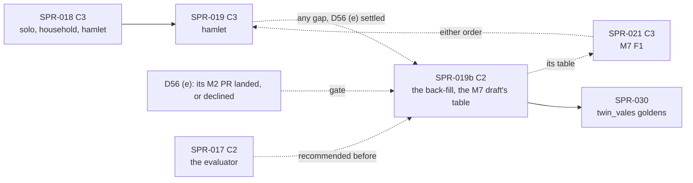

> **BLUF:** Builds `specs/worldgen/population_synthesis.toml` (PR #62, `REV-SPR-019` closed on `698e23d`; D46 approved) in `rh-worldgen`, bit-equal to `specs/worldgen/golden/population_synthesis_v0.txt` (hamlet and the manor at two seeds each; the manor's tenure logs under all seven laws over twenty seeds in two configurations) and to the genesis digests of SPR-030's fixture worlds (`golden/fixture_worlds_v0.txt`):
> - **population synthesis** (`[algorithm.population_synthesis]` P0–P12): for the anonymous rest of a people, persons from the compiled F1 schedule's stationary age-sex marginal by systematic allocation with a keyed offset, married couples by fixed-point iterative proportional fitting rounded to both marginals by a bipartite flow, dependent children assigned to eligible mothers, households, and residence by S3's rule; `hamlet`'s 14 anonymous founders are the first;
> - **the dynastic back-fill** (`[algorithm.dynastic_backfill]` B0–B11): for a dynastic world, each dynasty's spine of `generations` ancestors, their wives, their children by M2's own monthly conception draws, every death by the schedule's inverse draw, the younger sons' marriages, and the title's tenure log from the root's majority to the genesis holder, **each past holder the title's succession law selects** (the effect language's programs, checked against `effect_ref.py` at 1,481 successions: REV-SPR-019 R3), every dead row appended closed with `exit_tick < entry_tick` and **no channel-A record** (R1);
> - **the folds:** in stage A, `[algorithm.population_synthesis]` with INV-PS-01 to 07 as `[[invariants]]` and one `[[amends]]` adding `"dynasties"` to `initialization.from_manifest` into M2 (0.3.1 → 0.3.2, promoted in stage A's PR: Y2, Y3, Y6); in stage B, `[algorithm.dynastic_backfill]` with INV-BF-01 to 06 into the `next/M7` 0.5.0 draft, **not promoted** (SPR-021 promotes M7 after D56; `next/` keeps M7, so `check_all`'s deny-by-default controls keep their target: Y1);
> - the `house/v1` and `title/v1` id layouts, the six `rh-worldgen` purposes, the manifest compiler's dynastic refusals, and `rh-stream`'s rule that a back-filled dead row writes no record.
>
> **One baseline moves** (`hamlet`); `solo`, `household` and `smoke` are unchanged, which is an acceptance criterion. **The back-fill moves no golden world** (no rung has dynasties), so it is hash-neutral on `main`. Re-recorded in the final `[C3]` commit by `bin/regen_baseline.sh`; no `registry_version` bump (the Registry does not change); announced to the director before the merge.
>
> - **Developer:** AGT-002-CORE (`rh-worldgen`, `rh-ids`, `rh-registry`, `rh-stream`), with AGT-002-TOOLS for `rh-manifest`'s compiler, the references and the gates (one Developer session may hold both).
> - **Testers:** AGT-003-DET (bit-equality with the two goldens, the divergence, thread and keyframe invariance, the independent re-implementation), AGT-003-IF (the C2 surfaces: the M2 fold and promotion, the M7 draft's new table, the compiler's refusals, the stream rule, the genesis-inputs contract) and AGT-003-STAT (the synthesised populations' shape against the stationary marginal, reported). One session may hold them, on a different model from the Developer's.
> - **Size and class:** **about 6.25–6.5 agent-days** by the task inventory (T-01 0.75 with the M2 fold, T-02 1.5, T-03 0.5, T-04 0.5, T-05 2.0, T-06 0.5, T-07 0.75; Y8), above GOV-005 §3's ~3. **Recommended: the split at the stage boundary** (D57 item 1, 70%): **SPR-019** proper is stage A, the synthesis and the M2 fold (T-01 to T-04; **C3**; about 3.25 days, moves `hamlet`), and **SPR-019b** is stage B, the back-fill and the M7 draft's table (T-05 to T-07; **C2**: no golden world has dynasties, so no baseline moves; about 3.25 days, mergeable in any gap once D56's (e) is settled). The alternative is one sprint with a hard checkpoint after T-04. **C3**: `hamlet`'s genesis changes. It contains C2: M2 0.3.2 (frozen in stage A), `rh-ids` layouts, `rh-contracts::m2::GenesisInputs`, `WorldSpec`'s polities and dynasties, the compiler's refusals; stage B's C2 is the M7 draft's new table and `rh-stream`'s tracker rule.
> - **Status:** PLANNING, revision 2: REV-WAVE6's rulings on revision 0 (`a1d25d9`: Y1–Y9, the NITs, X5, Z1, Z2) and its re-check of revision 1 (`f6bf6d2`: V1–V8, N1–N12) are applied. It needs the director's plan approval (D57; GOV-005 §2). **Stage A starts under any state of D56; stage B starts when D56's (e) is settled** (approved and landed, or declined: "D56" below).

# SPR-019 — Population synthesis and the dynastic back-fill (WP P1.2)

- **Roadmap item:** `docs/11` P1.2, as narrowed by D46 (the `population` marginal only in v0) · **Phase / rung:** P1a, rung 2 (`hamlet`) and the non-rung fixtures `manor`, `twin_vales`, `kingdom_10k`
- **Depends on (the precondition head):**
  - **SPR-015 merged:** M2 0.3.0 frozen: `person.household`, `parity`, `last_birth_tick`, `conceived_tick`, `unborn_father`, `household.*`, `marriage.*` (P4, P8, P10, P11, B5, B11 write them), H2 and D-11's one rule for genesis mothers (REV-SPR-019 R14), `HouseholdId` and `household/v1` (`rh-ids`), the F0 band function, F4's `c_i` table and F3's level `m` from `tfr` (B6), N1's nuptiality thousandths and N2's ages (P5, B4, B8), F1's `n(a)` (P9), `SEX_M` (P4, B6), the derived index that holds every issued id (V-DATA-05: the back-filled dead are in it, since it is rebuilt from the log).
  - **SPR-016 merged (finding F-2: PRJ-002's graph lacks this edge):** the F1 mortality schedule's MR9 knots and the zero knot (`population_synthesis.toml:82` P0: "M2's compiled `[algorithm.mortality_f1]` schedule read as knots: MR9's 438 knots ... ending at the zero knot j_0 of MR8 (120 Y at most)"; `check_values.schedule_end_years_at_default = 120`, `:98`; the reference reads `selftest_m2_f1_mortality.py`'s compile, `selftest_population_synthesis.py:10–11, :321–322`). P2's marginal, B3's death draws and A = 120 are the F1 schedule's; under rung 0's 100-year linear `l` the goldens cannot be reproduced.
  - **SPR-018 merged:** M1's settlements and S3's R1–R4 (P12, B11's residence), `founder_residence`, the genesis order in `rh-worldgen` (M1, M2's founders, S3), `WorldSpec.geography`, and **`"dynasties"` in S3's `initialization.from_manifest`** at its freeze (Y2; SPR-018 T-03), without which `check_owner` (`crates/rh-worldgen/src/lib.rs:246–268`) refuses B11's residence writes for the living dynasts.
  - **SPR-014 merged:** the life-course row appended closed (`05.1` §2 rule 2; VER-SPR-011 DEF-3; `crates/rh-core/src/ledger.rs:20` already names the back-filled ancestor), `rh-contracts`.
  - **SPR-017: recommended before stage B, not required.** With `rh_registry::effect::succession::line` on `main` (SPR-017 T-04), B9 calls the evaluator over a genesis host of the back-filled rows (one procedure); without it, B9 is a Rust restatement of the five programs, bit-equal to the goldens, and SPR-021 or a later C1 PR replaces it by the call (hash-neutral, since the goldens pin both). The companion allows either (`population_synthesis.md` §8 item 2).
  - **SPR-021: not a dependency; a merge-order interaction, and M7's promoter (Y1).** SPR-021 promotes the `next/M7` 0.5.0 draft after D56, with stage B's table if stage B landed first; this sprint never promotes M7. If SPR-021's promotion lands first, stage B re-derives (REV-SPR-019 R13; `next/README.md:89`): it folds the table into a new `next/M7` draft over the then-frozen file, unpromoted, for M7's next sprint to promote. M7's code is not needed: genesis writes M7's columns under the frozen spec's `[initialization]` (`M7.dynasty.odd.toml:632–634` names `dynasties` and `polities`), and the engine keeps the tables of a system that is not built (`crates/rh-core/src/engine.rs:297–325` creates missing written columns and drops nothing), with M7 listed as `not_built` (ruling 3).
  - **SPR-020, SPR-026, SPR-027:** on `main` first; nothing is read beyond the stream's shape (no event, no record at genesis for the back-filled dead).
  - **D56** (A-56 membership, A-57 precedence and the levers of `specs/systems/next/M7_membership.md` §4; PR #79): **stage B's gate is "(e) settled"**, the elite read on the couple approved and landed in its own M2 PR (with B6's text and the goldens regenerated there, before SPR-015 freezes 0.3.0) or declined. Nothing else in D56 touches genesis (Y4: the "D56" section).
- **Binding contracts:**
  - `specs/worldgen/population_synthesis.toml` 0.2.0 (the fold file): `[fold]` `:30–40`, `[[rng_purposes]]` `:47–72`, `[algorithm.population_synthesis]` P0–P12 (`:75–95`, the constants `:80`, the check values `:98`), `[algorithm.dynastic_backfill]` B0–B11 (`:101–122`, the constants `:107`), INV-PS-01 to 07, INV-BF-01 to 06 (`:125–176`); `specs/worldgen/population_synthesis.md` §3 (the determinism rules), §4 D-01 to D-11, §5, §6, §8.
  - `specs/worldgen/selftest_population_synthesis.py` and `golden/population_synthesis_v0.txt` (four cases, 323 lines, the per-law digests of the sweep); `specs/worldgen/selftest_fixture_worlds.py` and `golden/fixture_worlds_v0.txt` (the person, marriage, household and house_member digests of `twin_vales` seeds 1–3 and `kingdom_10k` seeds 1–2: `selftest_fixture_worlds.py:29, :308`); `specs/registry/effect_ref.py` (`succession_line` `:2422`, `kin_within` `:2088`); `specs/determinism/golden/crn_pairing_v0.txt` (depends on `twin_vales`'s genesis).
  - `specs/systems/next/M2.demography.odd.toml` 0.3.0 as promoted by SPR-015 and bumped by SPR-016 (0.3.1): `[initialization]` as amended for SPR-019 (`:740–742`), H2 (`:652`), the `parity` and `last_birth_tick` meanings (`:166, :173`), `household.formed_tick` and `marriage.start_tick` (`:214, :250`); `specs/systems/next/M7.dynasty.odd.toml`, the 0.5.0 draft (`:58`; ten `[[amends]]` `:864–916`: PR #62's three, `initialization.state`, `tenure.title`, `house_member.house` (re-stated by PR #79), then INV-M7-06 and six recorded under the deny-by-default lint) and `specs/systems/next/M7_membership.md` (§2's three rules, `:29–31`; §4's levers, (e) at `:68`); `specs/systems/M7.dynasty.odd.toml` 0.3.4 (`house.*` `:85–104`, `house_member.*` `:106–118`, `title.*` and `tenure.*` `:128–230`, `[initialization]` `:632–634`, `majority_age` `:670`); `specs/systems/next/README.md` (the lifecycle, the promotion checklist, R13's rule `:89`); `specs/systems/next/amendments.lock.toml`; `bin/check_all.sh:330–389` (the seventeen deny-by-default controls, planted into `next/M7`).
  - `specs/systems/S3.migration.odd.toml` `[initialization]` `:170–172` (SPR-019 keeps R1–R3, writes no residence row for the dead; `from_manifest` names `"dynasties"` from SPR-018's freeze: Y2); `specs/registry/effect_language_v0.md` §5.3, §7.2, §8 (the five programs B9 restates; D14's `holders_of(title, 16)`).
  - `specs/manifest/manifest_v0.py` (`:164–184`: `Dynasty.generations` 1..6, `polities`), `specs/manifest/examples/manor.yaml` (400 persons, two dynasties, `majority_age: 16`), `twin_vales.yaml`, `kingdom_10k.yaml`; `crates/rh-manifest/src/compile.rs` (`:35` `DEMOGRAPHY_READS`; `:106–109` `compile(manifest, registry, built)`), `crates/rh-registry/src/world.rs:20–36` (`WorldSpec`).
  - `crates/rh-worldgen/src/lib.rs` (ruling 10's order `:8–10`; `check_owner` `:246–268`; `genesis` `:277–294`), `crates/rh-golden/src/world.rs:249–251` (genesis before `Demography::from_world`), `crates/rh-stream/src/convert.rs:150–215` (`LifeTracker`: "its first `observe` yields every row as an entry (genesis)"), `crates/rh-ids/src/person.rs:13–16, :41–47` (the `founder/v1`, `child/v1` and `rehash/v1` domains).
  - ADR-0006, ADR-0007, ADR-0024, ADR-0025 (nothing dated at or after tick 0 is written by genesis), ADR-0026 items 1–3, ADR-0033 §4; SPR-011 rulings 5 (as clarified: a row appended closed is free) and 10; `docs/09` V-DATA-04 P1a variant (`:267`: the back-filled rows exempt from the tiling), V-DATA-05 (`:268`), V-INV-01, V-INV-12 (`:136`, the genealogy clause), V-SAGA-19, V-DET-01, V-DET-02, V-DET-05, V-DET-12, V-DET-19, V-WC-04, V-GOLD-01, V-PERF-11.
- **System specs:** M2 goes from frozen 0.3.1 to **frozen 0.3.2** in stage A (T-01: `[algorithm.population_synthesis]`, INV-PS-01 to 07 as `[[invariants]]`, and one `[[amends]]` of `initialization.from_manifest` adding `"dynasties"`; Y2, Y3, Y6), an Architect-approved C2 change inside the C3 PR, built against the frozen file (D-1's reasoning). **M7 is not promoted here** (Y1): stage B (T-06) folds `[algorithm.dynastic_backfill]` and INV-BF-01 to 06 into the `next/M7` 0.5.0 draft, which stays a draft (frozen M7 stays 0.3.4, or SPR-021's); SPR-021 promotes it after D56. S3 0.1.0 is read, not changed here (its `"dynasties"` is SPR-018's freeze). Both `from_manifest` changes are listed in their PR bodies (Y2).
- **Rulings (binding):**
  - REV-SPR-019 R1–R15, above all R1 (keyframe and life-course only: no channel-A record for the back-filled dead; `exit_tick < entry_tick` the discriminator), R2 (E(a) in Q0.64 → Q0.32), R3 (the tenures are what the law selects; the differential gate), R4 (frozen text changes only through `next/` amendments; the fold file keeps the algorithm), R5, R9 (minor stand-ins, measured and pinned), R10 (609 days), R12 (the per-law digests, G = 6), R13 (whichever lands second re-derives `next/M7`), R14 (one rule for every genesis mother), R15 (u128, the ceiling form); the Architect's round-3 corrections (R9's mutant, R10's back-filled gaps); D46 (approved: the `population` marginal only);
  - REV-SPR-018 R7 (no residence row for the back-filled dead), R8; REV-SPR-017 N5 (the title-blood precondition); REV-SPR-015 R11 Q3 (`household/v1` additive), the W4 derived index; REV-SPR-030 R1 (the house-member mechanics and A-56), R6 (the fixture goldens' digests), R10 (the PR and nightly tiers), R18 (A-57); REV-SPR-029 R17 and D49 (`Founder #k` labels: the back-fill's `k` is the annals' key);
  - **REV-WAVE6 (2026-10-17): the Architect's rulings on revision 0 (Y1–Y9, the NITs, X5, Z1, Z2) and the re-check of revision 1 (V1–V8, N1–N12)**; every X-, Y-, Z-, V- and N- id in this plan is REV-WAVE6's (the specs table marks each row they decide; the rows still marked "proposed" are ruled with the plan's approval).
- **Director items:** D57 (this plan: the size and the split; no `manor` golden world; CI through D54 item 6; stage B's gate on D56's (e)); D56 (not this plan's to decide; the "D56" section says what reaches genesis); D40's pre-registered revisit (the house-size finding, REV-SPR-019 R7, is on its docket, not this sprint's).
- **Requirements covered:** SIM-1 (ledger rows and genealogical ids for a synthesised population; the 10k fixture's genesis); DATA-8 (the life-course log reaching before the epoch: every ancestor a closed row with parent links); SIM-9's precondition (great houses with their genealogies and tenure logs, so M7's naming and the title-blood rule have a past to read: V-INV-12's genealogy clause); DET-2 (six keyed purposes, no rejection loop); DET-3 (Q0.32, Q0.64, 2^-32 cells, u128 widths; no float); WC-3's ingredient (the manifest's `population` compiled exactly: INV-PS-07).

## Specs this sprint needs

| Spec | Exists? | Gap | Architect ruling | Needed by |
|---|---|---|---|---|
| **The F1 schedule as the synthesis's input (finding F-2)** | P0 (`population_synthesis.toml:82`) reads MR9's 438 knots and the zero knot; `check_values.schedule_end_years_at_default = 120` (`:98`); the companion §5: "The schedule's end is 120 years with the F1 knots (round 1 read rung 0's 100)" | PRJ-002's SPR-019 row says "SPR-015, SPR-018" (`:40`) and §3's graph has no `S016 --> S019` edge (`:71–72`); the MR1–MR9 compile lives in `rh-sys-demography` after SPR-016 T-02 | **Proposed (9/10):** SPR-016 is a precondition of this sprint (stage A and B both read the schedule); PRJ-002's row and graph gain the edge (done at this plan). The order is unchanged in practice: SPR-016 is wave 5 | T-02, T-05 |
| **How genesis gets M2's compiled schedule and tables** | `rh-worldgen` depends on `rh-core`, `rh-ids`, `rh-registry` only; `rh-sys-demography` is a dev-dependency (`crates/rh-worldgen/Cargo.toml:18–27`); `docs/13` §3: system crates depend on no other system crate, and nothing says a machinery crate may depend on a system crate; the host constructs `Demography::from_world` after genesis (`world.rs:249–251`) | P0's knots, F4's `c_i` and `c_i^e`, F0's bands, N1's `nu_i`, `SEX_M` and F1's `n(a)` are M2's compiled values; a second implementation in `rh-worldgen` is the "two procedures" risk D-6 and W19 closed for mortality | **Proposed (7/10): the host passes them in.** `rh-contracts::m2::GenesisInputs { knots: Vec<(age_minutes, l_bits)>, zero_knot, conception: [Prob32; 14], conception_elite: [Prob32; 14], nuptiality: [Prob32; 7], sex_male: Prob32, coale_trussell: [u16; 35] }`, a plain value type with no implementation (`docs/13` §4.1), built by `Demography::genesis_inputs()` (one procedure, M2's own compile) and given to `rh_worldgen::genesis(spec, specs, &inputs)`; `rh-golden` constructs M2 before genesis. Alternative: a normal crate edge `rh-worldgen → rh-sys-demography` (no `bin/lint_arch.py` change: `check_edge`, `:842–859`, constrains system sources only; it would set a precedent for machinery depending on a system) | T-01, T-02 |
| **Where the two algorithm tables live after the freeze (the fold; Y1, Y3, Y6)** | `population_synthesis.toml:3–8`: "it binds nothing until the Architect folds the two tables into the owning specs at SPR-019's freeze"; `[fold]` `:30–40`; companion §8 item 3 (`population_synthesis.md:91`): "the two tables into their owners' next versions; `specs/systems/next/M7.dynasty.odd.toml` 0.4.0 promoted with M7's next sprint"; `next/M2`'s `[initialization]` already says "folded here at its freeze" (`:741`) | After SPR-015 and SPR-016, M2 is frozen 0.3.1 with nothing in `next/`; `next/M7` is the 0.5.0 draft (PR #79: D56's runtime rules, ten `[[amends]]`), and promoting it would freeze agnatic `on_birth`, later-children vocations and the dormancy precedence before D56 is ruled; `check_all.sh:330–389` plants its seventeen deny-by-default controls into `next/M7`, so an empty `next/` leaves them no target; under the split, stage A's C3 code for P0–P12 would merge against an unfolded table (D-1's reasoning); `lint_odd.py` does not read `specs/worldgen`, so a table outside its owner is protected only by the reference's `--stale-spec` control (`worldgen_lite.md` §1) | **Ruled (Y1, Y3, Y6).** **Stage A (T-01): the M2 fold, promoted.** `next/M2` 0.3.2 = the frozen 0.3.1 plus `[algorithm.population_synthesis]` (P0–P12, its `version`, `constants`, `check_values`), INV-PS-01 to 07 as M2 `[[invariants]]` (checked by `rh-worldgen` at genesis and at restore, never in M2's per-instant `invariants()`: X1's rule; the docs/09 V-id stays in `test` and the cadence goes in `statement`: V3), and one `[[amends]]` of `initialization.from_manifest` adding `"dynasties"` (Y2); no change to `[[rng]]` (the purposes are `rh-worldgen`'s), bindings, `DRAINS` or any frozen step, so the skeleton diff is the version line; `lint_odd.py --next` green with the one new AMEND line read by the Architect and the lock regenerated by the tool; then promoted in stage A's PR (`next/README.md` step 4 scaled to what applies). The reference reads P0–P12 from the frozen M2 (`--stale-spec` plants a copy of M2's). **Stage B (T-06): the M7 table, unpromoted.** `[algorithm.dynastic_backfill]` (B0–B11, `constants`, `check_values`) and INV-BF-01 to 06 as `[[invariants]]` (genesis-only, as above) fold into the `next/M7` 0.5.0 draft beside its ten amendments; `lint_odd.py --next` green with the same ten (the review's simulated fold: "lock matched"); **no promotion**: SPR-021 promotes M7 after D56, and `next/` keeps M7, so the deny-by-default controls keep their target. The reference reads B0–B11 from the draft; `population_synthesis.toml` becomes a pointer; `lint_odd.py`'s "a new table never overrides a frozen step" rule is applied by the Architect to both tables (an Architect text edit at the fold, the tables being new). Alternative (not taken): the fold file stays as a frozen genesis spec under `rh-worldgen` (no `lint_next` protection) | T-01, T-06 |
| **Ruling 10's `from_manifest` half (Y2; finding F-9's other half)** | `check_owner` (`crates/rh-worldgen/src/lib.rs:246–268`) refuses any column whose owner's `[initialization] from_manifest` lacks the manifest section that drives the write; M2's lists (frozen `M2.demography.odd.toml:331`, next `:742`) and S3's (`S3.migration.odd.toml:172`) are `["peoples", "cast", "households"]`; M7's (`M7.dynasty.odd.toml:634`) already names `dynasties` | The back-fill writes M2's `person.*`, `life_course.*`, `household.*` and `marriage.*` rows and S3's residence columns for persons the `dynasties` section creates; without the section in both lists genesis refuses every such write | **Ruled (Y2):** `"dynasties"` joins S3's `initialization.from_manifest` at SPR-018's freeze (SPR-018 T-03: a precondition here), and M2's through the `[[amends]]` of `initialization.from_manifest` in T-01's 0.3.2 fold (stage A, so stage B builds on a frozen list); each change is listed in its PR body; a test plants a dynastic manifest against M2's old list and asserts `check_owner`'s refusal names `dynasties` | T-01, T-05 |
| **No `manor` golden world here (finding F-3)** | Companion §8 item 5: "The golden regeneration of `hamlet` (C3) and the new `manor` ladder"; PRJ-002 gives "the dynastic fixture world's goldens" to SPR-030 (`:51`) and lists SPR-019 among the golden-corpus announcements (`:208`); `bin/regen_baseline.sh:31` knows four worlds; a new golden world changes the corpus, which `docs/13` §4.2 makes a director announcement with a veto | A `manor` ladder before SPR-021 would freeze a history in which M7 never acts; SPR-021 would move it again | **Proposed (8/10): no new golden world in this sprint.** The manor runs in `rh-golden`'s tests (V-DET-01/02 at 1, 2, 4, N threads over 50 years; V-DET-05; V-DATA-04 with the exemption; INV-BF-05 at every year end by a test observer, never per instant: V8) with no committed baseline; the corpus grows at SPR-030 (`twin_vales`), as PRJ-002 says; the companion's item 5 is corrected at the fold | T-07 |
| **A dynastic manifest before M7 is built** | B1 (`:110`): "A manifest with a dynasty must register M7.dynasty and M2.demography (genesis refuses a column without an owner, ruling 10)"; `check_owner` reads the spec table of every spec on disk (`lib.rs:246–268`), so M7's columns have an owner today; `BUILT` lacks M7 until SPR-021 | Whether genesis may write M7's tables into a world whose build has no M7 | **Proposed (7/10): yes.** The manifest must name M7 (its template does: `feudal_realm`, `registry_v0.toml:462–463`), so the owner is in the spec table; the engine carries the tables unchanged with M7 `not_built` in the header, and `--strict` refuses the run until M7 is built (ruling 3). B1's sentence is read as "must name", stated at the fold. Alternative: genesis refuses a dynastic manifest until M7 is built, which leaves stage B with no engine-level test before SPR-021 | T-05, T-07 |
| **B9's programs: the evaluator or a restatement** | Companion §8 item 2: "the five law programs of B9 as Rust, or a call into `rh-registry`'s evaluator once SPR-017 lands it, either way bit-equal to the Python reference"; SPR-017 (D52 pending) delivers `succession::line(law, holder, title, now, host)` (its T-04) | Which, and what proves it | **Proposed (8/10):** the evaluator when it is on `main` at stage B's start (a genesis host over the back-filled rows: `exists`, `alive`, `parents`, `children`, the tenure rows written so far); else a restatement in `rh-worldgen` behind one function, replaced by the call in a later C1 PR. Either is pinned by the per-law digests of two configurations × 20 seeds × 7 laws and by the two mutants (`mutant-holders-window-8`, `mutant-standin-youngest`), which must each fail a named golden line | T-05 |
| **`rh-stream` would write records for the back-filled dead (finding F-4)** | `convert.rs:150–155`: `LifeTracker::new` "yields every row as an entry (genesis: the founders at tick 0)"; `observe` then closes every row whose `exit_kind` is not open (`:215`); B11 (`:120`) and R1: "Channel A at tick 0 carries nothing for the back-filled dead"; a `LIFE_EXIT` at a pre-epoch tick breaks R3 and R5 and the month-0 `STEP_DIGEST.deaths` would count them (REV-SPR-019 MAJ-1) | The writer has no rule for a row that is closed when first seen | **Proposed (8.5/10):** T-05 gives `LifeTracker` the discriminator in `new` and `observe` (`convert.rs:155`, `:177`): a row with `exit_tick < entry_tick` is never a record (no entry, no exit) and never counted; `LifeTracker::resumed` (`:164`) needs no change, since it already skips closed rows (`seen = len`, and `open` holds open rows only; the review's NIT); `STEP_DIGEST.deaths` and `living` are unchanged by it (`living` is ledger rows, `channel_a_v0.sql:227`). Hash-neutral on every rung (no rung has such a row); channel-A bytes unchanged there. A planted mutant `mutant-tracker-backfill-entry` fails the manor's R4 order check by name | T-05 |
| **`WorldSpec` carries no polities** | `world.rs:20–36`; `compile.rs` compiles M2's parameters only | B0–B1 need the polities in manifest order, each dynasty's id and `generations`, the polity's `succession_law`, and M7's `majority_age` (Q16_16; no Registry default: `registry_v0.toml:80–100`; REV-SPR-019 R15) | **Proposed (8/10):** `WorldSpec.polities: Vec<Polity { id, succession_law: SuccessionLaw, dynasties: Vec<Dynasty { id, generations: u8 }> }>` and `WorldSpec.dynasty: Option<DynastyParams { majority_age: Q16_16 }>` compiled from the validated manifest; the four refusals of companion §8 item 4 at `compile` (not the validator: V-WC-04 compares `validate`, W20's rule): a people's `population` below its founders plus living dynasts is a genesis error naming the three counts (P1: the count is known only after the back-fill, so genesis refuses, not `compile`); a dynasty beyond `max_rows` (B7, genesis; it counts the rows the back-fill writes, so it is stage B's, T-05: V4); until stage B lands, any manifest with dynasties (genesis, by name: T-03; V4); a dynasty in a manifest that names no `M7.dynasty` (compile); a dynastic manifest without `majority_age` (compile; `val_khor.yaml` is the case: it validates and fails to compile, which `manifest_parity.py` does not see). Compile-level fixture manifests cover each | T-03, T-05 |
| **`hamlet`'s divergence (W2, W3) and the two unchanged rungs** | Companion §7 note 1: `hamlet` moves, `solo` and `household` do not (N = 0 synthesised: `solo` 1 = cast 1; `household` 6 = cast 3 + children 3) | The form | **Ruled (X5; W3's two parts):** (a) at genesis, `hamlet`'s dump differs from SPR-018's in exactly the rows of founders k = 46..59 (the 14 anonymous: their ids are unchanged, `founder(seed, k)` in the same order, P4) across `person.*`, `life_course.*`, and in the `household.*`, `marriage.*` and `residence_interval.*` rows that name them; the cast and Job's household are byte-identical at tick 0; (b) **after genesis only W3 (b) binds:** the differential model reproduces every `BIRTH`, `MARRIAGE` and `DEATH` instant, child id and sex over 200 years, and no channel-A clause is asserted after tick 0 (`STEP_DIGEST`'s `living`, `births` and `deaths`, `EXTINCTION`'s tick and seq and every later record may differ); `solo`, `household` and `smoke` are byte-identical at 1 and N threads, headers included (any difference is a defect) | T-04 |
| **`solo` and `household` under P1–P4** | P1 (`:83`): N = population − cast − children − servants − living dynasts; P4 replaces ruling 10's draws "for the anonymous rest" only | A code path that touches the cast's draws would move the two rungs | The acceptance above; a probe asserts that no `synth_offset` draw is taken on `solo` and `household` (N = 0 allocates nothing, P3) | T-02 |
| **The genesis order of k and the ids** | Companion §3: the cast, the manifest households' children and servants, the back-filled rows in creation order, then the synthesised; `founder(seed, k)` follows it; D-02: every genesis row is `founder/v1`, the dead included | The derived index of issued ids (SPR-015 T-02) must hold the back-filled dead, or a runtime `child/v1` collision with a dead ancestor's id would not rehash | Built from the life-course log, which holds every closed row, so it does by construction (W4: "built from its columns at construction and at restore"); T-05 tests a forced collision with a dead ancestor's id | T-02, T-05 |
| **`hamlet`'s residence under the synthesis** | SPR-018 places the 14 anonymous founders by their own draws (R3); P12 places a synthesised couple by its husband's draw and a single by its own | The hamlet residence line of `worldgen_lite_v0.txt` (SPR-018's golden) describes loose founders and stays true for SPR-018's worlds; under this sprint the 14 are one couple and twelve singles (hamlet seed 42: `hamlet_42_married = 1`) | The worldgen-lite golden is not regenerated (its cases are the reference's `Population` objects, not the engine); the population-synthesis golden carries hamlet's residences; T-04's divergence record names the 14 rows | T-04 |
| **The fixture worlds as the port's second golden** | `selftest_fixture_worlds.py` renders `twin_vales` seeds 1–3 and `kingdom_10k` seed 1 in the PR tier with the SHA-256 of the person, marriage, household and house_member rows (`:29, :308`; REV-SPR-030 R6), so genesis is bit-pinned | The Rust genesis of a 10,000-person, twelve-house world is the strongest available check of P0–P12 and B0–B11 together | **Proposed (8.5/10):** T-07 reproduces every `_sha256` line of `golden/fixture_worlds_v0.txt` for the PR-tier cases in release (part golden; seed 2 of `kingdom_10k` nightly), which also pins `specs/determinism/golden/crn_pairing_v0.txt`'s genesis | T-07 |
| **CI (Z1)** | Revision 0's base, `772478f` (core 11:46, golden 9:01), predates SPR-014 and SPR-026, and its remedy (SPR-018 moving `population_synthesis_gate` and `fixture_worlds_gate` to part golden) is withdrawn. **The Architect's current figures:** part core's step about 11:30–12:05; part golden 12:46 with SPR-026, plus about 2.5 minutes from SPR-014, so about 15:15 after wave 4; wave 5 adds about +2.5 and +1.3 minutes (D54), SPR-018 about +50 s and +40 s | This sprint's Rust goldens; golden is already the tighter part | **Ruled (Z1):** the debug hamlet golden (about 5 s) and the compile fixtures in part core; the manor goldens, the seven-law sweep and the fixture-world digests in release in part golden; the two pure-Python gates stay in part core (path-scoping them is the Architect's BCK item, not this plan's); T-04 and T-07 state each stage's added time per part against the post-wave-4 state, budgeted ×1.5 for slow runners, and name their own nightly candidates; the third PR-tier job is D54 item 6 | T-04, T-07 |

## Compliance (every task)

| Rule | This sprint |
|---|---|
| Change class (`docs/13` §4.2) | **C3**: `hamlet`'s genesis changes (14 synthesised persons: ages, sexes, one couple with children, households, residences), so `state_hash` moves on `hamlet` from the genesis keyframe on. It contains C2: M2 0.3.2 (the fold and its promotion, with `"dynasties"` in M2's `from_manifest`), `rh-ids`' `house/v1` and `title/v1`, `rh-contracts::m2::GenesisInputs`, `WorldSpec`'s polities and dynasty parameters, the compiler's refusals. **Under the split,** SPR-019b (the back-fill, the M7 draft's new table, `rh-stream`'s tracker rule) is **C2**: no golden world has a dynasty, so no `state_hash` moves and no baseline is re-recorded; CI detects C2 |
| Planes touched (ADR-0024) | **A:** `rh-worldgen` (P0–P12, B0–B11, six purposes), `rh-ids` (two layouts), `rh-registry` (`WorldSpec`), `rh-contracts` (`m2::GenesisInputs`), `rh-sys-demography` (`genesis_inputs()`), `rh-stream` (`LifeTracker`), `rh-registry::effect` as a caller only (if SPR-017 is on `main`). **Tool:** `rh-manifest` (`compile`), `rh-golden` (the host's order; tests), `bin/gen_rng_golden.py`, `specs/` (the M2 fold and promotion, the M7 draft's new table, the references re-pointed, the fixtures), `bin/check_all.sh`. **B, C:** none |
| Owned columns written | At genesis only, by `rh-worldgen` under the owners' `[initialization]`, each owner's `from_manifest` naming `dynasties` (M2 by T-01's amendment, S3 by SPR-018's freeze, M7 already: Y2): `M2.demography`'s `person.*` (the fourteen), `life_course.*` (open rows for the living, closed rows with `exit_tick < entry_tick = 0` for the back-filled dead), `household.*`, `marriage.*`; `S3.migration`'s `person.residence` and `residence_interval.*` (the living only, R7); `M7.dynasty`'s `house.*`, `house_member.*`, `title.*`, `tenure.*`. No system step changes; M2's steps see a bigger ledger |
| Reads (via `rh-contracts`) | None at run time. Genesis reads M2's compiled values through `GenesisInputs` (the specs table) and S3's weights through M1's tables as SPR-018 does |
| RNG purposes added | `rh-worldgen`'s six, after SPR-018's (`[[rng_purposes]]` `:56–72`): `synth_offset` (entity `16 i + slot`, k = 0), `backfill_spine` (entity the `HouseId`, k = 0 and `1 + 4 (G − 1 − g) + j`), `backfill_marriage` (entity the groom, k = 0..3), `backfill_conception` (entity the wife, k = `2 m'` and `2 m' + 1`), `backfill_sex` (entity the mother, k = the child's index), `backfill_death` (entity the person, k = 0); `founder_birthday` and `founder_residence` reused; `founder_sex` and `founder_age` not drawn for a synthesised person. Keys as W0; the names are hashed (`PurposeId::of`), so the enum order is free; a fixed draw structure (no rejection loop) |
| Golden-hash effect | **`hamlet` moves; `solo`, `household` and `smoke` do not** (an acceptance criterion). Re-recorded by `bin/regen_baseline.sh` in the final `[C3]` commit; no `registry_version` bump (the Registry does not change); announced to the director before the merge; the divergence record is T-04's. **Stage B moves nothing** |
| Fixed-point quantities | Q0.32 shares (`nu_i`, E(a), C(a)), the Q0.64 unmarried chain (one `rhe` per month), the couple table at 32 fraction bits (one `rhe` per cell per step, 32 sweeps), `majority_age` as `Q16_16` → whole days; every other quantity an integer: the systematic allocation in unsigned u128 (`S (total + 1) < 2^96`, the ceiling as `ceil(x + 1 − φ) − 1`, R15), the flow's integers, the survivorship levels in 2^-32 units, `pick(u, n)` as a u128 product. No float (V-DET-19); `rhe` once per rounding as S0 defines it |
| Determinism lints (GOV-003 §2, §6) | Must pass. No new plane-A dependency (the evaluator, if used, is `rh-registry`'s, already a dependency); `BTreeMap` and `Vec` only, persons in ascending `PersonId`, cells in index order, the flow's BFS in the stated order, the laws' keys ending in `PersonId`; no interior mutability (W31); no `env!` (A-50) |
| Tests that gate this sprint | V-INV-01 (INV-PS-01 to 07 and INV-BF-01 to 06 at genesis and at restore on every case, never per instant (X1's rule); M2's invariants at every Bookkeeping on the synthesised worlds; INV-M2-07's parity rule across the epoch), V-DATA-04 (P1a: the exemption by the discriminator; the tiling of everyone else), V-DATA-05 (every genesis id `founder/v1`; a forced collision with a dead ancestor's id rehashes identically), V-INV-12's genealogy clause (every house member's lineage reconstructs from the closed rows), V-SAGA-19 (INV-BF-05's log at genesis), V-DET-01, V-DET-02 (1, 2, 4, N threads on `hamlet` and the manor), V-DET-05 (a keyframe with closed pre-epoch rows), V-DET-12, V-DET-19, V-WC-04 (unchanged: the refusals are `compile`'s), V-GOLD-01 (`hamlet`), V-STR-01 (no record for the back-filled dead; `hamlet`'s segments byte-identical across runs), V-PERF-11 (`hamlet`'s budget re-recorded if a count moves), plus `bin/check_all.sh`. **Reported, not gated** (AGT-003-STAT): the synthesised age-sex shape against the stationary marginal, the married share against E(a), the children per mother, on the manor and `kingdom_10k`; INSUFFICIENT where samples are small |
| Docs updated in the same sprint | `bin/check_all.sh` and `python/tests/test_check_all_inventory.py` (same commit); the `CLAUDE.md` checks (the reference's new paths after the folds, M2 0.3.2's lint lines, the compile fixtures); `next/README.md` (stage A: M2's promotion and its row gone; stage B: M7's row names the back-fill table, unpromoted); `population_synthesis.toml` (stage A: P0–P12 point at M2 0.3.2; stage B: the pointer) and the companion §1, §8 (the folds done; item 3: M7 promoted by SPR-021; item 5 corrected); `05.0` §6 (`rh-contracts::m2::GenesisInputs`); `05.1` §2 rule 2 (one line: genesis receives M2's compiled values through the contract crate; the Architect's wording); `docs/09` V-DATA-04, V-DATA-05, V-INV-12, V-SAGA-19 method lines with the test names; `worlds/hamlet/README.md` (what moved); PRJ-002's row (the SPR-016 edge, done at this plan); BCK-002 A-56 and A-57 (what this sprint did under D56's (e)); `docs/11` P1.2 (a note: D46's narrowing) |

**Rules carried from P0–SPR-018 (every task):**
- **Property tests vary world size and seed:** the four golden cases plus random manifests at three populations (60, 400, 1,500) and eight seeds, with one, two and five dynasties of one to six generations under each of the seven laws; the 10,000-person size and the 60-seed sweep nightly (W42).
- **A positive control fails for the right reason:** its `check_all` line matches the message; every planted mutant fails a named golden line.
- **A test input exercises the path it claims, and a probe asserts it:** P7's second pass was reached in at least one random case or is proven unreachable on the goldens (NIT-1 of REV-SPR-019 round 1); a stand-in fired on an adult (the sweep's `adult_fallbacks = 25`); a pregnancy was dropped at the epoch (D-08); a leftover child found a mother; a forced id collision was with a dead ancestor's id (W7).
- **Python tests read no CI environment variable.**
- **No statistical gate in this sprint.** AGT-003-STAT reports.
- **CI time (W42, Z1):** the reference is the state after wave 4 by the Architect's figures (part core about 11:30–12:05; part golden about 15:15, 12:46 with SPR-026 plus about 2.5 minutes from SPR-014), then wave 5's D54 additions (about +2.5 and +1.3 minutes) and SPR-018's (about +50 s and +40 s). Golden is past 12 minutes already, so the third PR-tier job is D54 item 6. T-04 and T-07 state each stage's added time per part against that state, budgeted ×1.5 for slow runners, with this sprint's own nightly candidates; no gate moves part; each part's time is reported.
- **Merge `origin/main` when main moves,** and re-run both parts.
- **Batch pushes at task boundaries.**
- **Every new gate is in exactly one `check_all.sh` part,** with the inventory test updated in the same commit.
- **Baselines are regenerated only by `bin/regen_baseline.sh`,** in the final commit, with `[C3]` at the end of its subject; the two reference goldens are **not** regenerated (the port reproduces them; `--write` is never run in this sprint, and a golden that must move is a defect in the port or a spec finding). **Mutants never make a baseline** (`mutant-*` features; BCK-002 A-52).
- **One commit per task** (GOV-005 §4).

## Tasks

**Stage A** is T-01 to T-04 (the synthesis and the M2 fold; SPR-019 proper under the split). **Stage B** is T-05 to T-07 (the back-fill and the M7 draft's table; SPR-019b under the split). Under one sprint, a **hard checkpoint** follows T-04: the Tester's interim pass on the synthesis (`VER-SPR-019-TEST`, phase 1) is required before T-05 lands.

#### T-01: The M2 0.3.2 fold and promotion, the id layouts and the genesis-inputs contract (`specs/systems`, `rh-ids`, `rh-contracts`, `rh-sys-demography`; B0; Y2, Y3, Y6, Y8; C2; at least 0.5 day for the contracts, 0.75 with the fold)
- **Deliverable:**
  - **The M2 fold (Architect, with the Developer; the specs table's fold row):** `specs/systems/next/M2.demography.odd.toml` 0.3.2 = the frozen 0.3.1 plus `[algorithm.population_synthesis]` (P0–P12, its `version`, `constants`, `check_values`; P10's "counted and reported by the run header", `population_synthesis.toml:92`, reworded to "counted and reported only when nonzero": Y7, N9), INV-PS-01 to 07 as `[[invariants]]` whose `test` fields keep the fold file's docs/09 V-ids (`lint_odd.py:1203–1204`) and whose `statement`s state the cadence: at genesis and at restore, never in M2's per-instant `invariants()` (V3), the `[[rng_purposes]]` note that the purposes are `rh-worldgen`'s, and **one `[[amends]]` of `initialization.from_manifest`** to `["peoples", "cast", "households", "dynasties"]` (Y2); `lint_odd.py --next` green with that one new AMEND line, read by the Architect, and the lock regenerated by `--write-amendments-lock`; then promoted (moved over the frozen file, `status = "frozen"`, the skeleton regenerated with `SPEC_VERSION = "0.3.2"` and nothing else, the lock's M2 section gone, the `CLAUDE.md` lines); the stale-value controls (`m2_f1_stale_control`, `m2_f1_mortality_stale_control`) still point at the promoted spec; `selftest_population_synthesis.py` reads P0–P12 from the frozen M2 (its `--stale-spec` plants a copy of M2's) and `population_synthesis.toml`'s P table becomes a pointer to it; the amendment is listed in the PR body.
  - **The ids and the contract:** `rh_ids::HouseId` and `TitleId` (u64) over `rehoboam/rh-ids/house/v1` and `rehoboam/rh-ids/title/v1` of `[world_seed, k]`, beside SPR-015's `household/v1` (REV-SPR-015 R11 Q3's additive pattern); `bin/gen_rng_golden.py` gains their vectors. `rh_contracts::m2::GenesisInputs` (the specs table: a value type, no implementation) and `Demography::genesis_inputs(&self) -> GenesisInputs` (M2's own compile: MR9's knots and zero knot, F4's two conception tables, N1's `nu_i`, `SEX_M`, F1's `n(a)`); `rh_worldgen::genesis` takes `&GenesisInputs`; `rh-golden`'s `world.rs` constructs M2 before genesis (`:249–251` reordered; one production caller); the `05.1` §2 rule 2 line.
- **Acceptance:** `lint_odd.py` green in frozen mode with M2 0.3.2 and `--next` green on the remaining M7 draft; `gen_skeletons.py --check` green and the M2 skeleton's diff is its version line; M2 registers against 0.3.2 under rule `spec`; `selftest_population_synthesis.py --effect-ref specs/registry` passes against the folded table and its stale-spec control fails `SPEC MISMATCH` by name; `selftest_m2_f1.py`, `selftest_m2_f1_mortality.py --check` and `selftest_fixture_worlds.py --tier pr` pass unchanged; a dynastic manifest planted against M2's 0.3.1 list is refused by `check_owner` naming `dynasties` (Y2). The `rh-ids` vectors reproduce (`gen_rng_golden.py --check`); two houses of one world never share an id and a planted equal `k` is refused; `GenesisInputs` equals the Python references' values at the Registry defaults and at the manor's parameters (the knots line for line against `selftest_m2_f1_mortality.py`'s `compile_schedule`, the tables against `selftest_m2_f1.py`'s `nuptiality_bits`, `c_i`, `SEX_M`: `population_synthesis.toml`'s `check_values` `tfr1_bits = 615614`, `level_bits_at_default = 34186`, `sex_male_bits = 2199861298`); `lint_arch` keeps `rh-contracts` (A, contract) with no implementation; the smoke, `solo`, `household` and `hamlet` ladders are unchanged by the reorder and the promotion (SPR-018's baselines).
- **Status:** [ ] not started

#### T-02: Population synthesis P0–P12 in `rh-worldgen` (INV-PS-01 to 07; REV-SPR-019 R2, R5, R10, R14, R15; D-10, D-11)
- **Deliverable:**
  - **P0–P1:** the calendar helpers (`t_m`, `n_m`, ages in whole years at the epoch), the schedule's knots from `GenesisInputs`, A = the least whole year at or past the zero knot; N = population − the cast − the households' members − the living dynasts (B written first: T-05; in stage A a dynastic manifest never reaches P1, since genesis refuses it by name: T-03, V4), a genesis error naming the people and the three counts when N < 0.
  - **P2–P4:** `L_a`, `Λ`, the 2A weights with the 105 : 100 ratio; the systematic allocation `A(w, total, slot)` in unsigned u128 with the `synth_offset` draw (`16 i + slot`, the high 32 bits as φ′) and the precondition checked; the persons in cell order as the next founders `k` with `founder_birthday` for the minute inside the year, M2's `[initialization]` values, the open life-course row.
  - **P5:** `nu_i` as Prob32, the Q0.64 unmarried chain (419 months, one `rhe` each), E(a) in Q0.32, C(a) with the widowhood factor `l((a + 3) Y) / l(22 Y)`, the women's and the men's weights, `M = min(M_f, M_m)`, the two allocations (slots 1 and 2), `r_i`.
  - **P6–P7:** the seed `Z`, 32 sweeps of row and column steps at 32 fraction bits, the floors, the deficits, the bipartite flow by BFS in the stated order (the first pass over cells with a positive fraction, the second over every cell), a construction error naming the table when the residual exceeds a unit.
  - **P8–P11:** the pairing in the stated orders (spouse columns, marriage rows `source = genesis`, households `H64(household/v1, [husband, 0])`), the children's bands and the allocation (slots 3 + c), the assignment by the fewest-children rule with the 609-day sibling gap (`sibling_gap_minutes = 876960`), the leftover list, the orphans counted and **reported only when nonzero** (one line at genesis, never in the ladder header, so `solo`'s and `household`'s headers stay byte-identical; every golden case has 0: Y7), parity and `last_birth_tick` by D-11 for every genesis mother (H2's included, as SPR-015 wrote them), the singles' households.
  - **P12:** residence by S3's R1–R3 (SPR-018's code) with the couple's draw keyed by the husband.
  - **The planted mutants** (`mutant-*` features): `mutant-synth-largest-remainder` (P3 by largest remainder: D-10's failure, no adult on hamlet), `mutant-synth-offset-low-bits` (φ′ from the low 32 bits), `mutant-ipf-sweeps-2` (2 sweeps instead of 32: of 31, 24, 16, 8, 4 and 2 sweeps only 2 changes a golden line, the review's probe, Y5), `mutant-sibling-gap-560` (the round-2 constant).
- **Acceptance:**
  - **The golden, every line** of `population_synthesis_v0.txt`'s two `hamlet` cases (seeds 42 and 7: the age-sex digest, the women's and men's allocations, the couple table, the person digests with `parity` and `last_birth_tick`, the households, the orphans and leftovers), in debug (part core) and release (part golden); the check values `hamlet_42_synthesised = 14`, `hamlet_42_married = 1`, `hamlet_7_married = 1`. **Stage A gates `hamlet`, which has no dynasty** (Y8: no `--stage a` rendering; the reference is not changed inside the sprint); the manor's lines are stage B's (T-05), except the couple table: P6–P7 are a pure function of (Z, r, c) (`population_synthesis.toml:88`), so a unit test reproduces `case manor 1`'s and `case manor 2`'s `ipf` rows from their printed `women_by_band` and `men_by_band` lines (`population_synthesis_v0.txt:74` for seed 1).
  - **The invariants** INV-PS-01 to 07 on the four cases and on random manifests (three populations, eight seeds); `rounding-cells` and `rounding-table` controls have Rust twins that fail INV-PS-01 and INV-PS-03 by name.
  - **The widths:** a probe records the widest intermediate on the 10,000-person size and asserts it below 2^128 (the reference measured 99 bits at 20,000).
  - **Mutants:** `mutant-synth-largest-remainder` fails hamlet's age-sex line (no adult); `mutant-synth-offset-low-bits` fails every allocation line; `mutant-ipf-sweeps-2` fails `case manor 1`'s `ipf` rows 2, 4 and 6–9 through the P6–P7 unit test (`population_synthesis_v0.txt:75–88`), and in stage B also its `persons_sha256` and `marriages_sha256` (`:103–104`); `mutant-sibling-gap-560` fails INV-PS-05 on a random case where a pair lands between 560 and 609 days (a probe asserts one exists).
  - **`solo` and `household`:** no `synth_offset` draw is taken (N = 0); their genesis tables are byte-identical to SPR-018's.
  - **Bit-equality in debug and release, at 1 and N threads** (genesis is serial by construction; the test asserts the tables are equal whatever the thread count of the run that follows).
- **Status:** [ ] not started

#### T-03: `WorldSpec`'s polities and dynasties, the compiler's refusals, the fixtures (the specs table; companion §8 item 4; W20's rule)
- **Deliverable:** `WorldSpec.polities` and `WorldSpec.dynasty` (the specs table) compiled from the validated manifest; `compile` refuses a manifest with a dynasty that names no `M7.dynasty` (template or `systems`) and one without `majority_age`, by name; genesis refuses N < 0 (P1) by name and, **until stage B lands, any manifest with dynasties, by name** ("dynasties: the dynastic back-fill is not built (SPR-019b)"), never generating none silently (V4); the `max_rows` refusal (B7) counts the rows the back-fill writes, so it is T-05's; compile-level fixture manifests under `tests/manifest_compile/` (new; the validator passes them, `compile` refuses them: the SPR-016 W20 precedent), one per refusal; `val_khor.yaml` (dynasties, no `majority_age`) stays VALID to both validators and is refused by `compile` (REV-SPR-019 R15 NIT-3's case, recorded).
- **Acceptance:** each fixture is refused by `rh_manifest::compile` naming the parameter or the dynasty and passes `manifest_v0.py validate` and the Rust validator alike (parity unchanged); `manor.yaml`, `twin_vales.yaml` and `kingdom_10k.yaml` compile with their polities in manifest order and `majority_age = 16`; the manifest JSON Schema is unchanged; `rh-cli manifest schema --diff` green; in stage A `manor.yaml` and `twin_vales.yaml` compile and are refused at genesis by name, with no world built (V4).
- **Status:** [ ] not started

#### T-04: `hamlet`'s baseline, the divergence record, stage-A CI and the checkpoint (W2, W3, W42; X5, Y9, Z1; SPR-020 T-07's pattern)
- **Deliverable:**
  - **The final commit of stage A,** subject ending `[C3]`: `hamlet` regenerated by `bin/regen_baseline.sh`; the tail snapshots `hamlet_deaths.txt` and `hamlet_follow_job.txt` rewritten locally under `RH_UPDATE_SNAPSHOTS` and reviewed in the diff (W12); the `rung hamlet` line of `allocations_v1.txt` re-recorded by `perf_gate.py alloc-record` if its count moved (then the PR title ends `[perf-baseline] [C3]`). No `registry_version` bump; no manifest pin moves.
  - **The divergence record,** in the PR body and in `VER-SPR-019`: the genesis dump's differing rows (exactly k = 46..59 and the rows naming them), the bisect's first divergence on a monthly ladder, the differing tables at every yearly rung.
  - **The gates.** Part `core`: the debug hamlet golden with one mutant (about 5 s), the P6–P7 unit test on the manor's marginals, the rh-ids vectors, the compile fixtures, the `GenesisInputs` equality, the M2 0.3.2 lint lines. Part `golden`: the release goldens of the two hamlet cases, the four mutants' rebuilds as one release build with features (or nightly if over 30 s), the hamlet ladder as today. Nightly: the 10,000-person size, the 600-founder property size, the remaining mutant rebuilds. The inventory test in the same commit.
  - The docs of the compliance table (stage A's share).
- **Acceptance:**
  - **Robust form (W3, X5).** `smoke`, `solo` and `household` are byte-identical at 1 and N threads, headers included. On `hamlet`: (a) at tick 0 the genesis dump differs from SPR-018's in exactly the rows of founders k = 46..59 across `person.*` and `life_course.*`, and in the `household.*`, `marriage.*` and `residence_interval.*` rows that name them; every row of the cast and of Job's household is byte-identical, and so is every M1 table; (b) **after genesis only this clause binds:** the differential model (`bin/gen_m2_f1_draws_reference.py`, which gains P1–P12 for hamlet's rest) reproduces every `BIRTH`, `MARRIAGE` and `DEATH` instant, child id and sex over 200 years.
  - **Channel A (W2, X5, Y9), in SPR-020 T-07's form.** On `hamlet` at tick 0, the genesis `LIFE_ENTRY` lines of k = 46..59 differ (their sex, `birth_tick`, `mother_id`, `father_id`; residence has no channel-A record while kind 7 is deferred, SPR-018), the tick-0 `KEYFRAME`'s `state_hash` differs, and the header is unchanged; **after tick 0 no channel-A clause is asserted** (`STEP_DIGEST`'s `living`, `births` and `deaths`, `EXTINCTION`'s tick and seq and every later record may differ; W3 (b) is the criterion). On `solo` and `household` every line is byte-identical.
  - **Ladders.** `hamlet`'s PR-tier ladder equals the new baseline at 1 and N threads; the nightly monthly ladders at 1, 2, 4 and N × 3 equal on the PR head; `--expect-serial` holds.
  - **Performance.** V-PERF-04 unchanged; V-PERF-11's three other budgets unchanged, `hamlet`'s equal to the tool's output.
  - **CI time (W42, Z1).** Against the state after wave 4 (the Architect's figures: core about 11:30–12:05, golden about 15:15) with wave 5's and SPR-018's additions, this stage adds **about +10 s to part core** (the debug hamlet golden, the P6–P7 unit test, the fixtures, the lint lines) and **about +25 s to part golden** (the release hamlet goldens, one mutant build), **+15 s and +40 s budgeted ×1.5 for slow runners**. **Nightly candidates if a part is over:** the core mutant and the release hamlet goldens (the debug ones cover the same lines). No gate moves part; both parts' times are reported; the third job is D54 item 6.
  - **Checkpoint (one-sprint form).** The Tester's interim pass on T-01 to T-04 is recorded in `VER-SPR-019-TEST` before T-05 lands.
- **Status:** [ ] not started

#### T-05: The dynastic back-fill B0–B11 and `rh-stream`'s rule for the back-filled dead (stage B, after D56's (e) is settled; INV-BF-01 to 06; REV-SPR-019 R1, R3, R9, R10, R12; D-02, D-03, D-04, D-07, D-08, D-09; Y4, Y9)
- **Deliverable:**
  - **B0–B2:** the ids (`HouseId`, `TitleId`, `founder(seed, k)` in creation order after the cast and the households' members, before the synthesised), `majority_age` → whole days, the houses and titles in manifest order (one sovereign title per polity with a dynasty, one major title per further dynasty, liege and polity as B1), the calendar extended before the epoch.
  - **B3:** the inverse death draw on the knots (`T = floor(u l(y) / 2^64)`, the least whole minute at which the interpolant falls to T, the day start at or after), conditional on the tick the person is known to be alive at.
  - **B4–B8:** the spine's anchors under `backfill_spine` in the stated k order and issue order; the marriage rows, households and headship (B5); bearing by M2's own monthly draws (`backfill_conception` keyed by the wife and the pulse index; the forced heir's closed window; F6's day; D-08's dropped pregnancy at the epoch; `backfill_sex`); the row cap (B7) and genesis's refusal by name of a dynasty beyond `max_rows` (moved from T-03: V4), replacing stage A's refusal of every dynastic manifest; the younger sons' queue and marriages (B8).
  - **B9:** the tenure log by the title's law: the court laws' single genesis row; the genealogical laws through the evaluator or the restatement (the specs table), the stand-in rule (the oldest living male of the house: an adult when one lives, else a minor), `holders_of(title, 16)`, the contiguous rows closed at each death.
  - **B10–B11:** the title rows at genesis (`regent = 0`, `predecessor_exit`), the closed life-course rows for the dead (`origin = founder`, `entry_tick = 0`, `exit_tick` pre-epoch, `death_cause = natural`: the discriminator), the ledger rows for the living with D-11's parity rule, the `house_member` rows (the root and every agnatic descendant, the dead included; none for a wife married in), the households' dissolution and headship, the residence of the living by P12.
  - **`rh-stream`:** `LifeTracker` skips a row with `exit_tick < entry_tick` (the specs table) in `new` and `observe`; `resumed` already skips closed rows (the review's NIT), and a test pins it; `STEP_DIGEST`'s counts untouched by such rows.
  - **No membership hook** (Y4): B4 and B6 write membership agnatically, and the three rules of D56 agree on every back-filled row ("D56" below).
  - **The planted mutants:** `mutant-holders-window-8`, `mutant-standin-youngest` (the spec's two), `mutant-backfill-carry-epoch-pregnancy` (a birth at or after tick 0 written), `mutant-tracker-backfill-entry` (the stream rule off).
- **Acceptance:**
  - **The golden, every line** of `population_synthesis_v0.txt` the back-fill renders: the manor's houses, members, rows, living, tenures at seeds 1 and 2 (`manor_1_house_0 = { generations = 3, rows = 21, members = 17, living = 6, tenures = 3 }` and the three others), the title and tenure lines, the person digests, and the law sweep's per-law digests, counts and seed-1 logs for both configurations (`sweep_manor_tanistry = { successions = 55, fallbacks = 6, minors = 6, adult_fallbacks = 0 }`, `sweep_manor_g6_partition = { 204, 22, 1, 21 }`, `sweep_adult_fallbacks = 25`), in release (part golden); the manor's synthesised rows count the dynasts against N (INV-PS-07), and its `ipf` rows equal T-02's unit test on the same marginals.
  - **The invariants** INV-BF-01 to 06 and INV-PS-07 on the four cases and on random dynastic manifests (one, two and five dynasties of one to six generations under each law); INV-BF-04's gap on the manifest's calendar (602 days on 360, 609 on 365: the Architect's round-3 R10 correction); INV-BF-05's log: contiguous, every holder a member alive through the row, the court laws' single row; a stand-in fired on an adult at least once in the sweep (asserted); a fixture dynasty beyond `max_rows` is refused at genesis by name (B7), and no dynastic manifest is refused any longer for want of the back-fill (V4).
  - **Mutants, each failing a named golden line:** `mutant-holders-window-8` the G = 6 digests (logs reach 13 rows); `mutant-standin-youngest` the tanistry counts (`fallbacks` and the digests); `mutant-backfill-carry-epoch-pregnancy` INV-BF-02 by name (a tick at or after 0); `mutant-tracker-backfill-entry` the manor's channel A: a `LIFE_EXIT` before tick 0, refused by the writer (R3) or the order view.
  - **Channel A at tick 0** on the manor: one `LIFE_ENTRY` per living person, none for the back-filled dead (no residence record exists while kind 7 is deferred: Y9), `STEP_DIGEST.deaths = 0` at month 0 (`manor` seed 1: 19 dead ancestors, none counted); the chronicle reads the ancestors from the genesis keyframe (a DuckDB query over the keyframe's life-course table finds 33 back-filled rows at seed 1, 14 alive).
  - **V-DATA-04 (P1a):** on the manor over 200 years the audit exempts exactly the rows with `exit_tick < entry_tick` from the residence tiling and audits everyone else; a planted ancestor with a residence row fails INV-S3-01's scope by name. **V-DATA-05:** a forced `child/v1` collision with a dead ancestor's id rehashes identically in two runs (the issued-id index holds the dead: W4). **V-INV-12's clause:** every house member's lineage to the root reconstructs from the closed rows through `mother` and `father`; `effect_ref.py`'s `kin_within` over the keyframe's log agrees with the Rust walk on every member of the manor at both seeds.
  - **The evaluator path (if SPR-017 is on `main`):** every back-filled succession's line equals `effect_ref.py`'s on the same rows (the reference's differential, now on the Rust rows: 1,481 successions, 0 differences); the restatement path: the same by the goldens.
- **Status:** [ ] not started

#### T-06: The back-fill table into the `next/M7` 0.5.0 draft, unpromoted (Architect, with the Developer; C2 inside the PR; the specs table's fold row; Y1; REV-SPR-019 R4, R13)
- **Deliverable:**
  - `specs/systems/next/M7.dynasty.odd.toml`, the 0.5.0 draft as it stands on `main` (or re-derived over SPR-021's frozen M7 if SPR-021 promoted first: R13, the dependency head), gains `[algorithm.dynastic_backfill]` (B0–B11, `constants`, `check_values`) and INV-BF-01 to 06 as `[[invariants]]` whose `test` fields keep the fold file's docs/09 V-ids and whose `statement`s state the cadence (at genesis and at restore; V3); its ten `[[amends]]` are untouched; `lint_odd.py --next` green with exactly those ten, the lock unchanged (the review's simulated fold: "lock matched"); **no promotion**: `status` stays `draft`, no skeleton moves, `next/` keeps M7 and `check_all.sh:330–389`'s seventeen deny-by-default controls keep their target.
  - `specs/worldgen/population_synthesis.toml` reduced to a pointer (M2 0.3.2's table, the M7 draft's table, the reference, the companion); `selftest_population_synthesis.py` reads B0–B11 from the M7 draft (a second `--stale-spec` control plants a copy of it); `selftest_fixture_worlds.py` and `project_population.py` unchanged (they import the reference); the `check_all.sh` lines and `CLAUDE.md` lines follow; the companion §1 and §8 say the folds are done and item 3 that SPR-021 promotes M7; `next/README.md`'s M7 row names the table.
  - The `lint_odd.py` review rule (`next/README.md:74–77`) applied by the Architect to the new table: no sentence changes what a frozen step computes.
- **Acceptance:** `lint_odd.py --next` green on the draft with ten amendments and `lint_odd.py` green in frozen mode (M7 still frozen 0.3.4, or SPR-021's); every deny-by-default control still fails by name; `gen_skeletons.py --check` green with no skeleton changed; `gen_manifest.py --check` green; `selftest_population_synthesis.py --effect-ref specs/registry` passes against the two folded tables and both stale-spec controls fail `SPEC MISMATCH` by name; `selftest_fixture_worlds.py --tier pr` passes unchanged.
- **Status:** [ ] not started

#### T-07: The fixture worlds' genesis digests, the manor's engine tests, stage-B CI and docs (the specs table; REV-SPR-030 R6, R10; W42, Z1)
- **Deliverable:**
  - **The fixture digests:** a release test that builds the genesis of `twin_vales` at seeds 1–3 and `kingdom_10k` at seed 1 (the PR tier, R10) with the engine's `rh_worldgen::genesis` and compares the SHA-256 of the person, marriage, household and house_member rows with the `_sha256` lines of `golden/fixture_worlds_v0.txt`, and the counts lines (`persons`, `living`, `dynasts`, `households`); `kingdom_10k` seed 2 nightly.
  - **The manor in the engine:** 50 years at 1, 2, 4 and N threads with M2, S3 and M1 built and M7 `not_built` (bit-equal ladders); a keyframe at year 10 with the closed pre-epoch rows round-trips and the resumed run equals the continuous one (V-DET-05); INV-BF-05 re-checked by a test observer at every year end (M7 absent: the log never changes; never in a per-instant `invariants()`, X1's rule); `EXTINCTION` once if the manor dies out in the nightly 1,000-year soak; the `rh-golden::rungs` style test extended with the manor as a non-rung case (no baseline).
  - **The manor's population band (0.3.1; RT-037 as adapted in `docs/red_team/RT-2026-10-18-batch-07-dispositions.md` §1.3, Architect, 70%).**
    - `manor` joins `specs/worldgen/project_population.py`'s worlds (C1), projected under the M2 F1 rates the engine runs.
    - The nightly 1,000-year soak asserts that the living count at years 50, 100 and 200 lies inside the projection's band. The band is the projection's own spread, stated in the PR and approved by the Architect at the audit.
    - The soak writes `artifacts/manor_cohorts.txt`: the age-sex pyramid every 50 years, the living count each decade, and peak RSS (reported, not gated).
    - If the projection cannot model the manor without mechanics it lacks, the Developer says so at T-07, and the band is a 64-seed engine run frozen as a golden range with the Architect's approval.
    - Nothing is added to the PR tier.
  - **The gates.** Part `core`: the `LifeTracker` unit test and the stream order control; the `GenesisInputs` and compile fixtures of stage B; the M7 draft's lint and stale-spec lines. Part `golden`: the release back-fill goldens (the manor's two seeds and the sweep, about 10 s), the fixture digests (about 5 s in Rust), the manor's thread and keyframe tests (about 15 s), one mutant rebuild. Nightly: the 60-seed sweep, `kingdom_10k` seed 2, the 1,000-year manor soak with invariants on, the other mutants, the random dynastic manifests at the 1,500-person size. The inventory test in the same commit.
  - The docs of the compliance table (stage B's share); BCK-002 A-56 and A-57 updated with what was built under D56.
- **Acceptance:**
  - Every `_sha256` and counts line of the PR-tier cases is reproduced (twin_vales 1: 1,676 persons, 71 living back-filled, 748 households; kingdom_10k 1: 10,472 persons, 237, 4,900; regenerated under D56 (e), BCK-002 A-62), so `crn_pairing_v0.txt`'s genesis is the engine's; the altered-golden control (`fixture_worlds_gate`'s, in part core) still fails `STALE:`.
  - The manor's living count at years 50, 100 and 200 is inside the approved band in the nightly soak, and a planted fertility mutant (`mutant-manor-fertility-x2`, nightly) leaves it by name (RT-037).
  - The manor's ladders are equal at 1, 2, 4 and N threads; the keyframe round trip holds with closed rows; the header lists `M7.dynasty` as `not_built` and `--strict` refuses it (ruling 3).
  - **No golden world was added:** `worlds/` has four directories and `bin/regen_baseline.sh` four worlds; `smoke`, `solo`, `household` and `hamlet` are byte-identical to stage A's baselines (stage B is hash-neutral).
  - **CI time (W42, Z1).** Against the same state, this stage adds **about +5 s to part core** (the tracker test, the fixtures, the lint lines) and **about +30 s to part golden** (the release back-fill goldens, the fixture digests, the manor's tests, one mutant build), **+10 s and +45 s budgeted ×1.5 for slow runners**. **Nightly candidates if a part is over:** the manor's thread and keyframe tests (about 15 s; the PR keeps one thread count), the mutant build, and the seven-law sweep's second configuration. No gate moves part; both parts' times are reported; the third job is D54 item 6.
- **Status:** [ ] not started

## D56: what reaches genesis (BCK-002 A-56, A-57; Y4)

D56 (PR #79, `specs/systems/next/M7_membership.md`) asks how great houses persist in a T1 world. Its levers are the membership rule (cognatic, as frozen; agnatic, the 0.5.0 draft; bounded), (d) vocations for later children only, (e) M2's elite fertility read on the couple rather than on the woman's row, (f) hypergamy, and A-57's dormancy precedence. The back-fill writes membership **agnatically** (B4: every `S_g` is a member, no `W_g` is; B6: a child is "a house_member of h's house"; INV-BF-06: every member but the root has a father of the house) and never marries a daughter out (D-07), so at genesis no child of a member mother and a non-member father exists.

| D56 lever | Effect at genesis (stages A and B) | Goldens |
|---|---|---|
| **The membership rule** (cognatic, agnatic or bounded) | **None.** The three rules agree on every back-filled row (`M7_membership.md:29–31`: cognatic's mother branch needs a member mother with a non-member father, which D-07 rules out; agnatic by construction; bounded's mother branch never fires on the back-fill's rows); `on_birth` is M7's runtime (SPR-021) | None move |
| **(d) later-children vocations** | **None.** The vocation step is M7's yearly runtime (SPR-021, SPR-022), not genesis | None move |
| **(e) the elite read on the couple** | **B6's text changes:** the spine wives draw `c_i^e`, so every back-filled genealogy moves (`M7_membership.md:68`). Under (e), B6's text in `population_synthesis.toml`, `population_synthesis_v0.txt`, `fixture_worlds_v0.txt` and `crn_pairing_v0.txt` regenerate with their tools **in (e)'s own M2 amendment PR, before SPR-015 freezes 0.3.0** (D56's recommendation; its own review), not in this sprint; stage B then builds what is on `main` | Moved by (e)'s PR, never by this sprint |
| **(f) hypergamy** | **None** (a P1b T1 change) | None move |
| **A-57 (precedence)** | **None:** naming is M7's runtime (the dormancy pass), not genesis; `selftest_fixture_worlds.py` already renders both readings | None move |

**The gate:** stage A starts under any state of D56 (the synthesis writes no house). **Stage B starts when (e) is settled:** approved and landed in the M2 draft with its goldens regenerated, or declined. The membership rule, (d), (f) and A-57 need no wait, and no hook is built (the review: the `member_of` hook bought nothing). M7 0.5.0, with D56's runtime rules, is promoted by SPR-021, not here (Y1).

## Director items, and what changes under the alternative

| Item | Planned | Under the alternative |
|---|---|---|
| **Size: about 6.25–6.5 agent-days, and the split** (W14's rule; Y8; recommendation 70%: the split; D57 item 1) | **The split:** SPR-019 proper is stage A (T-01 to T-04: the M2 fold and promotion, the synthesis; C3; about 3.25 days; moves `hamlet`), in the C3 slot after SPR-018; SPR-019b is stage B (T-05 to T-07: the back-fill, the M7 draft's table, the fixture digests; C2; about 3.25 days), in any gap once D56's (e) is settled. The back-fill moves no golden world, so the split costs no second rebaseline and takes three days of review out of the serial C3 slot (PRJ-002 §9's binding constraint); it also lets stage B wait for (e) and for SPR-017's evaluator without holding `hamlet`'s synthesis, and stage A builds against the frozen M2 0.3.2 (Y3). The stage-B document is this one's T-05 to T-07, the D56 table and their rows, under a number the Architect assigns | **One sprint** of about 6.5 days with a hard checkpoint after T-04 (the Tester's interim pass on the synthesis). One PR, one audit; the whole lands as one C3 in the serial slot, and it cannot start its second half before (e) is settled |
| **No `manor` golden world** (finding F-3; recommendation 8/10) | The corpus stays at four worlds until SPR-030 adds `twin_vales`; the manor is tested without a committed baseline | A fifth golden world now: a director announcement (a corpus change, `docs/13` §4.2), a fifth entry in `regen_baseline.sh`, `check_baseline.py`, `golden_nightly.sh` and the rung tests, and a ladder SPR-021 moves again weeks later |
| **SPR-016 as a precondition** (finding F-2; recommendation 9/10) | PRJ-002's row and graph gain the edge (done at this plan); the order is unchanged (wave 5 before wave 7) | Building the synthesis on rung 0's schedule would not reproduce the goldens (A = 100, no infant knots), so the alternative is a second schedule in genesis, which the "one procedure" rule forbids |
| **D56** (Y4) | Not this plan's to recommend. Only (e) reaches genesis (B6's spine wives); its goldens move in its own M2 PR before SPR-015 freezes 0.3.0, so stage B waits for (e) settled and builds what is on `main`; M7 is promoted by SPR-021 | — |

## Out of scope (explicit)
- **Manifest marginals beyond `population`** (D46): `class_shares`, cultures, faiths and an `age_structure` wait for M4 F0 and S1 (P1b) with their parity fixtures; `manor.yaml`'s 5 % elite is ignored, as D46 says.
- **A back-filled court** (offices, vassal titles, their holders: the court laws' past; companion §6 item 2), **claims**, **regents** (D-09: `regent = 0`; M7's first binding names one, SPR-021), **married-out daughters** (D-07), **a channel-A record for the back-filled dead** (R1: a record kind with `birth_tick` and `exit_tick` if SPR-029's annals ever need it in the stream; they read the keyframe, D50).
- **M7's runtime:** naming, dormancy, succession at a death, `on_birth`'s membership rule (SPR-021, SPR-022); the A-56 decision itself. **M7's promotion** (SPR-021, after D56: Y1). **(e)'s M2 amendment and the goldens it moves** (its own PR before SPR-015 freezes 0.3.0: Y4).
- **A residence record in channel A** (kind 7, S3 F1 in P1b: SPR-018's deferral, BCK-002 A-61); **path-scoping the pure-Python references** (the Architect's BCK item: Z1).
- **M7's Registry defaults** (companion §6 item 7; SPR-021 gives the 17 parameters defaults or keeps the compile refusal).
- **The house-size finding** (REV-SPR-019 R7, MIN-10: a three-generation house has a median of 7 living members at e0 30): on D40's docket, revisited at SPR-030; nothing is tuned here.
- **A golden world with dynasties** (SPR-030: `twin_vales`); **the 32-seed CRN-paired ensemble** (SPR-030).
- **Any change to the spec goldens by hand:** a line the port cannot reproduce is a defect in the port or a finding against the spec, never a `--write`.

## Verification assignment (Testers)

| Tester | What to verify, from which contract | Report |
|---|---|---|
| AGT-003-DET | T-02, T-04, T-05, T-07, written from P0–P12, B0–B11, `05.1` §6 items 2 and 5, ADR-0025 and ADR-0026 before reading the code:<ul><li>**the stage-A interim pass** (one-sprint form; under the split, the sprint's pass): their own re-implementation of P2–P7 from the TOML text (as REV-SPR-019's reviewer did) against the Rust port's rows on the four cases and on random manifests;</li><li>their own B0–B9 on the manor at seeds 1 and 2, and `effect_ref.py`'s `succession_line` on the Rust rows at every pre-epoch succession of the sweep;</li><li>the eight mutants killed for their reasons, plus three of their own (a P8 pairing in descending id; a B4 anchor drawn eldest first; a stand-in ignoring the house);</li><li>keyframe round trips with closed pre-epoch rows, thread invariance on `hamlet` and the manor;</li><li>the divergence record re-measured against T-04's two-part form and the channel-A projection; the three unchanged rungs byte-identical;</li><li>the fixture digests and the nightly sweep on the head</li></ul> | `VER-SPR-019-TEST` (phase 1 at the checkpoint, phase 2 at the end; one report per sprint under the split) |
| AGT-003-IF | T-01, T-03, T-05 (the stream rule), T-06, written from `next/README.md`, the promoted M2 0.3.2 and the M7 draft's new table, `05.1` §2 rule 2's new line, `channel_a_v0.sql` R3–R5 and `docs/13` §4.1:<ul><li>the promotion checklist's every applicable item (SPR-015 T-01's list) on a copy, before T-01 is pushed; M2's skeleton diff; the `from_manifest` amendment (Y2) and its `check_owner` probe; `lint_odd.py` in both modes; the lock; at T-06, that M7 stays a draft, no skeleton moves and the deny-by-default controls still fail by name;</li><li>`GenesisInputs` as a contract: types only, built by M2, equal to the Python references at three parameter points of their own;</li><li>the compiler's refusals with fixtures of their own (a dynasty of 7 generations is the validator's refusal, not `compile`'s; a polity with no dynasty compiles and back-fills nothing);</li><li>the `LifeTracker` rule through DuckDB: no record before tick 0 on the manor, `deaths = 0` at month 0, every living person's records exactly once; `resumed` after a keyframe;</li><li>the `rh-ids` layouts' vectors and a consumer test of their own</li></ul> | As above |
| AGT-003-STAT | T-02, T-05, written from P2, P5, P9 and the companion §5:<ul><li>the synthesised age-sex distribution of `kingdom_10k` against the stationary marginal (a chi-square over the 2A cells, reported);</li><li>the married share by age against E(a) and C(a), the children per mother against the Coale–Trussell expectation, INSUFFICIENT stated honestly on the manor;</li><li>the house sizes and the stand-in frequencies against the companion's §5 figures over 60 seeds;</li><li>no band adjusted, nothing tuned</li></ul> | As above |

## Merge route

- **Class and conditions.** Stage A (SPR-019 proper): C3, merged by the Architect after the Tester passes, the audit and the announcement of `hamlet`'s baseline move to the director, who may veto (GOV-005 §6); the PR title and the final commit's subject end `[C3]` (and `[perf-baseline]` if `hamlet`'s budget moved). The 32-seed CRN-paired ensemble is not built yet (SPR-030), so the divergence record and the Tester's re-implementation are the C3 evidence. Stage B (SPR-019b): C2, after the Tester pass and the audit, once D56's (e) is settled; M2's promotion (stage A) and the M7 draft's new table (stage B) are in their merge summaries.
- **One C3 open for merge at a time (GOV-005 §4.1).** The order (7/10):

  - **After SPR-018** (its `founder_residence`, settlements and genesis order; its `hamlet` baseline is the one stage A moves).
  - **SPR-021 in either order** with stage A. **SPR-021 promotes M7** (Y1): if stage B landed first, the 0.5.0 draft it promotes carries the back-fill table; if SPR-021 promoted first, stage B folds the table into a new `next/M7` draft over the then-frozen file (R13) and leaves it unpromoted. SPR-021's launch brief says so.
  - **Stage B after SPR-017 is recommended** (the evaluator path; one procedure); without it the restatement lands and a C1 PR replaces it.
  - **SPR-030 after stage B** (PRJ-002 §3: `S019 --> S030`): its fixture goldens are the engine's genesis of the same worlds.
- **Shared files.** With SPR-018: `rh-worldgen` (the genesis pipeline), `bin/gen_m2_f1_draws_reference.py`, `check_all.sh`, the inventory test, `CLAUDE.md`. With SPR-021: `specs/systems/M7.dynasty.odd.toml` and `next/`, the M7 skeleton, `rh-manifest`'s compile (M7's parameters). With SPR-016: `rh-sys-demography` (`genesis_inputs()` reads SPR-016's `Schedule`). Whichever merges second resolves the textual conflicts.
- **What this sprint re-verifies after merging `origin/main`:** both CI parts; the divergence measured from the baselines then on `main`; the fixture digests against the goldens then on `main` ((e)'s M2 PR regenerates them if (e) is approved); `lint_odd.py --next` on the M7 draft, with the deny-by-default controls.

## Blockers

| # | Blocker | Status |
|---|---|---|
| 1 | SPR-015 not merged (M2 0.3.0's columns, H2, the tables genesis reads) | Open |
| 2 | SPR-016 not merged (the F1 schedule's knots; finding F-2) | Open |
| 3 | SPR-018 not merged (settlements, S3's placement, the genesis order, `"dynasties"` in S3's `from_manifest`: Y2) | Open |
| 4 | The Architect's rulings of the specs table's rows still marked "proposed" (`GenesisInputs`, no `manor` golden, dynastic manifests before M7, B9's path, the tracker rule, `WorldSpec`) | Open: ruled with the plan's approval (the fold, `from_manifest` and CI rows are ruled: Y1–Y3, Z1) |
| 5 | D56's (e) settled: approved and landed in its own M2 PR with its goldens regenerated, or declined (stage B only; Y4) | Open (D56) |
| 6 | The director's plan approval, with the size and the split (D57; GOV-005 §2) | Open |

## Completion

- [ ] All tasks meet their acceptance criteria; under one sprint, the stage-A checkpoint (the Tester's interim pass on T-01 to T-04) was held before T-05 landed.
- [ ] `bin/check_all.sh` passes; the report is attached, with each part's time.
- [ ] Tester verdicts are PASS (DET, IF, STAT).
- [ ] Architect audit `VER-SPR-019` is PASS, with the divergence record of T-04 and the fixture digests of T-07.
- [ ] No open DEF- against this sprint.
- [ ] The merge route matches the CI-detected change class (C3; C2 for SPR-019b); `hamlet`'s baseline change was announced to the director first; `solo`, `household` and `smoke` are unchanged; no golden world was added.
- [ ] M2 0.3.2 is frozen on `main` with the synthesis table, INV-PS-01 to 07 and `"dynasties"` in its `from_manifest`; the back-fill table and INV-BF-01 to 06 are in the `next/M7` draft, **unpromoted** (SPR-021 promotes), and the deny-by-default controls still fail by name; `population_synthesis.toml` is a pointer; the Rust genesis reproduces `population_synthesis_v0.txt` and the PR-tier lines of `fixture_worlds_v0.txt`; the back-filled dead have no channel-A record; no invariant of this sprint runs per instant; BCK-002 A-56 and A-57 record what was built under D56's (e); PRJ-002 carries the SPR-016 edge.
