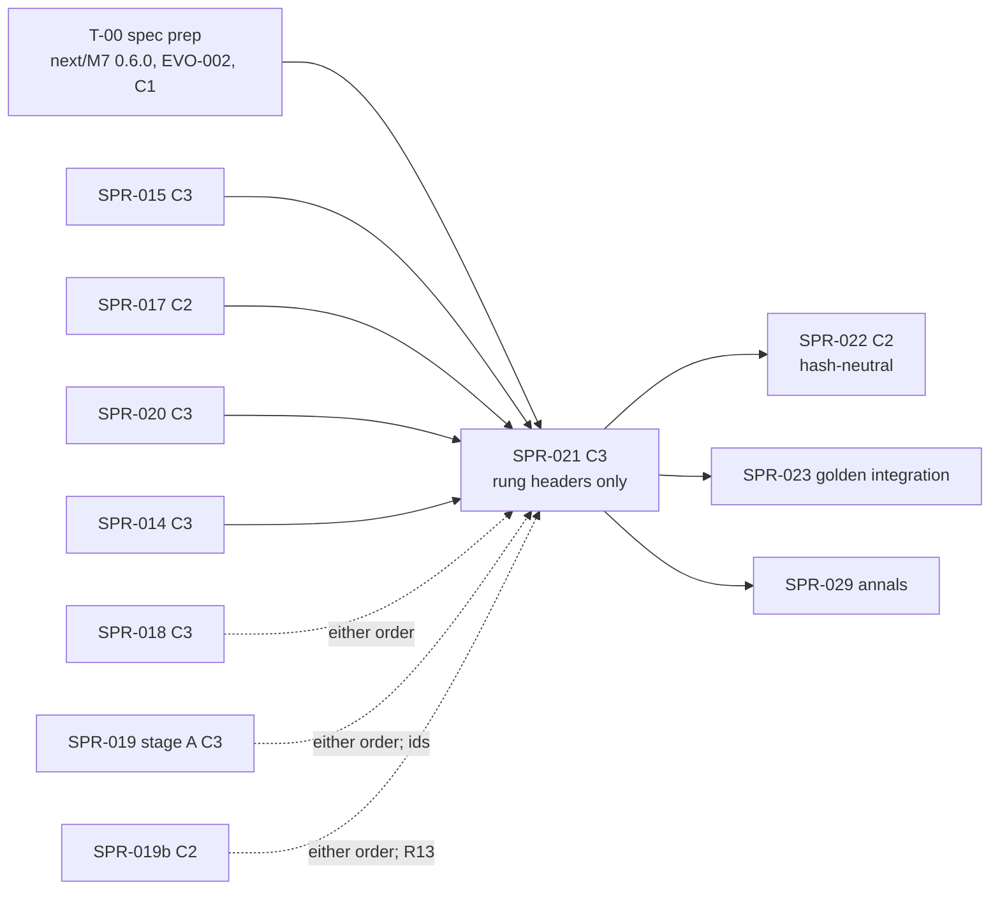

> **BLUF:** Builds the first half of `M7.dynasty` F1 in a new system crate, `rh-sys-dynasty`, and promotes M7 to frozen. The sprint delivers:
> - **the promotion of M7** (Y1, W1): the `next/M7` 0.5.0 draft that D56 approved (agnatic membership, vocations for later children, the dormancy precedence), plus the prep amendments this plan needs (T-00), moved over the frozen 0.3.4 with the whole promotion checklist; `next/` then holds no M7 draft, so `check_all`'s seventeen deny-by-default controls are re-rendered from a synthetic next version;
> - **immediate succession** (SAGA-13, V-SAGA-19): `on_death` and `arbitrate` in the death instant's `Day/Polity` binding. The legal heir comes from the title's law through SPR-017's evaluator. The arbitration scores pressed claims and the marshal and steward offices. A sovereign without a clear winner goes to `INTERREGNUM_CRISIS` and its resolution timer; a vassal title with no candidate reverts to its liege. Each change appends to the tenure log, and `SUCCEED` carries a `triggered` edge to the `DEATH` (BCK-002 A-59);
> - **house membership at birth** (`on_birth`, agnatic, with no row for a child of an extinct house: A-56, D56), `HOUSE_EXTINCT`, the offices and claims a death vacates or voids, and the four commands M7 applies from `T1.minds` (`PressClaim`, `RenounceClaim`, `PetitionSeat`, `Resign`);
> - **the engine surfaces it needs** (C2): SPR-015's derived index extended to the columns M7 reads from M2 and to the events it observes (EVO-002, the A-59 mechanism); `TitleId`, `HouseId`, `OfficeId` and `ClaimId` in `rh-ids`; `rh-contracts::m7` v0.
>
> **What SPR-022 builds:** the ruler-exit hazards, the murder timer, deposition, regencies, regrants, vocations and dormancy. Their bindings register here with empty steps, and `--strict` refuses an M7 world until SPR-022 closes.
>
> **No state root moves on any golden world.** M7 registers in no rung's template (`registry_v0.toml:472–478`), and `smoke` has its own overlay. **The three rung baselines still move, in their header line only:** `M7.dynasty` joins `BUILT`, which is printed in every rung's `tuple` line (`crates/rh-golden/src/world.rs:46, :255–260`; `worlds/solo/baselines/solo_yearly_200y.ladder:8`), and `registry_version` is bumped (SPR-017's ruling: M7 is the evaluator's first consumer). So the PR is **C3 by the baseline rule** (`bin/check_baseline.py` refuses a changed baseline without `[C3]`), with no history change. It is re-recorded in the final `[C3]` commit by `bin/regen_baseline.sh` and announced to the director before the merge. No golden world is added (D57 item 3).
>
> - **Developer:** AGT-002-CORE (`rh-core`, `rh-ids`, `rh-contracts`, `rh-sys-dynasty`, `rh-manifest`'s compile, `rh-golden`), with AGT-002-TOOLS for the succession checker, the promotion's tool edits and the gates. One Developer session may hold both.
> - **Testers:** AGT-003-DET (the death paths, arbitration against an independent model, thread and keyframe invariance), AGT-003-IF (the promotion, EVO-002's surfaces, the ids, `rh-contracts::m7`, registration). One session may hold both, on a different model from the Developer's.
> - **Size and class:** **about 4.75–5 agent-days** by the task inventory (T-01 0.5, T-02 1.0, T-03 1.0, T-04 1.25, T-05 0.75, T-06 0.5; T-00 is the Architect's, before the sprint), above GOV-005 §3's ~3. **Recommended: one sprint with a hard checkpoint after T-03** (D58 item 1, 60%). The alternative is a split: SPR-021a (T-01 to T-03; C2, hash-neutral) and SPR-021b (T-04 to T-06; the C3 header move). **C3** by the baseline rule, containing C2: the M7 promotion, EVO-002 in `rh-core`, the `rh-ids` layouts, `rh-contracts::m7`, `WorldSpec`'s M7 parameters, and the Registry's M7 defaults if D58 item 4 approves them.
> - **Status:** PLANNING, revision 0 (2026-10-18). It needs the director's plan approval (D58; GOV-005 §2) and the T-00 spec prep, merged after its independent review.

# SPR-021 — M7 F1 (a): titles, succession, immediate succession (WP P1.7, part a)

- **Roadmap item:** `docs/11` P1.7, the first half by PRJ-002 ruling M-3 · **Phase / rung:** P1a. No rung: M7 registers only in dynastic worlds (`feudal_realm`, `merchant_republic`: `registry_v0.toml:462–468`). It is tested on scripted dynastic worlds, and on `manor` and `twin_vales` if SPR-019b is on `main` (the specs table).
- **Depends on (the precondition head):**
  - **SPR-014 merged:** lifecycle queues with same-instant delivery to a later-phase owner; the absent-owner rule (M7's reads of `person.named` and `polity.exec_constraint` are dropped, each with its neutral, and its sends to `T1.minds` and `M4.economy` are discarded and counted); typed `[[applies]]`; `DRAINS` in the skeletons; a timer's `cause` slot; `rh-contracts` v0; the A-60 part (`origin/sprint/SPR-014-lifecycle-queues`, `921d372`).
  - **SPR-015 merged:** M2 0.3.0 frozen, with births at day starts, `life_course.mother`/`.father` for every born row, and `BIRTH`; **the derived per-system index** (W4; `SPR-015_BirthsF1.md:127–140`), which T-02 extends.
  - **SPR-017 merged** (approved D52; in flight): `rh_registry::effect`, with `succession::line(law, holder, title, now, host)`, the `Reads`/`Indexes`/`Draws` host traits and `SystemViewHost` (`SPR-017_EffectLanguage.md:214–235, :329–349`). SPR-017 leaves this sprint three things (`:403, :407, :416`): `WorldSpec` carrying the compiled programs, the `EvalError` → fatal `SimError` mapping with its crash artifact, and the `registry_version` bump.
  - **SPR-020 merged:** `EventDraft` roles, causes and payload; `EventRef::Known`; `ctx.set_cause` (`envelope_v0.md:32–72, :155`); the event-log digest v2.
  - **T-00 merged:** the spec prep (`next/M7` 0.6.0 and EVO-002), after its independent review. This sprint codes against T-00's text; nothing in T-02 to T-04 starts before it.
  - **D56 approved** (2026-10-17; recorded by PR #86, `docs/decisions-log.md`'s top row): agnatic membership and later-children vocations are in the 0.5.0 draft; (e), the elite read on the couple, is BCK-002 A-62's M2 amendment and does not touch M7's text.
  - **SPR-019: not a dependency, with one shared surface.** The `house/v1` and `title/v1` id layouts are SPR-019 T-01's. Whichever of SPR-019 stage A and this sprint merges first lands them, with the same vectors from `bin/gen_rng_golden.py`. Real dynastic genesis is SPR-019b's (stage B). Until it lands, `rh_worldgen::genesis` refuses any manifest with dynasties by name (SPR-019 T-03, V4), so this sprint tests on scripted worlds (the specs table). **M7's promotion is this sprint's** (Y1; `SPR-019_PopulationSynthesis.md:37, :258`). If SPR-019b landed first, the draft promoted here carries its back-fill table. If this sprint promotes first, SPR-019b re-derives a new `next/M7` draft over the frozen file (REV-SPR-019 R13; `next/README.md:89`).
  - **SPR-016, SPR-018:** not dependencies. They are in the same C3 slot (rung baselines), so whichever merges later re-records on top. SPR-018's `BUILT` gains M1 and S3. Both bump nothing of M7's.
- **Binding contracts:**
  - `specs/systems/next/M7.dynasty.odd.toml` 0.5.0 (`:58`): the owned columns `:94–345`, `[[emits]]` `:348–387`, `[[commands]]` `:389–414`, `[[applies]]` `:420–447`, `[[reads]]` `:461–533`, `[scales]` `:535–539`, `[[schedule]]` `:556–580`, `[[rng]]` `:587–623`, `[initialization]` `:641–643`, `[[params]]` `:649–716`, submodels `on_birth` `:724`, `on_death` `:728`, `arbitrate` `:732`, `apply_commands` `:744`, `[[invariants]]` `:761–792`, `[[couplings]]` `:795–846`, `[isolation]` `:849–856`, the ten `[[amends]]` `:864–916`. Then T-00's 0.6.0 amendments. `specs/systems/M7.dynasty.odd.toml` 0.3.4 is the frozen slice they preserve.
  - `specs/systems/next/M7_membership.md` §2, §6, §7, §10 (Q6, Q11, Q14, Q15); `specs/systems/next/README.md` (the deny-by-default table `:22–37`, the promotion checklist `:113–144`, R13 `:89`); `specs/systems/next/amendments.lock.toml` `:53–63`.
  - `specs/registry/effect_language_v0.md` §5.3 (the prelude: `lineage`'s pruning and `E_TRUNCATED`, `holders_of`, `court`), §7.2 (the line), §8 (the seven laws); SPR-017's plan T-04, T-07.
  - `specs/chronicle/envelope_v0.md` §2 (the draft, `EventRef`), §3 (`:83`: `SUCCEED` is `triggered` to the death or the deposition), §5 (`triggered`: evidence 1, weight 0), §7 (`set_cause`).
  - `specs/annals/annals_v0.md` §10 item 2 (`:147`: M7's payloads carry the title; the fixtures already do) and `specs/annals/fixtures/gen_fixtures.py:283–291, :494–512` (the expected shapes: `SUCCEED` with `[title]` and a told edge to the `DEATH`; `HOUSE_EXTINCT` with `[house]`).
  - `docs/09` V-SAGA-19 (`:425`), V-INV-03 (`:127`, P1a variant), V-INV-04, V-INV-15 (`:139`: "a soak on a fixture court with M2, M7 and `T1.minds` (SPR-021, SPR-023)"), V-DET-01, 02, 05, 12, 19, V-GOLD-01; `docs/03` SAGA-13 (`:234`), SIM-9 (`:52`).
  - `05.1` §2 rule 2 (with SPR-015's derived-index text and EVO-002's), §4.2 (the phase order: M2 in `Vital`, M7 arbitrates in `Polity`); `crates/rh-core/src/schedule.rs:1–36` (two bindings of one system in a phase run coarser pulse first).
  - BCK-002 1.21.0: A-55 (`:75`), A-56, A-57, A-59 (`:79`), A-60 (`:80`), A-62 (`:82`), A-63 (`:83`).
- **System specs:** M7 goes from frozen 0.3.4 to **frozen 0.6.0** in this PR (T-01): the 0.5.0 draft plus T-00's amendments, plus SPR-019b's back-fill table if that landed first. This is an Architect-approved C2 change inside the C3 PR. M2 0.3.x, T1 0.3.3 and S3 0.1.0 are read, not changed.
- **Rulings (binding):** D56 (2026-10-17); REV-WAVE5 W1–W4, W12, W31, W42; REV-WAVE6 X1, X5, X7, Y1, V3, Z1; REV-M7-membership R1–R14, N1–N15 (as the 0.5.0 draft carries them); REV-SPR-017's rulings in SPR-017's specs table (identity reads satisfy `E_NO_NEUTRAL`; commands carry no date; event arguments typed); SPR-011 rulings 3, 5 and 17; SPR-012 (mutant switches are Cargo features, BCK-002 A-52); the specs table's rows marked "proposed" are ruled with the plan's approval.
- **Director items:** D58 (this plan and SPR-022: sizes and form, classes, the spec prep and A-59's mechanism, M7's Registry defaults, the SPR-019 dependency, two requirement texts, CI).
- **Requirements covered:** SAGA-13 (immediate succession; V-SAGA-19); SIM-3 (`M7.dynasty` at P1a, first half); SIM-9's precondition (house membership at birth, `HOUSE_EXTINCT`; dormancy itself is SPR-022's); DET-13 (lifecycle delivery: `PressClaim` and the rest from `T1.minds`); DATA-8 (kinship over the life-course log, through the dead); EVO-1 (the single death path reaches succession: V-INV-03).

## Specs this sprint needs

| Spec | Exists? | Gap | Architect ruling | Needed by |
|---|---|---|---|---|
| **The spec prep (T-00): `next/M7` 0.6.0 and EVO-002** | The 0.5.0 draft (`next/M7:58`) carries D56's content and ten amendments; nothing in it serves this plan's findings below | Rows F-1 to F-11 below each need spec text before code (GOV-005 §2: no code without a spec) | **Proposed (8/10): one reviewed spec PR before the sprint starts**, on W30's route (SPR-027's `control_v1.md`). The Architect drafts it, a reviewer on a different model reviews it, the Architect rules, and it merges as C1, since no frozen spec, Registry file or baseline changes. It holds `next/M7` 0.6.0 (the amendments the rows below list, `lint_odd.py --next` green, the lock regenerated by the tool), EVO-002 (`05.1` §2 rule 2 text), and `lint_odd.py`'s `[[observes]]` schema with its fixtures | T-01 to T-04 |
| **F-1: same-instant learning of M2's `DEATH` id (BCK-002 A-59)** | Envelope §3 (`envelope_v0.md:83`): `SUCCEED` carries a `triggered` edge to the death or the deposition; `EventRef::Known` comes "from state" (`:55`). A draft-local cause names only an earlier draft of the same step (SPR-014 `system.rs:966–990`). M2 stores no event id in any column. `ScheduleDeath.cause_event` points the other way and only on the murder path. A-59 names two mechanisms, and neither reaches a natural death drawn by M2 | Without an id, `SUCCEED`, `INTERREGNUM_CRISIS` and `HOUSE_EXTINCT` cannot carry the edge the envelope and the annals fixtures expect (`gen_fixtures.py:290, :495, :503`) | **Proposed (6.5/10): the derived index observes events.** A system declares `[[observes]] kind = "DEATH", owner = "M2.demography"` (and `BIRTH`). After each level's merge, `rh-core` hands the system's derived-index hook the `(EventId, kind, role rows)` of every observed event merged at that level, ids already assigned. M7's index keeps "this instant's deaths, with their `DEATH` ids", and the step cites `EventRef::Known(id)`. This is hash-neutral, needs no M2 change, gives the same answer at every thread count (the merge order is canonical), and serves A-59's general case. The scheduler treats an observed kind like a `same_instant` read: the emitter's bindings come first in a shared phase, and an observer in an earlier phase than the emitter is a registration error. **Alternatives:** (a) M2 owns `life_course.exit_event` (`event_ref`, written by `set_cause` at the `DEATH` draft), read by M7 at `same_instant`; it moves every rung's state ladder and touches a second system crate (`docs/13` §2's sizing rule). (b) A per-death command from M2 to M7 (SAGA-13's literal wording); this changes M2's spec, and every death in a world without M7 becomes a counted absent-owner drop. (c) `StepCtx::instant_events(kind)`, a step-level read of the event log; it is equivalent to the proposal, but it adds a second read surface beside `SystemView` | T-02, T-04 |
| **F-2: M7's index needs M2's columns; SPR-015's index applies the owner's own** | SPR-015 T-02: `apply(&mut Index, &MergedWrites)` gets "the step's merged writes of the system's own columns … on the owner's index only" (`SPR-015_BirthsF1.md:129–130`). M7's spec rebuilds "a children-by-parent index over [M2's] columns at restore and on each birth" (`next/M7:456–459`). The effect language's `Indexes` needs children, a person's life-course row and a title's tenure rows (SPR-017 T-07). M2's lagged read of `house_member.person` (`next/M2:380–385`, F4's elite table) goes live when M7 registers | Without foreign inputs, M7 must rescan `life_course.*` and `person.alive` to find this instant's births and deaths: O(rows) per instant at about 360 instants a year (X1, A-60) | **Proposed (7/10), in EVO-002:** `apply` also receives (i) after each level, the merged writes of the foreign columns the system reads `same_instant`; (ii) at the end of the instant, those of its `lagged` foreign reads, so that an index over a lagged column never shows a same-instant value; (iii) the observed events (F-1). The rest of W4 is unchanged: the index is never hashed and never keyframed, it is rebuilt by `build`, and a debug invariant compares it with a rebuild. Per-instant lists (this instant's births and deaths) are stamped with their tick and are empty at every instant boundary, where the invariant runs | T-02, T-03 |
| **F-3: `title.exit_timer` cannot hold a `TimerId` written in the scheduling step** | `StepCtx::schedule` returns `()`; "the timer gets its id and `seq` at the end of the level" (SPR-014 `system.rs:759–765`). `title.exit_timer` is the "TimerId of a pending deposition or interregnum-resolution timer … [or] MURDER_DUE" (`next/M7:240–245`) | The column cannot be written as specified. A frozen owned column cannot be withdrawn (`next/README.md:37`) | **Proposed (6/10):** M7 finds and cancels its pending timers through `ctx.own_timers(entity)` (`system.rs:820`): the ruler's for deposition and `MURDER_DUE`, the title's for the resolution timer. `title.exit_timer` keeps its type and is written `1` while an exit timer is pending and `0` otherwise, as an amended meaning (`owns.title.exit_timer.meaning`). Alternative: a buffered `ctx.set_timer(column, row, …)` slot resolved at the merge, as `set_cause` is (`rh-core`, C2) | T-04 |
| **F-4: titles have no draw key and no timer entity** | `EntityKey` is sealed to `PersonId`, `RegionId` and `EventId` (`crates/rh-ids/src/ids.rs:215–231`). `EntityKind` has no title (`entity.rs:22–33`). Registration reports title- and house-keyed purposes as not kind-checked (SPR-014 `register.rs:531–557`: "a key name with no EntityKind yet (`title`, `house`, …) … M7, SPR-021"). M7 draws `arbitration_tie` and `interregnum_delay` by the title, `regrant_tie` by the title or office, and `sortition` with `k` = the title (`next/M7:605–619`). `TimerSpec.entity` is an `EntityRef` (`system.rs:403–432`). `main` has no `TitleId` | M7 cannot key its draws or its resolution timer | **Proposed (6/10):** `TitleId`, `HouseId` (SPR-019 T-01's `title/v1`, `house/v1` layouts, whoever lands first), `OfficeId` (`H64(title, kind)`) and `ClaimId` (`H64(claimant, title, since)`) in `rh-ids`, with `bin/gen_rng_golden.py` vectors. `EntityKey` for `TitleId` and `OfficeId`, with `entity()` = `Some(EntityRef::title(t))`. A new `EntityKind::Title`, tag 6, used by timers and draw keys only and never by an event role: titles stay payload, not cast (`next/M7:355`), so channel A's entity kinds 0 to 5 and the parser's refusal of 6 in a role (`envelope_v0.md:216`) hold. A-50's check covers `title`-keyed purposes. **Alternative:** no new kind; the resolution timer about `EntityRef::new(World, title)` and title draws via `entity() = None` (epoch 0), as `EventId` does. It is cheaper, but it bends the World kind's "raw value 0" convention (`entity.rs:23`) | T-02 |
| **F-5: M7 reads no `person.id`** | `SystemView::person_row` reads `person.id` and needs it in the caller's `AccessSpec` (SPR-014 `world.rs:244–254`). `SystemViewHost` finds a ledger row by binary search on the id column (SPR-017 T-07). The laws read `person.alive(x)` (`effect_language_v0.md:369–425`). M7's reads (`next/M7:461–533`) omit `person.id` | `person.alive(x)` is unreadable through `SystemView` | **Proposed (9/10):** T-00 adds `[[reads]] person.id` (owner M2, `same_instant`, `identity`). Adding a read is allowed (`next/README.md:36`) | T-00, T-03 |
| **F-6: two integer parameters typed q16_16** | `interregnum_max_days` [7, 730] and `dormancy_degrees` [1, 6] are integers in the Registry (`registry_v0.toml:97`), but `Fixed` in the skeleton (`crates/rh-core/tests/generated/M7_dynasty.rs:54–55`). The lint treats a parameter as q16_16 unless it says `type = "count"` (`next/README.md:33`; MR2, W20; `next/M2:782`) | `kin(p, n)` takes an integer degree; a manifest literal 2.5 would pass | **Proposed (9/10):** `type = "count"` on both in T-00 (a new field, not a frozen leaf: `lint_odd.py:388–410`); `compile` refuses a non-integer, with compile-level fixtures (W20's precedent) | T-00, T-03 |
| **F-7: `SUCCEED`'s edge still reads "motive edge"** | `next/M7:350` (`when`) and `:771` (INV-M7-02) say "motive edge". M7 0.3.3's header defers the change to "M7's next version (SPR-021), not here" (`M7.dynasty.odd.toml:38–40`, frozen). Envelope `:83`: `triggered`. The 0.5.0 draft does not amend either text | The promoted spec would contradict the envelope | **Proposed (9/10):** T-00 amends `emits.SUCCEED.when` and `invariants.INV-M7-02.statement` to "a `triggered` edge to the death (`DEATH`, F-1) or the `DEPOSED` (a draft-local cause, SPR-022)" | T-00 |
| **F-8: M7's event payloads are unspecified** | Annals §10 item 2 (`annals_v0.md:147`): "M7's payloads carry no layout"; the fixtures carry `[title id]` on every M7 event and `[house id]` on `HOUSE_EXTINCT`. BCK-002 A-55 (a typed `payload = [...]` on `[[emits]]`, `:75`) is Open, "Before SPR-021 (its spec prep)". M2 cites payloads in its `when` texts ("Payload: [death_cause code]", `templates_v0.toml:59–66`) | The engine must write a payload, and the annals lint binds to a `when` clause | **Proposed (6/10): the `when`-clause convention now.** T-00 amends each of the ten M7 `[[emits]] when` texts with its `Payload: [...]` clause: `[title id]`; `[house id]` on `HOUSE_EXTINCT`; and on `CLAIM_*`, `[title id, claim id]`. These are M2's convention and the annals fixtures' shapes. A-55's typed list replaces the clauses for M2, M7 and T1 together, later, as its own C2. Alternative: A-55 lands in T-00. It is broader (`lint_odd.py`, the skeletons, `emit`'s check, the annals binding) and would lengthen the prep review | T-00, T-04 |
| **F-9: M7's timers have no re-sample rule** | `scales.restart` (`next/M7:539`): "The deposition, interregnum and regency timers' re-sample rule is stated by SPR-021 (REV-EVO-001 MIN-7)". Not stated. `resample_timer` must answer for every timer whose entity an input scopes (`system.rs:1093–1106`) | A material input on a minor holder or on a title would hit `resample_timer` with no rule | **Proposed (8/10):** T-00 amends `scales.restart`. The interregnum-resolution timer (entity: the title; its delay was drawn at the crisis under `interregnum_delay`, keyed by the title) is kept (`Some(t)`). So is the regency-end timer (entity: the minor holder; the majority date is not a draw). The deposition timer (SPR-022) follows `exit_murder`'s rule: re-drawn among the month's remaining day starts at or after the input, never cancelled while one remains (`next/M7:590`) | T-00, T-04 |
| **F-10: a minor holder at genesis has no regent rule** | `[initialization]` (`next/M7:642`): "regent = 0, a holder under majority_age at genesis included: no step names one until SPR-021". `arbitrate` names a regent only at a succession (`:733`), and no submodel names one for a seated minor | Under the frozen text a genesis minor rules without a regent until he dies or comes of age | **Proposed (7/10):** T-00 amends the `regency` submodel (`:741`) and `initialization.state`: the first `Day/Polity` binding (tick 0) names a regent by the same rule for every minor holder (`REGENCY_BEGUN`, a regency-end timer). SPR-022 builds it; this sprint's genesis leaves `regent = 0` | T-00 (SPR-022 builds) |
| **F-11: two empty-candidate cases are undefined** | (a) "A sovereign with no candidate at resolution goes to the realm's highest-tier vassal holder" (`next/M7:733`). A realm with one dynasty has no vassal title ("one sovereign title per polity with a dynasty and one major title per further dynasty", `:642`). (b) `on_death` takes vacated titles "in ascending TitleId" (`:729`), a hash order (`TitleId = H64(seed, "title", k)`, `:142`). A vassal with no candidate "reverts to its liege's holder in demesne", but its liege may be awaiting or in interregnum in the same step | INV-M7-03 ("every interregnum ends … with SUCCEED", `:775`) can fail. Same-instant outcomes depend on hash order | **Proposed (6/10):** T-00 amends `on_death` and `arbitrate`. (b) Vacated titles are taken by tier (sovereign first), then `TitleId`. A vassal with no candidate whose liege is in interregnum joins that interregnum (no timer of its own) and is resolved with it, after the liege. (a) At resolution with no candidate and no vassal holder, the title goes to the back-fill's stand-in (SPR-019 B9: the oldest living male of the house, an adult when one lives, else a minor), which keeps genesis and runtime one rule. If the house is extinct, a renewed crisis with a new timer follows. INV-M7-01 and INV-M7-03 are amended to match | T-00, T-04 |
| **The cadence of M7's invariants (X1, V3)** | `rh-core` calls `invariants(&WorldTables)` at every instant's `Bookkeeping` (SPR-014 `engine.rs:930–932, :1052–1083`), about 360 times a year. INV-M7-08 ("exactly one open tenure row per held title … never removed", `:766`) and INV-M7-06's in-run membership clause (`:786`) read whole tables, and the tenure log and `house_member` grow for the whole run | O(rows) per instant over 1,000 years on `kingdom_10k` | **Proposed (8/10):** T-00 amends each `statement` with its cadence; `test` keeps its V-id (V3). Per instant: O(titles) plus this instant's changes, read through the derived index (INV-M7-01, 02, 03, 07; INV-M7-08's open row per title; INV-M7-06's rows written this instant). In full: at genesis, at restore and at every keyframe write, and by test observers. This is the route SPR-015 builds for INV-M2-13 ("the rows with `start_tick = now`", W4) | T-00, T-03 |
| **Scripted dynastic worlds: how this sprint tests without SPR-019b** | SPR-019 T-03 refuses any manifest with dynasties until stage B lands (V4). SPR-017 T-07 already loads the effect language's `dynasty` fixture into test-only owners of M2's and M7's columns (`SPR-017_EffectLanguage.md:341–343`). SPR-014's stub-owner technique registers test systems against a test spec table (`SPR-014_LifecycleQueues.md:74–75, :160–169`) | A real M7 run needs M2's rows with parent links and M7's houses, titles and tenure log | **Proposed (7.5/10):** a test-only **scripted genesis** in `crates/rh-golden/tests/support/` writes `WorldTables` from a small TOML fixture: persons, life-course rows with parents (the dead closed with `exit_tick < entry_tick`), houses, members, titles, tenure logs, offices, claims and petitions. It is never a production path and lives in a tool crate. Engine runs use the real M2 and M7. Fixtures: SPR-017's `dynasty` world; four hand-built courts (V-SAGA-19's four fixture kinds); and random dynastic worlds (one to five houses, three to six generations, each of the seven laws), at 400, 1,500 and 10,000 persons. **If SPR-019b is on `main` at T-05's start,** `manor` and `twin_vales` also run (nightly), and each title's line at genesis is compared with `specs/worldgen/golden/fixture_worlds_v0.txt` (`fixture_worlds.md` §2.2: "each title's line at genesis with its heir and second … and its length") | T-05 |
| **M7's Registry defaults (companion §6 item 7; REV-SPR-019 R15)** | M7's 17 parameters have bounds and no defaults (`registry_v0.toml:97`). `manor.yaml` sets `majority_age` only (`:42–44`); `twin_vales.yaml` and `kingdom_10k.yaml` set all 17 (`twin_vales.yaml:67–84`). `compile(manifest, registry, built)` fills only defaults (SPR-011 ruling 8). Once M7 is in `BUILT`, a missing parameter is a compile refusal | `manor` stops compiling the moment M7 is built, which breaks SPR-019b's T-07 runs if they merge before this sprint | **Proposed (6.5/10; D58 item 4):** Registry defaults for the 16 parameters other than `majority_age`, at `twin_vales.yaml`'s values (Eisner's pooled murder rate, K&S's deposition, `dormancy_degrees` 2, …). `majority_age` stays required, so `val_khor.yaml` remains SPR-019 T-03's compile refusal (REV-SPR-019 R15). This is a Registry change (C2), approved by the director as parameter semantics (`docs/13` §1). Alternative: keep the refusal and add the 16 values to `manor.yaml`, which also edits `python/tests/test_population_synthesis_cases.py`'s mirror | T-03 |
| **SPR-022's submodels in a frozen M7** | The promoted spec has every binding and submodel. Registration compares bindings and purposes with the skeleton (`rh-core` rule `spec`) | A registered M7 must declare `Month/Polity`, `Year/Polity` and `Day/Vital`, whose work is SPR-022's | **Proposed (6.5/10):** every binding registers. SPR-022's steps (`exit_hazards`, `murder_due`, `exit`, `regency`, `regrant`, `vocation`, `dormancy`) are empty, and registration prints one report line naming them. `rh-golden`'s `--strict` refuses a world that registers M7 ("M7.dynasty is partial until SPR-022"), as it refuses a not-built system (`world.rs:238–244`; SPR-011 ruling 3). No ladder header changes for it | T-03 |
| **The rung baselines under `BUILT`** | `BUILT` (`world.rs:46`) is printed into `engine_build` and every rung's `tuple` line (`:255–260`; `solo_yearly_200y.ladder:8`); `registry_version` is in the same line. SPR-020 T-07's precedent: "The bump changes only the ladder header's `tuple` line, plus `journal` if the journal anchors the tuple" (`SPR-020_EventEnvelope.md:304`) | — | **Proposed (8.5/10):** T-06's robust form. Every `rung` and `root` line of `solo`, `household` and `hamlet` is byte-identical, and `smoke`'s whole file is byte-identical. The step is measured twice, as SPR-020 measured its bump: `BUILT` first, then the bump | T-06 |
| **CI (W42, Z1, A-63)** | Wave 4's measurements: core 14:43 (SPR-014's head), golden 12:46 (SPR-026's) (BCK-002 A-63). After waves 5 and 6 as their approved plans state them (D54: +2.5 and +1.3 minutes; SPR-018 +50 s and +40 s; SPR-019 +15 s and +55 s), core is about 18:20 and golden about 15:40 (SPR-017's and SPR-020's additions not yet measured). The third PR-tier job is approved (D54 item 6) and not built (A-63) | Both parts are past 15 minutes before this sprint adds anything | **Ruled (W42, Z1; the Architect's brief):** a new gate over about 5 s goes to part golden. T-06 states the added time per part, budgeted ×1.5 for slow runners, with this sprint's nightly candidates. **D58 item 7:** A-63 lands before wave 7 | T-06 |

## Compliance (every task)

| Rule | This sprint |
|---|---|
| Change class (`docs/13` §4.2) | **C3 by the baseline rule:** the rung baselines' `tuple` lines move (M7 joins `BUILT`; `registry_version` is bumped), and no state root moves on any golden world. It contains C2: M7 0.6.0 frozen (the promotion), EVO-002 in `rh-core` (the derived index's foreign inputs and observed events), `rh-ids` (`TitleId`, `HouseId`, `OfficeId`, `ClaimId`, `EntityKind::Title`), `rh-contracts::m7` v0, `WorldSpec`'s M7 parameters, the Registry's M7 defaults (if D58 item 4 approves), `lint_odd.py`'s `[[observes]]` (landed in T-00). The PR title is `SPR-021: … [C3]`; `[perf-baseline]` only if a budget moved, which would be a defect to explain |
| Planes touched (ADR-0024) | **A:** `rh-sys-dynasty` (new; plane A, kind `system`, declared in `[package.metadata.rehoboam]` and pinned in `bin/lint_arch.py`), `rh-core` (EVO-002), `rh-ids`, `rh-contracts` (`m7`), `rh-registry` (`WorldSpec`), `rh-registry::effect` as a caller. **Tool:** `rh-manifest` (`compile`), `rh-golden` (`BUILT`, the scripted genesis, tests), `bin/check_m7_successions.py` (new), `bin/gen_rng_golden.py`, `specs/` (the promotion), `bin/check_all.sh`. **B, C:** none |
| Owned columns written | `M7.dynasty`'s own only: `house.extinct_at`, `house_member.*` (`on_birth`), `title.holder`, `.state`, `.held_since`, `.predecessor_exit`, `.exit_timer` (F-3), `tenure.*` (appends; `end` written once), `office.holder` (vacated at death; `Resign`), `claim.*` (`CLAIM_CREATED` for a passed-over heir; `pressed`, `status`), `petition.*`. Not yet: `title.regent`, `person.vocation` (SPR-022). M7 never writes an M2 column. Every death goes through M2 (INV-M7-07) |
| Reads (via `rh-contracts`) | M2's `person.id` (new, F-5), `person.alive`, `.death_cause`, `.death_tick`, `.birth_tick`, `.sex`, `.mother`, `.father`, `life_course.person_id`, `.mother`, `.father`, `.birth_tick`, `.sex`, all `same_instant`. Mode reads: `person.named` (T1; neutral `false`) and `polity.exec_constraint` (M6; neutral 0), both dropped in every P1a world. Observed: M2's `DEATH` and `BIRTH` (F-1) |
| RNG purposes added | None to the spec. This sprint draws `arbitration_tie` (entity: the title, `k` = 0), `interregnum_delay` (the title, `k` = 0) and `sortition` (the candidate, `k` = the title, through the effect language). `regrant_tie`, `exit_*`, `murder_culprit` and `vocation` are registered and not drawn until SPR-022. The skeleton's `RngPurpose` order is unchanged |
| Golden-hash effect | **No state root moves on `smoke`, `solo`, `household` or `hamlet`** (an acceptance criterion, T-06). Their `tuple` lines move (`engine_build` gains `M7.dynasty`; `registry_version`), with the manifests' pins if they follow the bump (SPR-020 T-07). Re-recorded by `bin/regen_baseline.sh` in the final `[C3]` commit, and announced to the director before the merge. No world is added to the corpus |
| Fixed-point quantities | Arbitration scores in Q16_16 (four weights × booleans, an exact sum); `contest_margin` compared exactly (`≥`); `majority_age` in Q16_16 years → whole days through the calendar (as SPR-019 B0 does). No float (V-DET-19) |
| Determinism lints (GOV-003 §2, §6) | Must pass. `BTreeMap` and `Vec` only. Titles by tier then `TitleId` (F-11), persons by `PersonId`, claims by `ClaimId`. No interior mutability in the system (W31): derived state lives in the `rh-core` index. No `env!` (A-50). `rh-sys-dynasty` depends only on `rh-core`, `rh-ids`, `rh-events`, `rh-registry` and `rh-contracts` (`docs/13` §3) |
| Tests that gate this sprint | V-SAGA-19; V-INV-03 (P1a variant: M2's hazard and the agenda path through a stub sender; M7's own murder is SPR-022's); V-INV-01 (INV-M7-01, 02, 03, 05's claim clause, 07, 08 at their cadence); V-INV-04 (M7's registration: identity reads require M2; the T1 and M6 reads dropped; sends to absent T1 and M4 discarded); V-INV-15 (M7's part: `living` commands for a dead claimant, petitioner or office holder are dropped, and the queue-age invariant holds); V-DET-01, V-DET-02, V-DET-05, V-DET-12 on the scripted worlds; V-DET-19; V-GOLD-01 (the four worlds, `tuple` only); V-PERF-04 and V-PERF-11 unchanged; plus `bin/check_all.sh`. **Reported, not gated:** the per-instant cost on the 10,000-person scripted world (A-60) |
| Docs updated in the same sprint | `bin/check_all.sh` and `python/tests/test_check_all_inventory.py` (same commit); `CLAUDE.md` (the `--next` line, the M7 lines, the new gates); `specs/systems/next/README.md` (step 4, "Current contents": the stale M7 row, finding F-12); the companion moves to `docs/05_architecture/systems/M7.dynasty_F1.md`; `05.1` §2 rule 2 (EVO-002's text, landed in T-00) and §4.2 (M7's bindings); `05.0` §6 (`rh-sys-dynasty`, `rh-contracts::m7`); `docs/09` V-SAGA-19, V-INV-03, V-INV-15 method lines with the test names; BCK-002 A-56, A-57 (built: membership), A-59 (decided), A-55 (the clause convention); PRJ-002's row |

**Rules carried from P0–SPR-020 (every task):**
- **Property tests vary world size and seed:** the scripted worlds at 400, 1,500 and 10,000 persons, eight seeds, one to five houses of three to six generations, each law. The 10,000-person size and 32 seeds run nightly (W42).
- **A positive control fails for the right reason:** its `check_all` line matches the diagnostic, and every planted mutant fails a named check (W7, W9, X4, Y5, V2).
- **A test input exercises the path it claims, and a probe asserts it:** at least one crisis, one resolution by the stand-in, one reversion in demesne, one passed-over heir, one `HOUSE_EXTINCT`, and one death of each `death_cause` code reached a succession on the scripted worlds.
- **No O(rows) work per instant (X1, A-60):** a test-only counter of the rows M7 visits per instant is asserted against this instant's changes plus O(titles) (T-05).
- **Python tests read no CI environment variable.**
- **No statistical gate in this sprint.** AGT-003-STAT is not assigned.
- **CI time (W42, Z1):** against the state after wave 6 (the specs table), budgeted ×1.5 for slow runners. No gate moves part; each part's time is reported.
- **Merge `origin/main` when main moves,** and re-run both parts.
- **Every new gate is in exactly one `check_all.sh` part,** with the inventory test in the same commit.
- **Baselines are regenerated only by `bin/regen_baseline.sh`,** in the final commit, with `[C3]` at the end of its subject. **Mutants never make a baseline** (`mutant-*` features; A-52).
- **One commit per task** (GOV-005 §4).

## Tasks

The **hard checkpoint** follows T-03: the Tester's interim pass on T-01 to T-03 (`VER-SPR-021-TEST` phase 1: the promotion, EVO-002, the ids, registration, `on_birth`) is required before T-04 lands.

#### T-00: The spec prep (Architect; one reviewed spec PR before the sprint; C1; not in the Developer's size)
- **Deliverable:**
  - **`specs/systems/next/M7.dynasty.odd.toml` 0.6.0:** the 0.5.0 draft plus the amendments of F-3 (`owns.title.exit_timer.meaning`), F-7 (`emits.SUCCEED.when`, `invariants.INV-M7-02.statement`), F-8 (the ten `emits.<KIND>.when` payload clauses), F-9 (`scales.restart`), F-10 (`submodels.regency.summary`, `initialization.state`), F-11 (`submodels.on_death.summary`, `submodels.arbitrate.summary`, `invariants.INV-M7-01.statement`, `invariants.INV-M7-03.statement`), the cadence of each invariant (V3: the `test` fields unchanged), the additions of F-5 (`[[reads]] person.id`), F-6 (`type = "count"` on two `[[params]]`) and F-1 (`[[observes]]`), and, for SPR-022, F-19 (`rng.vocation.use`, `schedule.Year/Polity.steps.vocation`, `submodels.vocation.summary`), F-20 (`submodels.regrant.summary`, `submodels.dormancy.summary`) and F-25 (`submodels.arbitrate.summary`, `submodels.dormancy.summary`). The prep is the M7 text of both wave-7 sprints, so that M7 is frozen once. `lint_odd.py --next` is green, the new `AMEND` lines are read by the Architect, and the lock is regenerated by `--write-amendments-lock`. The ten D56 amendments are unchanged.
  - **EVO-002** (`CODEX/60_EVOLUTION/`): the `05.1` §2 rule 2 text of F-1 and F-2 (observed events; the derived index's foreign inputs and their timing by lag), and the scheduler rule for an observed kind. Also F-4's ruling on `EntityKind::Title`.
  - **`lint_odd.py`:** the `[[observes]]` schema. The owner must emit the kind; the observer may not run in a phase before the emitter's; `--rust` emits an `OBSERVES` constant (no committed skeleton changes until T-01, since `gen_skeletons.py` reads frozen specs only). Planted fixtures under `tests/lint_fixtures/odd_observes/` fail by name, with their `check_all` lines and inventory entries.
  - **The review:** an independent reviewer on a different model; the Architect's rulings; then the merge.
- **Acceptance:** `lint_odd.py` green in both modes; `gen_skeletons.py --check` green (a draft changes no skeleton); the deny-by-default controls fail by name; `gen_manifest.py --check` green; no frozen spec, Registry file or baseline changed. **T-01 does not start before this merges.**
- **Status:** [ ] not started

#### T-01: The promotion of M7 0.6.0 (Architect with the Developer; C2 inside the PR; W1, Y1; `next/README.md:113–144`)
- **Deliverable (the checklist, each item applied to M7):**
  - **The move:** `next/M7.dynasty.odd.toml` over `specs/systems/M7.dynasty.odd.toml`, `status = "frozen"`, `spec_version = "0.6.0"`, its header naming this PR; the skeleton regenerated (`crates/rh-core/tests/generated/M7_dynasty.rs`: `SPEC_VERSION`, the two counts' types, the `[[observes]]` constant; nothing else); the stale-skeleton fixture's M7 copy refreshed (`tests/lint_fixtures/skeletons/stale/M7_dynasty.rs`), so the stale control still names only M2's planted file; the lock's M7 section removed by the tool.
  - **(a) Re-pointed reads:** none. 0.6.0 owns no column 0.3.4 did not. Checked by `lint_odd.py` on every draft.
  - **(b) Fallbacks:** every reference that loads `next/M7` reads the frozen file when the draft is gone (`selftest_population_synthesis.py`, if SPR-019b made it read B0–B11 from the draft; `project_population.py` reads M2's only, `:339`, and is checked).
  - **(c) Registry and annals:** the draft adds no verb (`next/README.md:155`), so the annals tools' verbs are unchanged. The `registry_version` bump and the regeneration of the annals fixtures and goldens are T-06's (g).
  - **(d) The rendered controls:** `bin/check_all.sh`'s `odd_next_control` M7 cases (`:357–381`) and the `--next` gate (`:1189`) are rendered from a **synthetic next version of the promoted M7** (status `draft`, version 0.6.1, as `clean` renders T1's: `:382–388`). That version carries one recorded amendment on each q5 path (`submodels.on_birth.summary`, `commands.Demote.why`, `submodels.dormancy.summary`), so `q5_summary`, `q5_why` and `q5_frozen_onbirth` keep their "`to` is not what the next version says there" diagnostics (`:1204–1206`). The other fourteen keep theirs. The gate's pinned self-check line names the synthetic version. If SPR-019b's re-derived draft is in `next/` by then, the gate also runs on it.
  - **(e) Stale-value controls:** none for M7 (the back-fill's are SPR-019's).
  - **(f) Texts:** the spec's own lines that name the promotion point ("until SPR-021", "SPR-021 promotes"); `next/README.md` step 4 and "Current contents" (the M7 row, which today names an `on_death` amendment and a `person.unborn_father` read that the draft does not carry: `:154` against the lock `:53–63` and `M7_membership.md:101, :187`); the companion moved to `docs/05_architecture/systems/M7.dynasty_F1.md`; the `CLAUDE.md` `--next` line and M7 lines.
  - **(g) No `registry_version` bump here:** it belongs to T-06's `[C3]` commit.
- **Acceptance:** `lint_odd.py` green in frozen mode with M7 0.6.0. The `--next` gate is green on the synthetic version, with its pinned line. Each of the seventeen M7 controls and the `lock`, `algorithm`, `rng`, `bound` and `clean` controls fails or passes with its own diagnostic. `gen_skeletons.py --check` is green, and the M7 skeleton's diff is exactly the version line, two parameter types and the observes constant. `rh-registry`'s `real_specs` compiles the skeleton. `gen_manifest.py --check` is green. **AGT-003-IF simulates the promotion on a copy before T-01 is pushed** (W1's method).
- **Status:** [ ] not started

#### T-02: The engine surfaces: EVO-002 in `rh-core`, the ids, `rh-contracts::m7` (C2; F-1, F-2, F-4; hash-neutral)
- **Deliverable:**
  - **`rh-core`:** the derived index's foreign inputs (same-instant reads after each level; lagged reads at the instant's end) and observed events (ids, kinds, role rows), declared through the system's `AccessSpec` from the skeleton's constants. The scheduler's edge for an observed kind. Registration refuses an observer in an earlier phase than the emitter, by name. The `05.1` text was landed in T-00.
  - **`rh-ids`:** `TitleId`, `HouseId` (SPR-019 T-01's `title/v1` and `house/v1`, or `main`'s if SPR-019 merged first), `OfficeId`, `ClaimId`, their `bin/gen_rng_golden.py` vectors, `EntityKey` for `TitleId` and `OfficeId`, and `EntityKind::Title` (or F-4's alternative, as T-00 rules). A-50's kind check covers `title` keys.
  - **`rh-contracts::m7` v0:** typed accessors for the M7 columns that T1, S6, S7 and M2 read (`title.*`, `house_member.*`, `claim.*`, `office.*`, `tenure.*`, `person.vocation`), with the drift test against the frozen spec (SPR-014 T-06's pattern).
  - **Planted mutant** `mutant-index-drop-foreign` (an `rh-core` test-harness feature): the hook skips one foreign update.
- **Acceptance:**
  - **On stub systems** (SPR-014's `agenda_events.rs` worlds, three sizes, eight seeds), with an index over a foreign same-instant column, a foreign lagged column and an observed kind:
    - the incremental index equals `build` at every keyframe write and at the run's end;
    - a lagged foreign column changed mid-instant is not visible in the index until the next instant (a probe);
    - each observed event reaches the hook exactly once, with the id the merge gave it, at 1, 2, 4 and N threads;
    - an unobserved kind never reaches the hook.
  - `mutant-index-drop-foreign` fails the rebuild invariant by name at the first dropped update.
  - **Not in history:** a run with the index rebuilt at every instant gives the same ladder; `bin/gen_hash_golden.py --check` is unchanged; the `smoke`, `solo`, `household` and `hamlet` ladders are byte-identical after T-02.
  - The `rh-ids` vectors reproduce. Two titles of one world never share an id, and a planted equal `k` is refused. A stub purpose keyed by `title` refuses a `PersonId` by name (A-50). No event role accepts `EntityKind::Title`: a planted role is refused by `StepCtx::emit`, and channel A's parser refuses kind 6 in a role, as today.
  - `rh-contracts`' drift test is green over M7's `[[owns]]`, and a consumer test reads every M7 accessor through a stub reader. `lint_arch` keeps `rh-contracts` free of any implementation.
- **Status:** [ ] not started

#### T-03: `rh-sys-dynasty`: registration, parameters, the index, the effect-language host, `on_birth` (the specs table; D56; F-5, F-6, the defaults row, the SPR-022 row)
- **Deliverable:**
  - **The crate:** `[package.metadata.rehoboam]` (plane A, `system`); the skeleton included (`include!`, as `rh-sys-demography` does: `demography.rs:40`); registration against frozen 0.6.0 (rule `spec`: version, bindings, purposes, `DRAINS`).
  - **`WorldSpec`:** M7's 17 parameters compiled by `rh-manifest` (Q16_16, the two counts), the Registry defaults (D58 item 4) or the refusal, and the compiled law programs (SPR-017 left them to "the first consumer").
  - **The derived index:**
    - children by parent (over `life_course.*`, the effect language's `Indexes::children`);
    - person → life-course row;
    - title → its tenure rows and its open row;
    - holder → titles, offices and claims;
    - house → living-member count;
    - this instant's births and deaths, each death with its `DEATH` id.
  - **The host:** `SystemViewHost` over M7's `SystemView` and its index, and `StepDraws` over `StepCtx` (`sortition` keyed by the candidate with `k` = the title). An `EvalError` maps to a fatal `SimError` with its crash artifact; `E_TRUNCATED` is fatal (`effect_language_v0.md` §5.2).
  - **`on_birth`** (`next/M7:724–726`): in ascending `PersonId`, for each newborn of this instant (from the index's birth list), a `house_member` row with the father's house when the father has a row and that house is not extinct; else no row; great houses only. The Promote half of `on_birth` is SPR-022's (dormancy's criteria).
  - **The empty SPR-022 steps,** with their registration report line, and `--strict`'s refusal of an M7 world (the specs table).
  - **`invariants()`** at the cadence T-00 states.
  - **The planted mutants:**
    - `mutant-onbirth-cognatic`: the frozen fallback to the mother's house;
    - `mutant-onbirth-resurrect`: a row for a child of an extinct house's last male;
    - `mutant-scan-ledger-daily`: `on_death` finds the dead by scanning `person.alive` every instant.
- **Acceptance:**
  - **Registration:** M7 registers with M2 on a scripted world. It is refused by name without M2 (identity reads, R12). The reads of `person.named` and `polity.exec_constraint` are dropped and reported, with their neutrals. Sends to `T1.minds` and `M4.economy` are discarded and counted. A planted skeleton binding is STALE in `gen_skeletons --check`, and a planted purpose name is refused under `rng-purpose` (W11's two forms).
  - **Parameters:** `twin_vales`'s 17 values compile exactly. A non-integer `dormancy_degrees` is refused by `compile` (a fixture under `tests/manifest_compile/`, W20). Without defaults, `manor.yaml` is refused naming the first missing parameter; with them, it compiles.
  - **The host:** `succession::line` through M7's own index and `SystemView` equals `effect_ref.py`'s `succession_line` on the `dynasty` world for every law and holder the golden file pins (SPR-017's 17 succession cases), and on 200 random scripted holders of each law at three sizes (0 differences). A planted `AccessSpec` without `person.id` fails with `SimError::UndeclaredRead` naming the column.
  - **`on_birth` fixtures:** an agnatic child gets a row; a posthumous child takes its dead father's house; a daughter of the house married to a commoner has a child with no row; the child of an extinct house's last male has no row; and a child of a non-great house gets no row. `mutant-onbirth-cognatic` fails the daughter's-child fixture, and `mutant-onbirth-resurrect` fails the extinct-house fixture, each by INV-M7-06's in-run clause by name. `mutant-scan-ledger-daily` fails T-05's rows-visited probe on the 10,000-person world.
  - **The index invariant** (W4) holds at every keyframe and at the run's end on the scripted worlds, and a keyframe round trip rebuilds an equal index.
  - **Checkpoint:** the Tester's interim pass on T-01 to T-03 is recorded in `VER-SPR-021-TEST` before T-04 lands.
- **Status:** [ ] not started

#### T-04: `on_death`, `arbitrate`, the tenure log, the interregnum, and the commands M7 applies (SAGA-13; F-1, F-3, F-8, F-9, F-11; INV-M7-01, 02, 03, 05, 07, 08)
- **Deliverable:**
  - **`on_death`** (`next/M7:728–730`, as T-00 amends it), at the `Day/Polity` binding of the death instant, for the dead of this instant (the index's list, its `DEATH` ids):
    - each title whose holder died, by tier then `TitleId` (F-11): `predecessor_exit` from `person.death_cause` (natural → `natural`; murder → `murdered`; battle, execution, accident → `other_violent`); `holder := 0`; `state := awaiting`; the title's and the holder's pending M7 timers cancelled through `own_timers` (F-3); `arbitrate` in the same step;
    - a dead office holder: `office.holder := 0`;
    - a dead claimant: `claim.status := void`;
    - a house whose living count reaches 0: `HOUSE_EXTINCT` (target: the last member; payload `[house id]`; a `triggered` edge to the `DEATH`), `house.extinct_at := now`.
    - A dead regent's successor is SPR-022's (regency).
  - **`arbitrate`** (`:732–734`, as amended):
    - **Candidates, each in ascending `PersonId`:** the legal heir (the first of the law's line, via the host, after M7's exclusions: holy orders, which no one is in before SPR-022, and the deposed, whom no one is before SPR-022; both are coded and fixture-tested); pressed active claimants (each `claim.rank` recomputed: the place in the line, 1 = heir, 0 outside, capped at 10); and, for a title with neither, the liege's re-grant candidates (petitioners, then `kin(liege holder, dormancy_degrees)`).
    - **The score:** Q16_16; the four terms; an exact tie by `arbitration_tie`.
    - **Seating:** `SUCCEED` when the best leads by `contest_margin` or more, or is alone, or the title is not sovereign. Then the tenure row is appended and the previous one closed; `held_since := now`; `state := held`; a passed-over heir gets `CLAIM_CREATED` (payload `[title id, claim id]`) and a `PASSED_OVER` `OpinionModifier` (discarded while T1 is absent); a realised claim's `status := realised`.
    - **The crisis:** otherwise `INTERREGNUM_CRISIS` (sovereign only; payload `[title id]`; `triggered` to the `DEATH`), `state := interregnum`, and a resolution timer at the day start `1 + draw mod interregnum_max_days` days later, in `Polity`, about the title, with `cause` = the crisis draft.
    - **Resolution:** re-arbitrate. If still contested, a score-weighted `arbitration_tie` pick. With no candidate, the highest-tier vassal holder, else the stand-in (F-11 (a)), else a renewed crisis.
    - **No candidate at all:** a vassal title reverts to its liege's holder in demesne (`SUCCEED`), or joins its liege's interregnum (F-11 (b)).
    - **Edges:** every `SUCCEED` carries a `triggered` edge to the `DEATH` (`EventRef::Known`, F-1) or, at a resolution, to the crisis (the timer's `cause`).
    - **The minor:** a successor under `majority_age` is seated with `regent = 0`; SPR-022's `regency` names the regent.
  - **`apply_commands`** (`Day/Agenda`; `:744–746`): `PressClaim` (`pressed := true`, `CLAIM_PRESSED`, `CLAIM_PRESSED_BY` for the holder), `RenounceClaim` (`renounced`, `CLAIM_RENOUNCED`), `PetitionSeat` (one row per person and target), `Resign` (`office.holder := 0`). A command naming an ended claim is dropped by M7 (`ended`); a dead key is dropped by `rh-core` at take (`dead_key`).
  - **Payloads** by T-00's clauses on every M7 event. No `holds_title` snapshot is declared or written (envelope `:104–105`; finding F-22).
  - **The planted mutants:**
    - `mutant-awaiting-leaks`: the arbitration is deferred to the next instant;
    - `mutant-tenure-no-close`: the previous tenure row is left open;
    - `mutant-contest-strict`: `>` in place of `≥`;
    - `mutant-vassal-interregnum`: a vassal with no candidate goes to interregnum;
    - `mutant-death-edge-none`: `SUCCEED` without its edge;
    - `mutant-law-holder-successor`: the law is evaluated with the successor as `holder`;
    - `mutant-title-order-id`: vacated titles are taken by `TitleId` alone.
- **Acceptance:**
  - **V-SAGA-19's fixtures** (`docs/09:425`), on scripted courts:
    - **a clear heir:** each of the seven laws seats its line's first in the death instant;
    - **rival claims:** a pressed claim at 0.6 against the heir's 1.0 under `contest_margin` 0.5 gives a crisis, at exactly 0.5 a seat (`≥`), and at 0.6 under margin 0.4 the heir;
    - **a distant heir:** a collateral five or more steps away under primogeniture (the title-blood window: `holders_of(title, 16)`);
    - **an empty treasury:** no steward and no marshal, so the legal term decides;
    - **an empty line:** a sovereign goes to a crisis and is resolved by a vassal holder; a vassal reverts in demesne;
    - a one-dynasty realm resolved by the stand-in;
    - a vassal whose liege is in interregnum in the same instant (F-11);
    - the twins' tie-break (two half-brothers born the same day);
    - **every `death_cause` code** reaching a succession through the stub sender, each mapped to its `predecessor_exit`.
  - **The invariants** INV-M7-01, 02, 03, 05 (claims), 07 and 08 hold at their cadence on random scripted worlds (three sizes, eight seeds).
  - **Each mutant fails a named check:**
    - `mutant-awaiting-leaks`: INV-M7-01 at the tick boundary;
    - `mutant-tenure-no-close`: INV-M7-08;
    - `mutant-contest-strict`: the margin fixture's line;
    - `mutant-vassal-interregnum`: the reversion fixture;
    - `mutant-death-edge-none`: INV-M7-02 and channel A's `causal_edge` for the `SUCCEED`;
    - `mutant-law-holder-successor`: the host's differential;
    - `mutant-title-order-id`: the liege-and-vassal same-instant fixture.
  - **Commands:** a `PressClaim` from the stub T1 is applied at the next `Day/Agenda`. One for a claimant dead at take is counted under `dropped{M7.dynasty, PressClaim, dead_key}` and never applied; one for a renounced claim is dropped `ended`. The queue-age invariant holds over a 200-year soak with commands every month (V-INV-15, M7's part).
- **Status:** [ ] not started

#### T-05: The death paths, determinism, the succession checker, the cost probe (V-INV-03, V-DET-*; the scripted-worlds row; X1, A-60)
- **Deliverable:**
  - **The scripted worlds** (the specs table) and the stub `T1.minds` sender. The stub is registered under a test spec table; it submits `ScheduleDeath` with each cause code through its own timer (`outcome = true`: EVO-001 R9), and the four commands M7 applies.
  - **`bin/check_m7_successions.py <run-dir>`** (stdlib, DuckDB and `specs/registry/effect_ref.py`; the tool plane). It reads the run's genesis keyframe (titles, tenure log, houses, offices, claims) and channel A (`LIFE_ENTRY` with its parents, `LIFE_EXIT`, `DEATH`, M7's events). From the deaths alone it re-derives every M7 decision: each succession's successor or crisis, the resolution, the reversion, `HOUSE_EXTINCT`, `CLAIM_CREATED`, the tenure rows, and each event's payload and edge. It prints one line per decision and a digest. `--plant swap-successor` rewrites one `SUCCEED`'s actor and must FAIL. It is the W3 (b)-style differential model (REV-WAVE5).
  - **The rows-visited counter** (SPR-015's generalised `rh-core` counter, W6), test-only.
  - **If SPR-019b is on `main`:** `manor` (seeds 1, 2) and `twin_vales` (seeds 1–3) at genesis and over 50 years, nightly.
- **Acceptance:**
  - **V-INV-03 (P1a variant, this sprint's part):** a holder killed by M2's hazard and one killed through the stub's `ScheduleDeath` produce the same consequence set: ledger removal at `Bookkeeping`, the life-course exit, the `DEATH` event, M7's arbitration in that instant, the office vacated and the claim voided. Every cause code is covered.
  - **Determinism:**
    - V-DET-01 and V-DET-02: the scripted worlds' ladders are equal at 1, 2, 4 and N threads over 200 years.
    - V-DET-05 and V-DET-12: a keyframe taken while a title is in interregnum with its timer pending resumes equal to the continuous run, and the index rebuilds equal.
    - V-DET-19: no float.
  - **The checker:** it reproduces every M7 decision on the scripted worlds at eight seeds over 200 years, with 0 differences, at 400 and 1,500 persons. A probe asserts at least 50 successions, at least one of each outcome class, and every law. `--plant swap-successor` fails by name.
  - **Cost (X1, A-60):** on the 10,000-person scripted world over 50 years, the rows M7 visits per instant are at most `c × (births + deaths + due M7 timers + queued M7 commands) + O(titles)`, asserted in release, where `c` is stated by the Developer from the code. The engine's per-instant instruction count with M7 against the same world without M7 is reported (iai-callgrind, nightly), and so are the per-instant clones of M7's lagged-read columns once M2's reads go live (X7).
  - **If SPR-019b is on `main`:** the line of each title at genesis (heir, second, length) equals `fixture_worlds_v0.txt` at `twin_vales` seeds 1–3, with heirs and seconds as `(k, distance)`. The checker reproduces the 50-year runs (nightly). Otherwise this item is recorded as not run and moves to SPR-022 T-06.
- **Status:** [ ] not started

#### T-06: The `[C3]` commit, the header-only divergence record, CI and docs (W2, W3, W12, X5; SPR-020 T-07's form)
- **Deliverable:**
  - **The final commit,** subject ending `[C3]`:
    - `BUILT` gains `M7.dynasty` (`world.rs:46`);
    - `registry_version` is bumped to the next free number, with the Registry's M7 defaults if approved;
    - the example manifests' pins follow, and so do the worlds' pinned SHA-256s (SPR-020 T-07);
    - `bin/regen_baseline.sh` for `solo`, `household` and `hamlet`, one world per call (`bin/regen_baseline.sh:16`); `smoke`'s baseline is not touched, and regenerating it would give the same bytes;
    - the annals fixtures and goldens are regenerated by `gen_fixtures.py` and `selftest_annals_v0.py --write`, since a bump alone breaks them (W1 (d));
    - the tail snapshots are rewritten under `RH_UPDATE_SNAPSHOTS` only if they print the header, each listed in the PR body (W12);
    - `allocations_v1.txt` is not re-recorded (M7 registers in no rung).
  - **The divergence record,** in the PR body and in `VER-SPR-021`, measured in two steps: `BUILT` alone, then the bump. For each world: the changed header lines and the bisect's verdict (no divergent rung).
  - **The gates.**
    - **Part core:** the `rh-sys-dynasty` unit tests and EVO-002's stub tests in the workspace run (debug); the `rh-ids` vectors; `rh-contracts`' drift; the compile fixtures; the promotion's lint lines.
    - **Part golden** (each over 5 s, release, by name in `BY_NAME_TESTS`): V-SAGA-19's fixtures; the scripted worlds' thread and keyframe tests (100 years); the checker on four seeds over 100 years; the rows-visited probe; one mutant build with three features.
    - **Nightly:** eight seeds over 200 years; the 1,000-year soak with invariants on; 32 seeds; the 10,000-person cost measurement; the other mutant builds; `manor` and `twin_vales` if SPR-019b is on `main`.
    - The inventory test is updated in the same commit.
  - The docs of the compliance table.
- **Acceptance:**
  - **Robust form (W3, X5).** On `smoke`, `solo`, `household` and `hamlet` at 1 and N threads, every `rung` and `root` line equals the baselines then on `main`, and `smoke`'s file is byte-identical. Only the `tuple` line differs (`engine_build`, `registry_version`, and `manifest_hash` if the pins move), plus `journal` if it anchors the tuple. Any other difference is a defect.
  - **Channel A (W2).** The rung segments differ only in their header lines (`engine_build`, the dictionary version). Every `EVENT`, `LIFE_*`, `KEYFRAME` and `STEP_DIGEST` line is byte-identical, and so is every `KEYFRAME` `state_hash`. Each moved file is listed.
  - **Ladders.** `check_baseline.py` is green under the `[C3]` title. The nightly monthly ladders at 1, 2, 4 and N × 3 are equal on the PR head. `--expect-serial` holds on `household` and `hamlet`.
  - **Performance.** V-PERF-04 and V-PERF-11 are unchanged.
  - **CI time.** Against the state after wave 6 (core about 18:20, golden about 15:40), this sprint adds **about +20 s to part core** (the new crate's debug build and tests, EVO-002's stub tests) and **about +55 s to part golden** (the release build, the fixtures, the scripted worlds' runs, the checker, one mutant build). That is **+30 s and +80 s budgeted ×1.5 for slow runners.** **Nightly candidates if a part is over:** the mutant build and the 4-seed checker run (the fixtures and the 1-seed run cover the same paths). No gate moves part; both parts' times are reported; A-63's third job is D58 item 7.
- **Status:** [ ] not started

## Director items, and what changes under the alternative

| Item | Planned | Under the alternative |
|---|---|---|
| **Size: about 4.75–5 agent-days, and the form** (W14's rule; recommendation 60%; D58 item 1) | **One sprint with a hard checkpoint after T-03.** It is one C3 PR with one header-only rebaseline, one announcement and one audit. The checkpoint gives the Tester a pass on the promotion and the engine surfaces before succession is coded on them | **A split:** SPR-021a (T-01 to T-03: the promotion, EVO-002, the ids, the crate, `on_birth`; C2, hash-neutral while M7 is not in `BUILT`) and SPR-021b (T-04 to T-06: succession and the header move; C3). It costs a second plan approval, Tester pass and audit, and gains review granularity. It does not halve the C3 slot's time, which is spent at the merge |
| **The spec prep before the sprint** (T-00; recommendation 75%; D58 item 3) | One reviewed spec PR: `next/M7` 0.6.0 and EVO-002, with A-59 decided as the observed-events index (65%) | The amendments land inside the sprint's PR. The prep is reviewed only with the code, so a review finding against the spec then re-opens code (the W30 lesson) |
| **M7's Registry defaults** (recommendation 65%; D58 item 4) | Defaults for 16 parameters at `twin_vales`'s values; `majority_age` stays required | No defaults: `manor.yaml` gains the 16 values (its mirror test follows), and every future dynastic manifest must set all 17 |
| **No dependency on SPR-019b** (recommendation 70%; D58 item 5) | Scripted genesis here; `manor` and `twin_vales` join when SPR-019b lands; SPR-022 closes only after it | SPR-021 waits for SPR-019b (and so for A-62): the critical path slips by about a wave |

## Out of scope (explicit)
- **SPR-022's submodels:** the ruler-exit hazards and the murder timer, deposition (`exit`, `DEPOSED`, the deposed's claim), regency (`REGENCY_*`, F-10's genesis rule), regrant (`SEAT_GRANTED`), vocations, dormancy (Promote and Demote at the passes and at birth), INV-M7-04, INV-M7-05's regent clause, INV-M7-06's dormancy clauses, V-INV-12, V-SF-06 and its relatives.
- **Real dynastic genesis** (SPR-019b), **A-62** (the elite read on the couple), **a golden world with dynasties** (SPR-030: `twin_vales`; D57 item 3), **the CRN-paired ensemble** (SPR-030).
- **`holds_title` snapshots** on M7's events (envelope `:83, :104–105`), until a pattern with an `authority` domain on M7's events needs them (P2.4; finding F-22). **A-55's typed payload lists** (the clause convention is used; F-8).
- **Property inheritance** (`TransferHoldings`, M4 F0, P1b; D35). **Inherited claims** (F2 / SIM-14, P4: `next/M7:88`).
- **T1's code** (SPR-023): the stub sender is test-only. **M6** (P1b): `exec_constraint` reads its neutral.
- **A-60's engine work** beyond measuring M7's share.

## Verification assignment (Testers)

| Tester | What to verify, from which contract | Report |
|---|---|---|
| AGT-003-DET | T-03 to T-05, written from 0.6.0's `on_birth`, `on_death` and `arbitrate`, effect language §7.2 and §8, EVO-002 and ADR-0025, before reading the code:<ul><li>**the interim pass at the checkpoint:** the index (rebuild equality, foreign inputs, lag timing) and `on_birth` on fixtures of their own;</li><li>their own arbitration model (not `check_m7_successions.py`) against the engine on five scripted worlds of their own, every decision;</li><li>the eleven mutants killed for their reasons, plus three of their own (a heir passed over without a claim; a crisis on a vassal; a tenure row appended at the wrong tick);</li><li>keyframes with a title in interregnum; thread invariance at 1, 2, 4 and N;</li><li>the divergence record re-measured (header-only), and the rows-visited probe on a world of their own</li></ul> | `VER-SPR-021-TEST` (phase 1 at the checkpoint, phase 2 at the end) |
| AGT-003-IF | T-00's text as the contract, then T-01, T-02, T-03's registration, written from `next/README.md`, EVO-002, `05.1` §2 rule 2 and `docs/13` §4.1:<ul><li>**the promotion checklist on a copy** before T-01 is pushed (W1), every item above; the skeleton's diff; the re-rendered controls, each failing with its own diagnostic;</li><li>`[[observes]]` in the lint and at registration, with planted fixtures of their own (an observer before its emitter; a kind its owner does not emit);</li><li>the ids' vectors and `EntityKind::Title` never reaching an event role;</li><li>`rh-contracts::m7`: types only, a consumer test of their own;</li><li>registration: the absent-owner cases of V-INV-04 with M7 (identity read without M2 refused; T1 and M6 reads dropped; T1 and M4 sends discarded)</li></ul> | As above |

## Merge route

- **Class and conditions.** C3 (the header-only rebaseline), merged by the Architect after the Tester passes, the audit and the announcement to the director of the three rungs' `tuple` lines (GOV-005 §6; no history moves). The PR title and the final commit's subject end `[C3]`. The 32-seed CRN-paired ensemble is not built (SPR-030). The C3 evidence is the header-only record, the succession checker and the Tester's independent model.
- **One C3 open for merge at a time (GOV-005 §4.1).** The order (7/10):

  - **After SPR-014, SPR-015, SPR-017 and SPR-020** (PRJ-002 §2), and after T-00.
  - **In either order with SPR-018 and SPR-019 stage A.** All three re-record the rung baselines, and the later one re-records on top. The ids: whichever lands `title/v1` and `house/v1` first, the other takes `main`'s.
  - **With SPR-019b:** either order. If SPR-019b is first, the draft promoted here carries its table; if this is first, SPR-019b re-derives a new `next/M7` draft (R13). SPR-019b's T-07 runs the manor with M7 `not_built`; after this sprint M7 is built, so SPR-019b's rebase builds M7, and the manor compiles only with the defaults (D58 item 4). Whichever lands second also re-derives SPR-019 0.3.1's manor population band with M7 registered (F-26).
  - **SPR-022 after this sprint;** SPR-023's integration and SPR-029 follow it (PRJ-002 §3).
- **Shared files.** With SPR-018 and SPR-019: `rh-golden/src/world.rs` (`BUILT`), `rh-registry` (`WorldSpec`), `rh-manifest` (`compile`), `rh-ids`, `check_all.sh`, the inventory test, `CLAUDE.md`, the rung baselines. With SPR-019b: `specs/systems/M7.dynasty.odd.toml` and `next/`. With SPR-015: `rh-core`'s derived index (EVO-002 extends it). With SPR-023: `rh-contracts::m7` (this sprint creates it; SPR-023's stub M7 owner reads through it). Whichever merges second resolves the textual conflicts.
- **What this sprint re-verifies after merging `origin/main`:** both CI parts; the header-only record against the baselines then on `main`; `lint_odd.py` in both modes and the rendered controls; the host's differential against `effect_ref.py` then on `main`.

## Risks

| Risk | Likelihood | Effect | Mitigation |
|---|---|---|---|
| EVO-002's review changes the A-59 mechanism | Medium | T-02 and T-04 re-plan | T-00 is reviewed before any code; the alternatives are costed in the specs table |
| SPR-015's derived index lands with an API that EVO-002 cannot extend without churn | Medium | T-02 grows by about half a day | EVO-002's text is written against SPR-015 T-02's merged API; T-02 starts after SPR-015 merges |
| CI over the hard limit before wave 7 | High (both parts are about 15:40 and 18:20 after wave 6) | Merges block on red or slow CI | D58 item 7: A-63 before wave 7; this sprint's nightly candidates are named |
| The scripted genesis diverges from SPR-019b's real genesis in a way M7 cares about | Low–medium | A succession defect found only at SPR-022 or SPR-030 | The checker runs on any run directory, so the `manor` and `twin_vales` runs reuse it unchanged; the line-at-genesis comparison with `fixture_worlds_v0.txt` runs when SPR-019b lands |
| The engine's per-instant clones of M7's lagged-read columns (M2's `house_member.person` and `person.vocation`, later T1's reads) cost O(members) per instant (X7, A-60) | Medium | The 10k G1a run slows | Measured and reported in T-05; A-60's open item (look columns up by index, clone only changed columns) |
| `lineage` exceeds its bound after pruning on a large house (`E_TRUNCATED`, a fatal error) | Low (583 at depth 3 in the golden; D12) | A run stops | The 10,000-person nightly world at six generations; the crash artifact names the house |

## Contract findings (the drafter's, for the Architect; wave 7)

F-1 to F-11 are the specs table's rows, with their evidence and proposed rulings. The rest are below. SPR-022 cites these ids.

| # | Disagreement | Evidence | Proposed fix |
|---|---|---|---|
| F-12 | `next/README.md`'s "Current contents" row for M7 describes a draft that does not exist | `:154` lists an `on_death` amendment, "a house with a member father's pregnancy pending is not extinct" and "a new read of M2's `person.unborn_father`". The draft has neither: its diff from 0.3.4 leaves `on_death` and the reads unchanged, and the lock lists ten paths without `on_death` (`amendments.lock.toml:53–63`). N6 withdrew both (`M7_membership.md:101, :187`) | Correct the row in T-01 (f) |
| F-13 | After the promotion, `check_all`'s M7 controls lose their target, and three change diagnostic | The seventeen cases plant into `specs/systems/next/M7.dynasty.odd.toml` (`check_all.sh:333, :357–381`). The q5 cases expect "`to` is not what the next version says there" (`:1204–1206`), a diagnostic that needs an `[[amends]]` record on the path. The `--next` gate pins a self-check line (`:1189`) | T-01 (d): render all of them from a synthetic next version of the promoted M7 that carries one record per q5 path |
| F-14 | Once M7 is built, `manor.yaml` no longer compiles | M7's parameters have no Registry defaults (`registry_v0.toml:97`). `manor.yaml` sets `majority_age` alone (`:42–44`). `compile` fills only defaults (SPR-011 ruling 8), and a built system's missing parameter is refused. SPR-019 T-07 runs the manor with M7 `not_built` (`SPR-019_PopulationSynthesis.md:183`) | D58 item 4: defaults for 16 parameters; `majority_age` stays required, keeping `val_khor.yaml` as SPR-019 T-03's refusal |
| F-15 | "Titles and claims" are inherited in P1a, but M7 F1 inherits no claim | D35 (`decisions_pending.md:48`: "P1a inherits titles and claims only"); `docs/09:127` (V-INV-03's P1a variant: "inheritance is of titles and claims"). M7: "Inherited claims … are F2 / SIM-14 (P4)" (`next/M7:88`), and `on_death` voids a dead claimant's claim (`:729`) | D58 item 6: read D35's "claims" as the claims the death path creates (a passed-over heir's) or voids (a dead claimant's), and amend V-INV-03's consequence-set text to say so (a `docs/09` edit, the Architect's on the director's word) |
| F-16 | SIM-9's text is not M7's dormancy rule | `docs/03:52`: "more than N degrees from any title, claim or office". M7 0.5.0: "of a holder … of its house", with any holder named (N7) and any line's first or second (R6) (`next/M7:757`). `M7_membership.md:143` (Q10) drafts the amendment "on the director's D56". D56's record carries no SIM-9 text (`docs/decisions-log.md`, the top row, PR #86) | D58 item 6: amend SIM-9 with Q10's text before SPR-022 builds dormancy |
| F-17 | PRJ-002's SPR-021 and SPR-022 rows are stale | `PRJ-002_P1aPlan.md:43`: "`M7.dynasty` (missing)"; class C3 with no golden world moving (F-18). `:42` omits T-00, the shared ids and SPR-019b's interplay | Fixed in this PR (the rows link the plans) |
| F-18 | `docs/13` §4.2 has no class for a plane-A model change that no golden world sees | C3 is "anything that changes `state_hash` on a golden world" and C1 excludes "plane-A behaviour" (`docs/13_agentic_development_playbook.md:95–97`). SPR-022 changes M7's behaviour, and no golden world registers M7. SPR-019b's precedent is C2 (`SPR-019_PopulationSynthesis.md:80`) | D58 item 2: such a change is declared C2 at least, reviewed with C3's evidence (independent Tester, audit, a differential model) but no bisect, and is outside the one-C3 slot |
| F-19 | The vocation draw's year is ambiguous | The Year step: "reached majority_age this year" (`next/M7:579, :753`). `[[rng]] vocation`: "t = the year's first instant in which it reaches majority_age" (`:623`). At the pass that opens year Y, "this year" can be Y−1 (already of age) or Y (not yet) | T-00: the pass at the start of Y draws for members whose majority fell in (start(Y−1), start(Y)], at `t` = this pass's instant. One draw per life either way. SPR-022 builds it |
| F-20 | At a year's first instant, the Year pass runs before `on_death` | The scheduler sorts a level coarser pulse first, and two bindings of one system run in turn (`crates/rh-core/src/schedule.rs:22–27`). So `Year/Polity` (regrant, dormancy) runs before `Day/Polity` (`on_death`). A holder who died in that instant's `Vital` is still `title.holder` | T-00: the Year pass treats a holder with `person.alive = 0` as gone. His titles are skipped by regrant, and his kin are measured from no holder, since `on_death` arbitrates later in the instant. SPR-022 builds it. (`exit_hazards` already requires a living holder: `:721`) |
| F-21 | The annals fixture tells an interregnum that M7 allows only on a sovereign | `gen_fixtures.py:495` emits `INTERREGNUM_CRISIS` on `THORNE_SEAT`. `arbitrate`: "Otherwise (sovereign only): INTERREGNUM_CRISIS" (`next/M7:733`). In the manor and `twin_vales` layouts, House Thorne holds a major seat. The fixture's keyframe extract records no tier, so check 5 ("a possible history under M7's rules", `annals_v0.md:172`) cannot see it | SPR-029, or an annals spec fix: record the title's tier and liege in the extract, and make the Thorne seat sovereign or the event a reversion |
| F-22 | `holds_title` snapshots are promised for "M7's next version" and are not in it | Envelope `:83` and `:104–105`. The 0.5.0 draft declares no snapshot on any `[[emits]]` (`next/M7:348–387`) | Defer to the first pattern that reads an `authority` domain on M7's events (P2.4), with a note in envelope §3. The alternative is declaring them in T-00, after which `MissingSnapshot` makes them mandatory on every draft |
| F-23 | M2's elite read becomes live when M7 registers, and it needs an index over a foreign column | `next/M2:380–385`: `house_member.person`, lagged, `mode`, neutral 0; F5–F7 scan the susceptible women monthly (`SPR-015_BirthsF1.md:151`). SPR-015's index applies own columns only (`:129`). The engine clones every lagged column at each instant (SPR-014 `engine.rs:863–868`) | EVO-002's lagged foreign input (F-2) serves M2 as well. T-05 measures the per-instant clone under A-60 |
| F-24 | V-INV-15's court soak is SPR-021's in `docs/09`, but its M7 sends are SPR-022's | `docs/09:139`: "a soak on a fixture court with M2, M7 and `T1.minds` (SPR-021, SPR-023)". M7's commands applied (`PressClaim` and the rest) are built here (T-04). Its `ScheduleDeath`, sent by the murder timer, is SPR-022's | The method line names SPR-021 (applied commands) and SPR-022 (the murder timer's sends) |
| F-25 | Whether a deposed ruler stays out of the title's line after the arbitration that follows his deposition | `arbitrate`: "the deposed ruler and persons in holy orders excluded" (`next/M7:733`); `exit`: "run arbitrate in the same step with the deposed excluded" (`:737`); dormancy's (d) and `on_birth`: "the line after M7's exclusions (the deposed and persons in holy orders)" (`:725, :757`). The tenure log records no end reason (`:145–171`), and `predecessor_exit` keeps only the last one (`:225–231`) | T-00: the exclusion applies to the arbitration that follows the deposition; afterwards the deposed competes through the claim `exit` gives him. Dormancy's (d) reads the line as `arbitrate` would compute it at the pass, with no standing exclusion. SPR-022 builds it |
| F-26 | SPR-019 0.3.1's manor population band assumes M7 is not built | SPR-019 T-07 (0.3.1, RT-037): the nightly 1,000-year manor soak asserts the living count at years 50, 100 and 200 inside a band projected "under the M2 F1 rates the engine runs", with M7 `not_built` (`SPR-019_PopulationSynthesis.md:183–189`). Once M7 is in `BUILT`, the manor registers it (template `feudal_realm`, `registry_v0.toml:462–463`), and M2's lagged reads of `house_member.person` and `person.vocation` go live (`next/M2:372–385`; frozen M2 0.3.x by then). The elite fertility table then applies to member women (A-62 extends it to member men's wives), and after SPR-022 holy orders leaves the pool, so the manor's growth changes | Whichever of SPR-019b and this sprint lands second re-derives the band with M7 registered (the projection's elite read on the members), stated in both PR bodies; SPR-022 re-checks it once vocations are live |

## Blockers

| # | Blocker | Status |
|---|---|---|
| 1 | SPR-014, SPR-015, SPR-017, SPR-020 not merged | Open (wave 4 in verification; wave 5 approved; SPR-017 in flight) |
| 2 | T-00: `next/M7` 0.6.0 and EVO-002 reviewed and merged | Open (the Architect's) |
| 3 | The Architect's rulings of the specs table's "proposed" rows | Open: ruled with the plan's approval, or in T-00's review |
| 4 | The director's plan approval (D58; GOV-005 §2), with the size, the defaults and CI | Open |

## Completion

- [ ] T-00 merged before T-01; all tasks meet their acceptance criteria; the checkpoint (the Tester's interim pass on T-01 to T-03) was held before T-04 landed.
- [ ] `bin/check_all.sh` passes; the report is attached, with each part's time.
- [ ] Tester verdicts are PASS (DET, IF).
- [ ] Architect audit `VER-SPR-021` is PASS, with the header-only divergence record and the checker's results.
- [ ] No open DEF- against this sprint.
- [ ] The merge route matches the CI-detected class (C3: the rung `tuple` lines); the move was announced to the director; no state root moved on any golden world; no golden world was added.
- [ ] M7 0.6.0 is frozen on `main`, with no M7 draft left in `next/` (unless SPR-019b re-derived one). The seventeen deny-by-default controls fail by name on the synthetic next version. `M7.dynasty` is in `BUILT`. `--strict` refuses an M7 world until SPR-022. BCK-002 A-59 is closed by EVO-002.
