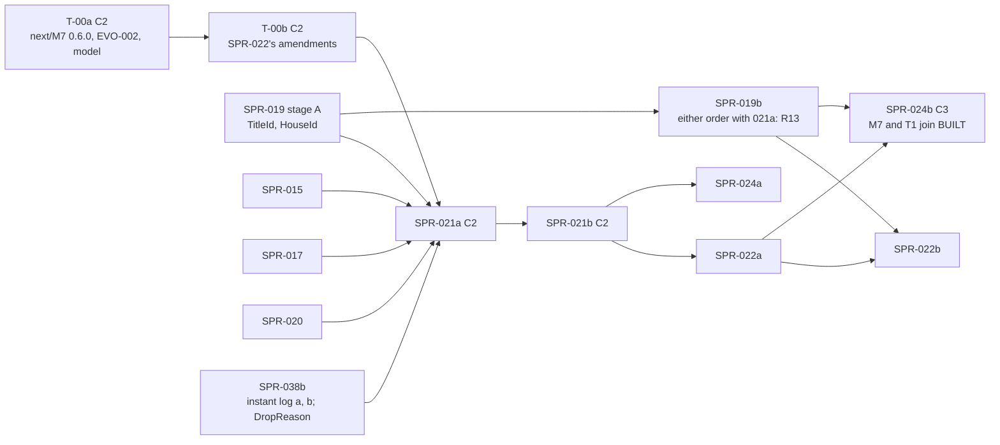

> **BLUF (the one-page brief).** M7 F1, first half, in a new system crate, `rh-sys-dynasty`. It runs as two sprints (X8), and both are **C2**.
>
> | | SPR-021a (T-01 to T-03) | SPR-021b (T-04 to T-06) |
> |---|---|---|
> | Builds | **T-01:** the promotion of M7 0.6.0 (T-00a's text), with the Registry's M7 defaults. **T-02:** in `rh-core`, the instant log's merged events by (kind, target) with their ids (X1 (c): BCK-002 A-59) and the core genealogy index (X2); `OfficeId` and `ClaimId`; `EntityKey` for `TitleId` and `OfficeId`, and the `EntityKind::Title` tag (`TitleId` and `HouseId` are SPR-019 T-01's: X13a); `rh-contracts::m7` v0, with M7's own house → title-holders index (R11). **T-03:** the crate, its registration and parameters, the effect-language host over the core index, and `on_birth` (agnatic; a sorted insert, X3) | **T-04:** `on_death` in two phases; `arbitrate` with the legal heir by the title's law, pressed claims and the court's offices; the interregnum and its resolution (a vassal that joins it emits its own crisis, K2); reversion in demesne; the tenure log; `HOUSE_EXTINCT`; the four commands from T1. **T-05:** scripted dynastic worlds, the succession checker, determinism, cost probes. **T-06:** CI and docs |
> | Size | about 4.5 agent-days (T-02 +0.5 for the merge-time form; T-00a review MIN-14) | about 4 agent-days |
> | Depends on | SPR-014, SPR-015, SPR-017, SPR-020, **SPR-019 stage A** (the ids: X13a), **T-00a and T-00b** (X9, R6); SPR-038b (the instant log, `inserted()`, `exited()` and the `DropReason` changes: X1, R14) before T-02 | SPR-021a |
> | Baselines | none | none |
> | CI, one runner (×1.5) | core +23 s (+35 s), golden +18 s (+27 s) | core +4 s (+6 s), golden +43 s (+65 s), stream +12 s (+18 s) |
>
> **Before it, counted separately (X7):**
> - **T-00a** (C2; the Architect commissions it): `next/M7` 0.6.0's shared amendments, EVO-002, an executable Python model of the instant log and its hook timing, and M7's 16 defaults in `next/registry_delta.toml` with `lint_odd.py`'s self-check fixed (R3). About 3–4 days plus two review rounds; the self-check fix is about 0.25 day of them.
> - **T-00b** (C2): the amendments only SPR-022 needs, about 1.5–2 days, reviewed separately. It merges after T-00a and before 021a's T-01, so both land in 0.6.0 (R6).
>
> **Why no baseline moves:**
> - M7 registers in no golden world: the rung templates exclude it (`registry_v0.toml:472–478`), and `smoke` has its own overlay.
> - M7 does **not** join `BUILT` here. M7 and T1 join together in SPR-024b's `[C3]` commit (X6). Tests compile with their own built list (`rh_manifest::compile` takes one: `crates/rh-golden/src/world.rs:204`).
> - `registry_version` is not bumped. The M7 defaults move from `next/registry_delta.toml` into the Registry in T-01 without a bump (K3, R3), and the bump is SPR-024b's.
>
> **Deliberately not here:** SPR-022's submodels; real dynastic genesis (SPR-019b, in either order with this sprint, its back-fill table folded by REV-SPR-019 R13's rule: the merge route); `twin_vales`; T1's code (SPR-023 to SPR-025).
>
> - **Developer:** AGT-002-CORE, with AGT-002-TOOLS for the checker, the promotion's tool edits and the gates.
> - **Testers:** AGT-003-DET and AGT-003-IF, on a different model from the Developer's.
> - **Status:** PLANNING, revision 2. Revision 1 applied the Architect's rulings K1–K33 on REV-WAVE7's review of `d37fc5b` and the cross-plan rulings X1–X12 of 2026-10-18; revision 2 applies X13 and the round-2 rulings R1–R16 on the joint re-check of `b2c6fb1`. It needs the director's plan approval (D58; GOV-005 §2), SPR-019 stage A, T-00a and T-00b merged.
> - **Ids in this plan:** K-ids are REV-WAVE7's. X1–X13 are the Architect's cross-plan rulings of 2026-10-18 (wave 7, the minds plans, SPR-038, SPR-015). R-ids are the Architect's round-2 rulings of the same day, except "REV-SPR-019 R13" and "REV-SPR-019 R15", which are that review's. REV-WAVE6's are written "REV-WAVE6 X…". F-ids are this plan's findings (the last section).

# SPR-021 — M7 F1 (a): titles, succession, immediate succession (WP P1.7, part a)

- **Roadmap item:** `docs/11` P1.7, the first half by PRJ-002 ruling M-3, as two sprints (X8) · **Phase / rung:** P1a. No rung. Tested on scripted dynastic worlds (the specs table).
- **Depends on (the precondition head):**
  - **SPR-014 merged:** lifecycle queues with same-instant delivery to a later-phase owner; the absent-owner rule; typed `[[applies]]`; `DRAINS` in the skeletons; a timer's `cause` slot; `rh-contracts` v0 (`origin/sprint/SPR-014-lifecycle-queues`, `921d372`).
  - **SPR-015 merged:** M2 0.3.0 frozen, with births at day starts, parents on every born row and `BIRTH`; W4's derived per-system index (`SPR-015_BirthsF1.md:127–140`), used by M7 for its own columns only; and X3's binary search of `house_member`, one sentence in SPR-015's plan, which this sprint tests with M7 registered.
  - **SPR-017 merged** (D52; in flight): `rh_registry::effect`, `succession::line`, the `Reads`/`Indexes`/`Draws` traits and `SystemViewHost` (`SPR-017_EffectLanguage.md:214–235, :329–349`). It leaves this sprint `WorldSpec`'s compiled programs and the `EvalError` → `SimError` mapping (`:403, :416`). The `registry_version` bump it also left goes to SPR-024b (X6).
  - **SPR-020 merged:** `EventDraft` roles, causes and payload; `EventRef::Known`; `ctx.set_cause` (`envelope_v0.md:32–72, :155`).
  - **SPR-019 stage A merged** (X13a, R1): `rh_ids::TitleId` and `HouseId` over the `title/v1` and `house/v1` layouts, with their vectors (`SPR-019_PopulationSynthesis.md:19, :111`), and `WorldSpec.dynasty`'s `DynastyParams { majority_age }` (its T-03; `:68`), which T-03 here replaces with M7's full parameter set (R12). Stage A precedes wave 7 in X9.
  - **T-00a merged, then T-00b** (X7, R6), each after its independent review: `next/M7` 0.6.0, EVO-002 and M7's defaults in `next/registry_delta.toml`. T-00b merges after T-00a and before T-01, so the promotion carries both. Nothing here is coded against text they have not merged.
  - **SPR-038b merged before T-02** (X1, R14): the instant log itself, with `inserted()` (a) and `exited()` (b), and `exited()` ascending by `PersonId` across the whole instant (SPR-038 revision 2, T5: `SPR-038_PerInstantCost.md:394`; R9), so M7 does not sort it; and `DropReason`'s one change: the generic `Ended` ("the timer's or command's premise no longer holds"), `Deferred`, the `cancelled{system, timer kind, reason}` counter with `StepCtx::cancel_because`, and `05.1`'s sentence (`SPR-038_PerInstantCost.md:137, :402–406`), which this plan consumes and does not widen. T-02 adds part (c). SPR-038b runs "in any gap after 038a" (X9), and 038a precedes SPR-015.
  - **D56 approved** (2026-10-17; `docs/decisions-log.md`'s top row, PR #86). A-62, D56 (e), lands before SPR-015 freezes M2 0.3.0, so before this sprint.
- **Binding contracts:**
  - `specs/systems/next/M7.dynasty.odd.toml` 0.5.0 (`:58`), as T-00a amends it to 0.6.0. The line numbers below are the 0.5.0 draft's:
    - owned columns `:94–345`; `[[emits]]` `:348–387`; `[[commands]]` `:389–414`; `[[applies]]` `:420–447`; `[[reads]]` `:461–533`; `[scales]` `:535–539`; `[[schedule]]` `:556–580`; `[[rng]]` `:587–623`; `[initialization]` `:641–643`; `[[params]]` `:649–716`;
    - `on_birth` `:724`, `on_death` `:728`, `arbitrate` `:732`, `apply_commands` `:744`; `[[invariants]]` `:761–792`; the ten `[[amends]]` `:864–916`.
    - `specs/systems/M7.dynasty.odd.toml` 0.3.4 is the frozen slice they preserve.
  - `specs/systems/next/M7_membership.md` §2, §6, §7, §10. `specs/systems/next/README.md`: the deny-by-default table `:22–37`, the promotion checklist `:113–144`. `amendments.lock.toml` `:53–63`.
  - `specs/registry/effect_language_v0.md` §5.2–§5.3, §7.2, §8; SPR-017's T-04 and T-07.
  - `specs/chronicle/envelope_v0.md` §2, §3 (`:83`), §5, §7.
  - `specs/annals/annals_v0.md` §10 item 2 (`:147`), and `specs/annals/fixtures/gen_fixtures.py:283–291, :414–432, :494–512` (the shapes kept: K7).
  - `docs/09` V-SAGA-19 (`:425`), V-INV-03 (`:127`), V-INV-04, V-INV-15 (`:139`), V-DET-01, 02, 05, 12, 19, V-GOLD-01; `docs/03` SAGA-13 (`:234`).
  - `05.1` §2 rule 2 (SPR-015's derived index; EVO-002's instant log and genealogy index), §4.2.
  - BCK-002 1.21.0: A-55 (`:75`), A-56, A-57, A-59 (`:79`), A-60 (`:80`), A-62 (`:82`).
- **System specs:** M7 goes from frozen 0.3.4 to **frozen 0.6.0** in SPR-021a's T-01. That is T-00a's and T-00b's text. It is an Architect-approved C2 change. In-place 0.6.x errata are allowed with the Architect's approval (K20).
  - **SPR-019's back-fill table, by REV-SPR-019 R13's rule, both ways (X13b, R2):** SPR-019b folds `[algorithm.dynastic_backfill]` and INV-BF-01 to 06 into the `next/M7` draft current when it lands. **SPR-019b first:** it folds them into the draft T-00a and T-00b amend (0.6.0 once T-00a has merged), and T-01 promotes M7 with the table. **021a first:** SPR-019b folds them into a new `next/M7` draft over the frozen 0.6.0, by `next/README.md:89`'s re-derivation, and leaves it unpromoted for M7's next sprint (`SPR-019_PopulationSynthesis.md:37, :259`). T-00a does not fold the table (X13b).
- **Rulings (binding):** X1–X13; K1–K33 as the Architect ruled them on REV-WAVE7; R1–R16 (round 2) where they touch wave 7; D56; REV-WAVE5 W1–W4, W7, W9, W12, W31, W42; REV-WAVE6 X1, X5, Y1, V3, Z1; REV-M7-membership R1–R14, N1–N15; SPR-017's specs-table rulings; SPR-011 rulings 3, 5, 17; A-52. Rows marked "proposed" are ruled with the plan's approval.
- **Director items:** D58 (with SPR-022).
- **Requirements covered:** SAGA-13 (V-SAGA-19); SIM-3 (first half); SIM-9's precondition (membership at birth, `HOUSE_EXTINCT`); DET-13 (the commands from T1); DATA-8 (kinship over the log, through the dead); EVO-1 (V-INV-03).

## Specs this sprint needs

| Spec | Exists? | Gap | Architect ruling | Needed by |
|---|---|---|---|---|
| **T-00a and T-00b** (X7, K5) | The 0.5.0 draft (`next/M7:58`) carries D56's ten amendments and none of F-1 to F-11 | About 30–35 `[[amends]]` with byte-exact `frozen` texts, EVO-002 and a lint schema. This is sprint-sized and on the critical path | **Ruled (K5, X7):** two spec PRs, each reviewed independently, counted outside this plan's size. **T-00a (C2):** M7 0.6.0's shared amendments (F-1, F-3 to F-9, F-11; X3's sorted insert; X4's world-start naming in `[initialization]`; K3's `default` on 16 `[[params]]`, with the same 16 in `next/registry_delta.toml` and the lint's self-check fixed: R3); EVO-002, with `events_of(kind)` (R10); `lint_odd.py`'s `[[observes]]`; an executable Python model of the instant log; about 3–4 days, of which the self-check fix is about 0.25 day (R3). **T-00b (C2):** F-10, F-19, F-20 (K12's form) and F-25; about 1.5–2 days; merged after T-00a and before T-01 (R6). **The back-fill table is not T-00a's** (X13b, R2): SPR-019b folds it by REV-SPR-019 R13's rule, both ways (the System specs line above) | T-01 to T-04 |
| **F-1: the id of M2's `DEATH`** (A-59; K1; X1) | Envelope `:83`: `SUCCEED` is `triggered` to the death. A draft-local cause reaches only the same step (SPR-014 `system.rs:966–990`) | No path gives M7 the id | **Ruled (X1, K1):** part (c) of the instant log holds the events merged so far this instant, by (kind, target), with their EventIds. It is filled at the serial merges, read-only through `StepCtx`, cleared at the instant's end, and outside every hash. SPR-021a T-02 builds it under EVO-002. M7 declares `[[observes]] kind = "DEATH", owner = "M2.demography"`. Whether M7 reads (c) and cites `EventRef::Known`, or uses the merge-time form ("the same-instant `DEATH` of X", resolved and refused by name if absent), is EVO-002's to say; this plan assumes the read | T-02, T-04 |
| **F-2: births, deaths and kinship without a scan** (K1, K10, K29–K31; X1, X2) | SPR-015's index applies its owner's own columns (`SPR-015_BirthsF1.md:129–130`). M7's spec rebuilds a children index over M2's columns (`next/M7:456–459`) | Revision 0's foreign-input index duplicated SPR-038's and SPR-023's buffers | **Ruled (X1, X2):** M7 reads this instant's births from `inserted()` and its deaths from `exited()` (SPR-038b). **One core genealogy index** (children by parent, and a person's life-course row, as SPR-017's `Indexes` needs) is maintained at the core's life-course append, O(births), outside every hash, and read by M7, T1 and M2. SPR-021a T-02 builds it under EVO-002. **The house → title-holders lookup (K31) is M7-owned** (R11): a derived index over M7's own `title.holder` and `house_member` columns, kept with M7's W4 index in T-03, exposed by `rh-contracts::m7`, and not in `rh-core`. How another system's step reaches an owner's W4 index (SPR-015's is read by its owner only) is EVO-002's to state (F-27). EVO-002's foreign-input part (ii) is dropped. M7's own W4 index covers its own columns only | T-02, T-03 |
| **F-3: `title.exit_timer`** (K11 (a)) | `StepCtx::schedule` returns `()`; ids are assigned at the end of the level (SPR-014 `system.rs:759–765`; `next/M7:240–245`) | — | **Proposed (6/10), T-00a:** M7 cancels its pending timers through `own_timers` (`system.rs:820`). `title.exit_timer` is written 1 while an exit timer is pending and 0 otherwise (an amended meaning). A debug desync check runs on the titles changed this instant (K11 (a)) | T-02, T-04 |
| **F-4: title draw keys and timer entities** (K11 (b), (c)) | `EntityKey` is sealed to `PersonId`, `RegionId` and `EventId` on `main` (`crates/rh-ids/src/ids.rs:226–231`), plus `WorldKey` on SPR-014 (`ids.rs:238–271` at `921d372`). `EntityKind` has no title (`entity.rs:22–33`). Title-keyed purposes go unchecked (SPR-014 `register.rs:531–557`) | — | **Proposed (6/10), T-00a/EVO-002:** `EntityKind::Title`, tag 6, for timers and draw keys only and never in an event role (`envelope_v0.md:216`), with a journal and keyframe decode test (K11 (b)). **Ruled (X13a, R1): the ids.** SPR-019 T-01 builds `TitleId` and `HouseId` (`title/v1` and `house/v1`, with their vectors), and stage A precedes this sprint. SPR-021a T-02 builds `OfficeId` and `ClaimId`, and adds only the `EntityKey` impls for `TitleId` and `OfficeId` and the `EntityKind::Title` tag | T-02 |
| **F-5: `person.id` read** | `SystemView::person_row` needs it (SPR-014 `world.rs:244–254`); the 0.5.0 reads omit it (`next/M7:461–533`) | — | **Ruled (accepted), T-00a** | T-03 |
| **F-6 and the defaults** (K3) | `interregnum_max_days` and `dormancy_degrees` are `Fixed` (`M7_dynasty.rs:54–55`). The frozen lint requires each Registry default to be mirrored as `default` on the `[[params]]` entry, both ways (`lint_odd.py:1171–1179`; `registry_v0.toml:20–30`) | Revision 0 put the Registry defaults after the promotion | **Ruled (K3, as corrected by R3):** T-00a adds `type = "count"` to the two counts, and `default` to the 16 parameters other than `majority_age`, at `twin_vales.yaml`'s values (`:67–84`), integers for the counts. **T-00a puts the same 16 under `[systems."M7.dynasty"]` in `specs/systems/next/registry_delta.toml`**, M2's mechanism (`registry_delta.toml:10`), so the `--next` run's overlay agrees both ways. T-00a also fixes `lint_odd.py`'s self-check (`:1574–1578`, the planted "frozen default of" probe) to pick a parameter whose frozen spec has a `default`, and counts that in its size (about 0.25 day, with a planted run showing the probe still fires). **T-01's promotion moves the 16 from the delta into `registry_v0.toml`'s `[systems."M7.dynasty"]`, with no `registry_version` bump**; SPR-015's T-01, which merges and deletes the delta, keeps M7's section (F-28) (there is no `[C3]` commit before SPR-024b). `majority_age` stays required (REV-SPR-019 R15) | T-01, T-03 |
| **F-7, F-8: the edge text and the payloads** (K7) | `next/M7:350, :771` say "motive edge". The annals fixtures carry `(LORDSHIP,)`, a title alone, on every M7 event, including `CLAIM_CREATED` (`gen_fixtures.py:424–432`); `HOUSE_EXTINCT` carries the house (`:498–504`) | — | **Ruled (K7), T-00a:** "a `triggered` edge"; `Payload: [title id]` on every M7 kind except `HOUSE_EXTINCT` (`[house id]`), so the fixtures stay as they are. `CLAIM_CREATED` is `triggered` to the event that created it (the `SUCCEED` that passed the heir over, draft-local; the `DEPOSED` in SPR-022), with `claim.cause_event` set through `set_cause` (envelope §7). A-55's typed lists come later, for M2, M7 and T1 together | T-04 |
| **F-9: re-sample rules** | `scales.restart` defers them to "SPR-021" (`next/M7:539`) | — | **Ruled (accepted), T-00a:** the interregnum-resolution and regency-end timers are kept; the deposition timer follows `exit_murder`'s rule (`:590`) | T-04 |
| **F-11: the empty-candidate cases** (K2, K6) | (a) A one-dynasty realm has no vassal holder at resolution (`:642`, `:733`). (b) Titles are vacated "in ascending TitleId", a hash order (`:729`). (c) A claimant or marshal who died in this instant's `Vital` can still score (K6) | Revision 0's "joins the interregnum" left a vassal with neither event, which fails V-SAGA-19 (K2) | **Ruled (K2, K6), T-00a:** `on_death` runs in **two phases**. First it voids the dead's claims, vacates their offices, closes their regencies and checks their houses. Then it arbitrates the vacated titles by tier, then `TitleId`. A vassal with no candidate whose liege is in interregnum **emits `INTERREGNUM_CRISIS`** (payload: its title; `triggered` → the `DEATH`), joins that interregnum, and is resolved after the liege; "sovereign only" is lifted for this case, and V-SAGA-19 is unchanged. At a resolution with no candidate and no vassal holder, the back-fill's stand-in (SPR-019 B9), else a renewed crisis. INV-M7-01 and INV-M7-03 are amended to match | T-04 |
| **Invariants' cadence** (REV-WAVE6 X1, V3) | `invariants(&WorldTables)` runs at every `Bookkeeping` (SPR-014 `engine.rs:930–932, :1052–1083`); SPR-038 (S1) makes it run only after a change, with `every-change` the default in every build (`SPR-038_PerInstantCost.md`, `arch/spr038-plan`) | INV-M7-08 and INV-M7-06 read growing tables | **Ruled (accepted), T-00a's statements:** per instant, O(titles) plus this instant's changes; in full at genesis, at restore, at keyframes and by test observers. `test` keeps its V-id | T-03, T-04 |
| **Scripted dynastic worlds** (K8) | SPR-019 T-03 refuses dynastic manifests until stage B. SPR-017 T-07 loads its `dynasty` fixture into test owners (`SPR-017_EffectLanguage.md:341–343`) | No Python keyframe reader exists | **Proposed (7.5/10):** a test-only scripted genesis in `crates/rh-golden/tests/support/` writes `WorldTables` from a TOML fixture. The checker reads that TOML for genesis and channel A for the run, so it needs no keyframe decoder; a `rehoboam-dump v1` text dump (`crates/rh-golden/src/dump.rs:1–20`) is its fallback | T-05 |
| **CI** (X10, K22, K24) | PR #89 (A-63 as built: `arch/ci-third-job` `a4be717`) adds part `stream` and moves about 295 s out of core (estimated slow core about 9:55) | — | **Ruled (X10):** gates are listed by role, for each of the three parts; budgets are gate sums on one runner, ×1.5; #89 is assumed merged, and the base is its first CI run | T-06 |

## Compliance (every task)

| Rule | This sprint |
|---|---|
| Change class (`docs/13` §4.2; X6, X12) | **C2, both stages.** No golden world registers M7, and `BUILT` is unchanged; each PR proves both with its `systems` lines and `BUILT`, under X12's rule (D58 item 2). **021a's C2 surfaces:** the M7 0.6.0 promotion and the Registry defaults (no `registry_version` bump); `rh-core`'s instant-log part (c) and genealogy index; `rh-ids`' keys and tag; `rh-contracts::m7`, with M7's own house → title-holders index (R11, not in `rh-core`); `WorldSpec`'s M7 parameters. **021b:** M7's model (X12); the succession counts are reported at merge. PR titles end `[C2]` |
| Planes touched | **A:** `rh-sys-dynasty` (new; plane A, `system`; pinned in `bin/lint_arch.py`), `rh-core`, `rh-ids`, `rh-contracts`, `rh-registry`. **Tool:** `rh-manifest`, `rh-golden` (tests, the scripted genesis), `bin/check_m7_successions.py` (new), `bin/gen_rng_golden.py`, `specs/` (the promotion), `bin/check_all.sh`. **B, C:** none |
| Owned columns written | M7's own only: `house.extinct_at`; `house_member.*` (sorted insert, X3); `title.holder`, `.state`, `.held_since`, `.predecessor_exit`, `.exit_timer`; `tenure.*`; `office.holder`; `claim.*`; `petition.*`. Not yet: `title.regent`, `person.vocation` (SPR-022) |
| Reads | M2's `person.id`, `.alive`, `.death_cause`, `.death_tick`, `.birth_tick`, `.sex`, `.mother`, `.father`, and `life_course.person_id`, `.mother`, `.father`, `.birth_tick`, `.sex` (`same_instant`). `person.named` and `polity.exec_constraint` are dropped, with their neutrals. From the instant log: `inserted()`, `exited()`, and the observed `DEATH`s. Kinship comes from the core genealogy index |
| RNG purposes | None added. Drawn here: `arbitration_tie` (the title, `k` = 0), `interregnum_delay` (the title, `k` = 0), `sortition` (the candidate, `k` = the title). The others are registered and first drawn in SPR-022 |
| Golden-hash effect | **None.** `smoke`, `solo`, `household` and `hamlet` are byte-identical, headers included (an acceptance criterion in both stages). Nothing is announced beyond the merge summary and X12's reported counts |
| Fixed point | Scores in Q16_16; `contest_margin` compared with `≥`; `majority_age` in Q16_16 years → whole days. No float |
| Determinism lints | Must pass. Titles by tier, then `TitleId`; persons by `PersonId`; claims by `ClaimId`; `BTreeMap` and `Vec`; no interior mutability (W31); dependencies only on `rh-core`, `rh-ids`, `rh-events`, `rh-registry` and `rh-contracts` |
| Tests that gate | V-SAGA-19; V-INV-03 (natural death and the agenda path via a stub sender); V-INV-01 (INV-M7-01, 02, 03, 05's claim clause, 07, 08 at their cadence); V-INV-04 (M7's registration); V-INV-15 (M7's applied commands); V-DET-01, 02, 05, 12, 19 on the scripted worlds; V-GOLD-01 (no file changed); V-PERF-04 and V-PERF-11 unchanged. **Reported:** per-instant cost per binding (A-60's record, K14) |
| Docs | `check_all.sh` and the inventory test (same commit); `CLAUDE.md`; `specs/systems/next/README.md` (step 4; "Current contents", F-12); the companion moved to `docs/05_architecture/systems/M7.dynasty_F1.md`; `05.0` §6; `docs/09` method lines; BCK-002 A-55, A-56, A-57, A-59, A-60; PRJ-002's rows |

**Rules carried (every task):**
- **Scripted worlds** at 400, 1,500 and 10,000 persons, eight seeds, every law; the 10,000 size and 32 seeds run nightly.
- **Every mutant is killed at a stated place** (run, fixture or unit), and the PR-tier mutant build names its features and their kill checks (K9; W7, W9).
- **Each probe asserts the path it claims was reached.**
- **No O(rows) work per instant** (REV-WAVE6 X1, A-60).
- **No statistical gate.**
- **CI by role, per part** (X10).
- **Merge `origin/main` when it moves.** Each gate is in exactly one part, with the inventory test in the same commit.
- **No baseline is regenerated.** Mutants never make one (A-52).
- **One commit per task.**

## Tasks

**SPR-021a** is T-01 to T-03 and **SPR-021b** is T-04 to T-06. Each is its own PR, Tester pass (`VER-SPR-021a-TEST`, `VER-SPR-021b-TEST`) and audit.

#### T-01: The promotion of M7 0.6.0, with the Registry defaults (021a; about 0.75 day; W1, Y1, K3, K15; `next/README.md:113–144`)
- **Deliverable (the checklist, applied to M7):**
  - **The move:** `next/M7.dynasty.odd.toml` over the frozen file, `status = "frozen"`, `spec_version = "0.6.0"`; the skeleton regenerated (the version line, the two counts' types, the `OBSERVES` constant); `tests/lint_fixtures/skeletons/stale/M7_dynasty.rs` refreshed; the lock's M7 section removed by the tool.
  - **The Registry defaults** (K3, R3): the 16 values move from `next/registry_delta.toml`'s `[systems."M7.dynasty"]` (T-00a's) into `registry_v0.toml`, matching the frozen `[[params]] default` lines, and the section leaves the delta, which is deleted if nothing else remains in it (F-28). No `registry_version` bump.
  - **(a) Re-pointed reads:** none; 0.6.0 owns no new column. **(b) Fallbacks:** `selftest_population_synthesis.py` and every other reference that loads `next/M7` read the frozen file (`project_population.py:339` loads M2's only, which is checked).
  - **(c) Verbs:** none added (`next/README.md:155`).
  - **(d) Rendered controls:** every `odd_next_control` case that plants into or copies `$m7` is rendered from a synthetic next version of the promoted M7 (draft, 0.6.1). That covers the 17 deny-by-default cases (`check_all.sh:357–381`) and the M2 cases that `cp "$m7"` (`:332–355`, K15), as `clean` renders T1 (`:382–388`). The synthetic version carries one recorded amendment on each q5 path, so their "`to` is not what the next version says there" diagnostics hold (`:1204–1206`). The `--next` gate's pinned line names it (`:1189`).
  - **(e) Stale-value controls:** none for M7.
  - **(f) Texts:** the spec's promotion-point lines; `next/README.md` step 4 and the stale "Current contents" row (F-12); the companion moved; `CLAUDE.md`.
  - **(g) No bump** (X6).
- **Acceptance:**
  - The frozen lint is green with M7 0.6.0, and the Registry's and the spec's defaults agree both ways.
  - The `--next` gate is green on the synthetic version. Each control fails or passes with its own diagnostic.
  - `gen_skeletons.py --check` is green, and the skeleton's diff is exactly the version line, two types and `OBSERVES`. `gen_manifest.py --check` is green.
  - Every baseline file is byte-identical.
  - AGT-003-IF simulates the promotion on a copy before T-01 is pushed (W1; the review's simulation of `d37fc5b` is the precedent).
- **Status:** [ ] not started

#### T-02: The engine surfaces: instant-log part (c), the genealogy index, the id keys, `rh-contracts::m7` (021a; about 2.25 days; X1, X2, X13a, X13c, K1, K11, R1, R14; EVO-002)
- **Deliverable:**
  - **EVO-002's merge-time citation form** (T-00a review MIN-14, Architect, 75%; +0.5 day): `EventRef::SameInstant(kind, target)` resolved at the merge against part (c) as the citing job's level started, with its named refusals (`absent`, `same_level`, `own_draft`, `ambiguous`) and `UndeclaredObserve` at the step; `InstantCause` where EVO-002 names it; the Rust analogues of the instant-log model's controls as `mutant-*` features (A-52), each failing its test; and the engine's (kind, target, id) sequences equal to the model's `--emit-vectors` on its scripted instants (V-DET-22).
  - **The instant log's part (c)** (X1), on SPR-038b's log: the events merged so far this instant, keyed by (kind, target), with their EventIds. It is appended at each serial merge for the kinds some registered system declares in `[[observes]]`, read-only through `StepCtx`, cleared at the instant's end, outside every hash, keyframe and journal. The merge-time `EventRef` form is added too if EVO-002 assigns it here. Registration refuses an observer in an earlier phase than the kind's emitter, by name.
  - **The core genealogy index** (X2): children by parent, and the life-course row by person. It is maintained at the core's life-course append (O(births)), rebuilt at construction and restore, outside every hash, and read through SPR-017's `Indexes` by M7, and by T1 and M2 where wanted. The house → title-holders lookup is not here: it is M7's own (T-03; R11).
  - **`rh-ids`:** `OfficeId`, `ClaimId` and their `gen_rng_golden.py` vectors; `EntityKey` for SPR-019's `TitleId` and for `OfficeId`; the `EntityKind::Title` tag (F-4). `TitleId` and `HouseId` themselves are SPR-019 T-01's (X13a, R1). A-50's kind check covers `title` keys.
  - **No `DropReason` change here** (R14). SPR-038b's generic `Ended` ("the timer's or command's premise no longer holds"), `Deferred` and the `cancelled{system, timer kind, reason}` counter are consumed as built: T-04's drops and cancellations use them, and SPR-022's fire for a ruler who lost his title drops `Ended` (K11 (d), K23).
  - **`rh-contracts::m7` v0, built only here** (X13c): accessors for the M7 columns T1, S6, S7 and M2 read, and the drift test. T-03 adds the house → title-holders accessor over M7's own index (R11). SPR-023 reads M7's columns by name through `SystemView`, as SPR-015 reads `person.named`, and SPR-024a switches T1 to these accessors.
  - **Mutants:** `mutant-log-drop-event` (one observed event is not appended) and `mutant-genealogy-drop-child`.
- **Acceptance:**
  - **Part (c), on stub systems** (SPR-014's `agenda_events.rs` worlds; three sizes, eight seeds):
    - each observed event is present exactly once from its level's merge to the instant's end, with the id the merge gave it, at 1, 2, 4 and N threads;
    - an unobserved kind is never present;
    - nothing survives the instant;
    - T-00a's Python model of the hook timing gives the same (kind, target, id) sequence on the same scripted instants.
  - **The genealogy index** equals a rebuild from `life_course.*` at every keyframe and at the run's end, and a keyframe round trip rebuilds an equal index.
  - **Each mutant is killed by name:** `mutant-log-drop-event` at the first dropped event; `mutant-genealogy-drop-child` by the rebuild check.
  - **Not in history:** the four ladders are byte-identical, and `gen_hash_golden.py --check` is unchanged.
  - **K11 (b):** a keyframe holding a timer about a title entity round-trips, and a journal row whose scope names a title decodes, or is refused by name if scopes cannot name titles (EVO-002 says which).
  - **K11 (c):** `EntityKey`'s sealed list is `PersonId`, `RegionId`, `EventId`, `WorldKey`, `TitleId` and `OfficeId`, and a compile-fail doctest refuses any other type, `HouseId` included. SPR-019's `title/v1` and `house/v1` vectors are unchanged.
  - No event role accepts `EntityKind::Title`. The id vectors reproduce. The contracts' drift test and a consumer test are green.
- **Status:** [ ] not started

#### T-03: `rh-sys-dynasty`: registration, parameters, the host, `on_birth` (021a; about 1.5 days; F-5, F-6, X3, R11, R12)
- **Deliverable:**
  - **The crate** (plane A, `system`; the skeleton `include!`d, as `demography.rs:40` does); registration against frozen 0.6.0. Every binding registers, and SPR-022's steps are empty, with one registration report line.
  - **`WorldSpec`:** **replaces SPR-019's `DynastyParams { majority_age }`** (stage A's T-03) with M7's full parameter set, the 17 parameters (Q16_16 and two counts) with the defaults, and the compiled law programs (R12). SPR-019's genesis reads `majority_age` from the new struct, and its goldens do not move.
  - **M7's W4 index over its own columns:** title → tenure rows and open row; holder → titles, offices and claims; house → members; **house → title holders** (K31), M7-owned and not in `rh-core` (R11), with its accessor in `rh-contracts::m7` and the W4 invariant (equal to a rebuild at every keyframe and run end).
  - **The host:** `SystemViewHost` over M7's `SystemView` and the core genealogy index; `StepDraws` (`sortition`: the candidate, `k` = the title). `EvalError` → fatal `SimError` with a crash artifact; `E_TRUNCATED` is fatal.
  - **`on_birth`:** for the persons in `inserted()`, in ascending `PersonId`, a `house_member` row for the father's house when he has a row and the house is not extinct, else none; great houses only. The row is a **sorted insert by person** (X3; compaction keeps the order). The Promote half is SPR-022's.
  - **`invariants()`** at T-00a's cadence.
  - **Mutants:** `mutant-onbirth-cognatic`, `mutant-onbirth-resurrect`, `mutant-member-append` (appends instead of a sorted insert).
- **Acceptance:**
  - **Registration:** M7 registers with M2 and is refused by name without it; `person.named` and `exec_constraint` are dropped with their neutrals; sends to T1 and M4 are discarded and counted; W11's two plants (a STALE skeleton, a refused purpose) fail.
  - **Parameters:** `twin_vales`'s 17 values compile exactly; `manor.yaml` compiles with the defaults; no `DynastyParams` remains, and SPR-019's genesis goldens (`population_synthesis_v0.txt`, `fixture_worlds_v0.txt`) are unchanged; a non-integer count is refused by `compile` (a fixture under `tests/manifest_compile/`); `val_khor.yaml` is still refused for `majority_age`.
  - **The host:** `succession::line` through M7's view and the core index equals `effect_ref.py`'s `succession_line` on every `kind = "succession"` case of `specs/registry/effect_language_golden_v0.toml` on the `dynasty` world (the cases with no `world` key, from `:5086`) and on 200 random scripted holders per law at three sizes, with 0 differences. A planted `AccessSpec` without `person.id` fails by name.
  - **`on_birth` fixtures:** an agnatic child; a posthumous child; a daughter's child by a commoner (no row); a child of an extinct house's last male (no row); a non-great house (no row).
  - **Mutants:**
    - `mutant-onbirth-cognatic` fails the daughter's-child fixture, and `mutant-onbirth-resurrect` the extinct-house fixture, each through INV-M7-06's in-run clause;
    - `mutant-member-append` fails the sorted-order check that M2's binary search relies on (T-05 tests that search).
- **Status:** [ ] not started

#### T-04: `on_death`, `arbitrate`, the tenure log, the interregnum, the commands (021b; about 2 days; F-1, F-3, F-7, F-8, F-9, F-11; K2, K6, K7, K11 (a); SAGA-13)
- **Deliverable:**
  - **`on_death`, phase 1:** for each person in `exited()` this instant, in its order, which is ascending by `PersonId` across the whole instant (SPR-038 revision 2, T5: `SPR-038_PerInstantCost.md:394`; R9), so M7 does not sort it:
    - void the dead claimant's claims;
    - vacate the dead office holder's offices;
    - leave the regency closure to SPR-022 (it is coded as a no-op hook here);
    - check each dead member's house through M7's house → members index and `person.alive`; on its last member, `HOUSE_EXTINCT` (payload `[house id]`; `triggered` → the `DEATH` from part (c)) and `house.extinct_at`.
  - **`on_death`, phase 2:** each title whose holder died, by tier then `TitleId`:
    - `predecessor_exit` from `death_cause`;
    - `holder := 0`, `state := awaiting`;
    - the title's and holder's M7 timers, found through `own_timers`, cancelled with SPR-038b's `cancel_because(id, Ended)`, so `cancelled{…}` counts them (R14);
    - `arbitrate` in the same step.
  - **`arbitrate`:**
    - **Candidates:** the legal heir via the host, after M7's exclusions (coded and fixture-tested; nobody is in holy orders or deposed before SPR-022); pressed active claimants, each `claim.rank` recomputed; and the liege's re-grant candidates for a title with neither. The dead of this instant are never candidates (phase 1).
    - **The score:** Q16_16; a tie by `arbitration_tie`.
    - **Seating:** `SUCCEED` (payload `[title id]`; `triggered` → the `DEATH`, or at a resolution → the crisis, the timer's `cause`) when the best leads by `contest_margin` or more, is alone, or the title is not sovereign. The tenure row is appended and the previous one closed; `held_since := now`. A passed-over heir gets `CLAIM_CREATED` (payload `[title id]`; `triggered` → the `SUCCEED`, draft-local; `claim.cause_event` via `set_cause`; K7) and a `PASSED_OVER` modifier, discarded while T1 is absent.
    - **The crisis:** otherwise `INTERREGNUM_CRISIS` and a resolution timer about the title at `1 + draw mod interregnum_max_days` days, in `Polity`, with `title.exit_timer := 1`.
    - **Resolution:** re-arbitrate; if still contested, a score-weighted pick; else the highest-tier vassal holder, else the stand-in, else a renewed crisis.
    - **A vassal with no candidate:** reverts to its liege in demesne, or, if the liege is in interregnum, emits its own `INTERREGNUM_CRISIS` and joins it (K2).
    - **A minor successor** is seated with `regent = 0` (SPR-022 names the regent).
  - **`apply_commands`** (`Day/Agenda`): `PressClaim`, `RenounceClaim`, `PetitionSeat` and `Resign`, as frozen, with the drops `ended` and `dead_key`.
  - **The `exit_timer` desync check** (K11 (a), debug): on every title changed this instant, `exit_timer = 1` iff `own_timers` holds an exit timer for it; in full at keyframes.
  - **Mutants:**
    - `mutant-awaiting-leaks`, `mutant-tenure-no-close`, `mutant-contest-strict`, `mutant-vassal-interregnum`, `mutant-death-edge-none`, `mutant-law-holder-successor`, `mutant-title-order-id`;
    - `mutant-dead-claimant-candidate` (phase 1 skipped; K6);
    - `mutant-joined-vassal-silent` (no crisis for the joined vassal; K2);
    - `mutant-claim-no-cause` (no `set_cause` on `CLAIM_CREATED`; K7);
    - `mutant-exit-timer-desync`.
- **Acceptance:**
  - **V-SAGA-19's fixtures**, on scripted courts:
    - a clear heir under each law;
    - rival claims at the margin (a crisis below it, a seat at exactly 0.5, the heir at 0.4);
    - a distant heir through `holders_of(title, 16)`;
    - an empty treasury;
    - an empty sovereign line (a crisis, resolved by a vassal holder);
    - a vassal reverting in demesne;
    - a one-dynasty realm resolved by the stand-in;
    - **a vassal joining its liege's interregnum**, which emits its own crisis (K2);
    - **a claimant and a marshal dying in the holder's instant**, neither scoring (K6);
    - twins;
    - every `death_cause` code through the stub sender.
  - **Invariants:** INV-M7-01, 02, 03, 05 (claims), 07 and 08 hold at their cadence on random scripted worlds (three sizes, eight seeds).
  - **Each mutant fails its named fixture or invariant:**
    - `mutant-dead-claimant-candidate`: the same-instant fixture;
    - `mutant-joined-vassal-silent`: INV-M7-02 and the K2 fixture;
    - `mutant-claim-no-cause`: the checker's `CLAIM_CREATED` line;
    - `mutant-exit-timer-desync`: the desync check;
    - `mutant-awaiting-leaks`: INV-M7-01 at the tick boundary;
    - `mutant-tenure-no-close`: INV-M7-08;
    - `mutant-contest-strict`: the margin fixture;
    - `mutant-vassal-interregnum`: the reversion fixture;
    - `mutant-death-edge-none`: INV-M7-02 and channel A's `causal_edge`;
    - `mutant-law-holder-successor`: the host's differential;
    - `mutant-title-order-id`: the liege-and-vassal fixture.
  - **V-INV-15, M7's part:** a `PressClaim` for a claimant dead at take is counted `dead_key` and never applied, and the queue-age invariant holds over a 200-year soak with commands every month.
- **Status:** [ ] not started

#### T-05: The death paths, determinism, the checker, the cost probes, M2's search (021b; about 1.5 days; K8, K9, K14, X3)
- **Deliverable:**
  - **The scripted genesis and the stub `T1.minds` sender** (a test spec table). The stub submits `ScheduleDeath` with each cause through its own timer, and the four commands.
  - **`bin/check_m7_successions.py`:** it reads the scripted fixture TOML (genesis) and channel A (the run) — no keyframe decoder — and re-derives every M7 decision from the deaths: successor or crisis, resolution, reversion, `HOUSE_EXTINCT`, `CLAIM_CREATED`, tenure rows, payloads and edges. `--plant swap-successor` must FAIL. A test-only harness writes a `rehoboam-dump v1` at tick 0 for worlds without a TOML (SPR-022b's).
  - **The rows-visited counter** (K9): per binding, with the mutant `mutant-scan-ledger-daily` (`on_death` scans `person.alive` every instant).
  - **A-60's record gains M7's five bindings** (K14): instructions per instant per binding on the 10,000-person world, nightly.
  - **M2's elite search with M7 registered** (X3): M2's binary search of the sorted `house_member` column gives the same membership as a scan, on every conception check of a 200-year scripted run.
- **Acceptance:**
  - **V-INV-03 (P1a, this part):** a holder killed by M2's hazard and one killed through the stub's `ScheduleDeath` give the same consequence set.
  - **V-DET-01 and 02** at 1, 2, 4 and N threads over 200 years. **V-DET-05 and 12:** a keyframe taken during an interregnum resumes equal, and the core and M7 indexes rebuild equal.
  - **The checker** reproduces every decision at eight seeds over 200 years at 400 and 1,500 persons, with 0 differences, and a probe asserts at least 50 successions, every outcome class and every law.
  - **Cost (K9):** at **1,500 persons in the PR tier**, the rows M7 visits per instant are at most `4 × (|inserted()| + |exited()| + due M7 timers + queued M7 commands) + 2 × titles` (asserted). `mutant-scan-ledger-daily` breaks that bound at 1,500 and fails by name. The 10,000-person run is nightly.
  - **M2's search:** 0 differences against the scan.
- **Status:** [ ] not started

#### T-06: CI, the no-baseline record, docs (021b; about 0.5 day; X6, X10, X12)
- **Deliverable:**
  - **Each stage's PR** states its `systems` lines and `BUILT` (unchanged) and, for 021b, the succession counts at the checker's seeds, reported (X12).
  - **The gates by role (X10):**

    | Gate | Role | Part | One runner | ×1.5 |
    |---|---|---|---|---|
    | 021a: the new crate's debug build and unit tests; instant-log (c) and genealogy stub tests; contracts drift; id vectors; compile fixtures; the promotion's lint lines (count unchanged) | lints, debug tests | core | +23 s | +35 s |
    | 021a: the host differential (release) | release tests | golden | +18 s | +27 s |
    | 021b: arbitration unit fixtures (debug) | debug tests | core | +4 s | +6 s |
    | 021b: V-SAGA-19 fixtures; the scripted worlds at 1, 2, 4 and N threads over 100 years and the keyframe resume; the 1,500-person cost probe; one mutant build (`mutant-contest-strict`, `mutant-dead-claimant-candidate`, `mutant-joined-vassal-silent`, each with the kill check above) | release runs | golden | +43 s | +65 s |
    | 021b: the checker on four seeds over 100 years (it writes run directories and reads channel A) | stream reads | stream | +12 s | +18 s |

  - **Nightly:** eight seeds over 200 years; 32 seeds; the 1,000-year soak; the 10,000-person cost and A-60's per-binding record; the other mutant builds.
  - The inventory test in the same commit; the docs of the compliance table.
- **Acceptance:** the four baselines, snapshots and budgets are byte-identical in both stages (`check_baseline.py` green under `[C2]`); each part's gate-time sum is reported against #89's first run; no gate moves part.
- **Status:** [ ] not started

## Director items, and what changes under the alternative

| Item | Planned | Under the alternative |
|---|---|---|
| **Sizes and splits** (X8; 65%; D58 item 1) | 021a and 021b, about 4 days each; T-00a and T-00b counted separately | One sprint of about 8 days: one PR, and no audit between the engine surfaces and succession |
| **C2, with `BUILT` moving in SPR-024b** (X6, X12; 60%/70%; D58 item 2) | No baseline moves in wave 7 | M7 joins `BUILT` here: a header-only `[C3]` on three rungs now and another for T1 in SPR-024 |
| **One builder per mechanism** (ruled: X13a–X13c, R1, R2, R11; D58 item 5, for the record) | SPR-019 T-01 builds `TitleId` and `HouseId`, and 021a waits for stage A; 021a builds `rh-contracts::m7`, the instant log's part (c) and the genealogy index; M7 owns the house → title-holders index; SPR-019b folds its table by REV-SPR-019 R13, both ways, in either order with 021a | None offered: the move of the ids to 021a and T-00a's fold of the back-fill table were declined (X13a, X13b) |

## Out of scope (explicit)
- **SPR-022's submodels:** hazards and the murder timer, deposition, regency (and F-10's genesis rule), regrant, vocations, dormancy, INV-M7-04, INV-M7-05's regent clause, INV-M7-06's dormancy clauses, V-INV-12, the V-SF rates.
- **`BUILT`, `registry_version` and the annals goldens' regeneration** (SPR-024b, X6).
- **SPR-019b** and `manor`/`twin_vales` runs (SPR-022b). **`holds_title` snapshots** (F-22). **A-55's typed lists.** **Inherited claims** (F2). **Property inheritance** (P1b). **T1's code.**

## Verification assignment (Testers)

| Tester | What to verify | Report |
|---|---|---|
| AGT-003-IF | 021a, written from T-00a's text, EVO-002, `next/README.md` and `05.1` §2:<ul><li>the promotion on a copy before T-01 is pushed, every checklist item and control;</li><li>the defaults both ways;</li><li>instant-log (c)'s contract, against T-00a's Python model on their own scripted instants;</li><li>the genealogy index's API (read-only, outside history);</li><li>`[[observes]]` plants;</li><li>the ids and `EntityKind::Title` decode;</li><li>`rh-contracts::m7` with a consumer test of their own</li></ul> | `VER-SPR-021a-TEST` |
| AGT-003-DET | 021b, written from 0.6.0's `on_death` and `arbitrate`, effect language §7.2 and §8, and ADR-0025:<ul><li>their own arbitration model (not the checker) on five scripted worlds of their own;</li><li>the twelve 021b mutants killed where stated, plus three of their own;</li><li>keyframes during an interregnum; thread invariance;</li><li>the cost bound at 1,500 on a world of their own;</li><li>the baselines byte-identical</li></ul> | `VER-SPR-021b-TEST` |

## Merge route

- **Class and conditions.** C2 in both stages. The Architect merges after the Tester pass and the audit (GOV-005 §6). Under X12, each PR proves its class by its `systems` lines and `BUILT`, and 021b reports its succession counts at merge. Neither stage is bound by the one-C3 slot.
- **Order (X9):**

  - **021a after SPR-015, SPR-017, SPR-020, SPR-019 stage A, T-00a and T-00b** (X9, X13a, R1, R6; T-00b after T-00a), and after SPR-038b (X1's container; R14's `DropReason`).
  - **021b after 021a; 022a after 021b; 024a after 021b; 024b after 022a and SPR-019b** (X9, X13e, R5).
  - **SPR-019b in either order with 021a** (X13b, R2): its table is folded by REV-SPR-019 R13's rule, both ways (the System specs line). It precedes 022b and 024b.
- **Shared files.**
  - With SPR-038: `rh-core`'s instant log (038b builds it; T-02 adds (c)).
  - With SPR-023 and SPR-024: `rh-contracts::m7`, the genealogy index (consumers).
  - With SPR-015: `next/registry_delta.toml`, whose M2 section SPR-015 merges while M7's stays for T-01 (F-28).
  - With SPR-019: `rh-ids` (stage A's ids; this sprint's keys and tag), `WorldSpec` (`DynastyParams` replaced, R12), and `next/M7` or the frozen M7 (stage B's fold, R13).
  - With all of them: `check_all.sh`, the inventory test, `CLAUDE.md`.
  - The second to merge resolves textual conflicts. The builder of each mechanism is fixed above.
- **Re-verified after merging `origin/main`:** all three CI parts; the baselines byte-identical; the lint in both modes and the rendered controls; the host's differential.

## Risks

| Risk | Likelihood | Effect | Mitigation |
|---|---|---|---|
| T-00a's review changes EVO-002 | Medium | T-02 re-plans | T-00a has an executable model and two review rounds before any code (X7) |
| SPR-038b slips | Medium | T-02 waits | X9 puts 038b in any gap after 038a; T-01 and T-03's scaffolding can start |
| CI over budget | Medium | Merges slow | Gates by role per part (X10); the nightly candidates are the mutant build and the 4-seed checker |
| The scripted genesis misses a real-genesis case | Low–medium | Found in 022b | The checker is the same tool on any run directory |
| `lineage` over its bound (`E_TRUNCATED`) | Low | A fatal run | The 10,000-person nightly world at six generations |

## Contract findings (wave 7; revision 2)

The review judged the 26 findings 22 real and 4 partly real (REV-WAVE7 §6). The current disposition:
- **F-1 to F-11:** the specs table's rows above, as ruled.
- **F-12:** `next/README.md:154` is stale: its M7 row names neither the 0.5.0 draft's content nor R13's fold rule, and it disagrees with this plan's System specs line (R6). T-01 (f) rewrites it to the promoted 0.6.0 and to REV-SPR-019 R13's rule, both ways; if SPR-019b's table is not yet folded, the row says that stage B folds it into a new draft over the frozen file.
- **F-13:** the controls after the promotion. Fixed in T-01 (d), including the M2 cases that copy `$m7` (K15).
- **F-14:** the defaults. Fixed per K3 as R3 corrects it (F-6's row), with F-28.
- **F-15:** "claims inherited". D58 item 6: D35, V-INV-03 and `docs/11` P1.7 read as the claims the death path creates or voids.
- **F-16:** SIM-9. D58 item 6.
- **F-17:** PRJ-002's rows. Restated in this PR.
- **F-18:** the `docs/13` class gap. X12, D58 item 2.
- **F-19:** the vocation draw's year. Superseded by K19 (a timer at majority; T-00b; SPR-022).
- **F-20:** at a year's first instant, the Year pass runs before `on_death` (`schedule.rs:22–27`). **K12: one rule.** A holder who died in the instant's `Vital` still holds for the Year pass, as for `on_birth` (`next/M7:725`); his titles are arbitrated in `Day/Polity` afterwards. T-00b; a fixture in SPR-022.
- **F-21:** the annals fixture's interregnum on a vassal seat. Resolved by the spec PR **AN-1** (annals fixtures for M7 F1: K2's vassal `INTERREGNUM_CRISIS`, F-21's distinguishing child, check 5's rule and its control; after T-00a, before SPR-029 T-02; REV-WAVE8 A1, PRJ-002 §6). With K2, a vassal joining its liege's interregnum now emits one, so the fixture is possible when the liege is in interregnum.
- **F-22:** `holds_title` snapshots. Deferred to P2.4, with a note in envelope §3.
- **F-23:** M2's elite read. X3: a sorted `house_member`, M2's binary search, tested in T-05.
- **F-24:** V-INV-15. 021b covers the applied commands; SPR-022a covers the murder timer's sends.
- **F-25:** the deposed's exclusion. T-00b.
- **F-26:** the manor population band (K21). SPR-019 T-07's assertion applies only with M1, M2 and S3 registered, and the band is re-derived in SPR-022b.
- **F-27 (new, revision 2):** R11 makes the house → title-holders index M7-owned and exposed by `rh-contracts::m7`, but SPR-015's W4 index is read by its owner only (`SPR-015_BirthsF1.md:129–130`). EVO-002 must state how another system's step reads it: a read-only view of an owner's W4 index through `StepCtx`, or an accessor over M7's lagged columns at O(titles of the house). The plan assumes the first; the second changes only T-03's accessor.
- **F-28 (new, revision 2):** R3 puts M7's 16 defaults in `next/registry_delta.toml`, but SPR-015's T-01 merges that file into `registry_v0.toml` and deletes it (`SPR-015_BirthsF1.md:110`; the file's own header, `registry_delta.toml:6–7`). If T-00a merges first, as X9 schedules it, SPR-015 would carry M7's defaults into the Registry while M7 is still frozen at 0.3.4 without them, which the frozen lint's two-way check refuses (`lint_odd.py:1171–1179`), or delete them. **Proposed fix (8/10):** SPR-015's T-01 merges only `[systems."M2.demography"]` and M2's verbs and keeps the file while M7's section is in it; T-00a's header comment says that section moves at SPR-021a's T-01. One sentence in SPR-015's plan, the Architect's edit (as X13g's).

## Blockers

| # | Blocker | Status |
|---|---|---|
| 1 | SPR-014, SPR-015, SPR-017, SPR-020 | Open |
| 2 | T-00a merged (C2, reviewed twice), then T-00b (C2), both before T-01 (R6) | Open (T-00a commissioned) |
| 3 | SPR-019 stage A merged: `TitleId`, `HouseId`, `DynastyParams` (X13a, R1) | Open |
| 4 | SPR-038b merged (before T-02): the instant log and `DropReason`'s change (R14) | Open |
| 5 | The director's plan approval (D58) | Open |

## Completion

- [ ] 021a and 021b each meet their acceptance; their Tester passes and audits are PASS (`VER-SPR-021a`, `VER-SPR-021b`).
- [ ] `bin/check_all.sh` passes in all three parts, with each part's time.
- [ ] No baseline, snapshot or budget changed, and `BUILT` is unchanged; the PRs are C2 (X12).
- [ ] M7 0.6.0 is frozen with the Registry defaults. The instant log's part (c) and the core genealogy index are built once, here. No "whichever first" clause remains.
