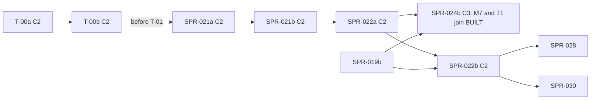

> [!NOTE]
> **ARCHIVED BASELINE:** Traditional sprint-based tracking has been superseded by Specification-Driven Development (SDD v2.0). All future deliverables are tracked as Spec Waves in `.spec/ARCHITECT_BACKLOG.md`.

> **BLUF (the one-page brief).** M7 F1, second half, in `rh-sys-dynasty`, against M7 0.6.0 as SPR-021a froze it. It runs as two sprints (X8), and both are **C2** (X6, X12).
>
> | | SPR-022a (T-01 to T-04) | SPR-022b (T-05 to T-06) |
> |---|---|---|
> | Builds | **T-01:** the exit hazards (exact u128 → Prob32, with a reference golden) and the `MURDER_DUE` timer into M2's death path. **T-02:** deposition and claims. **T-03:** regencies, the genesis minor included. **T-04:** the yearly pass: regrants, vocations at the majority date by a timer (K19), and dormancy with world-start naming by `Promote` (X4) | **T-05:** on `twin_vales` (SPR-019b), the named set at genesis against the `named_at_start` and per-house `named_full` lines of `fixture_worlds_v0.txt` for seeds 1–3, and V-INV-12's P1a variant. **T-06:** the 300-year runs, the isolation evidence, the manor band re-derived once (K21), CI and docs |
> | Size | about 4.25 agent-days, with a checkpoint after T-02 | about 1.5 agent-days |
> | Depends on | SPR-021b (T-00b has merged before SPR-021a's T-01: R6) | SPR-022a; SPR-019b |
> | Baselines | none | none |
> | CI, one runner (×1.5) | core +22 s (+33 s), golden +40 s (+60 s), stream +15 s (+23 s) | golden +43 s (+65 s), stream +15 s (+23 s) |
>
> **No baseline moves.** M7 is in no golden world, `BUILT` is unchanged until SPR-024b (X6), and the Registry does not change. Under X12, each PR proves its class by its `systems` lines and `BUILT`, and **its rates are reported to the director at merge**.
>
> **Order:**
> - The first real M7 + T1 world is SPR-024b's, after 022a **and SPR-019b** (X5, X13e, R5): its probes run on `manor` and `twin_vales`, whose dynasties come from the back-fill.
> - Tests here use a test-only stub owner of `person.named` that applies `Promote` and `Demote`.
> - SPR-030 follows 022b.
>
> - **Developer:** AGT-002-CORE, with AGT-002-TOOLS for the reference, the checker's new modes and the gates.
> - **Testers:** AGT-003-DET, AGT-003-STAT (the rates, reported) and AGT-003-IF, on a different model from the Developer's.
> - **Status:** PLANNING, revision 2. Revision 1 applied REV-WAVE7's K1–K33 as the Architect ruled them, and the cross-plan X1–X12 of 2026-10-18; revision 2 applies X13 and the round-2 rulings R1–R16 where they touch this plan (R5, R6, R14, R16). It needs the director's approval (D58).
> - **Ids:** as SPR-021's plan defines them; every F-n is in SPR-021's "Contract findings".

# SPR-022 — M7 F1 (b): ruler exits, claims, regencies, regrants, vocations, dormancy (WP P1.7, part b)

- **Roadmap item:** `docs/11` P1.7, the second half (PRJ-002 M-3), as two sprints (X8) · **Phase / rung:** P1a. Scripted dynastic worlds (022a); `twin_vales` (022b).
- **Depends on:**
  - **SPR-021b merged:** M7 0.6.0 frozen (T-00a's and T-00b's text, the Registry defaults moved from `next/registry_delta.toml`); `rh-sys-dynasty` with `on_death`, `arbitrate`, the indexes and the host; the scripted genesis and stub sender; `bin/check_m7_successions.py`; the rows-visited counter; the instant log's part (c). Through SPR-021a's own dependency, SPR-038b's one `DropReason` change (R14; `SPR-038_PerInstantCost.md:137`): the generic `Ended` ("the timer's or command's premise no longer holds"), `Deferred`, and `cancelled{system, timer kind, reason}` with `cancel_because`, consumed here with no new variant.
  - **T-00b merged** (X7, R6), after T-00a and before SPR-021a's T-01, so frozen 0.6.0 carries it: F-10 (a regent for a genesis minor), F-19 as K19 rules it (the vocation timer, with X13h's married daughter), F-20 as K12 rules it, F-25 (the deposed's exclusion). Errata after the freeze are in-place 0.6.x bumps with the Architect's approval (K20).
  - **SPR-019b merged, for 022b** (D58 item 5), its back-fill table folded into M7 by REV-SPR-019 R13's rule, both ways (SPR-021's System specs line). A-62 lands before SPR-015 freezes M2 0.3.0 and regenerates `fixture_worlds_v0.txt`. This plan cites that file's lines by name, never their numbers.
  - **D58 item 6** (SIM-9's text) ruled before T-04's dormancy.
  - **SPR-014's queues:** `ScheduleDeath` drained by M2 at `Day/Vital` (`M2.demography.odd.toml:214–220`); `Promote` and `Demote` drained by T1 at `Day/Agenda` (`T1.minds.odd.toml:562–574`), and discarded while T1 is absent.
- **Binding contracts:**
  - M7 0.6.0 (the line numbers are the 0.5.0 draft's): `exit_hazards` `:720–722`; `exit` `:736–738`; `regency` `:740–742`; `regrant` `:748–750`; `vocation` `:752–754`; `dormancy` `:756–758`; `on_birth`'s Promote clause `:724–726`; the `Month/Polity`, `Day/Vital` and `Year/Polity` bindings `:561–580`; `[[rng]]` `:587–623`; `title.predecessor_exit`, `.regent`, `.exit_timer` `:225–245`; `claim.*` `:283–331`; INV-M7-04, 05, 06 `:778–788`; `[isolation]` `:849–856`.
  - `M7_membership.md` §5–§7. `fixture_worlds.md` §2.2, §2.3 (the exit arithmetic per sovereign; the contested-succession route 2, the pressed claim), §3.2. `fixture_worlds_v0.txt`.
  - `docs/09` V-INV-12 (`:136`), V-INV-03, V-INV-15, V-SF-06, 06b, 06c, 06d (`:476–479`), V-SF-22 (`:501`), V-ERA-03.
  - `bin/gen_rng_golden.py` (the RNG reference), and M2's `MIN_AGE_F` 15 and `MIN_AGE_M` 18 (`next/M2:638`).
- **System specs:** none changes, except through K20's errata route.
- **Rulings:** X1–X13 (X13d: dormancy is 022a's; X13e: SPR-024b waits for SPR-019b; X13h: the married daughter); K1–K33; R1–R16 where they touch wave 7; D56; REV-WAVE5 W2, W3, W7, W9, W42; REV-WAVE6 X1, X5, V2, V3, Z1; REV-M7-membership R4–R6, N5–N7; REV-SPR-030 R2, R6, R7.
- **Requirements covered:** SIM-9 (V-INV-12, P1a variant); SIM-3 (second half); SAGA-13's regency and deposition paths; DET-13; ADR-0027 (V-SF-06 and V-SF-06b's identity halves, reported).

## Specs this sprint needs

| Spec | Exists? | Gap | Architect ruling | Needed by |
|---|---|---|---|---|
| **The exact monthly probability** | `exit_hazards` (`:721`): `h` as the u128 product of Q16_16 factors; `p = h × D_m / D`, rounded down once to Prob32 | Which reference pins it | **Proposed (8/10):** `bin/gen_m7_hazard_reference.py` (stdlib, `Fraction`) writes `crates/rh-sys-dynasty/tests/golden/m7_hazards_v1.txt`: `p_m` and `p_d` for each law × `predecessor_exit` × `exec_constraint` in {0, ½, 1} × the Registry's corners and `twin_vales`'s values, on 360- and 365-day calendars. `--check` runs in part core, and an altered copy is STALE (the `gen_m2_reference.py` pattern) | T-01 |
| **The draws, against the RNG reference** | `[[rng]]` `:588–603`. SPR-012's `gen_m2_draws_reference.py` precedent | — | **Proposed (7.5/10): the checker's exits mode.** At each month's first instant it re-draws every hit, day and culprit through `gen_rng_golden.py`'s H, with M7's `system_id` and purposes, and compares them with the run's `DEATH` (cause murder, `actor` the culprit) and `DEPOSED`. The world is 24 sovereigns under seniority with `murder_hazard_base`, `deposition_hazard_ref` and `seniority_hr` at the upper bounds of their ranges, which the test reads from `registry_v0.toml:100` (none is typed); a probe asserts at least 100 of each event | T-01 |
| **A murder and a deposition in one month** | "the earlier day wins (murder on a tie)" (`:599`) | Too rare to observe in a run (about 6 months in 86,400 have both hits) | **Proposed (9/10):** a pure resolver, tested exhaustively over every day pair of 28- to 31-day months; its mutant is killed there | T-01 |
| **The vocation draw** (K19) | The 0.5.0 Year step draws for "majority this year" (`:579`, `:753`). M2 draws brides from 15 and grooms from 18 (`next/M2:638`), and `twin_vales`'s `majority_age` is 16 | A yearly draw can come after a marriage | **Ruled (K19), T-00b:** the draw happens at the majority date, from a timer `on_birth` schedules (and the world-start pass, for living members under majority), at that day's start in `Polity`. The timer is kept on re-sample (F-9's rule), and the draw is keyed (the person, `t` = the fire). For a son, the draw precedes M2's earliest groom age at the manifests' values. **Ruled (X13h, R16), T-00b's text:** a daughter already married at her majority date draws no vocation (the draw at min(`majority_age`, `MIN_AGE_F`) was not adopted) | T-04 |
| **The Year pass at a year's first instant** (K12) | `Year/Polity` runs before `Day/Polity` (`schedule.rs:22–27`). `on_birth`: "a holder who dies this instant still holds here" (`:725`) | — | **Ruled (K12), T-00b:** one rule. A holder who died in this instant's `Vital` still holds for the Year pass; `on_death` arbitrates in `Day/Polity` afterwards. A fixture pins it | T-04 |
| **The deposed's exclusion** | F-25, T-00b: for the arbitration that follows the deposition only | — | Built here | T-02 |
| **Regency without a regent** | `arbitrate`'s rule (`:733`): the living adult mother, else the nearest adult kin, else the steward. Offices are vacant at genesis (`:642`) | — | **Proposed (7/10):** with none of the three, `regent = 0`, counted and reported; the yearly pass names a regent once a steward is granted | T-03 |
| **World-start naming** (X4) | M7's dormancy pass "at world start" (`:757`); T1 0.3.3 says world creation names (`T1.minds.odd.toml:804`) | Two routes | **Ruled (X4):** M7's route only. Tick 0's `Year/Polity` pass sends `Promote`, and genesis names only the cast. T-00a reconciles M7's `[initialization]`, and the T1-A spec PR reconciles T1's | T-04 |
| **Observing dormancy without T1** | `Promote` and `Demote` are T1's (`T1.minds.odd.toml:562–574`); without T1, M7 reads `person.named` as `false` | — | **Proposed (8/10):** a test-only stub owner of `person.named`, registered as `T1.minds` against a test spec table, that applies `Promote` and `Demote` at `Day/Agenda`. The real integration is SPR-024b's (X5) | T-04, T-05 |
| **The named set at genesis** | `fixture_worlds_v0.txt` per seed: the `named_at_start` line (`narrow`, `full`) and each house line's `named_narrow`, `named_full` and `line`, with the heir and second as k and distance. The 0.5.0 widenings change no genesis line (`M7_membership.md:97`). A-62 regenerates the file | Needs `twin_vales`'s genesis (SPR-019b) | **Proposed (8/10), 022b:** after tick 0, `person.named` (through the stub) gives each seed's `named_at_start full` count, every house's `named_full`, and each title's heir and second, as the file then on `main` states them. Nothing is copied into the plan or the tests. The narrow-reading mutant is killed at each seed whose line has `narrow ≠ full`, and the test asserts that at least one such seed exists among 1–3. If none does, the mutant is killed by T-04's A-57 fixtures alone, and the test says so | T-05 |
| **The manor's population band** (K21) | SPR-019 0.3.1 T-07: the nightly manor soak asserts a band projected for M1, M2 and S3 (`SPR-019_PopulationSynthesis.md:184–190`) | With M7 registered, M2's elite read and holy orders change the manor's growth | **Ruled (K21):** SPR-019's assertion applies only when the registered systems are M1, M2 and S3 (one line in SPR-019's T-07; this PR). The band is re-derived once, in 022b T-06, with M7 registered, by the projection SPR-019 names | T-06 |
| **CI** (X10, K22) | PR #89 (`arch/ci-third-job` `a4be717`): parts core, golden and stream | — | **Ruled (X10, K22):** gates by role per part; about +90–150 s on golden and stream together, +20–30 s on core; ×1.5; the base is #89's first run | T-06 |

## Compliance (every task)

| Rule | This sprint |
|---|---|
| Change class (X6, X12) | **C2, both stages.** No baseline file changes. Each PR proves its class by its `systems` lines and `BUILT`, and reports its rates to the director at merge (X12). PR titles end `[C2]` |
| Planes touched | **A:** `rh-sys-dynasty`. **Tool:** `rh-golden` (the stub owners; tests), `bin/gen_m7_hazard_reference.py` (new), `bin/check_m7_successions.py` (new modes), `bin/check_all.sh`. **B, C:** none |
| Owned columns written | M7's own: `title.predecessor_exit` (`deposed`), `.regent`, `.exit_timer`, `.holder`, `.state`, `.held_since`; `tenure.*`; `claim.*`; `office.holder`; `person.vocation`; `petition.*`. Every death goes through `ScheduleDeath` (INV-M7-07) |
| RNG purposes | None added. First drawn here: `exit_murder`, `exit_deposition`, `exit_day`, `murder_culprit` (the ruler, at the month's first instant), `regrant_tie`, `vocation` (the person, at the timer's fire) |
| Golden-hash effect | **None**, headers included (an acceptance criterion in both stages) |
| Fixed point | `h` exact in u128; `p` as Prob32; `m_ec` exact; regrant scores in Q16_16; vocation thresholds as Prob32. No float |
| Determinism lints | Sovereigns in ascending `TitleId` at the month pulse (`:721`). The Year pass by tier, then `TitleId`. Members by `PersonId`. No interior mutability |
| Tests that gate | V-INV-12 (P1a variant; 022b); V-INV-03 (M7's ruler exit: `MURDER_DUE` → M2); V-INV-15 (M7's sends: a `MURDER_DUE` for a dead ruler is dropped `dead`, one whose ruler lost the title `ended`); V-INV-01 (INV-M7-04, 05, 06 at their cadence); V-SAGA-19 (the deposition path); V-DET-01, 02, 05, 12, 19; V-GOLD-01 (no change). **Reported (X12, AGT-003-STAT):** V-SF-06, 06b, 06d, the V-SF-22 evidence, the named count against ≤ 500 |
| Docs | `check_all.sh` and the inventory test; `CLAUDE.md`; `docs/09` method lines; BCK-002 A-56, A-57; PRJ-002's rows |

**Rules carried:**
- **Scripted worlds** at three sizes and eight seeds, every law; 32 seeds nightly.
- **Each mutant is killed at a stated place**, and the PR-tier mutant build names its features and their kill checks (K9).
- **Probes assert their paths:** at least 100 murders and 100 depositions on the exits world; a regent named at genesis, one replaced at death, one ended at majority; a seat and an office granted; each vocation drawn; a Demote, a re-Promote, a far adult heir named, a houseless holder named.
- **No O(rows) work per instant:** the month pass is O(sovereigns), and the year pass O(members × titles) once a year.
- **No statistical gate.** Gates by role per part (X10). One commit per task. No baseline is regenerated.

## Tasks

**SPR-022a** is T-01 to T-04, with a **hard checkpoint after T-02** (the Tester's interim pass on the exits, deposition and claims). **SPR-022b** is T-05 to T-06, after SPR-019b. Each stage is its own PR, Tester pass (`VER-SPR-022a-TEST`, `VER-SPR-022b-TEST`) and audit.

#### T-01: The exit hazards and the murder timer (022a; about 1.25 days; INV-M7-04; F-9)
- **Deliverable:**
  - **`Month/Polity`:** for each sovereign with a living holder, in ascending `TitleId`:
    - `L` by law, `m_ec` (neutral 0 while M6 is absent), and the feud-stock factors from `predecessor_exit`;
    - `p = h × D_m / D` exactly, as Prob32;
    - `exit_murder` and `exit_deposition` against `p`; `exit_day` (`k` = 0, 1); the resolver;
    - on a murder hit: `murder_culprit` among the title's living claimants (else 0), and a `MURDER_DUE` timer at (that day's start, `Vital`) about the ruler;
    - on a deposition hit: a deposition timer at (that day's start, `Polity`);
    - `title.exit_timer := 1`.
  - **`murder_due`,** in `Vital`'s timer pass: if the ruler is alive and holds the title, `ScheduleDeath {ruler, murder, culprit, None}`, drained by M2 in the same `Vital`; a dead ruler → `drop_timer(dead)`; a ruler who lost the title → `drop_timer(ended)`, SPR-038b's generic `Ended`, "the timer's or command's premise no longer holds" (R14; K11 (d), K23).
  - **`resample_timer`:** `MURDER_DUE` by `:590`; the deposition timer by F-9.
  - **INV-M7-04** at each draw.
  - **The reference and its golden; the checker's exits mode.**
  - **Mutants:**
    - `mutant-hazard-month-twelfth`: equal to the true `p` on 30-day months, so killed only by the 365-day vectors;
    - `mutant-feud-stock-off`;
    - `mutant-exit-day-k-swap`;
    - `mutant-tie-deposition-wins`;
    - `mutant-resample-cancel`.
- **Acceptance:**
  - Every reference line is reproduced in debug and release, and an altered copy is STALE.
  - The checker's exits mode reproduces every hit, day and culprit on the exits world (four seeds over 300 years), with 0 differences, and each murder appears as a `DEATH` in the same `Vital`.
  - Re-sampling follows the case table, including the last-day case.
  - **Each mutant fails by name:**
    - `mutant-hazard-month-twelfth`: the 365-day lines (and the test asserts the 360-day lines are equal);
    - `mutant-feud-stock-off`: the `murdered` lines;
    - `mutant-exit-day-k-swap`: the checker's first murder;
    - `mutant-tie-deposition-wins`: the resolver;
    - `mutant-resample-cancel`: the case table.
- **Status:** [ ] not started

#### T-02: Deposition and claims (022a; about 0.75 day; F-25; K7)
- **Deliverable:**
  - **`exit`:**
    - `DEPOSED` (`actor`: the leading pressed claimant; `target`: the ruler; payload `[title id]`);
    - `CLAIM_CREATED` for the ruler (payload `[title id]`; `triggered` → the `DEPOSED`, draft-local; `claim.cause_event` via `set_cause`; the annals fixture's shape, `gen_fixtures.py:414–432`);
    - `DEPOSED_BY`;
    - `predecessor_exit := deposed`;
    - `arbitrate` in the same step with the deposed excluded, its `SUCCEED` `.after(DEPOSED)`.
  - `claim.rank` is recomputed in the Year pass too.
  - **Mutants:** `mutant-deposed-stays-excluded`, `mutant-deposed-no-claim`.
- **Acceptance:**
  - **Fixtures:**
    - a deposition with no claimant;
    - one with a pressed claimant who succeeds, so the heir is passed over and gains a claim;
    - the deposed's pressed claim at the next succession, at the scores and lead `fixture_worlds.md:75` states (§2.3, route 2: a lead under `contest_margin`), gives a crisis.
  - The checker's deposition mode reproduces every `DEPOSED`, its `SUCCEED` and its `CLAIM_CREATED`, with their edges.
  - **Mutants:** `mutant-deposed-stays-excluded` fails the second-succession fixture; `mutant-deposed-no-claim` fails INV-M7-05 and the `CLAIM_CREATED` line.
  - **Checkpoint:** the Tester's interim pass is recorded before T-03 lands.
- **Status:** [ ] not started

#### T-03: Regency (022a; about 0.5 day; F-10)
- **Deliverable:**
  - **At a minor's succession, and for each minor holder at tick 0** (F-10): the regent by rule; `REGENCY_BEGUN` (payload `[title id]`; `triggered` → the `SUCCEED`, or → nothing at tick 0); a regency-end timer at the first day start at or after majority, in `Polity`, kept on re-sample.
  - **A dead regent:** `REGENCY_ENDED`, then the next regent, in `on_death`'s phase 1 hook.
  - **A dead minor:** his timer cancelled. **At majority:** `REGENCY_ENDED`.
  - **Mutants:** `mutant-regent-minor-mother`, `mutant-regency-no-end`.
- **Acceptance:**
  - **Fixtures:** an adult mother; a minor mother, so the nearest adult kin is named; the steward; no regent at all (counted); a regent dying; a genesis minor; majority.
  - INV-M7-05's regent clause holds.
  - **Mutants:** `mutant-regent-minor-mother` fails the minor-mother fixture and INV-M7-05; `mutant-regency-no-end` fails the majority fixture.
- **Status:** [ ] not started

#### T-04: The yearly pass: regrants, vocations, dormancy (022a; about 1.75 days; K12, K19, X4; A-57)
- **Deliverable:**
  - **`regrant`:**
    - titles held in demesne and vacant offices, by tier then `TitleId`;
    - petitioners, then kin within the degrees who hold nothing (holy orders only for a chaplaincy);
    - `regrant_tie`; `SEAT_GRANTED` (payload `[title or office id]`) and `GRANTED_BY`;
    - a holder who died in this instant still holds (K12).
  - **`vocation`** (K19):
    - the `VOCATION_DUE` timer, scheduled by `on_birth` for each great-house member, and by tick 0's pass for living members under majority;
    - at its fire: a later child (an elder child of the same father alive), not first or second in any line, holding nothing, and not already married at the fire (X13h, ruled; T-00b's text) draws `holy_orders`, `mercenary` or `household`;
    - holy orders leaves every line, and M2's lagged read is live.
  - **`dormancy`** (`:756–758`):
    - at tick 0's `Year/Polity` (world-start naming, X4) and yearly;
    - criteria (a), (c) and (d) as one list; (b) waits for S7;
    - naming wins; a named minor is never demoted;
    - `Promote` and `Demote` to T1; `claim.rank` in the pass;
    - **`on_birth`'s Promote half** for a newborn member meeting a criterion.
  - **The stub `person.named` owner** for tests.
  - **INV-M7-06's dormancy clauses:** by a year-end observer, and in full at keyframes.
  - **Mutants:**
    - `mutant-vocation-first-only`, `mutant-vocation-literal`, `mutant-vocation-yearly` (drawn at the Year pass, not at majority);
    - `mutant-regrant-no-kin`;
    - `mutant-dormancy-narrow`, `mutant-demote-minor`, `mutant-dormancy-members-only`;
    - `mutant-yearpass-dead-holder-gone` (K12).
- **Acceptance:**
  - **Regrant fixtures:** a seat to a petitioner, else to kin; an office granted, after which the marshal and steward terms are live; no candidate, so the liege keeps the seat; **a holder dead in the year's first `Vital`**, whose demesne titles the Year pass treats as still his (K12).
  - **Vocation fixtures:**
    - **the majority-date fixture:** a son whose majority date is not a year's first day draws once, and `person.vocation` is written at that day's start (`Polity`), the tick the test asserts;
    - a son draws before `MIN_AGE_M` (`next/M2:638`);
    - a daughter married at `MIN_AGE_F`, so already married at her majority date, draws nothing (X13h);
    - the eldest living child is exempt even when the first-born is dead;
    - the second in a line is exempt;
    - holy orders is excluded by `arbitrate` and eligible for a chaplaincy only.
  - **A-57 fixtures (scripted):**
    - a far adult heir is named;
    - a named minor stays named until majority, then is demoted;
    - a houseless holder is named under (a), and demoted when the seat is lost;
    - a dormant member is re-promoted when the seat moves near him;
    - the world-start pass names exactly the members meeting a criterion (X4).
  - **Each mutant fails its fixture by name.** **`mutant-vocation-yearly`'s kill condition** (R16): it writes `person.vocation` at a year's first instant (the Year pass) instead of at the majority date's start, so the majority-date fixture's tick assertion fails. The married-daughter and before-`MIN_AGE_M` fixtures do not kill it (she is married at both instants, and the yearly draw also falls before `MIN_AGE_M` at `majority_age` 16), and the test says so.
  - **Without the stub,** the world-start `Promote`s are discarded `absent_owner` and counted, one per person meeting a criterion.
- **Status:** [ ] not started

#### T-05: `twin_vales`: the named set at genesis and V-INV-12 (022b; about 0.5 day; X4; A-62's regenerated golden)
- **Deliverable:** `twin_vales` (seeds 1–3), with M1, M2, S3 and M7 compiled through the test's built list and the stub owner, at genesis and through tick 0's pass.
- **Acceptance:**
  - **The named set at genesis:** `person.named` gives, at each seed, the `named_at_start` line's `full` count, every house line's `named_full`, and each title's heir and second (k and distance), as `fixture_worlds_v0.txt` then on `main` states them.
  - `mutant-dormancy-narrow` is killed at each seed whose line has `narrow ≠ full`; the test asserts that such a seed exists, or reports that only T-04's fixtures kill it.
  - **No criterion depends on a genesis interregnum or on an empty line at genesis.** A line the file reports as empty is checked as empty, whatever its count.
  - **V-INV-12's genealogy clause:** every member's lineage reconstructs, and `effect_ref.py`'s `kin_within` agrees with the core genealogy index on every member.
- **Status:** [ ] not started

#### T-06: The runs, the isolation evidence, the manor band, CI, docs (022b; about 1 day; K21, K22, X10, X12)
- **Deliverable:**
  - **`twin_vales`:**
    - **PR tier:** seed 1 over 50 years at 1 and N threads, with a keyframe resume while a `MURDER_DUE` and a regency are pending.
    - **Nightly:** seeds 1–3 over 300 years, with the checker in every mode and the year-end dormancy log (each `Promote` and `Demote` with its criterion; `fixture_worlds.md:57`).
  - **`kingdom_10k`,** nightly, over 100 years: the named count reported against ≤ 500.
  - **The isolation evidence** (V-SF-22 is SPR-028's gate), nightly: M7's `[isolation]` forcing (`:849–856`) with a test-only stub M6 owner (`exec_constraint` 0 then 1) and scripted regicides; eight seeds.
  - **The manor band** (K21): re-derived once, with M7 registered, by the projection SPR-019 names, and stated in the PR for the Architect's approval. From then on, the manor soak asserts the new band whenever M7 is registered.
  - **The gates by role (X10):**

    | Gate | Role | Part | One runner | ×1.5 |
    |---|---|---|---|---|
    | 022a: `gen_m7_hazard_reference.py --check` and its STALE control; unit tests (the reference's lines, the resolver, the regency, regrant, vocation and dormancy fixtures) | lints, debug tests | core | +22 s | +33 s |
    | 022a: the exits world over 100 years at four seeds; the A-57 fixtures in release; one mutant build (`mutant-hazard-month-twelfth`, `mutant-deposed-no-claim`, `mutant-dormancy-narrow`, each with its kill check above) | release runs | golden | +40 s | +60 s |
    | 022a: the checker's exits and deposition modes on that world | stream reads | stream | +15 s | +23 s |
    | 022b: `twin_vales` genesis at three seeds; seed 1 over 50 years at 1 and N threads with the keyframe resume | release runs | golden | +43 s | +65 s |
    | 022b: the checker on `twin_vales` seed 1 over 50 years | stream reads | stream | +15 s | +23 s |

  - **Nightly:** the 300-year runs, `kingdom_10k`, the isolation evidence, the manor soak, 32 seeds, the other mutant builds.
- **Acceptance:**
  - **V-INV-03:** a sovereign murdered through `MURDER_DUE` gives the same consequence set as a natural death. With SPR-021b's paths, all three P1a causes are covered.
  - **V-INV-15:** a `MURDER_DUE` whose ruler died earlier in the instant is dropped `dead`, and one whose ruler lost the title is dropped `ended`.
  - **V-INV-12:** T-05, and over 300 years every dormancy log entry is justified by its criterion (the checker re-derives each pass), with INV-M7-06 holding at every year end.
  - **Determinism** on `twin_vales`: 1 and N threads (PR); 1, 2, 4 and N over 300 years (nightly); the keyframe resume.
  - **No baseline moved;** `BUILT` is unchanged.
  - **Reported to the director at merge (X12; AGT-003-STAT):**
    - the realised murders and depositions per sovereign against `fixture_worlds.md` §2.3's Poisson means;
    - V-SF-06 and V-SF-06b against their bands, and V-SF-06d's odds ratio against `predecessor_killed_or`;
    - the step response to `exec_constraint`;
    - `INTERREGNUM_CRISIS` by route;
    - the named count per year.
    - INSUFFICIENT is stated where it applies, and nothing is tuned (V-SF-06c stays sealed).
  - **CI:** each part's gate-time sum is reported against #89's first run; no gate moves part.
- **Status:** [ ] not started

## Director items, and what changes under the alternative

| Item | Planned | Under the alternative |
|---|---|---|
| **Sizes and splits** (X8; 65%; D58 item 1) | 022a about 4.25 days (dormancy included, so SPR-024b can follow it: X5); 022b about 1.5 after SPR-019b | One sprint of about 5.75 days that cannot merge before SPR-019b |
| **C2, rates reported at merge** (X12; 70%; D58 item 2) | Outside the one-C3 slot | Treated as C3: waits for the slot, for no baseline it could move |
| **022b waits for SPR-019b** (70%; D58 item 5) | V-INV-12's genesis check runs on the real back-fill | It closes on scripted worlds, and the `twin_vales` checks move to SPR-030 |

## Out of scope (explicit)
- **T1** (SPR-023 to SPR-025; the first real M7 + T1 world is SPR-024b's, X5). **S7's vows** (criterion (b), P1b). **M6** (test stub only). **SIM-14.** **Tenure-dependent hazards; second-order contagion** (`next/M7:85–86`).
- **Gating V-SF-06, 06b, 06d or V-SF-22** (SPR-028); **the ≤ 500 bound over 1,000 years, the dynastic goldens and CRN pairing** (SPR-030); **`BUILT`** (SPR-024b).
- **Frozen text changes,** except K20's in-place 0.6.x errata with the Architect's approval.

## Verification assignment (Testers)

| Tester | What to verify | Report |
|---|---|---|
| AGT-003-DET | 022a, from 0.6.0's `exit_hazards`, `exit`, `regency`, `regrant`, `vocation`, `dormancy`, `[[rng]]` and ADR-0025:<ul><li>at the checkpoint: their own re-draw of the exits on a world of their own;</li><li>the seventeen 022a mutants where stated, plus three of their own;</li><li>keyframes with a murder, a regency and a vocation timer pending.</li></ul>022b: the named set at genesis re-derived from the rule's text at one seed of their own choice | `VER-SPR-022a-TEST`, `VER-SPR-022b-TEST` |
| AGT-003-STAT | 022b's reports: Poisson and Clopper–Pearson intervals; INSUFFICIENT stated; nothing tuned | As above |
| AGT-003-IF | The stub owners' registration; `Promote` and `Demote` (`key_field` `person`; discarded and counted without T1); `ScheduleDeath`'s payload; the `ended` drop, under SPR-038b's generic meaning (R14) | As above |

## Merge route

- **C2 in both stages,** merged by the Architect after the Tester pass and the audit, with the rates reported at merge (X12). Not in the one-C3 slot.
- **Order (X9, R5, R6):** 022a after SPR-021b (T-00a, then T-00b, merged before SPR-021a's T-01); 022b after 022a and SPR-019b; **SPR-024b after 022a and SPR-019b** (X13e); SPR-028 and SPR-030 after 022b.

- **Shared files:** `rh-sys-dynasty`, `rh-golden`'s test support, the checker, `check_all.sh`, the inventory test, `CLAUDE.md`. SPR-019's `T-07` bullet gains K21's one line in this PR.

## Risks

| Risk | Likelihood | Effect | Mitigation |
|---|---|---|---|
| SPR-019b slips | Medium | 022b waits | D58 item 5's alternative: move the `twin_vales` checks to SPR-030 |
| A-62's regeneration changes the named set or the lines | Certain | None on the tests: they read the file then on `main` | No number is copied; nothing depends on a genesis interregnum |
| The stub `T1.minds` hides T1's coupling (deferral, marriages among the named) | High, by design | Unseen until SPR-024b | M7's `[isolation]` is the uncoupled contract; X5's probes are SPR-024b's |
| Houses empty under D56's readings | Medium | Little for dormancy to act on | Reported, never tuned; D40's revisit is SPR-030's |

## Blockers

| # | Blocker | Status |
|---|---|---|
| 1 | SPR-021b (T-00a, then T-00b, merged before SPR-021a's T-01: R6) | Open |
| 2 | SPR-019b (022b only) | Open |
| 3 | SIM-9's text (D58 item 6) | Open; before T-04 |
| 4 | The director's approval (D58) | Open |

## Completion

- [ ] 022a and 022b each meet their acceptance; their Tester passes and audits are PASS.
- [ ] `bin/check_all.sh` passes in all three parts, with each part's time.
- [ ] No baseline changed; the rates were reported at merge (X12).
- [ ] M7 F1 is complete: every submodel of 0.6.0 is built; world-start naming is M7's `Promote` (X4); the named set at genesis matches the golden file on `main`.
