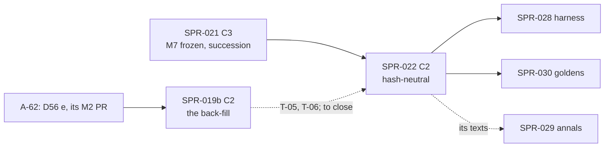

> **BLUF:** Builds the second half of `M7.dynasty` F1 in `rh-sys-dynasty`, against M7 0.6.0 as SPR-021 froze it. The sprint delivers:
> - **the ruler-exit hazards of sovereigns** (`exit_hazards`, `Month/Polity`): murder and deposition as functions of the succession law, the feud stock (`predecessor_exit`) and executive constraint (its neutral, while M6 is absent). The monthly probability is computed exactly in u128 and rounded once to Prob32 (`next/M7:721`, the frozen text as of SPR-021). A murder is M7's `MURDER_DUE` timer, whose fire in `Vital` submits `ScheduleDeath` to M2's single death path (EVO-001 R9). A deposition is a timer in `Polity`;
> - **deposition and claims** (`exit`): `DEPOSED`; the deposed gains a claim; the arbitration follows in the same step, with a draft-local `triggered` edge from `SUCCEED` to the `DEPOSED`; the culprit of a background murder is drawn among the title's claimants;
> - **regencies** (`regency`): a regent for a minor successor, and for a minor holder at genesis (finding F-10); the regency-end timer; a dead regent replaced;
> - **the yearly pass:** regrants of titles held in demesne and of vacant offices (finite seats), vocations for later children (D56's reading), and **dormancy** (SIM-9, A-57): one list of naming criteria, naming wins, a named minor is never demoted, any holder is named; `Promote` and `Demote` to `T1.minds` at world start, yearly, and at a member's birth;
> - INV-M7-04, INV-M7-05's regent clause, INV-M7-06's dormancy clauses, and V-INV-12's P1a variant on `twin_vales`.
>
> **No baseline moves.** No golden world registers M7, `BUILT` already holds it (SPR-021), and the Registry does not change, so `registry_version` stays. **Declared C2** (D58 item 2; finding F-18): a plane-A model change that no golden world sees. It is reviewed with C3's evidence (an independent Tester, the audit, two differential checkers), carries no bisect, and is **not bound by the one-C3 slot**. SPR-021's `--strict` refusal of M7 worlds is lifted at the end.
>
> - **Developer:** AGT-002-CORE (`rh-sys-dynasty`, `rh-golden`), with AGT-002-TOOLS for the two checkers and the gates. One session may hold both.
> - **Testers:** AGT-003-DET (the draws against the RNG reference, the checkers, the death paths, determinism), AGT-003-STAT (the rates, reported: V-SF-06, V-SF-06b, V-SF-06d, the isolation evidence), and AGT-003-IF (the stub owners, the commands to T1, the `--strict` lift). One session may hold them, on a different model from the Developer's.
> - **Size and class:** **about 4.25–4.5 agent-days** by the task inventory (T-01 1.0, T-02 0.5, T-03 0.5, T-04 0.75, T-05 0.75, T-06 0.75), above GOV-005 §3's ~3. **Recommended: one sprint with a hard checkpoint after T-03** (D58 item 1, 60%). The alternative is a split after T-03, each half C2. **C2**, hash-neutral on `main`.
> - **Status:** PLANNING, revision 0 (2026-10-18). It needs the director's plan approval (D58; GOV-005 §2), SPR-021 merged, and, to close, SPR-019b merged (D58 item 5).

# SPR-022 — M7 F1 (b): ruler exits, claims, regencies, regrants, vocations, dormancy (WP P1.7, part b)

- **Roadmap item:** `docs/11` P1.7, the second half by PRJ-002 ruling M-3 · **Phase / rung:** P1a. No rung; the dynastic fixture world `twin_vales` (SPR-030's) and scripted dynastic worlds.
- **Depends on (the precondition head):**
  - **SPR-021 merged:** M7 0.6.0 frozen, with SPR-021 T-00's amendments that this sprint builds: F-9 (the deposition timer's re-sample rule), F-10 (a regent for a genesis minor), F-11 (the empty-candidate cases), F-19 (the vocation draw's year), F-20 (the Year pass at a year's first instant), F-25 (the deposed's exclusion). Also: `rh-sys-dynasty` with its registration, derived index and effect-language host; `on_death` and `arbitrate`; `apply_commands`; the scripted genesis and the stub `T1.minds` sender; `bin/check_m7_successions.py`; the rows-visited probe; EVO-002's observed events.
  - **SPR-019b merged, for T-05 and T-06 (D58 item 5, 70%).** `twin_vales`'s genesis needs the back-fill (SPR-019 T-03 refuses a dynastic manifest until stage B: V4), and V-INV-12's P1a variant runs on it (`docs/09:136`; D34). SPR-019b waits for BCK-002 A-62 (D56 (e), the elite read on the couple, landed in its own M2 PR), which also regenerates `fixture_worlds_v0.txt`. T-01 to T-04 run on scripted worlds and need neither.
  - **D58 item 6 (SIM-9's text, finding F-16)** ruled before T-05.
  - **SPR-014's lifecycle queues:** `ScheduleDeath` drained by M2 at `Day/Vital` in the instant M7's timer submits it (`M2.demography.odd.toml:214–220`: `from = ["M7.dynasty", "T1.minds"]`, `outcome = true`); `Promote` and `Demote` drained by T1 at `Day/Agenda` (`T1.minds.odd.toml:562–574`), and discarded at `submit` while T1 is absent.
  - **SPR-020's envelope:** the draft-local `after` edge; the `DEATH`'s `actor` is the culprit of a caused death (`envelope_v0.md:80`).
  - **SPR-023: not a dependency.** T1 is not built in P1a before SPR-023. Tests use a test-only stub owner of `person.named` that applies `Promote` and `Demote`, the technique SPR-014 and SPR-021 use. SPR-023's integration follows SPR-021 and runs on whatever of this sprint is on `main`.
- **Binding contracts:**
  - `specs/systems/M7.dynasty.odd.toml` 0.6.0 (frozen by SPR-021; line numbers below are the 0.5.0 draft's, `specs/systems/next/M7.dynasty.odd.toml`): `exit_hazards` `:720–722`, `exit` `:736–738`, `regency` `:740–742`, `regrant` `:748–750`, `vocation` `:752–754`, `dormancy` `:756–758`, `on_birth`'s Promote clause `:724–726`; the `Month/Polity`, `Day/Vital` and `Year/Polity` bindings `:561–580`; `[[rng]]` `:587–623` (`exit_murder` with its re-sample rule `:590`, `exit_deposition`, `exit_day`, `murder_culprit`, `regrant_tie`, `vocation`); `[[commands]]` `ScheduleDeath`, `Promote`, `Demote`, `OpinionModifier` `:389–410`; `title.predecessor_exit`, `.regent`, `.exit_timer` `:225–245`; `claim.*` `:283–331`; `person.vocation` `:130–136`; INV-M7-04, 05, 06 `:778–788`; `[isolation]` `:849–856`; `[[params]]` `:649–716`.
  - `specs/systems/next/M7_membership.md` §2, §5 (the named counts, ≤ 500), §6 (A-57), §7 (the vocation draw), §10 Q2, Q3, Q15; `specs/worldgen/fixture_worlds.md` §2.2 (the naming rule; the named sets at genesis per seed and house), §2.3 (the exit arithmetic: 2.7 depositions and 0.9 murders in 300 years for the Lord of Ash, 9 and 3 for the Chieftain; the contested-succession routes), §3.2 (the ≤ 500 bound); `specs/worldgen/golden/fixture_worlds_v0.txt` (the full and narrow named sets, each title's line).
  - `docs/09` V-INV-12 (`:136`), V-INV-03 (`:127`), V-INV-15 (`:139`), V-SF-06, 06b, 06c, 06d (`:476–479`), V-SF-22 (`:501`), V-ERA-03 (`:647`), V-DET-01, 02, 05, 12, 19; `docs/03` SIM-9 (`:52`, as D58 item 6 amends it), SAGA-13.
  - The RNG reference `bin/gen_rng_golden.py` (the H of `05.1` §6 item 2) and `rh-core`'s `system_id` and `PurposeId` goldens: the second checker re-derives M7's draws with them.
  - Registry `[opinion_modifiers]` (`registry_v0.toml:312–319`: `PASSED_OVER`, `DEPOSED_BY`, `CLAIM_PRESSED_BY`, `GRANTED_BY`), `[vocations]`, `[office_kinds]` (`:186–192`).
- **System specs:** none changes. M7 0.6.0 is built as frozen. A text this sprint finds wrong is a finding for M7's next version (`next/`), not an edit.
- **Rulings (binding):** D56; REV-WAVE5 W2, W3, W7, W9, W42; REV-WAVE6 X1, X5, V2, V3, Z1; REV-M7-membership R4–R6, N5–N7; SPR-021's specs table and T-00; REV-SPR-030 R2, R6, R7 (the named set at genesis is the gate; the ≤ 500 bound is SPR-030's run). The rows below marked "proposed" are ruled with the plan's approval. Every finding id (F-n) in this plan is in the wave-7 list of `SPR-021_SuccessionF1.md` ("Contract findings").
- **Director items:** D58 (with SPR-021).
- **Requirements covered:** SIM-9 (great houses and dormancy; V-INV-12's P1a variant); SIM-3 (`M7.dynasty` at P1a, second half); SAGA-13's interregnum and regency paths; DET-13 (the murder timer's `ScheduleDeath`, the sends to T1); ADR-0027 (hazards as functions of institutions, not dates; the identity half of V-SF-06 and V-SF-06b, reported).

## Specs this sprint needs

| Spec | Exists? | Gap | Architect ruling | Needed by |
|---|---|---|---|---|
| **The exact monthly probability** | `exit_hazards` (`:721`): `h` is the product of Q16_16 factors, computed exactly in u128; `p = h × D_m / D`, rounded down once to Prob32. The lower corner is about 2 × 10⁴ Prob32 steps; the upper corner's excess over `1 − exp(−x)` is about 1.1% | Which reference pins the rounding | **Proposed (8/10):** `bin/gen_m7_hazard_reference.py` (stdlib, exact `Fraction` arithmetic) writes `crates/rh-sys-dynasty/tests/golden/m7_hazards_v1.txt`: `p_m` and `p_d` for each law × `predecessor_exit` × `exec_constraint` in {0, ½, 1} × the Registry's corners and `twin_vales`'s values, on 360- and 365-day calendars (months of 28 to 31 days). `--check` is in part core, and an altered copy must be STALE (the `gen_m2_reference.py` pattern). The Rust unit test reads the file | T-01 |
| **The draws, against the RNG reference** | `[[rng]]` (`:588–603`): `exit_murder`, `exit_deposition`, `exit_day` (`k` = 0 murder, 1 deposition), `murder_culprit`, each keyed by the ruler at the month's first instant. SPR-012's precedent: `bin/gen_m2_draws_reference.py` re-derives M2's death instants from the stdlib RNG reference (`:1–47`) | Without an independent model, a wrong `k`, entity or `t` passes every unit test | **Proposed (7.5/10): `bin/check_m7_successions.py` gains the exits.** At each month's first instant, from the sovereigns' holders as its own model of the run holds them, it re-draws every hit, day and culprit through `bin/gen_rng_golden.py`'s H with M7's `system_id` and `PurposeId`s, and compares each `MURDER_DUE` and deposition with the run's `DEATH` (cause murder, `actor` the culprit) and `DEPOSED` events. Epoch-keyed draws follow the run's journaled inputs. The world is scripted with 24 sovereigns under seniority at the Registry's upper bounds (`murder_hazard_base` 0.03, `deposition_hazard_ref` 0.05, `seniority_hr` 2.6), so 300 years give hundreds of hits (about 560 murders and 940 depositions in expectation). A probe asserts at least 100 of each | T-01, T-06 |
| **The tie of a murder and a deposition in one month** | "If both hit, the earlier day wins (murder on a tie)" (`:599`) | Both hit in about 6 of 86,400 sovereign-months on that world, and on the same day in about 0.2, so no run can observe the rule | **Proposed (9/10):** the resolution is a pure function (hits, days → the event), tested exhaustively over every day pair of 28-, 29-, 30- and 31-day months. Its mutant is killed there and not by a run (W9's lesson: say where a mutant is observable) | T-01 |
| **The deposition timer's re-sample rule** | Finding F-9, ruled in SPR-021's T-00: as `exit_murder`'s (`:590`) | — | Built here, with the case table of `exit_murder`'s rule: an input before the day; on the day, at or before the timer's phase; and in the month's last day after its start, which moves the timer to the next month's first day start | T-01 |
| **Regency at genesis and at a succession** | F-10, ruled in T-00. `arbitrate`'s rule (`:733`): the living adult mother, else the nearest living adult kin in the law's order (`kin(p, n)`), else the steward | Who the steward is when the office is vacant: offices are vacant at genesis (`:642`) until a regrant fills them | **Proposed (7/10):** with no adult mother, no adult kin within `dormancy_degrees` in the law's order, and a vacant steward office, the title has no regent (`regent = 0`). The minor still holds, and the yearly pass names a regent once a steward is granted. INV-M7-05's regent clause reads "while regent". The case is counted and reported | T-03 |
| **The vocation draw's year; the Year pass at a year's first instant** | F-19 and F-20, ruled in T-00 | — | Built here: the draw for majority in (start(Y−1), start(Y)] at the pass's instant; a holder dead in the instant's `Vital` is treated as gone by regrant and dormancy | T-04, T-05 |
| **The deposed's exclusion** | F-25, ruled in T-00: for the arbitration that follows the deposition only | — | Built here | T-02 |
| **How dormancy is observed while T1 is not built** | `Promote` and `Demote` are T1's to apply (`T1.minds.odd.toml:562–574`). With T1 absent, M7's read of `person.named` gives `false` (`next/M7:522–527`), so every person meeting a criterion is sent a `Promote` at each pass, and each is discarded and counted | The named set is not in state without T1 | **Proposed (8/10):** a **test-only stub owner of `person.named`**, registered as `T1.minds` against a test spec table (SPR-014's technique), that applies `Promote` and `Demote` at `Day/Agenda`, deferring nothing. The named set is then `person.named`, at the instant's end. Real T1 is SPR-023's. Without the stub, the counted `absent_owner` drops of `Promote` are the observable | T-05 |
| **The named set at genesis, against the reference** | `fixture_worlds_v0.txt` pins the full reading's named set at `twin_vales` seeds 1–3: 33, 35 and 26, and per house (`fixture_worlds.md:43–47`). The 0.5.0 widenings change no genesis line (`M7_membership.md:97`) | Needs `twin_vales`'s genesis (SPR-019b) | **Proposed (8/10):** after the world-start pass (tick 0's `Year/Polity`), with the stub applying at tick 0's `Agenda`, `person.named` equals the golden's full reading at each seed, member by member, with each title's heir and second. This is the strongest available check of the criteria together: it is non-vacuous because full ≠ narrow at every seed (33 ≠ 31, 35 ≠ 33, 26 ≠ 22). If `fixture_worlds_v0.txt` is regenerated by A-62 before this runs, this check reads the regenerated file | T-05 |
| **CI (W42, Z1)** | After wave 6 as the approved plans state it: core about 18:20, golden about 15:40, plus SPR-021's +20 s and +55 s (SPR-021's specs table). A-63 is approved and not built | — | **Ruled (W42, Z1):** a new gate over about 5 s goes to part golden; T-06 states the added time per part, budgeted ×1.5; the third job is D58 item 7 | T-06 |

## Compliance (every task)

| Rule | This sprint |
|---|---|
| Change class (`docs/13` §4.2) | **C2, declared** (D58 item 2; finding F-18): no golden world registers M7, so no `state_hash` moves on any of them and no baseline file changes. It adds no contract surface, unless `rh-contracts::m7` gains an accessor (then that is a C2 diff CI sees). **Reviewed with C3's evidence:** an independent Tester, the audit, the two checkers, the reference's golden. **Not bound by the one-C3 slot** (GOV-005 §4.1), and still one merge at a time |
| Planes touched (ADR-0024) | **A:** `rh-sys-dynasty`. **Tool:** `rh-golden` (the `--strict` lift; tests; the stub owners), `bin/gen_m7_hazard_reference.py` (new), `bin/check_m7_successions.py` (extended), `bin/check_all.sh`. **B, C:** none |
| Owned columns written | `M7.dynasty`'s own: `title.predecessor_exit` (already written by SPR-021's `on_death`; `deposed` here), `.regent`, `.exit_timer` (F-3's marker), `.holder`, `.state`, `.held_since` (deposition, regrant), `tenure.*`, `claim.*` (the deposed's claim, `rank` in the pass), `office.holder` (regrant), `person.vocation`, `petition.*` (cleared at a regrant). Every death M7 causes is a `ScheduleDeath` through M2 (INV-M7-07) |
| Reads (via `rh-contracts`) | As SPR-021, plus the live `person.named` through the test stub (lagged, `mode`). `polity.exec_constraint` stays dropped in every P1a world, with neutral 0 (`m_ec = 1`); the isolation evidence uses a test-only stub M6 owner (T-06) |
| RNG purposes added | None to the spec. First drawn here: `exit_murder`, `exit_deposition`, `exit_day`, `murder_culprit` (the ruler, at the month's first instant), `regrant_tie` (the title or office, at the year's first instant), `vocation` (the person, `k` = 0, F-19). The purposes keep their skeleton order |
| Golden-hash effect | **None.** `smoke`, `solo`, `household` and `hamlet` are byte-identical, headers included (`BUILT` and `registry_version` unchanged). An acceptance criterion |
| Fixed-point quantities | `h` as the exact u128 product of Q16_16 bits; `p` as Prob32, rounded down once; `m_ec = 1 + (exec_constraint_hr − 1) × exec_constraint` in Q16_16 × q8_8, exact; the regrant score in Q16_16; the vocation thresholds as Prob32 (`draw < vocation_holy_orders`, then `+ vocation_mercenary`). No float (V-DET-19) |
| Determinism lints (GOV-003 §2, §6) | Must pass. Sovereigns in ascending `TitleId` at the month pulse, as the frozen text says (`:721`). Titles by tier, then `TitleId`, in the Year pass (F-11's order). Members in ascending `PersonId`. No interior mutability (W31) |
| Tests that gate this sprint | V-INV-12 (P1a variant: the named set at genesis on `twin_vales` against the reference; dormancy and re-promotion by the criteria only, over 300 years, nightly); V-INV-03 (P1a variant, M7's ruler exit: a murder through `MURDER_DUE` and M2's drain gives the same consequence set); V-INV-15 (M7's sends: the `ScheduleDeath` of a timer whose ruler died first is dropped by M7's fire, `dead`); V-INV-01 (INV-M7-04, 05, 06 at their cadence); V-SAGA-19 (the deposition path: the deposed's title succeeds in the same step); V-DET-01, 02, 05, 12 on `twin_vales` (50 years) and the scripted worlds; V-DET-19; V-GOLD-01 (unchanged). **Reported, not gated** (AGT-003-STAT): V-SF-06, V-SF-06b, V-SF-06d on the 300-year runs; the V-SF-22 evidence for M7 (SPR-028's gate); the named-actor count against the ≤ 500 bound (SPR-030's gate) |
| Docs updated in the same sprint | `bin/check_all.sh` and the inventory test (same commit); `CLAUDE.md` (the reference, the checker's new modes, the `--strict` lift); `docs/09` V-INV-12, V-INV-03, V-INV-15 method lines with the test names; BCK-002 A-56, A-57 (built); PRJ-002's row; `worlds/` unchanged |

**Rules carried from P0–SPR-021 (every task):**
- **Property tests vary world size and seed:** the scripted worlds at 400, 1,500 and 10,000 persons, eight seeds, each law. The 10,000-person size and 32 seeds run nightly.
- **A positive control fails for the right reason, and every mutant is observable where the plan says** (a run, a fixture or a unit; W7, W9, X4, V2).
- **A test input exercises the path it claims, and a probe asserts it:** at least 100 murders and 100 depositions on the exits world; at least one regent named at genesis, one regent replaced at death, one regency ended at majority; a grant of a seat and of an office; a vocation of each kind; a Demote, a re-Promote, a far adult heir named, and a houseless holder named.
- **No O(rows) work per instant (X1):** the monthly pass is O(sovereigns), and the yearly pass is O(members × titles) once a year. SPR-021's rows-visited probe covers every binding of M7, the `Day/Vital` timer fire included.
- **No statistical gate.** AGT-003-STAT reports; INSUFFICIENT where counts are small.
- **CI time:** the state after SPR-021, budgeted ×1.5; no gate moves part; each part's time is reported.
- **Merge `origin/main` when main moves.** **Every new gate is in exactly one part,** with the inventory test in the same commit. **Mutants never make a baseline** (A-52); this sprint makes none. **One commit per task.**

## Tasks

The **hard checkpoint** follows T-03: the Tester's interim pass on T-01 to T-03 (`VER-SPR-022-TEST` phase 1: the exits, deposition, claims, regencies) is required before T-04 lands.

#### T-01: The ruler-exit hazards and the murder timer (`exit_hazards`, `murder_due`; INV-M7-04; the first three specs rows; F-9)
- **Deliverable:**
  - **`Month/Polity`,** at each month's first instant, for each sovereign title with a living holder, in ascending `TitleId`:
    - `L` by law: `primogeniture_hr` for primogeniture and ultimogeniture, `seniority_hr` for seniority, 1 otherwise;
    - `m_ec` from `exec_constraint`, which is its neutral 0 in P1a;
    - `h_m` and `h_d`, with the feud-stock multipliers from `predecessor_exit`;
    - `p = h × D_m / D` exactly, rounded down to Prob32; `exit_murder` and `exit_deposition` against `p_m` and `p_d`; `exit_day` (`k` = 0 and 1) on days 2 to the last; the tie resolver;
    - on a murder hit: `murder_culprit` uniform over the title's living claimants in ascending `PersonId`, else 0, and a `MURDER_DUE` timer at (that day's start, `Vital`) about the ruler, with the culprit as payload;
    - on a deposition hit: a deposition timer at (that day's start, `Polity`) about the ruler;
    - `title.exit_timer` set by F-3's rule.
  - **`murder_due`,** the fire in `Vital`'s timer pass: if the ruler is alive and still holds the title, `ScheduleDeath {ruler, murder, culprit, None}`, drained by M2 in the same `Vital`; otherwise `drop_timer(dead)`.
  - **`resample_timer`:** `MURDER_DUE` by `:590`'s rule (the day re-drawn among the month's remaining day starts at or after the input, at the ruler's new epoch; the hit and the payload kept); the deposition timer by F-9's ruling.
  - **INV-M7-04's bounds,** checked at each draw (O(sovereigns) a month).
  - `bin/gen_m7_hazard_reference.py` and its golden; the exits mode of `bin/check_m7_successions.py`.
  - **The planted mutants:**
    - `mutant-hazard-month-twelfth`: `p = h / 12`, which equals `h × D_m / D` on every 30-day month, so it is observable only on the 365-day vectors;
    - `mutant-feud-stock-off`: `predecessor_killed_or` ignored;
    - `mutant-exit-day-k-swap`: the murder's day drawn at `k` = 1;
    - `mutant-tie-deposition-wins`;
    - `mutant-resample-cancel`: a re-sample drops the murder.
- **Acceptance:**
  - **The reference:** every line of `m7_hazards_v1.txt` is reproduced by the Rust function, in debug and release; `--check` passes, and an altered copy is STALE.
  - **The checker's exits mode:** on the 24-sovereign scripted world over 300 years at four seeds, every `MURDER_DUE` hit, day and culprit, and every deposition hit and day, equals the reference's re-draw, with 0 differences. Each murder appears as a `DEATH` with cause murder and `actor` the culprit, in the same instant's `Vital` (EVO-001), and `on_death` then sets `predecessor_exit` to `murdered`.
  - **Re-sampling:** on a run with a journaled input scoping a ruler inside his hit month (the case table), the murder moves as the rule says, never to a cancelled state while a day start remains. The last-day case moves it to the next month's first day start.
  - **Each mutant fails a named check:**
    - `mutant-hazard-month-twelfth`: the reference's 365-day lines (and not the 360-day ones, which the test also asserts);
    - `mutant-feud-stock-off`: the `murdered` lines;
    - `mutant-exit-day-k-swap`: the checker's first murder;
    - `mutant-tie-deposition-wins`: the resolver's exhaustive test;
    - `mutant-resample-cancel`: the re-sample case table.
  - **INV-M7-04** holds at every draw; a planted factor outside the Registry's bounds is refused at load.
- **Status:** [ ] not started

#### T-02: Deposition and claims (`exit`; F-25; `claim.rank`; the culprit's claimants)
- **Deliverable:**
  - **`exit`,** when a deposition timer fires at a day start and the ruler is alive and still holds the title:
    - `DEPOSED` (`actor`: the leading pressed claimant by score, ties in ascending `PersonId`, if any; `target`: the ruler; payload `[title id]`);
    - the ruler's claim (`CLAIM_CREATED`, with `claim.cause_event` set through `set_cause` to the `DEPOSED` draft: envelope §7);
    - a `DEPOSED_BY` `OpinionModifier`;
    - `predecessor_exit := deposed` and `state := awaiting`;
    - `arbitrate` in the same step with the deposed excluded (F-25), its `SUCCEED` carrying `.after(DEPOSED)`.
  - **`claim.rank`** recomputed at each arbitration of the title (SPR-021) and in the yearly pass (T-05): the place in the line, 1 = the heir, 0 outside, capped at 10.
  - **The planted mutants:** `mutant-deposed-stays-excluded` (the exclusion kept for later arbitrations, against F-25) and `mutant-deposed-no-claim`.
- **Acceptance:**
  - **Fixtures:**
    - a deposition with no claimant: the line's first succeeds in the step;
    - with a pressed claimant: the claimant leads and succeeds, the heir is passed over and gains a claim;
    - a deposed ruler's pressed claim at the next succession competes at 0.6 against the heir's 1.0 under `contest_margin` 0.5, giving a crisis (`fixture_worlds.md` §2.3, route 2).
  - **The checker's deposition mode** reproduces every `DEPOSED` and the `SUCCEED` that follows, with its edge, on the exits world.
  - **Mutants:** `mutant-deposed-stays-excluded` fails the second-succession fixture, and `mutant-deposed-no-claim` fails INV-M7-05's claim clause and the fixture's `CLAIM_CREATED` line.
  - **V-SAGA-19's deposition path:** the title is held or in interregnum at the tick boundary (INV-M7-01).
- **Status:** [ ] not started

#### T-03: Regency (`regency`; F-10; INV-M7-05's regent clause; the regency row)
- **Deliverable:**
  - **At a minor's succession** (SPR-021's `arbitrate` seats it with `regent = 0`), and **for each minor holder at tick 0** (F-10): the regent by rule, `REGENCY_BEGUN` (`actor`: the regent; `target`: the holder; payload `[title id]`, `triggered` to the `SUCCEED` draft-locally), and a regency-end timer at the first day start at or after the holder's majority, in `Polity`, about the holder. The timer is kept on re-sample (F-9).
  - **A dead regent:** `REGENCY_ENDED`, then `REGENCY_BEGUN` for the next by rule, in `on_death`.
  - **A dead minor holder:** his regency-end timer cancelled through `own_timers`.
  - **At majority:** `regent := 0`, `REGENCY_ENDED`.
  - The case with no regent available, by the specs table's row.
  - **The planted mutants:** `mutant-regent-minor-mother` (the mother named while a minor) and `mutant-regency-no-end`.
- **Acceptance:**
  - **Fixtures:** a minor heir with a living adult mother; with a minor mother, so the nearest adult kin in the law's order is named; with no kin, so the steward is named; with no steward either (counted); a regent dying, replaced in the same instant; a minor holder at genesis gets a regent at tick 0; a regency ending at the first day start at or after majority.
  - **INV-M7-05's regent clause** holds on random scripted worlds at its cadence.
  - **Mutants:** `mutant-regent-minor-mother` fails the minor-mother fixture and INV-M7-05; `mutant-regency-no-end` fails the majority fixture.
  - **Checkpoint:** the Tester's interim pass on T-01 to T-03 is recorded before T-04 lands.
- **Status:** [ ] not started

#### T-04: The yearly pass, part 1: regrants and vocations (`regrant`, `vocation`; F-19, F-20; D56's reading)
- **Deliverable:**
  - **`regrant`** (`Year/Polity`, `:748–750`), each title held in demesne by its liege's holder and each vacant office, by tier then `TitleId`:
    - the candidates: the petitioners for it, then the holder's kin within `dormancy_degrees` who hold no seat or office (holy orders only for a chaplaincy);
    - the score without the legal term; `regrant_tie`;
    - `SEAT_GRANTED` (`actor`: the granter; `target`: the grantee; payload `[title or office id]`) and a `GRANTED_BY` modifier;
    - petitions cleared on a grant, a refusal at the next regrant, or the petitioner's death;
    - a holder dead in this instant is treated as gone (F-20).
  - **`vocation`** (`:752–754`): each great-house member whose majority fell in the year that just ended (F-19), who is a later child (an elder child of the same father alive at the draw), is not first or second in any title's line, and holds no seat, office or claim, draws `holy_orders`, `mercenary` or `household` by the Prob32 thresholds. A person in holy orders leaves every line (`arbitrate`'s exclusion, coded in SPR-021) and is eligible only for a chaplaincy. M2's lagged read of `person.vocation` is live in M7 worlds (holy orders leaves the marriage pool and the conception draw).
  - **The planted mutants:**
    - `mutant-vocation-first-only`: the frozen 0.3.4 reading, which exempts only the first in a line;
    - `mutant-vocation-literal`: the eldest by birth tick, dead or alive, is exempt;
    - `mutant-regrant-no-kin`.
- **Acceptance:**
  - **Fixtures:**
    - a vassal title in demesne granted to a petitioner, else to kin within the degrees;
    - an office granted, after which the arbitration's marshal and steward terms are live (SPR-021's scores, now non-zero on a run);
    - no candidate, so the liege keeps the seat;
    - a later child with an elder sibling alive draws; the eldest living child is exempt even when a first-born is dead; the second in a line is exempt;
    - a holy-orders member is skipped by `arbitrate` and is eligible for a chaplaincy only;
    - **the year boundary:** a member of age on the pass's first instant draws once, and never again.
  - **Mutants:** `mutant-vocation-first-only` fails the second-in-line fixture; `mutant-vocation-literal` fails the dead-first-born fixture; `mutant-regrant-no-kin` fails the kin-grant fixture.
- **Status:** [ ] not started

#### T-05: The yearly pass, part 2: dormancy (SIM-9; A-57; the stub owner; the named set at genesis)
- **Deliverable:**
  - **`dormancy`** (`:756–758`), at tick 0's `Year/Polity` (world start) and yearly. The naming criteria are one list:
    - (a) any holder of a title, office or claim, member or not;
    - (c) a member within `dormancy_degrees` of a holder of its house (`related` over the life-course log);
    - (d) a member first or second in the line of any title, by `arbitrate`'s computation at the pass;
    - (b), an active vow, waits for S7 (P1b).
  - **Precedence:** naming wins; a named adult meeting none is demoted; a named minor is never demoted. `Promote` goes to a person not named who meets a criterion; at world start, exactly those meeting one are named. `claim.rank` is recomputed in the pass.
  - **`on_birth`'s Promote half** (SPR-021 wrote the row): a newborn member meeting any criterion, evaluated on the instant's state, before `on_death`.
  - **The stub owner** of `person.named` (the specs table).
  - **INV-M7-06's dormancy clauses:** checked by a test observer at each year end and in full at keyframes; never in the per-instant `invariants()` (X1).
  - **The planted mutants:**
    - `mutant-dormancy-narrow`: criterion (d) dropped;
    - `mutant-demote-minor`;
    - `mutant-dormancy-members-only`: criterion (a) for members alone, against N7.
- **Acceptance:**
  - **The named set at genesis (SPR-019b on `main`):** on `twin_vales` seeds 1–3, after tick 0, `person.named` equals `fixture_worlds_v0.txt`'s full reading, member by member: 33, 35 and 26, with every house's count and each title's heir and second. `mutant-dormancy-narrow` gives 31, 33 and 22 and fails that line by name.
  - **The A-57 fixtures** (scripted):
    - a far adult heir beyond the degrees is named and not demoted;
    - a named minor who later meets no criterion stays named until majority, then is demoted;
    - a houseless holder (a seat inherited through a daughter, `M7_membership.md:84`) is named under (a), and demoted when he loses the seat;
    - a dormant member is re-promoted when the seat moves within two steps of him.
    - `mutant-demote-minor` and `mutant-dormancy-members-only` each fail their fixture.
  - **Without the stub,** every `Promote` is discarded as `absent_owner` and counted; the count at tick 0 on `twin_vales` seed 1 equals the full reading's 33.
  - **V-INV-12's genealogy clause:** every member's lineage to the root reconstructs from the life-course log (`effect_ref.py`'s `kin_within` agrees with the Rust walk on every member at seeds 1–3).
- **Status:** [ ] not started

#### T-06: The world runs, the isolation evidence, the `--strict` lift, CI and docs (V-INV-03, V-INV-15, V-INV-12, V-DET-*; W42, Z1)
- **Deliverable:**
  - **`twin_vales`** (SPR-019b on `main`) with M1, M2, S3 and M7 built and the stub `T1.minds`:
    - **PR tier:** seed 1 over 50 years at 1 and N threads, and a keyframe resume.
    - **Nightly:** seeds 1–3 over 300 years with the checker in all its modes and the observer's dormancy log (each `Promote` and `Demote` with its criterion: `fixture_worlds.md:57`).
  - **`kingdom_10k`,** nightly, seed 1 over 100 years: the named count reported against ≤ 500 (`fixture_worlds.md` §3.2; SPR-030 gates it over 1,000 years).
  - **The manor's population band** (SPR-019 0.3.1, RT-037), re-checked in its nightly soak with M7's vocations live (finding F-26 of SPR-021's list). A band that no longer holds is reported with the cause; it is not re-tuned here.
  - **The isolation evidence for M7** (V-SF-22 is SPR-028's gate; D-8's precedent), nightly and reported:
    - M7's `[isolation]` forcing (`:849–856`) on `twin_vales` with T1 absent;
    - `exec_constraint` through a test-only stub M6 owner: 0 for 150 years, then 1 for 150 years;
    - scripted runs of murdered predecessors through the stub `ScheduleDeath` sender;
    - eight seeds.
  - **`--strict`** no longer refuses an M7 world. The registration report's line on empty steps is removed.
  - **The gates.**
    - **Part core:** `gen_m7_hazard_reference.py --check` and its STALE control; the unit tests (the reference's lines, the resolver, the regency, regrant, vocation and dormancy fixtures) in the workspace run.
    - **Part golden:** the exits checker on four seeds over 100 years; the `twin_vales` genesis named sets at three seeds; `twin_vales` seed 1 over 50 years at 1 and N threads, with its keyframe resume; one mutant build with three features.
    - **Nightly:** the 300-year runs, `kingdom_10k`, the isolation evidence, 32 seeds, the other mutant builds.
    - The inventory test is updated in the same commit.
  - The docs of the compliance table.
- **Acceptance:**
  - **V-INV-03 (P1a variant, M7's ruler exit):** a sovereign killed through `MURDER_DUE` gives the same consequence set as a natural death: ledger removal, the life-course exit, the `DEATH` (`actor` the culprit), the arbitration in that instant, and the culprit's claim untouched. With SPR-021's natural and agenda paths, the three P1a causes are covered. Each is asserted on `twin_vales` (nightly) and on the scripted worlds (PR).
  - **V-INV-15 (M7's sends):** a `MURDER_DUE` that fires for a ruler who died earlier in the instant is dropped by M7 (`dead`), never submitted. The queue-age invariant holds on the 300-year runs.
  - **V-INV-12:** the genesis named sets above, and over 300 years the dormancy log's every entry is justified by its criterion (the checker re-derives each yearly pass from its own model of the run, with 0 differences). INV-M7-06 holds at every year end.
  - **Determinism:** `twin_vales`'s ladders at 1 and N threads are equal over 50 years (PR) and at 1, 2, 4 and N over 300 (nightly). A keyframe resume equals the continuous run with a title in interregnum, a regency running and a `MURDER_DUE` pending across the keyframe (V-DET-05, V-DET-12).
  - **No baseline moved:** `smoke`, `solo`, `household` and `hamlet` are byte-identical, headers included; `worlds/` has four directories.
  - **Reported (AGT-003-STAT):** the realised murders and depositions per sovereign against `fixture_worlds.md` §2.3's Poisson means at seeds 1–3; murders per 1,000 ruler-years against `1000 × murder_hazard_base × L` (the isolation `expect`); deposition shares by law against V-SF-06b; the predecessor-murdered odds ratio against `predecessor_killed_or` (V-SF-06d); after the step to `exec_constraint` = 1, both rates against `exec_constraint_hr`; `INTERREGNUM_CRISIS` by route; the named count per year. INSUFFICIENT where samples are small. Nothing is tuned.
  - **CI time.** Against the state after SPR-021 (core about 18:40, golden about 16:35), this sprint adds **about +10 s to part core** (the reference check and the unit fixtures) and **about +45 s to part golden** (the exits checker, the genesis named sets, the `twin_vales` 50-year runs, one mutant build). That is **+15 s and +70 s budgeted ×1.5 for slow runners.** **Nightly candidates if a part is over:** the mutant build and the N-thread `twin_vales` run (the 1-thread run and the fixtures cover the same paths). No gate moves part; both parts' times are reported; A-63's third job is D58 item 7.
- **Status:** [ ] not started

## Director items, and what changes under the alternative

| Item | Planned | Under the alternative |
|---|---|---|
| **Size: about 4.25–4.5 agent-days, one sprint with a hard checkpoint after T-03** (recommendation 60%; D58 item 1) | One C2 PR, one audit; the checkpoint gives the Tester the exits, deposition and regency before the yearly pass is built on them | A split after T-03: SPR-022a (exits, deposition, claims, regency; about 2.5 days) and SPR-022b (regrant, vocations, dormancy, the runs; about 2 days). Both C2, both outside the C3 slot; a second plan approval, Tester pass and audit |
| **Class C2, outside the one-C3 slot** (recommendation 70%; D58 item 2; finding F-18) | Merged in any gap after SPR-021, with C3's evidence and no bisect | Treated as C3 (PRJ-002's row as it stood): it waits for the slot behind SPR-019 stage A and SPR-030's prep, for no baseline it could move |
| **Closing after SPR-019b** (recommendation 70%; D58 item 5) | T-05's genesis named set and T-06's `twin_vales` runs need the back-fill. This sprint does not close before SPR-019b merges, which waits for A-62 | It closes on scripted worlds, and the `twin_vales` checks move to SPR-030 (which depends on SPR-019b already). V-INV-12's criteria then first meet the real genesis at the scale run |

## Out of scope (explicit)
- **T1's code** (SPR-023 to SPR-025): the stub owner and sender are test-only. Foreground murders (`MURDER_ATTEMPT`) and their recalibration of `murder_hazard_base` (V-SF-06 coupled: P1b and G1b).
- **S7's vows** (criterion (b), P1b). **M6** (`exec_constraint` is its neutral; the stub M6 owner is test-only). **SIM-14** (`succession_institutionalisation`'s effect on hazards; P4). **Tenure-dependent hazards, contagion two reigns back, accession-age effects** (`next/M7:85–86`).
- **Gating V-SF-06, V-SF-06b, V-SF-06d or V-SF-22** (SPR-028; G1a reports V-SF-06 and V-SF-06b, D34), **the ≤ 500 bound over 1,000 years** and **the dynastic goldens** (SPR-030), **the CRN pairing** (SPR-030).
- **Any change to M7's frozen text:** a finding goes to a `next/M7` draft for its next version (`next/README.md`).

## Verification assignment (Testers)

| Tester | What to verify, from which contract | Report |
|---|---|---|
| AGT-003-DET | T-01 to T-06, written from M7 0.6.0's `exit_hazards`, `exit`, `regency`, `regrant`, `vocation` and `dormancy`, `[[rng]]`, `05.1` §6 item 2 and ADR-0025, before reading the code:<ul><li>**at the checkpoint:** their own re-derivation of the monthly draws (not the checker) on a scripted world of their own, every hit and day; the re-sample cases; the regency fixtures;</li><li>the fifteen mutants killed where the plan says, plus three of their own (a murder timer in `Polity`; a culprit drawn among all claimants including dead ones; a regency-end timer not cancelled at the minor's death);</li><li>the named set at genesis re-computed from the rule's text on `twin_vales` seed 2 (35);</li><li>thread and keyframe invariance with a `MURDER_DUE` and a regency pending across the keyframe</li></ul> | `VER-SPR-022-TEST` (phase 1 at the checkpoint, phase 2 at the end) |
| AGT-003-STAT | T-06's reports, written from `fixture_worlds.md` §2.3, M7's `[isolation]` `expect` and `docs/09` §3.1:<ul><li>the Poisson and Clopper–Pearson intervals stated with each count; V-SF-06b's Cox model or the reigns' shares, as samples allow;</li><li>INSUFFICIENT stated honestly; no band adjusted, nothing tuned (V-SF-06c is held out: its numbers are not opened)</li></ul> | As above |
| AGT-003-IF | The stub owners' registration against their test spec tables; the `Promote`/`Demote` sends (`key_field` `person`, discarded and counted with T1 absent); `ScheduleDeath`'s payload against M2's `[[applies]]` (an event-typed `cause_event` of `None`); the `--strict` lift; a consumer test of `rh-contracts::m7` if it changed | As above |

## Merge route

- **Class and conditions.** C2, declared, and hash-neutral on `main`. Merged by the Architect after the Tester passes and the audit (GOV-005 §6), with C3's evidence. The PR title ends `[C2]`. `check_baseline.py` must be green with no baseline file changed. Nothing is announced to the director beyond the merge summary.
- **Not bound by the one-C3 rule** (D58 item 2), and still one merge at a time:

  - **After SPR-021;** T-05 and T-06 after SPR-019b (D58 item 5).
  - **SPR-030 after this sprint** (PRJ-002 §3): its `twin_vales` goldens record M7's whole F1 behaviour, and V-DET-17's protocol targets the sovereign's death.
  - **SPR-023 to SPR-025 in parallel:** T1 replaces the stub. The first world with both is SPR-023's integration, which reads this sprint's sends.
- **Shared files.** With SPR-021's follow-ups and SPR-023: `rh-sys-dynasty`, `rh-golden`'s test support (the stub owners), `bin/check_m7_successions.py`, `check_all.sh`, the inventory test, `CLAUDE.md`. Whichever merges second resolves the textual conflicts.
- **What this sprint re-verifies after merging `origin/main`:** both CI parts; the four baselines unchanged; the genesis named sets against `fixture_worlds_v0.txt` as then on `main` (A-62's PR regenerates it).

## Risks

| Risk | Likelihood | Effect | Mitigation |
|---|---|---|---|
| A-62 or SPR-019b slips, and this sprint cannot close | Medium | V-INV-12's real-world check waits; the critical path to SPR-030 holds | D58 item 5's alternative: close on scripted worlds and move the `twin_vales` checks to SPR-030 |
| The named set over 300 years is far from `fixture_worlds.md` §3.2's 100–200 on `kingdom_10k`, or houses empty under D56's readings before (e) lands | Medium (`M7_membership.md` §3–§4: 0.91 per generation under (d) alone) | Dormancy has little to act on; `HOUSE_EXTINCT` is common | Reported, never tuned (`docs/01` principle 8); the lever is the manifest's `dormancy_degrees`, and the director's D40 revisit is SPR-030's |
| The stub `T1.minds` hides a coupling the real T1 changes (deferral during a break; T1's marriages among the named) | High, by design | V-SF-23's coupled behaviour is unseen until SPR-023 | M7's `[isolation]` is the uncoupled contract; the coupled runs are SPR-023's to SPR-025's and SPR-028's |
| The draws checker shares a bug with the engine through the shared RNG reference | Low (the reference is SPR-002's stdlib implementation with its own golden vectors) | A wrong draw passes | AGT-003-DET re-derives the draws independently at the checkpoint |
| Per-instant cost of M7's `Day/Vital` timer pass and `Day/Agenda` drain on large worlds | Low | Slower G1a run | SPR-021's rows-visited probe extended to every binding (T-06) |

## Blockers

| # | Blocker | Status |
|---|---|---|
| 1 | SPR-021 not merged (M7 0.6.0 frozen with T-00's F-9, F-10, F-11, F-19, F-20 and F-25; the crate; the checker; the stubs) | Open |
| 2 | SPR-019b not merged (`twin_vales`'s genesis), behind A-62 | Open; blocks T-05's genesis check and T-06's runs (D58 item 5) |
| 3 | SIM-9's text (D58 item 6; finding F-16) | Open; before T-05 |
| 4 | The director's plan approval (D58; GOV-005 §2) | Open |

## Completion

- [ ] All tasks meet their acceptance criteria; the checkpoint (the Tester's interim pass on T-01 to T-03) was held before T-04 landed.
- [ ] `bin/check_all.sh` passes; the report is attached, with each part's time.
- [ ] Tester verdicts are PASS (DET, STAT, IF).
- [ ] Architect audit `VER-SPR-022` is PASS, with the checkers' results and the reported rates.
- [ ] No open DEF- against this sprint.
- [ ] No baseline file changed; the merge route matches the declared class (C2).
- [ ] M7 F1 is complete on `main`: every submodel of 0.6.0 is built; `--strict` accepts an M7 world; the named set at genesis on `twin_vales` equals the reference; BCK-002 A-56 and A-57 are built.
