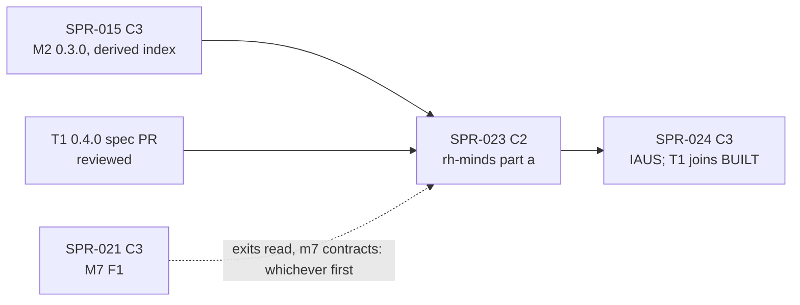

> **BLUF:** Builds the first slice of `T1.minds` (`specs/systems/T1.minds.odd.toml`, frozen 0.3.3, D36) in a new plane-A crate `rh-minds`:
> - **the mind table** with a key column it lacks today (`mind.person`), traits and ambition drawn once by `trait_draw`, kept through dormancy and reused on re-promotion (round 3 MAJ-9);
> - **promotion and demotion** from M7's commands (`Promote`, `Demote`; M7 0.5.0's one-list criteria, D56), developed against a **stub M7 owner** as PRJ-002 and EVO-001 R12 require, plus the world-start naming;
> - **relations** (liege and vassal rows) and **opinion modifiers** (CK3 style: applied from commands, summed and clamped on read, expired monthly), with the thought and goal tables applied from stub S6/S7 senders;
> - **the instant's ledger exits** as a hash-neutral `rh-core` read, so the minds' death path costs O(deaths), not O(persons), per day start (X1; A-60).
>
> **It needs a spec first.** T1 0.3.3 has no `[algorithm.*]` table and no exact reference, unlike every system built so far (M2 F1, M1, S3), and has contract gaps: rows 2–9 of the specs table here, and more in SPR-024's and SPR-025's tables. A T1 0.4.0 next-version draft with `[algorithm.minds_f1]` and `specs/minds/selftest_minds_v0.py` is reviewed as its own spec PR before T-01 (W30's route) and promoted in this sprint's PR with the full checklist (W1's lesson).
>
> **No baseline moves.** No golden world names `T1.minds` or `M7.dynasty` (`solo`, `household`, `hamlet` and `smoke`; `worlds/*/baselines/*.ladder` `systems` lines), and `T1.minds` does **not** join `rh-golden`'s `BUILT` here, so every ladder, header included, stays byte-identical. CI will detect **C2**, not the C3 PRJ-002 assumed (D59 item 3). T1 joins `BUILT` in SPR-024, once M7 is built (SPR-021) and the named can marry.
>
> - **Developer:** AGT-002-CORE (`rh-minds`, `rh-core`, `rh-registry`, `rh-contracts`), with AGT-002-TOOLS for the Registry loader, `lint_arch.py`, the gates and the reference port checks (one Developer session may hold both roles).
> - **Testers:** AGT-003-DET and AGT-003-IF (one session may hold both, on a different model from the Developer's).
> - **Size and class:** **about 3.75–4 agent-days** (T-01 0.75, T-02 0.5, T-03 1.25, T-04 0.75, T-05 0.5–0.75), as **one sprint with a hard checkpoint after T-03** (the Tester's interim pass on the promotion, the exits read and the mind table before relations and opinions land). **C2**: a new system crate, Registry typing, `rh-contracts` modules and a core read, with `state_hash` unchanged on every golden world.
> - **Status:** PLANNING, revision 0. It needs the T1 0.4.0 spec PR (specs table, row 1) and the director's plan approval (D59; GOV-005 §2).

# SPR-023 — Minds v0, part a: rh-minds, promotion, traits, relations, opinions (WP P3.2a, part a)

- **Roadmap item:** `docs/11` P3.2a (`docs/11_roadmap.md:183`), part a by PRJ-002 ruling M-3 (`PRJ-002_P1aPlan.md:182`) · **Phase / rung:** P1a; no rung (no golden world registers T1 before SPR-030).
- **Depends on (the precondition head):**
  - **SPR-014 merged:** same-instant delivery (M7's Polity-phase `Promote` reaches T1's Day/Agenda drain in the same instant), the absent-owner rule (T1's rate reads of S6 and S7 dropped with their neutrals; its sends to M4, S6 and S7 dropped and reported; `T1.minds.odd.toml:576–588`), typed `[[applies]]` with `drained_by` and `key = "living"` (`:526–574`), the dead-person drop, the `DRAINS` skeleton constants, and A-60's part (SPR-014's `1bd05a6`).
  - **SPR-015 merged:** M2 0.3.0 frozen (`person.spouse`, `life_course.mother/father` live; T1's ten M2 reads, `:589–638`), `rh-contracts::m2` v0.1, and **the derived per-system index** (W4, `REV-WAVE5-plans.md:59`), which holds every lookup this sprint needs over T1's own columns.
  - **SPR-020 merged (recommended, not required):** the envelope's checked `emit`. This sprint emits no event; SPR-024 is the first T1 sprint that does.
  - **The T1 0.4.0 spec PR merged** (specs table, row 1): the `[algorithm.minds_f1]` A-steps, the exact reference and golden, the `[[amends]]` records and lock.
  - **Not a dependency:** SPR-017 (no kinship walk is read in this part; SPR-024 is the first), SPR-021 (the stub M7 stands in; EVO-001 R12 at `T1.minds.odd.toml:577–579`), SPR-019 (no genesis with dynasties is needed: the fixture court is scripted, `:1029`).
- **Binding contracts:**
  - `specs/systems/T1.minds.odd.toml` 0.3.3 and its 0.4.0 next version (promoted by T-01): `[[owns]]` `:80–414` (this part writes `person.named`, `mind.*` but the stress and break columns' initial values, `relation.*`, `opinion.*`, `thought.*`, `goal.*`), `[[applies]]` `:526–574`, `[[reads]]` `:589–710`, `[scales]` `:712–716`, `[[schedule]]` `:728–742`, `[[rng]]` `trait_draw` and `poll_jitter`'s key `:749–756`, `[initialization]` `:803–805`, `[[params]]` `:811–874`, submodels `apply_commands`, `promote` and `expire` `:885–892`, `:909–912`, INV-T1-05, 06, 08 `:931–946`, `[isolation]` `:1023–1030`.
  - `specs/systems/next/M7.dynasty.odd.toml` 0.5.0 (draft, D56 approved): `Promote`, `Demote`, `OpinionModifier` to T1 (`:396–410`), the `person.named` mode read with `neutral = false` (`:522–527`), the dormancy criteria (`:756–757`, as amended `:898–900`), the T1 couplings (`:817–825`), `[isolation]`'s `person.named` constant (`:852`). The stub M7 implements the sender side of these and nothing else.
  - `05.1` §2 rule 2 (delivery, absent owners, the dead-person drop; this sprint adds the exits read, T-02), rule 4, §4.2 (phase order), §4.3 (`docs/05_architecture/05.1_simulation_core.md:175–195`), §5 (`:211`, the `bevy_ecs` row restated: specs table), §6 items 2–3; `05.3` §2 (`docs/05_architecture/05.3_cognition_epistemics_oracle.md:27–60`).
  - The Registry (`specs/manifest/registry_v0.toml`): `[systems."T1.minds"]` (`:121–141`, no `defaults`), `[relation_kinds]` `:301–310`, `[opinion_modifiers]` `:312–322`, `[overlay_traits]` `:331–337`.
  - `crates/rh-core/src/fixed/q.rs:103–104` (`Q16_16::narrow_saturating`, half to even), `crates/rh-sample/src/normal.rs:58, :73` (`Normal::new`, `sample` → `Q16_16`).
  - ADR-0006, ADR-0007 (no history compacted: mind rows kept), ADR-0012, ADR-0024 (no pin sets `person.named`: `T1.minds.odd.toml:85`), ADR-0025, ADR-0033, **ADR-0034** (no model chooses: `docs/06_adr/ADR-0034-llm-roles-translate-describe-never-decide.md:31`), ADR-0035; `docs/09` V-COG-01 (`:281`), V-INV-04 (`:128`), V-INV-12 (`:136`, its T1 half), V-INV-15 (`:139`, the court subset), V-DET-01, V-DET-02, V-DET-05, V-DET-12, V-DET-19, V-PLN-01, V-INSP-03, V-INSP-05.
- **System spec:** T1 goes from frozen 0.3.3 to **frozen 0.4.0** in this PR (T-01), an Architect-approved C2 change. The 0.4.0 draft carries all three minds parts (A-, I- and S-steps), so SPR-024 and SPR-025 build against a frozen text and bump it in place only for errata, as SPR-016 bumps M2 to 0.3.1 (D-1).
- **Rulings (binding):** REV-P1a rounds 1–4 as recorded in T1's header (`T1.minds.odd.toml:7–40`), above all MAJ-5 (kinship derived, rows hold liege and vassal only), MAJ-6, MAJ-9 (re-promotion reuses the kept mind), MIN-12 (`:75`, decided here); EVO-001 R9 and R12; REV-WAVE5 W1 (promotion checklist), W4 (derived index), W31 (no interior mutability), W42; **REV-WAVE6 X1** (nothing O(rows) per instant), X4 and V2 (mutants killed on real fixtures), X5 and V1 (criteria true for a correct build), X7 (lagged clones counted), V3 (V-ids in `test`, cadence in `statement`), Z1 (CI per part, ×1.5).
- **Director items:** D59 (the three minds plans: sizes, the spec PR, the classes, `bevy_ecs`).
- **Requirements covered:** COG-1 v0 (traits, opinions: V-COG-01), SIM-9's T1 half (promotion only by simulation criteria: V-INV-12), EVO-1 (single writer: V-INV-04), DET-2 (keyed RNG: `trait_draw`).

## Specs this sprint needs

| Spec | Exists? | Gap | Architect ruling | Needed by |
|---|---|---|---|---|
| **1. An exact algorithm and reference for T1** | T1 0.3.3 is frozen (`T1.minds.odd.toml:46–48`) with prose `[[submodels]]` only (`:877–912`); no `[algorithm.*]` table; no `specs/minds/` directory (`ls specs/`) | Every system built so far had both before its sprint: M2 F1's `[algorithm.fertility_f1]` and `selftest_m2_f1.py` (SPR-015), M1's `[algorithm.worldgen_lite]` and `selftest_worldgen_lite.py` (SPR-018). Without them there is no bit-exact rule for: the trait draw's rounding and clamp, ambition's mean, opinion sums wider than `q8_8`, month arithmetic for expiry, the court, the IAUS arithmetic, the grief classification, stress saturation. The Tester has nothing to re-implement from | **Proposed (8/10):** one **T1 0.4.0 next-version draft** in `specs/systems/next/` (the M2 F1 route, `specs/systems/next/README.md`) with `[algorithm.minds_f1]` in three parts (A: this sprint; I: SPR-024; S: SPR-025), the `[[amends]]` records and new columns this table's rows 2, 4 and 6–9 and SPR-024's and SPR-025's tables call for, the exact reference `specs/minds/selftest_minds_v0.py` and `specs/minds/golden/minds_v0.txt` (each part's cases, a `--mutant` flag that renders every planted mutant of the three plans, and the probe that each one changes a named line: X4, V2), written by the Architect or a spec drafter and **reviewed independently as its own spec PR before T-01** (W30, `REV-WAVE5-plans.md:77`). Alternative: one draft per sprint (three reviews, three promotions) | T-01 |
| **2. The mind table has no key** | `mind.*` (`T1.minds.odd.toml:87–199`): sixteen columns, no `mind.person`; `relation`, `opinion`, `thought`, `goal`, `knowledge` each have a holder column, `feud` has `feud.id` | Mind rows are kept after death and demotion (`promote`, `:891`; ADR-0007), so they cannot be ledger-aligned like `person.*` (compacted at Bookkeeping: `ledger.rs` header on SPR-014). S7 reads `mind.conscientiousness` of a vower (`S7.vows.odd.toml:175–176`) and has no way to find the row | **Proposed (9/10):** `mind.person` (`u64`, plane A) joins `[[owns]]` in 0.4.0 (a new column is additive: the next-version lint checks only the frozen columns, `lint_odd.py:569–578`); rows sorted by `mind.person`, appended at a first promotion, never removed; the derived index (W4) maps person → row | T-01, T-03 |
| **3. `rh-minds` cannot be a system crate under `lint_arch`** | `T1.minds.odd.toml:49` `crate = "rh-minds"`; `bin/lint_arch.py:674–675`: "only crates named rh-sys-* are kind system"; `rh-minds` is in `ENGINE_CRATES` (`:386`) and `docs/13` §3, `05.0` §6 (`05.0_overview.md:230`) | A crate named `rh-minds` declared `("A", "system")` fails rule `metadata`; declared anything else, it escapes V-INSP-03's system rules. A next version may not change `crate` (`lint_odd.py:561–562`) | **Proposed (8/10):** keep the name (every document uses it) and pin it: `PINNED_LABELS["rh-minds"] = ("A", "system")` (`lint_arch.py:120–150`) and the naming rule reads "named `rh-sys-*` or pinned as a system"; a planted `rh-minds` declared `("A", "machinery")` fails `metadata` by name. Alternative: rename to `rh-sys-minds` by an Architect edit of the frozen header and every document | T-01 |
| **4. `bevy_ecs` or columns (MIN-12)** | `T1.minds.odd.toml:75` leaves it "open for SPR-023"; `05.1` §5 (`:211`) puts named actors in a `bevy_ecs` World; PRJ-002's SPR-023 row lists "`bevy_ecs` plane-A review (missing)" (`PRJ-002_P1aPlan.md:44`) | The plane hash and keyframes cover `WorldTables` columns (`05.1` §6 item 6); single-writer ownership, `AccessSpec`, registration, lagged snapshots and the absent-owner rule all work on columns; a `bevy_ecs` World would need its own hash, keyframe and access paths, and a `plane-A-external` review (`lint_arch.py:189`) of a dependency tree with hash maps (not checked offline here). P1a needs at most 500 named actors (G1a), 5,000 at most (`:715`) | **Proposed (8.5/10): columns in `rh-core` tables, no `bevy_ecs` in P1a.** `rh-minds` therefore needs no plane-A `bevy_ecs` review; the PRJ-002 row drops it; the Architect restates `05.1` §5's row ("columns in `WorldTables`; iteration by `mind.person`") as a text edit. A `bevy_ecs` revisit is P3.2b's, with HTN and beliefs | T-01 |
| **5. The instant's dead, without a scan** | Day/Vital "work only where M2's apply_death ran" (`T1.minds.odd.toml:732`); the dead are "persons with alive = 0 and death_tick = now" (`:879`) | No engine path lists them: a system finds them only by scanning `person.alive` (O(persons) per day start, about 360 instants a year since SPR-014: A-60). The core already scans `person.alive` at Bookkeeping to compact (`ledger.rs:144–153` on SPR-014). M7's `on_birth` and `on_death` (`next/M7:559`) and S3's newborn selector (SPR-018, A-60) have the same need | **Proposed (6.5/10):** `SystemView::exits()` and `entries()`: the `PersonId`s that left the ledger (alive → 0) and entered it (the core row insert) **in this instant so far**, ascending, maintained by `rh-core` at each level merge from the jobs that own ledger columns, outside every hash and keyframe, cleared at the instant's end; a core-only read like D-3's `ResampleCtx::living_count()`; the `05.1` §2 rule 2 sentence in the Architect's words. Built here (T-02) unless SPR-021 lands it first (D58); either way one mechanism. Fallback if ruled out: an ascending scan of `person.alive` per Day/Vital, measured under A-60 like SPR-018's selector | T-02 |
| **6. World-start naming and the cast's traits** | `[initialization]`: "World creation (journaled) names the cast and the members of great houses who meet M7's criteria … traits and ambition come from the manifest's cast entry where given, else from trait_draw" (`T1.minds.odd.toml:804`); `from_manifest = ["cast", "dynasties", "peoples"]` (`:805`) | (a) No manifest path gives traits: `CastMember.initial` holds Registry attributes in [−1, 1] (`specs/manifest/manifest_v0.py:256`), and `[attributes]` has no HEXACO trait or ambition (`registry_v0.toml:525–560`); (b) `rh-worldgen` draws only under its reserved system id, so a mind created at genesis would draw under another key than one promoted at t = 0 | **Proposed (7/10):** (a) in P1a every trait is drawn (no cast seeding; the fixture worlds have no cast); the 0.4.0 `[initialization]` text says so; (b) genesis writes `person.named` (T1's column, under its `from_manifest`) for M7's world-start named set, and T1's first Day/Agenda (t = 0) creates a mind for each named person without one, in ascending `PersonId`, keyed exactly as a `Promote` applied at t = 0 would be, so both routes give the same bytes (a test). Coordinate with SPR-021's world-start pass (D58) | T-03 |
| **7. Deferred `Demote` has no state** | `promote`: "Demote{person}: deferred while break_state is pending or refractory" (`T1.minds.odd.toml:891`); `mind.break_timer` "lets a death or a deferred demotion cancel it" (`:177`); INV-T1-02 counts a break "cancelled" when its actor "went dormant first" (`:921`) | No column holds a deferred demotion, and the three texts disagree on whether a dormant actor can have a pending break | **Proposed (7.5/10):** a `Demote` met while `break_state ≠ calm` is dropped (`StepCtx::drop_command`, `dropped{T1, Demote, deferred}`), and M7's yearly dormancy pass sends it again while the person still meets no criterion (`next/M7:579`); so a dormant actor never has a break pending, and INV-T1-02's "went dormant first" clause is removed by an `[[amends]]`. In this sprint `break_state` is always `calm`, so the drop is tested with a planted state | T-03 |
| **8. Liege and vassal rows are never refreshed** | `relation.ended_at`: "b died, or the liege structure changed" (`T1.minds.odd.toml:227`); `promote` builds the rows (`:891`); only `grief` ends rows (b died, `:879`) | No step ends a row or adds one when M7 regrants, deposes or a title passes, so the rows drift from M7's titles | **Proposed (7.5/10):** a `relations` step in Month/Agenda: for each named actor, the rows its lagged title reads imply (`title.holder`, `title.liege`, `office.holder`, `office.title`) against its open rows; end the rows that no longer hold, append the new ones (O(named + titles) a month, not per instant); the death path ends rows with `b` = the dead at the death instant (row 5's exits). Alternative: drop the rows and derive liege and vassal at read time, as kinship is (MAJ-5); rejected because the frozen `[[owns]]` must keep them | T-04 |
| **9. Month and opinion arithmetic** | `opinion.expires` "created + the Registry months of its kind" (`T1.minds.odd.toml:270`); `opinion(a, b) = clamp(sum …, −100, 100)` (`:256`) on `q8_8` magnitudes | A 365-day calendar has unequal months; five −60 modifiers sum to −300, outside `q8_8` (−128..128) | **Proposed (8/10):** a month is `minutes_per_year / 12` (`05.1` §4.4's `1mo`, exact in integer minutes for 360 and 365 days); the sum is taken in `i32` raw units, then clamped and narrowed; both in `[algorithm.minds_f1]` A-steps with golden cases | T-04 |
| **10. Registry typing (BCK-002 A-24, the minds part)** | `rh-registry` types none of T1's sections (`crates/rh-registry/src/lib.rs`); `rh-manifest`'s loader keeps them as raw TOML | The engine needs `[relation_kinds]` (closeness), `[opinion_modifiers]` (magnitude, months) and `[overlay_traits]` as fixed-point tables; T1's 16 parameters have no `WorldSpec` home and no Registry `defaults` (`registry_v0.toml:141`, unlike M2's `:33`) | **Proposed (8/10):** the three sections typed in `rh-manifest` (unknown fields refused) and compiled into `rh-registry` tables (`Q8_8` closeness and magnitudes, months as `u16`); `WorldSpec.minds: Option<MindsParams>` compiled when T1 is built and named (days and counts as integers, `attempt_success` as `Prob32`, the rest `Q8_8` or `Q16_16` by unit), with **no defaults** in P1a: SPR-011 ruling 8 already refuses a built system's missing parameter by name (`registry_v0.toml:26–31`), and `twin_vales.yaml:20–23` and `kingdom_10k.yaml:12` set all sixteen. `[decision_types]`, `[considerations]`, `[response_curves]` are SPR-024's; `[mental_breaks]` and `[act_dissonance]` SPR-025's | T-01 |
| **11. Where the invariants run (X1)** | INV-T1-05 and 06 check every mind and every opinion (`T1.minds.odd.toml:931–938`); `check_invariants` runs at every instant's Bookkeeping (SPR-014 `engine.rs:929–932`) | O(minds + opinions) per instant | **Ruled by X1's rule (`REV-WAVE6-plans.md:44`):** `invariants()` is O(1) (column lengths: every `mind.*` column as long as `mind.person`, `opinion.*` aligned); the step asserts INV-T1-05 on each row it creates (traits written once) and INV-T1-06's clamp on each sum it computes; INV-T1-05 and 06 in full are test observers at every month end and at the run's end. Each `statement` states its cadence; `test` keeps its V-id (V3) | T-03, T-04 |
| **12. The class** | PRJ-002 classes SPR-023 C3 (`PRJ-002_P1aPlan.md:44`) | No golden world names T1 (the four manifests and the smoke overlay), and `BUILT` (`crates/rh-golden/src/world.rs:46`) is unchanged here, so no ladder, header or segment changes. `docs/13` §4.2: C3 is what changes `state_hash` on a golden world (`docs/13_agentic_development_playbook.md:97`) | **Proposed (8/10): C2 by CI's detection** (Registry schema, `rh-contracts`, a core read); merged after the Tester pass and the audit, in any gap of the C3 slot. D59 item 3 | T-05 |

## Compliance (every task)

| Rule | This sprint |
|---|---|
| Change class (`docs/13` §4.2) | **C2**: the T1 0.4.0 freeze, the Registry typing and `WorldSpec.minds`, `rh-contracts::t1` v0 (and `::m7` v0 if SPR-021 is not first), `SystemView::exits()`/`entries()` in `rh-core`, the `lint_arch` pin. `state_hash` unchanged on all four golden worlds; no baseline, snapshot or budget moves. The PR title is `SPR-023: … [C2]` |
| Planes touched (ADR-0024) | **A:** `rh-minds` (new, `("A", "system")` pinned), `rh-core` (the exits read), `rh-registry` (typed tables, `WorldSpec.minds`), `rh-contracts`. **Tool:** `rh-manifest` (loader, `compile`), `bin/lint_arch.py`, `specs/` (the promotion), `bin/check_all.sh`. **B, C:** none |
| Owned columns written | `T1.minds`: `person.named` (from `Promote`/`Demote` and world start only), `mind.person` and the six traits and ambition (once, at creation), `mind.stress` and its three accounting columns and `mind.break_state`/`break_timer`/`refractory_until` (their initial values only), `mind.interrupt_day`, `mind.interrupts_today` (initial values), `relation.*`, `opinion.*`, `thought.*`, `goal.*`. Not `feud.*` (SPR-024) or `knowledge.*` (P1b) |
| Reads (via `rh-contracts`) | M2 (`same_instant`, identity): `person.alive`, `death_tick`, `birth_tick`, `sex`, `mother`, `father`, `spouse`, `life_course.person_id/mother/father`. M7 (lagged, identity; the stub in this sprint): the twelve columns of `:640–698`. S7 `vow.conflict` and S6 `artifact.rumour_reach` (rate, dropped, neutral). Registration: T1 is refused in a world without M2 or M7 (identity reads, EVO-001 R12) |
| RNG purposes added | All nine of the skeleton (`crates/rh-core/tests/generated/T1_minds.rs`) are declared (registration compares names, rule `rng-purpose`); **this sprint draws only `trait_draw`** (entity = the person, k = 0..6, t = the creation instant, one `Normal(0, trait_sd)` call per k; ambition's mean is the A-steps' value, specs table row 1). Not re-sampled on a fork |
| Golden-hash effect | **None.** `smoke`, `solo`, `household`, `hamlet` byte-identical, headers included (T-05) |
| Fixed-point quantities | Traits and ambition `Q8_8` from `Q16_16` by half to even then clamp (`q.rs:103–104`); closeness and magnitudes `Q8_8` from the Registry's exact decimals (SPR-011 ruling 9); opinion sums in `i32` raw units. No float outside `rh-sample` (`CLAUDE.md`; V-DET-19) |
| Determinism lints (GOV-003 §2, §6) | Must pass. No `HashMap` (`BTreeMap` and sorted columns); every scan in ascending `PersonId` or row order; no interior mutability (W31): lookups live in the derived index (W4); `rh-minds` depends only on `SYSTEM_ALLOWED_DEPS` and contract crates (`lint_arch.py:115`); engine purity (no LLM client: ADR-0034, V-INSP-05) |
| Per-instant cost (X1; A-60) | Day/Vital and Day/Agenda run at every day start: each is **O(1) when idle** (an empty `exits()`, an empty inbox, no due timer) and O(exits + commands) otherwise. Month/Agenda is O(named + opinions + thoughts + titles) **a month**. `invariants()` O(1). **Lagged clones:** registering T1 makes live M7's and M2's lagged reads of `person.named` (N rows per instant, SPR-014 `engine.rs:863–868`) and adds T1's twelve lagged M7 reads: counted and reported (X7), with no golden budget moving |
| Tests that gate this sprint | V-COG-01 (opinion expiry, fixed-point ranges), V-INV-04 (T1's registration and absent owners), V-INV-12 (the T1 half: named only by `Promote`, `Demote` and world start; re-promotion reuses the mind), V-INV-15 (the court subset: `Promote`/`Demote`/`OpinionModifier` for a dead key dropped and counted), V-DET-01, V-DET-02, V-DET-05, V-DET-12 on the fixture court, V-DET-19, V-PLN-01, V-INSP-03, V-INSP-05, V-GOLD-01 (four ladders unchanged), plus `bin/check_all.sh` |
| Docs updated in the same sprint | `bin/check_all.sh` and `python/tests/test_check_all_inventory.py` (same commit); `CLAUDE.md` (the minds reference and the new gates); `specs/systems/next/README.md` ("Current contents"); `05.1` §2 rule 2 (the exits read, the Architect's wording) and §5 (the `bevy_ecs` row, the Architect's); `05.0` §6 (`rh-minds` built); `docs/09` V-COG-01, V-INV-12 method lines; `specs/README.md`; PRJ-002's row; BCK-002 A-24 (the minds part, partly done), A-60 (the measured cost) |

**Rules carried from P0–SPR-019 (every task):**
- **Property tests vary world size and seed:** three court sizes (6, 60, 600 named actors) and eight seeds, fixed-seed SplitMix64, no new crate; the 600 size nightly (W42).
- **A positive control fails for the right reason:** its `check_all` line matches the message (`fail:<text>`); every mutant fails a named golden line, shown on the reference before the code exists (row 1; X4, V2).
- **A test input exercises the path it claims, and a probe asserts it:** a re-promoted person really had a kept mind; a `Demote` really met a non-calm state; an opinion really crossed its expiry inside the run; an `exits()` list really held a person whose relation rows were open.
- **Python tests read no CI environment variable. No statistical gate in this sprint.**
- **Nothing per instant is O(rows) or O(minds)** (X1): idle bindings return in O(1), invariants in O(1), full checks in observers.
- **CI time (Z1):** the reference is the state after waves 4 and 5 (core about 12–14:43, golden about 12:46, the Architect's figures; the third PR-tier job, A-63, approved and not built); added time per part is stated and budgeted ×1.5; a gate over about 5 s goes to part golden.
- **Merge `origin/main` when main moves,** and re-run both parts. **Every new gate in exactly one part,** with the inventory test in the same commit. **Mutants are `mutant-*` Cargo features** (BCK-002 A-52) and never make a baseline. **One commit per task** (GOV-005 §4).

## Tasks

A **hard checkpoint** follows T-03: the Tester's interim pass (`VER-SPR-023-TEST`, phase 1) on the promotion, the exits read and the mind table is required before T-04 lands.

#### T-01: The promotion of T1 0.4.0, the Registry typing, `WorldSpec.minds` and the crate's labels (Architect with the Developer; C2; specs table rows 1–4, 10; W1's lesson)
- **Deliverable:**
  - `specs/systems/next/T1.minds.odd.toml` 0.4.0 moves over the frozen file with `status = "frozen"`; `amendments.lock.toml` regenerated by the tool (`lint_odd.py --next … --write-amendments-lock`; never typed); `next/README.md` "Current contents" follows.
  - **The promotion checklist** (every item a deliverable and an acceptance line, as SPR-015 T-01's):
    - (a) `bin/check_all.sh:383–386`'s `odd_next_control clean` renders its synthetic next from the frozen T1, whose version is no longer 0.3.3: the `sed` and the "T1 is not 0.3.3" guard follow the new version, and the pinned line at `:1211` ("39 planted changes rejected") is re-derived by running the control, never typed;
    - (b) `lint_odd.py` in frozen mode, and `--next` on whatever `next/` still holds (M7's draft until SPR-021), pass;
    - (c) S7's and S6's draft reads of T1 columns (`S7.vows.odd.toml:170–176`; S6's `mind.honesty_humility`, `S6.artifacts.odd.toml:197–198`) still resolve;
    - (d) `specs/annals/lint_templates.py` and `selftest_annals_v0.py --check` pass (T1's `[[emits]]` roles only grow; the annals label T1's kinds, `templates_v0.toml:74–97`);
    - (e) the T1 skeleton regenerated (`SPEC_VERSION`, the new owned columns are not in it; `gen_skeletons.py --check` green);
    - (f) `specs/minds/selftest_minds_v0.py --check` and its stale-golden control join part core, and the `CLAUDE.md` lines follow.
  - **Registry typing (row 10):** `[relation_kinds]`, `[opinion_modifiers]`, `[overlay_traits]` typed in `rh-manifest` with their refusals (an unknown field; a closeness outside [0, 1]; a magnitude outside [−100, 100]; `months` not a positive integer; an overlay or trait name not in `[overlays]` or the six HEXACO columns) and compiled into `rh-registry` tables; `WorldSpec.minds` from `rh_manifest::compile`, refusing a missing T1 parameter by name (no defaults).
  - **`bin/lint_arch.py`** (row 3): `rh-minds` pinned `("A", "system")`, the naming rule extended to pinned system names, a fixture crate that declares it otherwise.
  - **`crates/rh-minds`** created: `[package.metadata.rehoboam]` A/system, the skeleton included as `rh-sys-demography` includes M2's (`crates/rh-sys-demography/src/demography.rs:40`), no step yet.
- **Acceptance:**
  - Checklist items (a)–(f) each green, each named in the PR body; the `clean` control still fails for its own reason on a planted change.
  - `rh-cli manifest schema --diff` and `manifest_parity.py` unchanged; every example manifest keeps its verdict; `twin_vales.yaml` and `kingdom_10k.yaml` compile with a built list that includes `T1.minds` (the tests' list: `rh_manifest::compile` takes the build's list, `crates/rh-golden/src/world.rs:204`, and `BUILT` gains T1 only in SPR-024), and a copy of `twin_vales.yaml` without `grief_gain` is refused naming it.
  - The three typed sections: one planted refusal each fails by name; a value round-trips Registry → `rh-registry` table bit-equal to the reference's exact decimals.
  - `lint_arch`: green on the workspace; the planted `rh-minds` declared `("A", "machinery")` fails `metadata` by name; `rh-minds` depending on `rh-sys-demography` fails V-INSP-03.
  - `gen_manifest.py --check` passes; the four golden ladders are unchanged.
- **Status:** [ ] not started

#### T-02: The instant's ledger changes in `rh-core` (C2; specs table row 5; X1; A-60)
- **Deliverable:** `SystemView::exits() -> &[PersonId]` and `entries() -> &[PersonId]`, ascending, holding the persons whose row went `alive` 1 → 0 and the rows the core inserted, **in this instant so far**, appended at each level merge from the jobs that own a ledger column (collected where the ledger guard already looks at those jobs), cleared at the instant's end; readable by a system that declares a `same_instant` read of `person.alive`; in no hash and no keyframe (a resume starts an instant empty, which is exact because the lists are cleared at every instant's end). The `05.1` §2 rule 2 sentence (the Architect's wording). **If SPR-021 has landed the mechanism, this task is its tests on T1's side only.**
- **Acceptance:**
  - On SPR-014's stub worlds and M2 0.3.0 worlds (three sizes, eight seeds): at every Day/Vital binding after M2's level, `exits()` equals the brute-force set `{p : alive = 0}` and `entries()` the rows with `birth_tick = now`, both ascending; a planted `mutant-exits-skip-drain` (deaths from the Day/Vital drain of `ScheduleDeath` not recorded) fails by name on a world with a commanded death.
  - **Hash-neutral:** the four golden ladders byte-identical at 1 and N threads; `gen_hash_golden.py --check` unchanged; a keyframe round trip mid-run gives the same ladder.
  - **Cost:** a reader visits only the lists (a probe counts the rows T1's Day/Vital visits: the instant's exits); the core collects them inside the ledger guard it already runs on a job that writes a ledger column with work (A-60: that guard is O(rows) today, so the list adds no pass of its own; if A-60 removes the guard from release builds, M2's `apply_death` reports each exit through a core call instead, the Architect's choice at T-02); the 200-year `hamlet` wall time with the lists maintained is within noise of `main`'s (reported under A-60).
- **Status:** [ ] not started

#### T-03: `rh-minds`: the mind table, world start, `Promote` and `Demote`, the trait draw, the derived indexes, the contracts (the checkpoint; specs table rows 2, 6, 7, 11; MAJ-9)
- **Deliverable:**
  - **Declarations:** `AccessSpec` with every `[[owns]]` of 0.4.0 (`mind.person` included), the 24 `[[reads]]` with their lags and neutrals, the three bindings, the nine purposes, the `[[commands]]` and the `DRAINS` of the seven `[[applies]]`; registration under rule `spec`.
  - **The mind table:** rows sorted by `mind.person`; created by the A-steps' `create_mind` (traits and ambition by `trait_draw`, stress and the three accounting columns 0, `calm`, timers 0); never removed.
  - **World start** (row 6): at t = 0's Day/Agenda, a mind for each person with `person.named = 1` and no mind, ascending; equal bytes to a `Promote` at t = 0.
  - **`promote` in Day/Agenda** (`:891` as amended): `Promote` sets `person.named`, creates or reuses the mind (a re-promotion reuses traits, ambition, stress and the accounting columns as kept); builds the liege and vassal rows (T-04's builder); `Demote` clears `person.named` and goals and thoughts, keeps every row, and is dropped as `deferred` when `break_state ≠ calm` (row 7). First polls are SPR-024's.
  - **Derived indexes (W4):** person → mind row; (holder, about) → opinion rows; `b` → open relation rows; holder → thought and goal rows; each built at construction and restore, kept by the post-merge hook, never hashed; the W4 debug invariant (index = rebuild) at every keyframe and run end.
  - **`rh-contracts::t1` v0** (`person.named`, read by M2 and M7; the traits S6 and S7 read in P1b) with its drift test; **`rh-contracts::m7` v0** for T1's twelve reads if SPR-021 has not landed it (then SPR-021 extends it).
  - **`invariants()` O(1)** (row 11); INV-T1-05 asserted on creation.
  - **Two planted mutants:** `mutant-trait-k-swap` (emotionality drawn at k = 2 and extraversion at k = 1), `mutant-repromote-redraw` (a re-promotion redraws the traits at its own instant).
- **Acceptance:**
  - **Bit-equality** with `minds_v0.txt`'s A-cases (traits, ambition, the re-promotion case, world start) in debug and release; the altered-line control fails by name.
  - **Mutants:** `mutant-trait-k-swap` fails the `traits` line of every case with a drawn mind; `mutant-repromote-redraw` fails the re-promotion case's line and the INV-T1-05 observer by name. Both shown on the reference first (row 1).
  - **Registration (V-INV-04):** T1 registers in `{M2, M7-stub, T1}`; is refused in `{M2, T1}` naming M7 (identity reads); its S6 and S7 reads are dropped and reported with their neutrals; its sends to M4, S6 and S7 dropped at registration; a planted `AccessSpec` without `mind.person` fails `spec` by name; a planted purpose `trait_draw2` fails `rng-purpose`.
  - **V-INV-12 (T1 half):** over 200 years of the fixture court (T-05) `person.named` changes only in `promote` or world start; a probe asserts at least one re-promotion and one deferred `Demote` (planted state) occurred.
  - **V-DET-05, V-DET-01/02:** minds and indexes through a keyframe; the court equal at 1, 2, 4, N threads.
  - **Checkpoint.** The Tester's interim pass is recorded in `VER-SPR-023-TEST` before T-04 lands.
- **Status:** [ ] not started

#### T-04: Relations, opinions, thoughts and goals (specs table rows 8, 9; `apply_commands`, `expire`; V-COG-01)
- **Deliverable:**
  - **Relations:** the builder (liege and vassal rows from the lagged title and office reads at promotion); the Month/Agenda `relations` refresh (row 8); the Day/Vital death path: for each person in `exits()`, end the open rows with `b` = that person (`ended_at := now`), through the `b` index.
  - **Opinions:** `OpinionModifier` (from M7, S7 and T1 itself) appends a row expiring after its kind's months (row 9); `opinion(a, b)` as a function over the (holder, about) index, the sum in `i32`, clamped; `expire` in Month/Agenda drops expired rows from the index (rows kept).
  - **Thoughts and goals** (`apply_commands`, `:887`): `AgendaGoal` upserts, `ClearGoal` deletes, `ApplyThought` and `ApplyInfluence` saturate at `thought_cap`; thought decay monthly. No sender exists in P1a; stub S6 and S7 senders drive the tests.
  - **Two planted mutants:** `mutant-opinion-no-expiry`, `mutant-relation-not-ended`.
- **Acceptance:**
  - **Bit-equality** with the A-cases for relations (a regrant, a deposition, a death of a liege), opinions (a `CLAIM_PRESSED_BY` of 120 months crossing its expiry inside the case) and thoughts.
  - **Mutants:** `mutant-opinion-no-expiry` fails the opinion case's line at its expiry month; `mutant-relation-not-ended` fails the liege-death case's relation line.
  - **V-COG-01:** opinions stay in [−100, 100] with five −60 modifiers on one pair; an expired modifier never counts (property test, three sizes, eight seeds); thoughts stay in [0, `thought_cap`].
  - **V-INV-15 (court subset):** an `OpinionModifier` or `Promote` keyed by a person dead when Day/Agenda takes its inbox is dropped and counted (`dropped{T1.minds, …, dead_key}`); `ClearGoal` for a dead holder is applied (`key = "any"`).
  - **Cost:** the idle Day/Vital and Day/Agenda bindings visit no row (a probe on quiet days); the Month refresh's rows visited are reported.
- **Status:** [ ] not started

#### T-05: The stub M7 and the fixture court, the hash-neutral record, the per-instant cost record and CI (X1, X5, X7, Z1)
- **Deliverable:**
  - **The stub M7 owner** (test-only; SPR-014 T-04's technique): registered under a fixture spec that owns the columns T1 reads and declares the four `[[applies]]` T1 sends (`next/M7:419–447`), dropping them ("no petitions applied", `T1.minds.odd.toml:1029`); it scripts titles, offices, claims, houses and `Promote`/`Demote`/`OpinionModifier` from a script file.
  - **The isolation fixture court** (`:1029`): 60 named actors in 3 houses, genealogy scripted into M2's life-course rows, seats and offices scripted; the 6- and 600-actor variants; 200 years PR tier, 1,000 nightly.
  - **The hash-neutral record,** in the PR body and `VER-SPR-023`: the four ladders, the channel-A segments of the three manifest worlds and the tail snapshots byte-identical to `main`'s.
  - **The per-instant cost record (A-60):** the court's per-instant instructions with T1 registered and without; the lagged clones added (X7).
  - **The gates.** Part core: `selftest_minds_v0.py --check` and its control (about 3 s), the `rh-minds` tests in debug (registration, A-cases, mutants' named cases, indexes: about 15 s plus the crate's build), the Registry typing tests, the `lint_arch` fixture, the drift tests. Part golden: the release court run at 200 years and its thread invariance at 1, 2, 4, N (about 15 s). Nightly: the 1,000-year court soak with invariants on, the 600-actor size, the mutant rebuilds. The inventory test in the same commit.
- **Acceptance:**
  - **Hash-neutral, robust form (X5's lesson):** on every golden world, at every rung, every root, the header's `tuple` and `systems` lines and every channel-A record are byte-identical to `main`'s. This holds for a correct build because no golden world names T1 and `BUILT` does not change; anything differing is a defect.
  - **CI time (Z1):** this sprint adds **about +50–60 s to part core** and **about +15–20 s to part golden** (budgeted **+90 s and +30 s** ×1.5). **Nightly candidates if a part is over:** from core, the debug mutant cases and the 600-actor size; from golden, the thread-invariance repeats at 2 and 4 threads (1 and N stay). Both parts' times reported.
- **Status:** [ ] not started

## Director items, and what changes under the alternative

| Item | Planned | Under the alternative |
|---|---|---|
| **Size: about 3.75–4 agent-days as one sprint** (recommendation 7/10) | One C2 PR with a hard checkpoint after T-03 | Split at the checkpoint (SPR-023a: T-01–T-03; SPR-023b: T-04, T-05): two Tester passes and audits for no schedule gain; SPR-024 waits for both |
| **The T1 0.4.0 spec PR before T-01** (row 1; 8/10; D59 item 2) | One reviewed draft with the three parts' algorithms and the exact reference, promoted here | One draft per sprint: earlier start for SPR-023, three reviews and three promotions; SPR-024 and SPR-025 each wait for their own review |
| **C2, not C3** (row 12; 8/10; D59 item 3) | Merged in any gap; no baseline announcement | As PRJ-002 had it: a C3 slot taken for a change that moves nothing |
| **No `bevy_ecs` in P1a** (row 4; 8.5/10; D59 item 4) | Columns in `WorldTables`; the PRJ-002 review dropped | A plane-A `bevy_ecs` review first (`lint_arch.py:189`), plus a hash, keyframe and access path for its World: about 2–3 agent-days more before this sprint |

## Out of scope (explicit)
- **Decisions** (SPR-024): polls, interrupts, IAUS, `feud.*`, the `Marry`, `PetitionSeat`, `PressClaim` sends, every event T1 emits, `T1.minds` in `BUILT`.
- **Stress, grief and breaks** (SPR-025); `knowledge.*`, vows and artifacts (P1b).
- **The real M7** (SPR-021) and the dynastic back-fill (SPR-019b); a run of `twin_vales` (SPR-024's integration).
- **Seeding traits from a manifest** (row 6 (a)); a `bevy_ecs` World (row 4).

## Verification assignment (Testers)

| Tester | What to verify, from which contract | Report |
|---|---|---|
| AGT-003-DET | T-02, T-03, T-04, T-05, written from `[algorithm.minds_f1]` A-steps, `05.1` §4.3 and ADR-0006 before reading the code:<ul><li>**the checkpoint pass:** their own re-implementation of the trait draw, world start, promotion and re-promotion from the A-steps' text against the engine on the fixture court;</li><li>`exits()` against a brute-force scan on their own worlds, a commanded death included;</li><li>the four mutants killed for their reasons, plus three of their own (a trait clamped before rounding, an opinion summed in `q8_8`, a relation row ended at the Month refresh instead of the death instant);</li><li>keyframe round trips with the indexes rebuilt; thread invariance; the hash-neutral record re-measured;</li><li>the idle-binding probes and the per-instant cost record</li></ul> | `VER-SPR-023-TEST` (phase 1 at the checkpoint, phase 2 at the end) |
| AGT-003-IF | T-01, T-03, T-04, written from the 0.4.0 text, the Registry, `05.1` §2 rule 2 and the `rh-contracts` drift contract:<ul><li>the promotion checklist on a copy, before T-01 is pushed;</li><li>registration with their own planted `AccessSpec` mismatches; absent owners (M7 missing; S6, S7, M4 absent);</li><li>the typed sections' refusals with fixtures of their own;</li><li>`rh-contracts::t1` and `::m7` with a consumer test of their own;</li><li>the stub M7's commands keyed by dead persons</li></ul> | As above |

## Merge route

- **Class and conditions.** C2: merged by the Architect after the Tester passes and the audit (GOV-005 §6). No baseline moves, so no announcement; the hash-neutral record is the evidence. The PR title ends `[C2]`.
- **Order (7/10).** Not in the C3 slot:

  - **After SPR-015** (the derived index, M2 0.3.0) and the T1 spec PR.
  - **Before or after SPR-021, either way.** Shared surfaces: the exits read (T-02), `rh-contracts::m7`, the world-start naming (row 6). Whichever lands second reuses the first's and re-runs its tests; the Architect names the owner at D58/D59.
- **Shared files.** `bin/check_all.sh`, the inventory test, `CLAUDE.md`, `crates/rh-contracts`, `crates/rh-core/src/system.rs` (the exits read; with SPR-021), `crates/rh-registry` and `rh-manifest` (with SPR-017's Registry schema and SPR-021), `bin/lint_arch.py`.
- **Re-verified after merging `origin/main`:** both parts; the promotion checklist against `next/`'s contents then; the hash-neutral record.

## Risks

| # | Risk | Likelihood / impact | Mitigation |
|---|---|---|---|
| 1 | The T1 spec PR takes longer than a review round and holds T-01 | Medium / delays the minds lane, not the critical path | Draft it now, in parallel with waves 5–7; SPR-023 needs only its A-part reviewed to start T-02 |
| 2 | SPR-021 and this sprint both build the exits read, the `m7` contracts or world-start naming | Medium / rework | One owner named at D58/D59; the second reuses |
| 3 | The stub M7 drifts from M7 0.5.0's real sends | Medium / SPR-024's integration finds mismatches | The stub sends only what `next/M7:396–410` declares; SPR-024 replaces it with the real M7 and re-runs these tests |
| 4 | Once T1 is registered, the named never marry through M2 (`next/M2.demography.odd.toml:365–371`, N3/N4 at `:639–640`) until SPR-024's `marry` | Certain / none on goldens (no golden names T1); a house in a test world stops marrying | T1 joins `BUILT` only with `marry` (SPR-024); this sprint's court has scripted genealogy |
| 5 | Lagged clones of `person.named` per instant once T1 is live | Certain / allocation and time on dynastic worlds | Counted here (X7); A-60's index lookup and clone removal are the fix |

## Blockers

| # | Blocker | Status |
|---|---|---|
| 1 | SPR-014 not merged | Open (wave 4, in verification) |
| 2 | SPR-015 not merged (M2 0.3.0, the derived index) | Open (wave 5) |
| 3 | The T1 0.4.0 spec PR (row 1) | Open: not drafted |
| 4 | The Architect's rulings of the specs table's "proposed" rows | Open: ruled with the plan's approval |
| 5 | The director's plan approval (D59; GOV-005 §2) | Open |

## Completion

- [ ] All tasks meet their acceptance criteria; the checkpoint was held before T-04 landed.
- [ ] `bin/check_all.sh` passes; the report is attached with each part's time.
- [ ] Tester verdicts PASS (DET, IF); Architect audit `VER-SPR-023` PASS with the hash-neutral record and the per-instant cost record.
- [ ] No open DEF- against this sprint; the CI-detected class is C2.
- [ ] T1 0.4.0 is frozen on `main`; `rh-minds` is pinned `("A", "system")`; `05.1` §2 rule 2 states the exits read and §5 no longer names `bevy_ecs` for P1a.
