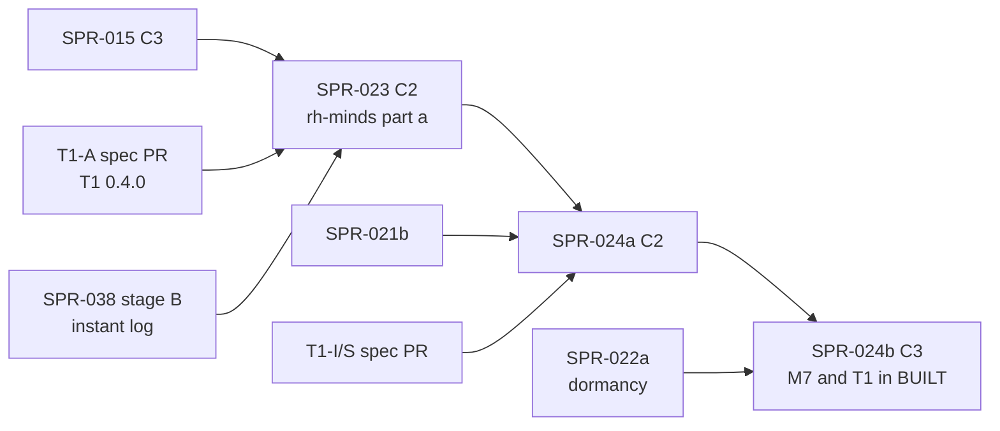

> **BLUF:** Builds the first slice of `T1.minds` in a new plane-A crate, `rh-minds`, against the **T1-A** spec (T1 0.4.0, a reviewed spec PR the Architect is commissioning; X7):
> - **the mind table**, keyed by a new column `mind.person`, appended in promotion order and read through the derived index; traits and ambition drawn once by `trait_draw`, kept through dormancy and reused on re-promotion (round 3 MAJ-9);
> - **promotion and demotion** by M7's `Promote` and `Demote` (M7 0.6.0's one-list criteria, D56). They are developed against a **stub M7 owner with a scripted `Promote` set** (X5; EVO-001 R12). **World start** has one route (X4): M7's dormancy pass sends `Promote` at tick 0, and genesis names only the manifest's cast;
> - **relations** (liege and vassal rows, refreshed monthly) and **opinion modifiers** (CK3 style: applied from commands, summed in `i64` and clamped on read, expired monthly), with thoughts and goals applied from stub S6/S7 senders;
> - **the death path through the instant log:** T1 consumes SPR-038 stage B's `StepCtx::exited()` (X1), so a quiet day start costs O(1);
> - **`DropReason::Deferred` and the timer-cancel counter consumed:** SPR-038 stage B adds them to `rh-core` with the generic `Ended` and their `05.1` sentence (round-2 ruling R14); this sprint uses them for a deferred `Demote` and for the timers `Demote` cancels (REV-MINDS M5, M6).
>
> **No baseline moves.** No golden world names `T1.minds` or `M7.dynasty`, and `BUILT` does not change here: M7 and T1 join the build together in SPR-024b (X6). So every ladder, header included, stays byte-identical. The class is **C2** under `docs/13` §4.2's rule for a system that no golden world registers (X12, a D58 director item); the PR proves it by its `systems` lines and `BUILT`.
>
> - **Developer:** AGT-002-CORE (`rh-minds`, `rh-registry`, `rh-contracts`), with AGT-002-TOOLS for the Registry loader, the gates and the reference port checks. One Developer session may hold both roles.
> - **Testers:** AGT-003-DET and AGT-003-IF. One session may hold both, on a different model from the Developer's.
> - **Size and class:** **about 4.75–5.25 agent-days** (X8; T-01 0.75, T-02 0.5, T-03 1.5, T-04 1.0, T-05 1.0–1.5). **One sprint with a hard checkpoint after T-03.** **C2.** The T1-A spec PR is counted separately, in PRJ-002 §6.
> - **Status:** PLANNING, revision 2, with the T1-A close's edits (0.3.1; REV-T1A F7: the opinion sum in `i64`, 26 reads, world start's order, the Demote rule's closed vocabulary, the trait draw, and the parts of T-01 that T1-A already did). REV-MINDS round 1 (M1–M11, Q1–Q3), the cross-plan rulings X1–X13 and the round-2 rulings R8, R9, R14 and R17 are applied. It needs T1-A merged and the director's plan approval (D59; GOV-005 §2).

# SPR-023 — Minds v0, part a: rh-minds, promotion, traits, relations, opinions (WP P3.2a, part a)

- **Roadmap item:** `docs/11` P3.2a (`docs/11_roadmap.md:183`), part a under PRJ-002 ruling M-3 (`PRJ-002_P1aPlan.md:182`) · **Phase / rung:** P1a. No rung: no golden world registers T1 before SPR-030.
- **Depends on (the precondition head; X9):**
  - **SPR-015 merged:** M2 0.3.0 frozen (`person.id`, `person.spouse` and `life_course.mother`/`father` live; T1's M2 reads, `T1.minds.odd.toml:589–638`, plus `person.id` per M1), `rh-contracts::m2` v0.1, and **the derived per-system index** (W4, `REV-WAVE5-plans.md:59`), which holds every lookup this sprint needs over T1's own columns. SPR-014 comes before it: same-instant delivery, the absent-owner rule (`T1.minds.odd.toml:576–588`), typed `[[applies]]` (`:526–574`) and the dead-person drop.
  - **The T1-A spec PR merged** (X7; specs table row 1): T1 0.4.0's A-steps, `person.id`, `mind.person`, world start by X4, the `rh-minds` pin in `bin/lint_arch.py`, and the exact reference `specs/minds/selftest_minds_v0.py` with its A-cases.
  - **SPR-038 stage B merged** (X1; R9, R14): the instant log with `StepCtx::inserted()` and `exited()`, ascending by `PersonId` across the whole instant (SPR-038's ruling T5, `SPR-038_PerInstantCost.md` T-07), and the `DropReason` changes: the generic `Ended` ("the timer's or command's premise no longer holds"), `Deferred`, the `cancelled{system, timer kind, reason}` counter and their `05.1` sentence.
  - **Not a dependency:**
    - SPR-017: no kinship walk is read in this part; SPR-024a is the first.
    - SPR-021 and SPR-022: the stub M7 stands in (X5).
    - SPR-019: the fixture court is scripted (`T1.minds.odd.toml:1029`).
    - SPR-020: this sprint emits no event.
- **Binding contracts:**
  - `specs/systems/T1.minds.odd.toml`, 0.3.3 and its 0.4.0 next version (promoted by T-01):
    - `[[owns]]` `:80–414`: this part writes `person.named`, `mind.*` (the stress and break columns' initial values only), `relation.*`, `opinion.*`, `thought.*` and `goal.*`;
    - `[[applies]]` `:526–574`, `[[reads]]` `:589–710` plus `person.id`, `[scales]` `:712–716`, `[[schedule]]` `:728–742`;
    - `[[rng]]` `trait_draw` `:749–752`, `[initialization]` `:803–805` as reconciled by X4, `[[params]]` `:811–874`;
    - the submodels `apply_commands`, `promote` and `expire` (`:885–892`, `:909–912`); INV-T1-05, 06 and 08 (`:931–946`); `[isolation]` (`:1023–1030`).
  - `specs/systems/M7.dynasty.odd.toml` 0.6.0 (SPR-021's promotion; until then the 0.5.0 draft in `next/`):
    - `Promote`, `Demote` and `OpinionModifier` to T1 (0.5.0 `:396–410`);
    - the `person.named` mode read, with `neutral = false` (`:522–527`);
    - the dormancy criteria (`:756–757`, amended at `:898–900`) and the T1 couplings (`:817–825`).
    The stub M7 implements the sender side of these and nothing else.
  - `05.1`: §2 rule 2 (delivery, absent owners, the dead-person drop; SPR-038's instant-log text; SPR-038b's `DropReason` sentence: the generic `Ended`, `Deferred`, the cancel counter; R14), rule 4, §4.2, §4.3 (`docs/05_architecture/05.1_simulation_core.md:175–195`), §6 items 2–3. `05.3` §2 (`05.3_cognition_epistemics_oracle.md:27–60`).
  - The Registry (`specs/manifest/registry_v0.toml`): `[systems."T1.minds"]` (`:121–141`, no `defaults`), `[relation_kinds]` (`:301–310`), `[opinion_modifiers]` (`:312–322`), `[overlay_traits]` (`:331–337`).
  - Code: `crates/rh-core/src/fixed/q.rs:103–104` (`Q16_16::narrow_saturating`, half to even); `crates/rh-sample/src/normal.rs:58`, `:73`; on SPR-014's branch, `system.rs:437–458` (`DropReason`), `:802–815` (`cancel`), `:820–828` (`own_timers`) and `world.rs:249–255` (`person_row` needs a declared `person.id` read).
  - ADRs: ADR-0002 (as amended by D59 item 4, X11), ADR-0006, ADR-0007 (mind rows are kept), ADR-0012, ADR-0024 (no pin sets `person.named`, `T1.minds.odd.toml:85`), ADR-0025, ADR-0033, **ADR-0034** (no model chooses anything: `docs/06_adr/ADR-0034-llm-roles-translate-describe-never-decide.md:31`), ADR-0035.
  - `docs/09`: V-COG-01 (`:281`), V-INV-04 (`:128`), V-INV-12 (`:136`, its T1 half), V-INV-15 (`:139`, the court subset), V-DET-01, V-DET-02, V-DET-05, V-DET-12, V-DET-19, V-PLN-01, V-INSP-03, V-INSP-05.
- **System spec:** T1 goes from frozen 0.3.3 to **frozen 0.4.0** in this PR (T-01), an Architect-approved C2 change carrying the T1-A text. The I- and S-steps are T1-I/S's: a `next/` draft after T-00a, promoted by SPR-024a (X7).
- **Rulings (binding):**
  - REV-P1a rounds 1–4 as T1's header records them (`T1.minds.odd.toml:7–40`): MAJ-5, MAJ-6, MAJ-9, and MIN-12 (`:75`), which is decided by D59 item 4;
  - EVO-001 R9 and R12;
  - REV-WAVE5 W1, W4, W31 and W42;
  - REV-WAVE6 X1, X4, X5, X7, V1, V2, V3 and Z1;
  - **REV-MINDS round 1** (the Architect's rulings of 2026-10-18: M1–M11, Q1–Q3, findings 3 and 13);
  - **the cross-plan rulings X1–X12 of 2026-10-18.** "X1"–"X12" below are the cross-plan rulings, not REV-WAVE6's: every REV-WAVE6 id in this plan is prefixed "REV-WAVE6".
- **Director items:** D59. X12, the class rule, is D58's.
- **Requirements covered:** COG-1 v0 (traits and opinions: V-COG-01); SIM-9's T1 half (promotion only by simulation criteria: V-INV-12); EVO-1 (single writer: V-INV-04); DET-2 (keyed RNG: `trait_draw`).

## Specs this sprint needs

| Spec | Exists? | Gap | Architect ruling | Needed by |
|---|---|---|---|---|
| **1. T1-A: the A-steps and the exact reference** | T1 0.3.3 is frozen (`T1.minds.odd.toml:46–48`) with prose `[[submodels]]` only (`:877–912`); no `[algorithm.*]` table; no `specs/minds/` directory | Every system built so far had both before its sprint (M2 F1, `selftest_m2_f1.py`; M1, `selftest_worldgen_lite.py`) | **Ruled (X7, REV-MINDS M3; 75%):** two reviewed spec PRs, each scheduled and counted in PRJ-002 §6. **T1-A** (0.4.0, before this sprint) holds the A-steps, `[[reads]] person.id` (row 2), `mind.person` (row 3), world start by X4 (row 7), the `lint_arch.py` pin (row 4), and `specs/minds/selftest_minds_v0.py` with its A-cases and `golden/minds_v0.txt`, its own `check_all` line, and a `--mutant` flag that renders every planted mutant of this plan with the probe that it changes a named line (REV-WAVE6 X4, V2). **T1-I/S** (the I- and S-steps) is a `next/` draft after T-00a, promoted by SPR-024a. The Architect commissions T1-A now; this plan does not write it | T-01 |
| **2. `person.id` is not read** (REV-MINDS M1) | T1 declares no `[[reads]] person.id` (`:589–710`); `person_row` needs it in the caller's `AccessSpec`, else `UndeclaredRead` (SPR-014 branch `world.rs:249–255`); SPR-021's F-5 is the same gap | Every person lookup of T1 fails | **Ruled (95%):** `[[reads]] person.id` (M2, `same_instant`, identity) in T1-A, with a registration test (T-03) | T-01, T-03 |
| **3. The mind table has no key** | `mind.*` (`T1.minds.odd.toml:87–199`): sixteen columns, no `mind.person` | Mind rows outlive the ledger row (`promote`, `:891`; ADR-0007), so they cannot be ledger-aligned; S7 reads `mind.conscientiousness` (`S7.vows.odd.toml:175–176`) | **Proposed (9/10), in T1-A:** `mind.person` (`u64`, plane A; a new column is additive under the next-version lint, `lint_odd.py:569–578`). **Rows are appended in promotion order and iterated through the derived index** (W4) in ascending `mind.person` (REV-MINDS M10); never removed | T-01, T-03 |
| **4. `rh-minds` and `lint_arch`** | `T1.minds.odd.toml:49` `crate = "rh-minds"`; `bin/lint_arch.py:674–675` makes only `rh-sys-*` kind "system"; a next version may not change `crate` (`lint_odd.py:561–562`) | A crate named `rh-minds` declared `("A", "system")` fails rule `metadata` | **Ruled (REV-MINDS finding 3; 70%):** `PINNED_LABELS["rh-minds"] = ("A", "system")` with a pinned-names clause in the naming rule, landed with T1-A (X7). **Done in T1-A:** the pin, and its two `check_all` controls (`tests/lint_fixtures/arch/relabelled_minds/`, a fixture declaring it `("A", "machinery")`, and `system_kind_unpinned/`) fail `metadata` by name. T-01 creates the crate the pin names | T-01 |
| **5. `bevy_ecs` or columns (MIN-12)** | `T1.minds.odd.toml:75`; ADR-0002 §2 puts T1 in a pinned `bevy_ecs` World behind `rh-minds` (`docs/06_adr/ADR-0002-state-model-ecs.md:16`); the same in `docs/07_technology_stack.md:28`, `docs/14_reuse_inventory.md:120, :149`, `05.0_overview.md:243` and `05.1` §5 (`05.1_simulation_core.md:211`) | The plane hash, keyframes, single-writer ownership, `AccessSpec`, lagged snapshots and the absent-owner rule all work on `WorldTables` columns; a World would need its own paths and a `plane-A-external` review (`lint_arch.py:189`) | **Ruled (X11; 80%): a director item, D59 item 4.** An **ADR-0002 §2 addendum** reads "P1a: named actors are columns behind `rh-minds`; `bevy_ecs` is revisited at P3.2b", and names the five doc lines above. This plan builds columns on that ruling. If it is declined, a plane-A `bevy_ecs` review and a World's hash and keyframe paths come first (about 2–3 agent-days) | T-01 |
| **6. The instant's dead** | Day/Vital "work only where M2's apply_death ran" (`T1.minds.odd.toml:732`); the dead are "persons with alive = 0 and death_tick = now" (`:879`) | Without an engine list, a scan of `person.alive` at every day start: O(persons) about 360 times a year (A-60) | **Ruled (X1; REV-MINDS M2; 70%):** consume SPR-038 stage B's **`StepCtx::exited()`**, part (b) of the engine-owned instant log: the persons whose `person.alive` went 1 → 0 at a merge of this instant, filled at the serial merges, read-only, cleared at the instant's end, outside every hash and keyframe. This plan builds no list; T-02 is a consumer test. `inserted()` has no consumer here | T-02, T-04 |
| **7. World-start naming and the cast's traits** | `[initialization]` (`T1.minds.odd.toml:804–805`): the cast and the members who meet M7's criteria are named at world creation; traits come from the cast entry "where given" | No manifest path gives traits (`CastMember.initial`, `specs/manifest/manifest_v0.py:256`; no HEXACO trait in `[attributes]`, `registry_v0.toml:525–560`). Two naming routes would draw under two keys | **Ruled (X4; 85%):** one route. Genesis names only the manifest's `cast` (`person.named`, under T1's `from_manifest`). M7's dormancy pass at tick 0's `Year/Polity` (SPR-022) sends `Promote` for the rest. **At t = 0's Day/Agenda T1 creates the cast's minds first (`world_start`), then those of M7's tick-0 `Promote`s (`promote`), each set in ascending `PersonId`** (T1-A A5), every trait drawn by `trait_draw` at t = 0 (no cast seeding in P1a). The cast stays named under M7 0.6.0's criterion (e) (T-00a), so M7 sends no `Demote` for a cast member; a `Demote` received for any named person is applied (A7), with no world-start special case (the T1-A review's F8). T1-A and M7's T-00a reconcile their `[initialization]` texts. Here the stub M7 sends the scripted t = 0 `Promote` set and no `Demote` for the cast | T-03 |
| **8. Deferred `Demote` and timer cancels** (REV-MINDS M5, M6) | "Demote{person}: deferred while break_state is pending or refractory" (`T1.minds.odd.toml:891`); `DropReason` has `DeadKey`, `Dead`, `Ended` and `AbsentOwner` only (SPR-014 `system.rs:437–458`); `cancel` counts nothing (`:802–815`); `own_timers` also returns `DEATH_DUE` and `MARRY_DUE` (`:820–828`) | A deferral has no reason code and no state; cancels leave no count; "cancel the actor's timers" would cancel decided outcomes (ADR-0025 item 1) | **Ruled (85%; R14: built once, by SPR-038 stage B):** this sprint consumes `DropReason::Deferred` (`"deferred"`) and the counter `cancelled{system, timer kind, reason}` with their `05.1` §2 rule 2 sentence (T-02 tests them). A `Demote` met while `break_state ≠ calm` is dropped as `Deferred`, and M7's yearly pass sends it again (`next/M7:579`). **`Demote` cancels every own timer of the person except `DEATH_DUE` and `MARRY_DUE`** (T1-A A7, a closed rule that names no kind T1-I/S has not yet defined; the T1-A review's F2), each through SPR-038b's `StepCtx::cancel_because(id, Ended)` and so counted under its kind; decided outcomes stand. `own_timers` is the agenda at the level's start, so a timer scheduled earlier in the same step is not cancelled: its fire revalidates `person.named` and drops as `ended`. The kind codes and purposes (poll, interrupt, break, refractory end) are T1-I/S's (SPR-024's row 11 (b)); in this sprint the rule and its test (with planted timers of six kinds, two of them `DEATH_DUE` and `MARRY_DUE`) exist | T-02, T-03 |
| **9. Liege and vassal rows are never refreshed** | `relation.ended_at`: "b died, or the liege structure changed" (`T1.minds.odd.toml:227`) | No step ends or adds a row when M7's titles change | **Proposed (7.5/10), in T1-A:** a `relations` step in Month/Agenda compares each named actor's open rows with what its lagged title and office reads imply, ends those that no longer hold and appends new ones (O(named + titles) a month). The death path ends rows with `b` dead at the death instant (row 6) | T-04 |
| **10. Month and opinion arithmetic** | `opinion.expires` (`T1.minds.odd.toml:270`); `opinion(a, b) = clamp(sum …, −100, 100)` (`:256`) on `q8_8` | Unequal months on a 365-day calendar; five −60 modifiers sum to −300, outside `q8_8` | **Settled by T1-A** (A0, A11): an opinion's month is `MONTH = Y / 12` minutes (`05.1` §4.4's `1mo`), and the Month pulse follows the calendar months; the sum in `i64` raw units (each magnitude at most 25,600), then clamped to −25,600..25,600 | T-04 |
| **11. Index freshness inside a binding** (REV-MINDS M7) | W4's hook applies a level's merged writes after the level (`SPR-015_BirthsF1.md:129–130`) | A step that appends an opinion row and then sums the pair's opinion in the same step reads a stale index | **Ruled (85%):** a step reads the index as of its start, plus a step-local overlay of the rows it appended itself (a scan of its own column past the index's covered length). The A-steps say so; a test appends and reads in one step | T-03, T-04 |
| **12. Registry typing (BCK-002 A-24, the minds part)** | `rh-registry` types none of T1's sections (`crates/rh-registry/src/lib.rs`); T1 has no Registry `defaults` (`registry_v0.toml:141`; M2's at `:33`) | The engine needs fixed-point tables, and T1's 16 parameters need a `WorldSpec` home | **Proposed (8/10):** `[relation_kinds]`, `[opinion_modifiers]` and `[overlay_traits]` typed in `rh-manifest` and compiled into `rh-registry` tables. `WorldSpec.minds` is compiled when T1 is in the caller's built list, with **no defaults in this sprint**: SPR-011 ruling 8 refuses a built system's missing parameter by name (`registry_v0.toml:26–31`), and `twin_vales.yaml:20–23` sets all sixteen. **T1-I/S then gives the sixteen parameters `default`s** through `specs/systems/next/registry_delta.toml` (M2's mechanism), and SPR-024a T-01 moves them into the Registry, so `manor.yaml` compiles with T1 built and is not edited (round-2 ruling R8) | T-01 |
| **13. Where the invariants run** (REV-WAVE6 X1) | INV-T1-05 and 06 cover every mind and opinion (`T1.minds.odd.toml:931–938`); `check_invariants` runs at every instant's Bookkeeping (SPR-014 `engine.rs:929–932`) | O(minds + opinions) per instant | **Ruled by REV-WAVE6 X1:** `invariants()` is O(1) (column lengths). The step asserts INV-T1-05 on each row it creates and INV-T1-06's clamp on each sum it computes. Both run in full as test observers at month ends and at the run's end. Each `statement` states its cadence; `test` keeps its V-id (V3) | T-03, T-04 |
| **14. Reading M7's columns before `rh-contracts::m7`** | `rh-contracts::m7` is SPR-021 T-02's (REV-MINDS Q1); this sprint does not follow SPR-021 (X9) | The stub owns M7's columns, but no typed accessor exists | **Proposed (8/10):** T1 reads the thirteen M7 columns (with `title.id`, T1-A) by name through `SystemView` with their declared lags, as SPR-015 reads T1's `person.named` before `rh-contracts::t1` exists (`SPR-015_BirthsF1.md:81`). SPR-024a switches them to `rh-contracts::m7`, with a consumer test | T-03, T-04 |
| **15. The class** | PRJ-002 classed SPR-023 C3 (`PRJ-002_P1aPlan.md:44`) | No golden world names T1, and `BUILT` (`crates/rh-golden/src/world.rs:46`) does not change | **Ruled (X6, X12; 80%):** **C2**. The PR shows that the four worlds' `systems` lines (`worlds/*/baselines/*.ladder`) and `BUILT` do not change. The court's measured rates go to the director at the merge (X12) | T-05 |

## Compliance (every task)

| Rule | This sprint |
|---|---|
| Change class (`docs/13` §4.2) | **C2** (X6, X12). What changes: the T1 0.4.0 freeze, the Registry typing and `WorldSpec.minds` and `rh-contracts::t1` v0. `rh-core` is not changed: `DropReason` and the cancel counter are SPR-038b's (R14). `state_hash` is unchanged on all four golden worlds; no baseline, snapshot or budget moves. PR title `SPR-023: … [C2]` |
| Planes touched (ADR-0024) | **A:** `rh-minds` (new, pinned `("A", "system")`), `rh-registry`, `rh-contracts` (`t1`). **Tool:** `rh-manifest`, `specs/` (the promotion), `bin/check_all.sh`. **B, C:** none |
| Owned columns written | `T1.minds`: `person.named` (by `Promote`, `Demote` and the cast only); `mind.person` and the six traits and ambition (once, at creation); the stress, accounting and break columns (initial values only); `relation.*`, `opinion.*`, `thought.*`, `goal.*`. Not `feud.*` (SPR-024b), `due.*` (SPR-024a) or `knowledge.*` (P1b) |
| Reads | M2, `same_instant` identity, through `rh-contracts::m2`: `person.id` (M1), `alive`, `death_tick`, `birth_tick`, `sex`, `mother`, `father`, `spouse`, `life_course.person_id`, `mother`, `father`. M7, lagged identity, by name (row 14): the twelve columns of `T1.minds.odd.toml:640–698` and `title.id` (T1-A), 26 reads in all. S7's `vow.conflict` and S6's `artifact.rumour_reach`: rate reads, dropped, neutral. **The engine's `StepCtx::exited()`** (X1(b)). Registration refuses T1 without M2 or M7 |
| RNG purposes | All nine skeleton purposes are declared (rule `rng-purpose`); this sprint **draws only `trait_draw`**: entity the person, k = 0..6, t the creation instant, **one `StepCtx::rng` draw per k, its four 16-bit fields summed and scaled exactly to sd `trait_sd`: Irwin–Hall(4), bounded at ±3.46 sd** (T1-A A3 and its `[[amends]]` reason; the T1-A review's F6: seven streams of one pair are `StreamReuse`, and seven `Normal::sample` calls on one stream break `05.1` §6 item 3's letter). No `rh-sample` call. Ambition's mean is 50 (`constants.ambition_mean`). Not re-sampled on a fork |
| Golden-hash effect | **None:** four ladders byte-identical, headers included (T-05) |
| Fixed-point quantities | Traits in `q8_8` by one rounding half to even of an exact `i64` quotient, then clamped (A3); closeness and magnitudes `Q8_8` from exact decimals (SPR-011 ruling 9); opinion sums in `i64` raw units (A11). No float, in `rh-minds` or `rh-sample` |
| Determinism lints (GOV-003 §2, §6) | Must pass. No `HashMap`; iteration in ascending `PersonId` through the index; no interior mutability (W31); `rh-minds` depends only on `SYSTEM_ALLOWED_DEPS` and contract crates (`lint_arch.py:115`); engine purity, with no LLM client (ADR-0034; V-INSP-05) |
| Per-instant cost (REV-WAVE6 X1; A-60) | Day/Vital and Day/Agenda are **O(1) when idle** (an empty `exited()`, an empty inbox, no due timer) and O(exits + commands) otherwise. Month/Agenda is O(named + opinions + thoughts + titles) **once a month**. `invariants()` is O(1). Lagged clones: once T1 is live, M2's and M7's lagged reads of `person.named` are cloned per instant (SPR-014 `engine.rs:863–868`; SPR-038 refreshes them only after a write), plus T1's thirteen lagged M7 reads. Counted, no budget moves (REV-WAVE6 X7) |
| Tests that gate this sprint | V-COG-01, V-INV-04, V-INV-12 (the T1 half), V-INV-15 (the court subset), V-DET-01, V-DET-02, V-DET-05 and V-DET-12 on the fixture court, V-DET-19, V-PLN-01, V-INSP-03, V-INSP-05, V-GOLD-01 (four ladders unchanged), plus `bin/check_all.sh` |
| Docs updated in the same sprint | `bin/check_all.sh` and `python/tests/test_check_all_inventory.py` (same commit); `CLAUDE.md`; `specs/systems/next/README.md`; `05.0` §6 (`rh-minds` built); `docs/09` V-COG-01, V-INV-12 method lines; `specs/README.md`; PRJ-002's row; BCK-002 A-24 (the minds part, partly done). The ADR-0002 addendum and its five doc lines are the Architect's, on D59 item 4 |

**Rules carried from P0–SPR-019 (every task):**
- **Property tests vary world size and seed:** three court sizes (6, 60, 600 named actors) and eight seeds, fixed-seed SplitMix64. The 600 size runs nightly (W42).
- **A positive control fails for the right reason:** its `check_all` line matches the message. Every mutant fails a named golden line, shown on the T1-A reference first (REV-WAVE6 X4, V2).
- **A test input exercises the path it claims, and a probe asserts it:** a re-promoted person really had a kept mind; a `Demote` really met a non-calm state; an opinion really crossed its expiry; an `exited()` list really held a person with open relation rows; an overlay row really was read in its own step.
- **Python tests read no CI environment variable. No statistical gate in this sprint.**
- **Nothing per instant is O(rows) or O(minds).**
- **CI (X10):** PR #89 (A-63) is assumed merged; the gates are listed by role and part in T-05, budgeted by gate sums on one runner ×1.5.
- **Merge `origin/main` when main moves.** Every new gate goes in exactly one part, with the inventory test updated in the same commit. Mutants are `mutant-*` features (A-52). One commit per task.

## Tasks

A **hard checkpoint** follows T-03: the Tester's interim pass (`VER-SPR-023-TEST`, phase 1) on the promotion, the core additions and the mind table is required before T-04 lands.

#### T-01: The promotion of T1 0.4.0, the Registry typing, `WorldSpec.minds`, the crate (Architect with the Developer; C2; rows 1–5, 12; W1)
- **Deliverable:**
  - **The promotion.** `specs/systems/next/T1.minds.odd.toml` 0.4.0 (T1-A) moves over the frozen file with `status = "frozen"`. `amendments.lock.toml` is regenerated by the tool, never typed.
  - **The promotion checklist**, each item a deliverable and an acceptance line:
    - (a) `bin/check_all.sh`'s `odd_next_control clean`, version-agnostic since T1-A (it rewrites `spec_version` to 99.0.0; the T1-A review's N6), renders from the frozen 0.4.0 file, and its pinned line ("39 planted changes rejected") is re-derived by running it;
    - (b) `lint_odd.py` passes in frozen mode, and `--next` passes on `next/`'s contents;
    - (c) S7's and S6's draft reads of T1 columns still resolve (`S7.vows.odd.toml:170–176`; `S6.artifacts.odd.toml:197–198`);
    - (d) `lint_templates.py` and `selftest_annals_v0.py --check` pass;
    - (e) the T1 skeleton is regenerated;
    - (f) **done in T1-A:** `selftest_minds_v0.py --check`, its stale-golden control and `minds_stale_control` are in part core with their `CLAUDE.md` line. **At the promotion:** `minds_stale_control` (which plants its stale check value in `specs/systems/next/T1.minds.odd.toml`) and the selftest's spec path point at the promoted spec (`specs/systems/next/README.md` checklist (e)); the selftest's `CLAUDE.md` line drops "specs/systems/next while it is a draft", and the `--next` line drops the T1 draft.
  - **The Registry (row 12):** the three sections typed, with their refusals, and `WorldSpec.minds`.
  - **The crate:** `crates/rh-minds` with `[package.metadata.rehoboam]` A/system; the skeleton included as `crates/rh-sys-demography/src/demography.rs:40` does. The pin and its control fixtures are T1-A's (row 4).
- **Acceptance:**
  - (a)–(f) are each green and named in the PR body.
  - `twin_vales.yaml` compiles with a built list that includes `M7.dynasty` and `T1.minds` (`rh_manifest::compile` takes the list, `crates/rh-golden/src/world.rs:204`), and a copy without `grief_gain` is refused, naming it.
  - Each typed section has one planted refusal that fails by name, and a bit-equal round trip.
  - `lint_arch` is green with the real `crates/rh-minds`; T1-A's two fixtures still fail `metadata`.
  - The four golden ladders are unchanged.
- **Status:** [ ] not started

#### T-02: The instant log and the drop reasons consumed (rows 6, 8; X1; R9, R14; REV-MINDS M2, M5)
- **Deliverable:**
  - **Consumer tests of SPR-038b's `DropReason::Deferred` and `cancelled{…}` counter** from `rh-minds` (no `rh-core` change here; R14).
  - **A consumer test of `StepCtx::exited()`.** On M2 0.3.0 worlds, a T1 Day/Vital step after M2's level reads `exited()` and checks it against a brute-force scan. Natural deaths, a commanded death through M2's drain, and two deaths at one day start.
- **Acceptance:**
  - `exited()` equals the scan **as a sorted set**, and is ascending by `PersonId` across the whole instant (SPR-038's ruling T5; R9), at every Day/Vital of three sizes and eight seeds; T1 does not sort it.
  - A planted `Deferred` drop and planted cancels of four own-timer kinds each show up in SPR-038b's counters; planted `DEATH_DUE` and `MARRY_DUE` timers survive a `Demote`.
  - The counters change no hash: the four ladders are byte-identical at 1 and N threads.
  - The probe counts T1's visited rows at a death instant: they equal the instant's exits.
- **Status:** [ ] not started

#### T-03: `rh-minds`: the mind table, world start, `Promote` and `Demote`, the trait draw, the indexes, the contract (the checkpoint; rows 2, 3, 7, 8, 11, 13, 14; MAJ-9)
- **Deliverable:**
  - **Declarations:** `AccessSpec` with every 0.4.0 `[[owns]]`, the 26 `[[reads]]` (with `person.id` and `title.id`), the three bindings, the nine purposes, the `[[commands]]`, and the `DRAINS` of the seven `[[applies]]`.
  - **The mind table** (row 3): `create_mind` draws traits and ambition by `trait_draw`, starts stress and the accounting columns at 0, and sets `calm`.
  - **World start** (row 7): at t = 0's Day/Agenda, `world_start` creates a mind for each cast member, then `promote` one for each person `Promote`d at t = 0, each set in ascending `PersonId` (A5).
  - **`promote`:** `Promote` sets `person.named` and creates or reuses the mind; it builds liege and vassal rows (T-04's builder). `Demote` clears `person.named`, goals and thoughts, keeps every row, and cancels every own timer of the actor except its `DEATH_DUE` and `MARRY_DUE` by `cancel_because(id, Ended)` (row 8, A7; counted per kind). When `break_state ≠ calm`, it is dropped as `Deferred`.
  - **Derived indexes (W4):**
    - the maps: person → mind row; (holder, about) → opinion rows; `b` → open relation rows; holder → thought and goal rows;
    - the step-local overlay rule (row 11);
    - the W4 rebuild invariant at keyframes and at the run's end.
  - **`rh-contracts::t1` v0**, with its drift test. M7's columns are read by name (row 14).
  - **`invariants()` O(1)** (row 13).
  - **Mutants:** `mutant-trait-k-swap`, `mutant-repromote-redraw`.
- **Acceptance:**
  - **Bit-equality** with T1-A's A-cases (traits, ambition, re-promotion, world start with a cast and a `Promote` set), in debug and release.
  - **Mutants:** `mutant-trait-k-swap` fails every case's `traits` line; `mutant-repromote-redraw` fails the re-promotion line and the INV-T1-05 observer.
  - **Registration (V-INV-04):**
    - T1 registers in `{M2, M7-stub, T1}` and is refused in `{M2, T1}`, naming M7;
    - its S6 and S7 reads are dropped with their neutrals, and its sends to M4, S6 and S7 are dropped;
    - an `AccessSpec` without `person.id` fails `spec` by name, as does one without `mind.person`;
    - a purpose `trait_draw2` fails `rng-purpose`.
  - **V-INV-12 (the T1 half):** `person.named` changes only by `Promote`, `Demote` or the cast. A probe asserts that a re-promotion and a `Deferred` drop (planted state) occurred.
  - **The overlay (row 11):** a step that appends an opinion row and sums the pair in the same step sees its own row.
  - **V-DET-05, V-DET-01/02:** minds and indexes survive a keyframe; the court is equal at 1, 2, 4 and N threads.
  - **Checkpoint.** The Tester's interim pass is recorded before T-04 lands.
- **Status:** [ ] not started

#### T-04: Relations, opinions, thoughts and goals (rows 9, 10, 11; `apply_commands`, `expire`; V-COG-01)
- **Deliverable:**
  - **Relations:** the builder at promotion, the Month/Agenda `relations` refresh (row 9), and the Day/Vital death path over `exited()`.
  - **Opinions:** `OpinionModifier` appends a row with its expiry (row 10). `opinion(a, b)` is summed in `i64` and clamped. `expire` runs in Month/Agenda.
  - **Thoughts and goals:** `AgendaGoal` and `ClearGoal`; `ApplyThought` and `ApplyInfluence` saturating at `thought_cap`; monthly decay. Stub S6 and S7 senders.
  - **Mutants:** `mutant-opinion-no-expiry`, `mutant-relation-not-ended`.
- **Acceptance:**
  - **Bit-equality** with the A-cases for relations (a regrant, a deposition, a liege's death), opinions (a 120-month `CLAIM_PRESSED_BY` expiring inside the case) and thoughts.
  - Each mutant fails its case's named line.
  - **V-COG-01:** five −60 modifiers on one pair stay at −100; an expired modifier never counts (three sizes, eight seeds); thoughts stay in [0, `thought_cap`].
  - **V-INV-15 (the court subset):** a `living`-keyed command for a dead person is dropped (`dead_key`); `ClearGoal` for a dead holder is applied.
  - **Cost:** idle bindings visit no row (a probe); the rows the Month refresh visits are reported.
- **Status:** [ ] not started

#### T-05: The stub M7 and the fixture court, the C2 record, the cost record and CI (X5, X10, X12; REV-MINDS M9)
- **Deliverable:**
  - **The stub M7 owner** (test-only; SPR-014 T-04's technique). It owns the columns T1 reads and declares the four `[[applies]]` T1 sends, which it drops. It scripts titles, offices, claims, houses, **the t = 0 `Promote` set** (X5), and later `Promote`, `Demote` and `OpinionModifier` commands.
  - **The isolation fixture court** (`T1.minds.odd.toml:1029`): 60 named actors in 3 houses; 6- and 600-actor variants.
  - **The C2 record** (PR body and `VER-SPR-023`):
    - the four ladders, the three manifest worlds' channel-A segments and the tail snapshots are byte-identical to `main`'s;
    - the `systems` lines and `BUILT` are unchanged (X12);
    - the court's measured rates (promotions, demotions, opinion rows a year) for the director.
  - **The per-instant cost record** (A-60), with T1 registered and without.
  - **The gates, by role and part** (X10; costs are estimates on one runner, measured at T-05):

    | Gate | Role | Part | Profile, horizon | Est. |
    |---|---|---|---|---|
    | `selftest_minds_v0.py --check` and its stale control | spec reference | core | Python | 3 s |
    | `rh-minds` unit tests: registration, A-cases, overlay, typed sections, drift, the `lint_arch` fixture | by-name tests | core | debug, no run longer than a year | 4 s plus the crate's build |
    | Core counters and the `exited()` consumer test | by-name tests | core | debug, 50 years at 60 founders | 3 s |
    | The court's mutant cases (one mutant rebuilt) | mutants | core | debug | 25 s |
    | The court at 200 years, thread invariance at 1 and N, keyframe | release system gate | golden | release, 200 years | 12 s |
    | The court at 1,000 years, 600 actors, the other mutants, 2 and 4 threads | soak | nightly | release | — |

  - **The inventory test**, in the same commit.
- **Acceptance:**
  - **Hash-neutral, robust form:** every root, header line and channel-A record of every golden world is byte-identical to `main`'s. This holds for a correct build: no golden world names T1, and `BUILT` does not change.
  - **CI:** about **+35 s** core and **+12 s** golden by gate sums, plus `rh-minds`'s build; budgets **+60 s** and **+20 s** (×1.5). Part stream: no change. **Nightly candidates:** the debug mutant case (to nightly) and the N-thread repeat (to nightly, keeping 1 thread).
- **Status:** [ ] not started

## Director items, and what changes under the alternative

| Item | Planned | Under the alternative |
|---|---|---|
| **Size: about 4.75–5.25 agent-days, one sprint** (X8; D59 item 1; 65%) | One C2 PR with a hard checkpoint after T-03 | A split at the checkpoint: two Tester passes and two audits, for no schedule gain |
| **The T1-A spec PR first** (X7; D59 item 2; 75%) | Reviewed, then promoted here | The A-steps land in this PR: no review before the code, and no reference for the Tester |
| **C2** (X6, X12; D59 item 3; 80%) | Merged in any gap of the C3 slot; the rates are reported at the merge | C3: a slot taken for a change that moves nothing |
| **ADR-0002 §2 addendum: columns, not `bevy_ecs`, in P1a** (X11; D59 item 4; 80%) | Columns in `WorldTables`; the addendum names `docs/07:28`, `docs/14:120, :149`, `05.0:243` and `05.1` §5 | A plane-A `bevy_ecs` review, and a World with its own hash and keyframe paths: about 2–3 agent-days before this sprint |

## Out of scope (explicit)
- **Decisions** (SPR-024a/b): polls, interrupts, IAUS, the `due` table, `feud.*`, every T1 event. T1 in `BUILT` (SPR-024b).
- **Stress, grief and breaks** (SPR-025); `knowledge.*`, vows and artifacts (P1b).
- **The real M7, its dormancy pass and its contracts** (SPR-021, SPR-022); the back-fill (SPR-019b); the T1-A text itself (the Architect's commission).
- **Seeding traits from a manifest; a `bevy_ecs` World.**

## Verification assignment (Testers)

| Tester | What to verify, from which contract | Report |
|---|---|---|
| AGT-003-DET | T-02 to T-05, written from T1-A's A-steps, `05.1` §4.3 and ADR-0006 before reading the code:<ul><li>**the checkpoint pass:** their own re-implementation of the trait draw, world start (cast plus `Promote` set), promotion and re-promotion, against the engine on the fixture court;</li><li>`exited()` against their own brute-force scan, with a commanded death;</li><li>the four mutants killed for their reasons, plus three of their own: a trait clamped before rounding, an opinion summed in `q8_8`, a relation ended at the Month refresh instead of the death instant;</li><li>the overlay rule;</li><li>keyframe round trips; thread invariance; the hash-neutral record;</li><li>the idle-binding probes</li></ul> | `VER-SPR-023-TEST` (phase 1 at the checkpoint, phase 2 at the end) |
| AGT-003-IF | T-01 to T-04, written from the 0.4.0 text, the Registry, `05.1` §2 rule 2 and the drift contract:<ul><li>the promotion checklist on a copy, before T-01 is pushed;</li><li>registration with their own planted mismatches (`person.id`, `mind.person`) and absent owners;</li><li>`Deferred` and the cancel counter;</li><li>the typed sections' refusals;</li><li>`rh-contracts::t1`, with a consumer test of their own</li></ul> | As above |

## Merge route

- **Class and conditions.** C2: merged by the Architect after the Tester passes and the audit. The C2 record and the reported rates are the evidence (X12). PR title `[C2]`.
- **Order (X9; 65%):**

  - **After SPR-015, T1-A and SPR-038 stage B.** Independent of SPR-021 and SPR-022: the stub M7 stands in, and M7's columns are read by name (row 14).
- **Shared files.** `bin/check_all.sh`, the inventory test, `CLAUDE.md`, `crates/rh-contracts`, `crates/rh-registry` and `rh-manifest` (with SPR-017 and SPR-021).
- **Re-verified after merging `origin/main`:** all three parts; the promotion checklist against `next/`; the hash-neutral record.

## Risks

| # | Risk | Likelihood / impact | Mitigation |
|---|---|---|---|
| 1 | T1-A's review runs long | Medium / delays the minds lane, not the critical path | Commissioned now, in parallel with T-00a (X7) |
| 2 | The stub M7 drifts from M7 0.6.0's sends | Medium / SPR-024's integration finds mismatches | The stub sends only what `next/M7:396–410` declares. SPR-024a reads through `rh-contracts::m7`; SPR-024b replaces the stub with the real M7 |
| 3 | Once T1 is registered, the named never marry through M2 (`next/M2.demography.odd.toml:365–371`, `:639–640`) until SPR-024b's `marry` | Certain / none on the goldens | T1 joins `BUILT` only with `marry` (X6) |
| 4 | Lagged clones of `person.named` | Certain / cost on dynastic worlds | Counted; SPR-038 refreshes the snapshot only after a write |

## Blockers

| # | Blocker | Status |
|---|---|---|
| 1 | SPR-015 merged | Open (wave 5) |
| 2 | T1-A (row 1) | Open: commissioned by the Architect |
| 3 | SPR-038 stage B (`exited()`, ascending across the instant; `Deferred`, the generic `Ended`, `cancel_because` and `cancelled{…}`; R9, R14) | Open |
| 4 | The director's plan approval (D59), and the ADR-0002 addendum (D59 item 4) | Open |

## Completion

- [ ] Every task meets its acceptance criteria; the checkpoint was held before T-04 landed.
- [ ] `bin/check_all.sh` passes, with each part's time in the report.
- [ ] Tester verdicts PASS (DET, IF); the Architect's audit `VER-SPR-023` PASS with the C2 record, the reported rates and the cost record.
- [ ] No open DEF-; the CI-detected class is C2.
- [ ] T1 0.4.0 is frozen on `main`; `rh-minds` is pinned `("A", "system")`; `Deferred` and the cancel counter (SPR-038b's) are consumed and tested.
