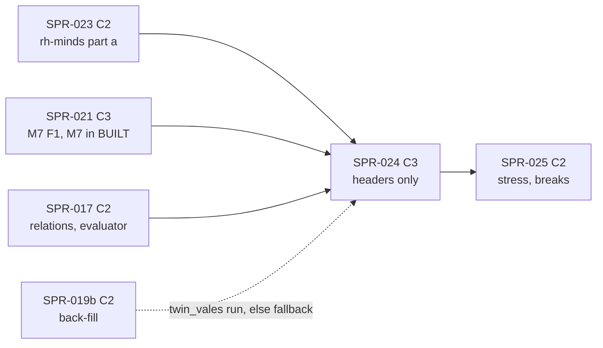

> **BLUF:** Builds the decision half of `T1.minds` 0.4.0 (frozen by SPR-023) in `rh-minds`:
> - **the Registry's typed `[decision_types]`, `[considerations]` and `[response_curves]`** (REV-P1a MAJ-6) as fixed-point tables, with the considerations a closed set of code-implemented inputs;
> - **event-driven IAUS** (`05.3` §3): polls by `poll_jitter`, interrupts at t + 1 day or later under the daily cap, the product of `Q16_16` curves with the compensation, the idle score, a keyed top-k weighted pick;
> - **same-instant semantics** (`05.1` §4.3): every due decision scored against one snapshot, actions applied in the keyed `action_order` permutation, invalidated actors re-scored once, then deferred; V-COG-03 and V-COG-04 (both gate G1a);
> - **four decision types:** `marry` (a `MARRY_DUE` timer that submits `Marry` to M2), `seek_office` (`PetitionSeat`), `press_claim` (`PressClaim`) and `feud` (declare, attack and reconcile: `FEUD_DECLARED`, `MURDER_ATTEMPT` with `attack_outcome` and a `DEATH_DUE` timer, `FEUD_ENDED`), with their `motivated_by` edges and the `stress(actor)` snapshot (`envelope_v0.md:86–88`);
> - **T1 joins the build** (`rh-golden`'s `BUILT`), with M7 built by SPR-021, so a dynastic world runs M2, M7 and T1 together, and the named marry.
>
> **One golden effect, headers only.** No golden world names `T1.minds`, so every `state_hash` root of `smoke`, `solo`, `household` and `hamlet` is unchanged; adding T1 to `BUILT` changes `engine_build` in the three manifest worlds' `tuple` lines and channel-A segment headers (`crates/rh-golden/src/world.rs:256–260`, `:366–367`), and `registry_version` moves with this sprint's Registry change. `bin/check_baseline.py`'s C3 rule (`:10–12`) therefore makes the PR **C3**, re-recorded in the final `[C3]` commit by `bin/regen_baseline.sh` and announced to the director.
>
> - **Developer:** AGT-002-CORE, with AGT-002-TOOLS for the Registry loader, the reference port checks and the gates (one Developer session may hold both roles).
> - **Testers:** AGT-003-DET, AGT-003-IF, and AGT-003-STAT for V-COG-04's equivalence test (one session may hold DET and IF, on a different model from the Developer's).
> - **Size and class:** **about 4.5 agent-days** (T-01 0.75, T-02 1.25, T-03 1.25, T-04 0.5, T-05 0.75), as **one sprint with a hard checkpoint after T-02** (the Tester's interim pass on the IAUS core and the same-instant semantics, on a test-only decision type, before the four real types land). **C3** by the baseline rule (headers only), containing C2: the Registry typing, `rh-contracts`, the `due.*` table.
> - **Status:** PLANNING, revision 0. It needs SPR-023 and SPR-021 merged and the director's plan approval (D59; GOV-005 §2).

# SPR-024 — Minds v0, part b: IAUS, same-instant semantics, four decisions (WP P3.2a, part b)

- **Roadmap item:** `docs/11` P3.2a (`docs/11_roadmap.md:183`), part b by PRJ-002 ruling M-3 · **Phase / rung:** P1a; the dynastic fixture worlds (no golden one before SPR-030).
- **Depends on (the precondition head):**
  - **SPR-023 merged:** T1 0.4.0 frozen with the I-steps of `[algorithm.minds_f1]` and the exact reference's I-cases; `rh-minds` with the mind table, promotion, relations, opinions; the instant's exits read; `rh-contracts::t1`.
  - **SPR-021 merged:** the real M7 (titles, offices, claims, houses, `Promote`/`Demote`/`OpinionModifier`, the `[[applies]]` of `PressClaim`, `PetitionSeat`, `RenounceClaim`, `Resign`; `next/M7.dynasty.odd.toml:396–447`), M7 in `BUILT`; the court sets need titles (REV-P1a MAJ-7, `PRJ-002_P1aPlan.md:45`).
  - **SPR-017 merged:** the effect language's relation code in `rh-registry` (`kin`, `related`, `titles`, `offices`, `court`, `claims_of`; `specs/registry/effect_language_v0.md:240–270`), used for candidate sets and `kin_distance_to_granter`.
  - **SPR-020 merged:** the checked `emit` with roles, the `stress` snapshot and `motivated_by` edges with weight and evidence (`envelope_v0.md:107–129`).
  - **SPR-019 stage B (the dynastic back-fill) for T-05's `twin_vales` run; fallback** if it is not on `main` at T-05: the integration runs on SPR-021's own dynastic test world, and the `twin_vales` run moves to SPR-025's T-05.
- **Binding contracts:**
  - `specs/systems/T1.minds.odd.toml` 0.4.0: the `decide` submodel (0.3.3 `:901–904`, as amended), `[[emits]]` `MURDER_ATTEMPT`, `FEUD_DECLARED`, `FEUD_ENDED` (`:423–457`), `[[commands]]` `Marry`, `ScheduleDeath`, `PetitionSeat`, `PressClaim` (`:460–488`), `[[rng]]` `poll_jitter`, `iaus_select`, `action_order`, `attack_outcome`, `outcome_delay` (`:753–785`), INV-T1-07, 08, 09 (`:939–950`), the Day/Vital `outcome_due` step (`:731`), the I-steps and the `due.*` table of 0.4.0.
  - The Registry: `[decision_types]` (`specs/manifest/registry_v0.toml:339–350`), `[considerations]` (`:352–375`), `[response_curves]` (`:377–417`), `[opinion_modifiers]` (`:312–322`), the T1 verbs (`:608–614`).
  - `05.1` §4.3 (`docs/05_architecture/05.1_simulation_core.md:175–195`; the same-instant items `:186–193`), §2 rules 2 and 4; `05.3` §3 (`05.3_cognition_epistemics_oracle.md:62–72`); `specs/chronicle/envelope_v0.md` §3 (`:85–88`), §5 (`:107–129`); `specs/registry/effect_language_v0.md` §5.3, §6, §9; `specs/systems/next/M2.demography.odd.toml` N7 as frozen in 0.3.x (`:643`).
  - ADR-0006, ADR-0012, ADR-0024, ADR-0025 (outcomes are timers: `MARRY_DUE`, `DEATH_DUE`), ADR-0033, **ADR-0034** (rule-based IAUS; no model chooses: `ADR-0034:31`), ADR-0035; `docs/09` V-COG-03 (`:283`), V-COG-04 (`:284`; the agenda-fairness band `:90`), V-COG-10 (`:290`), V-INV-03 (P1a variant: deaths through agenda actions), V-INV-04, V-INV-15, V-DET-01, V-DET-02, V-DET-05, V-DET-12, V-DET-14, V-GOLD-01.
- **System spec:** T1 stays at 0.4.0; a text erratum found in the sprint bumps it in place (0.4.1), as SPR-016 bumps M2 to 0.3.1.
- **Rulings (binding):** REV-P1a MAJ-4 (outcomes at the next day start), MAJ-6, MAJ-7; EVO-001 R9 (a command carries no date; outcomes are the sender's timers), R12; REV-SPR-017's rulings on commands without a date and on Q8 (`CODEX/05_PROJECT/SPR-017_EffectLanguage.md:69`, `:78`); REV-WAVE5 W2, W3, W42; REV-WAVE6 X1, X4, X5, V1, V2, V3, Z1; SPR-023's rulings.
- **Director items:** D59.
- **Requirements covered:** COG-3 v0 (IAUS cadence: V-COG-03, V-COG-10), SIM-7 (agenda and same-instant semantics: V-COG-03, V-COG-04), DET-13 (outcomes as timers, no back-dating), DET-2 (five purposes drawn).

## Specs this sprint needs

| Spec | Exists? | Gap | Architect ruling | Needed by |
|---|---|---|---|---|
| **1. The I-steps** | In T1 0.4.0's `[algorithm.minds_f1]` and `specs/minds/selftest_minds_v0.py` (SPR-023's spec PR, row 1) | — | As SPR-023's: the reference's I-cases are the golden; every mutant below is shown on it first (X4, V2) | T-02 |
| **2. The considerations are prose** | `[considerations]` inputs are text: `"(now - birth_tick(actor)) / minutes_per_year"`, `"max tier of a title held by target or target's father (0 none, 1 minor, 2 major, 3 sovereign)"` (`registry_v0.toml:355`, `:357`) | ADR-0010: no free-string semantics. The loader cannot evaluate prose, and `target_reachable` reads `artifact.location` and `artifact.bearer` (`:375`), which T1 does not declare (P1b) | **Proposed (7.5/10):** a consideration is a **closed, code-implemented input keyed by its id** (the effect language's `needs_code` model for relations, `effect_language_v0.md:234`): the loader refuses an unknown id, types `domain` (`Q16_16` pair), `unit` (an enum) and `reads` (column names); `lint_odd.py`'s T1 check requires each consideration's `reads` to be declared by T1 (`[[reads]]` or `[[owns]]`) for every decision type whose `requires` names only frozen specs, and warns for the others (`pursue_goal`, P1b). Alternative: a `consideration` program kind in the effect language (a language change, v0.2) | T-01 |
| **3. The curves and decision types, typed** | Knots "every value a dyadic rational exactly representable in Q16_16" (`registry_v0.toml:377–379`); `requires` gates a type, `available_from` is informational (`registry_v0.toml:341–342`) | No loader checks either | **Proposed (8.5/10):** refused by name: knots not ascending in x; y outside [0, 1]; a value not exact in `Q16_16`; a (type, consideration) without its curve or a curve without its consideration; `poll_months` outside 1..12; `idle_score` outside [0, 1]; a `requires` id not a Registry system. Interpolation: linear between knots, clamped at the ends, **rounded down** in `Q16_16` (`:377–379`); the product and the compensation `s + (1 − s)(1 − 1/n)s` (`T1.minds.odd.toml:903`) rounded down at each multiply, in the I-steps' stated order | T-01 |
| **4. Polls and interrupts cannot be decided inside the timer pass** | Polls and interrupts are T1 timers; `rh-core` calls `fire` once per due timer, in key order, on one `SystemView` (SPR-014 branch `engine.rs:1262–1264`), and the timer pass precedes every binding of the phase (`:925–929`) | `05.1` §4.3 scores every due decision against one snapshot and applies them in a keyed permutation (`05.1:186–193`); deciding inside `fire` would apply them in key (entity id) order, the bias V-COG-04 forbids. T1's Day/Agenda list (`T1.minds.odd.toml:736`) puts `break_act`, `refractory_end` and `decide` after `apply_commands` and `promote`, which the engine cannot do for timer-driven work | **Proposed (8/10):** a T1-owned hand-off table `due.person`, `due.type` (`u8`, the decision-type index), `due.interrupt` (`bool`), declared in 0.4.0: a poll or interrupt `fire` appends a row and re-arms the next poll; `decide`, in the Day/Agenda binding, reads the whole `due` table, scores, applies and empties it. O(due) per instant; an idle day is one length check. 0.4.0 restates the order as the engine runs it: timer pass (`break_act`, `refractory_end`, polls and interrupts marked due), then the binding (`apply_commands`, `promote`, `decide`, `threshold`). Alternative: an additive `SystemModel::fire_slot(&[TimerEntry])` in `rh-core` whose default loops `fire` (C2, no state) | T-02 |
| **5. The court of an actor with no seat or office** | "the court of an actor is the named actors whose seats or offices share its top liege" (`T1.minds.odd.toml:798`); `marry` takes "unmarried named adults of the other sex … in the actor's court or relation set" (`:903`); relation rows exist only for title and office holders (`:205`) | Most named members hold no seat or office (`specs/systems/next/M7_membership.md:82`: a holder's neighbourhood is 5 to 8 members), so they have no court and no candidates; with M2 excluding the named from partnering (`next/M2.demography.odd.toml:365–371`), the named core's market is thinner than the projection assumes (`M7_membership.md:105`) | **Proposed (6.5/10):** the court of an actor with no seat or office is the court of the highest-tier holder of its house (`house_member.house` → the house's members holding a title; ties by ascending `TitleId`), else none; stated in the I-steps with a golden case. SPR-030 measures the member share against `fixture_worlds.md`'s projection. The structural fix (hypergamy, lever (f)) stays P1b (`M7_membership.md:69`) | T-03 |
| **6. `marry`'s candidates against M2's N7** | T1 excludes "parent, child or sibling" (`T1.minds.odd.toml:903`); N7 drops a command marriage within `kin(a, 2)` or with a party in holy orders (`next/M2.demography.odd.toml:643`); T1 declares no read of `person.vocation` | A decision M2 then drops is a wasted poll and a misleading count | **Proposed (8/10):** the candidate predicate is N7's: not `related(a, b, 2)` and neither in holy orders, through a new lagged identity read of `person.vocation` (M7) in 0.4.0; a property test that no `Marry` T1 submits is dropped for kinship or vocation | T-03 |
| **7. `FEUD_WITH` and `MARRIED_TO` have no writer** | Registry `[opinion_modifiers]` (`registry_v0.toml:317–318`); no spec names them as sent or written (a search of `specs/` and `docs/05_architecture/`) | Two P1a opinion kinds never occur | **Proposed (7/10):** T1 writes them in its own tables (a system writes its own columns; no command): `FEUD_WITH` both ways when `FEUD_DECLARED` is applied; `MARRIED_TO` both ways when the `MARRY_DUE` fire submits `Marry` (a marriage M2 then drops for a precondition, rare and reported, keeps the rows) | T-03 |
| **8. `MURDER_ATTEMPT`'s outcome path** | `effect_language_v0.md:437`'s program submits `ScheduleDeath` with a `tick`; EVO-001 R9 removed dates from commands, and the language cannot schedule a timer (`:294`); SPR-017 left the decision here (`SPR-017_EffectLanguage.md:69`, `:409`) | The frozen T1 text already has the timer path (`T1.minds.odd.toml:425`, `:473`) | **Proposed (8/10):** no `effects` program for `MURDER_ATTEMPT` in v0. T1 draws `attack_outcome` (a feud attack; `break_outcome` is SPR-025's), writes `success` into the event payload (`MURDER_ATTEMPT.payload = { success = "bool" }` joins `[verbs]`), and on success schedules `DEATH_DUE` at (the next day start, Vital) under `outcome_delay` with the attempt as its `cause`; the timer's fire submits `ScheduleDeath`. §9's sample is marked superseded by an Architect erratum; v0.2's `schedule_outcome` (D11) may express it later | T-03 |
| **9. Q8: the seven `rh-minds` verbs** | `ARREST`, `PURGE`, `REVENGE`, `COUNSEL`, `LAMENT`, `RENOUNCE_FAITH`, `RESTORE` carry `emitted_by = "rh-minds"` (`registry_v0.toml:584–597`); SPR-017 left the rename here (`SPR-017_EffectLanguage.md:78`) | Renaming them to `T1.minds` fails `lint_odd.py` (T1's `[[emits]]` declares none) **and** changes channel A's verb dictionary, which carries `emitted_by` (`crates/rh-golden/src/stream.rs:273`), on every manifest world | **Proposed (7/10): not renamed in P1a.** T1 v0 emits none of them and none has `effects`, so SPR-017's loader rule does not bite; a BCK-002 item renames them with the T1 version that emits them (P3.2b) | T-01 |
| **10. V-COG-10's edges for decisions with no T1 event** | V-COG-10: "each records its top contributors and margin as `motivated_by` edges" (`docs/09:290`); an edge belongs to an effect event and names a cause event (`envelope_v0.md:116`, `:122`); T1's `[[emits]]` has no event for `marry`, `seek_office` or `press_claim` (`T1.minds.odd.toml:417–457`): M2 emits `MARRIAGE` and M7 `CLAIM_PRESSED` when they apply the command | Three of four types have nowhere to put their edges; a trait or age contributor has no cause event | **Proposed (6/10):** in P1a the edges are written on T1's own decision events (`FEUD_DECLARED`, a feud attack's `MURDER_ATTEMPT`, `FEUD_ENDED`): one edge per top-3 contributor that has a cause (an opinion term → its strongest unexpired modifier's `source_event`; `rival_claim` → `claim.cause_event`; the feud → `feud.cause_event`), `weight` = the contributor's curve value − 0.5 in `Q8_8` (signed: below the midpoint inhibits), `evidence` = the margin, min(1, chosen − runner-up) (the formula `envelope_v0.md:124` leaves to this sprint); a contributor with no cause writes no edge (counted). `marry`, `seek_office` and `press_claim` send their commands with `cause = None`; a decision event for them (a Registry verb, an annals label) is a BCK-002 item for P1b. V-COG-10 is not a G1a gate (`docs/09:705`) | T-04 |
| **11. Poll timing on a 365-day calendar** | "draw mod (poll_months in days)" (`T1.minds.odd.toml:756`) | Months are unequal on a 365-day calendar | **Proposed (8/10):** a poll period is `poll_months × minutes_per_year / 12` (SPR-023 row 9's month), the first poll at the day start at or after `promotion + (draw mod period)`, each next poll one period later at its day start | T-02 |
| **12. A shared genealogy index** | T1 reads kinship through `kin` and `related` over M2's log (`T1.minds.odd.toml:584–586`), whose host needs children-by-parent and person → log-row lookups (SPR-017's `Indexes`, `SPR-017_EffectLanguage.md:73`) | W4's derived index is built from **the declaring system's own** columns (`SPR-015_BirthsF1.md:61`, T-02 `:129`), so T1 (and M7) cannot declare one over M2's log | **Proposed (7/10):** one core-owned genealogy index over the append-only life-course log, readable by systems that declare `same_instant` identity reads of `life_course.person_id`, `mother`, `father`; outside every hash, rebuilt at restore, kept on append; checked against a rebuild in debug. Built by SPR-021 if its plan takes it (M7 has the same gap), else in T-01 here | T-01 |
| **13. V-COG-04 as a gate** | "TOST on Spearman ρ, δ = ±0.05" between entity-id rank and first-applied rate (`docs/09:284`, `:90`); G1a gates it (`:705`) | No sample size or seeds stated; with 60 actors the standard error of ρ is about 0.13 | **Proposed (8/10):** 4,000 fixture instants at distinct ticks, each with 8 named contenders for one vacant office (a conflict by construction: one write key), pooled: ρ between the within-instant id rank and "applied first"; n = 32,000, standard error about 0.006, TOST at α = 0.05 per side with δ = 0.05; fixed seeds, so the gate is deterministic; AGT-003-STAT states its power | T-04 |
| **14. The class and the header** | PRJ-002 classes SPR-024 C3 (`PRJ-002_P1aPlan.md:45`) | No golden world names T1; `BUILT` gains `T1.minds` here | **Proposed (8/10):** C3 by the baseline rule only: the three manifest worlds' headers and segment headers move; every root is unchanged. T1 joins `BUILT` here, not in SPR-023, because before `marry` the named never marry in a T1 world (M2's N3/N4 exclude them, `next/M2:639–640`) | T-05 |
| **15. Re-sampling T1's timers** | A material input cancels every pending timer about an entity in its scope and asks the owner's `resample_timer` (SPR-014 branch `engine.rs:33–40`), whose default refuses (`system.rs:1093–1105`); T1 0.3.3 states the rule for `outcome_delay` only (`T1.minds.odd.toml:784`) | Polls and interrupts (here) and break and refractory-end timers (SPR-025) have no rule, so a scope-only input on a named actor stops the run; V-DET-17's protocol puts exactly such an input on `twin_vales`'s primogeniture sovereign (`specs/determinism/crn_pairing_v0.md:5`, `:33`; SPR-030) | **Proposed (7/10):** 0.4.0 states `resample_timer` for every T1 timer: polls, interrupts, refractory ends, `MARRY_DUE` and `DEATH_DUE` keep their tick (a schedule or a decided outcome, not a sampled time); a break timer is re-drawn by `break_delay` from the input's day at the actor's new epoch (SPR-025's row). A test puts a scope-only input on a named actor with each timer pending and compares with the reference | T-02 |

## Compliance (every task)

| Rule | This sprint |
|---|---|
| Change class (`docs/13` §4.2) | **C3** (the baseline rule: headers only) containing C2: the Registry typing, `MURDER_ATTEMPT`'s `payload`, the `due.*` columns and the `person.vocation` read (0.4.0), the genealogy index if built here, `rh-contracts`. The PR title is `SPR-024: … [C3]` |
| Planes touched (ADR-0024) | **A:** `rh-minds`, `rh-registry` (typed tables), `rh-core` (the genealogy index, if here), `rh-contracts`. **Tool:** `rh-manifest`, `rh-golden` (`BUILT`), `specs/` (the Registry), `bin/check_all.sh`. **B, C:** none |
| Owned columns written | `T1.minds`: `feud.*`, `due.*`, `mind.interrupt_day`, `mind.interrupts_today`, `opinion.*` (`FEUD_WITH`, `MARRIED_TO`). Marriages, petitions, claims and deaths only through commands to their owners (INV-T1-08) |
| Reads (via `rh-contracts`) | SPR-023's, live against the real M7, plus `person.vocation` (M7, lagged, identity). Registration: T1 is refused without M2 or M7; `pursue_goal` and `swear_vow` are disabled in a world without S6 and S7 (`requires`, `registry_v0.toml:341–342`) |
| RNG purposes drawn | `poll_jitter` (person, k = type index, t = promotion), `iaus_select` (person, k = type index, t = decision), `action_order` (person, k = 0, t = instant), `attack_outcome` (actor, k = target, t = decision), `outcome_delay` (no draw). No purpose is added; none is re-sampled on a fork |
| Golden-hash effect | **Every root unchanged** on all four worlds. **Headers:** the `tuple` lines of `solo`, `household`, `hamlet` (`engine_build`'s built list, `registry_version`, `manifest_hash` with the re-pinned manifests) and their segment headers; `smoke` byte-identical. Re-recorded by `bin/regen_baseline.sh` in the final `[C3]` commit, announced to the director |
| Fixed-point quantities | Curves, scores, compensation and weights `Q16_16`, rounded down at each step; edges' `weight` and `evidence` `Q8_8`; `attempt_success` `Prob32`. No float |
| Determinism lints (GOV-003 §2, §6) | Must pass. Candidates listed in ascending target id; ties in score by ascending target id (`T1.minds.odd.toml:760`); `action_order` ties by ascending `PersonId` (`:764`); no `HashMap`; no interior mutability (the `due` table is a column, W31) |
| Per-instant cost (X1; A-60) | `decide` is O(due); polls and interrupts are timers (no scan of minds); a candidate set is bounded by the actor's situation (`[scales]`, `T1.minds.odd.toml:713`) and the relations' bounds (`effect_language_v0.md:240–270`); the death path for feuds reads `exits()`. T-05 reports the per-instant cost on the dynastic world with T1 registered |
| Tests that gate this sprint | V-COG-03, V-COG-04 (both gate G1a), V-COG-10 (P1a scope), V-INV-03 (subset: a feud attack's death through `DEATH_DUE` and M2's single death path), V-INV-04, V-INV-15 (court with the real M7), V-DET-01, V-DET-02, V-DET-05 (polls, interrupts, `MARRY_DUE` and `DEATH_DUE` through a keyframe; the `due` table empty at every instant's end, an invariant), V-DET-12, V-DET-14 (a material input in an actor's scope: row 15's re-sample rule for every T1 timer about the actor), V-GOLD-01 (three headers re-recorded), plus `bin/check_all.sh` |
| Docs updated in the same sprint | `bin/check_all.sh`, the inventory test, `CLAUDE.md`; `docs/09` V-COG-03, V-COG-04, V-COG-10 method lines; `specs/registry/effect_language_v0.md` §9's erratum (the Architect's); `05.0` §6; `worlds/*/README.md` (the header move); PRJ-002's row; BCK-002 (Q8's rename; the decision events of row 10) |

**Rules carried (every task):** SPR-023's list (property sizes 6, 60, 600 named with eight seeds, the 600 size nightly; controls failing for their reason; probes that a path was exercised; no CI variables in Python; nothing O(rows) per instant; CI per part ×1.5; one part per gate; `mutant-*` features; one commit per task), plus: **baselines only by `bin/regen_baseline.sh`** in the final commit, `[C3]` at the end of its subject; the annals fixtures and goldens regenerated by their tools when `registry_version` moves (W1 (d)); tail snapshots under `RH_UPDATE_SNAPSHOTS` locally, reviewed in the diff. **A statistical gate is allowed here only for V-COG-04, with its power stated** (row 13).

## Tasks

A **hard checkpoint** follows T-02: the Tester's interim pass (`VER-SPR-024-TEST`, phase 1) on the IAUS core and the same-instant semantics is required before T-03 lands.

#### T-01: The typed decision tables, the genealogy index, the Registry deltas (C2; rows 2, 3, 9, 12)
- **Deliverable:** `[decision_types]`, `[considerations]`, `[response_curves]` typed in `rh-manifest` and compiled into `rh-registry` (row 3's refusals; `Q16_16` knots; considerations as an enum of code-implemented inputs, row 2); `lint_odd.py`'s check of consideration reads against T1 (row 2); `MURDER_ATTEMPT.payload = { success = "bool" }` in `[verbs]` (row 8); the Q8 BCK-002 item (row 9); the genealogy index (row 12) unless SPR-021 landed it.
- **Acceptance:** each refusal planted once fails by name in both the loader and the lint; the compiled tables equal the reference's exact decimals; `lint_odd.py` passes on the real Registry and warns for `pursue_goal`; the genealogy index equals a brute-force walk on three sizes and eight seeds, through a keyframe, with a planted dropped append failing the debug check; the four ladders unchanged (no `registry_version` bump yet: T-05).
- **Status:** [ ] not started

#### T-02: The IAUS core and the same-instant semantics (the checkpoint; rows 4, 11; `05.1` §4.3; INV-T1-07)
- **Deliverable:**
  - **Polls and interrupts:** first polls at promotion by `poll_jitter` (row 11), re-armed at each fire; interrupts at t + 1 day or later on a new `PASSED_OVER` modifier (the only P1a trigger; `KIN_HARMED_BY` and goals are P1b, `T1.minds.odd.toml:887`), at most `interrupt_daily_cap` a day (`mind.interrupt_day`, `interrupts_today`); a dead actor's poll is dropped at its fire (`drop_timer(dead)`).
  - **The `due` hand-off** (row 4).
  - **Re-sampling** (row 15): `resample_timer` for polls, interrupts, `MARRY_DUE` and `DEATH_DUE` (each keeps its tick), tested with a scope-only input on a named actor holding each kind.
  - **Scoring:** curves, the product, the compensation, `idle_score` for "do nothing", effective traits through thoughts (`:903`), the top-k pick by `iaus_select` (weights the scores, ties by ascending target id).
  - **Same-instant semantics:** the snapshot at the binding's start; each chosen action's preconditions and read and write keys (the I-steps' table per type); application in `action_order`; invalidation (an earlier write key in its read set and a failed precondition), one re-score against the updated state, then defer to the next poll.
  - **A test-only decision type** (`probe`: one consideration, one office) exercising the core without M7's semantics.
  - **Three planted mutants:** `mutant-action-order-by-id`, `mutant-no-rescore`, `mutant-curve-round-up`.
- **Acceptance:**
  - **Bit-equality** with the reference's I-cases for scores, picks, the permutation and a conflict instant (two contenders, one office), debug and release.
  - **Mutants:** `mutant-action-order-by-id` fails the conflict case's line (a case whose keyed order puts the higher id first) and V-COG-04 (T-04); `mutant-no-rescore` fails the conflict case's second-choice line; `mutant-curve-round-up` fails the score line of every case with an odd-numerator interior knot. All three shown on the reference first.
  - **INV-T1-07:** a test observer over 100 years of the fixture court finds every decision at a poll or an interrupt, every interrupt at t + 1 day or later, at most the cap a day, at most one re-score per actor per instant.
  - **Cost:** an idle Day/Agenda binding reads the `due` table's length and nothing else (a probe).
  - **Checkpoint.** The Tester's interim pass is recorded before T-03 lands.
- **Status:** [ ] not started

#### T-03: The four decision types and their acts (rows 5–8; `decide`; MAJ-4; EVO-001 R9)
- **Deliverable:**
  - **`marry`:** candidates by row 5's court and row 6's predicate; the decision schedules `MARRY_DUE` at (d + 1 day start, Vital) under `outcome_delay` (entity = a, payload = b); the fire in that Vital's timer pass submits `Marry {a, b}` unless a or b is dead (`drop_timer(dead)`, REV-EVO-001 NIT-15) and writes `MARRIED_TO` both ways (row 7).
  - **`seek_office`:** vacant offices and seats held in demesne in the actor's court; `PetitionSeat {person, target}`.
  - **`press_claim`:** the actor's own active unpressed claims; `PressClaim {claimant, claim}`.
  - **`feud`:** declare (a `feud` row with `FeudId = H64(party_a, party_b, since)`, `feud.cause_event`, `FEUD_DECLARED`, `FEUD_WITH` both ways), attack (`attack_outcome` against `attempt_success`; `MURDER_ATTEMPT` with `success`; on success `DEATH_DUE` as row 8), reconcile (`FEUD_ENDED`); on a party's death, `FEUD_ENDED` at the death instant through `exits()` (the death path).
  - **Two planted mutants:** `mutant-marry-kin1` (row 6's predicate as "parent, child or sibling" only), `mutant-attack-no-timer` (success submits `ScheduleDeath` from the Agenda step directly).
- **Acceptance:**
  - **Bit-equality** with the reference's cases per type (a court with a vacancy, a pressed claim, a feud declared, attacked and reconciled, a marriage across houses).
  - **The death path (V-INV-03 subset):** a successful attack kills its target at the next day start through M2's drain (`dropped` and `DEATH` as M2's single path), the `DEATH` carrying a `triggered` edge to the attempt through `cause_event`; an attempt whose target dies naturally first drops its `DEATH_DUE` (`dropped{T1, DEATH_DUE, dead}`).
  - **Mutants:** `mutant-marry-kin1` submits a grandparent–grandchild `Marry` in the reference's kin case, which M2's N7 drops (reported), failing the case's line; `mutant-attack-no-timer` fails the reference's race case (the target dies naturally at the next day start): the correct build drops its own `DEATH_DUE` (`dropped{T1.minds, DEATH_DUE, dead}`), the mutant's queued `ScheduleDeath` is dropped by M2's drain as `dead_key`, so the case's drop line differs. `rh-core` does not refuse an outcome command submitted outside its sender's timer at `submit` (SPR-014 branch `system.rs:879–950`), so this case is the mutant's only kill.
  - **No dropped marriage for kinship or vocation** over 200 years of the fixture court and 50 of the dynastic world (row 6's property test).
  - **Commands:** every `PetitionSeat`, `PressClaim` reaches M7's Day/Agenda drain the next day (M7's binding precedes T1's in Agenda by id order: `next/M7:820`); the queue-age invariant holds.
- **Status:** [ ] not started

#### T-04: The envelope, V-COG-10, V-COG-03 and V-COG-04 (rows 10, 13)
- **Deliverable:** `motivated_by` edges by row 10's rule; the `stress(actor)` snapshot on `FEUD_DECLARED`, `FEUD_ENDED` and `MURDER_ATTEMPT` (the pre-act value; 0 until SPR-025 adds stress); `MURDER_ATTEMPT`'s `RETALIATION_FOR` or `AMBITION_FOR` motive to the feud's cause (`envelope_v0.md:86`); the V-COG-03 observer (100 years release on the court; 1,000 nightly); the V-COG-04 harness (row 13); `mutant-interrupt-same-day`.
- **Acceptance:**
  - **V-COG-10 (P1a scope):** every T1 decision event carries one edge per top-3 contributor with a cause, with `evidence` = the margin; a planted edge to a later event is refused (`ForwardCause`); the annals' `lint_templates.py` and `selftest_annals_v0.py --check` still pass.
  - **V-COG-03:** zero violations over 100 years; `mutant-interrupt-same-day` fails the observer by name ("interrupt at t").
  - **V-COG-04:** TOST passes with the stated power; `mutant-action-order-by-id` fails it.
- **Status:** [ ] not started

#### T-05: T1 in the build, the integration run, the headers, `registry_version` and CI (row 14; W1 (d), W2, W3, X5, V1, Z1)
- **Deliverable:**
  - **Integration:** the stub M7 of SPR-023's tests replaced by the real M7 where a test is about coupling; the dynastic integration run: `twin_vales` (or SPR-021's dynastic world, the fallback) at 50 years in the PR tier and 300 nightly, with M2, M7 and T1, checked by INV-T1-01 to 08's observers, V-INV-15 and thread invariance.
  - **The final commit,** subject ending `[C3]`: `BUILT` gains `T1.minds`; `registry_version` bumped to the next free number with the example manifests' pins and the worlds' SHA-256s; the annals fixtures and goldens regenerated by their tools; `solo`, `household`, `hamlet` regenerated by `bin/regen_baseline.sh`; tail snapshots that print the header rewritten locally. The bump alone is measured first, as a separate step.
  - **The divergence record** (PR body and `VER-SPR-024`).
  - **The gates.** Part core: the typed-table tests and refusals (about 3 s), `rh-minds` IAUS and decision tests in debug with one mutant (about 20 s plus the rebuild), V-COG-04's harness if it runs under 5 s in debug, else part golden. Part golden: V-COG-03's 100 years (about 4 s), the dynastic integration at 50 years (about 5 s), the three ladders. Nightly: the other mutants, the 600-actor size, V-COG-03 at 1,000 years, the dynastic run at 300 years.
- **Acceptance:**
  - **Robust form (W3, X5, V1; true for a correct build):** `smoke` byte-identical at 1 and N threads, header included. On `solo`, `household`, `hamlet`, at every rung **every root is byte-identical** to `main`'s; the header's `tuple` line differs only in `engine_build`'s built list (`T1.minds` added), `registry_version` and `manifest_hash` (the re-pinned manifest); the `systems` line is unchanged (no manifest names T1). Anything else differing is a defect.
  - **Channel A (W2):** every record of the three worlds byte-identical; the segment header differs only in `engine_build` and `registry_version`; the verb dictionary is unchanged (row 9: no `emitted_by` moves; `MURDER_ATTEMPT`'s `payload` is not in it, `stream.rs:268–275`).
  - **Ladders** equal the new baselines at 1 and N threads; nightly monthly ladders at 1, 2, 4, N × 3 equal on the head; V-PERF-11's budgets unchanged (no golden registers T1).
  - **CI time (Z1):** this sprint adds **about +60 s to part core** and **about +15–20 s to part golden** (budgeted **+90 s and +30 s**). **Nightly candidates if a part is over:** V-COG-04's harness (to golden, then nightly with a PR-tier 500-instant smoke that asserts nothing statistical), the dynastic run at 50 years. Both parts' times reported.
- **Status:** [ ] not started

## Director items, and what changes under the alternative

| Item | Planned | Under the alternative |
|---|---|---|
| **Size: about 4.5 agent-days as one sprint** (recommendation 6/10; D59 item 1) | One C3 PR with a hard checkpoint after T-02; one header re-record, one announcement | **Split:** SPR-024 (T-01, T-02, `marry` and `seek_office`, T-05) and SPR-024b (`press_claim`, `feud`, T-04): two audits, and a dynastic world whose named can marry but not feud between them; T1 joins `BUILT` in the first |
| **T1 joins `BUILT` here, not in SPR-023** (row 14; 8/10; D59 item 3) | The named marry from the first instant T1 runs in a built world | In SPR-023: `twin_vales` would run with named actors who never marry until this sprint (no golden effect; a misleading world for SPR-021's and SPR-030's preparation) |
| **V-COG-10 scoped to T1's own events in P1a** (row 10; 6/10) | Three of the four types send commands with no edge; a BCK-002 item for decision events | A decision verb per type now: three Registry verbs with tellability, annals labels (`lint_templates.py` requires one per kind), and the dictionary moves on every world |

## Out of scope (explicit)
- **Stress, grief, breaks and dissonance** (SPR-025): `break_outcome`, `threshold`, every break act. `stress(actor)` is snapshotted but stays 0 here.
- **`swear_vow`, `pursue_goal`, `respond_to_threat`** (P1b; `T1.minds.odd.toml:72`); knowledge rows and V-SAGA-18 (P1b).
- **Hypergamy** (M7 membership lever (f), P1b); **decision events** for the command-only types (row 10).
- **The CRN-paired ensemble** (SPR-030), **V-SF-22 for T1** (SPR-028), **`twin_vales` as a golden world** (SPR-030).

## Verification assignment (Testers)

| Tester | What to verify, from which contract | Report |
|---|---|---|
| AGT-003-DET | T-02, T-03, T-05, written from the I-steps, `05.1` §4.3 and EVO-001 R9 before reading the code:<ul><li>**the checkpoint pass:** their own scorer and permutation from the I-steps' text against the engine on the reference's I-cases and on random courts;</li><li>conflict instants of their own (three contenders, two offices; a marriage and a petition for one person);</li><li>the six mutants killed for their reasons, plus three of their own (compensation applied before the product; ties broken by descending id; an interrupt that skips the daily cap);</li><li>`MARRY_DUE` and `DEATH_DUE` through a keyframe and a material input;</li><li>the divergence record and channel-A clause re-measured</li></ul> | `VER-SPR-024-TEST` (phase 1 at the checkpoint, phase 2 at the end) |
| AGT-003-IF | T-01, T-03, T-04, written from the Registry text, 0.4.0's `[[commands]]`, M7's and M2's `[[applies]]` and `envelope_v0.md` §3, §5:<ul><li>the typed tables' refusals with their own plants;</li><li>registration of T1 with the real M7; `pursue_goal` disabled without S6 and S7;</li><li>every command's payload against its owner's `[[applies]]`;</li><li>the edges' kind, motive, weight and evidence through DuckDB and the canonical parser</li></ul> | As above |
| AGT-003-STAT | T-04's V-COG-04, written from `docs/09:284`, `:90`: the harness's independence (distinct ticks, one conflict each), the TOST computation of their own, the power at δ = 0.05, and the mutant's ρ | As above |

## Merge route

- **Class and conditions.** C3 (headers only): merged by the Architect after the Tester passes, the audit and the announcement of the three header moves; the director may veto (GOV-005 §6). No root moves, so the 32-seed CRN ensemble has nothing to compare; the divergence record is the evidence.
- **Order (7/10):**

  - **After SPR-021** in the C3 slot (M7 must be built for T1 to register). SPR-022 may run beside it; if SPR-022 is ready first, it merges first and this sprint re-records the headers from its baselines.
- **Shared files.** `rh-golden/src/world.rs` (`BUILT`, with SPR-021), the Registry and `rh-manifest` (with SPR-021, SPR-022), `rh-core` (the genealogy index, with SPR-021), `check_all.sh`, the inventory test, `CLAUDE.md`.
- **Rung checkpoint** (GOV-007 §3.5): when the dynastic world first runs green with T1 deciding, the director may read a 50-year `rh-cli tail --follow` of one house for 15–30 minutes.

## Risks

| # | Risk | Likelihood / impact | Mitigation |
|---|---|---|---|
| 1 | The named core's thin marriage market (row 5) leaves houses shrinking faster than `M7_membership.md` projects | High / G1a's family histories read thin | Row 5's court rule; SPR-030 measures the member share; hypergamy is the P1b lever |
| 2 | V-COG-04 fails on a correct build because the harness is not independent | Low / a false red | AGT-003-STAT reviews the harness; seeds fixed; the mutant shows the gate's teeth |
| 3 | The integration world is not on `main` (SPR-019b waits on A-62) | Medium / weaker integration evidence | The fallback to SPR-021's dynastic world; `twin_vales` moves to SPR-025's T-05 |
| 4 | The C3 slot is busy (SPR-021, SPR-022, SPR-019) | Medium / a wait | The header-only change re-records quickly from any baseline |
| 5 | Same-instant semantics need more read and write keys than the I-steps list | Medium / a spec erratum (0.4.1) | The checkpoint tests the core on a probe type first |

## Blockers

| # | Blocker | Status |
|---|---|---|
| 1 | SPR-023 not merged | Open |
| 2 | SPR-021 not merged (M7 built) | Open (wave 7, being planned) |
| 3 | SPR-017 not merged | Open (running) |
| 4 | SPR-020 not merged | Open (wave 4, in verification) |
| 5 | The director's plan approval (D59) | Open |

## Completion

- [ ] All tasks meet their acceptance criteria; the checkpoint was held before T-03 landed.
- [ ] `bin/check_all.sh` passes; the report is attached with each part's time.
- [ ] Tester verdicts PASS (DET, IF, STAT); Architect audit `VER-SPR-024` PASS with the divergence record.
- [ ] The three header moves were announced to the director; `smoke` unchanged; every root unchanged.
- [ ] `T1.minds` is in `BUILT`; `registry_version` moved in the `[C3]` commit; V-COG-03 and V-COG-04 gate in CI.
