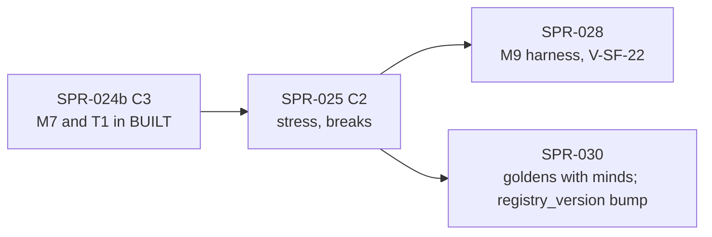

> **BLUF:** Builds the stress half of `T1.minds` 0.5.0 in `rh-minds` (SAGA-11; `05.3` §2.1). T1-I/S, promoted by SPR-024a, specifies it.
> - **Stress** is a `q8_8` value on 0–100 with three accounting columns. V-SAGA-16's identity therefore holds exactly; it gates G1a.
> - **Grief** arrives at the death instant, scaled by the relation's closeness and **saturated per instant** (`grief_instant_cap`).
>   - It covers the instant's deaths, read from `StepCtx::exited()` (X1(b)).
>   - Kin are classified over the core genealogy index (X2), out to uncles, nephews and cousins.
>   - Each grief crossing names M2's `DEATH`, read from the instant log's events (X1(c); `[[observes]]`).
> - **Dissonance** stress comes from chosen acts whose class `[act_dissonance]` ties to a trait (SPR-024b's decisions).
> - **Mental breaks:**
>   - a deterministic crossing, a keyed delay, and a weighted act from the **typed `[mental_breaks]`** (BCK-002 A-24, part);
>   - the acts of one slot are chosen against the binding's start state and applied in `action_order`;
>   - the acts: an assassination attempt (through `break_outcome` and `DEATH_DUE`), flight and a pact of despair. Flight and the pact are the first real verb programs, run by SPR-017's evaluator;
>   - relief, then a **refractory period** (red-team item 1);
>   - `mind.break_timer` is a flag, and the timers themselves are found through `own_timers` (REV-MINDS P2).
> - **V-SAGA-16b, made non-vacuous** (REV-MINDS P1). The gate runs on a stress-capable fixture court, plus a massacre variant. Each variant fails as "NOT EXERCISED" below 30 breaks of its own; the gate is **nightly-only**, and a planted FAIL is asserted (round-2 ruling R13). `twin_vales` is reported only: at its values no actor breaks (0 breaks in 92,160 actor-years, `minds_review/work/cascade_mc.py`).
>
> **No golden effect.** No golden world names `T1.minds`, and `BUILT` does not change here. Every ladder, header and segment stays byte-identical. The class is **C2** (X12). The Registry's new content (the typed tables, two verb programs) does not bump `registry_version`; SPR-030's C3 bumps it (REV-MINDS P7).
>
> - **Developer:** AGT-002-CORE, with AGT-002-TOOLS for the Registry loader, the verb programs and the gates.
> - **Testers:** AGT-003-DET, AGT-003-IF and AGT-003-STAT.
> - **Size and class:** **about 5.25–6 agent-days** (X8; T-01 0.5–0.75, T-02 1.5, T-03 1.75–2.0, T-04 1.0–1.25, T-05 0.5). **One sprint with a hard checkpoint after T-02.** **C2.**
> - **Status:** PLANNING, revision 2. REV-MINDS round 1 (P1–P7, Q1–Q3), X1–X13 and the round-2 rulings R13 and R14 are applied. It needs SPR-024b merged and the director's plan approval (D59).

# SPR-025 — Minds v0, part c: stress, grief, breaks, refractory period (WP P3.2a, part c)

- **Roadmap item:** `docs/11` P3.2a (`docs/11_roadmap.md:183`), part c under PRJ-002 ruling M-3; SAGA-11 (`docs/11_roadmap.md:457`).
- **Phase / rung:** P1a. It runs on the T1 fixture courts (the isolation court, and T1-I/S's stress-capable gate court) and on the dynastic fixture worlds.
- **Depends on (X9):**
  - **SPR-024b merged:**
    - decisions and their acts, which give dissonance its hook;
    - feuds, which supply a break's stressor in P1a;
    - the `due` table, `DEATH_DUE` and the timer purposes;
    - M7 and T1 in `BUILT`.
  - **Through it:**
    - T1 0.5.0 frozen (T1-I/S: the S-steps, `[[observes]]`, the `break_timer` flag, the gate fixture);
    - SPR-021's instant-log events and genealogy index (X1(c), X2);
    - SPR-038 stage B's `exited()` (X1(b));
    - SPR-038 stage B's `DropReason::Deferred` and `cancelled{…}` counter (R14).
  - **SPR-017 merged:** the evaluator and the `[verbs] effects` field (`specs/registry/effect_language_v0.md` §6, §7.3), for `FLED` and `DESPAIR_PACT`.
- **Binding contracts:**
  - **`specs/systems/T1.minds.odd.toml` 0.5.0:**
    - the stress columns and `break_state`, `break_timer` (as amended) and `refractory_until` (0.3.3 `:136–185`);
    - `[[emits]]` `MENTAL_BREAK`, `MURDER_ATTEMPT`, `FLED` and `DESPAIR_PACT` (`:417–446`);
    - `[[commands]]` `ScheduleDeath`, the `OpinionModifier` self-send, `RenounceClaim`, `Resign` and `BurnHoldings` (`:467–503`);
    - `[[rng]]` `break_delay`, `break_act` and `break_outcome` (`:765–776`);
    - the grief, threshold, break and stress-month steps (`:731`, `:736`, `:741`; submodels `:877–908`);
    - `[[params]]` (`:811–850`), INV-T1-01 to 04 (`:915–930`) and `[isolation]` (`:1023–1030`);
    - T1-I/S's S-steps, `[[observes]]` and gate fixture.
  - **The Registry** (`specs/manifest/registry_v0.toml`):
    - `[systems."T1.minds"]` (`:121–141`): `grief_instant_cap`'s upper bound, 45, sits below `stress_threshold`'s lower bound, 50 (REV-P1a MIN-5);
    - `[mental_breaks]` (`:291–299`), `[relation_kinds]` (`:301–310`), `DESPAIR_PACT_WITH` (`:320`), `[act_dissonance]` (`:324–329`) and the T1 verbs (`:608–612`).
  - **Elsewhere:**
    - `05.3` §2.1 (`05.3_cognition_epistemics_oracle.md:56–60`); `05.1` §2 rule 2 with EVO-002's text, and §4.3;
    - `specs/chronicle/envelope_v0.md` §3 (`:85–86`) and §4 (`:99`);
    - `specs/registry/effect_language_v0.md` §9 (`:433–439`);
    - `docs/red_team/RT-2026-10-16-G0-dispositions.md:33` (item 1: damping by mechanism, with no lock and no fiat cap).
  - **ADRs:** ADR-0006, ADR-0009 (no hidden director), ADR-0012, ADR-0025, ADR-0034 and ADR-0035.
  - **`docs/09` tests:** V-SAGA-16 (`:421`), V-SAGA-16b (`:422`), V-INV-03, V-INV-15, V-DET-01, V-DET-02, V-DET-05, V-DET-12, and V-SF-22 (`:501`: SPR-028's gate, with evidence from here).
- **System spec:** T1 0.5.0. An erratum bumps it in place (0.5.x).
- **Rulings (binding):**
  - REV-P1a: round 1, round 3 BLK-1, MIN-5 and round 4 NEW-1;
  - the red-team disposition of item 1;
  - EVO-001 R9 and R12;
  - REV-WAVE5 W42; REV-WAVE6 X1, X4, X5, V2, V3 and Z1;
  - **REV-MINDS round 1** and **X1–X12** (a bare "X" id below is a cross-plan ruling).
- **Director items:** D59 (items 6, 7).
- **Requirements covered:** SAGA-11 (V-SAGA-16, V-SAGA-16b), COG-1 v0's stress, DET-13.

## Specs this sprint needs

| Spec | Exists? | Gap | Architect ruling | Needed by |
|---|---|---|---|---|
| **1. The S-steps** | In T1-I/S (X7), promoted by SPR-024a | — | As SPR-024 row 1. Every mutant below is shown on the reference first (REV-WAVE6 X4, V2) | T-02 |
| **2. Grief's kin set** | "derived through kin(d, 2) … kin_other: uncles, aunts, nephews, nieces, first cousins" (`T1.minds.odd.toml:879`); `kin(p, n)` counts parent-or-child steps, with a bound of 256 (`effect_language_v0.md:249`) | Uncles are 3 steps away and first cousins 4, so `kin(d, 2)` never reaches the `kin_other` the Registry gives closeness 0.2 (`registry_v0.toml:308`). `kin(d, 4)` also reaches kinds that have no closeness, and can truncate | **Proposed (7.5/10; the review: the shapes are right), in T1-I/S:** <ul><li>the grievers are the named actors at a path shape (u up, v down) with u, v ≤ 2: parent (1, 0), child (0, 1), sibling (1, 1), grandparent (2, 0), grandchild (0, 2), and `kin_other` for (2, 1), (1, 2) and (2, 2);</li><li>plus the living spouse, and the holders of open liege and vassal rows with `b` = d;</li><li>the closest kind counts once;</li><li>the walk runs over the core genealogy index (X2), with no truncation, and a property test checks it against brute force</li></ul> | T-02 |
| **3. The crossing's cause** (REV-MINDS P3) | `MENTAL_BREAK`'s motive points "to the event that pushed stress over the threshold" (`T1.minds.odd.toml:419–421`; `envelope_v0.md:85`) | For grief, that is M2's `DEATH` of the same instant (BCK-002 A-59, `:79`) | **Ruled (X1(c); 75%):** <ul><li>T1 declares `[[observes]] DEATH` (in T1-I/S, under EVO-002);</li><li>its grief step reads the instant log's event of kind `DEATH` about each dead person, with its `EventId`, filled at the serial merges by SPR-021 T-02;</li><li>the break timer's `cause` slot (EVO-001 R9, R15) keeps the crossing's cause, and the fire emits `GRIEF_FOR` to it;</li><li>a dissonance crossing's cause is T1's own act.</li></ul> No M2 column (X1 drops it). No fallback: the instant log has one builder | T-02, T-03 |
| **4. A minor who comes of age above the threshold** | "evaluated at majority" (`T1.minds.odd.toml:883`); `threshold` runs "for each actor changed in this binding" | No step runs at majority | **Proposed (7.5/10):** Month/Agenda's `threshold` evaluates every named actor (O(named) once a month). Such an actor crosses at most one month late; there is a golden case | T-03 |
| **5. `DESPAIR_PACT`'s target and its modifiers** | "a bond with a stressed named relation" (`T1.minds.odd.toml:895`); "both ways" (`:478`); the sample sends one, with 30.0 (`effect_language_v0.md:439`) | The target is unstated, and the sample and the spec disagree on direction | **Proposed (7/10):** <ul><li>the target is the living named relation with the highest stress, ties broken by ascending `PersonId`; the act needs one with stress > 0;</li><li>the program sends `RenounceClaim` for each active claim, then two `OpinionModifier`s, one each way, with `DESPAIR_PACT_WITH`'s magnitude (`registry_v0.toml:320`);</li><li>an Architect erratum fixes §9's sample</li></ul> | T-01, T-03 |
| **6. The typed break table** (BCK-002 A-24, `BCK-002_ArchitectBacklog.md:44`) | `[mental_breaks]` and `[act_dissonance]` are untyped (`registry_v0.toml:291–299`, `:324–329`) | The loader accepts anything | **Proposed (8.5/10):** each of these is refused by name: <ul><li>an act class not in `[act_classes]`;</li><li>`relief` outside (0, 100];</li><li>a `verb` not emitted by `T1.minds`;</li><li>a `needs` entry outside {`stressor`, `seat`, `kin`, `holdings`};</li><li>a weight key that is not a HEXACO trait;</li><li>an `[act_dissonance]` class or trait that is unknown.</li></ul> Acts are read in source order | T-01 |
| **7. A decision's act class** | "a chosen act whose class is in [act_dissonance] adds dissonance stress" (`T1.minds.odd.toml:903`); "break acts never add dissonance" (`:841`) | `press_claim` and `marry` only send commands | **Proposed (7.5/10):** a decision takes its verb's class: <ul><li>a feud attack: `harm`;</li><li>a declaration: `accuse`;</li><li>a reconciliation: `restore`;</li><li>`press_claim`: `claim` (`registry_v0.toml:620`);</li><li>`marry`: `marry`;</li><li>`seek_office`: none.</li></ul> Dissonance is applied when the decision is applied, and accounted | T-02 |
| **8. Stress arithmetic** | INV-T1-01 (`T1.minds.odd.toml:917`); "the clipped amounts never enter the three accounting columns" (`:141`) | Order decides the bytes | **Proposed (8.5/10):** one order per binding: <ul><li>grief: add, clip, account;</li><li>month: sources, clip, account, decay, floor, account;</li><li>break: relief, floor, account.</li></ul> All in raw `q8_8` units; the products are rounded down | T-02 |
| **9. `break_timer` and the life cycle** (REV-MINDS P2) | `mind.break_timer` "TimerId of the pending break or of the refractory end" (`T1.minds.odd.toml:177`); INV-T1-02 (`:921`) | `schedule` returns `()`, a re-sample changes the id, and `invariants()` cannot see the agenda. The next-version lint refuses a type change (`lint_odd.py:576–578`) | **Ruled (90%), in T1-I/S:** <ul><li>`mind.break_timer` keeps its `u64` type, and its meaning is amended to a **0/1 flag**: 1 while a break or refractory-end timer is pending;</li><li>the timers themselves are found by kind through `own_timers` (SPR-014 `system.rs:820–828`);</li><li>INV-T1-02 is checked by a **test observer with agenda access** at every month end, at the run's end, through a re-sample and through a keyframe;</li><li>a death cancels the actor's break or refractory-end timer at the death instant (`exited()`), by SPR-038b's `cancel_because(id, Dead)`, counted in `cancelled{T1.minds, break, dead}` (R14);</li><li>a `Demote` met while `pending` or `refractory` is dropped as `Deferred` (SPR-023), and INV-T1-02's "went dormant first" clause is amended away</li></ul> | T-03 |
| **10. Breaks in one slot** (REV-MINDS P4) | Due timers of one `(t, phase)` fire in key order on one view (SPR-014 branch `engine.rs:1262–1264`) | A second break would see the first's relief, which changes a pact's target | **Proposed (7.5/10):** <ul><li>a break timer's fire marks the actor due in the `due` table (kind `break`; SPR-024 row 4);</li><li>in the binding, every due break chooses its act and target against the binding's start state, then the acts apply in `action_order`;</li><li>a golden case has two breaks in one slot, one choosing the other as its pact target</li></ul> | T-03 |
| **11. The first real verb programs** | `FLED.effects`, `DESPAIR_PACT.effects` (`effect_language_v0.md:438–439`); SPR-017 lands none (`SPR-017_EffectLanguage.md:27`) | The host seam in a real system is untried | **Proposed (8/10):** <ul><li>both programs join `[verbs]`, checked against T1 0.5.0's `[[commands]]`;</li><li>`rh-minds` evaluates them at the act, with the verb's event as `cause`;</li><li>`MURDER_ATTEMPT` keeps no program (SPR-024 row 8);</li><li>`HOLDINGS_BURNED`'s program waits for M4 (P1b);</li><li>no `registry_version` bump: SPR-030 bumps it (P7)</li></ul> | T-01, T-03 |
| **12. V-SAGA-16b, non-vacuous** (REV-MINDS P1) | "branching ratio … < 1, upper 95% bound included", 32 seeds (`docs/09:422`); `[isolation]` (`T1.minds.odd.toml:1030`) | At `twin_vales`' values (threshold 70, gain 20, cap 40; `twin_vales.yaml:88–93`) the cap stays below the threshold, and `cascade_mc.py` finds **0 breaks in 92,160 actor-years**. The ratio is 0/0, and the mutants that should show the gate's teeth cannot fire | **Ruled (80%):** <ul><li>**the gate runs on a stress-capable fixture court:** parameters inside the Registry box where a cascade is possible, stated in T1-I/S with the arithmetic that breaks occur;</li><li>**a massacre variant:** 4 deaths at closeness 1 in one instant;</li><li>**the floor applies per variant (R13): the scenario and the massacre variant each need at least 30 breaks over their 32-seed ensemble**, else that variant fails as "NOT EXERCISED"; **the gate is nightly-only** (the PR tier runs 4 seeds of each variant and asserts INV-T1-01 to 04 and the refractory clause only, with no ratio and no floor); **one planted FAIL is asserted:** the massacre variant under `mutant-no-refractory` must fail the gate's refractory clause, by name;</li><li>the band leaves the gate, so the gate is the ratio's upper bound below 1 plus no second break inside the refractory period;</li><li>**`twin_vales` is reported only;**</li><li>a T-04 probe asserts that breaks occurred.</li></ul> The attribution is a test observer on plane-A state: each crossing is linked to its instant's `exited()`, and each death to the break whose `DEATH_DUE` caused it. The bound comes from a keyed bootstrap over seeds | T-04 |
| **13. The break band under P1a's two sources** | 0.5–5 per 100 named-actor-years, a design value; it "may fall below 0.5" (`T1.minds.odd.toml:68–69`); reported at G1a and gated at G1b (D34) | Only grief and dissonance are sources in P1a | **Ruled:** measured at the fixture worlds' values and at the Registry corners, and reported to the director with the shortfall. Nothing is tuned | T-04 |
| **14. Re-sampling a break** | SPR-024 row 15 | The default `resample_timer` refuses | **Proposed (7/10), in T1-I/S:** a break is re-drawn by `break_delay` from the input's day, keyed at the actor's new epoch; it keeps its `cause`. A refractory end keeps its tick | T-03 |
| **15. Edges** (REV-MINDS P6) | `envelope_v0.md:86`: a break's `MURDER_ATTEMPT` carries "`triggered` to the `MENTAL_BREAK` of the same step" | Missing from revision 0 | **Ruled:** added (T-03) | T-03 |
| **16. The class** | PRJ-002 classed SPR-025 C3 | No golden world names T1, and `BUILT` does not change here | **Ruled (X12; 80%): C2.** The PR shows that the `systems` lines and `BUILT` are unchanged; the break rates are reported at the merge | T-05 |

## Compliance (every task)

| Rule | This sprint |
|---|---|
| Change class | **C2** (X12): `[mental_breaks]` and `[act_dissonance]` are typed; two verb programs. No golden effect. PR title `[C2]` |
| Planes touched | **A:** `rh-minds`, `rh-registry`. **Tool:** `rh-manifest`, `specs/` (the Registry), `bin/check_all.sh`. **B, C:** none |
| Owned columns written | `mind.stress`, `stress_in`, `stress_decayed`, `stress_relieved`, `break_state`, `break_timer` (the flag), `refractory_until`; `relation.ended_at`; `opinion.*` through the self-send; `due.*` (kind `break`). Deaths, resignations and renunciations only through commands |
| Reads | As in SPR-024, plus the instant log's `DEATH` events (`[[observes]]`) and `exited()`. `vow.conflict` stays dropped (`s_vow = 0`) |
| RNG purposes drawn | `break_delay`, `break_act`, `break_outcome` |
| Golden-hash effect | **None** |
| Fixed point | Stress, gains, caps and relief in `Q8_8`; accounting in raw `u64` units; act weights `clamp(1 + Σ w × trait/100, 0.1, 2.0)` in `Q16_16`; `attempt_success` as `Prob32` |
| Determinism lints | Must pass. Enumeration in ascending `PersonId` and in table order; no `HashMap`; no regulator (ADR-0009): no lock, and no cap but the scale's 100 |
| Per-instant cost | Grief is O(exits × walk) at a death instant and O(1) otherwise; breaks are O(due); Month/Agenda is O(named) once a month; `invariants()` is O(1) |
| Tests that gate this sprint | **V-SAGA-16** (gates G1a), **V-SAGA-16b** (gates G1a; nightly, power stated), V-INV-03 (subset), V-INV-15, V-DET-01, 02, 05 and 12, V-GOLD-01 (unchanged). Reported: the band; V-SF-22's evidence for SPR-028 |
| Docs updated in the same sprint | `check_all.sh`, the inventory test and `CLAUDE.md`; the `docs/09` method lines for V-SAGA-16 and 16b; the erratum to `effect_language_v0.md` §9; PRJ-002's row; BCK-002 A-24 (the T1 part done) |

**Rules carried:** SPR-023's list, with **one statistical gate, V-SAGA-16b, nightly-only** (R13). At the PR tier: 4 seeds of each variant, asserting INV-T1-01 to 04 and "no second break inside the refractory period"; no ratio and no floor are asserted there.

## Tasks

A **hard checkpoint** follows T-02: the Tester's interim pass on the accounting identity and grief (`VER-SPR-025-TEST`, phase 1) comes before T-03 lands.

#### T-01: The typed break table, the verb programs, the host seam (C2; rows 5, 6, 11)
- **Deliverable:** the typed tables (row 6); `FLED.effects` and `DESPAIR_PACT.effects` (rows 5, 11); the `rh-minds` seam that evaluates a program at its act and submits its commands with the verb's event as `cause`.
- **Acceptance:**
  - Each refusal, planted once, fails by name.
  - The programs compile, and planted bad ones fail with SPR-017's codes.
  - The seam's commands equal the reference's for a flight with two offices and a pact with one claim.
  - The four ladders are unchanged.
- **Status:** [ ] not started

#### T-02: Stress, accounting, dissonance, grief (the checkpoint; rows 2, 3, 7, 8; INV-T1-01, 04)
- **Deliverable:**
  - **One accounting function** (row 8). INV-T1-01 is asserted on each row it writes, and checked in full by a month-end observer.
  - **`stress_month`.**
  - **Dissonance** at SPR-024b's decision application (row 7).
  - **Grief** over `exited()`:
    - row 2's classification over the core index;
    - the cap;
    - the crossing's cause from the instant log's `DEATH` (row 3);
    - open liege and vassal rows ended.
  - **Mutants:** `mutant-grief-no-cap`, `mutant-grief-kin2`, `mutant-stress-clip-accounted`.
- **Acceptance:**
  - **Bit-equality** with the S-cases: grief by a parent, a spouse, an uncle, a first cousin and a liege; three closeness-1 deaths at one day start, which are capped; decay; dissonance; both clips.
  - **Mutants:**
    - `mutant-grief-no-cap` fails the triple-death line and INV-T1-04;
    - `mutant-grief-kin2` fails the uncle and cousin lines;
    - `mutant-stress-clip-accounted` fails INV-T1-01 at the first clip.
  - **V-SAGA-16 (the identity):** exact for every mind at every month end, over 200 years (PR tier) and 1,000 (nightly).
  - **The walk** equals brute force on three sizes and eight seeds.
  - **The cause:** each grief crossing's recorded cause is the `DEATH` `EventId` that channel A shows.
  - **Idle cost:** Day/Vital visits no row at an instant with no exit (a probe).
  - **Checkpoint.** The Tester's interim pass is recorded before T-03 lands.
- **Status:** [ ] not started

#### T-03: Crossings, breaks, the refractory period (rows 4, 5, 9, 10, 14, 15; INV-T1-02, 03)
- **Deliverable:**
  - **`threshold`:** in every T1 binding for the actors that binding changed, and over every named actor in Month/Agenda (row 4). A crossing sets the flag to 1 and schedules a break timer at (now + d days, Agenda), with d = 1 + `break_delay` mod `break_delay_max_days`, its `cause` the crossing's.
  - **`break_act`**, through the `due` table (row 10):
    - the available acts by `needs` (P1a's `stressor` is the active feud enemy with the lowest opinion; `holdings` is never available);
    - weights, and the pick by `break_act`;
    - `MENTAL_BREAK` with the pre-act stress snapshot and its motive (row 3), then the act;
    - the acts: `MURDER_ATTEMPT` (by `break_outcome`; on success `DEATH_DUE`; a `triggered` edge to the `MENTAL_BREAK`, row 15), `FLED`, `DESPAIR_PACT`;
    - relief, `refractory`, and the refractory-end timer.
  - **`refractory_end`;** re-sampling (row 14); death and dormancy (row 9).
  - **Mutants:** `mutant-no-refractory`, `mutant-break-act-k1`.
- **Acceptance:**
  - **Bit-equality** with the break cases:
    - a crossing by grief, and one by dissonance;
    - a minor at majority;
    - three available acts;
    - a pact; a flight with two offices;
    - an attempt that succeeds, and one whose target dies first;
    - two breaks in one slot (row 10);
    - a scope-only input inside a pending break's delay.
  - **Mutants:** `mutant-no-refractory` fails INV-T1-03 and the two-crossing case; `mutant-break-act-k1` fails the three-act case.
  - **V-SAGA-16 (the rest):** INV-T1-02 by the agenda observer (row 9), through a re-sample and a keyframe; INV-T1-03.
  - **The death path (V-INV-03):** a break's successful attempt kills at the next day start through M2's drain; a dead actor's break is cancelled and counted.
- **Status:** [ ] not started

#### T-04: V-SAGA-16b, the band, the isolation evidence (rows 12, 13)
- **Deliverable:**
  - **The cascade on T1-I/S's stress-capable gate court:** the sovereign is murdered in front of the court at year 50, and there is a massacre variant (4 closeness-1 deaths in one instant).
  - **Runs:** 32 seeds × 60 years of each variant, nightly (the gate); 4 seeds of each at the PR tier (invariants only, R13).
  - **`twin_vales`,** run for reporting only.
  - **The observer** (row 12), and the band report.
  - **The isolation run's observers** and a sanity run for SPR-028's V-SF-22.
- **Acceptance:**
  - **The probe, per variant (R13):** the scenario's ensemble has at least 30 breaks, and so has the massacre variant's. A variant with fewer fails as "NOT EXERCISED", naming the variant and its count.
  - **V-SAGA-16b (nightly gate):**
    - the ratio's upper 95% bound is below 1, on both the scenario and the massacre variant;
    - no second break inside `break_refractory_days`;
    - counts are back to baseline within 5 years (reported).
    - **The planted FAIL (asserted):** the massacre variant under `mutant-no-refractory` fails the gate's refractory clause by name, every night. A run with `mutant-grief-no-cap` as well shows the ratio rising (reported).
  - **Reported only:** the band at the fixture values and at the Registry corners, and `twin_vales`' break count, with the shortfall stated. AGT-003-STAT reads it before the audit. Nothing is tuned.
- **Status:** [ ] not started

#### T-05: The C2 record, the integration run, CI (row 16; X10, X12)
- **Deliverable:**
  - **The C2 record:** every root, header and segment is byte-identical; the `systems` lines and `BUILT` are unchanged; the break rates go to the director.
  - **The dynastic run with stress** on `manor` and `twin_vales`: 50 years at the PR tier, 300 years nightly.
  - **The gates, by role and part** (estimates on one runner):

    | Gate | Role | Part | Profile, horizon | Est. |
    |---|---|---|---|---|
    | Typed-table and program tests, the seam | by-name tests | core | debug | 4 s |
    | S-cases: grief, stress, break unit tests, one mutant rebuilt | by-name tests and mutants | core | debug | 25 s |
    | The court at 200 years with the identity and agenda observers | release system gate | golden | release | 6 s |
    | The cascade and the massacre variant, 4 seeds each, invariants only (R13) | release system gate | golden | release | 8 s |
    | The dynastic run at 50 years | release system gate | golden | release | 5 s |
    | V-SAGA-16b (both variants, 32 seeds each, with the planted FAIL), 1,000-year soak, band report, other mutants, 600 actors | gate and soak | nightly | release | — |

- **Acceptance:**
  - **Hash-neutral, robust form (true for a correct build):** no golden world names T1, and `BUILT` does not change.
  - **CI:** about **+29 s core** and **+19 s golden** by gate sums; stream is unchanged. Budgets: **+45 s** and **+30 s**.
  - **Nightly candidates:** the PR-tier cascade seeds, and the dynastic run.
- **Status:** [ ] not started

## Director items, and what changes under the alternative

| Item | Planned | Under the alternative |
|---|---|---|
| **Size: about 5.25–6 agent-days, one sprint** (X8; D59 item 1; 65%) | One C2 PR, with a checkpoint after T-02 | A split at the checkpoint: two audits |
| **The grief edge through the instant log** (X1(c); D59 item 6; 75%) | `GRIEF_FOR` to the same-instant `DEATH`, read through `[[observes]]` | No edge. Then V-SAGA-16b's attribution stays on plane-A state anyway |
| **The break band and a non-vacuous V-SAGA-16b** (P1; D59 item 7; 75%) | The nightly gate runs on a stress-capable court, each variant with at least 30 breaks, with one planted FAIL; `twin_vales` and the band are reported | The gate on `twin_vales`: vacuous (0/0) at its values |

## Out of scope (explicit)
- **Vow and kin-loyalty stress** (P1b); `HOLDINGS_BURNED` (M4, P1b); fugitive status after `FLED` (S3 F1, P1b).
- **Emotions, mood, memory** (P3.2b).
- **Any lock, inquest or cap on outcomes** (ADR-0009). **Tuning** any T1 parameter. The band's gate (G1b). V-SF-22 as a gate (SPR-028).
- **The instant log and the genealogy index** (SPR-038b, SPR-021): consumed here.

## Verification assignment (Testers)

| Tester | What to verify, from which contract | Report |
|---|---|---|
| AGT-003-DET | T-02, T-03 and T-05, from the S-steps, `05.3` §2.1 and INV-T1-01 to 04:<ul><li>**the checkpoint pass:** their own accounting and grief, checked against the engine;</li><li>the five mutants, plus three of their own (decay before accrual; a refractory period off by one day; an unavailable act chosen);</li><li>the agenda observer through a re-sample and a keyframe;</li><li>the two-break slot;</li><li>the C2 record</li></ul> | `VER-SPR-025-TEST` (phases 1 and 2) |
| AGT-003-IF | T-01 and T-03:<ul><li>the typed tables' refusals;</li><li>the two programs against T1's `[[commands]]` and the owners' `[[applies]]`;</li><li>`[[observes]]` and the `DEATH` id;</li><li>the `MENTAL_BREAK`'s roles, snapshot and edges, through DuckDB</li></ul> | As above |
| AGT-003-STAT | T-04:<ul><li>the gate court's arithmetic: are breaks possible?</li><li>V-SAGA-16b's attribution and independence;</li><li>their own bootstrap and power;</li><li>the "NOT EXERCISED" rule;</li><li>the band report, with INSUFFICIENT below 1,000 named-actor-years (`T1.minds.odd.toml:801`)</li></ul> | As above |

## Merge route

- **Class and conditions.** C2: merged after the Tester passes and the audit. The break rates are reported (X12).
- **Order (X9):**

- **Shared files:** the Registry and `rh-manifest` (with SPR-021 and SPR-022), `check_all.sh`, the inventory test and `CLAUDE.md`.

## Risks

| # | Risk | Likelihood / impact | Mitigation |
|---|---|---|---|
| 1 | The break rate under P1a's sources is far below the band | Likely (0 breaks at `twin_vales`' values) / G1a's histories show few breaks | Reported, not tuned; the band gates G1b (D34); the director sees the figures (D59 item 7) |
| 2 | V-SAGA-16b's ratio approaches 1 on the stress-capable court | Medium / a red gate | A finding for the Architect, never a tuning |
| 3 | The evaluator's first real programs expose a gap in the host seam | Medium / a C2 erratum | T-01 lands the seam first, on two programs |

## Blockers

| # | Blocker | Status |
|---|---|---|
| 1 | SPR-024b merged | Open |
| 2 | The director's plan approval (D59) | Open |

## Completion

- [ ] Every task meets its acceptance criteria; the checkpoint was held.
- [ ] `bin/check_all.sh` passes, with each part's time.
- [ ] DET, IF and STAT PASS. The audit `VER-SPR-025` PASS, with the C2 record, the V-SAGA-16b result (at least 30 breaks per variant, the planted FAIL failing) and the band report.
- [ ] V-SAGA-16 gates in the PR tier and V-SAGA-16b in the nightly tier; BCK-002 A-24's T1 part is done.
