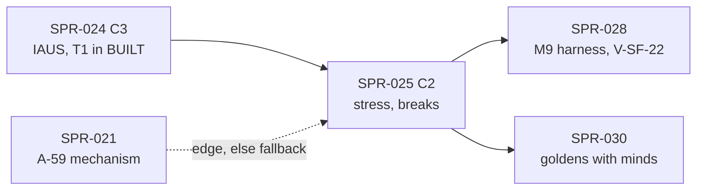

> **BLUF:** Builds the stress half of `T1.minds` 0.4.0 in `rh-minds` (SAGA-11; `05.3` §2.1):
> - **stress** in `q8_8` on 0–100 with its three accounting columns, so V-SAGA-16's identity holds exactly (it gates G1a);
> - **grief** at the death instant, scaled by the relation's closeness and **saturated per instant** (`grief_instant_cap`), over the instant's exits (SPR-023's read) and a kinship classification that reaches the uncles, nephews and cousins the Registry names (the frozen `kin(d, 2)` does not);
> - **dissonance** stress for chosen acts whose class `[act_dissonance]` ties to a trait (SPR-024's decisions);
> - **mental breaks:** a deterministic crossing, a keyed delay, a weighted act from the **typed `[mental_breaks]` table** (BCK-002 A-24, part), its effects (an assassination attempt through `break_outcome` and a `DEATH_DUE` timer; flight and a pact of despair as the first real verb programs through SPR-017's evaluator), relief, and a **refractory period** (red-team item 1);
> - **V-SAGA-16b,** the cascade scenario (a sovereign murdered in front of a 60-actor court, 32 seeds): the chain's branching ratio below 1 by mechanism alone, no lock and no fiat cap (it gates G1a).
>
> **No golden effect.** No golden world names `T1.minds` (T1 is in `BUILT` since SPR-024), so every ladder, header and segment stays byte-identical: CI detects **C2** (the Registry's typed sections and verb programs). The Registry change does not bump `registry_version`; the bump rides on the next C3 (SPR-017's precedent).
>
> - **Developer:** AGT-002-CORE, with AGT-002-TOOLS for the Registry loader, the verb programs and the gates (one session may hold both roles).
> - **Testers:** AGT-003-DET, AGT-003-IF, and AGT-003-STAT for V-SAGA-16b and the break-band report (DET and IF may share a session, on a different model from the Developer's).
> - **Size and class:** **about 4.25 agent-days** (T-01 0.5, T-02 1.25, T-03 1.25, T-04 0.75, T-05 0.5), **one sprint with a hard checkpoint after T-02** (the Tester's interim pass on the accounting identity and grief before breaks land). **C2.**
> - **Status:** PLANNING, revision 0. It needs SPR-024 merged and the director's plan approval (D59; GOV-005 §2).

# SPR-025 — Minds v0, part c: stress, grief, breaks, refractory period (WP P3.2a, part c)

- **Roadmap item:** `docs/11` P3.2a (`docs/11_roadmap.md:183`), part c by PRJ-002 ruling M-3; `docs/11`'s SAGA-11 row (`:457`) · **Phase / rung:** P1a; the T1 isolation fixture court and the dynastic fixture worlds.
- **Depends on (the precondition head):**
  - **SPR-024 merged:** decisions and their acts (the hook for dissonance), feuds (the break act's stressor in P1a), the `due` hand-off, `DEATH_DUE` through `outcome_delay`, T1 in `BUILT`, `MURDER_ATTEMPT`'s `success` payload.
  - **SPR-023 merged:** the S-steps of `[algorithm.minds_f1]` frozen in 0.4.0 with their reference cases; the instant's exits read; the deferred-`Demote` rule; the genealogy index (SPR-021's or SPR-024's).
  - **SPR-017 merged:** the evaluator and the Registry's `[verbs] effects` field (`specs/registry/effect_language_v0.md` §6, §7.3), for `FLED` and `DESPAIR_PACT`.
  - **SPR-021's mechanism for BCK-002 A-59** (same-instant learning of another system's `EventId`, `CODEX/05_PROJECT/BCK-002_ArchitectBacklog.md:79`), for the `MENTAL_BREAK`'s `GRIEF_FOR` edge to M2's `DEATH`; **fallback** in the specs table, row 3.
- **Binding contracts:**
  - `specs/systems/T1.minds.odd.toml` 0.4.0: `mind.stress`, `stress_in`, `stress_decayed`, `stress_relieved`, `break_state`, `break_timer`, `refractory_until` (0.3.3 `:136–185`); `[[emits]]` `MENTAL_BREAK`, `MURDER_ATTEMPT`, `FLED`, `DESPAIR_PACT` (`:417–446`); `[[commands]]` `ScheduleDeath`, `OpinionModifier` (self-send), `RenounceClaim`, `Resign`, `BurnHoldings` (`:467–503`); `[[rng]]` `break_delay`, `break_act`, `break_outcome` (`:765–776`); the Day/Vital `grief` and `threshold` steps (`:731`), Day/Agenda's `break_act`, `refractory_end`, `threshold` (`:736`), Month/Agenda's `stress_month` and `threshold` (`:741`); submodels `grief`, `threshold`, `break_act`, `refractory_end`, `stress_month` (`:877–908`); `[[params]]` `stress_threshold` to `attempt_success` (`:811–850`); INV-T1-01 to 04 (`:915–930`); `[isolation]` (`:1023–1030`); the S-steps of 0.4.0.
  - The Registry (`specs/manifest/registry_v0.toml`): `[systems."T1.minds"]` bounds and units (`:121–141`; `grief_instant_cap`'s upper bound 45 below `stress_threshold`'s lower 50, REV-P1a MIN-5), `[mental_breaks]` (`:291–299`), `[relation_kinds]` (`:301–310`), `[opinion_modifiers]`'s `DESPAIR_PACT_WITH` (`:320`), `[act_dissonance]` (`:324–329`), the T1 verbs (`:608–612`).
  - `05.3` §2.1 (`docs/05_architecture/05.3_cognition_epistemics_oracle.md:56–60`); `05.1` §2 rule 2, §4.3; `specs/chronicle/envelope_v0.md` §3 (`:85`, the `MENTAL_BREAK` row), §4 (the pre-act snapshot, `:99`); `specs/registry/effect_language_v0.md` §9 (`:433–439`); `docs/red_team/RT-2026-10-16-G0-dispositions.md:33` (item 1: damping by mechanism, no lock, no fiat cap).
  - ADR-0006, ADR-0009 (no hidden director: no regulator of outcomes), ADR-0012, ADR-0025 (a break is a timer), ADR-0034, ADR-0035; `docs/09` V-SAGA-16 (`:421`), V-SAGA-16b (`:422`), V-INV-03, V-INV-15, V-DET-01, V-DET-02, V-DET-05, V-DET-12, V-SF-22 (`:501`, SPR-028's gate; evidence here).
- **System spec:** T1 0.4.0; an erratum found in the sprint bumps it in place (0.4.x).
- **Rulings (binding):** REV-P1a round 1 (grief through minds' own relation rows and the dead readable until Bookkeeping; no P1a-only stress source; the cascade test is V-SAGA-16b), round 3 BLK-1 (grief in the Day/Vital binding of the death instant), MIN-5, round 4 NEW-1; the red-team disposition of item 1 (80%: mechanisms, not a lock); EVO-001 R9, R12; REV-WAVE5 W42; REV-WAVE6 X1, X4, X5, V2, V3, Z1; SPR-023's and SPR-024's rulings.
- **Director items:** D59 (with the break band's report, item 7).
- **Requirements covered:** SAGA-11 (stress and breaks: V-SAGA-16, V-SAGA-16b), COG-1 v0's stress, DET-13 (breaks as timers).

## Specs this sprint needs

| Spec | Exists? | Gap | Architect ruling | Needed by |
|---|---|---|---|---|
| **1. The S-steps** | In T1 0.4.0's `[algorithm.minds_f1]` and the reference's S-cases (SPR-023's spec PR) | — | As SPR-023 row 1; every mutant below shown on the reference first (X4, V2) | T-02 |
| **2. Grief's kin set** | "the grievers are the named actors kin to d, derived through kin(d, 2) … (parents, children, spouse, siblings, grandparents, grandchildren; kin_other: uncles, aunts, nephews, nieces, first cousins)" (`T1.minds.odd.toml:879`); `kin(p, n)` is "reachable from p in at most n parent-or-child steps", bound 256 (`effect_language_v0.md:249`) | Uncles, aunts, nephews and nieces are 3 steps away and first cousins 4, so `kin(d, 2)` never reaches the `kin_other` the Registry gives closeness 0.2 (`registry_v0.toml:308`); `kin(d, 4)` reaches them but also great-grandparents and grand-nephews, which have no kind, and its bound of 256 can drop grievers in a large house | **Proposed (7.5/10):** the grievers are the named actors at a parent-or-child path of shape (u up, v down) with u, v ≤ 2 from d, classified exactly: parent (1, 0), child (0, 1), sibling (1, 1), grandparent (2, 0), grandchild (0, 2), `kin_other` for uncle or aunt (2, 1), nephew or niece (1, 2), first cousin (2, 2); the living spouse from `person.spouse`; the holders of open liege and vassal rows with `b` = d; a pair related several ways counts its closest kind once (closeness order of `[relation_kinds]`). T1's own walk over the genealogy index, with no truncation (a property test against brute force), replaces `kin(d, 2)` in 0.4.0's grief step | T-02 |
| **3. The crossing's cause** | `MENTAL_BREAK`'s motive edge points "to the event that pushed stress over the threshold" (`T1.minds.odd.toml:419–421`; `envelope_v0.md:85`) | For grief that event is M2's `DEATH` of the same instant; no engine path lets T1 learn its `EventId` in that instant (BCK-002 A-59, `:79`: SPR-021's plan decides the mechanism) | **Proposed (6/10):** reuse SPR-021's A-59 mechanism. The plan's preferred form, if SPR-021 leaves the choice open: M2 records each death's `DraftRef` in an `event_ref` column it owns (the buffered cause slot of `05.1` v1.13, `05_architecture/05.1_simulation_core.md:15`, rewritten at the merge), which a `same_instant` reader sees after M2's level; T1 keeps the crossing's cause in the break timer's `cause` slot (EVO-001 R9, R15) and the fire emits the edge. **Fallback:** a grief-driven `MENTAL_BREAK` carries no motive edge (counted), and V-SAGA-16b's attribution uses plane-A observation (row 11), which needs no event id. A dissonance-driven crossing's cause is T1's own act, which it knows | T-03 |
| **4. A minor who comes of age above the threshold** | "a minor's stress accrues and is evaluated at majority" (`T1.minds.odd.toml:883`); `threshold` runs "for each actor changed in this binding" (`:883`) | No step runs at an actor's majority, so a minor at stress ≥ threshold who sees no further change never crosses | **Proposed (7.5/10):** Month/Agenda's `threshold` evaluates every named actor (O(named) a month, the binding already visits each for decay), so an actor adult since the last month start and at or above the threshold crosses at the next month start, at most one month late; the S-steps say so with a golden case | T-03 |
| **5. `DESPAIR_PACT`'s target and its modifiers** | "a bond with a stressed named relation" (`T1.minds.odd.toml:895`); the modifiers are "both ways" (`:478`, `:895`); the language's sample sends one, actor about target, with an illustrative 30.0 (`effect_language_v0.md:439`) | Which relation is the target is unstated; the sample program and the spec disagree on the direction | **Proposed (7/10):** the target is the living named relation (row 2's classes, liege and vassal rows included) with the highest stress, ties by ascending `PersonId`; the act needs one with stress > 0. The program sends `RenounceClaim` for each of the actor's active claims and two `OpinionModifier` actions (actor about target, target about actor), the magnitude the Registry's `DESPAIR_PACT_WITH` (30.0, `registry_v0.toml:320`); the Architect corrects §9's sample by erratum | T-01, T-03 |
| **6. The typed break table** (BCK-002 A-24, `BCK-002_ArchitectBacklog.md:44`: "before the S6, S7 and T1 sprints") | `[mental_breaks]`, `[act_dissonance]` untyped (`registry_v0.toml:291–299`, `:324–329`) | The loader accepts any field and value | **Proposed (8.5/10):** typed in `rh-manifest` and compiled into `rh-registry`, refused by name: an act class not in `[act_classes]`; `relief` outside (0, 100]; a `verb` not in `[verbs]` or not emitted by `T1.minds`; a `needs` entry outside {`stressor`, `seat`, `kin`, `holdings`}; a weight key not one of the six HEXACO traits; an `[act_dissonance]` class not in `[act_classes]` or trait not a HEXACO trait. Acts are taken in the table's source order (SPR-017's key-order ruling) | T-01 |
| **7. Which act class a decision has** | "a chosen act whose class is in [act_dissonance] adds dissonance stress" (`T1.minds.odd.toml:903`); "break acts never add dissonance" (`:841`) | `press_claim` and `marry` send commands; their events are M7's and M2's | **Proposed (7.5/10):** a decision's act class is its verb's: a feud attack `harm` (`MURDER_ATTEMPT`), a declaration `accuse`, a reconciliation `restore`; `press_claim` `claim` (M7's `CLAIM_PRESSED`, `registry_v0.toml:620`); `marry` `marry`; `seek_office` none. Dissonance = `dissonance_gain × max(0, effective trait)/100`, applied at the decision's application, accounted in `stress_in` | T-02 |
| **8. Stress arithmetic** | INV-T1-01: `stress = stress_at_creation + (stress_in − stress_decayed − stress_relieved)/256` exactly, in [0, 100] (`T1.minds.odd.toml:917`); "the clipped amounts never enter the three accounting columns" (`:141`) | The order of accrual, clip, decay and floor inside one binding decides the bytes | **Proposed (8.5/10):** the S-steps fix one order per binding (grief: add, clip at 100, account; Month: conflict sources, clip, account, then decay, floor at 0, account; break: relief, floor, account), all in raw `q8_8` units, the products `grief_gain × closeness` and `dissonance_gain × trait/100` rounded down; golden cases at both clips | T-02 |
| **9. Breaks and the life cycle** | A break timer "fires at its own tick unless its actor died or went dormant first (then it is cancelled and counted as cancelled)" (`T1.minds.odd.toml:921`) | SPR-023 row 7: a dormant actor never has a break pending (the `Demote` is dropped and re-sent) | **Proposed (8/10):** a death cancels the dead actor's break or refractory-end timer at the death instant (`exits()`), counted as `cancelled{T1, break, dead}`; INV-T1-02's dormancy clause is amended away in 0.4.0; a `Demote` met while `pending` or `refractory` is dropped as `deferred` (SPR-023) | T-03 |
| **10. The first real verb programs** | `FLED.effects`, `DESPAIR_PACT.effects` (`effect_language_v0.md:438–439`); SPR-017 lands no real program (`SPR-017_EffectLanguage.md:27`) | The host seam in a real system is untried | **Proposed (8/10):** both programs join `[verbs]`, checked at load against T1 0.4.0's `[[commands]]`; `rh-minds` evaluates them at the act and submits their commands with the verb's event as `cause` (`effect_language_v0.md` §6). `MURDER_ATTEMPT` keeps no program (SPR-024 row 8); `HOLDINGS_BURNED`'s waits for M4 (Q14, P1b). No `registry_version` bump (SPR-017's ruling: the bump rides on the next C3) | T-01, T-03 |
| **11. V-SAGA-16b's measurement** | "the chain branching ratio (breaks caused per break, through attempt deaths and grief) < 1, upper 95% bound included" over 32 seeds (`docs/09:422`); `[isolation]` (`T1.minds.odd.toml:1030`) | Attribution and the interval method are unstated | **Proposed (7.5/10):** a test observer (plane-A state, no event ids) links each crossing to the deaths of its instant (`exits()`) and each death to the break whose `MURDER_ATTEMPT` scheduled it (the `DEATH_DUE` payload); the ratio = child breaks / breaks over the ensemble, its upper bound by a keyed bootstrap over seeds (10,000 resamples); AGT-003-STAT states the method and the power before the run | T-04 |
| **12. The break band under P1a's two sources** | 0.5–5 per 100 named-actor-years is a design value; "the P1a break rate may fall below 0.5 … reported to the director if the Registry bounds cannot reach the band" (`:68–69`); reported at G1a, gated at G1b (D34) | Only grief and dissonance raise stress in P1a | **Ruled by the spec and D34:** measured in the isolation run at the fixture worlds' parameters and at the Registry corners, reported to the director with the shortfall; **no parameter is tuned here** | T-04 |
| **13. The class** | PRJ-002 classes SPR-025 C3 (`PRJ-002_P1aPlan.md:46`) | No golden world names T1; SPR-024 already put T1 in `BUILT` | **Proposed (8/10): C2** by CI's detection (typed Registry sections, verb programs); no baseline moves | T-05 |
| **14. Re-sampling a break** | SPR-024 row 15: a material input asks `resample_timer` for every timer about an entity in its scope; T1 0.3.3 has no rule for break and refractory-end timers | A scope-only input on a named actor with a pending break stops the run (the default refuses); SPR-030's CRN pairing puts such an input on a sovereign | **Proposed (7/10):** a break timer is a sampled outcome (ADR-0025 item 3): it is re-drawn as (the input's day start + 1 + `break_delay` mod `break_delay_max_days` days, Agenda), keyed by the input's instant at the actor's new epoch, and keeps its `cause`; a refractory end keeps its tick. A golden case and a test with the input inside the delay | T-03 |

## Compliance (every task)

| Rule | This sprint |
|---|---|
| Change class (`docs/13` §4.2) | **C2**: `[mental_breaks]` and `[act_dissonance]` typed; `FLED` and `DESPAIR_PACT` programs in `[verbs]`. `state_hash`, headers and segments unchanged on all four golden worlds. The PR title ends `[C2]` |
| Planes touched (ADR-0024) | **A:** `rh-minds`, `rh-registry`. **Tool:** `rh-manifest`, `specs/` (the Registry), `bin/check_all.sh`. **B, C:** none |
| Owned columns written | `T1.minds`: `mind.stress`, `stress_in`, `stress_decayed`, `stress_relieved`, `break_state`, `break_timer`, `refractory_until`; `relation.ended_at` (the death path, as SPR-023); `opinion.*` through the `OpinionModifier` self-send. Deaths, resignations and renunciations only through commands (INV-T1-08) |
| Reads (via `rh-contracts`) | As SPR-024. `vow.conflict` stays dropped (S7 absent): `s_vow = 0`; `s_loy` is P1b (`:907`) |
| RNG purposes drawn | `break_delay` (person, k = 0, t = the crossing), `break_act` (person, k = 0, t = the break), `break_outcome` (actor, k = target, t = the break). No purpose added; none re-sampled on a fork |
| Golden-hash effect | **None**: four ladders, their headers and channel-A segments byte-identical (T-05) |
| Fixed-point quantities | Stress, gains, caps, relief `Q8_8`; accounting in raw `u64` units; act weights `clamp(1 + Σ w × trait/100, 0.1, 2.0)` in `Q16_16`; `attempt_success` `Prob32`. No float |
| Determinism lints (GOV-003 §2, §6) | Must pass. Grievers and acts enumerated in ascending `PersonId` and table order; no `HashMap`; no interior mutability; no regulator: no global lock, no stress cap but the scale's 100 (ADR-0009; the red-team disposition) |
| Per-instant cost (X1; A-60) | Grief is O(exits × walk) at a death instant and O(1) otherwise; the break and refractory timers fire only when due; Month/Agenda is O(named) a month; `invariants()` O(1), INV-T1-01 to 04 incremental on the rows written and in full in observers at month ends |
| Tests that gate this sprint | **V-SAGA-16** (the accounting identity, every crossing one timer, every act in the table: gates G1a), **V-SAGA-16b** (gates G1a; nightly with its power stated), V-INV-03 (a break's assassination through `DEATH_DUE` and M2's single death path), V-INV-15, V-DET-01, V-DET-02, V-DET-05 (pending breaks and refractory timers through a keyframe), V-DET-12, V-GOLD-01 (unchanged), plus `bin/check_all.sh`. Reported: the break band (D34), V-SF-22's evidence for SPR-028 |
| Docs updated in the same sprint | `bin/check_all.sh`, the inventory test, `CLAUDE.md`; `docs/09` V-SAGA-16 and V-SAGA-16b method lines; `effect_language_v0.md` §9's erratum (the Architect's); PRJ-002's row; BCK-002 A-24 (the T1 part done) |

**Rules carried (every task):** SPR-023's list, and **one statistical gate, V-SAGA-16b, with its power stated, in the nightly tier** (the PR tier runs four seeds and asserts only INV-T1-01 to 04 and "no actor breaks twice within the refractory period").

## Tasks

A **hard checkpoint** follows T-02: the Tester's interim pass (`VER-SPR-025-TEST`, phase 1) on the accounting identity and grief is required before T-03 lands.

#### T-01: The typed break table, the verb programs and the host seam (C2; rows 5, 6, 10)
- **Deliverable:** `[mental_breaks]` and `[act_dissonance]` typed and compiled (row 6); `FLED.effects` and `DESPAIR_PACT.effects` in `[verbs]` (row 5, row 10) checked by SPR-017's checker against T1 0.4.0; the `rh-minds` host seam: evaluate a verb's program at its act, submit the commands it lists with the verb's event as `cause`.
- **Acceptance:** each refusal planted once fails by name; the two programs compile, and planted ones fail with SPR-017's codes (a `Resign` to a system T1 does not list; an `OpinionModifier` without `source_event`); on the fixture court the seam's commands equal the reference's for a flight (two offices) and a pact (one claim); the four ladders unchanged.
- **Status:** [ ] not started

#### T-02: Stress, its accounting, dissonance and grief (the checkpoint; rows 2, 7, 8; INV-T1-01, 04)
- **Deliverable:**
  - **Accounting** (row 8): every change of `mind.stress` through one function that writes the applied amount to its column; INV-T1-01 asserted on each row written; the full identity in an observer at month ends.
  - **`stress_month`** in Month/Agenda: `s_vow` from the dropped read (0), `s_loy` 0 (P1b), then decay and floor.
  - **Dissonance** (row 7) at SPR-024's act application.
  - **Grief** in Day/Vital (row 2): for each person in `exits()`, the grievers by the exact classification, `g_a = min(grief_instant_cap, Σ grief_gain × closeness)` over the instant's dead, applied and accounted; open liege and vassal rows with `b` = d ended (SPR-023's path).
  - **Three planted mutants:** `mutant-grief-no-cap`, `mutant-grief-kin2` (the frozen `kin(d, 2)`), `mutant-stress-clip-accounted` (the clipped amount enters `stress_in`).
- **Acceptance:**
  - **Bit-equality** with the reference's S-cases for grief (a parent, a spouse, an uncle, a first cousin, a liege; three closeness-1 deaths at one day start: 3 × 20 = 60 against a cap of 40 at the fixture's values, `twin_vales.yaml:92–93`), decay, dissonance and both clips.
  - **Mutants:** `mutant-grief-no-cap` fails the triple-death line and INV-T1-04's observer by name; `mutant-grief-kin2` fails the uncle and cousin lines; `mutant-stress-clip-accounted` fails INV-T1-01 by name at the first clip.
  - **V-SAGA-16 (identity):** over 200 years of the court (PR tier) and 1,000 (nightly) the identity holds exactly for every mind at every month end and at the run's end; stress stays in [0, 100]; INV-T1-04 holds at every death instant.
  - **The walk:** the classification equals a brute-force path enumeration on three sizes and eight seeds, with no truncation (row 2).
  - **Cost:** at an instant with no exit, Day/Vital visits no row (a probe).
  - **Checkpoint.** The Tester's interim pass is recorded before T-03 lands.
- **Status:** [ ] not started

#### T-03: The crossing, the break and the refractory period (rows 3, 4, 5, 9; `threshold`, `break_act`, `refractory_end`; INV-T1-02, 03)
- **Deliverable:**
  - **`threshold`** in every T1 binding for the actors it changed, and over every named actor in Month/Agenda (row 4): on the false-to-true transition of (adult and `calm` and stress ≥ `stress_threshold`), `pending`, a break timer at (now + d days, Agenda), `d = 1 + break_delay mod break_delay_max_days`, its `cause` the crossing's (row 3).
  - **`break_act`** in the Day/Agenda timer pass: the available acts by `needs` (P1a: `stressor` = the actor's active feud enemy with the lowest opinion; `seat`; `kin` = a living named relation with stress > 0; `holdings` never, M4 absent), weights from the traits, the pick by `break_act`; `MENTAL_BREAK` (the pre-act stress snapshot, the motive edge by row 3), then the act: `MURDER_ATTEMPT` (`break_outcome` against `attempt_success`; on success `DEATH_DUE`, SPR-024's path), `FLED` and `DESPAIR_PACT` (row 5) through the programs; relief, `refractory`, `refractory_until`, the refractory-end timer.
  - **`refractory_end`:** `calm`, and a crossing if still adult and at or above the threshold.
  - **Death and dormancy** (row 9).
  - **Re-sampling** (row 14): `resample_timer` for break and refractory-end timers.
  - **Two planted mutants:** `mutant-no-refractory`, `mutant-break-act-k1` (the act drawn at k = 1).
- **Acceptance:**
  - **Bit-equality** with the reference's break cases: a crossing by grief and by dissonance, a minor crossing at the month after majority, an actor with three acts available, a pact, a flight with two offices, an assassination that succeeds and one whose target dies first.
  - **Mutants:** `mutant-no-refractory` fails INV-T1-03 and the two-crossing case; `mutant-break-act-k1` fails the three-act case's line.
  - **V-SAGA-16 (the rest):** every crossing schedules exactly one timer; `pending` exactly while it is live; every fired act is a `[mental_breaks]` entry (INV-T1-02); two breaks of one actor at least `break_refractory_days` apart (INV-T1-03).
  - **The death path (V-INV-03 subset):** a break's successful attempt kills at the next day start through M2's drain, the `DEATH` carrying a `triggered` edge to the attempt; a dead actor's break is cancelled and counted.
  - **The edge:** with SPR-021's A-59 mechanism, every grief-driven `MENTAL_BREAK` carries `GRIEF_FOR` to the `DEATH` that crossed it; under the fallback, none does and the count is reported.
- **Status:** [ ] not started

#### T-04: V-SAGA-16b, the break band, and the isolation evidence (rows 11, 12; red-team item 1)
- **Deliverable:** the cascade scenario on the fixture court (the sovereign murdered "in front of the court" at year 50 by the stub M7's scripted death, `T1.minds.odd.toml:1027`), 32 seeds × 60 years nightly, 4 seeds in the PR tier; the observer of row 11; the break-band report at the fixture parameters and the Registry corners; the isolation run's observers and a sanity run for SPR-028's V-SF-22 (SPR-015's D-8 split).
- **Acceptance:**
  - **V-SAGA-16b (nightly gate):** branching ratio < 1 with its upper 95% bound; the court's break rate in the year after the death inside 0.5–5 per 100 named-actor-years in the ensemble mean; no actor breaks twice within `break_refractory_days`; counts back to baseline within 5 years (`:1030`). A planted run with `mutant-grief-no-cap` and `mutant-no-refractory` together shows the ratio's rise (reported, the gate's teeth).
  - **The band (reported):** breaks per 100 named-actor-years under P1a's sources, with the shortfall stated if below 0.5 (`:69`); AGT-003-STAT reads it before the audit; the Architect takes it to the director (D59 item 7). Nothing is tuned.
- **Status:** [ ] not started

#### T-05: The hash-neutral record, the integration run and CI (row 13; X5, Z1)
- **Deliverable:** the hash-neutral record; the dynastic run with stress (`twin_vales` if SPR-019b is on `main`, else SPR-021's world) at 50 years PR tier and 300 nightly, with INV-T1-01 to 08 observers; the gates. Part core: the typed-table and program tests (about 3 s), `rh-minds` stress and break tests in debug with one mutant (about 20 s plus the rebuild). Part golden: the court at 200 years with the identity observer, 4 cascade seeds (about 10 s). Nightly: the 1,000-year soak, the 32-seed cascade, the band report, the other mutants, the 600-actor size.
- **Acceptance:**
  - **Hash-neutral, robust form (true for a correct build):** every golden world's roots, header lines and channel-A records byte-identical to `main`'s (no golden world names T1; `BUILT` unchanged here).
  - **CI time (Z1):** **about +50–60 s to part core** and **about +15–20 s to part golden** (budgeted **+90 s and +30 s**). **Nightly candidates:** the 4 PR-tier cascade seeds, the debug mutant case.
- **Status:** [ ] not started

## Director items, and what changes under the alternative

| Item | Planned | Under the alternative |
|---|---|---|
| **Size: about 4.25 agent-days as one sprint** (7/10; D59 item 1) | One C2 PR, a checkpoint after T-02 | Split at the checkpoint (stress and grief; breaks and the cascade): the accounting identity lands first, the cascade second; two audits |
| **The edge waits on SPR-021's A-59 mechanism** (row 3; 6/10; D59 item 6) | The `GRIEF_FOR` edge with SPR-021's mechanism; else no edge, counted | An M2 amendment of its own (an `event_ref` death column) before this sprint: a C3 on every rung with M2 (its column enters every hash) |
| **The break band under P1a's sources** (row 12; D59 item 7) | Measured and reported, nothing tuned | Pulling a P1b source (vow conflict) forward: S7 is a P1b system (D33) |

## Out of scope (explicit)
- **Vow conflict and kin-loyalty stress** (P1b, S7 and knowledge rows); `HOLDINGS_BURNED` (M4, P1b); fugitive status after `FLED` (S3 F1, P1b).
- **Emotions, mood, memory** (P3.2b); a stress snapshot other than `stress(actor)`.
- **Any lock, inquest or cap on outcomes** (ADR-0009; the inquest waits for M6-lite).
- **Tuning** any T1 parameter; the band's gate (G1b); V-SF-22 as a gate (SPR-028).

## Verification assignment (Testers)

| Tester | What to verify, from which contract | Report |
|---|---|---|
| AGT-003-DET | T-02, T-03, T-05, from the S-steps, `05.3` §2.1 and INV-T1-01 to 04 before reading the code:<ul><li>**the checkpoint pass:** their own accounting and grief from the S-steps' text against the engine on the reference's cases and random courts;</li><li>the five mutants killed for their reasons, plus three of their own (decay before accrual; a refractory period off by one day; a break act chosen among unavailable acts);</li><li>pending breaks and refractory timers through a keyframe and a material input;</li><li>the hash-neutral record</li></ul> | `VER-SPR-025-TEST` (phase 1 at the checkpoint, phase 2 at the end) |
| AGT-003-IF | T-01, T-03: the typed tables' refusals with their own plants; the two programs against T1's `[[commands]]` and the owners' `[[applies]]`; the `MENTAL_BREAK`'s roles, snapshot and edge through DuckDB and the canonical parser | As above |
| AGT-003-STAT | T-04: V-SAGA-16b's attribution, independence across seeds, the bootstrap of their own, the power; the band's report and its INSUFFICIENT rule below 1,000 named-actor-years (`T1.minds.odd.toml:801`); nothing tuned | As above |

## Merge route

- **Class and conditions.** C2: merged by the Architect after the Tester passes and the audit; no baseline moves.
- **Order (7/10):**

  - **After SPR-024;** before SPR-028 and SPR-030, which both depend on it (`PRJ-002_P1aPlan.md:49`, `:51`).
- **Shared files.** The Registry and `rh-manifest` (with SPR-021, SPR-022), `check_all.sh`, the inventory test, `CLAUDE.md`.

## Risks

| # | Risk | Likelihood / impact | Mitigation |
|---|---|---|---|
| 1 | The break rate under P1a's sources falls below the band | Likely (`T1.minds.odd.toml:69`) / G1a's histories show few breaks | Reported, not tuned; the band gates G1b (D34) |
| 2 | V-SAGA-16b's ratio is near 1 at the fixture's parameters | Low (the cap's bound is below the threshold's, MIN-5) / a red gate | The mechanisms are the spec's; a red gate goes to the Architect as a finding, never a tuning |
| 3 | A-59's mechanism is not settled when T-03 starts | Medium / no `GRIEF_FOR` edge | The fallback; the edge is not a G1a gate |
| 4 | The evaluator's first real programs expose a host-seam gap | Medium / a C2 erratum in SPR-017's code | T-01 lands the seam first, on two programs only |

## Blockers

| # | Blocker | Status |
|---|---|---|
| 1 | SPR-024 not merged | Open |
| 2 | SPR-021's A-59 mechanism | Open (SPR-021's plan) |
| 3 | The director's plan approval (D59) | Open |

## Completion

- [ ] All tasks meet their acceptance criteria; the checkpoint was held before T-03 landed.
- [ ] `bin/check_all.sh` passes; the report is attached with each part's time.
- [ ] Tester verdicts PASS (DET, IF, STAT); Architect audit `VER-SPR-025` PASS with the hash-neutral record, the V-SAGA-16b result and the band's report.
- [ ] V-SAGA-16's identity gates in the PR tier and V-SAGA-16b in the nightly tier; the band's report is with the director; BCK-002 A-24's T1 part is done.
