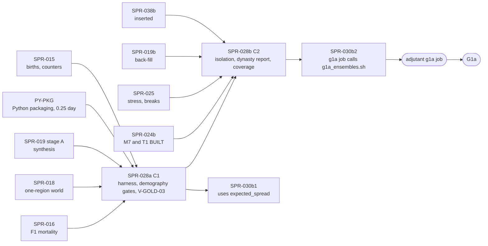

> **BLUF:** Builds M9 v0 (`docs/11` P1.10, `docs/11_roadmap.md:200`: "the isolation harness (V-SF-22), the demography and dynasty bands first, censoring-aware lifespans, 32-seed ensembles, the auto-generated run report"), the tool that turns G1a's statistical rows into evidence, plus BCK-002 A-15's coverage (ruling M-10). **Priority 1** under D62 (the director's execution priorities of 2026-10-18: the engine core first, then the viewer, then era packs; `docs/decisions-log.md:7`): this plan carries G1a's demography row (`:211`), its isolation row (`:212`) and the reported succession bands (`:214`). Two stages, each its own PR, Tester pass and audit:
> - **Stage A, PR `SPR-028a`** (C1), the harness:
>   - **the harness contract and its exact reference** (`specs/validation/`), reviewed independently before any product code (the review round is counted: ruling G14): the statistics of `docs/09` §1.2 and §3.1 in the standard library (t-intervals over seeds, a keyed seed-level bootstrap, Clopper–Pearson and exact Poisson intervals, TOST with a stated zero-variance rule, Kaplan–Meier, a Cox model **stratified by polity**, a logistic fit), with known answers from **R's `survival` outputs** (G14), and two population functions, `expected_rate` (the r_exp that M2's amended `[isolation]` expect (1) names "the harness's model of the same schedules, SPR-028") and `expected_spread` (the relative spread of a population count after y years), which SPR-030b1's population band also uses (one builder);
>   - `python/rehoboam_calib/`: readers of sealed runs through DuckDB (channel A only; **no keyframe reader**: ruling G11), the band evaluator with `docs/09`'s per-band verdict and the MOP-5 rule, an ensemble runner, the run report;
>   - **V-SF-01, V-SF-02 and V-SF-02b as gates** on a 32-seed ensemble of `fixture-demography_1000`, **V-SF-01 on the seed-mean r with a two-sided 99.9% t-interval**, as M2's `[isolation]` expect (1) now reads (A-62, PR #94), the population range reported with its expected spread (ruling G10: the per-seed range clause fails a correct build 69% of the time over 32 seeds);
>   - **V-GOLD-03's 32-seed CRN-paired comparison**, run by the Architect as a workflow dispatch on each C3 PR (a D61 item with `docs/13`'s text: ruling G12), with a `pull_request` path trigger for its smoke case.
> - **Stage B, PR `SPR-028b`** (**C2**: a test-only plane-A crate, ruling G13), isolation, dynasty and coverage:
>   - a forcing crate (`rh-sys-forcing`) on `lint_arch`'s engine list, which no golden world registers, driven by a typed forcing table whose `historical:<id>` files are hashed into the manifest (G13), and three isolation worlds, so **V-SF-22 runs for M2, M7 and `T1.minds`**;
>   - **the dynasty report** (V-SF-06, V-SF-06b, V-SF-06d reported), with reigns read from channel A (`SUCCEED`, `DEPOSED` and the holder's `DEATH`; payload `[title]`, K7: ruling G11), after SPR-024b puts M7 and T1 in `BUILT` (G19);
>   - **A-15's coverage** as a scheduled ratchet after a branch-coverage probe (D61 item 3).
>
> **Nothing in plane A changes for any golden world:** no system or contract changes; no baseline moves (`smoke`, `solo`, `household`, `hamlet` and, once SPR-030b1 lands, `twin_vales` byte-identical, an acceptance criterion). The full ensembles run in the `adjutant` session through `bin/g1a_ensembles.sh`, which SPR-030b2's `g1a` job calls; the PR tier carries unit tests and short runs, and a weekly hosted workflow the reduced ensembles and coverage.
>
> - **Developer:** AGT-002-TOOLS (the Python package, the reference port, the ensembles, the coverage job), with AGT-002-CORE for the forcing crate and the isolation worlds' registration. One Developer session may hold both roles.
> - **Testers:** AGT-003-STAT (the statistics, the bands, the verdicts, the sealed rule, V-SCALE-02), AGT-003-DET (the forcing series, determinism of reports and runs, the isolation worlds) and AGT-003-IF (the harness contract, the report format, the coverage gate, the workflows). One session may hold them, on a different model from the Developer's.
> - **Size and class:** **about 8.0–9.0 agent-days** (ruling G22: 7–9): **stage A about 4.0–4.5** (T-01 1.5–2.0 with the review round, T-02 1.5, T-03 0.75, T-04 0.25), **C1**; **stage B about 4.0–4.5** (T-05 1.75, T-06 1.75–2.0, T-07 0.5–0.75; T-05 and T-06 re-sized by S7: the `check_pin` edits, the constant-0 run set, the shared reign reader), **C2** by the forcing crate (G13). Both are above GOV-005 §3's ~3; stage A's spec review round is its natural checkpoint (D61 item 1).
> - **Status:** PLANNING, **revision 2**. Revision 0 (`dc39967`) had an independent review (REV-WAVE8 round 1: for this plan 2 MAJ, 3 MIN; rulings G1–G22); revision 1 (`1dfc563`) a re-check (round 2: this plan AFTER SMALL FIXES, 0 MAJ, 6 MIN, 1 NIT), whose rulings S1–S7, C6 and X1–X3 are applied here (the last section maps both rounds). It is written against `main` at `99a5b3d` (A-62 as PR #94; D62; PR #89's three CI parts; wave 7 as PR #95 with D58 waiting; the minds as PR #93 with D59 waiting; D60 approved), with the cross-plan rulings X1–X13. It needs the director's plan approval with the wave (D61).

# SPR-028 — The M9 validation harness v0 (WP P1.10; ruling M-10)

- **Roadmap item:** `docs/11` P1.10 (`docs/11_roadmap.md:200`), with BCK-002 A-15 by PRJ-002 ruling M-10 · **Phase:** P1a, G1a's statistical rows: V-SF-01, V-SF-02, V-SF-02b on a 32-seed ensemble (`docs/11_roadmap.md:211`), V-SF-22 for M2, M7 and `T1.minds` (`:212`), V-SF-06 and V-SF-06b reported (`:214`); `docs/09` §3.1's gate table (`docs/09_verification_and_validation.md:516–523`).
- **Depends on, by task** (ruling G19; the split sprints of X8, SPR-038's two stages; "merged" means on `main`):

| Task | Needs merged | Why |
|---|---|---|
| T-01 (stage A) | Nothing beyond `main` | A spec, a stdlib reference, a golden and an independent review |
| T-02 (stage A) | SPR-015 (`BIRTH`, `MARRIAGE`, `LIFE_ENTRY` parents, M2's counters through `--vitals`); **PY-PKG** (ruling S6: the Python packaging step, `package = true` and the layout, carved out of SPR-027 T-05 as a 0.25-day C1 PR that SPR-027 T-05, SPR-028a and SPR-029 consume; filed by the Architect at the close; `python/pyproject.toml:33` is `package = false` today); T-01's review | The readers and the package layout |
| T-03 (stage A) | SPR-016 (the F1 schedule and the density term); **SPR-019 stage A** (the synthesised population of `fixture-demography_1000`); SPR-018 (M1 F0 and S3 F0, so a one-region world places everyone in one settlement); SPR-038b recommended (the ensembles' per-instant cost) | The demography gates on a synthesised, one-settlement world |
| T-05 (stage B) | **SPR-024b** (M7 and T1 in `BUILT` together, X6, so an isolation world can register either through `rh-cli`); SPR-021b (its stub `T1.minds` sender of `ScheduleDeath`); SPR-022b (its stub M6 owner and scripted regicides); SPR-023 (its stub M7 owner and the fixture court); SPR-038b (`inserted()`, for the residence forcer: G13) | The forcers reuse those stubs; the worlds run real M7 and T1 |
| T-06 (stage B) | SPR-025 (stress, breaks, the cascade fixture); SPR-019b (`twin_vales`' genesis and **`worlds/twin_vales/`**, which SPR-019b creates: ruling X1, filed by the Architect at the close); SPR-021b (`bin/check_m7_successions.py`'s reader: S4); SPR-024b | V-SF-22's expect clauses; the dynasty report needs M7 and T1 running (G19) |
| T-07 (stage B) | Nothing beyond `main` | Coverage |

  - **What the dependencies mean for the order** (X9, G19): stage A, the demography half, can land as soon as SPR-015, SPR-016, SPR-018, SPR-019 stage A and PY-PKG are on `main`, in any gap between C3 merges; stage B lands after SPR-025. SPR-030b1 consumes stage A's `expected_spread`, so stage A precedes it; SPR-030b2's `g1a` job calls stage B's `bin/g1a_ensembles.sh`, so stage B precedes SPR-030b2.
  - **SPR-029 is not a dependency** of either stage (G11): nothing here reads a keyframe.
- **Binding contracts:**
  - `docs/09` §1.2 (`:69–91`: TOST, margins stated before the run, the seed as the unit, Clopper–Pearson, Wilson); §3.1 (the band tags, held-out bands `:443`, V-SF-01 `:463` (method: "Seed-mean r with t-interval; population range per seed"), V-SF-02 `:464`, V-SF-02b `:465`, V-SF-06 `:476`, V-SF-06b `:477` ("Cox model on simulated reigns stratified by polity, natural death and foreign conquest censored"), V-SF-06c `:478`, V-SF-06d `:479`, V-SF-07 `:480`, V-SF-22 `:501`, V-SF-23 `:502`, V-SF-24 `:503`, V-SF-25 `:504`, the gate rule and phasing `:506–513`, the gate table `:516–523`, non-ergodicity reporting `:524–530`); V-GOLD-02 and V-GOLD-03 (`:149–150`); V-SCALE-02 (`:660`); §4's run report (`:692`).
  - `docs/13` §4.2 (the C3 row, `:97`; the tier table's "Stylized facts | 32-seed CRN-paired ensemble on every C3 PR; full ensemble nightly", `:113`); GOV-002 §1 law 11 (held-out stays held out, `GOV-002_TestingProtocol.md:34`), tier 13 (`:53`), §3 coverage (`:59–66`); GOV-005 §6; GOV-008 (`:31`: the Free plan's about 2,000 Actions minutes a month; nightly heavy work on `adjutant`).
  - The `[isolation]` tables: M2 (`specs/systems/next/M2.demography.odd.toml:973–981`), **whose expect (1) A-62 amended (PR #94; ruling G10)**: a 1,000-founder start with ages uniform in [0, 60), "GATED on the seed-mean growth rate": with r_s = ln(N_1000 / N_0) / 1,000 per seed, r_mean inside the two-sided 99.9% t-interval r_exp ± t(0.9995; 31) × s_r / √32 and inside V-SF-01's band, r_exp being M2's own expected rate for that start from "the harness's model of the same schedules, SPR-028"; each seed's N_1000 / N_0 "REPORTED, not gated" against its expected spread (`:981`); M7 (`specs/systems/M7.dynasty.odd.toml:840–847`; the next draft `specs/systems/next/M7.dynasty.odd.toml:849–856`), T1 (`specs/systems/T1.minds.odd.toml:1023–1030`); `specs/systems/lint_odd.py:152` (`SERIES`) and `:1103–1116`; M2's declared aggregates (next M2 `:542`) and `density_mortality_slope`'s source (`:798`); `specs/demography/infant_sub_schedule.toml:17`.
  - M7's `[[emits]]` for the reign reader: `SUCCEED` (actor the successor, target the predecessor, `triggered` to the death or deposition: next M7 `:349–351`), `DEPOSED` (actor the leading claimant, target the ruler: `:357–359`), `INTERREGNUM_CRISIS` (`:353–355`); payloads `[title id]` on every M7 kind but `HOUSE_EXTINCT` (SPR-021's ruling K7, in its revision-1 draft `b2c6fb1`).
  - The references the bands are computed against: `specs/demography/selftest_m2_f1_mortality.py` (`compile_schedule`, `ell`), `specs/demography/selftest_brass.py`, `specs/demography/selftest_m2_f1.py` (the widowhood chain: NRR, r, T), and `specs/worldgen/golden/population_projection_v0.txt`'s `rates` line (as A-62 regenerates it: `r_c`, `generation_years`).
  - `worlds/smoke/` and `crates/rh-sys-smoke` (the test-only system pattern); `bin/lint_arch.py:378–404` (`ENGINE_CRATES`); `05.1` §2 rule 2 (absent owners give their `neutral`); `crates/rh-golden/src/world.rs:124–135` (`FIXTURE_PREFIX`: `fixture-<name>` lives in `tests/worlds/<name>`).
  - ADR-0024, ADR-0026, ADR-0033.
- **System specs:** none changed by this plan. **Finding F-19** (stated, ruling G21): V-SF-22 is "required for each system before its in-couplings are switched on (P1a, P1b)" (`docs/09:501`), but in P1a M7 and T1 are coupled in SPR-024b (X5, X6), before stage B runs their isolation, so the order the row states cannot hold in P1a. **Proposed (8/10):** the Architect adds to V-SF-22's method: "P1a: gated at G1a by SPR-028b, after the couplings of SPR-024b; from P1b, before a coupling is switched on". Findings F-12 and F-13 record text for M2's next version (both accepted in round 1); F-14's K rule is G10's.
- **Rulings (binding):** REV-WAVE8 round 1, **G1–G22** (the Architect, 2026-10-18), with X1–X13, SPR-038's S1–S16 and T1–T11, A-62's E1–E12 and wave 7's K2, K7 and K21; REV-WAVE5 D-8; SPR-012's q(15) ruling (a 99.9% band per fixed seed set over 32 fixed seeds); REV-SPR-016 W18; D41 (V-SF-24 and V-SF-25 reported at G1a, gated from G1b); D34; REV-WAVE6 X1, Z1; RT-037 as adapted.
- **Director items:** D61 (items 1, 3, 4, 6, 8 and 9 touch this plan: the split, coverage, the sealed bands, the `adjutant` session, CI and the minutes, the forcing crate's class and V-GOLD-03 as a dispatch).
- **Requirements covered:** SIM-3's `M9.validation` at P1a (`docs/03_requirements.md:46`); MOP-5's G1a bands; EVO-3's per-system isolation (V-SF-22); GOV-002 tier 13 and §3 (coverage); DET-2 and ADR-0026 through V-GOLD-03's CRN pairing of seeds.

## Specs this sprint needs

| Spec | Exists? | Gap | Architect ruling | Needed by |
|---|---|---|---|---|
| **The harness contract** | `docs/09` §1.2, §3.1, §4 in prose | No executable statement of each statistic, its unit, interval, minimum, verdict rule, report format or sealed rule | **Accepted (round 1; G14, 85%): T-01 writes it, and an independent reviewer reviews it before T-02's code** (W30's pattern), the round counted in T-01's size: `specs/validation/harness_v0.md`, `bands_v0.toml`, `forcing_v0.toml`, `selftest_harness_v0.py` (standard library only) with `golden/harness_v0.txt` | T-01 |
| **Known answers (G14)** | Revision 0 proposed "published values to six significant digits" from textbook tables | Tables print 3–4 digits | **Ruled (G14, 85%): R's `survival` outputs are the reference.** One committed transcript, `specs/validation/golden/r_reference_v0.txt`: the R and package versions, the commands, and the outputs printed with `digits = 15`: `survfit` and `coxph(…, ties = "breslow")` on the Freireich 6-MP remission data (`survival`'s `gehan`), a stratified `coxph` on a two-stratum synthetic set, `qt` at 7 and 31 degrees of freedom, `qbeta` and `qchisq` at the intervals' quantiles. It is produced once by whoever has R (the commands are committed, so it can be re-run) and is data, not a CI dependency; the reference reproduces each figure to 10⁻⁹ relative | T-01 |
| **The forcing series are prose (finding F-9)** | `lint_odd.py` checks a series' head word only (`:152`, `:1108–1110`); M7's step values are in `note` (`M7.dynasty.odd.toml:842`); `historical:fixture_regicides` (M7 `:844`) and `historical:court_deaths` (T1 `:1027`) name no file | A harness cannot read the series from the specs | **Accepted (round 1; G13, 75%): a typed table outside the specs,** `forcing_v0.toml` keyed by `(system, input)`: `constant:<value>`, `step:<v0>-><v1>@year<y>`, `historical:<id>` naming `specs/validation/forcing/<id>.toml`, each citing its spec line; `lint_forcing.py` checks both directions; `sine` and `ramp` refused in v0. **The `historical:<id>` files are pinned with the manifest** (G13, ruling S2): `manifest_hash` is computed in `rh-golden`, not in `rh-manifest` (which has no SHA-256), so **`check_pin`** (`crates/rh-golden/src/world.rs:141`, a tool crate) is extended to pin each named forcing file's SHA-256 beside the manifest's in the world's `world.toml`, and replay's check refuses a run whose forcing digest differs; `rh-manifest` reads the series as compiled parameters. The edits this needs (`specs/manifest/manifest_v0.py` accepting the forcing reference, the Rust loader parity gate V-WC-04, replay's check) are named in D61 item 9. A run stays a function of its history tuple (ADR-0025) | T-01, T-05 |
| **Held-out bands (finding F-10)** | V-SF-06c and V-SF-07 are held-out (`docs/09:443`); GOV-002 law 11 (`:34`); A-04 is not P1a | M7's expect asks V-SF-06c "computed but sealed" (`M7.dynasty.odd.toml:847`) | **Accepted (round 1; D61 item 4, 80%): sealed means not computed.** The evaluator prints `SEALED (A-04; held-out, docs/09 §3.1)` with no statistic, interval or sample size; a test greps every report for a held-out band's statistic name followed by a number | T-01, T-02 |
| **V-SF-01: what gates, and K (findings F-13, F-14; ruling G10)** | V-SF-01: "mean r ∈ [−0.1, +0.3]%/yr; population ∈ [0.3, 5]·K"; method "Seed-mean r with t-interval; population range per seed" (`docs/09:463`); M2's expect (1) (next M2 `:981`, as A-62 amended it) | **A correct build fails the per-seed population clause** (REV-WAVE8 G10): growth over 1,000 years is about 3.1 times at M2's r, and a single seed's spread is wide (the review's female-line Leslie simulation: sd(ln N) 0.31 at year 1,000 for 500 women, a lower bound), so P(N > 5 × start) is about 3.6% per seed and **about 69% that one of 32 seeds exceeds it**. K is undefined for an uncapped world (F-14) | **Ruled (G10, 85%).** **V-SF-01 gates on the seed-mean r:** its two-sided 99.9% t-interval over 32 seeds (t(0.9995; 31), the interval M2's amended expect (1) uses) lies in [−0.1, +0.3]% a year. **The population range is reported, not gated:** each seed's N(y)/N₀ beside [0.3, 5]·K, with **the expected spread** (`expected_spread`, the next row) and the expected number of seeds outside the range; K = `density_capacity` where the manifest sets one (`kingdom_10k`, 10,000: R1a), else no K, and the range is reported against N₀ e^(r y). **M2's `[isolation]` expect (1) was amended the same way by A-62** (PR #94), with r_exp from this harness (the next row). **F-13 (uniform ages) is settled by that text:** expect (1) keeps a start with ages uniform in [0, 60), so the M2 isolation world gives them through an explicit 1,000-founder cast (cast entries carry `age_years`: `specs/manifest/examples/household.yaml:33–35`), while the V-SF-01 and V-SF-02 gate world, `fixture-demography_1000`, is synthesised from the stationary marginal (SPR-019 P2–P4) | T-01, T-03, T-06 |
| **`expected_rate` and `expected_spread` (one builder; SPR-030b1 consumes the second)** | M2's expect (1) (`:981`) names this harness as the model that gives r_exp, "adding the uniform start's transient and the difference between the mean of the log and the log of the mean"; the review's simulation (`mc.py`) | No contract states either | **Proposed (7/10):** `harness_v0.md` states **r_exp(start, y) = (ln(E[N_y] / N_0) − s(y)² / 2) / y**, where E[N_y] is the mean projection of the start's female age distribution under the compiled F1 schedules (the stable rate of `selftest_m2_f1.py` check 5's widowhood chain, reached from the start through its transient), and **s(y)² = (b + d)(1 − e^(−r y)) / (r F₀)**, the relative variance of a linear birth-and-death process, with F₀ the women alive at the start and b, d the stationary crude birth and death rates of the compiled schedule at r (the golden's `r_c`). The drafter checked it against a female-line Leslie Monte Carlo of the compiled e0-30 schedule, and the round-2 re-check reproduced it: the simulated sd of ln N lies within a factor 0.85–1.13 of s(y) over 50–1,000 years and three population sizes (REV-WAVE8 round 2 §4 (b); revision 1's "within 5%" was optimistic: 9.7% at 500 years). The report uses it with a stated factor of 1.25 for what it omits (the second sex, the marriage market) | T-01, T-03 |
| **The statistics: the standard library or a dependency** | GOV-003 §3 (`GOV-003_CodingStandard.md:49`) | t, beta and gamma quantiles; KM; stratified Cox; logistic; a keyed bootstrap | **Accepted (round 1; 7/10): standard library, ported from the reference** (SPR-027 T-05's pattern); numbers printed to six significant digits; an interval endpoint within 10⁻⁹ relative of a band edge is MARGINAL; the bootstrap draws from SHA-256 of `(seed set, band, resample index)` | T-01, T-02 |
| **TOST with zero variance (G14)** | `docs/09` §1.2 | The identical-ensemble control has every paired difference 0, so the t-interval divides by a zero standard error | **Ruled (G14):** if every paired difference is exactly 0, the verdict is EQUIVALENT with the interval [0, 0]; if the differences have zero variance and a non-zero mean d, the interval is [d, d] and EQUIVALENT iff \|d\| < δ; no t-interval is computed with a zero standard error | T-01 |
| **How the harness reads a run (ruling G11)** | Sealed segments are Parquet readable by DuckDB (`specs/stream/check_segments.py`); M2's counters print on the `--vitals` stdout line (SPR-015 T-06) | Revision 0 read M7's tenure rows "at the horizon" through a keyframe reader that does not exist: SPR-029 rebuilds genesis because Python cannot read Arrow IPC with zstd (its F-2), and run-directory keyframes come every 10 years (`crates/rh-golden/src/stream.rs:13–21`), so a 305-year run has none at its horizon | **Ruled (G11, 85%): channel A only, through DuckDB; no keyframe reader.** Births, deaths, ages, marriages, households and the living count from `LIFE_ENTRY`, `LIFE_EXIT`, `EVENT` and `STEP_DIGEST`; M2's counters from the `--vitals` stdout line, which the ensemble runner captures to a file, **read by key** (G14, S7); **reigns from M7's events** (T-06), **through SPR-021b's channel-A reader in `bin/check_m7_successions.py`** (`SPR-021_SuccessionF1.md:238`: it reads channel A, "no keyframe decoder"), imported rather than rewritten (ruling S4): for each title (payload `[title id]`, K7), a reign starts at a `SUCCEED` (holder: its actor; predecessor: its target) and **ends at the tick of the event that triggered the next `SUCCEED`, or of the `DEPOSED`**, whose target is the holder (the holder's `DEATH`, with its cause, or the `DEPOSED`: S4), right-censored at the horizon; **a genesis reign** enters at tick 0 (left-truncated: its back-filled years are not exposure, being history the back-fill wrote, not M7's hazards) and its holder is the first event's target on the title | T-02, T-06 |
| **V-SF-06b's stratified Cox in P1a worlds (finding F-25, new)** | V-SF-06b: "Cox model on simulated reigns stratified by polity" (`docs/09:477`) | In every P1a world each polity has one law for the whole run (`twin_vales`: primogeniture and tanistry, one per polity), so within a stratum the law never varies and the law's hazard ratio is **not identified** in a model stratified by polity | **Proposed (7/10):** the harness implements docs/09's stratified model, and on P1a worlds it reports V-SF-06b's HR as INSUFFICIENT with the reason "law constant within every stratum"; the deposition shares by law (Clopper–Pearson) are reported as V-SF-06b's P1a evidence, and an unstratified Cox HR is printed **without a confidence interval**, labelled "descriptive; not docs/09's method" (ruling S5: robust errors clustered on two or three polities cannot be estimated). The Architect decides whether `docs/09` gains a P1a note (V-SF-06b is reported, not gated, at G1a) | T-01, T-06 |
| **V-GOLD-03's ensemble (finding F-8; ruling G12)** | `docs/13` §4.2's C3 row and its tier table (`:113`: "32-seed CRN-paired ensemble on every C3 PR"); V-GOLD-03 (`docs/09:150`); GOV-002 tier 13 | Six plans give the ensemble to SPR-030 (`SPR-014_LifecycleQueues.md:282`, `SPR-015_BirthsF1.md:241`, `SPR-016_MortalityF1.md:186`, `SPR-018_WorldgenLite.md:220`, `SPR-019_PopulationSynthesis.md:230`, `SPR-020_EventEnvelope.md:347`); a workflow added in a PR is likely not dispatchable before it is on the default branch | **Ruled (G12, 80%): this sprint builds it (T-03), and it runs as an Architect-run `workflow_dispatch` on each C3 PR** (a D61 item 9 decision, since `docs/13:113` reads as an automatic PR-tier run: the Architect amends that row to "the Architect dispatches the 32-seed CRN-paired comparison on every C3 PR and attaches its report"). `.github/workflows/ensemble.yml` also has a **`pull_request` trigger on its own paths** (the workflow file, `python/rehoboam_calib/**`) running a smoke case, so the PR that adds it exercises it. The mutant comparison runs weekly. From this sprint's merge on, the Architect runs it for every C3 merge (by X9's graph, at least SPR-024b and SPR-030b1); the six plans' "(SPR-030)" read "(SPR-028)" at their next revision | T-03 |
| **The forcing crate's class (ruling G13)** | `rh-sys-smoke` precedent (`bin/lint_arch.py:395`) | A new plane-A crate, an `ENGINE_CRATES` edit and stub owners of real columns (`polity.exec_constraint`, `house_member.*`, `person.residence`) | **Ruled (G13, 75%; D61 item 9): C2,** with the `ENGINE_CRATES` edit reviewed and a stated rule, checked by a test, that **no golden world registers a forcing system** | T-05 |
| **Coverage (finding F-11; A-15)** | GOV-002 §3 (`:59–66`): line ≥ 80%, branch ≥ 75%, "CI blocks merge" | The pinned toolchain is stable 1.97.0 (`rust-toolchain.toml`); stable branch coverage is unverified there; an instrumented build and suite cost several minutes | **Accepted (round 1; D61 item 3, 65%): a scheduled ratchet, after a branch-coverage probe.** T-07 first probes branch coverage on the pinned toolchain and records the answer; then the weekly `validation` workflow measures; floors are written by the tool in `[coverage-baseline]` commits; a crate below its floor fails the run, which blocks the next merge that touches it. D61 item 3 calls the ratchet nightly; by G20's minutes it is weekly on hosted runners (item 8) | T-07 |
| **M2's calibration hook (finding F-12)** | `density_mortality_slope`: "a design value until SPR-028 calibrates it" (next M2 `:789`) | Calibrating changes a Registry default (C3) and needs A-04 first | **Accepted (round 1): report only.** V-SF-01 on `kingdom_10k` at the default slope 1; calibration is P1b after A-04 | T-03 |
| **What the report holds in v0** | `docs/09` §4 (`:692`) | Liveness, bad-run metrics, arcs and firing budgets need P1b and P2 | **Accepted (round 1; 8/10):** run identities, the stylized-fact table, the MOP-5 summary, the non-ergodicity lines (`docs/09:524–530`), M2's declared aggregates (`:533`), the infant first-month share, the age-at-death distribution (A-48's evidence), wall times; the rest named "not in v0" in the report | T-02 |
| **CI and where the ensembles run (ruling G20)** | PR #89's three parts; its first run: core 10:00, golden 7:10, stream 7:32 | Revision 0 used two parts and added a daily hosted `validation` job | **Ruled (G20, 80%):** the "CI by part" section below | T-04, T-07 |

## CI by part (X10; ruling G20)

**The base** is PR #89's first CI run (`a4be717`): **core 10:00, golden 7:10, stream 7:32**. Sums are gate sums on one runner; ×1.5 is the slow-runner budget. Run-directory readers go to `stream`, which builds its own release `rh-cli` and its own `solo`, `household` and `hamlet` run directories (`stream_inputs`).

| Stage | Part `core` | Part `golden` | Part `stream` | ×1.5 (core / golden / stream) |
|---|---|---|---|---|
| A | +9 s: `selftest_harness_v0.py` (about 5 s), `lint_forcing.py` and its four controls (about 1 s), the package's unit tests (about 3 s) | — | +10 s: V-SCALE-02 over the three run directories (about 4 s); V-GOLD-03's null comparison of two 4-seed × 20-year `household` ensembles from the stream part's `rh-cli` (about 6 s) | +14 s / — / +15 s |
| B | +4 s: the forcing crate's unit tests; `lint_odd` and the skeleton check on the isolation specs; `coverage_gate.py`'s unit tests and controls | +30 s: one short wiring run per isolation world, release (M2 50 years, M7 50 years, the court 10 years) | — | +6 s / +45 s / — |
| **Total** | **+13 s** | **+30 s** | **+10 s** | **+20 s / +45 s / +15 s** |

**Off the PR tier.** The allowance of hosted Actions minutes is D61 item 8's question to the director (ruling X3), so this plan states minutes per run and enters them in **PRJ-002's nightly ledger, which the Architect keeps** (X2). It adds **nothing to the daily nightly**, and:
- **a weekly hosted workflow `.github/workflows/validation.yml`** (a weekly `schedule`, `workflow_dispatch`, and **a `pull_request` trigger on its own paths** (the workflow file, `python/rehoboam_calib/**`, `specs/validation/**`) running a reduced case: ruling C6), each job `timeout-minutes: 45`, **split into two jobs if a subtotal passes 45**:

  | Item | Stage | Subtotal, the drafter's estimate before measurement |
  |---|---|---|
  | `fixture-demography_1000`, 32 seeds × 300 years (V-SF-02, V-SF-02b gated) | A | 2–5 minutes |
  | The mutant builds and checks: `mutant-m2-fertility-x2` (V-SF-01's r, 8 seeds × 100 years; V-GOLD-03's planted effect), `mutant-m2-e0-plus-15` (V-SF-02, V-SF-02b) | A | 6–10 minutes |
  | `expected_spread`'s simulation re-run (`selftest_harness_v0.py --resim`: S3) | A | 1–2 minutes |
  | The reduced isolation ensembles, 8 seeds × 200 years per system; the M7 and T1 mutants | B | 8–15 minutes |
  | Coverage (`cargo llvm-cov` and `coverage.py`) | B | 15–20 minutes |
  | **The reduced `pull_request` case:** `fixture-demography_1000`, 4 seeds × 50 years, through `ensemble` and `report`; one isolation world for 20 years | A, B | 3–5 minutes |

  The weekly items total 32–52 minutes, so coverage runs as its own job if the measured total passes 45. **"First run green within 45 minutes" is not a merge gate:** the first post-merge dispatch is recorded by the Architect at the audit (C6);
- **`ensemble.yml`**'s `pull_request` smoke case, which runs only when its own paths change (a two-seed, ten-year comparison, about 2 minutes);
- **the G1a ensembles** in `bin/g1a_ensembles.sh`, run by SPR-030b2's `g1a` job on `adjutant` (no hosted minutes).

## Compliance (every task)

| Rule | This sprint |
|---|---|
| Change class (`docs/13` §4.2) | **Stage A: C1** (tooling and tests; no contract, Registry, event schema, IF-x or ownership change; no `state_hash` change on any golden world). **Stage B: C2** (ruling G13): `rh-sys-forcing` is a new plane-A crate of test-only systems on `ENGINE_CRATES` by a reviewed `lint_arch` edit (as `rh-sys-smoke`, `bin/lint_arch.py:395`), registered only in `tests/worlds/isolation_*` worlds, its systems' specs under `tests/worlds/isolation_specs/` with their own overlay outside the Registry; `check_pin` pins the forcing files' digests for worlds that name them (S2). No golden world's `state_hash` moves (acceptance) |
| Planes touched (ADR-0024) | **Tool:** `python/rehoboam_calib/`, `rh-golden` (the isolation worlds' registration), `specs/validation/`, `bin/check_all.sh`, `bin/g1a_ensembles.sh`, `.github/workflows/validation.yml` and `ensemble.yml`. **A:** `rh-sys-forcing` (test-only systems); `rh-manifest` (the forcing digests); `rh-sys-demography` (one mutant feature). **B, C:** none. The harness reads plane A at rest and writes reports no plane-A code reads (V-PLN-01) |
| Owned columns written | Only by `rh-sys-forcing`'s systems, in isolation worlds, each owning the column it forces there while the real owner is not registered; never in a golden world (the G13 test) |
| Reads (via `rh-contracts`) | None at run time beyond each forcer's own column; the residence forcer reads the instant log's `inserted()` (SPR-038b) |
| RNG purposes added | None expected (the scripted series are deterministic); none in the harness, whose bootstrap is a SHA-256 stream outside the engine |
| Golden-hash effect | **None.** `smoke`, `solo`, `household`, `hamlet` (and `twin_vales` if on `main`) byte-identical at 1 and N threads, headers included. The isolation worlds have no baseline |
| Fixed-point quantities | None new in plane A. The harness computes in Python floats in the tool plane, with the MARGINAL rule at band edges |
| Determinism lints (GOV-003 §2, §3, §6) | `lint_arch` (the new crate placed), `lint_forbidden` (no float, no file I/O in the forcers: a historical series reaches a forcer through the compiled manifest, A-51's rule) and the hidden-state rule (W31) green; `ruff` and `mypy --strict` on the package |
| Mutant features (A-52; S7) | Each a `mutant-*` Cargo feature, compiled out of every baseline build and of `check_all`'s default build: `mutant-m2-e0-plus-15` (`rh-sys-demography`, planted here, T-03); `mutant-m2-fertility-x2` (`rh-sys-demography`, SPR-019b T-07's feature, renamed from `mutant-manor-fertility-x2` by the Architect at this close under F-20: `SPR-019_PopulationSynthesis.md:194`); `mutant-m7-murder-x3` (`rh-sys-dynasty`, planted here, T-06); `mutant-forcing-step-ignored` (`rh-sys-forcing`, T-06); SPR-025's grief mutant (its own V-SAGA-16b control). Each is built only by `validation.yml`'s weekly jobs |
| Tests that gate this sprint | V-SF-01 (the seed-mean r), V-SF-02, V-SF-02b (gates on `fixture-demography_1000`'s ensemble), V-SF-22 (M2, M7, T1), V-SCALE-02, V-GOLD-03 (the comparison, on a planted effect and a null), V-SAGA-16 and V-SAGA-16b (T1's expect, re-run), V-PLN-01, V-GOLD-01 (unchanged baselines), GOV-002 §3 (the coverage floors), plus `bin/check_all.sh`. **Reported, not gated:** V-SF-01's population range, V-SF-06, V-SF-06b, V-SF-06d, V-SF-24, V-SF-25, M2's declared aggregates, the age-at-death distribution |
| Docs updated in the same stage | `bin/check_all.sh` and `python/tests/test_check_all_inventory.py` (same commit); `CLAUDE.md` (the reference, the forcing lint, the harness commands, the isolation worlds' lint and skeleton lines); `docs/09` V-SF-01 (G10's method line), V-SF-22 (F-19's note), V-SF-06b (F-25, if the Architect rules a note), V-GOLD-03 and §4 (the method lines and the v0 report); `docs/13:113` (G12's dispatch); GOV-002 §3 (the director's ruling on F-11); `05.0` §6 (`rehoboam_calib` built); `docs/14` (no dependency added; ports noted); BCK-002 A-15 (done), A-04 (the sealed rule waiting for it); PRJ-002's rows |

**Rules carried from P0–SPR-019 (every task):**
- **A statistical gate is stated before the run** (`docs/09` §1.2 rule 2): every band's method, minimum and verdict rule is in `bands_v0.toml` before T-03's first ensemble; nothing is changed after seeing a result, and a change is logged in `docs/decisions-log.md`.
- **Fixed seeds, not flaky gates:** an ensemble runs seeds 1–32 (or the stated subset), so a verdict is a deterministic function of the build; **a gate must be true for a correct build at the rate stated** (W2, X5, V1): a clause whose false-alarm rate over the ensemble is not small is reported, never gated (G10's lesson).
- **A positive control fails for the right reason;** every planted mutant fails a named check, and the plan states why it is observable.
- **A test input exercises the path it claims, and a probe asserts it:** each forced series is read back from its column at every year end; the M7 isolation records at least one murder and one deposition per law; the demography world records at least 400 births per seed.
- **No O(rows) work per instant** (REV-WAVE6 X1): the harness works after the run; a forcer does O(1) work per pulse, or O(events) for a script; the residence forcer reads `inserted()`, never scans.
- **No typed golden numbers:** a figure a gate uses is read from its golden or computed by the reference (G4's rule, shared).
- **Python tests read no CI environment variable.**
- **CI time (W42, Z1, X10):** per part of three, ×1.5 for slow runners; each new gate in exactly one part; run-directory readers in `stream`.
- **Merge `origin/main` when main moves;** **batch pushes at task boundaries;** **one commit per task** (GOV-005 §4).

## Tasks

**Stage A** (`SPR-028a`) is T-01 to T-04. **Stage B** (`SPR-028b`) is T-05 to T-07.

#### T-01: The harness contract, its exact reference and its review (`specs/validation/`; F-9, F-10, F-13, F-14, F-25; G10, G14; 1.5–2.0 days)
- **Deliverable:**
  - `specs/validation/harness_v0.md`: the conventions of `docs/09` §1.2 made exact (the unit is the seed; t-intervals with the t quantile computed, not tabled, at the level `bands_v0.toml` states per band: **two-sided 99.9% for every gated band** (V-SF-01's r, V-SF-02, V-SF-02b) and for M2's expect (1), as SPR-012's q(15) ruling and that text use (ruling S1); 90% for reported bands; the seed-level bootstrap of 10,000 resamples keyed by SHA-256; Clopper–Pearson; the exact Poisson interval; TOST at a stated δ with **the zero-variance rule**; the per-band verdict: PASS, FAIL, MARGINAL within 10⁻⁹ relative of an edge, INSUFFICIENT below the minimum); the estimators (cohort q(15) with right-censoring at the horizon; the period life table and l(65)/l(15); r_s = ln(N_y / N_0) / y per seed, M2's expect (1)'s definition (`:981`), used for V-SF-01 too; Kaplan–Meier; **the Cox partial likelihood with Breslow ties, stratified**; the logistic fit); **`expected_rate` and `expected_spread`** (the specs table's row); the reign model of G11 (left truncation at tick 0, right-censoring at the horizon); the sealed rule; the report format `rehoboam/m9/report/v0` (canonical ASCII lines in a fixed order, a SHA-256 digest last); the V-GOLD-03 comparison.
  - `bands_v0.toml`: per P1a band (V-SF-01, 02, 02b, 06, 06b, 06c, 06d, 07, 22, 24, 25), its tags, statistic, unit, minimum, world and length, interval and verdict use (gate, report, sealed); **V-SF-01 split into `r` (gate) and `population_range` (report)**.
  - `forcing_v0.toml`, `forcing/<id>.toml` and `lint_forcing.py` (F-9; the specs table's row).
  - `selftest_harness_v0.py` (standard library only) and `golden/harness_v0.txt`; `golden/r_reference_v0.txt` (G14).
  - **The independent review** (`REV-SPR-028-harness`), and the Architect's rulings applied, before T-02 lands; the round is in this task's size.
- **Acceptance:**
  - **Known answers:** closed forms hit to 10⁻¹² (Clopper–Pearson's upper bound for 0 events in n trials at two-sided 95% is 1 − 0.025^(1/n); the exact Poisson upper bound for 0 events is −ln 0.025; KM with no censoring equals the empirical survival function; a TOST of identical paired samples is EQUIVALENT with the interval [0, 0] by the zero-variance rule, and a TOST of samples differing by a constant d is EQUIVALENT iff \|d\| < δ); **every figure of `r_reference_v0.txt`** (KM, the Cox coefficient and its standard error on `gehan`, the stratified fit, the t, beta and chi-square quantiles) to 10⁻⁹ relative.
  - **The rate:** `expected_rate` at the M2 isolation world's start (1,000 founders, ages uniform in [0, 60)) and at a stationary start, y = 1,000, is printed with its three terms (the stable rate, the transient, the log correction); at the stationary start the transient term is 0 to the printed digits, and the stable rate equals `selftest_m2_f1.py` check 5's.
  - **The spread:** `expected_spread` at F₀ = 500 and y = 100, 300, 1,000 is printed beside the sd of ln N from a seeded female-line Leslie simulation (standard library, 400 replicates, SHA-256-keyed); **the simulation's results are recorded in the golden and recomputed only with `--resim`** (weekly; ruling S3: 400 replicates take at least 12 s in Python), so `--check` compares the formula with the recorded figures, and fails if they differ by more than 25% at any y ≤ 300.
  - **The synthetic ensemble:** 32 synthetic seeds with a planted q(15) of 0.45 and censoring at a horizon give PASS for V-SF-02; the `km-ignores-censoring` control (censored children counted as survivors) fails by name; 12 seeds of 300 births give INSUFFICIENT (the `minimum-ignored` control fails); a held-out band prints `SEALED` (the `heldout-printed` control fails the grep check); two runs give the same report bytes under different `PYTHONHASHSEED` values (the `bootstrap-unkeyed` control fails); **32 synthetic seeds with r = +0.114% and the spread of `expected_spread`** give PASS for V-SF-01's r and a reported population range, never a FAIL (the `range-gated` control, which gates the range per seed, fails on the same input in at least one of three fixed synthetic seed sets, which is G10's point made executable); a synthetic two-polity reign set with one law per polity gives V-SF-06b INSUFFICIENT with "law constant within every stratum" (F-25), and a set with a law change inside one polity gives an HR.
  - `lint_forcing.py` passes on the real specs and fails, by name, on four plants (an `[isolation]` forcing with no typed entry, a head word that differs, a rate read neither forced nor neutral, a `sine` series).
  - The review is recorded and its rulings applied before T-02 lands.
- **Status:** [ ] not started

#### T-02: `rehoboam_calib`: the statistics, the readers, the band evaluator and the report (G11, G14, G18; 1.5 days)
- **Deliverable:**
  - `python/rehoboam_calib/`, in the uv project's package layout that PY-PKG sets up (G18, S6: this task starts after PY-PKG is on `main`): `stats` (the port of T-01's reference), `read` (a run directory: DuckDB over the sealed segments for `LIFE_ENTRY`, `LIFE_EXIT`, `EVENT` with payloads and edges, `STEP_DIGEST`; the `--vitals` stdout line, captured by the runner, **parsed by key**), `bands`, `report` (`rehoboam/m9/report/v0` and a Markdown rendering).
  - `python -I -m rehoboam_calib report --runs <dir>… --bands <ids> --out <dir>`.
  - **V-SCALE-02:** `report` on the stream part's run directories of `solo` (N = 1), `household` (6) and `hamlet` (60).
- **Acceptance:**
  - **Equal to the reference:** the package's report on T-01's synthetic ensemble equals `golden/harness_v0.txt` byte for byte; every known answer of T-01 is a unit test of the package.
  - **On real runs, against independent counts:** on `hamlet`'s 200-year run directory, the package's births, deaths and age-at-death histogram equal an independent count by the Tester's own DuckDB query over the same segments; a `--vitals` file with its fields reordered gives the same report (read by key).
  - **V-SCALE-02:** on the three rungs every band reports INSUFFICIENT or a valid result, none passes or fails below its minimum.
  - **The sealed rule holds on real reports:** no report the package writes contains a V-SF-06c or V-SF-07 statistic.
  - **Determinism:** the report of a run set is byte-identical in two processes under different `PYTHONHASHSEED` values; the package reads no environment variable and no clock (a grep test).
  - `ruff` and `mypy --strict` clean; no dependency added (the lock changes only as PY-PKG's packaging makes it change for a new package).
- **Status:** [ ] not started

#### T-03: Ensembles, the G1a demography gates, V-GOLD-03's comparison (F-8, F-12, F-14; G10, G12; 0.75 day)
- **Deliverable:**
  - `python -m rehoboam_calib ensemble --world <w> --seeds 1-32 --years Y --jobs J --out DIR`: one `rh-cli run --seed s --threads 1 --years Y --run-dir DIR/seed-s --vitals` per seed, `J` at a time, then `report`. A failed run stops the ensemble with the seed named.
  - `tests/worlds/demography_1000/` (world name `fixture-demography_1000`: `crates/rh-golden/src/world.rs:124–135`): 1,000 synthesised persons, one region (`flat`, `region_count: 1`, so M1 F0 gives one settlement and N4's pool is the world), the Registry's M2 defaults, M2, M1 and S3 registered.
  - **The G1a demography gates:** V-SF-01 (r), V-SF-02 and V-SF-02b on `fixture-demography_1000`, 32 seeds × 1,000 years (in `bin/g1a_ensembles.sh`, for the session), and 32 seeds × 300 years for V-SF-02 and V-SF-02b (weekly); V-SF-01 on `kingdom_10k` (K = 10,000), 32 seeds × 1,000 years, reported (the session).
  - **`mutant-m2-e0-plus-15`** (`rh-sys-demography`, the schedule compiled at e0 + 15), planted here.
  - **V-GOLD-03:** `python -m rehoboam_calib compare --before DIR --after DIR` and `.github/workflows/ensemble.yml`: `workflow_dispatch` (base and head refs, the worlds, 32 seeds × 200 years each), and a `pull_request` trigger on its own paths that runs the smoke case (2 seeds × 10 years of `household`, base = head, so EQUIVALENT with zero differences).
- **Acceptance:**
  - **The identity bands pass on a correct build** (`docs/09:439`): on `fixture-demography_1000`, V-SF-02's seed-mean q(15) and its two-sided 99.9% t-interval lie in [35%, 55%] (the F1 schedule at e0 30, β 1 gives q(15) = 0.4443 by `selftest_m2_f1_mortality.py`'s `compile_schedule`, the drafter's computation, which the review confirmed); V-SF-02b's l(65)/l(15) lies within ± 0.03 of the compiled schedule's value; **V-SF-01's two-sided 99.9% t-interval of the seed-mean r lies in [−0.1, +0.3]% a year** (S1) (the widowhood chain gives r near +0.11%, `selftest_m2_f1.py`); the population range per seed is reported with `expected_spread` and the expected number of seeds outside [0.3, 5]·N₀, and is not a verdict (G10).
  - **The gates are not vacuous:** `mutant-m2-fertility-x2` (SPR-019b T-07's feature, renamed by the Architect under F-20) fails V-SF-01's r by name: twice the conception probability, less the closed periods after a birth, raises r by more than a percentage point a year, so the interval lies far above +0.3% (8 seeds × 100 years suffice; weekly); `mutant-m2-e0-plus-15` fails V-SF-02 and V-SF-02b by name: `compile_schedule` gives q(15) = 0.4443 and l(65)/l(15) = 0.3146 at e0 30, and 0.2463 and 0.4530 at e0 45 (confirmed by the review), so the mutant's q(15) falls 10 points below the band and its l(65)/l(15) sits 0.14 from the implied value against ± 0.03. The Developer states the measured shifts in the PR.
  - **V-GOLD-03 both ways:** comparing an ensemble with itself gives EQUIVALENT on every statistic with every paired difference exactly 0 (the zero-variance rule, in the PR tier); the correct build against `mutant-m2-fertility-x2` gives NOT EQUIVALENT on V-SF-01's r with the statistic named (weekly); the `pull_request` smoke case runs green in this PR.
- **Status:** [ ] not started

#### T-04: Stage-A gates, CI, docs and `bin/g1a_ensembles.sh` (W42, Z1, X10; 0.25 day)
- **Deliverable:** the gates of the "CI by part" table's stage-A row; `validation.yml` with stage A's weekly jobs; `bin/g1a_ensembles.sh` (stage A's part: the demography gates at 32 × 1,000 and `kingdom_10k`'s V-SF-01 report; `--dry-run` prints its commands), which SPR-030b2's `g1a` job calls; the inventory test; `CLAUDE.md`; the stage's docs; the PR title `SPR-028a: … [C1]`.
- **Acceptance:** every gate in exactly one part; within the stage-A row's ×1.5 budgets (+14 s core, +15 s stream); `validation.yml`'s `pull_request` reduced case is green on the PR (its first weekly dispatch after the merge is recorded by the Architect at the audit: C6); no existing gate moves part. The Tester's pass and the audit are recorded (`VER-SPR-028-TEST`, `VER-SPR-028`, stage A).
- **Status:** [ ] not started

#### T-05: The forcing crate and the isolation worlds (stage B; F-9; G13, S2; X1; 1.75 days)
- **Deliverable:**
  - **Reuse first:** SPR-022b's stub M6 owner and scripted regicides, SPR-021b's stub `T1.minds` sender of `ScheduleDeath` and SPR-023's stub M7 owner are this task's step and script forcers: they move into `rh-sys-forcing` and take their series from `forcing_v0.toml` instead of code; only the forcers no earlier sprint built are written here.
  - `crates/rh-sys-forcing` (plane A, kind system, test-only), on `ENGINE_CRATES` by a reviewed `lint_arch` edit: a **step forcer** (owns one column; `v0` at genesis and `v1` at the Year pulse of the step year; O(1) per pulse), a **script forcer** (sends the commands a `historical:<id>` series lists, each from its own timer in the outcome's instant: EVO-001's outcome-carrying-command rule), and the **residence forcer** SPR-015 built for INV-M2-13 (two settlements; a newborn takes its mother's value at birth), generalised and moved here, **reading the newborns from `inserted()`** (SPR-038b; G13), never scanning.
  - **`historical:<id>` files pinned with the manifest** (G13, S2): `rh-manifest` reads each named forcing file at compile time and carries its series as compiled parameters; `check_pin` pins its SHA-256 in the world's `world.toml` beside the manifest's, and replay's check compares it; `specs/manifest/manifest_v0.py` and the parity fixtures (V-WC-04) accept the forcing reference.
  - **The rule that no golden world registers a forcing system** (G13): a test over `rh-golden`'s world registrations and `worlds/*/world.toml` fails if any golden world names a `rh-sys-forcing` system.
  - `tests/worlds/isolation_specs/*.odd.toml` and `registry_overlay.toml`; skeletons by `gen_skeletons.py --specs … --check`, linted by `lint_odd.py --specs … --overlay …` (the smoke world's two lines).
  - **The isolation worlds** (`tests/worlds/isolation_m2/`, `isolation_m7/`, `isolation_t1/`, named `fixture-isolation_m2` and so on): `m2` (1,000 founders with ages uniform in [0, 60), as M2's amended expect (1) states, given as explicit cast entries with `age_years` by a committed generator script and its committed output; M2 alone, so T1, M7 and S3 are absent and their reads give their typed neutrals; the elite step and the two-settlement step add their forcers); `m7` (`twin_vales`' houses and laws with M2, M1 and S3 live and T1 absent; the `exec_constraint` step 0 → 1 at year 500; the regicide script), plus two law-sweep manifests carrying the other laws M7 F1 builds (SPR-021); `t1` (SPR-023's fixture court with its stub M7 owner and the court-deaths script, SPR-025's cascade at year 50).
- **Acceptance:**
  - **The series are what the table says:** each forced column read at every year end equals `forcing_v0.toml`'s series; the script's commands appear in channel A as the events they cause (a `DEATH` with cause murder at each scripted tick, on the scripted target if alive, dropped and counted if not).
  - **Isolation is real:** the `m2` constant case's run header lists M2 as the only registered system; a planted world that leaves a rate read of M2 neither forced nor absent is refused with "isolation: unforced read <column>"; M2's expect (3) holds by INV-M2-13 under the two-settlement step.
  - **The history tuple covers the forcing:** changing one byte of a `historical:<id>` file makes `check_pin` refuse the world by name, and a replay of a run made before the change is refused by name; `manifest_parity.py` passes with a forcing reference in a test manifest.
  - **No golden world registers a forcer:** the G13 test passes, and fails on a planted `worlds/` copy that registers one.
  - **No per-instant growth (X1):** a counter of rows visited per instant by each forcer is O(1) (step) or the instant's events (script, residence).
  - `lint_arch`, `lint_forbidden`, the hidden-state rule, `lint_odd` and the skeleton check green; the golden worlds' ladders unchanged.
- **Status:** [ ] not started

#### T-06: V-SF-22 for M2, M7 and T1, and the dynasty report (stage B; F-25; G10, G11, S4, S5; 1.75–2.0 days)
- **Deliverable:** `python -m rehoboam_calib isolation --system <M2|M7|T1>` (the system's isolation ensembles, its `expect` clauses as checks of `bands_v0.toml`, V-SF-22's verdict line per system), and `python -m rehoboam_calib dynasty --runs …` (the reign reader of G11 and V-SF-06, V-SF-06b, V-SF-06d).
  - **M2** (next M2 `:981`, **expect (1) as A-62 amended it**): (1) no seed dies out over 1,000 years; r_mean inside r_exp ± t(0.9995; 31) × s_r / √32, with r_exp from `expected_rate` at the world's start (1,000 founders, ages uniform in [0, 60)), and inside V-SF-01's band; each seed's N_1000 / N_0 reported against `expected_spread`; (2) V-SF-24 reported against `c_i`'s binomial 99.9% interval per band; (3) INV-M2-13 under the two-settlement step, gated in every run, and V-SF-25 reported; (4) q(15) of the birth cohorts inside V-SF-02's band; (5) `solo` dies out, `household`'s extinction-time distribution over 64 replicas reported against the reviewer's model, `hamlet` by chance.
  - **M7** (`M7.dynasty.odd.toml:847`; its forcing steps `exec_constraint` from 0 to 1 at year 500, `:842`): INV-M7-01 to 07 with 0 violations; **the rate clause is carried by a constant-0 run set** (the same world with `exec_constraint` held at 0 for 1,000 years: S4): murders per 1,000 ruler-years at the reference state equal 1000 × `murder_hazard_base` × L within the exact Poisson 99.9% interval, per law; deposition shares by law reported; the predecessor-murdered odds ratio's interval contains `predecessor_killed_or` (V-SF-06d); after the step to `exec_constraint` = 1, both rates' ratio intervals contain `exec_constraint_hr`; the named count reported; no house resurrected, no title created; V-SF-06c `SEALED`.
  - **T1** (`T1.minds.odd.toml:1030`): INV-T1-01 to 07 with 0 violations; stress in [0, 100] with V-SAGA-16's accounting identity exact; breaks per 100 named-actor-years reported under P1a sources, with the shortfall stated (`vow.conflict` and `artifact.rumour_reach` are P1b's); the cascade (V-SAGA-16b): the branching ratio's upper 95% bound below 1 over 32 seeds, no actor breaking twice within `break_refractory_days`, the break count back to baseline within 5 years.
  - **The dynasty report** on `twin_vales`, 32 seeds × 300 years (in `bin/g1a_ensembles.sh`): per law, murders per 1,000 ruler-years with the exact Poisson interval, the deposition share with Clopper–Pearson, V-SF-06b as the specs table's F-25 row says, V-SF-06d's odds ratio, n stated, INSUFFICIENT below the minimums.
  - `bin/g1a_ensembles.sh` gains stage B's part (the full isolation ensembles, the dynasty report).
- **Acceptance:**
  - **On a correct build** each system's V-SF-22 verdict is PASS on the session's ensembles (32 seeds × 1,000 years per world; the T1 cascade 32 seeds × 60 years), recorded in `VER-SPR-028`. A FAIL on the real model is a finding for the Architect with its evidence, never a tuning here.
  - **The reign reader is exact on a pinned genesis:** on `twin_vales` seed 1 over 300 years, the titles seen in channel A equal the `title` lines of `golden/fixture_worlds_v0.txt` for seed 1 (as A-62 regenerates it), each title's first event's target equals that line's `holder`, every reign after the first starts at its predecessor's end, and a title with no event in the horizon is reported by name; the number of reigns equals the `SUCCEED` events plus the titles; each reign's end tick equals its triggering `DEATH`'s or `DEPOSED`'s tick (S4); `bin/check_m7_successions.py` on the same run directory still passes after the reader is shared.
  - **Mutants, each failing its system's verdict by name:** `mutant-m2-fertility-x2` fails M2 (1)'s r clause; `mutant-m7-murder-x3` (the monthly murder probability tripled) fails M7's rate check on the constant-0 runs (32 seeds × 1,000 reference years: about 64,000 ruler-years and about 416 expected murders, REV-WAVE8 round 1 §6; on the step runs' 500 reference years, half of each), so × 3 lies far outside the 99.9% interval either way; `mutant-forcing-step-ignored` fails M7's step clause (the ratio interval sits at 1); SPR-025's grief mutant fails T1's cascade clause.
  - **Weekly (reduced):** 8 seeds × 200 years per system, INSUFFICIENT stated where a minimum is not met; the mutants weekly.
- **Status:** [ ] not started

#### T-07: Coverage (A-15; F-11), stage-B CI and docs (0.5–0.75 day)
- **Deliverable:**
  - **The probe first:** whether branch coverage works on the pinned stable toolchain (`cargo llvm-cov --branch` on 1.97.0), recorded in the PR; if not, line coverage only and a BCK item.
  - **Coverage in `validation.yml`** (weekly): `cargo llvm-cov nextest --workspace --locked` with `llvm-tools-preview` installed in the job (the toolchain file is not changed); `coverage run -m pytest` for the Python tooling (`coverage` in the dev group); `bin/coverage_gate.py` (`measure`, `check`, `record`) with `specs/validation/coverage_floors_v1.txt` written by `record` in a `[coverage-baseline]` commit with a reason line; GOV-002 §3's crates at ≥ 80% line (≥ 75% branch where measured) or at their recorded floor with a BCK item each.
  - The gates of the stage-B row; the inventory test; `CLAUDE.md`; BCK-002 A-15 done; the PR title `SPR-028b: … [C2]`.
- **Acceptance:** `coverage_gate.py check` passes against the floors; three controls fail by name: a floor above the measurement, a hand-typed floor file ("not the tool's output"), a floor file changed without `[coverage-baseline]`; within the stage-B row's ×1.5 budgets (+6 s core, +45 s golden); `validation.yml` within 45 minutes or coverage moved to the session, said so.
- **Status:** [ ] not started

## Out of scope (explicit)
- **Calibration of any parameter** (F-12; P1b after A-04), V-SF-23 (G1b), the bands of systems P1a does not build (M3, M4, M6, M8), submodel tournaments (§3.8), liveness and certification (V-WC-05, V-WC-07: P1b).
- **Sealing held-out bands** (A-04): this sprint refuses to compute them.
- **`sine` and `ramp` forcings, and T1's P1b forcings.**
- **A keyframe reader** (G11).
- **The G1a performance run, V-DET-17, the `twin_vales` golden world and the population bands** (SPR-030); this plan supplies `expected_spread` and the ensembles' script.
- **Public functions with a test** and mutation testing (GOV-002 §3's other rows; tier 11).

## Verification assignment (Testers)

| Tester | What to verify, from which contract | Report |
|---|---|---|
| AGT-003-STAT | T-01, T-02, T-03, T-06, written from `docs/09` §1.2, §3.1 and the harness spec before reading the code:<ul><li>their own implementation of the intervals, KM, the stratified Cox fit and TOST against `r_reference_v0.txt` and the reference's synthetic ensemble;</li><li>`expected_spread` against their own birth-and-death simulation;</li><li>V-SF-01's r, V-SF-02 and V-SF-02b on the demography world recomputed from the segments with their own queries;</li><li>the sealed rule: every report grepped for held-out statistics;</li><li>V-SCALE-02 on the three rungs, and a world of their own at N = 10;</li><li>the T-01 controls and the T-03 mutants killed for their reasons, plus two of their own (a t-interval with the normal quantile at 32 seeds; a q(15) that drops short-follow-up cohorts from the denominator only);</li><li>no band adjusted, nothing tuned</li></ul> | `VER-SPR-028-TEST`, one report per stage |
| AGT-003-DET | T-05, T-06:<ul><li>each forcer's series read back from its column at every year, and the script's deaths in channel A;</li><li>the isolation worlds' registration: the header, the absent owners' neutrals, the refusal of an unforced read; the forcing file's digest in `manifest_hash`;</li><li>the reign reader against the fixture golden's `title` lines on a seed of their choice;</li><li>the golden worlds' ladders byte-identical with the new crate built in;</li><li>the M7 and T1 mutants killed for their reasons, and the ensemble verdicts reproduced on a second machine</li></ul> | As above |
| AGT-003-IF | T-01, T-03, T-07:<ul><li>the report format against two independent renderings of their own;</li><li>`lint_forcing.py` against plants of their own;</li><li>`ensemble.yml`'s triggers (the dispatch and the path-filtered smoke case);</li><li>the coverage gate's rules, controls and the probe's answer</li></ul> | As above |

## Merge route

- **Class and conditions.** **SPR-028a: C1**, merged by the Architect after green CI, the Tester pass and the audit (kept: G1a evidence). **SPR-028b: C2** (G13): independent Tester, audit, the Architect's merge; outside the one-C3 slot. No baseline moves in either, so no announcement. T-07's first floor file comes in its own `[coverage-baseline]` commit.
- **Order (75%; X9 as G19 restates it):**

- **Shared files.** With SPR-030: `bin/check_all.sh`, the inventory test, `CLAUDE.md`, `adjutant.yml` (SPR-030b2's `g1a` job calls this plan's script). With SPR-015: the residence forcer moves out of its tests. With SPR-021b, SPR-022b and SPR-023: their stubs move into `rh-sys-forcing`. The second to merge resolves the textual conflicts.
- **What each stage re-verifies after merging `origin/main`:** all three CI parts; the identity bands on the then-current M2 (a C3 change to M2 since the last weekly run re-runs `validation.yml` before this merges); the golden ladders unchanged.

## Risks

| Risk | Likelihood and effect | Mitigation |
|---|---|---|
| An identity band fails on the real model | Low for the demography world (one settlement, M2's own schedule); medium for the coupled worlds | The demography world is the gate; the coupled worlds are reported; a failure is a finding, never a tuning (F-12) |
| `expected_spread` understates a seed's spread | Low to medium: 15% low at 1,000 years against the female-line simulation, which omits the second sex | The 1.25 factor; the reference's own simulation in the golden; V-SF-01's population clause is reported, not gated |
| V-SF-06b says nothing in P1a | Likely (F-25: one law per polity) | Reported as INSUFFICIENT with its reason, the shares as evidence; V-SF-06b is reported, not gated, at G1a |
| The ensembles are too slow for the session | Medium without SPR-038b | SPR-038b first; the weekly tier gives the trend; the session runs one seed per core |
| The weekly workflow exceeds 45 minutes | Medium (32–52 minutes estimated) | Coverage becomes its own job, or moves to the session; the minutes go to PRJ-002's ledger (X2) and the allowance is D61 item 8's question (X3) |
| Held-out exposure by accident | Low; GOV-002 calls it a P0 incident | Sealed means not computed; the grep check on every report |

## Blockers

| # | Blocker | Status |
|---|---|---|
| 1 | SPR-015, SPR-016, SPR-018, SPR-019 stage A and PY-PKG (filed by the Architect at the close: S6) not merged (stage A) | Open |
| 2 | SPR-019b, SPR-021b, SPR-022b, SPR-023, SPR-024b, SPR-025 and SPR-038b not merged (stage B) | Open |
| 3 | The harness spec's independent review (T-01, before T-02) | Open |
| 4 | A-62 merged with G10's amendment of M2's expect (1) | Done (PR #94, `1950df8`) |
| 5 | The director's approval (D61) | Open |

## Completion

- [ ] All tasks meet their acceptance criteria, stage by stage.
- [ ] `bin/check_all.sh` passes on each stage's PR; each part's time is reported; `validation.yml` is green on the PR head.
- [ ] Tester verdicts are PASS (STAT, DET, IF) per stage.
- [ ] Architect audits `VER-SPR-028` are PASS per stage, with the session's reports (V-SF-01's r, V-SF-02, V-SF-02b gated; V-SF-22 for M2, M7 and T1; the dynasty report).
- [ ] No open DEF- against this sprint.
- [ ] The merge route matches the CI-detected class (C1, then C2); no golden world moved; no held-out statistic appears in any report.
- [ ] V-GOLD-03's comparison and `ensemble.yml` are on `main` and `docs/13:113` carries G12's text; the six plans' "(SPR-030)" are corrected (F-8); BCK-002 A-15 is done; `docs/09` carries G10's, F-19's and (if ruled) F-25's lines; PRJ-002's rows link this plan.

## Revisions: the Architect's rulings applied (REV-WAVE8 rounds 1 and 2)

| Ruling | What changed here |
|---|---|
| G10 | V-SF-01 gates on the seed-mean r with a two-sided 99.9% t-interval; the population range is reported with `expected_spread`; `expected_rate` gives M2's expect (1) its r_exp (both new T-01 deliverables; SPR-030b1 consumes the spread); M2's expect (1), amended by A-62 (PR #94), is referenced, not edited; the `range-gated` control; the M2 isolation world's uniform-age cast (F-13 settled) |
| G11 | No keyframe reader: reigns from channel A (`SUCCEED`, `DEPOSED`, the holder's `DEATH`; payload `[title]`, K7) through DuckDB, with left truncation at tick 0 and a check against the fixture golden; SPR-029 is not a dependency |
| G12 | V-GOLD-03 as an Architect-run dispatch on each C3 PR (D61 item 9, `docs/13:113`); a `pull_request` path trigger for the smoke case; the mutant comparison weekly |
| G13 | `historical:<id>` files hashed into `manifest_hash`; the forcing crate is C2 with the `ENGINE_CRATES` edit and a test that no golden world registers it; the residence forcer reads `inserted()` |
| G14 | The review round counted in T-01; Cox stratified by polity (and F-25, new: the law's HR is not identified within strata in P1a worlds); the zero-variance TOST rule; R `survival` outputs as the reference; `fixture-demography_1000`; vitals read by key |
| G18 | The package waits for the Python packaging step (PY-PKG since round 2's S6) |
| G19 | Dependencies by task; the dynasty report moved to stage B (it needs SPR-024b); the demography half lands early |
| G20 | CI per three parts; V-SCALE-02 and the null comparison in `stream`; no daily nightly; a weekly `validation.yml` with the minutes arithmetic; the G1a ensembles through SPR-030b2's `g1a` job |
| G21 | F-19 stated (System specs) |
| G22 | Stages A (4.0–4.5) and B (4.0–4.5 after S7): about 8.0–9.0 days |
| S1 | Every gated band's interval is the two-sided 99.9% t-interval (T-01's levels, T-03's acceptance) |
| S2 | The forcing files pinned by `check_pin` (a tool crate) with replay's check, not folded by `rh-manifest`; the `manifest_v0.py`, parity and replay edits named in D61 item 9 |
| S3 | The spread's simulation recorded in the golden, recomputed only with `--resim` (weekly) |
| S4 | M7's arithmetic for the step runs' 500 reference years and a constant-0 run set for the rate clause; SPR-021b's `check_m7_successions.py` reader imported; a reign ends at its triggering `DEATH` or `DEPOSED` tick |
| S5 | The clustered-errors line dropped; the unstratified HR printed without a CI, labelled descriptive |
| S6 | PY-PKG (filed by the Architect) replaces SPR-027 T-05 as the packaging dependency |
| S7 | The mutant-feature list (Compliance); F-20's rename by the Architect at the close (`SPR-019_PopulationSynthesis.md:194`); `--vitals` is a stdout line; T-05 and T-06 re-sized |
| C6 | `validation.yml`'s `pull_request` reduced case; its subtotal table and split rule; the first weekly run out of the merge gate |
| X1 | `worlds/twin_vales/` from SPR-019b (filed by the Architect) |
| X2, X3 | Minutes per run in PRJ-002's ledger; no monthly arithmetic; the allowance is D61 item 8's question |
