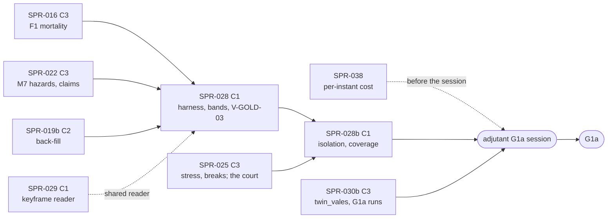

> **BLUF:** Builds M9 v0 (`docs/11` P1.10: "the isolation harness (V-SF-22), the demography and dynasty bands first, censoring-aware lifespans, 32-seed ensembles, the auto-generated run report"), the tool that turns G1a's statistical rows into evidence, plus BCK-002 A-15's coverage gates (ruling M-10). Two stages:
> - **Stage A, the harness** (`python/rehoboam_calib/`, `05.0` §6): the statistics of `docs/09` §1.2 and §3.1 (t-intervals over seeds, a keyed seed-level bootstrap, Clopper–Pearson and exact Poisson intervals, TOST, Kaplan–Meier and right-censored estimators, a Cox model for V-SF-06b, a logistic fit for V-SF-06d) in the standard library, ported from a reviewed reference (`specs/validation/selftest_harness_v0.py`); readers of sealed runs (life tables, cohort q(15), l(65)/l(15), growth, reigns from M7's tenure log, M2's declared aggregates); the band evaluator with `docs/09`'s per-band verdict (PASS, FAIL, MARGINAL, INSUFFICIENT) and the MOP-5 rule; an ensemble runner over `rh-cli run --seed`; **V-GOLD-03's 32-seed CRN-paired comparison** for C3 merges, which four approved plans say "SPR-030" builds (finding F-8); and the run report of `docs/09` §4. **V-SF-01, V-SF-02 and V-SF-02b become gates** on a 32-seed ensemble; V-SF-06, V-SF-06b, V-SF-24 and V-SF-25 are reported; the held-out V-SF-06c and V-SF-07 print `SEALED` and nothing else until BCK-002 A-04 (finding F-10).
> - **Stage B, isolation and coverage:** a test-only forcing crate (`rh-sys-forcing`, the smoke world's pattern) and three isolation worlds that register one system with its forcers, driven by a typed forcing table (`specs/validation/forcing_v0.toml`, finding F-9), so **V-SF-22 runs for M2, M7 and `T1.minds`** under the series their `[isolation]` tables declare, each judged against its `expect`; and **A-15's coverage gates** (`cargo llvm-cov` and `coverage.py`) on a nightly ratchet (finding F-11).
>
> **Nothing in plane A changes:** no system, contract or engine code is touched; no baseline moves (`smoke`, `solo`, `household`, `hamlet` and, once SPR-030b lands, `twin_vales` byte-identical, an acceptance criterion). The new plane-A crate is registered only in the isolation worlds. The full ensembles run in the G1a session on `adjutant`, shared with SPR-030b; the PR tier carries the harness's unit tests and short wiring runs, and the nightly tier reduced ensembles and coverage.
>
> - **Developer:** AGT-002-TOOLS (the Python package, the reference port, the ensembles, the coverage job), with AGT-002-CORE for the forcing crate and the isolation worlds' registration in `rh-golden`. One Developer session may hold both roles.
> - **Testers:** AGT-003-STAT (the statistics, the bands, the verdicts, the sealed rule, V-SCALE-02), AGT-003-DET (the forcing series, determinism of reports and runs, the isolation worlds' registration) and AGT-003-IF (the harness contract, the report format, the coverage gate). One session may hold them, on a different model from the Developer's.
> - **Size and class:** **about 4.5 agent-days** by the task inventory (stage A: T-01 0.75, T-02 1.0, T-03 0.5, T-04 0.25; stage B: T-05 0.75, T-06 0.75, T-07 0.5), above GOV-005 §3's ~3. **Recommended: the split at the stage boundary** (D61 item 1, 65%): **SPR-028** (stage A; C1; about 2.5 days; needs SPR-016 and SPR-022) and **SPR-028b** (stage B; C1; about 2.0 days; needs SPR-025's fixture court, and reuses SPR-022's and SPR-023's stub owners). Both are **C1**: tools and tests, no hash. Stage B contains a new plane-A crate placed on `lint_arch`'s engine list by a reviewed edit (the `rh-sys-smoke` precedent); the forcing table is a new spec file, not an amendment of any frozen `[isolation]` text.
> - **Status:** PLANNING, revision 0. It is written against `main` at `3e2e6ef` and the frozen M7 0.3.4, the `next/M7` 0.5.0 draft and T1 0.3.3, and read beside the parallel drafts, revision 0 and unreviewed: SPR-021 and SPR-022 (`arch/wave7-plans`, `d37fc5b`) and SPR-023 to SPR-025 (`arch/minds-plans`, `3beca61`). Two of them meet this plan: SPR-022's T-06 builds a stub M6 owner and a stub `ScheduleDeath` sender for M7's isolation evidence (nightly, reported; 150 + 150 years on 8 seeds, where M7's `[isolation]` says 500 + 500 on 32: next M7 `:851`, `:855`), which T-05 reuses; and SPR-021's and SPR-024's drafts still write "the CRN-paired ensemble (SPR-030)" (finding F-8). It needs the director's plan approval with the wave (D61).

# SPR-028 — The M9 validation harness v0 (WP P1.10; ruling M-10)

- **Roadmap item:** `docs/11` P1.10 (`docs/11_roadmap.md:187`), with BCK-002 A-15 by PRJ-002 ruling M-10 (`PRJ-002_P1aPlan.md:189`, 60%) · **Phase:** P1a, G1a's statistical rows: V-SF-01, V-SF-02, V-SF-02b on a 32-seed ensemble (`docs/11_roadmap.md:198`), V-SF-22 for M2, M7 and `T1.minds` (`:198`), V-SF-06 and V-SF-06b reported (`:200`); `docs/09` §3.1's gate table (`docs/09_verification_and_validation.md:518`)
- **Depends on (the precondition head):**
  - **SPR-016 merged:** the F1 schedule (MR1–MR12), the density modifier, the re-derived q(15) null (W18). V-SF-02 and V-SF-02b are identity bands of this schedule; SPR-016 names "the demography bands as gates (V-SF-01, V-SF-02b; SPR-028)" (`SPR-016_MortalityF1.md:172`).
  - **SPR-015 merged:** the generalised counter `StepCtx::count` and M2's counters (conceptions and susceptible woman-months per band, births by the mother's age, first marriages, household size), printed by `rh-cli run --vitals` (`SPR-015_BirthsF1.md`, T-06), which V-SF-24 and V-SF-25 read; the nightly evidence "SPR-028 will gate on" (T-06's acceptance).
  - **SPR-019 and SPR-019b merged:** the synthesised population (the 1,000-person band world's genesis) and `twin_vales`' back-filled houses and tenure logs (the dynasty bands' world).
  - **SPR-021 and SPR-022 merged (stage A's dynasty report; stage B's M7 isolation):** M7 F1's successions, exit hazards, depositions, claims and dormancy; the tenure log the reign statistics read. PRJ-002's row names SPR-022 (`PRJ-002_P1aPlan.md:49`).
  - **SPR-023 to SPR-025 merged (stage B only):** `T1.minds` with stress and breaks, and SPR-023's stub M7 owner and fixture court of 60 named actors in 3 houses (PRJ-002 `:44`; T1's `[isolation]` horizon, `specs/systems/T1.minds.odd.toml:1029`), which T1's V-SF-22 runs. The cascade scenario (V-SAGA-16b) is SPR-025's; this sprint re-runs it as part of T1's expect.
  - **SPR-029: shares its export.** M7's tenure, title and life-course rows at a run's horizon are read from the run's last keyframe through `rh-golden` (keyframes are Arrow IPC with zstd: `crates/rh-snapshot/src/keyframe.rs:1–20`). Whichever of SPR-029 (`rh-cli annals-inputs`) and this sprint lands first builds the keyframe reader in `rh-golden`; the second reuses it.
  - **SPR-038 recommended before the G1a session** (BCK-002 A-60's per-instant cost): the 32-seed × 1,000-year ensembles cost about 3 × 10⁵ instants each (the specs table's CI row).
  - **SPR-030b: not a dependency.** If it is on `main`, the dynasty report reads `twin_vales`' golden run directory instead of running its own.
- **Binding contracts:**
  - `docs/09` §1.2 (statistical conventions: TOST, margins stated before the run, the seed as the unit, Clopper–Pearson, Wilson; `docs/09_verification_and_validation.md:69–91`); §3.1 (the band tags, held-out bands `:443`, V-SF-01 `:463`, V-SF-02 `:464`, V-SF-02b `:465`, V-SF-06 `:476`, V-SF-06b `:477`, V-SF-06c `:478`, V-SF-06d `:479`, V-SF-07 `:480`, V-SF-22 `:501`, V-SF-23 `:502`, V-SF-24 `:503`, V-SF-25 `:504`, the gate rule and phasing `:506–513`, the gate table `:516–523`, non-ergodicity and typicality reporting `:524–530`); V-GOLD-02 and V-GOLD-03 (`:149–150`); V-SCALE-02 (`:660`); §4's run report (`:692`); §5's G1a row (`:705`).
  - `docs/13` §4.2 (the C3 row: "CI runs the 32-seed CRN-paired stylized-fact ensemble, before against after"); GOV-002 §1 law 11 (held-out stays held out, `GOV-002_TestingProtocol.md:34`), tier 13 (`:53`), §3 coverage thresholds (`:59–66`); GOV-005 §6 (the C3 evidence).
  - The `[isolation]` tables: M2 (`specs/systems/next/M2.demography.odd.toml:964–972`, frozen at SPR-015/SPR-016), M7 (`specs/systems/M7.dynasty.odd.toml:840–847`; the 0.5.0 draft `specs/systems/next/M7.dynasty.odd.toml:849–856`), T1 (`specs/systems/T1.minds.odd.toml:1023–1030`); `specs/systems/lint_odd.py:152` (`SERIES`) and `:1103–1116` (the forcing check); M2's declared aggregates (next M2 `:533`) and `density_mortality_slope`'s source (`:789`); `specs/demography/infant_sub_schedule.toml:17` (the first-month share, reported by "the M9 harness (SPR-028)").
  - The references the bands are computed against: `specs/demography/selftest_m2_f1_mortality.py` (the compiled schedule, l(15), l(65)), `specs/demography/selftest_brass.py`, `specs/demography/selftest_m2_f1.py` (the widowhood chain: NRR, r = +0.114% a year, T = 29.4 years).
  - `worlds/smoke/` and `crates/rh-sys-smoke` (the test-only system world pattern: specs under `worlds/smoke/systems/`, `registry_overlay.toml`, generated skeletons checked by `gen_skeletons.py --specs … --check`); `bin/lint_arch.py:378–404` (`ENGINE_CRATES`, `NON_ENGINE_CRATES`); `05.1` §2 rule 2 (the absent-owner rule: a rate or mode read of an absent owner gives its `neutral`); `tests/worlds/founders_10k/` (the non-golden test world pattern).
  - ADR-0024 (the harness is tool plane; nothing it writes enters plane A), ADR-0026 (CRN), ADR-0033 (`[isolation]` is part of a system's spec).
- **System specs:** none changed. The forcing table is a new file under `specs/validation/`; findings F-12, F-13 and F-14 record text for M2's next version and the harness spec, not edits here.
- **Rulings (binding):** REV-WAVE5 D-8 (SPR-015 delivers the observers and a sanity run; V-SF-22 is SPR-028's); SPR-012's q(15) ruling (a 99.9% two-sided band per fixed seed set over 32 fixed seeds, the exact variance); REV-SPR-016 W18 (the re-derived null); D41 (V-SF-24 and V-SF-25 reported at G1a, gated from G1b); D34 (G1a's one list); REV-WAVE6 X1 (nothing O(rows) per instant), Z1 (CI per part); RT-037 as adapted (SPR-019 0.3.1 T-07: a population band against `project_population.py`; this sprint's harness evaluates it when SPR-030b and SPR-019b ask).
- **Director items:** D61 (the wave-8 plans: this plan's size and split, the coverage enforcement of GOV-002 §3, the sealed held-out bands, the shared `adjutant` session).
- **Requirements covered:** SIM-3's `M9.validation` at P1a (`docs/03_requirements.md:46`); MOP-5's G1a bands; EVO-3's per-system isolation (V-SF-22); GOV-002 tier 13 and §3 (coverage); DET-2 and ADR-0026 through V-GOLD-03's CRN pairing of seeds; NAR-free: the report is a tool artefact.

## Specs this sprint needs

| Spec | Exists? | Gap | Architect ruling | Needed by |
|---|---|---|---|---|
| **The harness contract** | `docs/09` §1.2, §3.1, §4 state the bands and conventions in prose | No executable statement of each statistic, its unit, interval method, minimum sample, verdict rule, report format or the sealed rule; nothing an independent Tester can reproduce byte for byte | **Proposed (8/10): T-01 writes it, and an independent reviewer reviews it before T-02's code** (W30's pattern, applied to a C1 contract): `specs/validation/harness_v0.md` (the companion), `bands_v0.toml` (per band: tags, statistic, unit, interval, minimums, world and length, verdict), `forcing_v0.toml` (the forcing table, below), `selftest_harness_v0.py` (the exact reference, standard library only) with `golden/harness_v0.txt` | T-01 |
| **The forcing series are prose (finding F-9)** | `lint_odd.py` checks only a series' head word (`SERIES = ("constant", "step", "sine", "ramp", "historical")`, `:152`; `:1108–1110`); M7's step values are in `note` ("0 (reference) for 500 years, then 1 (an assembly) for 500 years", `M7.dynasty.odd.toml:842`); M2 writes `constant:0` and prose steps (next M2 `:966–969`); `historical:fixture_regicides` (M7 `:844`) and `historical:court_deaths` (T1 `:1027`) name no file | A harness cannot read the series from the specs; amending three frozen `[isolation]` tables through `next/` for a tool's convenience would churn frozen specs | **Proposed (7.5/10): a typed table outside the specs.** `forcing_v0.toml` keyed by `(system, input)`: `constant:<value>`, `step:<v0>-><v1>@year<y>`, `historical:<id>` naming `specs/validation/forcing/<id>.toml` (scripted events with ticks and targets), each entry citing its spec line; a check (`specs/validation/lint_forcing.py`) that every `[isolation]` forcing of every frozen spec has exactly one typed entry whose head word matches, and every rate or mode `[[reads]]` is forced or neutral by absence. `sine` and `ramp` are refused in v0 by name: no P1a forcing uses them (M2's entitlement sine is P1.5a's, next M2 `:959–962`) | T-01, T-05 |
| **Held-out bands (finding F-10)** | V-SF-06c and V-SF-07 are held-out (`docs/09:443`); "Held-out bands are sealed before tuning and evaluated only in sealed runs. Exposing one is a P0 incident" (GOV-002 law 11, `:34`); BCK-002 A-04 seals them "Before P1b tuning; not P1a" (`PRJ-002_P1aPlan.md:206`) | M7's `[isolation]` expect asks V-SF-06c "computed but sealed: reported only once the held-out evaluation runs" (`M7.dynasty.odd.toml:847`); P1.10 names "censoring-aware lifespans" (`docs/11:187`), V-SF-07's method | **Proposed (8/10; D61 item 4): sealed means not computed.** The evaluator refuses a held-out band: its report line is `SEALED (A-04; held-out, docs/09 §3.1)` with no statistic, interval or sample size; a test greps every report for any held-out band's statistic name followed by a number. The censoring-aware estimators serve V-SF-02 and V-SF-02b (cohorts censored at the horizon) and V-SF-06b (reigns censored at natural death, at the horizon and at a regrant). V-SF-07's dynasty-tenure clause ("reported") stays sealed with its band, since its row is held-out | T-01, T-02 |
| **Which world carries which band, and V-SF-01's K (findings F-13, F-14)** | V-SF-01: "population ∈ [0.3, 5]·K" (`docs/09:463`); M2's isolation expect (1): "A 1,000-founder population (ages uniform in [0, 60), …) neither dies out nor exceeds 5 x its start" (next M2 `:972`) | `twin_vales` keeps the default `density_capacity` 10,000,000 (REV-SPR-030 R9), so K is undefined there; after SPR-019 a manifest's anonymous population is synthesised from the stationary marginal (`population_synthesis.toml` P2–P4), so no manifest gives uniform ages | **Proposed (7.5/10).** K = `density_capacity` where the manifest sets one (`kingdom_10k`, 10,000: R1a), else the starting population (M2's own reading). **The demography gates (stage A)** run on `tests/worlds/demography_1000/`: 1,000 synthesised persons, one region (`flat`, `region_count: 1`, so M1 F0 gives one settlement and N4's pool is the world), the Registry's M2 defaults, M2, M1 and S3 registered (S3 places everyone in the one settlement, equivalent to the constant residence forcing), 32 seeds × 1,000 years. **M2's V-SF-22 (stage B)** registers M2 alone. **Reported, coupled:** `twin_vales` (32 seeds × 300 years) and `kingdom_10k` (V-SF-01 with K = 10,000; 32 seeds × 1,000 years) in the `adjutant` session. F-13 (uniform ages) and F-14 (K) go into the harness spec and M2's next text | T-01, T-03 |
| **The statistics: the standard library or a dependency** | GOV-003 §3: "Scripts in `specs/` use only the standard library where practical" (`GOV-003_CodingStandard.md:49`); the Python environment has pydantic, pyyaml, DuckDB (`python/pyproject.toml:16–20`) | t, beta and gamma quantiles; Kaplan–Meier; a Cox partial likelihood; a logistic fit; a keyed bootstrap. SciPy would supply the quantiles, with platform-dependent last bits | **Proposed (7/10): standard library, ported from the reference** (SPR-027 T-05's port pattern), so a report's bytes are the same on every machine that runs the same Python; numbers are printed to six significant digits, and an interval endpoint within 10⁻⁹ relative of a band edge is MARGINAL, never PASS or FAIL by a last bit. The bootstrap draws from SHA-256 of `(seed set, band, resample index)`, never `random`. Alternative: SciPy (DEPEND; BSD) for the quantiles, the reference cross-checking a known-answer table | T-01, T-02 |
| **How the harness reads a run** | Sealed segments are Parquet readable by DuckDB (`specs/stream/check_segments.py`); M2's counters print with `--vitals` (SPR-015 T-06); M7's tenure log is plane-A state, not a channel-A record (`specs/systems/M7.dynasty.odd.toml:135–160`; the 0.5.0 draft `:145–170`) | Reigns need `tenure.{title, holder, start, end}` at the horizon, plus each holder's exit cause | **Proposed (8/10).** Births, deaths, ages, marriages, households, `DEPOSED` and the living count from the sealed segments through DuckDB (`LIFE_ENTRY`, `LIFE_EXIT`, `EVENT`, `STEP_DIGEST`); counters from the run's `--vitals` file; M7's tenure, title and life-course tables at the horizon from the run's last keyframe through `rh-golden`'s keyframe reader (SPR-029's, shared). The tenure log is append-only and never compacted (ADR-0007), so the horizon keyframe holds every reign; a reign's end is a death (the holder's `LIFE_EXIT` at `tenure.end`, its cause from `DEATH`'s payload), a deposition (`DEPOSED` at `tenure.end`), or open at the horizon (right-censored) | T-02 |
| **V-GOLD-03's ensemble (finding F-8)** | `docs/13` §4.2's C3 row; V-GOLD-03 (`docs/09:150`): "TOST on each stylized-fact statistic of the 32-seed CRN-paired ensemble, margin 10% of the band width" | `SPR-016_MortalityF1.md:186`, `SPR-018_WorldgenLite.md:220`, `SPR-020_EventEnvelope.md:347` and SPR-019's merge route say "not built yet (SPR-030)", and the wave-7 and minds drafts repeat it (SPR-021 on `d37fc5b`: "The 32-seed CRN-paired ensemble is not built (SPR-030)"; SPR-024 on `3beca61`: "The CRN-paired ensemble (SPR-030)"); PRJ-002 gives "32-seed ensembles" to SPR-028 (`:49`) and SPR-030 V-DET-17 only (`:51`); V-DET-17 is a different test (paired intervention rollouts) | **Proposed (7.5/10): this sprint builds it** (stage A, T-03): `rehoboam_calib compare --before DIR --after DIR`, the per-seed paired differences of every non-sealed band statistic, TOST at δ = 10% of the band width, EQUIVALENT or NOT EQUIVALENT per statistic; and `.github/workflows/ensemble.yml`, a manual dispatch that builds `rh-cli` at the base and head refs and runs both ensembles (32 seeds, the C3's affected worlds at 200 years). The Architect runs it for every C3 merge from this sprint's merge on, and attaches its report (GOV-005 §6). The four plans' sentences, and the two drafts', read "(SPR-028)" at their next revision | T-03 |
| **Coverage gates (finding F-11; A-15)** | GOV-002 §3 (`:59–66`): line ≥ 80%, branch ≥ 75% for `rh-core`, `rh-sys-*`, `rh-registry` and the Python tooling, "CI blocks merge"; BCK-002 A-15 (`cargo-llvm-cov` in CI) | The pinned toolchain is stable `1.97.0` with `rustfmt` and `clippy` (`rust-toolchain.toml`); rustc's branch coverage has, to the drafter's knowledge, needed the unstable `-Z coverage-options=branch` (not verified for 1.97.0); an instrumented build and the whole suite cost several minutes, and both PR-tier parts are at 12–15 minutes | **Proposed (6.5/10; D61 item 3, GOV-002 is the director's): nightly with a ratchet.** A nightly job measures line coverage per crate and per Python package (and branch coverage where the pinned toolchain supports it: T-07 probes it and records the answer); a committed floor file (`specs/validation/coverage_floors_v1.txt`, written by the tool, never by hand, in a PR tagged `[coverage-baseline]` with a reason line, the perf-baseline rules of SPR-009 ruling 3); a crate below its floor fails the nightly, which blocks the next merge that touches it (GOV-002 tier 11's form). Crates under 80% at first measurement get a floor at their measured value and a BCK item each; GOV-002 §3's "CI blocks merge" is amended to say so | T-07 |
| **M2's calibration hook (finding F-12)** | `density_mortality_slope`: "a design value until SPR-028 calibrates it against V-SF-01 on the dynastic fixture world" (next M2 `:789`) | Calibrating changes a Registry default: C3 on every world with a capacity, and `docs/09` §3.1's filtering procedure first seals the held-out bands (A-04) | **Proposed (8.5/10): report only.** The harness reports V-SF-01 on `kingdom_10k` at the default slope 1; the calibration is a P1b item after A-04. M2's source sentence is corrected at its next version | T-03 |
| **What the report holds in v0** | `docs/09` §4 (`:692`): "plane hashes, stylized-fact table with identity/emergent tags, liveness or certification status, bad-run metrics, top arcs, firing rates against budgets, timings, costs" | Liveness (V-WC-05), bad-run metrics, arcs and firing-rate budgets need P1b's compiler and P2's sifter | **Proposed (8/10): v0 holds** the run identities (history tuple and final ladder root per seed), the stylized-fact table (each band's tags, statistic, interval, n, verdict), the MOP-5 summary for G1a's gate set, the non-ergodicity lines (share of seeds whose own statistic is in band; between- and within-seed variance; `docs/09:524–530`), M2's declared aggregates (`:533`: crude rates, marital fertility by band, age at first marriage, household size), the infant first-month share (`infant_sub_schedule.toml:17`), the age-at-death distribution against the schedule (BCK-002 A-48's evidence, D54) and wall times. The rest is named "not in v0" in the report itself | T-02 |
| **Where the ensembles run (CI; Z1)** | Part core about 12:00–14:43, part golden about 12:46 after wave 4 (the Architect's figures); BCK-002 A-63's third job being built; the nightly golden job's timeout 45 minutes (`.github/workflows/nightly.yml:91`) | 32 seeds × 1,000 years of a 1,000-person world is about 3.6 × 10⁵ instants per seed (A-60: about 360 instants a year) | **Proposed (8/10).** PR tier: unit tests, the reference, V-SCALE-02 on the existing golden run directories, short wiring runs. Nightly: a new `validation` job (32 seeds × 300 years of the demography world for V-SF-02 and V-SF-02b; the reduced isolation ensembles; coverage). `adjutant`: the full G1a ensembles in the session SPR-030b holds (D61 item 6) | T-04, T-07 |

## Compliance (every task)

| Rule | This sprint |
|---|---|
| Change class (`docs/13` §4.2) | **C1** in both stages: tooling and tests. No contract crate, Registry schema, event schema, IF-x or ownership change; no `state_hash` change on any golden world (an acceptance criterion). Stage B's `rh-sys-forcing` is a plane-A crate of test-only systems, registered only in `tests/worlds/isolation/` worlds, placed on `lint_arch`'s `ENGINE_CRATES` by a reviewed edit (as `rh-sys-smoke`, `bin/lint_arch.py:395`); its systems' specs live under `tests/worlds/isolation/systems/` with their own overlay, outside the Registry (the smoke precedent, SPR-008) |
| Planes touched (ADR-0024) | **Tool:** `python/rehoboam_calib/`, `rh-golden` (the isolation worlds' registration; the keyframe reader, shared with SPR-029), `specs/validation/`, `bin/check_all.sh`, `.github/workflows/nightly.yml` and `ensemble.yml`. **A:** `rh-sys-forcing` (test-only systems). **B, C:** none. The harness reads plane A at rest (sealed segments, keyframes, counters) and writes reports no plane-A code reads (V-PLN-01) |
| Owned columns written | Only by `rh-sys-forcing`'s systems, in isolation worlds, each owning the column it forces there (M6's `polity.exec_constraint`, M7's `house_member.*`, S3's `person.residence`) while the real owner is not registered; never in a golden world |
| Reads (via `rh-contracts`) | None at run time beyond each forcer's own column |
| RNG purposes added | One per stochastic forcer, if any (the scripted series are deterministic by construction; none is expected); none in the harness, whose bootstrap is a SHA-256 stream outside the engine |
| Golden-hash effect | **None.** `smoke`, `solo`, `household`, `hamlet` (and `twin_vales` if on `main`) byte-identical at 1 and N threads, headers included. The isolation worlds have no baseline |
| Fixed-point quantities | None new in plane A (the forcers write integers and fixed-point values as their columns are typed). The harness computes in Python floats in the tool plane, with the MARGINAL rule at band edges |
| Determinism lints (GOV-003 §2, §3, §6) | `lint_arch` (the new crate placed), `lint_forbidden` (no float, no file I/O in the forcers: a historical series reaches a forcer through the compiled manifest, never a file read at step time, BCK-002 A-51's rule) and the hidden-state rule (W31) green; `ruff` and `mypy --strict` on the package |
| Tests that gate this sprint | V-SF-01, V-SF-02, V-SF-02b (gates on the demography world's 32-seed ensemble), V-SF-22 (M2, M7, T1), V-SCALE-02, V-GOLD-03 (the comparison, on a planted effect and a null), V-SAGA-16 and V-SAGA-16b (T1's expect, re-run), V-PLN-01, V-GOLD-01 (unchanged baselines), GOV-002 §3 (the coverage floors), plus `bin/check_all.sh`. **Reported, not gated:** V-SF-06, V-SF-06b, V-SF-06d, V-SF-24, V-SF-25, M2's declared aggregates, the age-at-death distribution |
| Docs updated in the same sprint | `bin/check_all.sh` and `python/tests/test_check_all_inventory.py` (same commit); `CLAUDE.md` (the reference, the forcing lint, the harness commands, the isolation worlds' lint and skeleton lines); `docs/09` V-SF-22 (the note of finding F-19), V-SF-01 (K: F-14), V-GOLD-03 and §4 (the method lines and the v0 report); GOV-002 §3 (the director's ruling on F-11); `05.0` §6 (`rehoboam_calib` built); `docs/14` (no dependency added; ports noted); BCK-002 A-15 (done), A-04 (the sealed rule waiting for it); PRJ-002's row |

**Rules carried from P0–SPR-019 (every task):**
- **A statistical gate is stated before the run** (`docs/09` §1.2 rule 2): every band's method, minimum and verdict rule is in `bands_v0.toml` before T-03's first ensemble; nothing is changed after seeing a result, and a change is logged in `docs/decisions-log.md`.
- **Fixed seeds, not flaky gates** (SPR-012's q(15) ruling): an ensemble runs seeds 1–32 (or the stated subset), so a verdict is a deterministic function of the build; a rate checked against an exact expectation uses a 99.9% interval, so a correct build fails one check in a thousand at most.
- **A positive control fails for the right reason;** every planted mutant fails a named check, and the plan states why it is observable.
- **A test input exercises the path it claims, and a probe asserts it:** each forced series is read back from its column at every step year; the M7 isolation records at least one murder and one deposition per law; the demography world records at least 400 births per seed (V-SF-02's minimum).
- **No O(rows) work per instant** (REV-WAVE6 X1): the harness works after the run; a forcer does O(1) work per pulse, or O(events) for a script.
- **Python tests read no CI environment variable.**
- **CI time (W42, Z1):** per part, ×1.5 for slow runners, against the Architect's figures at launch; each new gate in exactly one part; over about 5 s, the golden part or nightly.
- **Merge `origin/main` when main moves;** **batch pushes at task boundaries;** **one commit per task** (GOV-005 §4).

## Tasks

**Stage A** is T-01 to T-04 (the harness; SPR-028 proper under the split). **Stage B** is T-05 to T-07 (isolation and coverage; SPR-028b). Under one sprint, a **hard checkpoint** follows T-04: the Tester's interim pass on the harness is required before T-05 lands.

#### T-01: The harness contract and its exact reference (`specs/validation/`; F-9, F-10, F-13, F-14; the reviewed-spec row; 0.75 day)
- **Deliverable:**
  - `specs/validation/harness_v0.md`: the conventions of `docs/09` §1.2 made exact (the unit is the seed; the 90% t-interval over seed statistics with the t quantile computed, not tabled; the seed-level bootstrap of 10,000 resamples keyed by SHA-256; Clopper–Pearson; the exact Poisson interval; TOST at a stated δ; the per-band verdict: PASS when the interval lies inside the band, FAIL when wholly outside, MARGINAL otherwise and within 10⁻⁹ relative of an edge; INSUFFICIENT below the band's minimum), the estimators (cohort q(15) with right-censoring at the horizon; the period life table and l(65)/l(15); r as the least-squares slope of ln N over yearly living counts; Kaplan–Meier; the Cox partial likelihood with Breslow ties; the logistic fit for V-SF-06d), the sealed rule, the report format `rehoboam/m9/report/v0` (canonical ASCII lines in a fixed order, a SHA-256 digest last), and the V-GOLD-03 comparison.
  - `bands_v0.toml`: per P1a band (V-SF-01, 02, 02b, 06, 06b, 06c, 06d, 07, 22, 24, 25), its tags (kind, role, level), statistic, unit, minimum, world and length, interval, verdict use (gate, report, sealed).
  - `forcing_v0.toml` and `forcing/<id>.toml` (F-9): every forcing of M2, M7 and T1 typed, each citing its spec line; `specs/validation/lint_forcing.py` (every `[isolation]` forcing of every frozen spec has one typed entry with the same head word; every rate or mode read is forced or neutral by absence; `sine` and `ramp` refused in v0).
  - `selftest_harness_v0.py` (standard library only) and `golden/harness_v0.txt`: known answers and a synthetic ensemble with planted effects, rendered as a v0 report.
  - **The independent review**, then the Architect's ruling, before T-02 lands (the specs table).
- **Acceptance:**
  - **Known answers:** closed forms the reference must hit exactly (to 10⁻¹²): Clopper–Pearson's upper bound for 0 events in n trials at two-sided 95% is 1 − 0.025^(1/n); the exact Poisson upper bound for 0 events is −ln 0.025; Kaplan–Meier with no censoring equals the empirical survival function; a TOST of identical paired samples is EQUIVALENT with every difference 0. And published values to six significant digits: a textbook survival data set with its published Kaplan–Meier curve and Cox coefficient (the Freireich 6-MP remission data is the proposed case, its source cited in the companion), t quantiles at 31 and 7 degrees of freedom, a beta quantile and a chi-square quantile, each against a published table.
  - **The synthetic ensemble:** 32 synthetic seeds with a planted q(15) of 0.45 and censoring at a horizon give PASS for V-SF-02; the same with the censored children counted as survivors gives a q(15) below the truth by the censored share and its line differs (the `km-ignores-censoring` control fails by name); 12 seeds with 300 births each give INSUFFICIENT, never PASS or FAIL (the `minimum-ignored` control turns it into a verdict and fails); a held-out band asked for prints `SEALED` (the `heldout-printed` control prints a statistic and fails the grep check); two runs of the reference give the same report bytes under different `PYTHONHASHSEED` values (the `bootstrap-unkeyed` control, which draws from `random` seeded by the clock, fails it).
  - `lint_forcing.py` passes on the real specs and fails, by name, on four plants: an `[isolation]` forcing with no typed entry, a typed entry whose head word differs, a rate read neither forced nor neutral by absence, a `sine` series.
  - The review is recorded (`REV-SPR-028-harness`) and its rulings applied before T-02 lands.
- **Status:** [ ] not started

#### T-02: `rehoboam_calib`: the statistics, the readers, the band evaluator and the report (the statistics and reading rows; 1.0 day)
- **Deliverable:**
  - `python/rehoboam_calib/` (laid out as SPR-027 T-05's `rehoboam_tui`): `stats` (the port of T-01's reference), `read` (a run directory: DuckDB over the sealed segments for `LIFE_ENTRY`, `LIFE_EXIT`, `EVENT` with payloads, `STEP_DIGEST`; the `--vitals` counters file; the horizon keyframe's `tenure`, `title` and `life_course` tables through `rh-golden`'s reader), `bands` (each band of `bands_v0.toml` from a set of runs, with its minimums), `report` (`rehoboam/m9/report/v0` and a Markdown rendering).
  - `python -I -m rehoboam_calib report --runs <dir>… --bands <ids> --out <dir>`.
  - **V-SCALE-02:** `report` on the golden run directories of `solo` (N = 1), `household` (6) and `hamlet` (60).
- **Acceptance:**
  - **Equal to the reference:** the package's report on T-01's synthetic ensemble equals `golden/harness_v0.txt` byte for byte; every known answer of T-01 is a unit test of the package.
  - **On real runs, against independent counts:** on `hamlet`'s 200-year golden run, the package's births, deaths and age-at-death histogram equal an independent count by the Tester's own DuckDB query over the same segments; on `twin_vales` (or the manor) at seed 1 over 50 years, every reign the package reads from the horizon keyframe starts at its predecessor's end, and the number of reigns equals the number of `SUCCEED` events plus the titles' genesis holders.
  - **V-SCALE-02:** on the three rungs every band reports INSUFFICIENT or a valid result, and none passes or fails below its declared minimum (`solo`: one death, no cohort; `hamlet`: under 400 births).
  - **The sealed rule holds on real reports:** no report the package writes in this sprint contains a V-SF-06c or V-SF-07 statistic (the grep check over every report under `artifacts/`).
  - **Determinism:** the report of the same run set is byte-identical in two processes under different `PYTHONHASHSEED` values; the package reads no environment variable and no clock (a grep test).
  - `ruff` and `mypy --strict` clean; the uv lock unchanged.
- **Status:** [ ] not started

#### T-03: Ensembles, the G1a demography gates, the dynasty report and V-GOLD-03's comparison (F-8, F-12, F-14; 0.5 day)
- **Deliverable:**
  - `python -m rehoboam_calib ensemble --world <w> --seeds 1-32 --years Y --jobs J --out DIR`: one `rh-cli run --seed s --threads 1 --years Y --run-dir DIR/seed-s --vitals` per seed, `J` processes at a time, then `report`. A run that fails stops the ensemble with the seed named.
  - `tests/worlds/demography_1000/` (the world row: 1,000 synthesised persons, one region, M2 defaults).
  - **The G1a demography gates:** V-SF-01, V-SF-02 and V-SF-02b on `demography_1000`, 32 seeds × 1,000 years (the `adjutant` session) and 32 seeds × 300 years for V-SF-02 and V-SF-02b (nightly); the dynasty report (V-SF-06, V-SF-06b, V-SF-06d) on `twin_vales`, 32 seeds × 300 years; V-SF-01 on `kingdom_10k`, 32 seeds × 1,000 years, K = 10,000 (both in the `adjutant` session).
  - **V-GOLD-03:** `python -m rehoboam_calib compare --before DIR --after DIR` and `.github/workflows/ensemble.yml` (workflow dispatch: base and head refs, the worlds, 32 seeds × 200 years each).
- **Acceptance:**
  - **The identity bands pass on a correct build** (an identity band's failure is an implementation bug: `docs/09:439`): on `demography_1000`, V-SF-02's seed-mean q(15) and its 90% interval lie in [35%, 55%] (the F1 schedule at e0 30, β 1 gives q(15) = 0.4443 by `selftest_m2_f1_mortality.py`'s `compile_schedule`, the drafter's computation; `docs/09:464`: "e0 ∈ [23.4, 36.6]"); V-SF-02b's l(65)/l(15) lies within ± 0.03 of the value `selftest_m2_f1_mortality.py`'s compiled schedule implies; V-SF-01's r interval lies in [−0.1, +0.3]% a year (the widowhood chain gives +0.114%) and every seed's population at year 1,000 lies in [0.3, 5] × its start (about 3.1× at that r).
  - **The gates are not vacuous:** the same ensemble built with `mutant-m2-fertility-x2` (the feature SPR-019 0.3.1's T-07 plants; finding F-20 renames it) fails V-SF-01 by name (twice the conception probability, less the closed periods after a birth, raises r by more than a percentage point a year, so the population passes 5× its start within about a century, far inside 1,000 years and far outside [−0.1, +0.3]%); `mutant-m2-e0-plus-15`, planted here (the schedule compiled at e0 + 15), fails V-SF-02 by name and V-SF-02b too: `selftest_m2_f1_mortality.py`'s `compile_schedule` gives q(15) = 0.4443 and l(65)/l(15) = 0.3146 at e0 30, β 1, and 0.2463 and 0.4530 at e0 45 (the drafter's computation on `main`, matching `docs/09:464`'s "e0 ≈ 45 implies q(15) ≈ 25%"), so the mutant's q(15) falls 10 points below the band and its l(65)/l(15) sits 0.14 from the implied value, against a ± 0.03 band. The Developer states the measured shift of each in the PR.
  - **V-GOLD-03 both ways:** comparing an ensemble with itself gives EQUIVALENT on every statistic with every paired difference exactly 0; comparing the correct build with `mutant-m2-fertility-x2` gives NOT EQUIVALENT on V-SF-01's r with the statistic named; the workflow runs end to end on a two-seed, ten-year dispatch in this sprint's PR.
  - **The dynasty report exists and is honest:** per law, murders per 1,000 ruler-years with the exact Poisson interval, the deposition share with Clopper–Pearson, n stated, INSUFFICIENT below the minimums; V-SF-06b's hazard ratio needs an elective realm and reports INSUFFICIENT on `twin_vales` (no elective law there; the law-sweep worlds of T-06 supply it).
- **Status:** [ ] not started

#### T-04: Stage-A gates, CI time, docs and the checkpoint (W42, Z1; 0.25 day)
- **Deliverable:**
  - **Part `core`:** `selftest_harness_v0.py` (about 5 s, pure Python: BCK-002 A-64's path-scoping applies when built), `lint_forcing.py` and its four controls, the package's unit tests (`pytest`).
  - **The golden part:** V-SCALE-02 over the three golden run directories (reads only; about 4 s); the V-GOLD-03 null and planted-effect comparisons on two 4-seed × 20-year ensembles of `household` built with and without the mutant (about 15 s, one mutant build of `rh-cli`; nightly if over 30 s).
  - **Nightly** (a new `validation` job in `.github/workflows/nightly.yml`, its own 45-minute timeout): `demography_1000`, 32 seeds × 300 years, V-SF-02 and V-SF-02b gated (about 32 × 5 s on four runner cores, so about 1 minute; the Developer measures it).
  - The inventory test in the same commit; `CLAUDE.md`; the stage's docs.
- **Acceptance:**
  - Every gate in exactly one part. **CI time (W42, Z1).** Against the Architect's figures at launch, stage A adds **about +10 s to part core** (the reference, the lint, the unit tests) and **about +20 s to the golden part** (V-SCALE-02, the comparison controls), **+15 s and +30 s budgeted ×1.5 for slow runners**. **Nightly candidates if a part is over:** the comparison controls (their mutant build). No existing gate moves part.
  - **Checkpoint (one-sprint form).** The Tester's interim pass on T-01 to T-04 is recorded in `VER-SPR-028-TEST` before T-05 lands.
- **Status:** [ ] not started

#### T-05: The forcing crate and the isolation worlds (stage B; F-9; X1; 0.75 day)
- **Deliverable:**
  - **Reuse first.** SPR-022's stub M6 owner and stub `ScheduleDeath` sender (its T-06 in the draft) and SPR-023's stub M7 owner are this task's step and script forcers once they are on `main`: they move into `rh-sys-forcing` and take their series from `forcing_v0.toml` instead of code; only the forcers no earlier sprint built are written here.
  - `crates/rh-sys-forcing` (plane A, kind system, test-only), placed on `ENGINE_CRATES` by a reviewed `lint_arch` edit: a **step forcer** (owns one column; writes `v0` at genesis and `v1` at the Year pulse of the step year; O(1) per pulse for a per-polity column), a **script forcer** (sends the commands a `historical:<id>` series lists, each from its own timer in the outcome's instant: the outcome-carrying-command rule of EVO-001, REV-P1a's ruling on outcomes held by their sender), and the **residence forcer** SPR-015 built for INV-M2-13 (two settlements; a newborn takes its mother's value at birth), generalised and moved here. The historical series reach the forcer as compiled parameters (`rh-manifest` reads the file; no file read at step time).
  - `tests/worlds/isolation/systems/*.odd.toml` and `registry_overlay.toml` for the forcers; skeletons checked by `gen_skeletons.py --specs tests/worlds/isolation/systems --overlay … --check`, linted by `lint_odd.py --specs … --overlay …` (the smoke world's two lines, `CLAUDE.md`).
  - **The isolation worlds** (`tests/worlds/isolation/<system>/`, each a manifest, a `world.toml` naming the system under test and its forcers, and `rh-golden`'s registration of exactly those): `m2` (1,000 synthesised persons; the constant case registers M2 alone, so T1, M7 and S3 are absent and their reads give their typed neutrals; the elite step and the two-settlement step add their forcers); `m7` (`twin_vales`' houses and laws with M2, M1 and S3 live and T1 absent; the `exec_constraint` step 0 → 1 at year 500; the regicide script) and two law-sweep manifests carrying the other laws M7 F1 builds (SPR-021), one to three realms each; `t1` (SPR-023's fixture court with its stub M7 owner and the court-deaths script, SPR-025's cascade at year 50). The run header names the systems isolated out.
- **Acceptance:**
  - **The series are what the table says:** for each forcer, a test reads the forced column at every year end (the ladder host's yearly stop) and compares it with `forcing_v0.toml`'s series; the script forcer's commands appear in channel A as the events they cause (a `DEATH` with cause murder at each scripted tick, on the scripted target if alive, dropped and counted if not).
  - **Isolation is real:** the `m2` constant case's run header lists M2 as the only registered system; a planted isolation world that leaves a rate read of M2 neither forced nor absent is refused by the harness with "isolation: unforced read <column>"; M2's `[isolation]` expect (3) holds by INV-M2-13 under the two-settlement step (no `source = partnering` marriage pairs two non-zero settlements in any generation).
  - **No per-instant growth (X1):** a counter of rows visited per instant by each forcer is O(1) (step) or the series' events in that instant (script).
  - `lint_arch`, `lint_forbidden` (no float, no file I/O), the hidden-state rule, `lint_odd` and the skeleton check green on the new crate and specs; the golden worlds' ladders unchanged.
- **Status:** [ ] not started

#### T-06: V-SF-22 for M2, M7 and T1, judged against each `expect` (stage B; 0.75 day)
- **Deliverable:** `python -m rehoboam_calib isolation --system <M2|M7|T1>`: the system's isolation ensembles, its `expect` clauses as checks of `bands_v0.toml`, and V-SF-22's verdict line per system in the report.
  - **M2** (next M2 `:972`): (1) the 1,000-person population neither dies out nor exceeds 5× its start over 1,000 years, seed-mean r inside V-SF-01's band (32 seeds); (2) V-SF-24 reported against `c_i`'s binomial 99.9% interval per band, the age-shape report against `report_ratios`; (3) INV-M2-13 under the two-settlement step, gated in every run, and V-SF-25 reported; (4) q(15) of the birth cohorts inside V-SF-02's band; (5) `solo` dies out, `household`'s extinction-time distribution over 64 replicas against the reviewer's model (alive at 100 years about 39%, median extinction year 88), `hamlet` by chance.
  - **M7** (`M7.dynasty.odd.toml:847`): INV-M7-01 to 07 with 0 violations; murders per 1,000 ruler-years at the reference state equal 1000 × `murder_hazard_base` × L within the exact Poisson 99.9% interval, per law; deposition shares by law reported against V-SF-06b; the predecessor-murdered odds ratio's interval contains `predecessor_killed_or` (V-SF-06d); after the step to `exec_constraint` = 1, both rates' ratio intervals contain `exec_constraint_hr`; the named count reported against population; no house resurrected, no title created; V-SF-06c `SEALED`.
  - **T1** (`T1.minds.odd.toml:1030`): INV-T1-01 to 07 with 0 violations; stress in [0, 100] with V-SAGA-16's accounting identity exact; breaks per 100 named-actor-years reported under P1a sources alone, with the shortfall stated (the P1b forcings `vow.conflict` and `artifact.rumour_reach` are not runnable: their owners are P1b's); the cascade (V-SAGA-16b): the branching ratio's upper 95% bound below 1 over 32 seeds, no actor breaking twice within `break_refractory_days`, the break count back to baseline within 5 years.
- **Acceptance:**
  - **On a correct build** each system's V-SF-22 verdict is PASS on the `adjutant` ensembles (32 seeds × 1,000 years per world; the T1 cascade 32 seeds × 60 years), recorded in `VER-SPR-028`. A FAIL on the real model is a finding for the Architect with its evidence, never a tuning in this sprint.
  - **Mutants, each failing its system's verdict by name, with why it is observable:** `mutant-m2-fertility-x2` fails M2 (1) (5× its start within about a century); `mutant-m7-murder-x3` (the monthly murder probability tripled) fails M7's rate check (at 32 seeds × 1,000 years on `twin_vales`, about 64,000 ruler-years and about 400 expected murders at the reference state, so ×3 lies far outside the 99.9% interval); `mutant-forcing-step-ignored` (the step forcer never steps) fails M7's step clause (the ratio interval sits at 1, not at 0.5); SPR-025's grief mutant (its own V-SAGA-16b control) fails T1's cascade clause.
  - **Nightly (reduced):** 8 seeds × 200 years per system, the same checks at reduced power with INSUFFICIENT stated where a minimum is not met; the mutants are not re-run nightly.
- **Status:** [ ] not started

#### T-07: Coverage (A-15; F-11), stage-B CI and docs (0.5 day)
- **Deliverable:**
  - **Coverage:** a nightly `coverage` job: `cargo llvm-cov nextest --workspace --locked` with `llvm-tools-preview` installed in the job (the toolchain file is not changed), per-crate line coverage (and branch coverage if the pinned toolchain supports it, probed and recorded), and `coverage run -m pytest` for the Python tooling (`coverage` added to the dev dependency group); `bin/coverage_gate.py` (`measure`, `check`, `record`) with `specs/validation/coverage_floors_v1.txt` written by `record` in a `[coverage-baseline]` PR with a reason line; the GOV-002 §3 crates and packages at ≥ 80% line (≥ 75% branch where measured) or at their recorded floor with a BCK item.
  - **Part `core`:** the forcing crate's unit tests, `lint_odd` and the skeleton check on the isolation specs (about 3 s), `coverage_gate.py`'s unit tests and controls.
  - **The golden part:** one short wiring run per isolation world (M2 50 years, M7 50 years, the court 10 years) with the harness's `isolation` command reporting (verdicts mostly INSUFFICIENT at that length; the gate is that each runs, its forcers' series read back, and its header names the isolated-out systems), about 30 s in release.
  - **Nightly:** T-06's reduced ensembles (about 6–8 minutes) and the coverage job (about 15–20 minutes) in the `validation` job.
  - The inventory test; `CLAUDE.md`; the docs of the compliance table; BCK-002 A-15 marked done.
- **Acceptance:**
  - `coverage_gate.py check` passes against the recorded floors; three controls fail by name: a floor raised above the measurement ("below floor"), a hand-typed floor file ("not the tool's output"), a floor file changed without `[coverage-baseline]` in the PR title.
  - **CI time (W42, Z1).** Stage B adds **about +5 s to part core** and **about +30 s to the golden part**, **+8 s and +45 s budgeted ×1.5 for slow runners**; the nightly `validation` job is about 25–30 minutes. **Nightly candidates if a part is over:** the golden part's three wiring runs (T-06's nightly ensembles cover the same paths). No existing gate moves part.
- **Status:** [ ] not started

## Out of scope (explicit)
- **Calibration of any parameter** (F-12; `docs/09` §3.1's filtering procedure; P1b after A-04), the coupling sweep V-SF-23 (reported at G1b), V-SF bands of systems P1a does not build (M3, M4, M6, M8), submodel tournaments (§3.8), the liveness gate and certification of compiled worlds (V-WC-05, V-WC-07: P1b).
- **Sealing held-out bands** (BCK-002 A-04, before P1b tuning): this sprint refuses to compute them.
- **`sine` and `ramp` forcings, and the P1b forcings of T1** (`vow.conflict`, `artifact.rumour_reach`), whose owners do not exist in P1a.
- **The G1a performance run, V-DET-17, the `twin_vales` golden world** (SPR-030b); the population bands of `twin_vales`, `kingdom_10k` and the manor against `project_population.py` (SPR-030b and SPR-019 0.3.1 own them; this harness's statistics are available to them).
- **Public functions with a test** and mutation testing (GOV-002 §3's other rows; tier 11): A-15 is line and branch coverage.

## Verification assignment (Testers)

| Tester | What to verify, from which contract | Report |
|---|---|---|
| AGT-003-STAT | T-01, T-02, T-03, T-06, written from `docs/09` §1.2, §3.1 and the harness spec before reading the code:<ul><li>**the stage-A interim pass:** their own implementation of the intervals, KM, the Cox fit and TOST against the known answers and against the reference's synthetic ensemble;</li><li>V-SF-02 and V-SF-02b on the demography world recomputed from the segments with their own queries;</li><li>the sealed rule: every report of the sprint grepped for held-out statistics;</li><li>V-SCALE-02 on the three rungs, and a world of their own at N = 10;</li><li>the four T-01 controls and the two T-03 mutants killed for their reasons, plus two of their own (a t-interval that uses the normal quantile at 32 seeds; a q(15) that drops cohorts with fewer than 15 years of follow-up from the denominator only);</li><li>no band adjusted, nothing tuned</li></ul> | `VER-SPR-028-TEST` (phase 1 at the checkpoint, phase 2 at the end; one report per sprint under the split) |
| AGT-003-DET | T-05, T-06:<ul><li>each forcer's series read back from its column at every year, and the script's deaths in channel A;</li><li>the isolation worlds' registration: the header, the absent owners' neutrals, the refusal of an unforced read;</li><li>the golden worlds' ladders byte-identical with the new crate built in;</li><li>the M7 and T1 mutants killed for their reasons, and the ensemble verdicts reproduced on a second machine</li></ul> | As above |
| AGT-003-IF | T-01, T-07:<ul><li>the harness spec's report format against two independent renderings of their own;</li><li>`lint_forcing.py` against plants of their own;</li><li>the coverage gate's floor rules and controls, and the toolchain probe's answer</li></ul> | As above |

## Merge route

- **Class and conditions.** C1 in both stages: merged by the Architect after green CI, the Tester pass and the audit (the audit is kept: the sprint delivers G1a evidence). No baseline moves, so no announcement. Titles end `[C1]`; T-07's first floor file comes in its own `[coverage-baseline]` commit with a reason line.
- **Order (7/10).** Stage A after SPR-016 and SPR-022 (and SPR-019b for `twin_vales`), in any gap between C3 merges; stage B after SPR-025. Neither stage takes the serial C3 slot. The G1a ensembles run in the `adjutant` session with SPR-030b's runs (D61 item 6).

- **Shared files.** With SPR-029: `rh-golden`'s keyframe reader and `cli.rs`. With SPR-030: `bin/check_all.sh`, the inventory test, `CLAUDE.md`, `nightly.yml`, `rh-bench` (no file in common unless SPR-030's benches reuse the demography world). With SPR-015: the residence forcer moves out of its tests into `rh-sys-forcing`. Whichever merges second resolves the textual conflicts.
- **What this sprint re-verifies after merging `origin/main`:** both CI parts; the identity bands on the then-current M2 (a C3 change to M2 since the last run re-runs the nightly demography ensemble before this merges); the golden ladders unchanged.

## Risks

| Risk | Likelihood and effect | Mitigation |
|---|---|---|
| An identity band fails on the real model (V-SF-02 at e0 30, or V-SF-01 on the coupled worlds) | Medium for the coupled worlds (T1's named marriages, settlement-bounded N4), low for the demography world | The demography world is the gate (M2 with one settlement); the coupled worlds are reported. A failure is a finding with its evidence; nothing is tuned here (F-12) |
| The ensembles are too slow for the session before SPR-038 | Likely without SPR-038 (A-60: about 93k instructions per instant, about 360 instants a year) | SPR-038 before the session; the nightly tier runs reduced ensembles; the session's runs parallelise one seed per core |
| The forcing table drifts from the specs' prose | Medium over P1b | `lint_forcing.py` in part core, both directions |
| Coverage is far below 80% somewhere | Likely for young crates | The ratchet floors (D61 item 3); a BCK item per crate; no PR blocked at first measurement |
| Held-out exposure by accident | Low; GOV-002 calls it a P0 incident | Sealed means not computed; the grep check on every report |
| The `adjutant` session is not available when G1a is due | Low (D6: on demand) | The Architect asks with the session's length (D61 item 6); the nightly reduced ensembles give the trend meanwhile |

## Blockers

| # | Blocker | Status |
|---|---|---|
| 1 | SPR-016, SPR-019b, SPR-021 and SPR-022 not merged (stage A) | Open |
| 2 | SPR-023 to SPR-025 not merged (stage B: T1's court and breaks) | Open |
| 3 | The harness spec's independent review and the Architect's ruling (T-01, before T-02) | Open |
| 4 | The Architect's rulings of the specs table's "proposed" rows | Open: ruled with the plan's approval |
| 5 | The director's approval (D61: the size and split, the coverage enforcement, the sealed bands, the session) | Open |

## Completion

- [ ] All tasks meet their acceptance criteria; under one sprint, the stage-A checkpoint was held before T-05 landed.
- [ ] `bin/check_all.sh` passes; the report is attached, with each part's time; the nightly `validation` job is green on the PR head.
- [ ] Tester verdicts are PASS (STAT, DET, IF).
- [ ] Architect audit `VER-SPR-028` is PASS, with the G1a ensembles' reports (V-SF-01, 02, 02b gated; V-SF-22 for M2, M7 and T1; the dynasty report) from the `adjutant` session.
- [ ] No open DEF- against this sprint.
- [ ] The merge route matches the CI-detected change class (C1); no golden world moved; no held-out statistic appears in any report.
- [ ] V-GOLD-03's comparison and `ensemble.yml` are on `main`, and the four approved plans' and the two drafts' "(SPR-030)" sentences are corrected (F-8); BCK-002 A-15 is done with its floors; PRJ-002's row links this plan.
