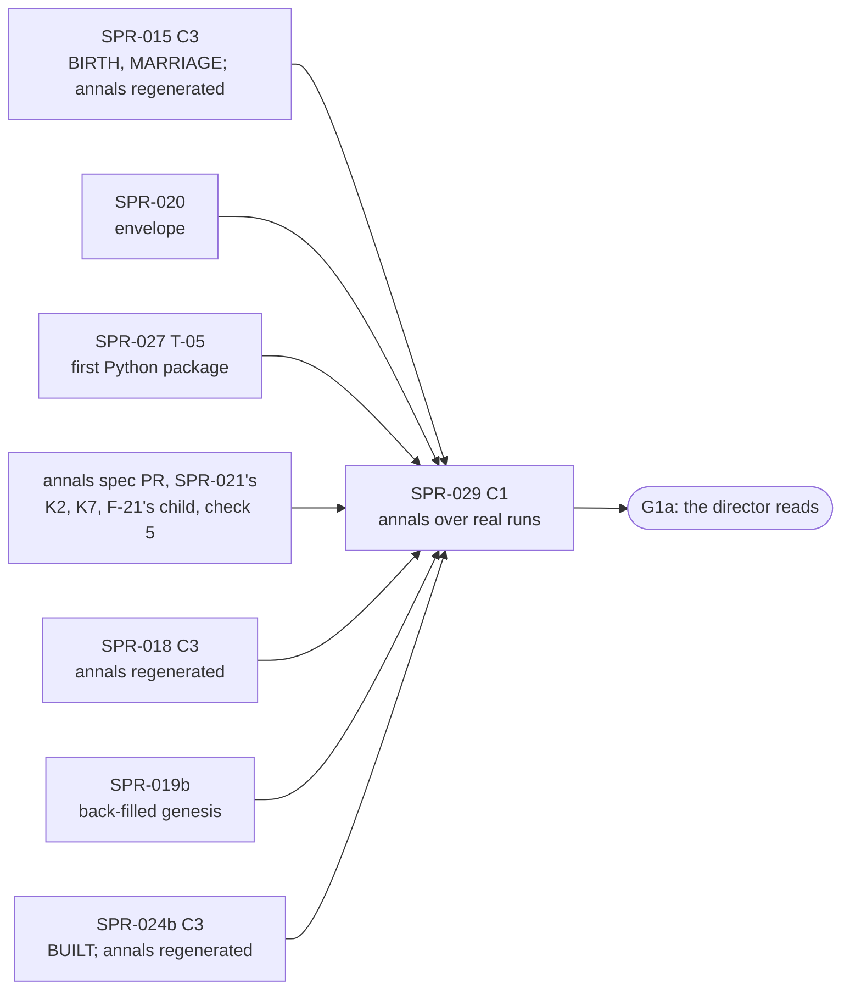

> **BLUF:** Builds the family-annals contract that is already on `main` (`specs/annals/annals_v0.md`, `templates_v0.toml`, the exact reference `selftest_annals_v0.py`, `lint_templates.py`, the three fixture chronicles and their 17 goldens; `REV-SPR-029` closed, D49 and D50 ruled) as a plane-C tool that renders **real annals from real sealed runs**. **Priority 1** under D62 (the director's execution priorities of 2026-10-18: the engine core first, then the viewer, then era packs; `docs/decisions-log.md:7`): G1a's last criterion is "[H] You read the templated family history of 3 seeds" (`docs/11_roadmap.md:220`; the director's ≈ 2–4 hours, `:94`), and this plan builds what the director reads.
> - **The inputs, exported by `rh-cli`** (tool plane, `rh-golden`): `rh-cli annals-inputs <run-dir> --into <dir>` writes the world directory the reference already reads (`chronicle_A.txt`, `world.toml`, `names.toml`, `keyframe.toml`). The chronicle is every sealed channel-A segment in the canonical text form, the same lines `rh-cli tail --canonical` prints, with one `#segment` comment per segment. The keyframe extract is rebuilt from the run's history tuple at genesis (a run directory holds no genesis keyframe, and Python cannot read Arrow IPC with zstd: finding F-2), and **the rebuilt living founders are cross-checked against the chronicle's tick-0 `LIFE_ENTRY` lines** (id, sex, birth tick, parents), with a refusal by name on any difference (ruling G16). The run-directory format does not change.
> - **The renderer, a port** in `python/rehoboam_narrative/annals/`: standard library only, byte-equal to all the fixture goldens, with `verify` (V-NAR-05, D50's prologue rule) and the module audit (V-NAR-07); `label_of` memoized, since the reference's is O(pool) per designation (ruling G17); packaged in the uv project's layout that **SPR-027 T-05 sets up first** (ruling G18).
> - **The multi-segment `chronicle_digest`** (annals_v0.md §9; finding F-3).
> - **The real-run gates:** `solo`, `household` and `hamlet`'s run directories in CI's `stream` part (ruling G20); a dynastic run nightly, after SPR-024b (ruling G19).
> - **The G1a reading package** (`bin/annals_g1a.sh`): the house annals of `twin_vales` at seeds 1–3.
>
> **This sprint regenerates no annals fixture or golden** (ruling G15). **SPR-021 owns the annals-fixture changes** (its rulings K2 and K7, and F-21's distinguishing child) through a reviewed annals spec PR, with check 5's new rule: `INTERREGNUM_CRISIS` on a non-sovereign title is possible only while its liege's interregnum is open at that tick. Every regeneration (SPR-015's, SPR-018's, that spec PR's and SPR-024b's) lands before this sprint merges, and the port reproduces the fixtures as they then stand.
>
> **Nothing in plane A changes:** no ladder, segment, keyframe, baseline or allocation budget moves; `smoke`, `solo`, `household` and `hamlet` are byte-identical (an acceptance criterion).
>
> - **Developer:** AGT-002-TOOLS (the Python package, the gates, the script), with AGT-002-CORE for the `rh-golden` export (genesis from the history tuple, `rh-stream`'s reader). One Developer session may hold both roles.
> - **Testers:** AGT-003-IF (the export's formats against the contract, V-NAR-05 and V-NAR-07 on real runs, the refusals) and AGT-003-DET (**their own renderer, written from the contract alone, as the independent oracle**: ruling G18; the digests; the genesis cross-check). One session may hold both, on a different model from the Developer's.
> - **Size and class:** **about 4.5–5 agent-days** (ruling G22) by the task inventory (T-01 1.5, T-02 2.0, T-03 0.5, T-04 0.5, T-05 0.25), **one C1 sprint with a checkpoint after T-01** (the Tester's interim pass on the export, before the port lands): plane C and tool plane only (ADR-0024), no contract change of its own, no hash (D61 item 1).
> - **Status:** PLANNING, **revision 1**. Revision 0 (`dc39967`) had an independent review (REV-WAVE8: for this plan 1 MAJ, 3 MIN; "the feed is sound"), and the Architect's rulings G1–G22 of 2026-10-18 are applied (the last section maps each). It is written against `main` at `1950df8` (with A-62, PR #94, and D62), PR #89 (`a4be717`) and the revision-1 drafts of wave 7 (`b2c6fb1`: SPR-021a/b, SPR-022a/b) and the minds (`f791a38`), with the cross-plan rulings X1–X13. A C1 plan is the Architect's under GOV-005 §2; it goes to the director with the wave (D61).

# SPR-029 — Family annals v0 over real sealed runs (WP P2.8a)

- **Roadmap item:** `docs/11` P2.8a (`docs/11_roadmap.md:199`: "rendered from the chronicle with provenance links, so a run reads as a family history. Plane C, in `python/`") · **Phase:** P1a; G1a's [H] reading (`docs/11_roadmap.md:220`).
- **Depends on, by task** (ruling G19; the split sprints of X8; "merged" means on `main`):

| Task | Needs merged | Why |
|---|---|---|
| T-01 (the rungs) | SPR-013 (on `main`); SPR-015 (`LIFE_ENTRY` parents, which G16's cross-check compares) | Run directories, the canonical printer, genesis |
| T-01 (the dynastic extract) | SPR-019b (the back-filled genesis rows); **the annals spec PR that SPR-021 owns** (G15: the extract's §1 schema gains each title's tier and liege, for check 5) | The extract's `[[house_member]]`, `[[tenure]]` and title rows |
| T-02 | SPR-015 (the dictionary; the fixtures and goldens regenerated by its tools: REV-WAVE5 W1 (d)); the annals spec PR (the final fixture set: K2, K7, F-21's child, check 5); **SPR-027 T-05** (the uv project's first package: G18) | The port reproduces the fixtures as they stand after every regeneration |
| T-03 | The annals spec PR (the reference's fold, F-3) | The fold's oracle |
| T-04 (the rungs) | SPR-015, SPR-020 (the envelope in the segments) | Births, marriages, deaths with roles and edges |
| T-04 (the dynastic case; `bin/annals_g1a.sh`) | **SPR-024b** (M7 and T1 join `BUILT` together, X6: before it a `SUCCEED` citing a `DEATH` cannot occur in a run); SPR-019b | The house annals the director reads |

  - **The order** (G15, G19): development starts once SPR-015, SPR-020, SPR-027 T-05 and the annals spec PR are on `main`; T-01 to T-03 run on the rungs; T-04's dynastic case and **the merge wait for SPR-024b and SPR-019b**. So every annals regeneration of P1a (the next section's list) is on `main` before this sprint merges, and none after it is expected; if a later Registry bump moves the goldens, the bumping PR regenerates them with the tools and keeps this sprint's port gate green in its own CI.
  - **SPR-026, SPR-028, SPR-030: not dependencies.** The live edge is for viewers; SPR-028 reads no keyframe and needs no export (its ruling G11); SPR-030b1's `twin_vales` golden world changes nothing here.
- **Binding contracts:**
  - `specs/annals/annals_v0.md` (v0, round 5): §1 the inputs (`:13–19`), §2 (`:23–29`), §3 (`:33–53`), §4 designation and the agnatic house walk (`:57–68`), §5 (`:72–76`), §6 the prologue (`:80–88`), §8 the sidecar (`:107–124`), §9 determinism, the digests, the manifest (`:126–140`), §11 D49 and D50 (`:155–162`), §12 the acceptance probes (`:164–175`), §16 the M7 0.5.0 house walk (`:263–265`); as the annals spec PR amends §1 (tier and liege), §12 check 5 and the fixtures.
  - `specs/annals/templates_v0.toml`, `specs/annals/selftest_annals_v0.py` (`RENDERER = "annals_v0/0.3.0"` `:79`; `FORBIDDEN_MODULES` `:174`; `load_world` `:575–591`; `Kinship.house_of` `:642–655`; `render`), `specs/annals/lint_templates.py`, `specs/annals/fixtures/` (`ashcombe`, `solitary`, `untold`; `gen_fixtures.py`) and `specs/annals/golden/` (17 files today).
  - `specs/stream/canonical_v0.md` §1 (a canonical file: header, records in `seq` order, `#` comments no digest reads), §4 (`canonical_digest`); `specs/stream/canonical_v0.py`; `specs/stream/channel_a_v0.sql` (the segment table `:97–114`, one segment per sim-year `:36–38`); `bin/gen_hash_golden.py` (the stdlib XXH3).
  - `crates/rh-golden/src/stream.rs:13–21` (no genesis keyframe in a run directory; "a tick of years 0-9 is rebuilt from genesis, which the history tuple determines"), `crates/rh-golden/src/tail.rs`, `crates/rh-snapshot/src/keyframe.rs:1–20`, `crates/rh-worldgen` (genesis).
  - M7's `[[emits]]`: `INTERREGNUM_CRISIS` (`specs/systems/next/M7.dynasty.odd.toml:353–355`) and `arbitrate` (`:733`: "or the title is not sovereign: SUCCEED … Otherwise (sovereign only): INTERREGNUM_CRISIS"), which SPR-021's ruling K2 lifts for a vassal joining its liege's interregnum.
  - ADR-0017, ADR-0024, ADR-0034, ADR-0035 §5a; `05.11` §0 rules 1, 2 and 5 and §3 stage 2; `05.4` §5, §6.1; `docs/09` V-NAR-05 (`:243`, as amended by D50), V-NAR-07 (`:245`), V-PLN-01, V-PLN-04, V-GOLD-01; `docs/03` NAR-1 (`:187`), NAR-5 (`:191`).
- **System specs:** none changed.
- **Rulings (binding):** REV-WAVE8 round 1, **G1–G22** (the Architect, 2026-10-18), with X1–X13 and wave 7's K2 and K7; REV-SPR-029 R1–R42 (R2 and R19: check 1 re-renders the whole group; R9; R17 and R26: `Founder #k`; R18 and §16: the agnatic house walk; R21; R23; R28 and R38; R39); D49 and D50; REV-SPR-019 R1 (no channel-A record for the back-filled dead); REV-WAVE5 W1 (d) (a `registry_version` bump regenerates the annals goldens with their tools); REV-WAVE6 Z1.
- **Director items:** D61 item 7 (the G1a reading set, after SPR-024b) and items 1 and 8 (size, CI). Nothing else here needs the director: it is C1.
- **Requirements covered:** NAR-1's P1a binding (no model: V-NAR-07); NAR-5 (every sentence traceable to its event ids, the prologue to its keyframe rows: V-NAR-05 as amended by D50); SAGA-7's precondition; DET-6's plane rule (V-PLN-01, V-PLN-04).

## Specs this sprint needs

| Spec | Exists? | Gap | Architect ruling | Needed by |
|---|---|---|---|---|
| **The annals contract and its reference** | Yes, on `main` (REV-SPR-029 closed: "an independent renderer written from the contract alone reproduces all 17 golden files byte for byte") | None for the render itself | Binding as merged, and as the annals spec PR amends it | T-02 |
| **Which `rh-cli` surface feeds the tool** | `rh-cli tail --canonical`, the Parquet segments through DuckDB, the live wire | The contract names the canonical text form (annals_v0.md §1, `:13`); the render stays standard library with no process or network module loaded (V-NAR-07) | **Accepted (round 1: "the feed is sound"; 8.5/10): the canonical form through `tail`'s printer, written to files by a separate export.** `#segment y<NNNNNN> first_seq=<a> last_seq=<b> canonical_digest=<32 hex>` comments are legal (`canonical_v0.md` §1). Not DuckDB (a native library with its own I/O inside V-NAR-07's audit; Parquet bytes are not the contract's input); not `wire_v1` (an unsealed edge) | T-01 |
| **The keyframe extract (finding F-2) and its check (ruling G16)** | annals_v0.md §1 (`:17`) reads the genesis keyframe's rows "from the keyframe's Arrow tables" | No genesis keyframe in a run directory (`stream.rs:13–21`); Python 3.12 has no zstd. **The rebuild alone is unverified** (REV-WAVE8 G16): `engine_build` is a version and the built set (the review's `run.toml`: `rh-golden 0.0.0 built:M2.demography`), not a code hash, so a worldgen change between run and export would go undetected and `verify` would re-render from the same wrong extract | **Ruled (G16, 75%): the export rebuilds genesis and cross-checks it, with no new file.** `rh-cli annals-inputs` reads `run.toml`'s history tuple, refuses a tuple its build does not match (the `replay` rule), runs `rh-worldgen`'s genesis, and **compares every living founder it rebuilt with the chronicle's tick-0 `LIFE_ENTRY` lines (id, sex, birth tick, parents), refusing by name on any difference** before it writes `keyframe.toml` (§1's `[extract]` schema: `keyframe = "genesis"`, the genesis `state_hash`, `[[life_course]]` with `founder = k` (R30), `[[house_member]]`, `[[tenure]]`, and the titles' tier and liege as the annals spec PR adds them). No `genesis.toml` is written, so the run-directory format is unchanged. §1's sentence is amended by the Architect (text only) | T-01 |
| **The multi-segment `chronicle_digest` (finding F-3)** | annals_v0.md §9 (`:131`): "the XXH3-128 of the segments' 16-byte digests concatenated in segment order (R21). The reference renders one-segment fixtures" | Every real run has one segment per sim-year; the fold has no executable oracle | **Proposed (7/10): the reference gains `fold`** (a function and a subcommand: reads the `#segment` blocks, recomputes each segment's `canonical_digest`, checks it against its comment, folds), **with no fixture or golden change**, in the reviewed annals spec PR that G15 gives SPR-021 (or, if the Architect keeps that PR to M7's fixtures, a one-function spec PR of the Architect's before T-03; nothing here changes either way). T-03's oracle is the reference's fold over the real `hamlet` export (200 segments) and over a two-segment cut of `solitary`'s chronicle that the test makes and does not commit | T-03 |
| **The `renderer` token (finding F-4)** | §8 (`:116`): `renderer=annals_v0/0.3.0` (`RENDERER`, `:79`) | A wording gap (REV-WAVE8: "partly real, a NIT") | **Accepted (round 1): one sentence** in §8 by the Architect: the token names the contract version every conforming renderer implements; the port prints `annals_v0/0.3.0`, and its own version is in its package metadata | T-02 |
| **The names file** | §1 (`:16`) | The house, title and founder ids (`house/v1`, `title/v1`, `founder/v1`) are not in channel A | **Accepted (round 1; 7/10): the Rust export writes `names.toml`** from the compiled manifest and the genesis tables, so one procedure computes the ids (`rh-ids`) | T-01 |
| **Where the port lives, and its packaging (ruling G18)** | `05.0` §6 (`docs/05_architecture/05.0_overview.md:213–220`), `05.11` §1 (`:45`) | No package exists; `python/pyproject.toml:33` is `package = false`, which `uv.lock` records as `source = { virtual = "." }`; SPR-027 T-05 adds "the first Python package of the uv project" (`SPR-027_Materializer.md:168`), and `python -I -m` needs an install | **Ruled (G18, 85%): `python/rehoboam_narrative/annals/`, after SPR-027 T-05 is on `main`,** in the layout and uv set-up that T-05 makes; this sprint then adds a package to that set-up and no dependency. The "uv lock unchanged" clause of revision 0 is withdrawn | T-02 |
| **A port, and the independent oracle (ruling G18)** | The reference renders a world directory | A transliterated port is not independent of the reference | **Ruled (G18):** the product is a port (SPR-027 T-05's precedent), byte-equal to the reference; **the independent oracle is the Tester's own renderer**, written from the contract alone, as REV-SPR-029's reviewer did (`REV-SPR-029-family-annals.md:16`), run on the fixtures and on real runs | T-02, T-04 |
| **Designation at scale (ruling G17)** | §4: the shortest unique `p-` prefix over the run's pool | **The reference's `label_of` is O(pool) per designation** (the review: 4.3 ms a call at a 15,000-person pool; about 10⁵ calls in a 300-year `twin_vales` year annal, so about 10 minutes a render); revision 0 called the render "linear in events" | **Ruled (G17, 85%):** the port **memoizes `label_of`**, which is pure in `(pid, pool)` (the pool is the run's, fixed for a render), so each pid is labelled once; a PR-tier test counts pool scans on a synthetic 15,000-person pool and fails if a pid is scanned twice; **a 300-year timing line**: the nightly dynastic case prints the port's render time for `twin_vales` seed 1 over 300 years. The reference differential runs on 50 years, where the reference's cost is minutes at most | T-02, T-04 |
| **The G1a reading set** (`docs/11_roadmap.md:220`) | PRJ-002 §5 (`[H] the family history of 3 seeds — SPR-029, then the director`) | Which world, which groups, how long | **Proposed (7.5/10; D61 item 7, after SPR-024b):** `twin_vales` at seeds 1–3 over 300 years, each seed's house annals of the two sovereign houses (`ashcombe`, `fell`), with the year annal as an index; the director reads and audits any sentence through its sidecar row; about 2–4 hours (`docs/11_roadmap.md:94`) | T-04 |
| **The agnatic house walk is not pinned by any golden (finding F-21)** | annals_v0.md §16 (`:265`) | A cognatic fallback in `Kinship.house_of` (`selftest_annals_v0.py:642–655`) leaves `--check` at PASS on all 17 goldens (the drafter's probe, reproduced by the review) | **Ruled (G15, 80%): SPR-021 owns the fix**, in its reviewed annals spec PR: a distinguishing child (an un-named house daughter with a houseless father, bearing in-run), derived by `gen_fixtures.py`, the goldens regenerated by `--write` there. The cognatic fallback then becomes a mutant of the port here (T-02) | T-02 |
| **An interregnum M7 cannot produce, in the `ashcombe` fixture (finding F-24; ruling G15)** | `gen_fixtures.py:495` emits `INTERREGNUM_CRISIS` on `THORNE_SEAT` (`:58`), a seat; `arbitrate` (next M7 `:733`) gives a non-sovereign title a `SUCCEED` | Revision 0's fix (refuse the event on any non-sovereign title) contradicts **K2**: a vassal joining its liege's interregnum **does** emit `INTERREGNUM_CRISIS` (payload its title, `triggered` to the `DEATH`). The fixture's event is still impossible (Cedric holds the Lordship when Giles dies, so no liege interregnum is open; next M7 `:733` sends a vassal with no heir to a reversion `SUCCEED`) | **Ruled (G15, 80%):** **check 5** gains the rule "`INTERREGNUM_CRISIS` on a non-sovereign title only while its liege's interregnum is open at that tick", the extract recording each title's tier and liege; **SPR-021's reviewed annals spec PR** makes the fixture possible (or replaces the event) and adds check 5's control (W30). **This sprint reproduces the result and regenerates nothing;** T-01's export writes tier and liege as the amended §1 says | T-01, T-02 |
| **The order of the annals regenerations (ruling G15)** | REV-WAVE5 W1 (d) | Revision 0 said "the 17 goldens are reproduced, not regenerated" while its own spec PR regenerated them | **Ruled (G15):** the annals fixtures and goldens are regenerated by their tools at **SPR-015** (its T-01 and its `[C3]` commit), **SPR-018** (its `[C3]` commit's `registry_version` bump), **the annals spec PR** (K2, K7, F-21's child, check 5) and **SPR-024b** (its `[C3]` commit: `BUILT` and `registry_version`, X6). All four land before this sprint merges (the order above); the port reads the dictionary version from the Registry, so a header change needs no code change | T-02 |
| **Titles in succession sentences** | §10 item 2 (`:147`) | BCK-002 A-55 | **Accepted (round 1): out of scope**; a template-set change of its own if A-55 lands | — |

## CI by part (X10; ruling G20)

**The base** is PR #89's first CI run (`a4be717`): **core 10:00, golden 7:10, stream 7:32**. Sums are gate sums on one runner; ×1.5 is the slow-runner budget.

| Part | Gates | Sum | ×1.5 |
|---|---|---|---|
| `core` | the package's unit tests (the fixture goldens, the calendar, designation, the digests, the module audit, the memo's scan count, the port's mutants, the refusals) under `pytest`, about 3 s; the export's unit tests in debug (`cargo nextest run -p rh-golden --test annals`), about 5 s | +8 s | +12 s |
| `golden` | — | — | — |
| `stream` | **the real-run gate** on the stream part's own `solo`, `household` and `hamlet` run directories (`stream_inputs`): export, the port's render of every group, `verify`, the reference's render, byte comparison, the summary line, the planted-fault control, and the genesis cross-check's refusal control | +10 s | +15 s |

**Off the PR tier, and the minutes (GOV-008).** The last scheduled nightly took 43 minutes (run `39015254184`), about 1,300 a month at a daily cadence, against the Free plan's about 2,000 (`GOV-008_Infrastructure.md:31`). This plan adds **one small daily case** to the existing golden nightly job (`bin/golden_nightly.sh`), once SPR-024b is on `main`: `twin_vales` seed 1, 50 years with the reference differential, and 300 years port-only with the timing line, about 1–2 minutes a night (about 30–60 minutes a month). `bin/annals_g1a.sh` runs where the Architect runs it for G1a (the `adjutant` session or a laptop), costing no hosted minutes.

## Compliance (every task)

| Rule | This sprint |
|---|---|
| Change class (`docs/13` §4.2) | **C1.** Plane-C presentation, a tool-plane `rh-cli` subcommand, Python tooling. The contract changes are not this sprint's: F-2's and F-4's sentences are the Architect's, and the fixtures, check 5 and (proposed) the fold are the annals spec PR's (G15). No `state_hash` moves (acceptance); CI detects C1 |
| Planes touched (ADR-0024) | **C:** `python/rehoboam_narrative/annals/`; its outputs are plane-C artefacts no plane-A code reads. **Tool:** `rh-golden` (`annals-inputs`), `rh-cli`'s dispatcher, `bin/annals_g1a.sh`, `bin/check_all.sh`, `bin/golden_nightly.sh`. **A:** none |
| Owned columns written | None |
| Reads (via `rh-contracts`) | None. The export reads sealed segments (plane A at rest, through `rh-stream`'s reader) and genesis tables of a world it rebuilds, as `replay` does |
| RNG purposes added | None. The renderer draws nothing (§9); the export's genesis draws what `rh-worldgen` draws |
| Golden-hash effect | **None.** The four golden worlds byte-identical at 1 and N threads, headers included; no segment, keyframe, ladder or allocation budget changes. **No annals golden is regenerated here** (G15) |
| Fixed-point quantities | None new. `q8_8` snapshots render as exact decimals in integer arithmetic |
| Determinism lints (GOV-003 §2, §3, §6) | `lint_arch`, `lint_forbidden` green. Python: `ruff` and `mypy --strict` clean; standard library only in the render path (V-NAR-07); no hash-map iteration reaching the output (§9); no clock and no environment variable read in the render |
| Tests that gate this sprint | V-NAR-05 (the whole-group re-render, D50's prologue rule, on the fixtures and on real runs), V-NAR-07 (the module audit after every render; the package's import audit), V-PLN-01, V-PLN-04 (run directories unchanged by an export), V-GOLD-01, plus `bin/check_all.sh` |
| Docs updated in the same sprint | `bin/check_all.sh` and `python/tests/test_check_all_inventory.py` (same commit); `CLAUDE.md` (the export, render and verify commands); `annals_v0.md` §1 (F-2, G16) and §8 (F-4) by the Architect; `05.0` §6 (`rehoboam_narrative` built: annals); `docs/09` V-NAR-05 and V-NAR-07 method lines; `docs/14` (no new dependency; the XXH3 port noted as PORT from `bin/gen_hash_golden.py`); PRJ-002's row |

**Rules carried from P0–SPR-019 (every task):**
- **Byte equality is the oracle.** The port reproduces every file of `specs/annals/golden/` from `specs/annals/fixtures/`; on real runs, the reference's `render` over the same exported directory gives the same bytes; the Tester's own renderer is the independent check. A difference is a defect in the port or a finding against the spec, never a `--write`.
- **A positive control fails for the right reason;** every planted mutation of a real annal fails `verify` at the line it touched.
- **A test input exercises the path it claims, and a probe asserts it:** the real-run gate counts the `S` rows, `P` rows, cited causes and `untold/` sources it verified, and fails if a class it claims to cover is empty on the world it ran.
- **Python tests read no CI environment variable;** the render reads none at all.
- **No O(rows) work per instant** (REV-WAVE6 X1): nothing here runs inside the engine; **no O(pool) work per designation** (G17).
- **CI time (W42, Z1, X10):** per part of three, ×1.5; run-directory readers in `stream`.
- **Merge `origin/main` when main moves,** and re-run all three parts; **batch pushes at task boundaries;** **one commit per task** (GOV-005 §4).

## Tasks

#### T-01: `rh-cli annals-inputs`: the chronicle, the genesis extract with its cross-check, names and world file (`rh-golden`; F-2; G16; 1.5 days)
- **Deliverable:**
  - `rh-cli annals-inputs <run-dir> --into <dir> [--to-year Y]` in `rh-golden` (a new `annals.rs`, dispatched from `cli.rs`). `--into` follows `replay --into`'s rule: absent, empty, or a previous export's output (it holds `.rh-annals-inputs`), never the run directory or anything inside or around it.
  - **`chronicle_A.txt`:** the canonical file of channel A over every sealed segment (up to `--to-year`), by `tail`'s printer: the header line, then for each segment a `#segment` comment and its records. The export recomputes each segment's digest from the lines it printed and refuses a segment whose stored `canonical_digest` differs (by name).
  - **`keyframe.toml`:** genesis rebuilt from `run.toml`'s history tuple, refused by name if the build's engine build, `registry_version` or `manifest_hash` differ from the tuple; **then the cross-check (G16):** every founder alive at tick 0 in the rebuilt genesis against the chronicle's tick-0 `LIFE_ENTRY` lines, field by field (id, sex, birth tick, mother, father), in both directions (a founder missing from either side is a difference); on any difference the export writes nothing and exits with `annals-inputs: genesis differs from the chronicle: <field> of <id>`; then `[extract]`, `[[life_course]]` with `founder = k` (R30), `[[house_member]]`, `[[tenure]]` and the titles' tier and liege, as §1 (amended) says. A world without dynasties writes no member, tenure or title rows.
  - **`names.toml`** and **`world.toml`**: `[world] manifest_hash` as `run.toml` prints it (`sha256:<64 hex>`, R23), `[persons]` for the cast, `[houses]` and `[titles]` by id; `[world] id`, `days_per_year`, `epoch_label` from the manifest's calendar.
- **Acceptance:**
  - **The chronicle is the stream:** for each segment of `hamlet`'s 200-year run, the lines between its `#segment` comment and the next, with the header, form a canonical file that `canonical_v0.py --digest` accepts with the comment's and the segment table's `canonical_digest`; the whole file, comments stripped, equals `rh-cli tail <run> --canonical` with its status comment stripped.
  - **The extract is genesis:** its genesis `state_hash` equals the year-0 keyframe header's `state_hash` of the same world and seed written by `rh-cli run --keyframes D` (SPR-008's full-run keyframes keep year 0: `stream.rs:21`); on `manor` (and `twin_vales` once SPR-019b is on `main`) every back-filled dead row appears with `exit_tick < 0`, and every `house_member`, tenure and title row matches that year-0 keyframe's tables, read back through `rh-snapshot` in the test, row for row; the `founder` indices equal `selftest_fixture_worlds.py`'s `members_k` lines for `twin_vales` seed 1 (`golden/fixture_worlds_v0.txt`).
  - **The cross-check refuses a drifted genesis (G16):** a planted run directory whose chronicle has one founder's birth tick shifted by a day is refused with the field and the id named; so is one with a founder removed from the chronicle, and one whose rebuild is made by a build with a planted worldgen change (`mutant-worldgen-sex-flip`, a test-only feature that flips one founder's sex) while `run.toml` still matches.
  - **Refusals by name:** another engine build or `registry_version` in `run.toml`; a sealed segment with an altered `canonical_digest`; `--into` inside the run directory; a manifest whose hash does not match `run.toml`.
  - **Read-only (V-PLN-04):** the run directory's file list, sizes and modification times are unchanged by an export.
  - **Checkpoint:** the Tester's interim pass on T-01 is recorded in `VER-SPR-029-TEST` before T-02 lands.
- **Status:** [ ] not started

#### T-02: The renderer port: `rehoboam_narrative.annals` (annals_v0.md §1–§9; F-4; G17, G18; 2.0 days)
- **Deliverable:**
  - `python/rehoboam_narrative/annals/` (after SPR-027 T-05: G18), with modules for the calendar and words (§5), the dictionary (the Registry's `[verbs]`, `[act_classes]`, `[attributes]`, `[motive_edges]`), the chronicle reader (a port of `canonical_v0.py`'s parser for the kinds the annals read, with the same refusals), designation and the house walk (§4, §16; **`label_of` memoized** per `(pid, pool)`: G17), grouping and order (§5), the template engine (§2, §3), the prologue (§6), the sidecar and the digests (§8, §9: XXH3-64 and XXH3-128 ported from `bin/gen_hash_golden.py`), and the annals manifest (§9).
  - `python -I -m rehoboam_narrative.annals render --world <dir> [--group …] --out <dir>`; `renderer=annals_v0/0.3.0` (F-4).
  - The module audit of V-NAR-07 (§12 check 3) after every render, and a test listing the package's imports.
- **Acceptance:**
  - **Every fixture golden, byte for byte,** as `specs/annals/golden/` then stands (after the annals spec PR and SPR-024b's regeneration), the extra group of R39 and the manifests included.
  - **The reference's probes, as unit tests of the port:** the calendar's known answers (check 4); injective designation with `shared-name` (check 9); the extract digest unchanged by a shuffled, re-commented extract (check 10); the motive edge chosen only when positive (R20, R31); **check 5's interregnum rule** as the annals spec PR states it, with its control.
  - **Designation at scale (G17):** on a synthetic pool of 15,000 persons and 10⁵ designations, the pool scan count equals the number of distinct pids labelled (each scanned once), and the labels equal the unmemoized reference function's on a 1,000-pid sample.
  - **Determinism (§9; check 6):** every fixture group byte-identical in the test process and in two subprocesses under different `PYTHONHASHSEED` values and under the `C` locale and a UTF-8 locale the runner has.
  - **V-NAR-07:** the module audit passes after every render; a planted `import urllib.request` in the render path fails it with "module socket was imported during the render"; no `subprocess` import anywhere under `rehoboam_narrative/annals/`.
  - **Mutants of the port, each failing by name** (each probed on the reference, patched the same way, on a copy of `main` at `39e213b`; the files named are today's goldens, re-identified after the regenerations): a 365-day calendar whose first month has 30 days (fails check 4's known answers); a birth order counted over children of both sexes (fails `ashcombe_house-3172275184034551431.txt`, `ashcombe_house-7252932463130708544.txt`, `ashcombe_year.txt` and `ashcombe_line-6740622430173101898.txt`); a house walk that takes the mother's house first (fails both Ashcombe house annals and `ashcombe.manifest.txt`); a motive chosen by the largest absolute weight (fails the same four files as the birth order: Giles's feud of weight −40 renders "moved by", `ashcombe_house-3172275184034551431.txt:38`); **the cognatic fallback** (the father's house, else the mother's), which fails the house annal of F-21's distinguishing child once SPR-021's spec PR adds it (G15).
  - `ruff` and `mypy --strict` clean; no dependency added.
- **Status:** [ ] not started

#### T-03: `verify`, the multi-segment digest and the refusals (V-NAR-05 as amended by D50; F-3; 0.5 day)
- **Deliverable:**
  - `python -I -m rehoboam_narrative.annals verify --world <dir> --text <file> --sidecar <file>`: a port of check 1 (§12; R2, R19), D50's prologue rule, a sentence with no row, a row with no sentence, a truncated text; the sidecar digest recomputed.
  - **The multi-segment `chronicle_digest`** (§9): each `#segment` block's digest recomputed and checked against its comment, then the XXH3-128 fold of the 16-byte digests in segment order; one segment keeps its `canonical_digest`.
  - **Refusals by name** (§1, R9, R23, R27): a `registry_version` that is not the dictionary read; a calendar other than 360 or 365; a malformed `manifest_hash`; an unnamed house or title reaching the text; a `#segment` comment whose digest the lines do not give.
- **Acceptance:**
  - `verify` passes on every golden group and fails, at the line or field its mutation touched and with the reference's wording, on the reference's ten provenance mutants ported as controls (`no-event-id`, `row-drops-own`, `body-as-prologue`, `missing-kf-source`, `unrelated-event`, `rows-swapped`, `prologue-altered`, `foreign-root`, `forged-source`, `text-truncated`).
  - **The fold against its oracle (F-3):** on `hamlet`'s 200-segment export and on a two-segment cut of `solitary`'s chronicle made in the test (`solitary` has records in years 0 and 3), the port's `chronicle_digest` equals the reference's `fold`; on `hamlet` it also equals an independent fold from `check_segments.py`'s recomputed per-segment digests; swapping two `#segment` blocks is refused; a one-byte change inside a segment changes that segment's digest and the fold.
  - Each refusal has a test with its message.
- **Status:** [ ] not started

#### T-04: Real runs, the differential, and the G1a reading package (G17, G19, G20; 0.5 day)
- **Deliverable:**
  - **The real-run gate** (part `stream`, G20): for each of the stream part's `solo`, `household` and `hamlet` run directories, `rh-cli annals-inputs`, the port's `render` of every manifest group, `verify` on each, and the reference's `render --world` on the same exported directory; outputs compared byte for byte; a summary line with the groups, sentences, `S` and `P` rows, cited causes and `untold/` sources.
  - **The dynastic case** (the daily golden nightly, after SPR-024b and SPR-019b): `rh-cli run twin_vales --seed 1 --years 50 --run-dir D`, the export, every house annal with its prologue, `verify`, the reference's differential; then 300 years, the port only, its render time printed (**the 300-year timing line**, G17).
  - **`bin/annals_g1a.sh`:** for `twin_vales` at seeds 1–3, `rh-cli run --seed s --years 300 --run-dir`, the export, the house annals of every house and the year annal, `verify`, into `artifacts/annals_g1a/seed-<s>/` with a reading index (the sovereign houses first). Run by the Architect for the G1a reading, not a gate.
- **Acceptance:**
  - **Real runs equal the reference:** on the three run directories every text, sidecar and manifest the port writes equals the reference's render byte for byte, and `verify` passes on each; `hamlet`'s year annal holds at least one `BIRTH`, one `MARRIAGE` and one `DEATH` sentence; every sidecar row's event ids exist as `EVENT` records of the chronicle (an independent DuckDB check over the sealed segments).
  - **A planted fault in a real annal fails:** an event id dropped from one `S` row of `hamlet`'s year sidecar fails `verify` at that row; a sentence edited in the text fails at that line.
  - **The dynastic case:** at least one house annal opens with `## Before the chronicle began` and its `P` rows cite only `kf:` rows of the extract; at least one `SUCCEED` sentence cites the `DEATH` that triggered it (`cause.triggered`); the 300-year render completes and its time is printed (the review's estimate for an unmemoized render was about 10 minutes; the memoized port's figure is recorded in the PR).
  - **No plane-A effect:** the four golden ladders unchanged; the run directories unchanged by the export.
  - **The G1a script** runs end to end on `twin_vales` seed 1 for 20 years in a test.
- **Status:** [ ] not started

#### T-05: Gates, CI, docs (W42, Z1, X10; 0.25 day)
- **Deliverable:** the gates of the "CI by part" section; the dynastic case in `bin/golden_nightly.sh`; the inventory test in the same commit; `CLAUDE.md`; the docs of the compliance table; the PR title `SPR-029: … [C1]`.
- **Acceptance:** every gate in exactly one part, each part's `check_report.md` and time in the PR; within the ×1.5 budgets (+12 s core, +15 s stream); the nightly's addition measured (about 1–2 minutes); **nightly candidates if a part is over:** the reference differential on `solo` and `household` (`hamlet` covers every kind they have); no existing gate moves part.
- **Status:** [ ] not started

## Out of scope (explicit)
- **Regenerating any annals fixture or golden** (G15: the four owners above).
- **The name generator** (D49: P2.8; pre-registered to move into P1a only if G1a's readers find the bare labels disruptive).
- **Titles in succession sentences** (A-55), a tellability filter, grouped saga arcs, the fold into `narrative_hash`, LLM polish (P2.8, P3; ADR-0034).
- **A live annal** over `wire_v1` (P2.7/P2.8); a channel-A record for the back-filled dead (REV-SPR-019 R1).
- **A genesis file in the run directory** (G16: the cross-check instead).
- **The director's reading itself** (G1a, after SPR-024b and SPR-030b1): this sprint delivers the package and the script.

## Verification assignment (Testers)

| Tester | What to verify, from which contract | Report |
|---|---|---|
| AGT-003-IF | T-01, T-03, T-04, written from annals_v0.md §1, §8, §9, §12, `canonical_v0.md` §1 and §4, before reading the code:<ul><li>**the checkpoint:** the export's four files against the contract's schemas, a hand-checked extract of their own for `manor` at seed 1, the `#segment` comments against the segment table read with DuckDB; the genesis cross-check with two drifted plants of their own;</li><li>V-NAR-05 on real runs: their own five mutations of a real `hamlet` annal, each failing `verify` at its line;</li><li>V-NAR-07: the module audit with their own planted import, and a render under `python -I` with no network namespace;</li><li>every refusal of T-01 and T-03 with an input of their own; the read-only property on a live run directory</li></ul> | `VER-SPR-029-TEST` (the checkpoint after T-01, then the end) |
| AGT-003-DET | T-02, T-03, T-04, written from §9 and the goldens:<ul><li>**their own renderer, written from the contract alone, as the independent oracle (G18):** byte equality with the port on every fixture golden and on the three real run directories, on two machines;</li><li>the fold against their own stdlib computation;</li><li>the memo: the labels of a 15,000-person pool against their own unmemoized labelling;</li><li>the port's mutants killed for their reasons, plus three of their own (a castless event joined in descending id order; a `p-` prefix unique per annal instead of per run; an ordinal word for 1100 without "and")</li></ul> | As above |

## Merge route

- **Class and conditions.** C1: merged by the Architect after green CI and the Architect's review (GOV-005 §6); the Tester pass and audit are kept because the sprint delivers a G1a artefact. No baseline moves. The PR title ends `[C1]`.
- **Order (75%; G15, G19):** development after SPR-015, SPR-020, SPR-027 T-05 and the annals spec PR; the merge after SPR-024b and SPR-019b, in any gap between C3 merges (it takes no C3 slot).

- **Shared files.** With SPR-027: `python/pyproject.toml`, `python/uv.lock`, the Python lint configuration. With SPR-028 and SPR-030: `bin/check_all.sh`, the inventory test, `CLAUDE.md`, `rh-golden`'s `cli.rs`, `bin/golden_nightly.sh`. The second to merge resolves the textual conflicts.
- **What this sprint re-verifies after merging `origin/main`:** all three CI parts; the fixture goldens as then on `main`; the real-run differential on the stream part's run directories.

## Risks

| Risk | Likelihood and effect | Mitigation |
|---|---|---|
| A Registry bump lands after this sprint merges | Low after SPR-024b (no later P1a bump is planned) | The bumping PR regenerates with the tools and runs this sprint's port gate in its own CI |
| The port and the reference differ on a corner the fixtures do not reach | Medium | T-04's differential on real runs; the Tester's own renderer; the Architect rules which side the contract supports |
| The rebuilt genesis drifts from the run's | Low; now detected (G16) | The tuple refusal, then the founders' cross-check |
| Real chronicles are long | Medium at 300 years (G17) | The memo; the timing line; the reference differential kept to 50 years |
| The bare labels read badly at G1a | Medium | D49's pre-registered move of the name generator into P1a |
| SPR-024b slips | Medium | T-01 to T-03 proceed on the rungs; the merge waits (G19) |

## Blockers

| # | Blocker | Status |
|---|---|---|
| 1 | SPR-015, SPR-020 and SPR-027 T-05 not merged | Open |
| 2 | The annals spec PR (SPR-021's: K2, K7, F-21's child, check 5; F-3's fold as proposed) not merged | Open |
| 3 | SPR-019b and SPR-024b not merged (T-04's dynastic case; the merge) | Open |
| 4 | The Architect's sentences for F-2 and G16 (§1) and F-4 (§8) | Open |
| 5 | The director's approval of the wave (D61) | Open |

## Completion

- [ ] All tasks meet their acceptance criteria; the checkpoint after T-01 was held.
- [ ] `bin/check_all.sh` passes; the report is attached, with each part's time.
- [ ] Tester verdicts are PASS (IF, DET), the DET pass with their own renderer.
- [ ] Architect audit `VER-SPR-029` is PASS, with the real-run differential, the fold's evidence and the 300-year timing line.
- [ ] No open DEF- against this sprint.
- [ ] The merge route matches the CI-detected class (C1); no golden world, segment or budget moved; **no annals fixture or golden was regenerated by this sprint.**
- [ ] `annals_v0.md` §1 and §8 carry F-2, G16 and F-4's text; `bin/annals_g1a.sh` is ready for the G1a reading; PRJ-002's row links this plan.

## Revision 1: the Architect's rulings applied (REV-WAVE8 round 1)

| Ruling | What changed here |
|---|---|
| G15 | SPR-021 owns the annals-fixture changes (K2, K7, F-21's child) and check 5's rule through a reviewed spec PR; revision 0's F-24 fix (refuse on any non-sovereign title) withdrawn; this sprint regenerates nothing; the order against the four regenerations stated; F-3's fold proposed for the same spec PR with no fixture change |
| G16 | The export cross-checks the rebuilt living founders against the tick-0 `LIFE_ENTRY` lines and refuses by name; no `genesis.toml`; three drift controls |
| G17 | `label_of` memoized; a scan-count test; the 300-year timing line; "linear in events" withdrawn |
| G18 | The package after SPR-027 T-05; "uv lock unchanged" withdrawn; the Tester's own renderer is the independent oracle |
| G19 | Dependencies by task; the dynastic case and the merge after SPR-024b |
| G20 | The real-run gate in `stream`; the daily nightly addition and its minutes |
| G22 | About 4.5–5 days, one sprint, a checkpoint after T-01 |
| Priority | Priority 1 stated in the BLUF (the director's directive of 2026-10-18) |
