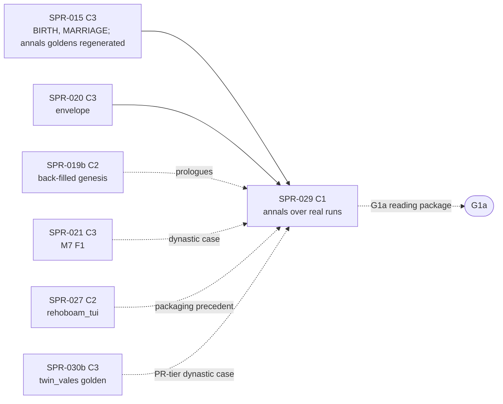

> **BLUF:** Builds the family-annals contract that is already on `main` (`specs/annals/annals_v0.md`, `templates_v0.toml`, the exact reference `selftest_annals_v0.py`, `lint_templates.py`, the three fixture chronicles and their 17 goldens; `REV-SPR-029` closed after five rounds, D49 and D50 ruled) as a plane-C tool that renders **real annals from real sealed runs**:
> - **the inputs, exported by `rh-cli`** (tool plane, `rh-golden`): `rh-cli annals-inputs <run-dir> --into <dir>` writes the world directory the reference already reads (`chronicle_A.txt`, `world.toml`, `names.toml`, `keyframe.toml`). The chronicle is every sealed channel-A segment in the canonical text form, the same lines `rh-cli tail --canonical` prints, with one `#segment` comment line per segment. The keyframe extract is rebuilt from the run's history tuple at genesis, because a run directory holds no genesis keyframe and Python cannot read an Arrow-IPC-with-zstd keyframe (finding F-2);
> - **the renderer, a port** in `python/rehoboam_narrative/annals/` (05.0 §6, 05.11 §1; SPR-027 T-05's porting precedent): standard library only, a pure function of its inputs, byte-equal to all 17 goldens, with `verify` (V-NAR-05: the whole group re-rendered and compared in order, D50's prologue rule) and the module audit (V-NAR-07);
> - **the multi-segment `chronicle_digest`** (annals_v0.md §9; finding F-3), which no fixture exercises today;
> - **the real-run gates:** `solo`, `household` and `hamlet`'s golden run directories exported, rendered, verified, and rendered again by the reference with byte-equal output; a dynastic run (`manor` or `twin_vales`) nightly once M7 is on `main`;
> - **the G1a reading package** (`bin/annals_g1a.sh`): the house annals of `twin_vales` at seeds 1–3, for the director's reading at G1a (`docs/11` G1a [H]).
>
> **Nothing in plane A changes:** no ladder, segment, keyframe, baseline or allocation budget moves; `smoke`, `solo`, `household` and `hamlet` are byte-identical (an acceptance criterion). The spec goldens are not regenerated: the port reproduces them, and a line it cannot reproduce is a finding against the port or the spec, never a `--write`.
>
> - **Developer:** AGT-002-TOOLS (the Python package, the gates, the script), with AGT-002-CORE consulted for the `rh-golden` export (genesis from the history tuple, `rh-stream`'s reader). One Developer session may hold both roles.
> - **Testers:** AGT-003-IF (the export's formats against the contract, V-NAR-05 and V-NAR-07 on real runs, the refusals) and AGT-003-DET (byte equality with the reference in two processes, the digests, the genesis extract against a year-0 keyframe). One session may hold both, on a different model from the Developer's.
> - **Size and class:** **about 3.25 agent-days** by the task inventory (T-01 0.75, T-02 1.25, T-03 0.5, T-04 0.5, T-05 0.25), **one C1 sprint** with no checkpoint: plane C and tool plane only (ADR-0024), no contract change (the contract is merged), no hash. It contains the C1 spec changes of findings F-2, F-3, F-4, F-21 and F-24 (the reference's multi-segment fold; one fixture child that pins the agnatic house walk, which no golden pins today; the titles' tier in the extract, so that a seat's interregnum is refused), which the Architect makes or approves (the specs table).
> - **Status:** PLANNING, revision 0. It is written against `main` at `3e2e6ef` and read beside the parallel drafts, revision 0 and unreviewed: SPR-021 and SPR-022 (`arch/wave7-plans`, `d37fc5b`) and SPR-023 to SPR-025 (`arch/minds-plans`, `3beca61`). One of them names this sprint: SPR-021's F-21, the `ashcombe` fixture's interregnum on a seat (F-24 here). It needs the director's plan approval only because the wave's other two plans do (D61; a C1 plan is the Architect's under GOV-005 §2).

# SPR-029 — Family annals v0 over real sealed runs (WP P2.8a)

- **Roadmap item:** `docs/11` P2.8a (`docs/11_roadmap.md:186`: "rendered from the chronicle with provenance links, so a run reads as a family history. Plane C, in `python/`") · **Phase:** P1a; G1a's [H] reading (`docs/11_roadmap.md:207`)
- **Depends on (the precondition head):**
  - **SPR-013 merged** (on `main`): run directories, sealed channel-A segments, one per sim-year (`specs/stream/channel_a_v0.sql:36–38`), `rh-stream`'s reader and canonical printer, `rh-cli tail --canonical` (`crates/rh-golden/src/tail.rs:1–25`), and the golden run directories of `solo`, `household` and `hamlet` that part golden already writes (`bin/check_all.sh`, `$GOLDEN/hamlet_run`).
  - **SPR-015 merged:** `BIRTH` and `MARRIAGE` events and the `LIFE_ENTRY` parents the designation reads (annals_v0.md §4 rule 2); the Registry delta folded and `registry_version` bumped in SPR-015's final `[C3]` commit, which regenerates the annals fixtures and goldens with their tools (REV-WAVE5 W1 (d); D-2). The renderer reads one dictionary, the Registry's, and refuses a chronicle whose `registry_version` is another (annals_v0.md §1).
  - **SPR-020 merged:** the envelope's roles, anchored snapshots, typed and motive edges, `cause_told` (`specs/chronicle/envelope_v0.md` §1–§5) in the sealed segments; without them the slots of §3 have nothing to bind.
  - **SPR-019b merged (stage B of SPR-019; D57 item 1):** the back-filled genesis rows (closed life-course rows with `exit_tick < 0`, `house_member` rows, each title's tenure log) that a house prologue renders (annals_v0.md §6). Before it, a house annal opens at its first event. PRJ-002's row named SPR-015, SPR-020 and SPR-021 only (finding F-16, restated in this plan's row).
  - **SPR-021 merged:** M7's successions, regencies, seats and house extinctions in channel A, so a dynastic run's house annals carry them. **SPR-022** (claims, depositions, dormancy) and **SPR-024** (`FEUD_DECLARED`, `FEUD_ENDED`) widen what real runs exercise; the tool renders whatever kinds a chronicle holds, and coverage on real runs is reported, not gated (annals_v0.md §12 check 7's rule: unexercised variants are printed, not failed). The fixture goldens already cover all sixteen kinds.
  - **SPR-027: not a dependency, but the packaging precedent.** Its T-05 adds `python/rehoboam_tui/`, "the first Python package of the uv project", ported from a reference (`CODEX/05_PROJECT/SPR-027_Materializer.md:168`). This sprint's package follows that layout and the uv set-up it makes (`python/pyproject.toml:33` is `package = false` today). If this sprint lands first, it makes the packaging change and SPR-027 follows it; the Architect names the order at launch.
  - **SPR-026, SPR-030: not dependencies.** The live edge is for viewers; annals read sealed segments (the specs table). SPR-030b's `twin_vales` golden run directory, once on `main`, lets T-04's dynastic case move from the nightly tier to the PR tier.
- **Binding contracts:**
  - `specs/annals/annals_v0.md` (v0, round 5): §1 the inputs (`:13–19`), §2 templates and variants (`:23–29`), §3 the slot grammar and the edge choice (`:33–53`), §4 designation and the agnatic house walk (`:57–68`), §5 grouping, the text grammar, the calendar and words, what is left out (`:72–76`), §6 the prologue (`:80–88`), §8 the sidecar (`:107–124`), §9 determinism, the digests, the manifest (`:126–140`), §11 D49 and D50 (`:155–162`), §12 the acceptance probes (`:164–175`), §16 the M7 0.5.0 house walk (`:263–265`).
  - `specs/annals/templates_v0.toml`, `specs/annals/selftest_annals_v0.py` (`RENDERER = "annals_v0/0.3.0"` `:79`; `FORBIDDEN_MODULES` `:174`; `load_world` `:575–591`; `render` subcommand), `specs/annals/lint_templates.py`, `specs/annals/fixtures/` (`ashcombe`, `solitary`, `untold`: `chronicle_A.txt`, `world.toml`, `names.toml`, `keyframe.toml`) and `specs/annals/golden/` (17 files).
  - `specs/stream/canonical_v0.md` §1 (a canonical file: header, records in `seq` order, `#` comments that no digest reads), §4 (`canonical_digest`); `specs/stream/canonical_v0.py`; `specs/stream/channel_a_v0.sql` (the segment table `:97–114`, one segment per sim-year `:36–38`); `bin/gen_hash_golden.py` (the stdlib XXH3 the digests use).
  - `crates/rh-golden/src/stream.rs:13–21` (no genesis keyframe in a run directory; the history tuple determines genesis: the Architect's ruling on SPR-013 deviation 6), `crates/rh-golden/src/tail.rs` (the canonical printer path), `crates/rh-snapshot/src/keyframe.rs:1–20` (Arrow IPC with zstd, rows in the canonical encoding), `crates/rh-worldgen` (genesis).
  - ADR-0017 (forms escalate from templated annals; a provenance sidecar), ADR-0024 (plane C: nothing here is read by plane A), ADR-0034 (describe, never decide: no model), ADR-0035 §5a; `05.11` §0 rules 1, 2 and 5 and §3 stage 2; `05.4` §5, §6.1; `docs/09` V-NAR-05 (`:243`, as amended by D50), V-NAR-07 (`:245`), V-PLN-01, V-PLN-04, V-GOLD-01; `docs/03` NAR-1 (`:187`), NAR-5 (`:191`).
- **System specs:** none changed. The annals read the `[[emits]]` of M2, M7 and T1 through `lint_templates.py` as today.
- **Rulings (binding):** REV-SPR-029 R1–R42 (above all R2 and R19: check 1 re-renders the whole group; R9: every input named by digest; R17 and R26: `Founder #k`; R18 and §16: the agnatic house walk; R21 (a) and (b); R23: the extract digest over the canonical form; R28 and R38: the `p-` prefix's pool; R39: no orphan golden); D49 (G1a reads with the kinship fallback; the name generator is P2.8's) and D50 (V-NAR-05 amended for prologue rows), both ruled by the director on 2026-10-17; REV-SPR-019 R1 (no channel-A record for the back-filled dead); REV-WAVE5 W1 (d) (a `registry_version` bump regenerates the annals goldens with their tools); REV-WAVE6 Z1 (CI per part).
- **Director items:** D61 (the wave-8 plans; this plan's item is the G1a reading set, item 7). None of this plan's rows needs the director: it is C1.
- **Requirements covered:** NAR-1's P1a binding (family annals with no model: V-NAR-07); NAR-5 (every sentence traceable to its event ids, the prologue to its keyframe rows: V-NAR-05 as amended by D50); SAGA-7's precondition (the annals are the episode text a later reader shows, 05.11 §3 stage 2); DET-6's plane rule (nothing here enters plane A: V-PLN-01, V-PLN-04).

## Specs this sprint needs

| Spec | Exists? | Gap | Architect ruling | Needed by |
|---|---|---|---|---|
| **The annals contract and its reference** | Yes, on `main` (`specs/annals/`; REV-SPR-029 closed on `03b9890`: "an independent renderer written from the contract alone reproduces all 17 golden files byte for byte") | None for the render itself | Binding as merged | T-02 |
| **Which `rh-cli` surface feeds the tool** (the Architect's question) | Three exist or are planned: `rh-cli tail --canonical` (SPR-013 T-10), the Parquet segments through DuckDB (`specs/stream/check_segments.py`), the live wire (`specs/stream/wire_v1.md`, SPR-026) | The contract names the canonical text form as the chronicle input (annals_v0.md §1, `:13`); the render must stay standard library only with no process or network module loaded (V-NAR-07, `FORBIDDEN_MODULES` `:174`), so it cannot shell out to `rh-cli` or open a socket in the render process | **Proposed (8.5/10): the canonical form, through `tail`'s printer, written to files by a separate export step.** `rh-cli annals-inputs` (T-01) writes `chronicle_A.txt` by the same code path as `tail --canonical`: one header, every sealed channel-A record in `seq` order, and one `#segment y<NNNNNN> first_seq=<a> last_seq=<b> canonical_digest=<32 hex>` comment before each segment's records (a comment, so no digest reads it: `canonical_v0.md` §1). The renderer reads files only. **Not DuckDB:** importing it into the render process would put a native library with its own I/O in V-NAR-07's audit, and the Parquet bytes are not the contract's input. **Not `wire_v1`:** the live edge serves viewers of an unsealed tip; an annal is an offline artefact over sealed years (`05.11` §0), and a live annal is P2.7/P2.8's | T-01 |
| **The keyframe extract (finding F-2)** | annals_v0.md §1 (`:17`): "the genesis keyframe's rows … The P2.8a tool reads them from the keyframe's Arrow tables (`rh-snapshot`)" | A run directory holds no genesis keyframe: "a tick of years 0–9 is rebuilt from genesis, which the history tuple determines" (`crates/rh-golden/src/stream.rs:17–20`). Keyframes are Arrow IPC with zstd over canonical row encodings (`crates/rh-snapshot/src/keyframe.rs:1–20`); the Python environment has pydantic, pyyaml and DuckDB (`python/pyproject.toml:16–20`) and Python 3.12's standard library has no zstd | **Proposed (8/10): the export rebuilds genesis.** `rh-cli annals-inputs` reads `run.toml`'s history tuple and manifest, refuses a tuple its build does not match (the `replay` rule: engine build, `registry_version`, `manifest_hash`), runs `rh-worldgen`'s genesis, and writes `keyframe.toml` in §1's `[extract]` schema from the tables before the first instant: `keyframe = "genesis"`, the genesis `state_hash`, `[[life_course]]` with `founder = k` re-derived over `founder(seed, k)` (R30), `[[house_member]]`, `[[tenure]]`. The sentence of §1 is amended by the Architect to say so (text only; no golden moves, since the fixtures' extracts are hand-shaped by `gen_fixtures.py`) | T-01 |
| **The multi-segment `chronicle_digest` (finding F-3)** | annals_v0.md §9 (`:131`): "for one of several, the XXH3-128 of the segments' 16-byte digests concatenated in segment order (R21). The reference renders one-segment fixtures" | Every real run has one segment per sim-year (`channel_a_v0.sql:36–38`); the fold has a formula but no executable oracle and no golden | **Proposed (7.5/10): the reference gains the fold before T-03** (a C1 change to `selftest_annals_v0.py`, by the Architect or the Developer under the Architect's review): the `#segment` lines read, each segment's `canonical_digest` recomputed and checked against its comment, the fold computed; a two-segment fixture (`solitary` split at its year boundary by `gen_fixtures.py`) and its golden sidecar header. Alternative: no reference change, and the Tester's independent fold over `check_segments.py`'s recomputed digests is the only oracle (weaker: it checks the product against a second Python, not against the contract's reference) | T-03 |
| **The `renderer` token (finding F-4)** | §8 (`:116`): `renderer=annals_v0/0.3.0`, which the reference prints (`RENDERER`, `:79`) | Whether a conforming implementation prints the reference's token: if it names the implementation, no port can reproduce the goldens byte for byte | **Proposed (8/10): the token names the contract version every conforming renderer implements.** The port prints `annals_v0/0.3.0`; its own version is in its package metadata and in the run log, not in the sidecar. §8 gets one sentence (Architect, text only) | T-02 |
| **The names file** | §1 (`:16`): "Written by a plane-C tool from the manifest and the run's genesis ids" | The house and title ids are `rh-ids`' `house/v1` and `title/v1` (SPR-019 T-01); the founder ids `founder/v1` with their rehash; none is in channel A | **Proposed (7/10): the Rust export writes `names.toml` too,** from the compiled manifest (`rh-manifest`) and the genesis tables: `[world] manifest_hash` as `run.toml` prints it, `[persons]` for the cast by founder id, `[houses]` and `[titles]` by their ids. One procedure computes the ids (`rh-ids`); a Python re-derivation would be a second. Alternative: a Python writer over the YAML and `bin/gen_rng_golden.py`'s stdlib H64 | T-01 |
| **Where the port lives** | `05.0` §6 (`docs/05_architecture/05.0_overview.md:213–220`): `python/rehoboam_narrative/` is "narrative compiler + exporters"; `05.11` §1 (`:45`): `rehoboam_narrative` holds "episode text and prose" | No package exists; `pyproject.toml:33` is `package = false` until "the first Python package lands" | **Proposed (8/10): `python/rehoboam_narrative/annals/`,** laid out as SPR-027 T-05 lays out `rehoboam_tui`, typed and lint-clean under GOV-003 §3 (`ruff`, `mypy --strict`) | T-02 |
| **A port or a wrapper of the reference** | The reference renders a world directory (`render --world DIR --group …`) | Whether the product ports the renderer (two implementations, one oracle) or imports the reference by path (one implementation, the spec as product code) | **Proposed (6.5/10): a port**, as SPR-027 T-05 ports the wire reference's codec and requires its transcript reproduced line for line. The reference stays the contract's oracle; REV-SPR-029's reviewer showed that a renderer written from the contract alone reproduces the goldens (`REV-SPR-029-family-annals.md:16`). Alternative: the package imports `render_group` from the reference (about 1 day less, but a product module would load a spec file by path, and a reference refactor would change the product) | T-02 |
| **The G1a reading set** (`docs/11_roadmap.md:207`: "the templated family history of 3 seeds") | PRJ-002 §5 (`:149`): "[H] the family history of 3 seeds — SPR-029, then the director" | Which world, which groups, how long | **Proposed (7.5/10; a director item, D61 item 7):** `twin_vales` at seeds 1–3 over 300 years, each seed's house annals of the two sovereign houses (`ashcombe`, `fell`), with the year annal as an index; the director reads the annals and audits any sentence through its sidecar row. About 2–4 hours (PRJ-002 §9). Rendered by `bin/annals_g1a.sh` once SPR-022, SPR-025 and SPR-030b are on `main` | T-04 |
| **The agnatic house walk is not pinned by any golden (finding F-21)** | annals_v0.md §16 (`:265`): the `ashcombe` fixture's Col "shows that the mother's house never passes"; Bram has no house | Replacing §4 rule 4's walk by the frozen M7 0.3.4 rule (the father's house, else the mother's) leaves all 17 goldens byte-identical: probed by patching `Kinship.house_of` (`selftest_annals_v0.py:642–655`) on a copy of `main` at `39e213b`, `--check` PASS. No fixture has an in-run child whose father has no house and whose mother has one (Col's father walks to Ashcombe; Bram's parents are both houseless) | **Proposed (8/10): the fixture gains the case before T-02:** an un-named daughter of a house (beyond `dormancy_degrees`, so on M2's market under T1's rule) marries a houseless founder through M2 and bears in-run; `gen_fixtures.py` derives it, the goldens are regenerated by `--write` in the Architect's C1 spec change, and the cognatic fallback becomes the port's fifth mutant, failing that child's house annal line | T-02 |
| **An interregnum M7 cannot produce, in the `ashcombe` fixture (finding F-24; SPR-021's draft, `d37fc5b`, raises it as its F-21 and names this sprint)** | `gen_fixtures.py:495` emits `INTERREGNUM_CRISIS` on `THORNE_SEAT` (`:58`), a seat, not a sovereign title; next M7's `arbitrate` (`next/M7:733`): "or the title is not sovereign: SUCCEED … Otherwise (sovereign only): INTERREGNUM_CRISIS" | The extract records no tier or liege (annals_v0.md §1), so check 5 ("a possible history", `:172`) cannot refuse it, and a port byte-equal to the goldens carries the impossible event into its tests | **Proposed (7.5/10): an annals spec fix before T-02,** in the Architect's C1 spec PR with F-21's case: the extract records each title's tier and liege; check 5 refuses `INTERREGNUM_CRISIS` on a non-sovereign title, with a control; the fixture's event becomes the `SUCCEED` M7 would emit (or the seat becomes a sovereign title); the goldens are regenerated by `--write`. T-01's export then writes tier and liege from the genesis title rows. If the fix has not landed, T-02 ports the reference as merged and the fix follows as a template-set change | T-01, T-02 |
| **Titles in succession sentences** | §10 item 2 (`:147`): v0's succession sentences name no title until BCK-002 A-55 types `payload = [...]` on `[[emits]]` | A-55 is "before SPR-021 (its spec prep)" | **Proposed (8/10): out of scope.** If A-55 lands, naming the title is a template-set change (a `templates.version` bump with goldens regenerated by `--write`), a C1 spec change of its own; this sprint builds v0 as merged | — |

## Compliance (every task)

| Rule | This sprint |
|---|---|
| Change class (`docs/13` §4.2) | **C1.** Plane-C presentation (`docs/13` §4.2 C1 row: "plane-B or plane-C changes"), a tool-plane `rh-cli` subcommand, Python tooling. No contract changes: the annals contract is merged; F-2 and F-4 are one-sentence text amendments, F-3 a reference addition with a golden, all C1 and Architect-approved. No `state_hash` moves on any golden world (an acceptance criterion); CI detects C1 |
| Planes touched (ADR-0024) | **C:** `python/rehoboam_narrative/annals/` (the renderer, `verify`, the manifest); the outputs (text, sidecar, annals manifest) are plane-C artefacts no plane-A code reads. **Tool:** `rh-golden` (`annals-inputs`, reading sealed segments with `rh-stream`'s reader and rebuilding genesis with `rh-worldgen`), `rh-cli`'s dispatcher, `bin/annals_g1a.sh`, `bin/check_all.sh`, `specs/annals/` (F-3's fold). **A:** none: no plane-A crate changes, and no plane-A crate gains a dependency |
| Owned columns written | None |
| Reads (via `rh-contracts`) | None. The export reads sealed segments (plane A at rest, through `rh-stream`'s reader) and genesis tables of a world it rebuilds itself, as `replay` does |
| RNG purposes added | None. The renderer draws nothing (annals_v0.md §9: "no random draw"); the export's genesis draws what `rh-worldgen` draws, unchanged |
| Golden-hash effect | **None.** `smoke`, `solo`, `household` and `hamlet` byte-identical at 1 and N threads, headers included; no segment, keyframe, ladder or allocation budget changes. The annals spec goldens are reproduced, not regenerated |
| Fixed-point quantities | None new. `q8_8` snapshots render as exact decimals (`templates`' rule, §3), in integer arithmetic |
| Determinism lints (GOV-003 §2, §3, §6) | `lint_arch`, `lint_forbidden` unchanged and green (no plane-A code). Python: `ruff` and `mypy --strict` clean on the package; standard library only in the render path (V-NAR-07); no iteration over a hash map that reaches the output (§9); no clock, no environment variable read in the render |
| Tests that gate this sprint | V-NAR-05 (the whole-group re-render and D50's prologue rule, on the fixtures and on real runs), V-NAR-07 (the module audit after every render; the import audit of the package), V-PLN-01 (no plane-A edge), V-PLN-04 (the run directories unchanged by an export), V-GOLD-01 (the four baselines unchanged), plus `bin/check_all.sh` |
| Docs updated in the same sprint | `bin/check_all.sh` and `python/tests/test_check_all_inventory.py` (same commit); `CLAUDE.md` (the export, render and verify commands); `annals_v0.md` §1 (F-2), §8 (F-4), §9 and §15 (F-3), §16 and `gen_fixtures.py` (F-21, F-24) by the Architect; `05.0` §6 (`rehoboam_narrative` built: annals); `docs/09` V-NAR-05 and V-NAR-07 method lines with the test names; `docs/14` (no new dependency; the XXH3 port noted as PORT from `bin/gen_hash_golden.py`); PRJ-002's row (this plan) |

**Rules carried from P0–SPR-019 (every task):**
- **Byte equality is the oracle.** The port reproduces every file of `specs/annals/golden/` from `specs/annals/fixtures/`; on real runs, the reference's `render` over the same exported directory gives the same bytes. A difference is a defect in the port or a finding against the spec, never a `--write`.
- **A positive control fails for the right reason:** its `check_all` line matches the message; every planted mutation of a real annal fails `verify` at the line the mutation touched.
- **A test input exercises the path it claims, and a probe asserts it:** the real-run gate counts the `S` rows, the `P` rows, the cited causes and the `untold/` sources it verified, and fails if a class it claims to cover is empty on the world it ran (`hamlet` has births, marriages and deaths; the dynastic case has `P` rows and a `SUCCEED`).
- **Python tests read no CI environment variable;** the render reads none at all.
- **No O(rows) work per instant** (REV-WAVE6 X1): nothing here runs inside the engine. The export reads sealed segments once and rebuilds genesis once.
- **CI time (W42, Z1):** stated per part, budgeted ×1.5 for slow runners, against the Architect's figures at launch (part core about 12:00–14:43, part golden about 12:46 after wave 4; the third PR-tier job of BCK-002 A-63 being built). Each new gate goes in exactly one part; a gate over about 5 s goes to the golden part or nightly.
- **Merge `origin/main` when main moves,** and re-run both parts; **batch pushes at task boundaries;** **one commit per task** (GOV-005 §4).

## Tasks

#### T-01: `rh-cli annals-inputs`: the run's chronicle, genesis extract, names and world file (`rh-golden`; findings F-2, the names-file row; 0.75 day)
- **Deliverable:**
  - `rh-cli annals-inputs <run-dir> --into <dir> [--to-year Y]` in `rh-golden` (a new `annals.rs`, dispatched from `cli.rs`). `--into` follows `replay --into`'s rule: absent, empty, or a previous export's output (it holds `.rh-annals-inputs`), never the run directory or anything inside or around it (SPR-013's DEF-2 ruling).
  - **`chronicle_A.txt`:** the canonical file of channel A over every sealed segment (up to `--to-year`), by `tail`'s printer: the header line, then for each segment a `#segment y<NNNNNN> first_seq=<a> last_seq=<b> canonical_digest=<32 hex>` comment and its records. The export recomputes each segment's digest from the lines it printed and refuses a segment whose stored `canonical_digest` differs (by name).
  - **`keyframe.toml`:** genesis rebuilt from `run.toml`'s history tuple (the specs table), refused by name if the build's engine build, `registry_version` or `manifest_hash` differ from the tuple; `[extract]` `format = "rehoboam/annals/keyframe-extract/v0"`, `keyframe = "genesis"`, `state_hash` = the genesis `state_hash`; `[[life_course]]`, `[[house_member]]`, `[[tenure]]` in §1's schema, `founder = k` by re-deriving `founder(seed, k)` with its rehash over the genesis rows (R30). A world without dynasties writes the extract with no member or tenure rows.
  - **`names.toml`** and **`world.toml`** (the specs table): `[world] manifest_hash` as `run.toml` prints it (`sha256:<64 hex>`, R23), `[persons]` for the cast, `[houses]` and `[titles]` by id; `[world] id`, `days_per_year`, `epoch_label` from the manifest's calendar.
- **Acceptance:**
  - **The chronicle is the stream:** for each segment of `hamlet`'s 200-year golden run, the lines between its `#segment` comment and the next, with the header, form a canonical file that `canonical_v0.py --digest` accepts and whose digest is the comment's and the segment table's `canonical_digest`; the whole file, comments stripped, equals `rh-cli tail <run> --canonical` with its status comment stripped.
  - **The extract is genesis:** the genesis `state_hash` it records equals the year-0 keyframe header's `state_hash` of the same world and seed written by `rh-cli run --keyframes D` (SPR-008's full-run keyframes keep year 0: `stream.rs:21`); on `manor` (or `twin_vales` once SPR-019b is on `main`) every back-filled dead row appears with `exit_tick < 0`, every `house_member` row and every tenure row match the same tables of that year-0 keyframe, read back through `rh-snapshot` in the test, row for row (`--dump` is not the oracle: it writes the state at the end of a month, not at genesis); the `founder` indices equal `selftest_fixture_worlds.py`'s `members_k` lines for `twin_vales` seed 1 (`golden/fixture_worlds_v0.txt`).
  - **Refusals by name:** a run directory whose `run.toml` names another engine build or `registry_version`; a sealed segment with an altered `canonical_digest` (a planted copy); `--into` inside the run directory; a world whose manifest hash does not match `run.toml`.
  - **Read-only (V-PLN-04):** the run directory's file list, sizes and modification times are unchanged by an export (the `tail` read-only test's form, SPR-013 T-10).
- **Status:** [ ] not started

#### T-02: The renderer port: `rehoboam_narrative.annals` (annals_v0.md §1–§9; the port row; F-4; 1.25 days)
- **Deliverable:**
  - `python/rehoboam_narrative/annals/` with modules for the calendar and words (§5: ordinals and cardinals to 999,999 in British style, `day N of month M`, years before the epoch, refusals of other calendars and larger numbers), the dictionary (the Registry's `[verbs]`, `[act_classes]`, `[attributes]`, `[motive_edges]`; the `+next` rule while a delta exists), the chronicle reader (a port of `canonical_v0.py`'s parser for the record kinds the annals read, with the same refusals), designation and the house walk (§4: names, the Nth son or daughter of a named father then mother, `Founder #k`, the shortest unique `p-` prefix over the run's pool, run-wide disambiguation; the agnatic walk of §16), grouping and order (§5: `house:`, `line:`, `year`, castless joins by told `triggered` edges in ascending id order), the template engine (the restricted `string.Formatter`, the variant choice in file order, the edge choice of §3), the prologue (§6), the sidecar and the digests (§8, §9: XXH3-64 and XXH3-128 ported from `bin/gen_hash_golden.py`), and the annals manifest (§9).
  - `python -I -m rehoboam_narrative.annals render --world <dir> [--group …] --out <dir>`: every group of the manifest (houses in id order, the line of the least named id when the world has houses, the year), the text and sidecar files `<world>_<group>.txt` and `.sidecar.txt`, and `<world>.manifest.txt`; `renderer=annals_v0/0.3.0` (F-4).
  - The module audit of V-NAR-07 (§12 check 3) built in: after a render the process asserts that none of `socket`, `ssl`, `http.client`, `urllib.request`, `subprocess` is in `sys.modules`, and a test lists the package's imports (standard library and the package's own modules only).
- **Acceptance:**
  - **All 17 goldens, byte for byte:** rendering `specs/annals/fixtures/ashcombe`, `solitary` and `untold` reproduces every file of `specs/annals/golden/`, the extra group (Edric Ashcombe's line, R39) included, and the three manifests.
  - **The reference's probes, as unit tests of the port:** the calendar's known answers (360 and 365 days, before and after the epoch; 1000, 1001, 1100, 2024 and 999,999 in words; a 364-day calendar and 1,000,000 refused by name: §12 check 4); injective designation with the `shared-name` case disambiguated (check 9); the extract digest unchanged by a shuffled, re-commented extract (check 10); the motive edge chosen only when positive (R20, R31: Giles's feud of weight −40 renders `feud.declared`).
  - **Determinism (§9; check 6):** the port's render of every fixture group is byte-identical in the test process and in two subprocesses under different `PYTHONHASHSEED` values and under the `C` locale and a UTF-8 locale the runner has.
  - **V-NAR-07:** the module audit passes after every render; a planted `import urllib.request` inside the render path fails it with "module socket was imported during the render" (the reference's control, ported); no `subprocess` import anywhere under `rehoboam_narrative/annals/` (a grep test).
  - **Mutants of the port, each failing by name** (each probed on the reference, patched the same way, on a copy of `main` at `39e213b`): a 365-day calendar whose first month has 30 days (fails the calendar's known answers, check 4); a birth order counted over children of both sexes (fails `ashcombe_house-3172275184034551431.txt`, `ashcombe_house-7252932463130708544.txt`, `ashcombe_year.txt` and `ashcombe_line-6740622430173101898.txt`); a house walk that takes the mother's house first (fails both Ashcombe house annals and `ashcombe.manifest.txt`); a motive chosen by the largest absolute weight (fails the same four files as the birth order: Giles's feud of weight −40 renders "moved by" instead of `feud.declared`, `ashcombe_house-3172275184034551431.txt:38`). **Not usable as a control:** the frozen cognatic fallback (the father's house, else the mother's) and a walk into a genesis person's ancestry both leave all 17 goldens byte-identical in the same probe, so the agnatic rule's one distinguishing case is unpinned (finding F-21, the specs table).
  - `ruff` and `mypy --strict` clean on the package; the uv lock unchanged (no dependency added).
- **Status:** [ ] not started

#### T-03: `verify`, the multi-segment digest and the refusals (V-NAR-05 as amended by D50; F-3; 0.5 day)
- **Deliverable:**
  - `python -I -m rehoboam_narrative.annals verify --world <dir> --text <file> --sidecar <file>`: a port of check 1 (§12; R2, R19): the group re-rendered from its inputs and compared with the files line by line and field by field, in list order, naming the first line or field that differs; D50's prologue rule (`P` rows only before the first year heading, exactly `## Before the chronicle began`, no event, every `kf:` source present in the extract); a sentence with no row, a row with no sentence, a truncated text; the sidecar digest recomputed (`verify` mode, F26).
  - **The multi-segment `chronicle_digest`** (§9): each `#segment` block's digest recomputed and checked against its comment, then the XXH3-128 fold of the 16-byte digests in segment order; a chronicle of one segment keeps its `canonical_digest`.
  - **Refusals by name** (§1, R9, R23, R27): a chronicle whose `registry_version` is not the dictionary read; a calendar other than 360 or 365; a `manifest_hash` not of the `sha256:<64 hex>` form; an unnamed house or title reaching the text; a `#segment` comment whose digest the lines do not give.
  - **F-3's oracle:** the reference's fold and its two-segment fixture golden, added under the specs table's ruling (the Architect's C1 change, landed before this task); the port's header reproduces it.
- **Acceptance:**
  - `verify` passes on every golden group, and fails, each at the line or field its mutation touched and with the reference's wording, on the reference's ten provenance mutants ported as controls (`no-event-id`, `row-drops-own`, `body-as-prologue`, `missing-kf-source`, `unrelated-event`, `rows-swapped`, `prologue-altered`, `foreign-root`, `forged-source`, `text-truncated`).
  - **The fold:** the two-segment fixture's header equals the reference's golden; on `hamlet`'s 200-segment export the port's `chronicle_digest` equals an independent fold computed by the test from `check_segments.py`'s recomputed per-segment digests (stdlib XXH3 of `bin/gen_hash_golden.py`); swapping two `#segment` blocks is refused (the `seq` order, `canonical_v0.md` §1), and a one-byte change inside a segment changes that segment's digest and the fold.
  - Each refusal has a test with its message.
- **Status:** [ ] not started

#### T-04: Real runs, the differential against the reference, and the G1a reading package (the G1a row; 0.5 day)
- **Deliverable:**
  - **The real-run gate** (`bin/check_all.sh`, the part that holds the golden run directories): for each of `$GOLDEN/solo_run`, `$GOLDEN/household_run` and `$GOLDEN/hamlet_run`, `rh-cli annals-inputs`, the port's `render` of every manifest group, `verify` on each, and the reference's `render --world` on the same exported directory; the outputs compared byte for byte; a summary line with the groups, sentences, `S` and `P` rows, cited causes and `untold/` sources.
  - **The dynastic case** (nightly while no dynastic golden run directory exists): `rh-cli run manor --years 50 --run-dir D` (or `twin_vales` once SPR-019b and SPR-021 are on `main`), the export, every house annal with its prologue, `verify`, and the reference's differential. When SPR-030b puts `twin_vales`'s run directory into the PR tier, this case moves there if it fits the part's budget (≤ 10 s).
  - **`bin/annals_g1a.sh`:** for `twin_vales` at seeds 1–3, `rh-cli run --seed s --years 300 --run-dir`, the export, the house annals of every house and the year annal, `verify`, into `artifacts/annals_g1a/seed-<s>/` with a reading index (the sovereign houses first). Run by the Architect for the G1a reading, not a gate.
- **Acceptance:**
  - **Real runs equal the reference:** on the three golden run directories, every text, sidecar and manifest the port writes equals the reference's render byte for byte, and `verify` passes on each; the probe asserts that `hamlet`'s year annal holds at least one `BIRTH`, one `MARRIAGE` and one `DEATH` sentence, and that every sidecar row's event ids exist as `EVENT` records of the chronicle (an independent DuckDB check over the sealed segments: V-NAR-05's "every sentence maps to event ids" on a real run).
  - **A planted fault in a real annal fails:** an event id dropped from one `S` row of `hamlet`'s year sidecar fails `verify` at that row, with the reference's message; a sentence edited in the text fails at that line.
  - **The dynastic case:** at least one house annal opens with `## Before the chronicle began` and its `P` rows cite only `kf:` rows of the extract; with SPR-021 on `main`, at least one `SUCCEED` sentence cites the `DEATH` that triggered it (`cause.triggered`).
  - **No plane-A effect:** the four golden ladders are unchanged (part golden's existing gates), and the run directories are unchanged by the export (T-01's read-only test, repeated on the real directories).
  - **The G1a script** runs end to end on `twin_vales` seed 1 for 20 years in a test (the full 300-year, three-seed run is the Architect's at G1a).
- **Status:** [ ] not started

#### T-05: Gates, CI time, docs (W42, Z1; 0.25 day)
- **Deliverable:**
  - **Part `core`:** the package's unit tests (the 17 goldens, the calendar, designation, the digests, the module audit, the port's mutants, the refusals) under `pytest`; `ruff` and `mypy` on the package (already in the tier's Python lint gates); the export's unit tests in debug (`cargo nextest run -p rh-golden --test annals`).
  - **The golden part** (the part that holds `$GOLDEN/*_run` after BCK-002 A-63's split): the real-run gate on the three run directories and its planted-fault control.
  - **Nightly** (`.github/workflows/nightly.yml`, its golden job): the dynastic case.
  - The inventory test in the same commit; `CLAUDE.md`; the docs of the compliance table.
- **Acceptance:**
  - Every gate in exactly one part, each part's `check_report.md` and time in the PR.
  - **CI time (W42, Z1).** Against the Architect's figures at launch, this sprint adds **about +8 s to part core** (the pytest module, about 3 s for 17 goldens and the unit tests; the export's debug tests, about 5 s) and **about +8 s to the golden part** (three exports, renders and reference renders of small worlds), **+12 s and +12 s budgeted ×1.5 for slow runners**. The nightly dynastic case adds about 30 s to the nightly golden job. **Nightly candidates if a part is over:** the reference differential on `solo` and `household` (`hamlet` covers every kind they have). No existing gate moves part.
- **Status:** [ ] not started

## Out of scope (explicit)
- **The name generator** (D49: P2.8; pre-registered to move into P1a only if G1a's readers find the bare labels disruptive, at no contract cost: annals_v0.md §4's hook).
- **Titles in succession sentences** (BCK-002 A-55; a template-set change of its own), a tellability or significance filter (P2.8; §10 item 6), grouped saga arcs and causal "because" clauses (P2.8), the annals' fold into `narrative_hash` (P2.8; §9), LLM polish (P3; ADR-0034).
- **A live annal** over `wire_v1` (P2.7/P2.8); a channel-A record for the back-filled dead (REV-SPR-019 R1; the extract serves).
- **Regenerating the spec goldens.** The Registry bump that moves them is SPR-015's `[C3]` commit (REV-WAVE5 W1 (d)), not this sprint's.
- **The director's reading itself** (G1a, after SPR-030b): this sprint delivers the package and the script.

## Verification assignment (Testers)

| Tester | What to verify, from which contract | Report |
|---|---|---|
| AGT-003-IF | T-01, T-03, T-04, written from annals_v0.md §1, §8, §9, §12, `canonical_v0.md` §1 and §4, and the specs table's rows before reading the code:<ul><li>the export's four files against the contract's schemas: a hand-checked extract of their own for `manor` at seed 1 (the back-filled dead, the members, the tenures), the `#segment` comments against the segment table read with DuckDB;</li><li>V-NAR-05 on real runs: their own five mutations of a real `hamlet` annal (a row's persons, a source, a template version, a line order, a prologue on a world without one), each failing `verify` at its line;</li><li>V-NAR-07: the module audit with their own planted import, and a render under `python -I` with no network namespace;</li><li>every refusal of T-01 and T-03 with an input of their own;</li><li>the read-only property on a live run directory (an export while `rh-cli run` is still sealing)</li></ul> | `VER-SPR-029-TEST` |
| AGT-003-DET | T-02, T-03, T-04, written from §9 and the goldens:<ul><li>byte equality with the reference on all 17 goldens and on the three real run directories, rendered on two machines (a hosted runner and the Tester's sandbox);</li><li>the fold against their own stdlib computation;</li><li>the genesis extract's `state_hash` against a year-0 keyframe of their own;</li><li>the port's four mutants killed for their reasons, plus three of their own (a castless event joined in descending id order; a `p-` prefix unique per annal instead of per run; an ordinal word for 1100 without "and")</li></ul> | As above |

## Merge route

- **Class and conditions.** C1: merged by the Architect after green CI and the Architect's review (GOV-005 §6); the Tester pass and audit are kept because the sprint delivers a G1a artefact. No baseline moves, so no announcement. The PR title ends `[C1]`.
- **Order (7/10).** After SPR-015 (the dictionary and the regenerated annals goldens) and SPR-020 (the envelope in the segments); SPR-019b and SPR-021 before T-04's dynastic case is meaningful. It merges in any gap between C3 merges, so it costs the serial C3 slot nothing. With SPR-027: whichever lands second follows the other's packaging (the specs table).

- **Shared files.** With SPR-027: `python/pyproject.toml`, `python/uv.lock`, the Python lint configuration. With SPR-030 and SPR-028: `bin/check_all.sh`, the inventory test, `CLAUDE.md`, `rh-golden`'s `cli.rs` (SPR-028 reuses this sprint's export for M7's tenure rows at the horizon: `SPR-028_ValidationHarness.md`, the specs table). Whichever merges second resolves the textual conflicts.
- **What this sprint re-verifies after merging `origin/main`:** both CI parts; the 17 goldens (regenerated by any `registry_version` bump since); the real-run differential on the run directories then on `main`.

## Risks

| Risk | Likelihood and effect | Mitigation |
|---|---|---|
| A `registry_version` bump lands between this sprint's branch point and its merge (SPR-016, SPR-018, SPR-021 all bump) | Likely; the goldens and the fixtures' headers move under the port's feet | The bumping sprint regenerates them with the tools (W1 (d)); the port reads the dictionary version from the Registry, so it follows without a code change; re-verify after each merge of `main` |
| The port and the reference differ on a corner the fixtures do not reach, found only on a real run | Medium; a real `hamlet` annal differs | T-04's differential on real runs is the gate that finds it; the Architect rules which side the contract supports and files the fix against that side |
| Rebuilding genesis in the export drifts from the run's genesis (a build other than the run's) | Low; T-01 refuses a tuple mismatch | The year-0 keyframe equality of T-01's acceptance; a run made by another build is exported by that build |
| Real chronicles are long: a 1,000-year `kingdom_10k` chronicle above D38's ceiling | Low for G1a (it reads `twin_vales`, 300 years) | The render is linear in events; the G1a set is `twin_vales`; `kingdom_10k`'s annals are not a deliverable |
| The bare labels (`Founder #k`, `p-aae0`) read badly at G1a | Medium; the G1a reading fails "reads as a family history" | D49's pre-registered move of the name generator into P1a, at no contract cost |

## Blockers

| # | Blocker | Status |
|---|---|---|
| 1 | SPR-015 not merged (BIRTH, MARRIAGE; the folded Registry; the regenerated annals goldens) | Open |
| 2 | SPR-020 not merged (the envelope in the segments) | Open |
| 3 | SPR-019b and SPR-021 not merged (prologues; M7's kinds on real runs): T-04's dynastic case only | Open |
| 4 | F-3's reference fold and two-segment golden, before T-03, and F-21's fixture child and F-24's tier rule, before T-02 (the Architect's C1 spec changes) | Open |
| 5 | The Architect's rulings of the specs table's "proposed" rows (the surface, the extract, the names file, the package, port or wrapper, F-4) | Open: ruled with the plan's approval |
| 6 | The director's approval of the wave's plans (D61) | Open |

## Completion

- [ ] All tasks meet their acceptance criteria.
- [ ] `bin/check_all.sh` passes; the report is attached, with each part's time.
- [ ] Tester verdicts are PASS (IF, DET).
- [ ] Architect audit `VER-SPR-029` is PASS, with the real-run differential and the fold's evidence.
- [ ] No open DEF- against this sprint.
- [ ] The merge route matches the CI-detected change class (C1); no golden world, segment or budget moved; the 17 spec goldens were reproduced, not regenerated.
- [ ] `annals_v0.md` §1, §8 and §9 carry F-2, F-4 and F-3's text, and the fixture pins the agnatic walk (F-21) and holds no interregnum on a seat (F-24); `bin/annals_g1a.sh` is ready for the G1a reading; PRJ-002's row links this plan.
