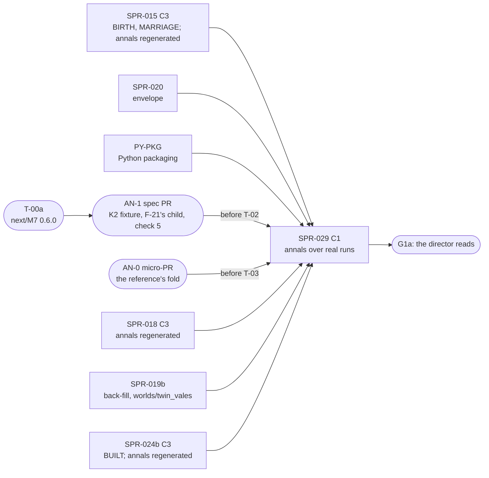

> [!NOTE]
> **ARCHIVED BASELINE:** Traditional sprint-based tracking has been superseded by Specification-Driven Development (SDD v2.0). All future deliverables are tracked as Spec Waves in `.spec/ARCHITECT_BACKLOG.md`.

> **BLUF:** Builds the family-annals contract that is already on `main` (`specs/annals/annals_v0.md`, `templates_v0.toml`, the exact reference `selftest_annals_v0.py`, `lint_templates.py`, the three fixture chronicles and their 17 goldens; `REV-SPR-029` closed, D49 and D50 ruled) as a plane-C tool that renders **real annals from real sealed runs**. **Priority 1** under D62 (the director's execution priorities of 2026-10-18: the engine core first, then the viewer, then era packs; `docs/decisions-log.md:7`, which names this sprint): G1a's last criterion is "[H] You read the templated family history of 3 seeds" (`docs/11_roadmap.md:220`; the director's ≈ 2–4 hours, `:94`), and this plan builds what the director reads.
> - **The inputs, exported by `rh-cli`** (tool plane, `rh-golden`): `rh-cli annals-inputs <run-dir> --into <dir>` writes the world directory the reference already reads (`chronicle_A.txt`, `world.toml`, `names.toml`, `keyframe.toml`). The chronicle is every sealed channel-A segment in the canonical text form, the lines `rh-cli tail --canonical` prints, with one `#segment` comment per segment. The keyframe extract is rebuilt from the run's history tuple at genesis (finding F-2), and **checked against the run twice** before it is written: the rebuilt living founders against the chronicle's tick-0 `LIFE_ENTRY` lines (ruling G16), and the rebuilt world advanced one sim-year along the run's journal against rung 1 of the run's `run.ladder`, which covers the house, tenure and title rows the founders' lines do not (ruling A3). The run-directory format does not change.
> - **The renderer, a port** in `python/rehoboam_narrative/annals/`: standard library only, byte-equal to every fixture golden, with `verify` (V-NAR-05, D50's prologue rule) and the module audit (V-NAR-07); designation at scale by **the sorted-neighbour method** for the `p-` prefixes, with the provenance memoized separately and siblings indexed for the birth order (ruling A2); packaged in the layout of **PY-PKG** (ruling S6, filed by the Architect at the close).
> - **The multi-segment `chronicle_digest`** (annals_v0.md §9; finding F-3), against the reference's fold, which **AN-0** adds (ruling A1).
> - **The real-run gates:** `solo`, `household` and `hamlet`'s run directories in CI's `stream` part (G20); a dynastic run nightly, after SPR-024b (G19), on the `worlds/twin_vales/` that SPR-019b creates (ruling X1).
> - **The G1a reading package** (`bin/annals_g1a.sh`): the house annals of `twin_vales` at seeds 1–3.
>
> **This sprint regenerates no annals fixture or golden** (G15). **The annals-fixture changes are AN-1, "annals fixtures for M7 F1"** (ruling A1; a spec PR the Architect commissions after T-00a merges and files at this close): K2's vassal `INTERREGNUM_CRISIS` fixture, F-21's distinguishing child, check 5's rule (`INTERREGNUM_CRISIS` on a non-sovereign title only while its liege's interregnum is open at that tick) with its control, and the goldens by `--write`; about 1–1.5 days plus one review round; it merges before this sprint's T-02. K7 changes no fixture: it keeps the existing shapes (`CLAIM_*` payloads `[title id]`). Every regeneration (SPR-015's, SPR-018's, AN-1's and SPR-024b's) lands before this sprint merges, and the port reproduces the fixtures as they then stand.
>
> **Nothing in plane A changes:** no ladder, segment, keyframe, baseline or allocation budget moves; `smoke`, `solo`, `household` and `hamlet` are byte-identical (an acceptance criterion).
>
> - **Developer:** AGT-002-TOOLS (the Python package, the gates, the script), with AGT-002-CORE for the `rh-golden` export (genesis from the history tuple, the one-year replay check, `rh-stream`'s reader). One session may hold both roles.
> - **Testers:** AGT-003-IF (the export's formats, V-NAR-05 and V-NAR-07 on real runs, the refusals) and AGT-003-DET (**their own renderer, written from the contract alone, as the independent oracle**: G18; the digests; the genesis checks). One session may hold both, on a different model from the Developer's.
> - **Size and class:** **about 4.75–5.25 agent-days** by the task inventory (T-01 1.75 with A3's one-year check, T-02 2.0, T-03 0.5, T-04 0.5, T-05 0.25), slightly above G22's 4.5–5 because of A3; **one C1 sprint with a checkpoint after T-01** (the Tester's interim pass on the export): plane C and tool plane only, no contract change of its own, no hash (D61 item 1).
> - **Status:** PLANNING, **revision 2**. Revision 0 (`dc39967`) had an independent review (REV-WAVE8 round 1: rulings G1–G22); revision 1 (`1dfc563`) a re-check (round 2: this plan AFTER SMALL FIXES, 1 MAJ, 2 MIN, 1 NIT), whose rulings A1–A4, S6 and X1–X3 are applied here (the last section maps both rounds). It is written against `main` at `99a5b3d` (A-62; D62; PR #89's three CI parts; wave 7 as PR #95 with D58 waiting; the minds as PR #93 with D59 waiting; D60 approved), with the cross-plan rulings X1–X13. A C1 plan is the Architect's under GOV-005 §2; it goes to the director with the wave (D61).

# SPR-029 — Family annals v0 over real sealed runs (WP P2.8a)

- **Roadmap item:** `docs/11` P2.8a (`docs/11_roadmap.md:199`: "rendered from the chronicle with provenance links, so a run reads as a family history. Plane C, in `python/`") · **Phase:** P1a; G1a's [H] reading (`docs/11_roadmap.md:220`).
- **Depends on, by task** (G19; the split sprints on `main`; "merged" means on `main`):

| Task | Needs merged | Why |
|---|---|---|
| T-01 (the rungs) | SPR-013 (on `main`); SPR-015 (`LIFE_ENTRY` parents, which G16's cross-check compares) | Run directories, the canonical printer, genesis, replay's code path |
| T-01 (the dynastic extract) | SPR-019b (the back-filled genesis rows; `worlds/twin_vales/`: X1); **AN-1** (the extract's §1 schema gains each title's tier and liege, for check 5) | The extract's `[[house_member]]`, `[[tenure]]` and title rows |
| T-02 | SPR-015 (the dictionary; the fixtures and goldens regenerated by its tools: REV-WAVE5 W1 (d)); **AN-1** (the final fixture set); **PY-PKG** (the uv project's first package: S6) | The port reproduces the fixtures as they stand after every regeneration |
| T-03 | **AN-0** (the reference's fold, F-3: a micro-PR the Architect commissions now) | The fold's oracle |
| T-04 (the rungs) | SPR-015, SPR-020 (the envelope in the segments) | Births, marriages, deaths with roles and edges |
| T-04 (the dynastic case; `bin/annals_g1a.sh`) | **SPR-024b** (M7 and T1 join `BUILT` together, X6: before it a `SUCCEED` citing a `DEATH` cannot occur in a run); SPR-019b (`worlds/twin_vales/`: X1) | The house annals the director reads |

  - **The order** (G15, G19, A1): development starts once SPR-015, SPR-020, PY-PKG and AN-1 are on `main` (T-01 on the rungs may start before AN-1; T-03 needs AN-0); **the merge waits for SPR-024b and SPR-019b**. So every annals regeneration of P1a is on `main` before this sprint merges; if a later Registry bump moves the goldens, the bumping PR regenerates them with the tools and keeps this sprint's port gate green in its own CI.
  - **SPR-026, SPR-028, SPR-030: not dependencies.** SPR-028 reads no keyframe and needs no export (its G11); SPR-030b1's golden `twin_vales` changes nothing here.
- **Binding contracts:**
  - `specs/annals/annals_v0.md` (v0, round 5): §1 the inputs (`:13–19`), §2 (`:23–29`), §3 (`:33–53`), §4 designation and the agnatic house walk (`:57–68`), §5 (`:72–76`), §6 the prologue (`:80–88`), §8 the sidecar (`:107–124`), §9 determinism, the digests, the manifest (`:126–140`), §11 D49 and D50 (`:155–162`), §12 the acceptance probes (`:164–175`), §16 the M7 0.5.0 house walk (`:263–265`); as AN-1 amends §1 (tier and liege), §12 check 5 and the fixtures, and AN-0 adds the reference's fold.
  - `specs/annals/templates_v0.toml`, `specs/annals/selftest_annals_v0.py` (`RENDERER = "annals_v0/0.3.0"` `:79`; `FORBIDDEN_MODULES` `:174`; `load_world` `:575–591`; `Kinship.house_of` `:642–655`; `label_of`; `render`), `specs/annals/lint_templates.py`, `specs/annals/fixtures/` (`ashcombe`, `solitary`, `untold`; `gen_fixtures.py`) and `specs/annals/golden/` (17 files today; the house and line annals' names carry house and person ids, `ashcombe_house-<id>.txt`, `ashcombe_line-<id>.txt`, which a regeneration may rename: A4).
  - `specs/stream/canonical_v0.md` §1 (a canonical file: header, records in `seq` order, `#` comments no digest reads), §4 (`canonical_digest`); `specs/stream/canonical_v0.py`; `specs/stream/channel_a_v0.sql` (the segment table `:97–114`, one segment per sim-year `:36–38`); `bin/gen_hash_golden.py` (the stdlib XXH3).
  - `crates/rh-golden/src/stream.rs:13–21` (no genesis keyframe in a run directory; "a tick of years 0-9 is rebuilt from genesis, which the history tuple determines"), `crates/rh-golden/src/tail.rs`, `rh-cli replay` (`CLAUDE.md`: the run rebuilt from `run.toml` and its journal alone), `crates/rh-snapshot/src/keyframe.rs:1–20`, `crates/rh-worldgen`.
  - M7's `[[emits]]`: `INTERREGNUM_CRISIS` (`specs/systems/next/M7.dynasty.odd.toml:353–355`) and `arbitrate` (`:733`), which SPR-021's ruling K2 lifts for a vassal joining its liege's interregnum.
  - ADR-0017, ADR-0024, ADR-0034, ADR-0035 §5a; `05.11` §0 rules 1, 2 and 5 and §3 stage 2; `05.4` §5, §6.1; `docs/09` V-NAR-05 (`:243`, as amended by D50), V-NAR-07 (`:245`), V-PLN-01, V-PLN-04, V-GOLD-01; `docs/03` NAR-1 (`:187`), NAR-5 (`:191`).
- **System specs:** none changed.
- **Rulings (binding):** REV-WAVE8 round 1 **G1–G22** and round 2 **A1–A4, S6, X1–X3** (the Architect, 2026-10-18), with X1–X13 and wave 7's K2 and K7; REV-SPR-029 R1–R42 (R2 and R19: check 1 re-renders the whole group; R9; R17 and R26: `Founder #k`; R18 and §16: the agnatic house walk; R21; R23; R28 and R38: the `p-` prefix's pool; R39); D49 and D50; REV-SPR-019 R1; REV-WAVE5 W1 (d); REV-WAVE6 Z1.
- **Director items:** D61 item 7 (the G1a reading set, after SPR-024b) and items 1 and 8 (size, CI). Nothing else here needs the director: it is C1.
- **Requirements covered:** NAR-1's P1a binding (V-NAR-07); NAR-5 (V-NAR-05 as amended by D50); SAGA-7's precondition; DET-6's plane rule (V-PLN-01, V-PLN-04).

## Specs this sprint needs

| Spec | Exists? | Gap | Architect ruling | Needed by |
|---|---|---|---|---|
| **The annals contract and its reference** | Yes, on `main` (REV-SPR-029 closed) | None for the render itself | Binding as merged, and as AN-1 and AN-0 amend it | T-02 |
| **Which `rh-cli` surface feeds the tool** | `tail --canonical`, the Parquet segments through DuckDB, the live wire | The contract names the canonical text form (§1, `:13`); the render stays standard library (V-NAR-07) | **Accepted (round 1: "the feed is sound"; 8.5/10): the canonical form through `tail`'s printer, written to files by a separate export;** `#segment` comments are legal (`canonical_v0.md` §1). Not DuckDB; not `wire_v1` | T-01 |
| **The keyframe extract (finding F-2) and its checks (rulings G16, A3)** | annals_v0.md §1 (`:17`) | No genesis keyframe in a run directory (`stream.rs:13–21`); Python 3.12 has no zstd. `engine_build` is a version and the built set, not a code hash, so a worldgen change between run and export would go undetected (G16); and the founders' tick-0 lines cannot see drift in the house, tenure and title rows (round 2's A3) | **Ruled (G16, A3; 85%): the export rebuilds genesis and checks it twice, with no new file.** (1) Every living founder it rebuilt against the chronicle's tick-0 `LIFE_ENTRY` lines (id, sex, birth tick, parents), refused by name on any difference. (2) **The rebuilt world advanced one sim-year along the run's own journal, through `replay`'s code path, and its rung-1 hash compared with rung 1 of `run.ladder`** (the run's first rung, at its recorded cadence and ladder), refused by name on a difference: the rung hashes every plane-A table, so any drift in `house_member`, tenure or title rows shows. Then `keyframe.toml` is written (§1's schema, with the titles' tier and liege as AN-1 adds them). No `genesis.toml`; the run-directory format is unchanged. §1's sentence is amended by the Architect | T-01 |
| **The multi-segment `chronicle_digest` (finding F-3)** | annals_v0.md §9 (`:131`) | Every real run has one segment per sim-year; the fold had no executable oracle | **Ruled (A1, 80%): AN-0, a micro-PR the Architect commissions now,** adds `fold` to the reference (a function and a subcommand: the `#segment` blocks read, each segment's `canonical_digest` recomputed and checked against its comment, the fold), with no fixture or golden change. T-03's oracle is that fold over the real `hamlet` export and over a two-segment cut of `solitary`'s chronicle that the test makes and does not commit | T-03 |
| **The `renderer` token (finding F-4)** | §8 (`:116`) | A wording gap (round 1: a NIT) | **Accepted:** one sentence in §8 by the Architect: the token names the contract version every conforming renderer implements | T-02 |
| **The names file** | §1 (`:16`) | The house, title and founder ids are not in channel A | **Accepted (7/10): the Rust export writes `names.toml`** from the compiled manifest and the genesis tables | T-01 |
| **Where the port lives, and its packaging (rulings G18, S6)** | `05.0` §6 (`:213–220`), `05.11` §1 (`:45`) | `python/pyproject.toml:33` is `package = false` (`uv.lock` records `source = { virtual = "." }`); revision 1 waited on SPR-027 T-05, the last task of a plan the director ranks below the core (round 2's S6) | **Ruled (S6, 75%): PY-PKG,** a 0.25-day C1 PR carved out of SPR-027 T-05 (`package = true` and the layout), consumed by SPR-027 T-05, SPR-028a and this sprint, with a PRJ-002 row filed by the Architect at the close. The port lives in `python/rehoboam_narrative/annals/` in that layout and adds no dependency | T-02 |
| **A port, and the independent oracle (ruling G18)** | — | A transliterated port is not independent | **Ruled (G18):** the port is byte-equal to the reference; **the independent oracle is the Tester's own renderer**, written from the contract alone | T-02, T-04 |
| **Designation at scale (rulings G17, A2)** | §4: the shortest unique `p-` prefix of at least 4 hex digits over the run's pool (D49; R28, R38) | The reference's `label_of` is O(pool) per designation; **revision 1's memo is still O(distinct pids × pool)**: about 132 s for 18,000 labels (round 2's A2) | **Ruled (A2, 85%): the sorted-neighbour method in the port.** The pool's ids, as fixed-width hex, are sorted once; the shortest unique prefix of an id is 1 + the longer of its common prefixes with its two sorted neighbours, at least 4 digits, which is the reference's definition computed in O(n log n) (round 2 labelled all 18,000 in 0.05 s with identical labels on a sample). **The provenance the reference records while labelling is memoized separately** per pid, so a cached label still records its source in each annal that uses it; **siblings are indexed** (children by parent, ordered by birth tick then id, built once) so "the Nth son or daughter" is a lookup. **The reference stays the differential** on the real-run gate and at 50 years; the 300-year timing line times the port only | T-02, T-04 |
| **The G1a reading set** (`docs/11_roadmap.md:220`) | PRJ-002 §5 | Which world, which groups, how long | **Proposed (7.5/10; D61 item 7, after SPR-024b):** `twin_vales` at seeds 1–3 over 300 years, the house annals of the two sovereign houses (`ashcombe`, `fell`), with the year annal as an index; about 2–4 hours (`docs/11_roadmap.md:94`) | T-04 |
| **The agnatic house walk is not pinned by any golden (finding F-21)** | §16 (`:265`) | A cognatic fallback in `Kinship.house_of` leaves `--check` at PASS on all 17 goldens | **Ruled (G15, A1): AN-1 adds the distinguishing child** (an un-named house daughter with a houseless father, bearing in-run); the cognatic fallback then becomes a mutant of the port (T-02). SPR-021's "F-21 is SPR-029's to resolve" (`SPR-021_SuccessionF1.md:347`) is corrected by the Architect at this close | T-02 |
| **An interregnum M7 cannot produce, in the `ashcombe` fixture (finding F-24)** | `gen_fixtures.py:495` emits `INTERREGNUM_CRISIS` on `THORNE_SEAT` (`:58`); `arbitrate` (next M7 `:733`) | Under K2 a vassal joining its liege's interregnum does emit one; the fixture's event is still impossible (no liege interregnum is open) | **Ruled (G15, A1): AN-1** makes check 5 "`INTERREGNUM_CRISIS` on a non-sovereign title only while its liege's interregnum is open at that tick", the extract records tier and liege, the fixture becomes possible (K2's vassal case) or loses the event, with check 5's control. **This sprint reproduces the result and regenerates nothing;** T-01 writes tier and liege as the amended §1 says | T-01, T-02 |
| **The order of the annals regenerations (G15)** | REV-WAVE5 W1 (d) | — | **Ruled:** regenerated by their tools at **SPR-015** (T-01 and its `[C3]`), **SPR-018** (its `[C3]`), **AN-1** and **SPR-024b** (its `[C3]`: `BUILT` and `registry_version`, X6; `SPR-021_SuccessionF1.md:278`), all before this sprint merges | T-02 |
| **Titles in succession sentences** | §10 item 2 (`:147`) | BCK-002 A-55 | **Accepted: out of scope** | — |

## CI by part (X10; rulings G20, X2, X3)

**The base** is PR #89's first CI run (`a4be717`): **core 10:00, golden 7:10, stream 7:32**. Sums are gate sums on one runner; ×1.5 is the slow-runner budget.

| Part | Gates | Sum | ×1.5 |
|---|---|---|---|
| `core` | the package's unit tests (the fixture goldens, the calendar, designation and the neighbour method against the reference's function on a 1,000-pid sample, the sibling index, the digests, the module audit, the port's mutants, the refusals) under `pytest`, about 3 s; the export's unit tests in debug (`cargo nextest run -p rh-golden --test annals`), about 5 s | +8 s | +12 s |
| `golden` | — | — | — |
| `stream` | **the real-run gate** on the stream part's own `solo`, `household` and `hamlet` run directories (`stream_inputs`): export with both genesis checks, the port's render of every group, `verify`, the reference's render, byte comparison, the summary line, the planted-fault control, and the two drift controls | +13 s | +20 s |

**Off the PR tier.** The allowance of hosted Actions minutes is D61 item 8's question to the director (X3); this plan states minutes per run and enters them in **PRJ-002's nightly ledger, which the Architect keeps** (X2). It adds **one small daily case** to the golden nightly job once SPR-024b is on `main`: `twin_vales` seed 1, 50 years with the reference differential, and 300 years port-only with the timing line, about 1–2 minutes a night. If the ledger shows the golden nightly's headroom spent, the case moves to SPR-030b1's weekly `dynastic.yml` (X2). `bin/annals_g1a.sh` runs where the Architect runs it for G1a, costing no hosted minutes.

## Compliance (every task)

| Rule | This sprint |
|---|---|
| Change class (`docs/13` §4.2) | **C1.** Plane-C presentation, a tool-plane `rh-cli` subcommand, Python tooling. The contract changes are not this sprint's: F-2's, G16's and F-4's sentences are the Architect's; the fixtures and check 5 are AN-1's; the fold is AN-0's. No `state_hash` moves (acceptance) |
| Planes touched (ADR-0024) | **C:** `python/rehoboam_narrative/annals/`. **Tool:** `rh-golden` (`annals-inputs`, replay's one-year path), `rh-cli`'s dispatcher, `bin/annals_g1a.sh`, `bin/check_all.sh`, `bin/golden_nightly.sh`. **A:** none, except the test-only `mutant-worldgen-sex-flip` in `rh-worldgen`, a `mutant-*` feature compiled out of every baseline build and of `check_all`'s default build (A-52; A4) and built only by T-01's drift test |
| Owned columns written | None |
| Reads (via `rh-contracts`) | None. The export reads sealed segments (plane A at rest) and genesis tables of a world it rebuilds and advances one year, as `replay` does |
| RNG purposes added | None. The renderer draws nothing (§9); the export's genesis and year draw what the run drew |
| Golden-hash effect | **None.** The four golden worlds byte-identical; no segment, keyframe, ladder or allocation budget changes. **No annals golden is regenerated here** (G15) |
| Fixed-point quantities | None new |
| Determinism lints (GOV-003 §2, §3, §6) | `lint_arch`, `lint_forbidden` green. Python: `ruff` and `mypy --strict`; standard library only in the render path (V-NAR-07); no hash-map iteration reaching the output (§9); no clock and no environment variable read in the render |
| Tests that gate this sprint | V-NAR-05, V-NAR-07, V-PLN-01, V-PLN-04, V-GOLD-01, plus `bin/check_all.sh` |
| Docs updated in the same sprint | `bin/check_all.sh` and `python/tests/test_check_all_inventory.py` (same commit); `CLAUDE.md`; `annals_v0.md` §1 (F-2, G16, A3) and §8 (F-4) by the Architect; `05.0` §6; `docs/09` V-NAR-05 and V-NAR-07 method lines; `docs/14` (the XXH3 port noted as PORT); PRJ-002's row and nightly ledger |

**Rules carried from P0–SPR-019 (every task):**
- **Byte equality is the oracle.** The port reproduces every file of `specs/annals/golden/`; on real runs the reference's `render` over the same exported directory gives the same bytes; the Tester's own renderer is the independent check. A difference is a defect in the port or a finding against the spec, never a `--write`.
- **A positive control fails for the right reason;** every planted mutation of a real annal fails `verify` at the line it touched.
- **A test input exercises the path it claims, and a probe asserts it.**
- **Python tests read no CI environment variable;** the render reads none at all.
- **No O(rows) work per instant** (REV-WAVE6 X1); **no O(pool) work per designation** (G17, A2).
- **CI time (W42, Z1, X10):** per part of three, ×1.5; run-directory readers in `stream`; minutes per run in PRJ-002's ledger.
- **Merge `origin/main` when main moves,** and re-run all three parts; **batch pushes at task boundaries;** **one commit per task** (GOV-005 §4).

## Tasks

#### T-01: `rh-cli annals-inputs`: the chronicle, the genesis extract with its two checks, names and world file (`rh-golden`; F-2; G16, A3, A4; 1.75 days)
- **Deliverable:**
  - `rh-cli annals-inputs <run-dir> --into <dir> [--to-year Y]` in `rh-golden` (`annals.rs`, dispatched from `cli.rs`). `--into` follows `replay --into`'s rule (absent, empty, or a previous export's output holding `.rh-annals-inputs`; never the run directory or anything inside or around it).
  - **`chronicle_A.txt`:** every sealed segment (up to `--to-year`) in the canonical form by `tail`'s printer, one `#segment y<NNNNNN> first_seq=<a> last_seq=<b> canonical_digest=<32 hex>` comment per segment; a segment whose stored `canonical_digest` differs from the printed lines' is refused by name.
  - **The genesis, rebuilt and checked:** from `run.toml`'s history tuple (refused by name if the build's engine build, `registry_version` or `manifest_hash` differ); **check (1)** every living founder against the tick-0 `LIFE_ENTRY` lines (id, sex, birth tick, mother, father), both directions; **check (2)** the rebuilt world advanced one sim-year along the run's journal through `replay`'s code path, its first rung's hash against `run.ladder`'s first rung (the run's recorded cadence and ladder); on any difference the export writes nothing and exits naming the check, the field or rung, and the id.
  - **`keyframe.toml`** in §1's schema (`keyframe = "genesis"`, the genesis `state_hash`, `[[life_course]]` with `founder = k` (R30), `[[house_member]]`, `[[tenure]]`, the titles' tier and liege as AN-1 adds them); **`names.toml`** and **`world.toml`** (`[world] manifest_hash` as `run.toml` prints it, `sha256:<64 hex>`; `[persons]` for the cast; `[houses]` and `[titles]` by id; `id`, `days_per_year`, `epoch_label`).
- **Acceptance:**
  - **The chronicle is the stream:** each segment of `hamlet`'s 200-year run, with the header, is a canonical file whose digest is its comment's and the segment table's; the whole file, comments stripped, equals `rh-cli tail <run> --canonical` with its status comment stripped.
  - **The extract is genesis:** its `state_hash` equals the year-0 keyframe header's of the same world and seed written by `rh-cli run --keyframes D` (`stream.rs:21`); on `manor` and on `twin_vales` (from SPR-019b's world directory, X1) every back-filled dead row appears with `exit_tick < 0`, and every `house_member`, tenure and title row matches that year-0 keyframe, row for row; the `founder` indices equal `selftest_fixture_worlds.py`'s `members_k` lines for `twin_vales` seed 1.
  - **The checks refuse a drifted genesis:** check (1) on a planted chronicle with one founder's birth tick shifted by a day, and with a founder removed; **check (2) on a build with a planted worldgen change that leaves every founder's line intact** (one back-filled tenure row's start shifted), refused at rung 1; both checks on `mutant-worldgen-sex-flip` (A-52: a `mutant-*` feature of `rh-worldgen`, built only by this test).
  - **Refusals by name:** another engine build or `registry_version`; an altered `canonical_digest`; `--into` inside the run directory; a manifest whose hash does not match `run.toml`.
  - **Read-only (V-PLN-04):** the run directory's files, sizes and modification times unchanged.
  - **Checkpoint:** the Tester's interim pass on T-01 is recorded in `VER-SPR-029-TEST` before T-02 lands.
- **Status:** [ ] not started

#### T-02: The renderer port: `rehoboam_narrative.annals` (annals_v0.md §1–§9; F-4; G17, G18, A2, A4; 2.0 days)
- **Deliverable:**
  - `python/rehoboam_narrative/annals/` (in PY-PKG's layout: S6), with modules for the calendar and words (§5), the dictionary (the Registry's `[verbs]`, `[act_classes]`, `[attributes]`, `[motive_edges]`), the chronicle reader (a port of `canonical_v0.py`'s parser for the kinds the annals read), designation and the house walk (§4, §16) with **the sorted-neighbour labels, the provenance memo and the sibling index** (A2), grouping and order (§5), the template engine (§2, §3), the prologue (§6), the sidecar and the digests (§8, §9: XXH3 ported from `bin/gen_hash_golden.py`), and the annals manifest (§9).
  - `python -I -m rehoboam_narrative.annals render --world <dir> [--group …] --out <dir>`; `renderer=annals_v0/0.3.0` (F-4).
  - The module audit of V-NAR-07 (§12 check 3) after every render; a test listing the package's imports.
- **Acceptance:**
  - **Every fixture golden, byte for byte,** as `specs/annals/golden/` then stands (after AN-1 and SPR-024b), the extra group of R39 and the manifests included.
  - **The reference's probes as unit tests:** the calendar (check 4); injective designation with `shared-name` (check 9); the extract digest unchanged by a shuffled, re-commented extract (check 10); the motive edge chosen only when positive (R20, R31); **check 5's interregnum rule** as AN-1 states it, with its control.
  - **Designation at scale (A2):** on a synthetic pool of 18,000 persons, every label equals the reference's `label_of` on a 1,000-pid sample and on the whole of `hamlet`'s pool; labelling the whole pool takes O(n log n) (a sort count, not a wall-clock gate); a cached label still records its provenance in a second annal that uses it; the birth-order rank equals the reference's on every fixture person.
  - **Determinism (§9; check 6):** every fixture group byte-identical in the test process and in two subprocesses (run under `python -P -s -m`) under different `PYTHONHASHSEED` values and two locales.
  - **V-NAR-07:** the audit passes after every render; a planted `import urllib.request` in the render path fails it with "module socket was imported during the render"; no `subprocess` import under the package.
  - **Mutants of the port, each failing by name** (probed on the reference, patched the same way, on `main` at `39e213b`; the files are named as today, and a regeneration that renames a house file is followed by the name: A4): a 365-day calendar whose first month has 30 days (check 4); a birth order counted over both sexes (the two Ashcombe house annals, the year annal and the line annal of Edric Ashcombe); a mother-first house walk (both house annals and `ashcombe.manifest.txt`); a motive by the largest absolute weight (Giles's feud renders "moved by" in the first house annal); **the cognatic fallback**, which fails the house annal of AN-1's distinguishing child; **a `p-` prefix from one neighbour only**, which fails the 1,000-pid sample.
  - `ruff` and `mypy --strict` clean; no dependency added.
- **Status:** [ ] not started

#### T-03: `verify`, the multi-segment digest and the refusals (V-NAR-05 as amended by D50; F-3; A1; 0.5 day)
- **Deliverable:** `python -I -m rehoboam_narrative.annals verify --world <dir> --text <file> --sidecar <file>` (check 1, R2, R19; D50's prologue rule; a sentence with no row, a row with no sentence, a truncated text; the sidecar digest); **the multi-segment `chronicle_digest`** (each `#segment` block recomputed and checked, then the XXH3-128 fold); **refusals by name** (§1, R9, R23, R27).
- **Acceptance:** `verify` passes on every golden group and fails, at the touched line or field and with the reference's wording, on the reference's ten provenance mutants; **the fold equals AN-0's reference fold** on `hamlet`'s 200-segment export and on a two-segment cut of `solitary`'s chronicle made in the test, and on `hamlet` an independent fold from `check_segments.py`'s per-segment digests; each block's records are checked against its sim-year on the world's calendar (AN-0 R7); swapping two `#segment` blocks is refused with canonical's message (AN-0 F2); a changed record with an unchanged segment line is refused (annals_v0.md §9.1 rule 4; AN-0 R12); a one-byte change with its segment line recomputed changes the fold; each refusal has a test with its message.
- **Status:** [ ] not started

#### T-04: Real runs, the differential, and the G1a reading package (G17, G19, G20, X1; 0.5 day)
- **Deliverable:**
  - **The real-run gate** (part `stream`): for each of the stream part's `solo`, `household` and `hamlet` run directories, the export (both genesis checks), the port's render of every manifest group, `verify` on each, the reference's render on the same directory, byte comparison, a summary line.
  - **The dynastic case** (the daily golden nightly, after SPR-024b and SPR-019b): `rh-cli run twin_vales --seed 1 --years 50 --run-dir D` (SPR-019b's world directory), the export, every house annal with its prologue, `verify`, the reference's differential; then 300 years, the port only, its render time printed (**the 300-year timing line**).
  - **`bin/annals_g1a.sh`:** `twin_vales` at seeds 1–3, 300 years, the export, every house annal and the year annal, `verify`, into `artifacts/annals_g1a/seed-<s>/` with a reading index (the sovereign houses first). Run by the Architect for the G1a reading, not a gate.
- **Acceptance:**
  - **Real runs equal the reference:** on the three run directories every output equals the reference's render byte for byte, and `verify` passes; `hamlet`'s year annal holds at least one `BIRTH`, one `MARRIAGE` and one `DEATH` sentence; every sidecar row's event ids exist as `EVENT` records (an independent DuckDB check).
  - **A planted fault in a real annal fails:** a dropped event id in one `S` row; an edited sentence.
  - **The dynastic case:** at least one house annal opens with `## Before the chronicle began` and its `P` rows cite only `kf:` rows; at least one `SUCCEED` sentence cites the `DEATH` that triggered it; the 300-year render completes, its time recorded in the PR (round 2 measured the neighbour method at 0.05 s for 18,000 labels; the unmemoized reference's estimate was about 10 minutes).
  - **No plane-A effect;** **the G1a script** runs end to end on `twin_vales` seed 1 for 20 years in a test.
- **Status:** [ ] not started

#### T-05: Gates, CI, docs (W42, Z1, X10; 0.25 day)
- **Deliverable:** the gates of the "CI by part" section; the dynastic case in `bin/golden_nightly.sh` and its PRJ-002 ledger line; the inventory test; `CLAUDE.md`; the docs; the PR title `SPR-029: … [C1]`.
- **Acceptance:** every gate in exactly one part; within the ×1.5 budgets (+12 s core, +20 s stream); the nightly addition measured (about 1–2 minutes); nightly candidates if a part is over: the reference differential on `solo` and `household`; no existing gate moves part.
- **Status:** [ ] not started

## Out of scope (explicit)
- **Regenerating any annals fixture or golden** (G15: SPR-015, SPR-018, AN-1 and SPR-024b do); **the fixture changes and check 5** (AN-1); **the reference's fold** (AN-0).
- **The name generator** (D49: P2.8, pre-registered to move into P1a only if G1a's readers find the bare labels disruptive).
- **Titles in succession sentences** (A-55), a tellability filter, saga arcs, the fold into `narrative_hash`, LLM polish.
- **A live annal** over `wire_v1`; a channel-A record for the back-filled dead.
- **A genesis file in the run directory** (G16, A3: the two checks instead).
- **`worlds/twin_vales/`** (SPR-019b: X1).
- **The director's reading itself** (G1a, after SPR-024b and SPR-030b1).

## Verification assignment (Testers)

| Tester | What to verify, from which contract | Report |
|---|---|---|
| AGT-003-IF | T-01, T-03, T-04, written from annals_v0.md §1, §8, §9, §12, `canonical_v0.md` §1 and §4, before reading the code:<ul><li>**the checkpoint:** the export's four files against the schemas, a hand-checked extract of their own for `manor` at seed 1, the `#segment` comments against the segment table read with DuckDB; both genesis checks with drift plants of their own (one a tenure-only change);</li><li>V-NAR-05 on real runs with five mutations of their own;</li><li>V-NAR-07 with their own planted import, and a render under `python -I` with no network namespace;</li><li>every refusal with an input of their own; the read-only property on a live run directory</li></ul> | `VER-SPR-029-TEST` (the checkpoint after T-01, then the end) |
| AGT-003-DET | T-02, T-03, T-04:<ul><li>**their own renderer, written from the contract alone (G18):** byte equality with the port on every fixture golden and on the three real run directories, on two machines;</li><li>the fold against their own stdlib computation and AN-0's reference;</li><li>the neighbour labels against their own brute-force labelling of a 15,000-person pool;</li><li>the port's mutants killed for their reasons, plus three of their own</li></ul> | As above |

## Merge route

- **Class and conditions.** C1: merged by the Architect after green CI and the Architect's review; the Tester pass and audit kept (a G1a artefact). No baseline moves. The PR title ends `[C1]`.
- **Order (75%; G15, G19, A1):** development after SPR-015, SPR-020, PY-PKG and AN-1 (AN-0 before T-03); the merge after SPR-024b and SPR-019b, in any gap between C3 merges.

- **Shared files.** With PY-PKG and SPR-027: `python/pyproject.toml`, `python/uv.lock`, the Python lint configuration. With SPR-028 and SPR-030: `bin/check_all.sh`, the inventory test, `CLAUDE.md`, `rh-golden`'s `cli.rs`, `bin/golden_nightly.sh`. The second to merge resolves the textual conflicts.
- **What this sprint re-verifies after merging `origin/main`:** all three CI parts; the fixture goldens as then on `main`; the real-run differential.

## Risks

| Risk | Likelihood and effect | Mitigation |
|---|---|---|
| AN-1 slips (it follows T-00a) | Medium | T-01 and T-03 proceed; T-02 waits for the final fixture set |
| A Registry bump lands after this sprint merges | Low after SPR-024b | The bumping PR regenerates with the tools and runs this port gate |
| The port and the reference differ on an uncovered corner | Medium | The real-run differential; the Tester's own renderer |
| The rebuilt genesis drifts from the run's | Low; now detected by two checks (G16, A3) | — |
| Real chronicles are long | Medium at 300 years | The neighbour method (A2); the timing line; the reference differential kept to 50 years |
| The bare labels read badly at G1a | Medium | D49's pre-registered move of the name generator |
| SPR-024b slips | Medium | T-01 to T-03 proceed on the rungs; the merge waits |

## Blockers

| # | Blocker | Status |
|---|---|---|
| 1 | SPR-015, SPR-020 and PY-PKG (filed by the Architect at the close: S6) not merged | Open |
| 2 | AN-1 (after T-00a) and AN-0 (now), filed by the Architect at the close (A1), not merged | Open |
| 3 | SPR-019b (with `worlds/twin_vales/`: X1) and SPR-024b not merged | Open |
| 4 | The Architect's sentences for F-2, G16, A3 (§1) and F-4 (§8) | Open |
| 5 | The director's approval of the wave (D61) | Open |

## Completion

- [ ] All tasks meet their acceptance criteria; the checkpoint after T-01 was held.
- [ ] `bin/check_all.sh` passes; the report is attached, with each part's time.
- [ ] Tester verdicts are PASS (IF, DET), the DET pass with their own renderer.
- [ ] Architect audit `VER-SPR-029` is PASS, with the real-run differential, the fold's evidence and the 300-year timing line.
- [ ] No open DEF- against this sprint.
- [ ] The class matches CI (C1); no golden world, segment or budget moved; **no annals fixture or golden was regenerated by this sprint.**
- [ ] `annals_v0.md` §1 and §8 carry F-2, G16, A3 and F-4's text; `bin/annals_g1a.sh` is ready; PRJ-002's row links this plan.

## Revisions: the Architect's rulings applied (REV-WAVE8 rounds 1 and 2)

| Ruling | What changed here |
|---|---|
| G15–G20, G22 (round 1) | See revision 1: no annals regeneration here and the order of the four regenerations; the tick-0 cross-check; the scale test and the 300-year timing line; the Tester's own renderer as the oracle; dependencies by task, the merge after SPR-024b; the real-run gate in `stream`; one sprint with a checkpoint |
| A1 | AN-1 (the Architect's spec PR after T-00a: K2's fixture, F-21's child, check 5 and its control) replaces "the annals spec PR that SPR-021 owns"; AN-0 (the fold's micro-PR) replaces revision 1's proposal; both cited as filed by the Architect at the close |
| A2 | The sorted-neighbour method for the `p-` prefixes, the reference as the differential; the provenance memoized separately; siblings indexed for the birth order; a one-neighbour mutant |
| A3 | Check (2): the rebuilt world advanced one year along the journal, its rung 1 against `run.ladder`'s; a tenure-only drift control; T-01 re-sized to 1.75 days |
| A4 | Golden file names may change with a regeneration; `mutant-worldgen-sex-flip` under A-52; K7 changes no fixture |
| S6 | PY-PKG (filed by the Architect) replaces SPR-027 T-05 |
| X1 | `worlds/twin_vales/` from SPR-019b (filed by the Architect) |
| X2, X3 | The nightly case in PRJ-002's ledger, moved to `dynastic.yml` if the headroom is spent; no monthly arithmetic; the allowance is D61 item 8's question |
