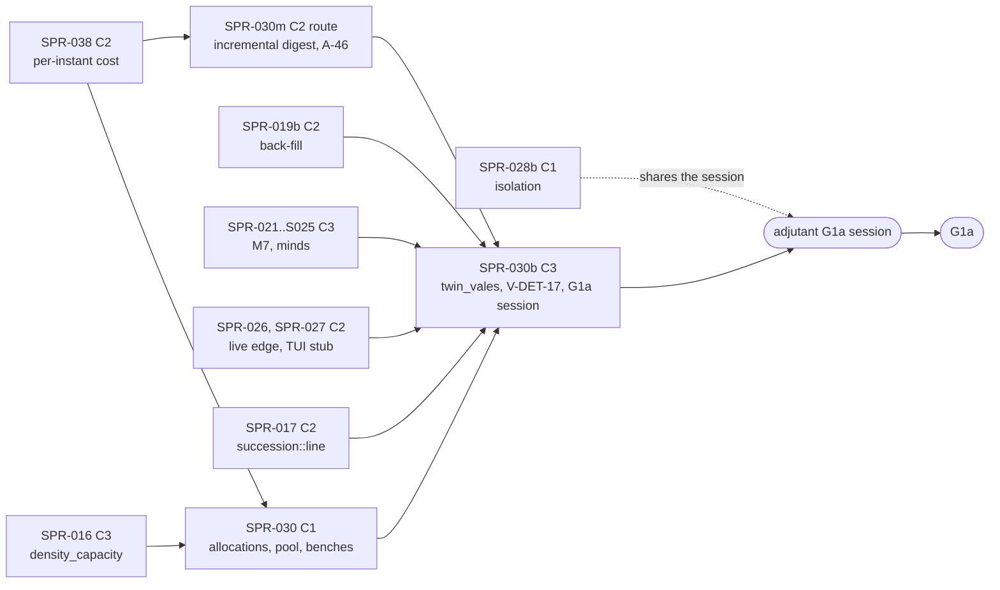

> **BLUF:** Closes P1.14 (`docs/11_roadmap.md:189`) and supplies most of G1a's scale evidence, in three stages:
> - **Stage A (C1, `[perf-baseline]`), the machinery:** `kingdom_10k` sets `density_capacity: 10000`, the first C1 change REV-SPR-030 R1a reserved for this sprint; **BCK-002 A-32**: the engine's machinery allocates nothing per steady-state instant (pooled per-level and per-phase buffers) and a persistent worker pool replaces a scoped thread spawn per parallel level; **A-45**: the serial fraction defined as a single-thread work share, and the vitals line's per-run signals (GOV-006 §2); **benches 1–3** (`docs/08` §9) at meso sizes, since `docs/11` moves the synthetic 1M benches to Later (finding F-6), with bench 3 reported, not gated, at G1a (F-7).
> - **Stage M (the scale machinery SPR-038 leaves; no baseline moves; C2's route by the Architect's ruling):** **the run loop's state digest made incremental** (finding F-23): every month-end stop, and with a run directory every Month pulse (twice there: `stream.rs:539–551`), clones the whole state and re-hashes every row (`crates/rh-golden/src/run.rs:680`), which SPR-038's plan estimates at about 10¹² instructions over `kingdom_10k`'s 1,000 years, more than G1a's whole budget, and files for this sprint; and **A-46's per-draw overhead** (finding F-18), which SPR-038's plan does not take.
> - **Stage B (C3: the golden-world corpus changes), the worlds:**
>   - **`twin_vales` becomes the fifth golden world** (D57 item 3: no `manor` golden before this sprint), with nightly monthly ladders at 1/2/4/N threads × 3, as G1a's determinism row requires of "a dynastic fixture world" (`docs/11_roadmap.md:194`);
>   - **V-DET-17 runs on the engine** by `specs/determinism/crn_pairing_v0.md` §6: the exact-CRN gate on the unaffected persons, with four engine mutants that must each fail for their own reason; the protocol's "Promote and Demote records" do not exist in channel A (finding F-1);
>   - **the population bands:** `twin_vales` and capped `kingdom_10k` are checked against `specs/worldgen/project_population.py` under D56's configuration, RT-037's pattern with a band rule stated before the run;
>   - **the G1a session on `adjutant`:**
>     - `kingdom_10k`'s 1,000 years at seeds 1–3, against the ≤ 60 s on 8 cores criterion (`docs/11_roadmap.md:206`);
>     - the named bound (≤ 500);
>     - V-SCALE-01 at 10k;
>     - V-SAGA-15's stored bytes over 100 years;
>     - V-PERF-09's P1a variant;
>     - **BCK-002 A-67**, the live edge's window and bytes at 10k, with a pre-registered rule for the byte cap;
>     - **A-60's per-instant cost** measured at scale;
>     - D40's revisit evidence.
>
> **SPR-038 optimises the per-instant cost; this sprint builds what SPR-038 leaves and measures at scale** (the Architect's brief; the "Division of A-60 with SPR-038" section, written against SPR-038's plan, revision 0). SPR-038 merges before stage A. It takes the quiet instant's allocations at 1 thread, the lagged snapshot's refresh and the release rule for the checks, and hands this sprint its `instant` bench, `CheckCadence::Yearly` for the G1a run, A-32's pool and the month-end digest. Stage A builds the rest of A-32; stage M is optimisation, and the argument for it is F-23: without it the 60 s verdict is decided by the ladder's hashing, not by the simulation. Stage B records whether the G1a run meets 60 s; a miss is G1a evidence for a follow-up, not a reason to optimise further here.
>
> **Baselines.** Stage A moves no ladder (`smoke`, `solo`, `household`, `hamlet` byte-identical, an acceptance criterion) and re-records `allocations_v1.txt` lower and `instructions_v1.txt` with benches 1–2 (`[perf-baseline]`). Stage M moves no ladder either and re-records `instructions_v1.txt` where the draw cost falls (`[perf-baseline]`). Stage B **adds** `worlds/twin_vales/baselines/twin_vales_yearly_<Y>y.ladder` by `bin/regen_baseline.sh twin_vales` in its final `[C3]` commit, and a `rung twin_vales` allocation line; the four existing baselines are byte-identical. The corpus change is announced to the director before the merge (`docs/13` §4.2).
>
> - **Developer:** AGT-002-CORE (stage A's engine work in `rh-core`; stage M's digest and draw cache; the engine mutants; the world's registration), with AGT-002-TOOLS for the benches, `perf_gate.py`, the CRN harness, the band and byte tools and the session script. One Developer session may hold both roles.
> - **Testers:** AGT-003-DET (thread invariance with the pool, the ladders, the CRN pairs and mutants, the golden world), AGT-003-STAT (the band rule, the CRN statistic, the named bound, V-SAGA-15's measure) and AGT-003-IF (the vitals format, `perf_gate.py`'s new gates, V-PERF-09's terms and A-67's measurements). One session may hold them, on a different model from the Developer's.
> - **Size and class:** **about 8.35 agent-days** by the task inventory (stage A: T-01 0.1, T-02 1.25, T-03 0.5, T-04 0.75, T-05 0.25; stage M: T-10 1.25, T-11 0.5, T-12 0.25; stage B: T-06 1.25, T-07 1.0, T-08 1.0, T-09 0.25). T-10 to T-12 were added after SPR-038's plan was read, so they are numbered after T-09; in the merge order they stand between T-05 and T-06. **Recommended: three sprints at the stage boundaries** (D61 item 1, 70%; PRJ-002 §4 already places "SPR-030 (prep: A-32, benches)" in wave 8 and "(goldens, G1a runs)" in wave 9, `PRJ-002_P1aPlan.md:128–129`):
>   - **SPR-030** is stage A: C1, about 2.85 days, needs SPR-038;
>   - **SPR-030m** (the Architect numbers it) is stage M: hash-neutral, routed as C2 by the Architect's ruling (F-23), about 2.0 days, needs SPR-038; in any gap between C3 merges, before stage B's session;
>   - **SPR-030b** is stage B: C3 by the corpus change, about 3.5 days, needs SPR-019b, SPR-021 to SPR-025, SPR-026 and SPR-027.
> - **Status:** PLANNING, revision 0. It is written against `main` at `3e2e6ef` (D52 to D57 recorded, BCK-002 1.21.0, SPR-019 0.3.1) and read beside the parallel drafts, revision 0 and unreviewed, on their branches: SPR-021 and SPR-022 (`arch/wave7-plans`, `d37fc5b`), SPR-023 to SPR-025 (`arch/minds-plans`, `3beca61`) and SPR-038 (`arch/spr038-plan`, `fb5d68b`). Where a draft changes a dependency, this plan says so. It needs the director's plan approval (D61; GOV-005 §2: C3).

# SPR-030 — Determinism and performance at scale (WP P1.14)

- **Roadmap item:** `docs/11` P1.14 (`docs/11_roadmap.md:189`: "Golden runs on the M1/M2/M7 world (1,000 years); CRN pairing test (ADR-0026); meso benches (≤ 50k persons, ≤ 2,000 named actors) and `bench/serial_fraction`. The synthetic 1M benches move to Later with P3.10") · **Phase:** P1a; G1a's determinism (`:193`), CRN (`:196`), envelope (`:201`), stream (`:204`) and performance (`:205`) rows; PRJ-002 §5 (`PRJ-002_P1aPlan.md:138, :141, :146–148`)
- **Depends on (the precondition head):**
  - **SPR-038 merged before stage A** (BCK-002 A-60: "Before SPR-030's G1a performance run; its own small sprint after wave 5", `BCK-002_ArchitectBacklog.md:80`): both rewrite `run_instant`, `run_level` and `dispatch` (`crates/rh-core/src/engine.rs:833–931, :1066–1182, :1326–1373`); this sprint's A-32 starts from SPR-038's engine. SPR-038's plan is C2 with `[perf-baseline]` (D60), about 3.25–3.5 days, and its PRJ-002 row is on its branch (finding F-16 is closed for it); its out-of-scope list hands this sprint the month-end digest and A-32's pool (`SPR-038_PerInstantCost.md`, "Out of scope").
  - **SPR-014 merged:** the ~360 instants a year of the Day/Vital drain (A-60's measurement), the lifecycle queues; SPR-009's allocation and instruction baselines as SPR-013, SPR-015, SPR-016 and SPR-018 re-recorded them.
  - **Stage B:**
    - **SPR-016 merged:** `density_capacity` and the density modifier (MR11) in the frozen M2 and the folded Registry (`specs/systems/next/registry_delta.toml:15, :20`: bounds [1, 10,000,000], default 10,000,000). The validator refuses the parameter until the Registry carries it (`specs/worldgen/fixture_worlds.md:131`), so T-01 lands after it, in stage A.
    - **SPR-019 and SPR-019b merged:** `twin_vales`' and `kingdom_10k`'s genesis (the synthesis and the back-fill), bit-pinned by `specs/worldgen/golden/fixture_worlds_v0.txt` and reproduced by the engine in SPR-019b T-07. PRJ-002's row named SPR-019 only (finding F-16).
    - **SPR-017 merged:** `rh_registry::effect::succession::line`, which computes the title's line at genesis for V-DET-17's affected set (`crn_pairing_v0.md:52`: "the title's line at genesis (every candidate the law orders)").
    - **SPR-021 to SPR-025 merged:** M7 F1 and `T1.minds` run in both fixture worlds; the named bound, the CRN affected set, V-SAGA-15's event mix and V-INV-03's agenda path need them. PRJ-002's row names SPR-022 and SPR-025 (`:51`). SPR-022's draft (`d37fc5b`, its T-06) runs `twin_vales` seed 1 for 50 years in the PR tier and seeds 1–3 for 300 years nightly with its succession checker; under its D58 item 5 alternative those checks move here (about +0.25 day to T-06).
    - **SPR-026 and SPR-027 merged:** `rh-cli tail --live`, the stalled consumer, `LiveEdge::bytes()`, the seal-latency log, the per-viewer frame cap and the counted live bytes (SPR-026's ingredients, `SPR-026_WorldStreamV1.md:257–262`); the Textual TUI stub, V-PERF-09's third viewer (`SPR-027_Materializer.md:167–176`).
    - **SPR-020 merged:** the envelope's tables, whose stored bytes V-SAGA-15 measures (`specs/chronicle/envelope_v0.md:186`: "fixed here for SPR-030").
    - **SPR-028: not a dependency.** If it is on `main`, the session also runs its `kingdom_10k` ensemble (V-SF-01 with K = 10,000), and its statistics compute the band and pair statistics here; otherwise this sprint's own small checks do (they are stated below).
  - **D56 settled** (approved 2026-10-17, `docs/decisions-log.md` on `main`): agnatic membership, vocations for later children, and A-62's elite read on the couple. The population band reads the projection under exactly that configuration.
- **Binding contracts:**
  - `specs/worldgen/fixture_worlds.md` 0.4.0: §1 (what the worlds supply, `:9–21`), §2 (`twin_vales`, `:25–85`), §3.1–§3.3 (`kingdom_10k`, the named rule and the bound `:101–107`, the projection `:109–131`, R1a `:131`), §4 (the reference, `:133–145`), §5 D-01 to D-11 (`:147–161`), §6 (what the Developer decides, `:163–171`); `specs/manifest/examples/twin_vales.yaml`, `kingdom_10k.yaml`; `specs/worldgen/selftest_fixture_worlds.py`, `golden/fixture_worlds_v0.txt`; `specs/worldgen/project_population.py` and `golden/population_projection_v0.txt` (the D56 line `:301`: `twin_vales` 2,319 persons at year 300; capped `kingdom_10k` 10,569 at year 1,000 under `agnatic`, `later`, `couple`, T1 regime); REV-SPR-030 R1–R28.
  - `specs/determinism/crn_pairing_v0.md` 0.3.0 (§2 the mechanism `:11–15`, §3.1 the world and pairing `:19–29`, §3.2 the input and validity `:31–42`, §3.3 the affected set `:44–54`, §3.4 the statistic and the partnering clause `:56–70`, §4.4 the controls `:98–108`, §5 D-03 `:116`, §6 the Developer's run `:122–127`); `selftest_crn_pairing.py` (`HORIZON_YEARS = 10` `:95`, `MIN_WINDOW_YEARS = 5` `:100`, `MIN_INFORMATIVE = 100` `:101`); `golden/crn_pairing_v0.txt`.
  - `docs/08` §1.3 (the serial budget, `docs/08_performance_and_capacity.md:67–86`), §1.4 (`:93`), §9 benches 1–3 (`:236–238`) and the regression policy; `docs/09` V-DET-01, V-DET-02, V-DET-05, V-DET-12, V-DET-17 (`:115`), V-INV-02 (`:126`), V-INV-12 (`:136`), V-GOLD-01 (`:148`), V-PERF-04 (`:210`), V-PERF-09 (`:215`), V-PERF-11 (`:217`), V-DATA-04 (`:267`), V-SAGA-15 (`:420`), V-SCALE-01 (`:659`), V-SCALE-03 (`:661`); `docs/03` PERF-2 (`:243`), PERF-5 (`:246`), SIM-1 (`:44`).
  - `specs/stream/wire_v1.md` §6.1 (the window policy, D42 (b), `:213–221`), §9's V-PERF-09 row (`:315`) and "the engine never waits" (`:316`); `specs/chronicle/envelope_v0.md` §9 (the stored-byte measure, `:183–186`).
  - `crates/rh-bench` (`benches/alloc_budget.rs:1–30`, the sites and rungs; `baselines/allocations_v1.txt:9` `budget threads 1 ticks 8801 allocations 819401 growths 856 shrinks 0 max_per_tick 281` and its site lines; `baselines/instructions_v1.txt`), `bin/perf_gate.py` (`BENCH_TARGETS` `:70`, `ALLOC_GATED` `:574`, the integrity rules), `bin/wall_trend.py`, `bin/bench_session.sh`, `.github/workflows/adjutant.yml` (`timeout-minutes: 120`, `:31`); `crates/rh-core/src/observe.rs:1–30` (notices carry no state); `crates/rh-golden/src/vitals.rs`.
  - `bin/regen_baseline.sh` (`worlds="${1:-smoke solo household hamlet}"`, `:31`), `bin/golden_nightly.sh`, `bin/check_baseline.py`, `.github/workflows/nightly.yml` (the golden job's `timeout-minutes: 45`, `:91`), `worlds/hamlet/world.toml` and `inputs.toml` (the golden-world pattern: the pinned manifest SHA-256, the committed input placed by a probe run).
  - BCK-002 1.21.0 (`main`, `3e2e6ef`): A-32 (`:52`), A-45 (`:65`), A-46 (`:66`), A-60 (`:80`), A-62 (`:82`), A-63 (`:83`), A-66 (`:86`), A-67 (`:87`); `VER-SPR-026-TEST` GAP-1 (on `origin/sprint/SPR-026-stream-v1`, `1a10dd2`); SPR-038's plan (`arch/spr038-plan`, `fb5d68b`; revision 0) for the division.
  - ADR-0006, ADR-0025 item 3 (the per-entity epoch), ADR-0026 (CRN), ADR-0030 (the engine never waits), ADR-0031; GOV-005 §6 (C3, the corpus announcement); GOV-008 and RUN-002 (`adjutant` on demand; "the Architect asks in advance, saying what the session is for and roughly how long it takes", `RUN-002_BenchVm.md:65`).
- **System specs:** none changed. Finding F-15 records a sentence for M2's next version.
- **Rulings (binding):**
  - REV-SPR-030 R1 (a) (the G1a criterion is 10,000 persons as written; `density_capacity: 10000` is this sprint's first C1 change), R2 (the named set's full reading), R3, R4, R14, R16, R23 and R25 (the CRN validity rule, the exact-identity gate, the power floor, S completed after the runs, the partnering clause, the controls' reasons), R7 (the yearly maximum of `person.named` ≤ 500 at seeds 1–3), R9 (`twin_vales` keeps the default capacity), R10 (the PR and nightly tiers), R20 and R24 (V-INV-03's agenda-path fallback to `kingdom_10k`);
  - D57 item 3 (no `manor` golden before SPR-030); D56 (the configuration above); RT-037 as adapted in SPR-019 0.3.1 T-07 (a population band against `project_population.py`; PR #87, merged); D34 (G1a's P1a variants); D42 (the window, option (b)); D40 (its revisit runs in this sprint regardless);
  - REV-WAVE6 X1 (nothing O(rows) per instant), X7 (the allocation budgets move with real systems), Z1 (CI per part); REV-WAVE5 W2, W3 and X5's forms for the unchanged worlds; SPR-008 rulings (baselines regenerated, never typed); SPR-009 rulings 2, 3 and 5 (instruction counts under valgrind; baselines by the tool in a `[perf-baseline]` PR with a reason; any allocation increase fails).
- **Director items:** D61 (the wave-8 plans; this plan's items: the split, the corpus change, benches 1–3's sizes and bench 3's gate, the `adjutant` session, A-67's rule, the division with SPR-038, stage M's sprint and route).
- **Requirements covered:** DET-1, DET-2, DET-5 (the fifth golden world and its ladders); DET-13 (no back-dating on a dynastic world); ADR-0026's CRN survival (V-DET-17); SIM-1 at 10k (V-SCALE-01); SIM-9's world (V-INV-12 on the fixture); PERF-4 (benches 1–3 in the regression gate); PERF-5's P1a variant (V-PERF-09); SAGA-10 (V-SAGA-15's P1a variant); the G1a performance default (`docs/11_roadmap.md:206`); V-PERF-11 (allocations to budget).

## Specs this sprint needs

| Spec | Exists? | Gap | Architect ruling | Needed by |
|---|---|---|---|---|
| **`kingdom_10k`'s capacity** | `fixture_worlds.md:131` and D-04 (`:154`): "`density_capacity: 10000` as SPR-030's first C1 change once the M2 F1 spec that carries the parameter is frozen" | None once SPR-016 is on `main` | **Ruled (REV-SPR-030 R1a).** Genesis does not read it, so `fixture_worlds_v0.txt` does not move; the projection already models the capped case | T-01 |
| **What "allocations to budget" means (A-32)** | `docs/09` V-PERF-11 (`:217`): "≤ the budget recorded per bench (default 0 for P0 machinery)"; A-32: "default 0 for machinery: pooled per-level buffers and a persistent worker pool instead of scoped threads per level"; `alloc_budget.rs:14–18` attributes each allocation to a site (`step <system>`, a level's dispatch, the merge, the engine between levels, phases and instants) | Only the per-world totals are gated (`ALLOC_GATED = ("allocations", "growths", "max_per_tick")`, `perf_gate.py:574`); the sites are printed, not gated; smoke's steady state is about 93 allocations per instant (`819401 / 8801`), almost all machinery (`allocations_v1.txt`'s site lines: "phase start (timers due)" about 44,000 per phase, "instant setup and inputs" 87,969) | **Proposed (8/10): machinery means every site but `step <system>`.** SPR-038's plan takes a quiet instant at 1 thread to 0 at four of these sites ("instant setup and inputs", "phase start (timers due)", "level dispatch", "merge"); this sprint takes the rest: busy instants, the multi-thread buffers and the pool. After the warm-up, every machinery site counts **0 allocations and 0 growths** at 1 and 4 threads on `smoke` and on each rung; a new gate in `perf_gate.py alloc-gate` fails a machinery site above 0 by name, with a planted control. A system's own step allocations stay in the per-world totals, gated as today (any increase fails). If a machinery site cannot reach 0 in the sprint, the Developer records its residual with the reason, the Architect rules it, and the budget is that number, not 0 | T-02 |
| **The division of A-60 with SPR-038** | A-60 (BCK-002 `:80`): "still to do: look owned columns up by index … run `Ledger::check`/`compact` only after a level that moved a ledger column; remove `format!` from the hot path; decide whether the ledger guards and `Ledger::check` belong in release builds … measure the per-instant cost against row count on a fixed-size synthetic (kingdom_10k's genesis held for a year) …"; A-46 (`:66`): "revisit before SPR-030's scale benches" | Two sprints touch the same per-instant path; A-46 has no owner (finding F-18); SPR-038's plan files the month-end digest for this sprint (F-23) | **Proposed (7/10; D61 item 6): the table in "Division of A-60 with SPR-038" below**, written against SPR-038's plan: SPR-038 owns A-60's list, the lagged snapshot's refresh (`engine.rs:847–851`, X7) and the quiet instant's allocations at 1 thread. This sprint owns the rest of A-32 (busy instants, the multi-thread buffers, the pool), A-45, benches 1–3, stage M (the digest, F-23; A-46, which SPR-038's plan does not take, F-18) and the at-scale measurement in the G1a session | T-02, T-08, T-10, T-11 |
| **The month-end state digest at scale (finding F-23)** | The run loop computes `state_digest(&engine.snapshot())` at every stop (`crates/rh-golden/src/run.rs:680`): every month end (`:441–443`) and, with a run directory, every Month pulse as well (`:429–438`), where the stream's `STEP_DIGEST` takes a second snapshot and hash (`crates/rh-golden/src/stream.rs:539–551`): about 36 full digests a sim-year with a run directory, 12 without. `snapshot()` clones the tables (`crates/rh-core/src/engine.rs:380–385`), and `state_digest` re-hashes every row of every table (`crates/rh-snapshot/src/state.rs:103–116`). SPR-007's `MerkleCache`, which re-hashes only dirty chunks (`hash.rs:44–51`), is not used by the run loop, and a clone's fresh identity would defeat it anyway (`world.rs:36–44`). Bench 7 costs about 58 instructions a row (`instructions_v1.txt:26`: 2,311,755 for four columns of 10,000 rows) | SPR-038's plan puts it out of scope and files it for this sprint: about 10¹² instructions over `kingdom_10k`'s 1,000 years, "more than G1a's whole budget" (`SPR-038_PerInstantCost.md`, "Out of scope"). By F-22's rates about 340,000 persons are born in the run, so each life-course column ends above 3 × 10⁵ rows. The fix is optimisation, so the brief's "measures, does not optimise unless argued" needs the argument: without it the 60 s verdict is decided by the ladder's hashing, not by the simulation | **Proposed (7/10; D61 item 1): stage M's T-10.** The run loop hashes the engine's live tables (`Engine::tables`, `engine.rs:583`) through a kept `MerkleCache`, with no clone, and the engine reports each column's dirty rows since the last stop (the life-course log is append-only and its exit fields are written once, SPR-011 ruling 5, so a log column's dirty set is its new tail plus the rows that exited); the bytes hashed, the layout and every digest stay identical. **Class:** C1 by its hash effect, but `docs/13` §4.2 puts "any change to the determinism machinery itself (RNG, … hashing …)" in C3. Proposed: C2's route (an independent Tester, the audit, no C3 slot, no bisect, since nothing moves), the treatment SPR-021's draft proposes for a plane-A change no golden world sees (its F-18, D58 item 2); the same ruling covers T-11's RNG-side change | T-10, T-11 |
| **The serial fraction (A-45)** | A-45 (`:65`): the vitals' serial fraction "depends on the thread count and includes thread-spawn cost (90.7% at 1 thread, 47.8% at 4 on smoke). Define the serial fraction in `docs/08` §9 and GOV-006 (single-thread work shares for any gate)"; `docs/08` §1.3 (`:67–86`) | No definition a gate can use | **Proposed (7.5/10):** the serial fraction is the share of an instant's wall time, **at 1 thread**, spent outside the jobs of levels that hold two or more jobs (the levels a pool could spread), measured by the host's observer clock (tool plane; `observe.rs` carries no clock); at N threads the vitals line reports the parallel efficiency beside it. The definition goes into `docs/08` §9 (the Architect's text) | T-03 |
| **Benches 1 and 2: their sizes (finding F-6)** | `docs/08` §9 (`:236–237`): `ledger_month_1M`, `timers_lifecycle_1M`, "From P1a"; §1.4 (`:93`) and `docs/03` PERF-2 (`:243`): PERF-2's binding value "set at G1b from P1 measurements on a synthetic 1M world … WP P1.14" | `docs/11` P1.14 (`:189`): "The synthetic 1M benches move to Later with P3.10"; PERF-2's own phase column says Later | **Proposed (7/10; D61 item 3, a director call because it moves PERF-2's binding):** benches 1 and 2 are built at meso size with the bench 7–8 pattern: instruction counts at 10k in the PR tier, wall clock at 50k on `adjutant`, 1M an optional wall case run when the session's memory allows; PERF-2's binding value moves with the scale-up (Later); `docs/08` §1.4 and §9 and `docs/03` PERF-2 are amended to say so | T-04 |
| **Bench 3's gate (finding F-7)** | `docs/08` §9 (`:238`): "Fails above 20%"; `docs/11` G1a (`:206`): "serial share reported" | In P1a, M2's monthly pass is one job (one system, one job per level: `--expect-serial` holds on every rung, `bin/check_all.sh`); its share of the instant dominates, so a 20% budget fails by construction at G1a, and a wall-clock gate on a hosted runner is noise (GOV-002 tier 10) | **Proposed (7.5/10; D61 item 3):** bench 3 reports at G1a (on `adjutant`, and in CI as a trend) and gates from G1b, when region-parallel systems exist; `docs/08` §9 amended | T-03 |
| **`twin_vales` as a golden world** | D57 item 3; `fixture_worlds.md:165`: "The golden run lengths for `twin_vales` (300 years at a yearly ladder, as solo's 200) and its baseline's thread count; both are C3 and go in a `[C3]` PR with `bin/regen_baseline.sh`"; G1a (`docs/11:194`): monthly hashes "for 1,000 years, on `smoke`, rungs 0–2 and a dynastic fixture world" | The PR-tier length; whether `kingdom_10k` is a golden world too; the nightly job's 45-minute timeout | **Proposed (7.5/10; D61 item 2: a corpus change is announced, and the director may veto):** `twin_vales` is the fifth golden world: `worlds/twin_vales/` (the pinned manifest SHA-256, the committed input of the next row); the PR tier runs **Y = 300 years** yearly at 1 and N threads if one release run takes ≤ 20 s on a hosted runner (measured in T-06), else **Y = 100** with 300 nightly; a new nightly job `golden-dynastic` (its own timeout) runs 1,000-year monthly ladders at 1/2/4/N × 3, the yearly cut of a Y-year monthly run equal to the baseline (GAP-6), V-SCALE-01 and V-SCALE-04 checks, replay, sift and the twin, V-DATA-04 and V-INV-12's genealogy clause over 300 years; the 1,000-year debug soak (V-INV-02) runs weekly or in the session. **`kingdom_10k` is not a golden world:** its determinism is checked in the session (V-SCALE-01 at 10k) and no ladder is committed. **`manor` stays a test world** (SPR-019b's) | T-06 |
| **`twin_vales`' committed input** | `worlds/hamlet/inputs.toml` (a scope-only input inside the month of a founder's pending death, found by a probe run: "a golden input must exercise the path it claims") | Which person | **Proposed (8/10): V-DET-17's input.** The input T-07's run A determines at the first VALID seed (the primogeniture sovereign, else the tanistry one: `crn_pairing_v0.md:37`), placed at that seed's `T_IN`; so the golden run is the pair's run B, and the baseline exercises ADR-0025 item 3 on a sovereign whose re-sampled death moves a succession. If no seed is VALID, founder 0 as `hamlet`'s | T-06, T-07 |
| **V-DET-17 on the engine** | `crn_pairing_v0.md` §6 (`:122–127`): the engine's run A, the target by §3.2, run B with the input, death instants from the life-course log, S on the engine's own line, house, realm's houses and named, the validity rule, every pair on U identical, ρ reported, the partnering clause on N4's lists replayed from the ledger | The engine's S extension reads "the Promote and Demote records of channel A" (`:52`, `:124`); no such record exists (finding F-1) | **Proposed (8/10).** A release test in `rh-golden` drives both runs through `rh_golden`'s run API, stepping instant by instant (`advance_until` per instant), and reads `person.named` from the engine's tables after every instant of both runs: everyone named at any instant joins S. N4's candidate lists are replayed from the ledger before each Month pulse (§3.4, R23) through a function M2 exposes for the purpose (`rh-sys-demography`, a `pub` read-only helper over the tables, not a step). `crn_pairing_v0.md` §3.3 and §6 are amended (text; no golden moves). The PR tier runs the least seed in 1–3 that is VALID in the engine | T-07 |
| **The CRN engine mutants** | `crn_pairing_v0.md` §4.4: five model mutants on the reference | The reference's mutants are model edits; the engine needs its own, compiled out of every baseline build (A-52) | **Proposed (8/10): four `mutant-*` features, nightly**, each required to fail for its own reason (R25): `mutant-crn-noop-input` (`rh-core` ignores a scope-only input: an INVALID pair, equal target deaths), `mutant-crn-global-epoch` (an input bumps every entity's epoch: pairs differ), `mutant-crn-position-key` (M2's monthly death draw keyed by the person's row position, which compaction shifts once the target's death differs: pairs differ), `mutant-crn-rekey-2pct` (the input also bumps every 50th living person's epoch: pairs differ). The reference's `shift-one-day` has no natural engine form and stays the reference's | T-07 |
| **The population band rule** | RT-037 as adapted (SPR-019 0.3.1 T-07, PR #87): "The band is the projection's own spread, stated in the PR and approved by the Architect at the audit"; `project_population.py`'s docstring: "The model says what the mechanics imply to within tens of per cent, not a golden" (`:58–59`); `docs/09` §1.2 rule 2: margins stated before the run | The projection's own sensitivity spread under D56 is a few per cent (isolation 2,339 against T1 2,319 at year 300); the engine's demographic noise at 1,500 persons is larger, so a band of the projection's spread alone fails a correct build | **Proposed (6.5/10): pre-registered here.** At year y, the band is P(y) × [1 − δ(y), 1 + δ(y)] with δ(y) = 4 √(c y / P(y)) + ε(y): P is the projection under D56's configuration (`agnatic`, `later`, `couple`, T1 regime), extended by T-06 to print the intermediate years (a C1 change to the script, its golden regenerated by `--write`); c ≈ 0.068 is the stationary chain's crude birth plus death rate at e0 30 and `tfr` 4.9 (1/e0 twice, plus r), restated exactly from `selftest_m2_f1.py` before any engine run; the square-root term is four standard deviations of a living count's demographic noise after y years; ε = 5% per century of the horizon for an uncapped world (the model's drift) and a flat 5% for the capped world. Computed by the drafter from the projection: `twin_vales` year 50: P = 1,608, band about [1,270, 1,946]; year 100: 1,726, about [1,203, 2,249]; year 200: 1,995, about [1,132, 2,859]; year 300: 2,319, about [1,094, 3,543]; capped `kingdom_10k` year 100: 10,466, about [8,867, 12,064]; year 1,000: 10,569, about [6,625, 14,513]. If SPR-019b's manor band (RT-037) lands first with another rule, the two are harmonised at the second plan's audit | T-06, T-08 |
| **The named bound's measurement** | `fixture_worlds.md:107` (R7): "SPR-030's G1a run asserts the yearly maximum of `person.named` ≤ 500 over the 1,000 years at seeds 1 to 3" | Observers carry no state (`observe.rs:8–12`); a per-instant count would be O(rows) per instant (X1) | **Proposed (8/10):** the host counts `person.named` at each yearly ladder stop (O(rows) once a year), and, if SPR-023 gives T1 a `named` counter through `StepCtx::count`, its running maximum too; the assertion is on the yearly counts. On a fail, `dormancy_degrees` drops to 1 in the manifest (a C1 change), as `fixture_worlds.md:107` says | T-08 |
| **V-SAGA-15's P1a variant on real segments** | `envelope_v0.md:186`: the stored-byte measure "fixed here for SPR-030": the Parquet bytes of extra role rows, every snapshot row, every `motivated_by` edge and the typed columns of other edges, over the `EVENT` count; the reference measure is check 6 of `selftest_envelope.py` on a synthetic chronicle | No tool measures real segments; PRJ-002 §5 gives the variant to SPR-020 and SPR-025 (`:147`) while the envelope spec and SPR-020 (`:325`) give it here (finding F-17) | **Proposed (8/10):** `bin/envelope_bytes.py <run-dir> --years 100` (DuckDB) implements §9's measure exactly, its reference being check 6's measure on the same synthetic chronicle (equal to its 4.0 bytes per event); run on `kingdom_10k`'s first 100 years at seeds 1–3; ≤ 40 bytes per event (48 with cells and contaminants: none in P1a) | T-08 |
| **The fixture worlds' event rates (finding F-22)** | `fixture_worlds.md:61`: "At e0 30 the crude death rate of the stationary population is about 2.1% a year: the CRN reference's M2-only runs give 311 and 323 deaths in 10 years of 1,500 persons"; `:99`: "about 220 births and 210 deaths a year at the defaults: a crude death rate of 2.1%" | The CRN reference runs no births (`crn_pairing_v0.md:80`, `:68`: "The reference's M2-only model runs no partnering"), so after the first year it has no infants, the age group with the most deaths at e0 30; its 2.1% is a closed cohort's rate, not a stationary one. A stationary population's crude death rate is 1/e0, about 3.3% at e0 30 (with r = +0.11% the birth rate is about 3.4%): about 335 deaths and 345 births a year on 10,000 persons, about 1.5 times the stated figures. T-08's event counts, the seal throughput of A-67's rule and V-SAGA-15's denominator scale with them | **Proposed (8/10):** the Architect corrects `:61` and `:99` (C0, specs prose; no golden reads them) before T-08; T-08 records the measured crude rates of `kingdom_10k` at seeds 1–3 beside the projection's, and T-06's band rule already uses the stationary figure (c ≈ 0.068 per person-year) | T-06, T-08 |
| **V-PERF-09's memory term (finding F-5)** | `wire_v1.md:315`: "the host's live bytes ≤ peak `LiveEdge::bytes()` … + V × 1 MiB (one frame per viewer) + a stated allowance for threads" | SPR-026's Tester: at full speed on `solo` "1,499 of 1,500 seals landed later than their sim-year … the window held the whole run (peak `LiveEdge::bytes()` 1.84 MB). The host's peak memory (`VmHWM`) rose from 16.0 MB headless to 25.0 MB, about 5 times the counted window, because the seal queue holds structured records that `bytes()` does not count" (`VER-SPR-026-TEST` GAP-1) | **Proposed (8/10):** the seal queue is a stated term of the bound, counted with SPR-009's counting allocator, and the bound is restated in `wire_v1.md` §9 (the Architect's text, C2-adjacent, no wire byte changes) before T-08 runs | T-08 |
| **A-67: when the live edge needs a byte cap** | A-67 (`:87`): "Measure (b)'s maximum unsealed years, peak `LiveEdge::bytes()` and seal throughput against sim-years per second on `kingdom_10k`. If the window is unbounded in practice, add a byte cap that makes the host thread wait for seals" | "Unbounded in practice" has no threshold; a cap changes D42's ruled option (b) (`wire_v1.md:218`) | **Proposed (6.5/10; D61 item 5): a pre-registered rule.** The window is unbounded in practice if, on `kingdom_10k` at seeds 1–3 over 1,000 years with the viewers of V-PERF-09 attached, the unsealed years exceed 4 at any instant, or the live bytes (window plus seal queue) exceed 64 MiB. Then the cap is a D42 amendment (option (b) with a byte cap: the host thread waits for its own seal, never for a viewer), specified as a reviewed `wire_v1.md` §6.1 change before any code, and built in a follow-up C2 sprint. The measurement is this sprint's; the cap is not | T-08 |
| **The G1a session** | GOV-008 §1 (`adjutant` on demand); RUN-002 (`:65`); `.github/workflows/adjutant.yml` (`timeout-minutes: 120`) | Nothing schedules G1a's runs | **Proposed (8.5/10; D61 item 6):** one session of about 2 hours once SPR-030b (and SPR-028b, whose ensembles share it) are on `main`: `bin/g1a_scale.sh` as an input of the `adjutant` workflow; plus a shorter one (about 45 minutes) for stage A's wall-clock benches | T-04, T-08 |
| **What a missed 60 s means** | `docs/11:206`: "≤ 60 s on 8 cores (default; fixed before P1a)" | This sprint measures; SPR-038 optimises | **Proposed (7.5/10):** T-08 records the verdict with every term (per-instant cost, serial share, peak RSS, seal cost) in `VER-SPR-030`. A miss is a G1a finding: SPR-038's follow-up, or the director's go / iterate call at G1a; it does not hold this sprint open. The criterion is not relaxed here | T-08 |
| **CI (Z1)** | Part core about 12:00–14:43, part golden about 12:46 after wave 4 (the Architect's figures); BCK-002 A-63's third PR-tier job being built | Golden is the tighter part; this sprint adds benches under valgrind and a new golden world | **Proposed (8/10):** stage A adds benches 1–2 to the perf gate (golden part) and the machinery-site gate; stage B adds `twin_vales`' two PR-tier runs and the seed-1 CRN pair (golden part); everything longer goes to the new nightly job or the session (T-05, T-09) | T-05, T-09 |

## Division of A-60 with SPR-038

| Item | SPR-038 (A-60; being planned, D60) | This sprint |
|---|---|---|
| Owned columns looked up by index; `Ledger::check`, `compact`, the invariants and the lagged snapshot only after a change; no `format!` on the hot path (the run log line, `engine.rs:920`); the release-build rule for the checks; `StepCtx::inserted()` | Builds (its T-01 to T-05), with the `instant` bench and `CheckCadence` | Measures at scale with SPR-038's `instant` bench, and runs the G1a run with `CheckCadence::Yearly`, as SPR-038 hands it (T-08) |
| The O(rows) clones per instant: `Ledger::guard`'s `person.id` and life-course columns; the lagged-column snapshot (`engine.rs:847–851`, X7) | Builds (the guards' value checks compiled out of release; the snapshot refreshed only when its column was written) | Measures at scale |
| A-46, the per-draw overhead of `StepCtx::rng` (1,241 instructions at epoch 0 against 552 straight from `rh-ids`): at `kingdom_10k` scale M2 makes about 13,000 keyed draws a month in one serial job, about 1.6 × 10⁸ over 1,000 years, so about 10¹¹ instructions of overhead (finding F-18) | Not in its plan (revision 0) | Builds in stage M (T-11); bench 1 measures it per draw (T-04) |
| The per-instant cost against row count on a fixed-size synthetic (`kingdom_10k`'s genesis held for a year) | Builds the measurement and its acceptance (flat in row count) | Re-runs it on the real 1,000-year run at years 0, 100, 500 and 1,000 (T-08) |
| Machinery allocations per instant to 0; the persistent worker pool (A-32) | A quiet instant at 1 thread: 0 allocations at four sites (its director item 1, 70%) | The rest: busy instants, the multi-thread buffers, the pool and the per-site gate at 1 and 4 threads (T-02), after SPR-038 merges |
| The month-end state digest: a clone and a full re-hash at every stop (F-23) | Out of scope; filed for this sprint ("A-32's lane") with its T-01 figure | Builds in stage M (T-10) |
| The serial fraction's definition and the vitals' per-run signals (A-45); benches 1–3 | — | Builds (T-03, T-04) |
| The G1a verdict (≤ 60 s) | Its target | Records (T-08) |

The order is SPR-038 first, then stage A and stage M in either order. SPR-038 is C2 and stage A C1, both hash-neutral, so the opposite order is legal; it costs a textual rebase of `engine.rs`, and SPR-038's figures would then be measured on a pooled engine. The Architect names the order at launch.

## Compliance (every task)

| Rule | This sprint |
|---|---|
| Change class (`docs/13` §4.2) | **Stage A: C1** (performance work inside `rh-core` and `rh-golden`, with no change to contracts, Registry semantics or plane-A behaviour; `state_hash` unchanged on every golden world; the manifest's capacity line moves no golden); `[perf-baseline]` for the re-recorded budgets and the new bench lines. **Stage M:** hash-neutral; C1 by its effect, C3 by `docs/13` §4.2's machinery clause, routed as C2 by the Architect's ruling (F-23); `[perf-baseline]` for the draw cost. **Stage B: C3** by the corpus change (`docs/13` §4.2: "or one that changes the golden-world corpus, is announced"): a new baseline file needs `[C3]` (`bin/check_baseline.py`); no existing `state_hash` moves. Stage B contains C1 (the CRN harness, the band and byte tools, the session script, the projection's extension) and test-only `mutant-*` features |
| Planes touched (ADR-0024) | **A:** `rh-core` (stage A: buffers and the pool, inside the engine; stage M: the columns' dirty rows, `StepCtx::rng`'s epoch cache and guard; stage B: one mutant feature), `rh-snapshot` (stage M: the cache's use from a borrowed state), `rh-sys-demography` (one read-only helper for N4's lists; two mutant features). **Tool:** `rh-bench` (benches 1–3, the site gate), `rh-golden` (the vitals, the CRN test, the named count, `twin_vales`' registration), `bin/` (`perf_gate.py`, `regen_baseline.sh`, `golden_nightly.sh`, `envelope_bytes.py`, `g1a_scale.sh`), `specs/` (`kingdom_10k.yaml`, `project_population.py`), `worlds/twin_vales/`, the workflows. **B, C:** none |
| Owned columns written | None new. Stage A changes how the engine moves columns, never what a system writes |
| Reads (via `rh-contracts`) | None new. The CRN test and the named count read `engine.tables()` between instants, in the host |
| RNG purposes added | None. The mutants re-key existing purposes by design and never reach a baseline (A-52) |
| Golden-hash effect | **Stages A and M: none** (`smoke`, `solo`, `household`, `hamlet` byte-identical at 1 and N threads, headers included; the nightly monthly ladders equal). **Stage B: one baseline added** (`twin_vales`); the four others byte-identical |
| Fixed-point quantities | None new. The band rule and the CRN statistic are computed in the tool plane: ρ² exactly in rationals as the reference does (`crn_pairing_v0.md:66`), the band in decimals with its inputs printed |
| Determinism lints (GOV-003 §2, §6) | Must pass. The pool uses `std` only (threads parked on a `Condvar` or channel; no new dependency), its synchronisation types carrying the W31 hidden-state rule's `LINT-ALLOW` escapes with reasons, as `world.rs`'s `NEXT_IDENTITY` does; results still merge in canonical job order, so the thread count never reaches an id (SPR-006 ruling); `Notice::worker` stays `k % threads` |
| Tests that gate this sprint | V-PERF-11 (the machinery sites at 0; the totals within budget), V-PERF-04 (benches 1–2 recorded and gated), V-DET-01 and V-DET-02 (with the pool; on `twin_vales`; at 10k in the session), V-DET-05, V-DET-12, V-DET-17, V-GOLD-01 (five worlds), V-INV-02 (the soak), V-INV-12's genealogy clause, V-DATA-04 (P1a variant, the back-filled exemption), V-SCALE-01 (10k), V-SCALE-04, V-SAGA-15 (P1a variant), V-PERF-09 (P1a variant), plus `bin/check_all.sh`. **Reported, not gated:** bench 3, the G1a time's terms, A-67's measurements, A-60's per-instant cost at scale, D40's evidence, the realised counts of `fixture_worlds.md` §6 |
| Docs updated in the same sprint | `bin/check_all.sh` and `python/tests/test_check_all_inventory.py` (same commit); `CLAUDE.md` (benches, the alloc site gate, `twin_vales`' runs and baseline line, the CRN engine test, `envelope_bytes.py`, the session script); `docs/08` §1.4 and §9 (F-6, F-7, the serial fraction: the Architect); `docs/03` PERF-2 (the director's ruling on F-6); `docs/09` V-PERF-09 (F-5's term), V-DET-17, V-SAGA-15 and V-SCALE-01 method lines; `wire_v1.md` §9 (F-5); `crn_pairing_v0.md` §3.3 and §6 (F-1); `fixture_worlds.md` §6 (what was decided); `worlds/twin_vales/README.md`; BCK-002 A-32, A-45 (done), A-67 (measured; the rule's outcome), A-60 (the at-scale figures); PRJ-002's row |

**Rules carried from P0–SPR-019 (every task):**
- **Hash-neutral means byte-identical:** stage A's acceptance is the four ladders, every channel-A segment of the four golden run directories and the tail snapshots byte-identical at 1 and N threads; anything else differing is a defect.
- **A positive control fails for the right reason:** its `check_all` line matches the message; every planted mutant fails a named check, and the plan says why it is observable.
- **A test input exercises the path it claims, and a probe asserts it:** the pool runs levels with two or more jobs (smoke's at least 5% parallel levels, `--require-parallel 5`); the CRN pair's re-sample ran (S11's path, as the reference reports it); the band checks run on years the run reached; the session's viewer was behind the window at least once.
- **No O(rows) work per instant** (REV-WAVE6 X1): the named count is yearly; the CRN test's per-instant reads are in a test host, never in engine or system code.
- **Mutants never make a baseline** (`mutant-*` features; BCK-002 A-52); **baselines are regenerated only by their tools** (`regen_baseline.sh`, `perf_gate.py record` and `alloc-record`), in the final commit, with `[C3]` or `[perf-baseline]` at the end of its subject and a `perf-baseline-reason:` line in the PR body.
- **Python tests read no CI environment variable.**
- **CI time (W42, Z1):** per part, ×1.5 for slow runners, against the Architect's figures at launch; each new gate in exactly one part; a gate over about 5 s goes to the golden part or nightly; new baseline controls follow BCK-002 A-66's form (a copy of the recomputation, never the committed baseline), so a C3 head before its regeneration commit fails only the baseline gate itself.
- **Merge `origin/main` when main moves;** **batch pushes at task boundaries;** **one commit per task** (GOV-005 §4).

## Tasks

**Stage A** is T-01 to T-05 (SPR-030 proper under the split). **Stage M** is T-10 to T-12 (SPR-030m), written after T-05 below because it was added last. **Stage B** is T-06 to T-09 (SPR-030b). Under one sprint, a **hard checkpoint** follows each stage: the Tester's interim pass, and the stage's `[perf-baseline]` commit reviewed, before the next stage lands.

#### T-01: `density_capacity: 10000` in `kingdom_10k.yaml` (R1a; 0.1 day)
- **Deliverable:** the line in `specs/manifest/examples/kingdom_10k.yaml`'s `systems: M2.demography` (with its comment: R1a, the G1a criterion at 10,000); `fixture_worlds.md` §3.1's table and §6 say it is done.
- **Acceptance:** `manifest_v0.py validate` and the Rust loader accept the manifest (V-WC-04 parity unchanged); `selftest_fixture_worlds.py --tier pr` and `project_population.py --check` pass unchanged (genesis does not read the capacity, and the capped case is already projected); `python/tests/test_fixture_worlds_cases.py` passes (it mirrors genesis fields, not the capacity); no golden world moves.
- **Status:** [ ] not started

#### T-02: Machinery allocations to 0 and a persistent worker pool (A-32; the allocation and division rows; 1.25 days)
- **Deliverable:**
  - **No machinery allocation per steady-state instant** in `rh-core`: the per-instant and per-phase containers (the fired pulses, the due timers by system, the plan's levels, the passes, the lagged snapshot's holder, the merge buffers, the run-log ring's line) become fields of the engine reused with `clear()`, keeping their capacity; maps whose nodes allocate (`BTreeMap` of due timers) become sorted vectors; the run-log line is written into a reused buffer (if SPR-038 has not already removed it). SPR-038 brings a quiet instant at 1 thread to 0 at four sites; this task covers busy instants (births, deaths, due timers, commands) and every thread count, and keeps SPR-038's figure as a regression.
  - **A persistent worker pool** replacing `std::thread::scope` per parallel level (`engine.rs:1346–1350`): `threads − 1` workers started once per engine and parked between levels; job `k` of a level still runs on worker `k % threads`; results merged in canonical job order as now; a panic in a job still becomes `SimError::Panic` naming the system (the `guard` discipline, `engine.rs:1375`), and an engine that drops shuts its workers down.
  - **The machinery-site gate:** `alloc_budget.rs` prints, per world and thread count, the machinery sites' totals; `perf_gate.py alloc-gate` fails any machinery site above 0 allocations or 0 growths in the window, naming the site; `alloc-record` writes the lower totals.
  - **A planted control:** `mutant-alloc-machinery` (a `String` allocated per instant in `run_instant`) must fail the new gate with its site named.
- **Acceptance:**
  - **Allocations:** after the 2-year warm-up, every machinery site of `smoke` at 1 and 4 threads and of `solo`, `household` and `hamlet` at 1 thread counts 0 allocations and 0 growths over the measured year; the per-world totals equal the systems' own step allocations; the planted control fails by name; the existing control (a system that zero-fills a buffer per tick) still fails the totals.
  - **Hash-neutral:** the four ladders, the golden run directories' segments and the tail snapshots byte-identical at 1 and N threads; the nightly monthly ladders equal at 1, 2, 4 and N threads × 3; the thread-leak control (`--leak-thread`) still fails the 1-versus-N comparison and the parallel-level floor control still fails.
  - **The pool behaves:** a level with fewer jobs than workers leaves the rest parked; a 10,000-level stress test at 4 threads with random job counts gives the same merged result as 1 thread; an engine dropped mid-run joins its workers (no thread outlives the engine: a test counts the process's threads).
  - **Wall clock, reported:** `smoke`'s 1,000-year run at 4 threads before and after (SPR-008 DEF-2 measured the spawn cost of a two-job level), on the hosted runner (a trend) and in stage A's `adjutant` session.
- **Status:** [ ] not started

#### T-03: The serial fraction and the vitals' per-run signals (A-45); bench 3 (`bench/serial_fraction`; F-7; 0.5 day)
- **Deliverable:**
  - **The definition** (the A-45 row) in the vitals: at 1 thread, the share of wall time outside the jobs of levels holding two or more jobs; at N threads, the parallel efficiency beside it. The vitals line's per-run signals of GOV-006 §2: build, Registry version, manifest hash and seed, wall time, peak RSS, stream bytes per channel, keyframes written, plus the counters (SPR-015's).
  - **Bench 3** in `rh-bench` (the `wall` target's pattern): an instrumented sim-year of `kingdom_10k` at 1 thread (resumed from its genesis), its serial fraction per phase and in all, reported by `bin/wall_trend.py` as a trend; in CI a smoke-size case runs as a report.
- **Acceptance:** the vitals line on `smoke` at 1 thread gives the same serial fraction (to 0.1 percentage point) in three runs on the same machine, while A-45's old figure moved from 90.7% to 47.8% between 1 and 4 threads; a planted vitals format without `peak_rss` fails its format test; the counters change no hash (the SPR-015 observer check, repeated); bench 3's report names each phase's serial share and is in `artifacts/perf/`; its gate is not on (F-7).
- **Status:** [ ] not started

#### T-04: Benches 1 and 2 at meso size (F-6; 0.75 day)
- **Deliverable:**
  - **Bench 1, `ledger_month`:** one Month instant of M2 over N living persons (a synthesised world held at genesis, M2 only), the per-person hazards, keyed draws and the step digest's aggregation; instruction counts at N = 10,000 in the PR tier (`perf_gate.py`, `BENCH_TARGETS`), wall clock at 50,000 (and 1,000,000 when the session's memory allows) in `bin/bench_session.sh`. It reports the instructions per draw (A-46's figure).
  - **Bench 2, `timers_lifecycle`:** `rh-core`'s agenda and lifecycle queues under stub systems (the `agenda_events` test pattern): 10⁴ timers popped and their commands applied in `(phase, PersonId)` order in one month (the "normal" load `docs/08` §1.1 states for 1M), and 4 × 10⁴ (the crisis load), instruction counts in the PR tier.
  - `python -I bin/perf_gate.py record` in the stage's final commit (`[perf-baseline]`, with a reason line): the new bench lines and the `draws`, bench 7 and bench 8 lines unchanged within R-8's band.
- **Acceptance:** the new cases are identical in two runs on one commit (the repeatability gate); a planted 15% slowdown in bench 1's hazard loop (the `slowdown-control` feature's pattern) fails `REGRESSION ledger_month/…`; bench 1's draw count equals the number of living persons times the draws per person the M2 spec states for a Month pulse (one death draw each, one conception draw per susceptible married woman, one marriage draw per eligible unmarried woman), counted by the bench; the wall cases run in stage A's `adjutant` session and are recorded as trend files.
- **Status:** [ ] not started

#### T-05: Stage-A gates, CI time, docs, the `[perf-baseline]` commit and the checkpoint (W42, Z1; 0.25 day)
- **Deliverable:**
  - **Part `core`:** the pool's unit and stress tests (debug, about 5 s), the vitals format tests.
  - **The golden part:** benches 1 and 2 under valgrind within `perf_gate.py gate` (about +25 s, measured twice by the repeatability gate, so about +50 s); the machinery-site gate within `alloc-gate` (about +5 s); the machinery control (one feature build, about +15 s; nightly if over 30 s).
  - **The final commit,** subject ending `[perf-baseline]`: `allocations_v1.txt` by `alloc-record` (lower totals, the machinery sites at 0), `instructions_v1.txt` by `record`; the PR title `SPR-030: … [perf-baseline] [C1]`.
  - The inventory test in the same commit; `CLAUDE.md`; the stage's docs.
- **Acceptance:**
  - Every gate in exactly one part. **CI time (W42, Z1).** Against the Architect's figures at launch, stage A adds **about +5 s to part core** and **about +70 s to the golden part**, **+8 s and +105 s budgeted ×1.5 for slow runners**. **Nightly candidates if a part is over:** the repeatability re-run of benches 1–2 (the first run still gates), bench 2's crisis case, the machinery control's build. No existing gate moves part.
  - **Checkpoint (one-sprint form).** The Tester's interim pass on T-01 to T-05 is recorded in `VER-SPR-030-TEST` before T-06 lands.
- **Status:** [ ] not started

#### Stage M: the scale machinery (SPR-030m; T-10 to T-12)

Stage M is hash-neutral optimisation that SPR-038 leaves (the division table): the digest SPR-038 files here (F-23) and A-46 (F-18). It needs SPR-038 merged and may merge before or after stage A; it must be on `main` before stage B's session (T-08).

#### T-10: The run loop's state digest made incremental (F-23; the digest row; 1.25 days)
- **Deliverable:**
  - **No clone and no full re-hash per stop.** The run loop (`crates/rh-golden/src/run.rs:680`) and the stream's Month-pulse digest (`stream.rs:539–551`), which then share one computation per stop, hash the engine's live tables through `Engine::tables` (`engine.rs:583`) and a `MerkleCache` kept for the run (`crates/rh-snapshot/src/hash.rs:402–412`), plus the engine's small tables (agenda, commands, epochs, inputs) as now. `engine.snapshot()` is called only where a state is kept: keyframes, `--dump`, the injection fork.
  - **Dirty chunks without a contract change** (the proposed design; the Developer may propose another, the Architect rules): a column whose version changed since the last stop is compared chunk by chunk with the cache's copy of its bytes, and only differing chunks are re-hashed; an append-only log column compares only the chunks at or after its previous length, plus the chunks holding exit fields written since the last stop (SPR-011 ruling 5) if the engine can name them, else the whole column. Equal bytes give equal chunk hashes, so the digest is the full digest by construction.
  - **The columns may be hashed in parallel** on stage A's pool (a table's digest is independent of the others; the plane hash folds them in name order, as now).
  - `--verify-digest` on `rh-cli run`: `MerkleCache::verify` (a full recomputation, `hash.rs:51`) at every stop; always on in debug builds.
  - **A planted control:** `mutant-digest-stale-tail`: the comparison skips a column's last chunk when its length did not change.
- **Acceptance:**
  - **Byte identity:** the four ladders at 1 and N threads, every channel-A segment (each `STEP_DIGEST`), the keyframes and the tail snapshots of the four golden run directories byte-identical; the nightly monthly ladders equal; `--verify-digest` passes on every stop of `hamlet`'s 200 years and of `kingdom_10k`'s first 100 years at seed 1.
  - **The control is observable and fails:** the Developer's probe first counts, on `hamlet`'s run, the stops after which a written row lay in a log column's last chunk with its length unchanged (an exit field written in the tail chunk), and it must be at least one; then `mutant-digest-stale-tail` fails `--verify-digest` naming the table and chunk, and the ladder differs from the baseline.
  - **The cost, measured by callgrind** over one sim-year resumed from `kingdom_10k`'s year-1,000 keyframe (seed 1, 1 thread, a run directory): the digest's instructions are **at most 10% of the year's total** (today's estimate: most of it), and the figure at the year-100 keyframe is recorded beside it. **Stop rule:** if the comparison design stays above 10%, the Developer stops and records the figure; the Architect rules on the alternative (columns handed to systems through write-marking handles, a C2 change to every system's column access) before more work.
- **Status:** [ ] not started

#### T-11: The per-draw overhead (A-46; F-18; 0.5 day)
- **Deliverable:** `StepCtx::rng` looks the entity's epoch up once per job and entity, from a job-local cache built at the job's start (inputs bump epochs only at an instant's start, ADR-0025 item 3, so the epochs are fixed while a job runs), and the A-37 guard becomes an O(1) comparison; the keys, the purposes and every draw's bytes are unchanged.
- **Acceptance:**
  - **Byte identity:** `bin/gen_rng_golden.py --check`, `draws_golden` (every re-sample case), the four ladders and `solo`'s and `hamlet`'s committed-input runs byte-identical.
  - **The cost:** the draw-cost bench (SPR-011 A-37's, in `perf_gate.py`) at epoch 0 and epoch 1 is at most 1.5 × the raw `rh-ids` draw (about 830 instructions, from 1,241 and 1,503; proposed 6/10, the measured figure recorded either way).
  - **A planted control:** `mutant-epoch-cache-stale` (the cache kept across instants) fails `draws_golden`'s re-sample cases, because the re-sampled person's later draws then use the epoch before the input and her death instant differs from the reference's.
- **Status:** [ ] not started

#### T-12: Stage-M gates, CI time, docs and the `[perf-baseline]` commit (W42, Z1; 0.25 day)
- **Deliverable:**
  - **Part `core`:** the cache's unit tests on synthetic tables (random writes, inserts, compactions and appends; the cached digest equal to the full one after each), about 3 s.
  - **The golden part:** `hamlet`'s 200-year release run with `--verify-digest` (about +10 s); the two mutants' builds nightly.
  - **Nightly:** `--verify-digest` on `kingdom_10k` seed 1 over 100 years (and on `twin_vales` once stage B lands), in the `golden-dynastic` job (about +3 minutes).
  - **The final commit,** subject ending `[perf-baseline]`: `instructions_v1.txt` by `record` (the draw cost lower); the PR title `SPR-030m: … [perf-baseline] [C2]` (the route the Architect rules, F-23).
  - The inventory test in the same commit; `CLAUDE.md` (`--verify-digest`); `05.1` §6 item 6's note that the run loop's digest is incremental and equal to the full one (the Architect's sentence); BCK-002 A-46 done and the digest item closed.
- **Acceptance:**
  - Every gate in exactly one part. **CI time (W42, Z1).** Against the Architect's figures at launch, stage M adds **about +3 s to part core** and **about +10 s to the golden part**, **+5 s and +15 s budgeted ×1.5 for slow runners**, and saves the rungs' own digest share (about 2% of `solo`'s instructions by A-60's callgrind, so nothing measurable). **Nightly candidates if a part is over:** the `hamlet` verify run (the debug runs check every stop anyway). No existing gate moves part.
  - **Checkpoint.** The Tester's pass on T-10 to T-12 (byte identity re-run by the Tester's own base and head builds; the controls) is recorded before stage B's session.
- **Status:** [ ] not started

#### T-06: `twin_vales`, the fifth golden world, and the population bands (stage B; the golden-world, input and band rows; 1.25 days)
- **Deliverable:**
  - `worlds/twin_vales/world.toml` (the manifest path and its pinned SHA-256, the Registry, the inputs), `inputs.toml` (the input row: written after T-07's run A, with its probe record in comments as `hamlet`'s), `README.md`; `rh-golden`'s registration of the world; `bin/regen_baseline.sh` gains `twin_vales` (Y years, 1 thread; `--expect-serial` only if every level is serial, which the Developer measures).
  - **The PR tier** (the golden part): the Y-year yearly run at 1 thread into `$GOLDEN/twin_vales_run` and at N threads, `ladder compare`, `check_baseline.py` against the new baseline; Y chosen by the measurement of the golden-world row (300 if one release run takes ≤ 20 s on a hosted runner, else 100).
  - **The nightly job** `golden-dynastic` (`.github/workflows/nightly.yml`; its own timeout): `bin/golden_nightly.sh --world twin_vales`, a refactor of the script into per-world functions, running the 1,000-year monthly ladders at 1, 2, 4 and N threads × 3, the yearly cut of a Y-year monthly run equal to the baseline (GAP-6), one 300-year run directory per seed 1–3 with replay at N threads, sift and the SQL twin, `check_segments.py`, V-DATA-04's audit with the back-filled exemption, V-INV-12's genealogy clause (every house member's lineage reconstructs from the life-course log), and the population band.
  - **The band:** `project_population.py` gains D56's configuration as full trajectory blocks for `twin_vales` and capped `kingdom_10k` (its golden regenerated by `--write` in this commit; a C1 spec change, Architect-approved); `bin/population_band.py <run-dir>… --world <w>` reads `STEP_DIGEST.living` at each band year from the sealed segments and applies the band rule; the rule's constants printed with the verdict.
  - **The weekly soak:** `twin_vales` for 1,000 years in a debug build (V-INV-02), weekly (a `schedule` in `nightly.yml`) or in the G1a session if the weekly slot is not added.
  - The `rung twin_vales` line of `allocations_v1.txt` by `alloc-record`.
- **Acceptance:**
  - **The world is deterministic:** the PR-tier ladders equal at 1 and N threads; the nightly monthly ladders equal at 1, 2, 4 and N × 3 and the yearly cut equals the baseline; replay from `run.toml` and the journal is byte-identical (V-DET-04); a keyframe resume at year 100 equals the continuous run (V-DET-05).
  - **The genesis is the fixture's:** the run's genesis person, marriage, household and house_member digests equal `fixture_worlds_v0.txt`'s `_sha256` lines for seed 1 (SPR-019b T-07's test, run on the golden world's build).
  - **The four other worlds unchanged:** `smoke`, `solo`, `household` and `hamlet` byte-identical, headers included (adding a world moves none).
  - **The band:** at seeds 1–3, `twin_vales`' living count at years 50, 100 and 200 (and 300 in the nightly run directories) lies inside the band; the same world built with `mutant-m2-fertility-x2` (SPR-019 0.3.1's feature, renamed by F-20) leaves it by year 50 (twice the conception probability gives r above +1% a year: year 50's count passes the band's top of about 1,946), checked once in the PR that adds the gate and nightly thereafter.
  - **V-DATA-04 and V-INV-12** on the three 300-year run directories: every `PersonId` once in the log, parents or founder provenance, a death record iff absent from the ledger, residence intervals tiling every lifetime but the back-filled (`exit_tick < entry_tick`); every house member's lineage reconstructs; 0 invariant violations in the soak.
  - **The corpus change is complete:** `worlds/` has five directories; `regen_baseline.sh`, `golden_nightly.sh`, `check_baseline.py`'s gates and the rung-style tests know `twin_vales`; the baseline line in `CLAUDE.md`.
- **Status:** [ ] not started

#### T-07: V-DET-17 on the engine (stage B; the V-DET-17 and mutant rows; F-1; 1.0 day)
- **Deliverable:**
  - `crates/rh-golden/tests/crn.rs` (release): for a seed, run A of `twin_vales` for 10 years stepping instant by instant; the sovereigns' deaths and causes from channel A; the target by `crn_pairing_v0.md` §3.2 (the primogeniture sovereign, else the tanistry one, else SKIPPED; a death that is not M2's rejected, R22); `T_IN` = the day before the target's run-A death at 06:07; run B with the scope-only input at `T_IN`; both runs' death instants from the life-course log, right-censored at the horizon.
  - **S** by §3.3 on the engine's own genesis: the title's line through `succession::line` (SPR-017), the target's house, the realm's houses' members, the realm's named at world start, their spouses and household members; then everyone with `person.named` true after any instant of either run (F-1's fix). **U** the living at `T_IN` in both runs minus S; |U| reported.
  - **The verdict:** VALID by (a)–(e) with the power floor; every informative pair on U identical; ρ² exactly in rationals and its floor (cov > 0, ρ² ≥ 0.81) reported; the partnering clause: N4's lists replayed from the ledger before each Month pulse in both runs; for every U woman whose list and eligibility are identical at each of her draws, the same marriage and the same births (gated); every other differing marriage reported with the person responsible.
  - **The four engine mutants** (the mutant row), each a `mutant-*` feature, run nightly at seeds 1 and 3 on the same run A, each required to fail with its reason.
  - `crn_pairing_v0.md` §3.3 and §6 amended for F-1 (the Architect's text).
- **Acceptance:**
  - **The gate on a correct build:** at the PR-tier seed (the least VALID seed in 1–3) the pair is VALID, every informative pair on U is identical, |U| ≥ 100 after S's extension, and the partnering clause holds; the nightly run covers seeds 1–3, and a seed that is VALID in one night and SKIPPED in the next fails it (the reference's R25 rule, the skip pinned with run A's deaths digest).
  - **The re-sample path ran:** the target's death instants differ between the runs (validity (b)), and the test prints what S11 did (a hit and its day, or a miss and the later death), as the reference does.
  - **The mutants, each for its reason:** `mutant-crn-noop-input` gives INVALID (equal target deaths: the reference's `no-op-input`); `mutant-crn-global-epoch`, `mutant-crn-position-key` and `mutant-crn-rekey-2pct` each give a VALID pair with at least one differing pair on U, named by `PersonId`. Each is observable because the re-keyed or re-positioned persons' monthly death draws change from `T_IN` on, and over five sim-years at a crude death rate near 3% some of them die in one run and not the other (the reference's counts at seed 1: 376, 38 and 7 differing pairs).
  - **Agreement with the reference where the model applies:** the engine's U, S and death instants are not compared with the M2-only reference (M7 and T1 change them, §3.5), but the validity rule's arithmetic, the statistic and the mutant reasons are the reference's, and the reference's own gate stays green.
- **Status:** [ ] not started

#### T-08: The G1a session: `kingdom_10k` at scale, V-PERF-09, A-67, A-60 at scale, V-SAGA-15 and the evidence (stage B; 1.0 day)
- **Deliverable:**
  - `bin/g1a_scale.sh` (an input of `.github/workflows/adjutant.yml`, `timeout-minutes: 120`): builds release, then runs and reports (a)–(j) below into `artifacts/g1a/`, with each term printed and nothing gated by wall clock except (a)'s recorded verdict.
  - `bin/envelope_bytes.py` (the V-SAGA-15 row) and `bin/population_band.py` (T-06) used on `kingdom_10k`.
  - **(a) G1a performance:** `rh-cli run kingdom_10k --years 1000 --threads 8 --run-dir D` at seeds 1–3 (the stream sealed, as a run is made), the wall time against ≤ 60 s, with the engine-only time (`--out` without a run directory) beside it, peak RSS, the serial share (T-03), the per-instant cost and the digest's share (T-10); the checks at SPR-038's `CheckCadence::Yearly`, as SPR-038 hands the G1a run.
  - **(b) The named bound:** the yearly count of `person.named` (the named-bound row) at seeds 1–3; the yearly maximum ≤ 500 asserted.
  - **(c) V-SCALE-01 at 10k:** seed 1's monthly ladders at 1, 2, 4 and 8 threads equal; replay from `run.toml` and the journal equal at 8 threads (V-DET-04); a keyframe resume at year 500 equal to the continuous run (V-DET-05); 0 invariant violations.
  - **(d) The capped band:** the living count at years 100, 300, 500 and 1,000 of seeds 1–3 inside the band of the band row.
  - **(e) V-SAGA-15, P1a variant:** `envelope_bytes.py` over years 0–100 of seeds 1–3: ≤ 40 bytes per event.
  - **(f) V-PERF-09, P1a variant:** seed 1 headless, then with `rh-cli tail --live`, the TUI stub and one stalled consumer, each pinned by `taskset` to cores the engine does not use; throughput ≥ 95% of headless; the host's live bytes ≤ peak `LiveEdge::bytes()` + the seal queue's bytes (F-5) + V × 1 MiB + the stated thread allowance, every term printed; the ladder identical; the stalled consumer, resumed after the run, reads everything from the sealed segments with nothing missing (contiguous `seq`, digests equal).
  - **(g) A-67:** in (f)'s attached run and a headless `--socket` run at seeds 1–3: the maximum unsealed years, peak window and seal-queue bytes, seal throughput (sealed sim-years per wall second) against sim-years per wall second, the seal-latency distribution; the A-67 row's rule applied and its outcome recorded.
  - **(h) A-60 at scale:** callgrind over one sim-month resumed from the keyframes of years 0 (genesis), 100, 500 and 1,000 (the instructions per instant against the living count and the life-course rows, with SPR-038's `instant` bench), and the wall per instant over the whole run; against SPR-038's figures.
  - **(i) The realised counts** of `fixture_worlds.md` §6 at seeds 1–3: the house-member share and members against the projection's under D56 (SPR-024's draft, `3beca61`, hands this measurement here); depositions, murders by path (M7 and the agenda), `INTERREGNUM_CRISIS` by route, Promote and Demote counts, successions with a stand-in; V-INV-03's agenda path (R20, R24: the gap reported if no agenda murder occurs).
  - **(j) D40's revisit evidence:** r on `twin_vales` (300 years) and `kingdom_10k` (uncapped and capped) against the projection under D56's configuration, with V-SF-24 and V-SF-25 as SPR-028 reports them if it is on `main`; for the director at G1a, with no change here.
- **Acceptance:**
  - (b), (c), (d) and (e) hold at every seed; (f)'s throughput, memory, ladder and catch-up clauses hold, with the memory bound as restated by F-5 (if the bound fails only because the seal queue grows without bound, (g)'s rule decides, and the failure is recorded as A-67's outcome, not hidden);
  - (a)'s verdict, (g)'s outcome and (h)'s figures are recorded in `VER-SPR-030` and BCK-002 A-60 and A-67, with the director's items they raise (the "What a missed 60 s means" row);
  - **Non-vacuous:** (b)'s assertion fails by name on a planted series with one year at 501; (e)'s tool, run on a copy of seed 1's first-year segment with every `event_role` row duplicated fifty times (the reference's `budget-bloat` pattern), exceeds 40 and fails; (d)'s band, applied to the uncapped `kingdom_10k` run, fails at year 1,000 (the projection's uncapped D56 world reaches 38,200, outside the capped band's top of about 14,500), which shows the band sees a broken density term; (c)'s ladder comparison fails on a run with `--leak-thread`.
  - The session's report is attached to the PR; its runs' wall time fits the workflow's 120 minutes with the ensembles of SPR-028b if they share it (each seed's run uses all 8 cores in (a), one core each in the ensembles).
- **Status:** [ ] not started

#### T-09: Stage-B gates, CI time, docs and the final `[C3]` commit (W42, Z1; 0.25 day)
- **Deliverable:**
  - **Part `core`:** the CRN harness's unit tests on synthetic death lists (the validity rule, the statistic, the partnering bookkeeping), `population_band.py` and `envelope_bytes.py` unit tests and controls (about 5 s).
  - **The golden part:** `twin_vales`' two PR-tier runs, ladder compare and the baseline gate; the CRN pair at the PR-tier seed (two 10-year runs and the analysis); `envelope_bytes.py` on `hamlet`'s run directory as a smoke check of the tool (reported).
  - **Nightly:** the `golden-dynastic` job (T-06), the CRN seeds 1–3 and the four mutants (T-07), the bands. **The session:** T-08.
  - **The final commit,** subject ending `[C3]`: `worlds/twin_vales/baselines/twin_vales_yearly_<Y>y.ladder` by `bin/regen_baseline.sh twin_vales`, the `rung twin_vales` allocation line by `alloc-record`; the PR title `SPR-030b: … [perf-baseline] [C3]` with a `perf-baseline-reason:` line; the corpus change announced to the director before the merge.
  - The inventory test in the same commit; `CLAUDE.md`; the docs of the compliance table.
- **Acceptance:**
  - Every gate in exactly one part. **CI time (W42, Z1).** Against the Architect's figures at launch, stage B adds **about +5 s to part core** and **about +55 s to the golden part** (two `twin_vales` runs of at most 20 s each by the golden-world row's rule, the comparisons, the CRN pair about 10 s), **+8 s and +85 s budgeted ×1.5 for slow runners**. The new nightly job takes about 25–35 minutes on a hosted runner (12 monthly runs of 1,000 years, three 300-year runs, the CRN seeds and mutants), the Developer measures it, and it gets its own timeout so the existing golden job's 45 minutes are untouched. **Nightly candidates if a part is over:** the N-thread `twin_vales` run (the nightly ladders cover thread invariance), then the CRN pair (nightly at three seeds). No existing gate moves part.
- **Status:** [ ] not started

## Director items, and what changes under the alternative

| Item | Planned | Under the alternative |
|---|---|---|
| **Size and split** (about 8.35 agent-days; D61 item 1, recommendation 70%) | **Three sprints:** SPR-030 (stage A, C1, about 2.85 days, after SPR-038), SPR-030m (stage M, hash-neutral, C2's route, about 2.0 days, after SPR-038) and SPR-030b (stage B, C3, about 3.5 days, after SPR-019b and SPR-021 to SPR-027), as PRJ-002 §4's waves 8 and 9 place the first and last. Stages A and M take no C3 slot | **(i)** One sprint of about 8.35 days with a checkpoint per stage: its last stage cannot start before wave 7 and the minds land, so the machinery would wait for no reason. **(ii)** Stage M folded into SPR-038 (about 5.5 days, its plan's scope reopened) or into SPR-030b (about 5.5 days, C3 already, so the class question vanishes, but the session waits for the digest) |
| **Stage M: the digest and A-46** (F-23, F-18; D61 item 1, 70%; the route 6/10) | Built here, as optimisation argued by F-23: the run loop's digest is incremental and A-46's draw overhead falls, with every byte unchanged; routed as C2 (independent Tester, audit, no C3 slot) by the Architect's ruling on `docs/13` §4.2's machinery clause | **(i)** Not built: the G1a run's wall time is then dominated by the ladder's hashing (SPR-038's estimate: about 10¹² instructions), and the 60 s verdict says nothing about the simulation. **(ii)** Routed as C3: the same work waits for the serial slot with nothing to bisect |
| **The corpus change** (D61 item 2, 75%) | `twin_vales` is the fifth golden world, PR tier at 300 or 100 years by measurement, nightly at 1,000 years monthly; `kingdom_10k` is not a golden world; `manor` stays a test world | **(i)** `kingdom_10k` as a sixth golden world: a 1,000-year baseline nobody can recompute in the PR tier, so its baseline gate would live only on `adjutant`. **(ii)** `manor` as the PR-tier dynastic golden and `twin_vales` nightly only: cheaper per PR, but G1a's determinism row names the dynastic fixture world, which is `twin_vales` |
| **Benches 1–3's sizes and bench 3's gate** (F-6, F-7; D61 item 3, 70%) | Meso sizes (10k instruction counts, 50k wall); PERF-2's binding with the scale-up (Later); bench 3 reported at G1a, gated from G1b | Build the 1M synthetics now (about +1 day; a 1M world on a hosted runner is beyond its memory budget, so wall only on `adjutant`) and keep PERF-2's G1b binding; bench 3 at 20% fails G1a by construction while M2 is one serial job |
| **A-67's byte cap** (D61 item 5, 65%) | Measure at G1a by the pre-registered rule; a cap, if needed, is a D42 amendment with a reviewed `wire_v1.md` §6.1 change and a follow-up C2 sprint | **(i)** Build the cap now, before the measurement: a contract change to D42's ruled option (b) without the evidence A-67 asks for. **(ii)** Accept an unbounded window and restate PERF-5 to exclude the seal queue: the 10k world's memory then grows with the run's length |
| **The `adjutant` session** (D61 item 6, 85%) | About 2 hours once SPR-030b and SPR-028b are on `main` (G1a's evidence), and about 45 minutes for stage A's wall benches; the Architect asks with the purpose and length (RUN-002) | Hosted runners only: no wall-clock evidence on reference-class hardware, so G1a's ≤ 60 s on 8 cores and V-PERF-09 cannot be judged |
| **The division with SPR-038** (D61 item 6, 70%) | SPR-038 first, as its plan scopes it (A-60's list, the quiet instant's allocations at 1 thread); this sprint takes the rest of A-32, stage M, and measures at scale with the 60 s verdict | A-46 into SPR-038 instead of stage M (+0.5 day there); or this sprint also re-optimises the per-instant path: two sprints editing the same functions in the same wave |
| **D40's revisit** (no decision now) | The evidence (T-08 (j)) goes to the director at G1a | — |

## Out of scope (explicit)
- **Optimising the per-instant cost** (SPR-038; A-60), beyond stage M's digest and A-46; **building the live edge's byte cap** (a D42 amendment and a follow-up sprint, if A-67's rule says so).
- **The 32-seed CRN-paired stylized-fact ensemble of C3 merges** (V-GOLD-03: SPR-028, finding F-8); the demography bands as gates (SPR-028); V-SF-22 (SPR-028b).
- **The 1M synthetic benches as gates** (Later with P3.10, F-6); bench 3 as a gate (G1b, F-7); the wall-clock gate on `adjutant` (BCK-002 A-43's preconditions).
- **A `kingdom_10k` golden baseline**; a `manor` golden; the `village` rung (P1b: `fixture_worlds.md` D-08).
- **Changing any model parameter**, D40 included (the director's, at G1a); a catalyst in either fixture world (`fixture_worlds.md` D-02).
- **Sealing held-out bands** (A-04), the coupling sweep (V-SF-23), V-PERF-01 (G1b's kingdom).

## Verification assignment (Testers)

| Tester | What to verify, from which contract | Report |
|---|---|---|
| AGT-003-DET | T-02, T-10, T-11, T-06, T-07, T-08 (c), written from `05.1` §6, ADR-0025 item 3, ADR-0026 and `crn_pairing_v0.md` before reading the code:<ul><li>**the stage-A interim pass:** the four worlds byte-identical with the pool at 1, 2, 4 and N threads, their own planted thread-identity leak caught, the pool's shutdown;</li><li>**the stage-M pass:** byte identity from their own base and head builds, `--verify-digest` on a world of their choice, a stale-chunk plant of their own (a write in a middle chunk of an unchanged-length column), the epoch cache's re-sample cases;</li><li>`twin_vales`' ladders, replay and keyframe resume on two machines;</li><li>V-DET-17 recomputed by their own script from the two runs' life-course logs and their own S (the line from `effect_ref.py` on the genesis rows), every pair on U compared, the partnering clause on three women of their choice;</li><li>the four engine mutants killed for their reasons, plus one of their own (an input that re-samples the target's spouse as well)</li></ul> | `VER-SPR-030-TEST` (phase 1 at the checkpoint, phase 2 at the end; one report per sprint under the split) |
| AGT-003-STAT | T-06, T-08 (b), (d), (e), (j):<ul><li>the band rule's constants recomputed from the chain before reading the runs; the band's false-alarm rate on a correct build estimated from 32 seeds of `twin_vales` at 100 years (nightly, once);</li><li>the named bound from their own count over a keyframe's `person.named`;</li><li>V-SAGA-15's measure on their own DuckDB query against `envelope_v0.md` §9's definition;</li><li>D40's evidence and the projection's fit stated honestly, nothing tuned</li></ul> | As above |
| AGT-003-IF | T-03, T-04, T-05, T-10's and T-11's cost figures, T-12, T-08 (f), (g):<ul><li>the vitals' per-run signals against GOV-006 §2;</li><li>`perf_gate.py`'s new benches and the machinery-site gate with plants of their own, the integrity rules on both baseline files;</li><li>V-PERF-09's terms recomputed from the session's raw counters, the seal-queue term included;</li><li>A-67's rule applied to the raw seal log</li></ul> | As above |

## Merge route

- **Class and conditions.** Stage A (SPR-030): **C1** with `[perf-baseline]`, merged by the Architect after green CI, the Tester pass and the audit; no ladder moves. Stage M (SPR-030m): hash-neutral, **routed as C2** by the Architect's ruling on F-23 (independent Tester, audit, Architect's merge; no C3 slot), with `[perf-baseline]`; no ladder moves. Stage B (SPR-030b): **C3**, merged after the Tester passes, the audit and **the announcement of the corpus change to the director**, who may veto (GOV-005 §6; `docs/13` §4.2); the PR title and the final commit's subject end `[C3]` (and the title `[perf-baseline] [C3]`). V-GOLD-03's ensemble is SPR-028's: if it is on `main`, the Architect runs `ensemble.yml` for stage B (it adds a world and moves none, so the comparison on the four existing worlds must be EQUIVALENT with zero differences).
- **One C3 open for merge at a time (GOV-005 §4.1).** The order (7/10):

  - **Stage A after SPR-038** (the division section) and after SPR-016 (T-01's Registry parameter); it takes no C3 slot.
  - **Stage M after SPR-038,** before or after stage A (a textual rebase of `engine.rs` either way), and before stage B's session; no C3 slot.
  - **Stage B is the last C3 of P1a:** after SPR-025, the last minds C3, and after SPR-022.
- **Shared files.** With SPR-038: `crates/rh-core/src/engine.rs`, `system.rs` (T-11), `rh-snapshot` (T-10), `rh-bench`, `perf_gate.py`, `allocations_v1.txt`, `instructions_v1.txt`. With SPR-028: `bin/check_all.sh`, `nightly.yml`, the session script. With SPR-019b: `fixture_worlds.md`, `project_population.py` and its golden (RT-037's manor block), the fertility mutant (F-20). With SPR-029: `rh-golden/src/cli.rs`. Whichever merges second resolves the textual conflicts and re-records its baselines with the tools.
- **What this sprint re-verifies after merging `origin/main`:** both CI parts; the allocation and instruction baselines re-recorded by the tools if a merged sprint moved them; `twin_vales`' genesis digests against `fixture_worlds_v0.txt` as then on `main`; the CRN pair at the PR-tier seed.
- **Rung checkpoint** (GOV-007 §3.5): when `twin_vales` first runs green as a golden world, the director may watch it through `rh-cli tail` for 15–30 minutes; the notes become `EVO-` or `DEF-` items.

## Risks

| Risk | Likelihood and effect | Mitigation |
|---|---|---|
| The G1a run misses 60 s | Medium even after SPR-038 and stage M: M2's monthly pass is one serial job over 10,000 persons with about 13,000 keyed draws a month (F-18), so 8 cores help little | Recorded with every term; a follow-up sprint or the director's go / iterate call at G1a; the criterion is not relaxed here |
| Stage M's comparison design leaves the digest above 10% | Medium: the ledger columns are returned, so compared, at every stop | T-10's stop rule: the figure is recorded and the Architect rules on write-marking handles (C2) before more work; parallel hashing on the pool is allowed meanwhile |
| The live edge's window grows with the run on `kingdom_10k` | Likely, by SPR-026's GAP-1 (seals 3–10× slower than the simulation on small worlds) | A-67's pre-registered rule; the cap is a D42 amendment, not an improvisation |
| `twin_vales` is too slow for the PR tier | Medium before SPR-038 | Y = 100 by rule; the nightly carries 300 and 1,000 |
| The pool introduces a thread-dependent result | Low; caught at once by V-DET-01/02 | The canonical merge order is unchanged; the thread-leak control; the Tester's interim pass |
| The band fails a correct build (the projection's model error is larger than stated) | Low to medium at year 300 (the projection's "within tens of per cent") | ε grows 5% a century; the fallback is RT-037's: a 64-seed engine range frozen with the Architect's approval |
| No seed in 1–3 gives a VALID CRN pair in the engine (M7 and T1 change the sovereigns' deaths) | Low (the reference found two of three) | The rule fails the gate rather than pass vacuously; the Architect may add seeds 4–6 by a protocol revision |
| SPR-038 slips | Medium | Stage A may go first (SPR-038 is C2, stage A C1, both hash-neutral), at the cost of a textual rebase; stage M and the G1a session wait for SPR-038 |

## Blockers

| # | Blocker | Status |
|---|---|---|
| 1 | SPR-038 not merged (stages A and M; the G1a session); its plan (`fb5d68b`) awaits D60 | Open |
| 2 | SPR-016 not merged (T-01's Registry parameter) | Open |
| 3 | SPR-017, SPR-019b, SPR-021 to SPR-027 not merged (stage B) | Open |
| 4 | The Architect's text for F-1 (`crn_pairing_v0.md`), F-5 (`wire_v1.md` §9), F-22 (`fixture_worlds.md:61`, `:99`) and the projection's extension; the route ruling for stage M (F-23) | Open |
| 5 | The director's rulings: the split, the corpus change, the benches, A-67's rule, the session (D61) | Open |
| 6 | The `adjutant` sessions scheduled by the director (RUN-002) | Open |

## Completion

- [ ] All tasks meet their acceptance criteria; under one sprint, each stage's checkpoint was held before the next stage landed.
- [ ] `bin/check_all.sh` passes; the report is attached, with each part's time; the `golden-dynastic` nightly is green on the PR head.
- [ ] Tester verdicts are PASS (DET, STAT, IF).
- [ ] Architect audit `VER-SPR-030` is PASS, with the session's report: the G1a time's verdict and terms, the named bound, V-SCALE-01 at 10k, the bands, V-SAGA-15, V-PERF-09, A-67's outcome, A-60's figures at scale, D40's evidence.
- [ ] No open DEF- against this sprint.
- [ ] The merge route matches the CI-detected change class (C1, then C3); the corpus change was announced to the director before stage B merged; the four existing baselines are unchanged through stages A and M; the allocation and instruction baselines were written by their tools.
- [ ] BCK-002 A-32, A-45 and A-46 are done, and the digest item SPR-038 filed is closed with T-10's figure; A-60 and A-67 carry the measurements; `crn_pairing_v0.md`, `wire_v1.md` §9, `docs/08` and `docs/03` carry the rulings of F-1, F-5, F-6 and F-7; PRJ-002's row links this plan.
