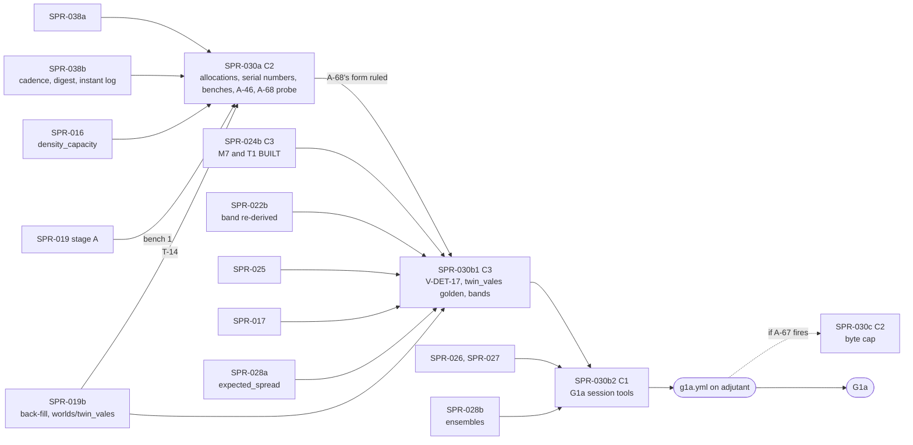

> **BLUF:** Closes P1.14 (`docs/11_roadmap.md:202`) and supplies most of G1a's scale evidence. **Priority 1** under D62 (the director's execution priorities of 2026-10-18: the engine core first, then the viewer, then era packs; `docs/decisions-log.md:7`): this plan carries G1a's determinism row on a dynastic fixture world (`:207`), its CRN row (`:210`), its envelope row (`:215`), its stream row's V-PERF-09 (`:218`) and its performance row (`:219`). Three stages, each its own PR, Tester pass and audit:
> - **Stage A, PR `SPR-030a`** (C2 with `[perf-baseline]`, by T-11's class: ruling G3), the machinery:
>   - `kingdom_10k` sets `density_capacity: 10000` (REV-SPR-030 R1a), and its test world `fixture-kingdom_10k` is created (T-01);
>   - **BCK-002 A-32, part (i):** every machinery site at 0 allocations **at 1 thread**, busy instants included; at 4 threads no growth and at most a recorded per-spawn constant per parallel level, which becomes the P1b pool's target (T-02; rulings G2, C1);
>   - **A-45:** two serial numbers, the engine's overhead outside system jobs and the largest job's share (T-03; G7);
>   - **benches 1 and 2** at meso sizes (T-04; finding F-6);
>   - **A-46, the per-draw overhead** (T-11): a per-term callgrind breakdown first, `PurposeId` cached in the spec purpose, the stream-reuse guard redesigned (per job in an engine-owned buffer, or debug-only if the breakdown says per job cannot reach the target), every draw bit-identical (G3, C9);
>   - **the A-68 probe** (T-14; ruling C3): a 10-year `fixture-kingdom_10k` run measures the run loop's digest per stop at 10k, so that the Architect rules A-68's form **before stage B1**.
> - **Stage B1, PR `SPR-030b1`** (C3: the golden-world corpus changes), the worlds:
>   - **V-DET-17 on the engine** by `specs/determinism/crn_pairing_v0.md` §6, at the seeds A-62's ruling E4 sets, with four engine mutants (T-07, which lands first: its run A places T-06's committed input; ruling C7);
>   - **`twin_vales` becomes the fifth golden world** (D57 item 3) on the world directory and nightly debug soak that SPR-019b creates (ruling X1, filed by the Architect at the close); thread invariance on it is declared vacuous, with a fallback if a level ever holds two jobs (G8, C7);
>   - **the population bands:** `twin_vales` and capped `kingdom_10k` against `specs/worldgen/project_population.py`'s golden, read by key and never typed (G4).
> - **Stage B2, PR `SPR-030b2`** (C1), the G1a session:
>   - `bin/g1a_scale.sh` in **its own workflow, `.github/workflows/g1a.yml`**, in the `adjutant` concurrency group, without `check_all`, `timeout-minutes: 300` (G20, C5);
>   - **the G1a verdict pre-registered** with all its terms (G5, C4): engine only, `--check-cadence yearly`, the default yearly ladder, no vitals, 8 threads on one vCPU per physical core, the process's external wall time, 5 runs per seed at seeds 1–3, PASS iff each seed's median is ≤ 60 s, a setup check before any time is read;
>   - **V-PERF-09 on SPR-026's built memory gate,** measured separately with the engine on cores 0–3 and the viewers on 4–7; **A-67 fires on more than 4 unsealed years**, and if it fires, V-PERF-09 is FAIL at G1a until the conditional byte-cap sprint **SPR-030c** lands, unless the director waives it (C2);
>   - **A-60 at scale; A-68 fires only on a miss the digest causes** (C3); the named bound as a year-end sample; V-SCALE-01 at 10k; V-SAGA-15's stored bytes; bench 3; D40's evidence; the two genesis reports PR #96 asks for (C8).
>
> **Not here:** the run loop's digest (SPR-038b T-06; its residual is BCK-002 A-68: rulings G1, C3); the persistent worker pool (a P1b spike: G2); the live edge's byte cap (SPR-030c, only if A-67 fires: C2); `worlds/twin_vales/` itself and its debug soak (SPR-019b: X1).
>
> **Baselines.** Stage A moves no ladder (`smoke`, `solo`, `household`, `hamlet` byte-identical) and re-records `allocations_v1.txt` and `instructions_v1.txt` (`[perf-baseline]`). Stage B1 **adds** `worlds/twin_vales/baselines/twin_vales_yearly_<Y>y.ladder` by `bin/regen_baseline.sh twin_vales` in its final `[C3]` commit, and a `rung twin_vales` allocation line; the four existing baselines are byte-identical; the corpus change is announced to the director before the merge (`docs/13` §4.2). Stage B2 moves nothing.
>
> - **Developer:** AGT-002-CORE (stage A's engine work in `rh-core` and `rh-sys-demography`; the engine mutants; the world's registration), with AGT-002-TOOLS for the benches, `perf_gate.py`, the CRN harness, the band and byte tools, the probe, the session script and its workflow. One session may hold both roles.
> - **Testers, per stage:** AGT-003-DET (byte and draw identity, the ladders, the CRN pairs and mutants, the golden world), AGT-003-STAT (the band rule, the CRN statistic, the named bound, V-SAGA-15's measure, the verdict's statistics) and AGT-003-IF (the vitals, `perf_gate.py`'s gates, V-PERF-09's terms, A-67's measurements, the workflows). One session may hold them, on a different model from the Developer's.
> - **Size and class:** **about 10–12 agent-days** (G22): **stage A about 3.65–4.15** (T-01 0.15, T-02 1.0, T-03 0.5, T-04 0.75, T-11 0.75–1.0, T-14 0.25, T-05 0.25–0.5), **C2** with `[perf-baseline]` if every draw stays bit-identical, else T-11 leaves the stage as its own C3 PR (G3); **stage B1 about 3.0–3.75** (T-07 1.25–1.5, T-06 1.5–1.75, T-09 0.25–0.5), **C3**; **stage B2 about 3.25–4.0** (T-08 3.0–3.5, the likeliest overrun, re-sized at the Tester's first pass (C10); T-13 0.25–0.5), **C1**. T-10 and T-12 were the deleted stage M's; their numbers are not reused.
> - **Status:** PLANNING, **revision 2**. Revision 0 (`dc39967`) had an independent review (REV-WAVE8 round 1: the Architect's rulings G1–G22); revision 1 (`1dfc563`) a re-check (round 2: 0 BLK, 5 MAJ, 16 MIN, 5 NIT; this plan NEEDS REVISION, text only), whose rulings C1–C10 and X1–X5 are applied here (the last section maps both rounds). It is written against `main` at `99a5b3d` (A-62 as PR #94; D62; PR #89's three CI parts; wave 7 (PR #95: SPR-021a/b, SPR-022a/b, D58 waiting); the minds (PR #93: SPR-023, SPR-024a/b, SPR-025, D59 waiting); D60 approved, so SPR-038 is APPROVED) and SPR-026's sprint branch (`origin/sprint/SPR-026-stream-v1`, `f610915`). It needs the director's plan approval (D61; GOV-005 §2: C2 and C3 work).

# SPR-030 — Determinism and performance at scale (WP P1.14)

- **Roadmap item:** `docs/11` P1.14 (`docs/11_roadmap.md:202`: "Golden runs on the M1/M2/M7 world (1,000 years); CRN pairing test (ADR-0026); meso benches (≤ 50k persons, ≤ 2,000 named actors) and `bench/serial_fraction`. The synthetic 1M benches move to Later with P3.10") · **Phase:** P1a; G1a's determinism (`:207`), invariants (`:208`), CRN (`:210`), envelope (`:215`), stream (`:218`) and performance (`:219`) rows; PRJ-002 §5.
- **Depends on, by task** (ruling G19; the split sprints on `main`; "merged" means on `main`):

| Task | Needs merged | Why |
|---|---|---|
| T-01 (stage A) | SPR-016 | The Registry carries `density_capacity` (`specs/systems/next/registry_delta.toml:15`, `:20`); the validator refuses the parameter until then (`specs/worldgen/fixture_worlds.md:133`) |
| T-02, T-03 (stage A) | SPR-038a | Its quiet instant at 1 thread is T-02's starting point; T-03's timing points sit in the run loop SPR-038a rewrites |
| T-04 (stage A) | Bench 1: **SPR-019 stage A** (a synthesised world held at genesis); bench 2: none | G19 |
| T-11 (stage A) | SPR-038b | Both edit `StepCtx` (`crates/rh-core/src/system.rs`); a textual order |
| T-14 (stage A) | **SPR-038b** (the incremental digest it measures) and **SPR-019b** (`kingdom_10k`'s genesis: a dynastic manifest is refused before it, REV-WAVE6 V4) | The A-68 probe (C3). Before SPR-024b it runs M1, M2 and S3, with M7 and T1 `not_built` |
| T-07 (stage B1) | SPR-017 (`succession::line`); SPR-019b (`worlds/twin_vales/`, X1); **SPR-024b** (M7 and T1 join `BUILT` together: X6) | The affected set's line at genesis; the sovereigns' deaths under M7 and T1 |
| T-06 (stage B1) | T-07 (its run A places the committed input: C7); SPR-019b (the world directory and its soak: X1); SPR-024b; SPR-025; SPR-022b (the band re-derived after it: G4, K21); SPR-028a (`expected_spread`) | Before SPR-024b `rh-cli run twin_vales` runs M1, M2 and S3 only; a golden world must not move again under SPR-025's T1 change |
| T-08 (stage B2) | Stage B1; SPR-038b (`--check-cadence`, `Engine::check_now()`); **SPR-026** (the live edge, the stalled consumer, the memory gate of C2) and SPR-027 (the TUI stub); SPR-020 (the envelope's tables); SPR-028b (its ensembles share the session) | The session measures the G1a build |

  - **D56 settled** (approved 2026-10-17); the band reads the projection under D56's configuration, as A-62 regenerated it (PR #94).
  - **The order** (X9, G19): stage A in any gap between C3 merges once SPR-016, SPR-019 stage A, SPR-019b and SPR-038b are on `main` (T-02 to T-04 may be developed earlier); **the Architect rules A-68's form on T-14's figures before B1 starts**; B1 is the last C3 of P1a; B2 follows B1 and SPR-028b; the `adjutant` session follows B2.
- **Binding contracts:**
  - `specs/worldgen/fixture_worlds.md` 0.5.1: §1 (`:7–21`), §2 (`twin_vales`, `:23–85`; the crude rates `:61`), §3.1–§3.3 (`kingdom_10k` `:87–99`, the named rule and the bound `:101–107`, the projection `:109–133`, R1a `:133`), §4 (`:135–147`), §5 D-01 to D-11 (`:149–163`), §6 (`:165–171`); `specs/manifest/examples/twin_vales.yaml`, `kingdom_10k.yaml`; `specs/worldgen/selftest_fixture_worlds.py`, `golden/fixture_worlds_v0.txt`; `specs/worldgen/project_population.py` and `golden/population_projection_v0.txt`, whose `baseline world twin_vales capacity default` and `baseline world kingdom_10k capacity 10000` blocks (D56's reading) the band reads by key, as A-62 regenerated them; REV-SPR-030 R1–R28.
  - `specs/determinism/crn_pairing_v0.md` 0.4.1: §2 (`:11–15`), §3.1 and the tiers (`:19–29`, `:23`), §3.2 (`:31–42`), §3.3 (`:44–54`), §3.4 (`:56–70`), §4.3 the results (`:88–99`), §4.4 the controls (`:101–111`), §5 D-03 (`:119`) and D-08 (`:124`), §6 the Developer's run (`:126–131`); `selftest_crn_pairing.py` (`HORIZON_YEARS = 10` `:104`, `MIN_WINDOW_YEARS = 5` `:109`, `MIN_INFORMATIVE = 100` `:110`); `golden/crn_pairing_v0.txt`, whose `pair VALID` and `pair SKIPPED` lines name the reference's VALID and skipped seeds (`crn_pairing_v0.md:99`).
  - `docs/08` §1.3 (`docs/08_performance_and_capacity.md:67–86`), §1.4 (`:93`), §9 benches 1–3 (`:236–238`); `docs/09` V-DET-01, V-DET-02, V-DET-05, V-DET-12, V-DET-17 (`:115`), V-INV-02 (`:126`), V-INV-12 (`:136`), V-GOLD-01 (`:148`), V-PERF-04 (`:210`), V-PERF-09 (`:215`), V-PERF-11 (`:217`), V-DATA-04 (`:267`), V-SAGA-15 (`:420`), V-SCALE-01 (`:659`), V-SCALE-03 (`:661`); `docs/03` PERF-2 (`:243`), PERF-5 (`:246`), SIM-1 (`:44`).
  - `specs/stream/wire_v1.md` §6.1 (D42 (b), `:213–221`), §9's V-PERF-09 row (`:315`), "the engine never waits" (`:316`); `specs/chronicle/envelope_v0.md` §9 (`:183–186`).
  - **SPR-026 as built** (`origin/sprint/SPR-026-stream-v1`, `f610915`): `crates/rh-cli/tests/memory.rs` (`:1–10`: since GAP-1, `LiveEdge::bytes()` counts the seal queue as well as the window, and the host's `VmHWM` growth over a headless run is bounded by 2 × peak `bytes()` + an allowance, `ALLOWANCE` 2 MiB at `:28`, the bound at `:84`); `CODEX/40_VERIFICATION/VER-SPR-026-TEST.md` `:204` (the uncounted host memory plateaus at about 4.9–5.7 MB at 1,500–3,000 years of `solo`, peak `bytes()` about 4.5 MB) and GAP-8 (`:209`: take the headless baseline as the maximum of three runs).
  - **SPR-038's plan** (`CODEX/05_PROJECT/SPR-038_PerInstantCost.md`, APPROVED by D60): stage A's exact gating and zero allocations on a quiet instant (`:18–28`); stage B's `--check-cadence {every-change,yearly}` (default `every-change`, `yearly` opt-in for G1a, written to `run.toml` and the ladder header only when not the default), `Engine::check_now()`, the cross-cadence refusal (`:30–36`), the incremental digest with append marks and one digest per stop (`:37–40`; T-06 `:358–389`), the instant log (`:41`); its G1a arithmetic (`:159–172`: 35–71 s of digest per 1,000 years without a run directory, 70–142 s with one, "necessary, not sufficient") and A-68 (`:470`).
  - `crates/rh-bench` (`benches/alloc_budget.rs:10–25` (sites attributed at 1 thread only, `:14–18`), `:53` (`THREADS = [1, 4]`); `baselines/allocations_v1.txt:9–10`: 819,401 allocations at 1 thread against 828,161 at 4, the scoped spawns' difference; `baselines/instructions_v1.txt:12–16`), `bin/perf_gate.py` (`BENCH_TARGETS` `:70`, `ALLOC_GATED` `:574`), `bin/wall_trend.py`, `bin/bench_session.sh`, `.github/workflows/adjutant.yml` (the `session` job: `check_all` then the bench session, `timeout-minutes: 120`, `:28–31`); `crates/rh-core/src/engine.rs` on `main` (`dispatch` `:1326`, `std::thread::scope` `:1346`); `crates/rh-core/src/observe.rs:1–30`; `crates/rh-golden/src/vitals.rs`.
  - `bin/regen_baseline.sh` (`:31`), `bin/golden_nightly.sh` (the debug soak loop, `:108–116`), `bin/check_baseline.py`, `.github/workflows/nightly.yml` (the golden job, `timeout-minutes: 45`, `:91`), `worlds/hamlet/world.toml` and `inputs.toml`.
  - BCK-002 1.21.1: A-32 (`:52`), A-45 (`:65`), A-46 (`:66`), A-60 (`:80`), A-62 (`:82`), A-63 (`:83`), A-66 (`:86`), A-67 (`:87`); A-68 as SPR-038's plan files it.
  - `docs/red_team/RT-2026-10-18-batch-08-dispositions.md:96` (PR #96: "SPR-030's G1a run report: living members per house … Male-line depth at genesis is reported there too").
  - ADR-0006, ADR-0025 item 3, ADR-0026, ADR-0030, ADR-0031; GOV-005 §6; GOV-008 (`:25`, `:30–31`); RUN-002 (`:23`: 16 vCPU = 8 physical cores; §5 `:74–77`: at least 5 runs, the median and spread).
- **System specs:** none changed by this plan. **Finding F-15** (stated, rulings G21, C8): three texts say the density term never binds in P1a: M2's `scale_behaviour` ("while the living count is at or under `density_capacity` (every P1a world)", `specs/systems/next/M2.demography.odd.toml:544`), the parameter block's comment ("Both inert in every P1a world", `:788`) and the Registry delta's comment ("both defaults are design values that leave every P1a world untouched", `specs/systems/next/registry_delta.toml:16–17`). `kingdom_10k` starts at its capacity of 10,000 (R1a) and grows, so the term binds there from its first months. **Proposed (8/10):** the Architect corrects all three to "every P1a world but `kingdom_10k`, which runs at its capacity (R1a)" before SPR-015 freezes 0.3.0 (an `[[amends]]` record if a field is in the frozen slice); text only, no golden moves.
- **Rulings (binding):** REV-WAVE8 round 1 **G1–G22** and round 2 **C1–C10, X1–X5** (the Architect, 2026-10-18), with SPR-038's S1–S16 and T1–T11, the cross-plan X1–X13 (the P1a shared rulings), A-62's E1–E12; REV-SPR-030 R1 (a), R2–R4, R7, R9, R10, R14, R16, R20, R22–R25; D57 item 3; D56; RT-037 as adapted, with wave 7's K21; D34; D42; D40; REV-WAVE6 X1, X7, Z1; REV-WAVE5 W2, W3, X5; SPR-008's baseline rulings; SPR-009 rulings 2, 3 and 5.
- **Director items:** D61 (items 1, 2, 3, 5, 6, 8 and 9).
- **Requirements covered:** DET-1, DET-2, DET-5; DET-13; ADR-0026's CRN survival (V-DET-17); SIM-1 at 10k (V-SCALE-01); SIM-9's world (V-INV-12); PERF-4; PERF-5's P1a variant (V-PERF-09); SAGA-10 (V-SAGA-15's P1a variant); the G1a performance default (`docs/11_roadmap.md:219`); V-PERF-11.

## Specs this sprint needs

| Spec | Exists? | Gap | Architect ruling | Needed by |
|---|---|---|---|---|
| **`kingdom_10k`'s capacity, and its test world** | `fixture_worlds.md:133` and D-04 (`:156`) | None once SPR-016 is on `main`; no world directory runs `kingdom_10k` (`crates/rh-golden/src/world.rs:124–135`: `fixture-<name>` lives in `tests/worlds/<name>`) | **Ruled (REV-SPR-030 R1a).** T-01 also creates `tests/worlds/kingdom_10k/` (`fixture-kingdom_10k`: the manifest path and its pinned SHA-256, no baseline), the one directory T-14 and T-08 run | T-01 |
| **A-32's machinery allocations, part (i)** | V-PERF-11 (`docs/09:217`); `alloc_budget.rs` attributes sites at 1 thread only (`:14–18`) and measures 1 and 4 threads (`:53`) | **Zero at 4 threads is impossible while `std::thread::scope` stays** (ruling C1): `dispatch` and its scoped spawns allocate (`allocations_v1.txt:9–10`: 819,401 at 1 thread against 828,161 at 4) | **Ruled (G2, C1; 85%).** **At 1 thread:** every machinery site (every site but `step <system>`) at 0 allocations and 0 growths after the warm-up, busy instants included, stated as the delta from SPR-038a's quiet instant. **At 4 threads:** no growth, and total allocations ≤ the 1-thread count + K × the parallel levels in the window, where **K is a recorded per-spawn constant** (the allocations one scoped spawn of a two-job level costs, measured by the Developer and written to `allocations_v1.txt` by `alloc-record`). K is the P1b pool's target (0). A residual the Developer cannot remove at 1 thread is recorded and ruled | T-02 |
| **The persistent worker pool** | A-32 (`BCK-002_ArchitectBacklog.md:52`) | `dispatch` borrows engine state (`engine.rs:1326–1350`), the workspace forbids `unsafe` (`Cargo.toml:22`), no P1a world has a parallel level | **Ruled (G2, 85%): a P1b spike;** C1's K is its target | — |
| **The division of A-60 with SPR-038** | SPR-038's plan (APPROVED) | — | **Ruled (G1, G9):** the "Division" table below | T-02, T-08, T-11, T-14 |
| **The run loop's digest after SPR-038b, and A-68 (formerly finding F-23)** | SPR-038b T-06: one cache across stops, also serving `StreamHost::collect` (ruling T2), append marks; its arithmetic leaves 35–71 s of digest per 1,000 years without a run directory and 70–142 s with one (`SPR-038_PerInstantCost.md:159–172`) | **Revision 1's trigger was vacuous** (ruling C3): "over 10% of the run" holds on every run by SPR-038's own arithmetic, even a passing one; and it was decided in B2, after B1 | **Ruled (G1, C3; 80%).** **(i) A-68 fires only on a miss the digest causes:** if (a)'s verdict is FAIL **and**, for a failing seed, its median minus that seed's measured digest time is ≤ 60 s. **(ii) The early decision:** T-14 (stage A) measures the digest per stop at 10k on a 10-year `fixture-kingdom_10k` run; **the Architect rules A-68's form on it before B1** (none; an incremental agenda digest; row-level dirty marks for the written log columns from the instant log's `inserted()` and `exited()`; or `05.1` §6 item 6's release digest cadence, C3). **(iii)** The miss risk is **Likely**. "SPR-030 keeps T-08 (h)" is confirmed, with T-14 as the early decision | T-14, T-08 |
| **The per-draw overhead (A-46; finding F-18)** | A-46 (`:66`); `instructions_v1.txt:12–16` (`raw_1000` 552,039; `empty` 16,611; `rng_epoch0_1000` 1,257,191; `rng_epoch1_1000` 1,519,576) | The per-draw terms: `purpose_id` (a linear `contains` and `PurposeId::of`, an `h64_bytes` of the purpose name, `system.rs:591–600`, `crates/rh-ids/src/rng.rs:125–131`) and the guard's `BTreeMap` insert (`system.rs:567–589`); the epoch lookup misses an empty map at epoch 0 (`:455–459`) | **Ruled (G3, C9; 75%).** A per-term callgrind breakdown first; `PurposeId` cached in the spec purpose (a `const`); **the guard per job**, in an **engine-owned reused buffer** (the `(purpose, entity, how)` uses of a job, sorted and scanned once at the job's end); **if the breakdown shows the per-job sort-and-scan cannot meet the target, the guard becomes debug-only,** with a release test of the key path (SPR-007's DET-11 pattern: the debug build refuses the planted reuse; the release build's keys and draws equal the debug build's). **Class: C2 if every draw is bit-identical**, else its own C3 PR (D61 item 9) | T-11 |
| **The serial numbers (A-45)** | A-45 (`:65`); `docs/08` §1.3 (`:67–86`) | Revision 0's definition is about 100% on every P1a world (G7) | **Ruled (G7, C9):** at 1 thread, **(1) the engine's overhead** (the share of wall time outside every system job; the run loop's digest is a named part of it) and **(2) the largest job's share** (per instant, the most expensive job's wall time, summed over the run); at N threads, **the parallel efficiency, defined as the speed-up over the 1-thread run divided by N**. In `docs/08` §9 (the Architect's text) | T-03 |
| **Benches 1 and 2 (finding F-6)** | `docs/08` §9 (`:236–237`); §1.4 (`:93`); PERF-2 (`docs/03:243`) | `docs/11` P1.14 moves the 1M benches to Later | **Accepted (round 1; D61 item 3, 70%):** meso sizes; PERF-2's binding with the scale-up | T-04 |
| **Bench 3's gate (finding F-7)** | `docs/08` §9 (`:238`); G1a (`docs/11:219`) | 20% fails by construction while M2 is one serial job | **Accepted (round 1; D61 item 3):** reported at G1a, gated from G1b; in T-08 (after SPR-019b and SPR-024b) | T-08 |
| **`twin_vales` as a golden world, and its directory (ruling X1)** | D57 item 3; `fixture_worlds.md:167`; G1a (`docs/11:207`) | Revision 1 created `worlds/twin_vales/` in B1, so SPR-029 T-04, SPR-028b T-06 and SPR-024b's probes had nothing to run before it (round 2's X1) | **Ruled (X1, 70%): SPR-019b creates `worlds/twin_vales/`** (the manifest pin; no baseline, not a golden world) and, since `twin_vales` registers M2, its nightly debug soak line under SPR-038's inventory rule (SPR-019b adds it if SPR-038b has merged, or SPR-038b does when it lands); the Architect amends SPR-019 at the close. **This stage makes it golden:** the baseline, the committed input, `regen_baseline.sh` and `check_baseline.py` entries. **Accepted (round 1; D61 item 2, 75%):** PR tier Y = 300 years yearly at 1 thread if one release run takes ≤ 20 s on a hosted runner, else 100; `kingdom_10k` not golden; `manor` a test world | T-06 |
| **Thread invariance on `twin_vales` (G8, C7)** | Every P1a level is single-job (`--expect-serial`) | A declaration of vacuity needs a fallback | **Ruled (G8, C7):** declared vacuous while the dispatch line reads "0 with two or more jobs" (`run.rs:37`, `:224`), asserted in the PR tier; **if a level ever holds two jobs, the declaration is withdrawn by that assertion's failure, and the N-thread run becomes a PR-tier gate in the same PR** | T-06 |
| **`twin_vales`' committed input (C7)** | `worlds/hamlet/inputs.toml` | Which person; T-06 needs T-07's run A | **Proposed (8/10): V-DET-17's input** at the PR-tier seed (the first VALID engine seed in 1–4), at its `T_IN`; **T-07 lands before T-06** in stage B1. If no seed in 1–4 is VALID, founder 0 as `hamlet`'s | T-07, T-06 |
| **V-DET-17 on the engine (finding F-1)** | `crn_pairing_v0.md` §6 (`:126–131`) | The S extension reads "the Promote and Demote records of channel A" (`:52`, `:128`); none exists (M7's `[[emits]]`, `specs/systems/next/M7.dynasty.odd.toml:349–385`) | **Accepted (round 1; G4, 85%):** `person.named` read after every instant in a test host; N4's lists replayed by the function M2's step calls; `crn_pairing_v0.md` §3.3 and §6 amended (the Architect's text). **Seeds (A-62 E4, as merged):** the PR tier takes the first VALID engine seed in 1–4; E4's nightly rule (at least 2 VALID, searching seeds 1–12) runs in the weekly tier; SKIPPED seeds' run-A death digests pinned (R25) | T-07 |
| **The CRN engine mutants** | `crn_pairing_v0.md` §4.4 (`:101–111`) | The engine needs its own (A-52) | **Proposed (8/10): four `mutant-*` features, weekly,** on the PR-tier seed's run A (T-07) | T-07 |
| **The population band rule** | RT-037 as adapted; `project_population.py:58`; `docs/09` §1.2 rule 2 | — | **Proposed (7/10), pre-registered; no number typed.** `population_band.py` reads P(y) from the golden by key and s(y) from SPR-028a's `expected_spread`: **ln N(y) − ln P(y) ∈ [−h(y), +h(y)]**, h(y) = 5 s(y) + ε(y), s(y)² = (b + d)(1 − e^(−r y)) / (r F₀), ε = 5% per century of horizon (uncapped) or a flat 5% (capped). The factor 5 (four standard deviations × 1.25) is checked: round 2 reproduced the female-line Leslie simulation and found the simulated sd within a factor 0.85–1.13 of s(y) over 50–1,000 years (REV-WAVE8 round 2 §4 (b)). **It asserts only when the run's `systems` line is M1, M2, S3, M7 and T1**, else NOT APPLICABLE by name; it is re-derived after 022b (G4, K21). **Its spread pre-check runs at 300 years on `adjutant`** (C6, C7) | T-06, T-08 |
| **The named bound** | `fixture_worlds.md:107`, `:170` (R7) | Observers carry no state; a per-instant count is O(rows) (X1) | **Accepted (G5):** the host counts `person.named` at each yearly stop; the bound is a year-end sample, asserted as "the maximum of the year-end counts ≤ 500" | T-08 |
| **V-SAGA-15's P1a variant (finding F-17)** | `envelope_v0.md:186`; SPR-020 `:325` | — | **Accepted (G21):** `bin/envelope_bytes.py`; PRJ-002 §5 carries it | T-08 |
| **The fixture worlds' event rates (finding F-22)** | `fixture_worlds.md:61`, `:99`; `crn_pairing_v0.md:99` | — | **Done in revision 1** (`fixture_worlds.md` 0.5.1, `crn_pairing_v0.md` 0.4.1): the stationary rates, about 3.3% deaths and 3.4% births a year at e0 30; T-08 records the measured rates beside them | T-08 |
| **V-PERF-09's memory term (finding F-5; ruling C2)** | `wire_v1.md:315`; **SPR-026 as built:** `bytes()` counts the seal queue since GAP-1, and `tests/memory.rs` gates `VmHWM` growth ≤ 2 × peak `bytes()` + 2 MiB (`:1–10`, `:28`, `:84`) | Revision 1's counting allocator in `rh-cli` is forbidden by `lint_arch`'s global-allocator rule, and its seal-queue term is already in `bytes()` (round 2's C2). GAP-8: 2 MiB is smaller than headless noise (up to 2.9 MB) | **Ruled (C2, 75%):** V-PERF-09's memory clause is **SPR-026's gate at 10k:** `VmHWM` with the viewers − the headless baseline ≤ 2 × peak `bytes()` + V × 1 MiB (one frame per viewer) + R, where **the headless baseline is the maximum of three headless runs (GAP-8)** and **R is a stated term for the uncounted host memory**, SPR-026's measured plateau of about 4–5 MB (`VER-SPR-026-TEST.md:204`), re-measured headless on `kingdom_10k` and written down before the paired runs. No counting allocator. `wire_v1.md` §9 is restated by the Architect | T-08 |
| **A-67, and the conditional byte cap (ruling C2)** | A-67 (`:87`) | Revision 1's clause 2 is a tautology under SPR-026's gate; clause 1 is the one that can fire, and it is likely to (sealing ran 3–10 times slower than the simulation in SPR-026's runs) | **Ruled (C2, 75%; D61 item 5):** **A-67 fires if the unsealed years exceed 4 at any instant** (two nominal years of D42 (b)'s window plus slack) on `kingdom_10k` at seeds 1–3 with V-PERF-09's viewers attached. **If it fires, V-PERF-09 is FAIL at G1a until the cap lands, unless the director waives it.** The cap is pre-planned as **SPR-030c, "if A-67 fires"** (a PRJ-002 row with its size): a reviewed D42 (b) amendment of `wire_v1.md` §6.1 (a byte cap under which the host thread waits for its own seal, never for a viewer), then the C2 code | T-08 |
| **The G1a verdict (rulings G5, C4)** | `docs/11:219`; RUN-002 §5 | Revision 1 omitted the clock, the ladder, vitals, the build and a setup-failure rule | **Ruled (G5, C4; 80%), pre-registered before the session:** `rh-cli run fixture-kingdom_10k --seed s --years 1000 --threads 8 --check-cadence yearly`, **engine only** (no `--run-dir`, no `--socket`, no viewers); **the ladder:** the default `--ladder yearly`, to a file (`--out`), stated; **vitals off** in timed runs (one separate vitals run per seed for the breakdown); **the build:** release at the recorded commit, the repository's own Cargo configuration, no extra `RUSTFLAGS`; **the clock:** the external wall time of the whole `rh-cli run` process (`/usr/bin/time -f %e`), genesis and the final ladder write included; **the topology:** one vCPU per physical core (`taskset` to 8 vCPUs on distinct cores, the sibling map from `lscpu -e` in the report); **the setup check, run before any time is read:** the affinity verified in `/proc/<pid>/status` (`Cpus_allowed_list`), and no other process above 5% CPU (`ps`), else the run is discarded and re-run once, the reason logged; **the statistic:** 5 runs per seed at seeds 1–3, **PASS iff each seed's median is ≤ 60 s**, every time and the spread printed | T-08 |
| **What a missed 60 s means** | `docs/11:219` | — | **Accepted (C3):** recorded with its terms; A-68 if the digest caused it (the A-68 row); otherwise another follow-up or the director's go / iterate call at G1a; the criterion is not relaxed here | T-08 |
| **The session's workflow (rulings G20, C5)** | `adjutant.yml`'s `session` job (`:28–31`) | Revision 1 put `g1a` in `adjutant.yml` with a dispatch input, claimed a hosted dry run of a self-hosted job, and gave no derivation of its hours | **Ruled (C5, 85%):** **its own workflow, `.github/workflows/g1a.yml`** (`workflow_dispatch`; `concurrency: group: adjutant`, the session's group; `runs-on: [self-hosted, adjutant]`; `timeout-minutes: 300`; no `check_all`): checkout, `uv sync --frozen --project python`, the release build, `bin/g1a_scale.sh`, SPR-028b's `bin/g1a_ensembles.sh` (ensembles at `--check-cadence yearly`), and the upload with `if: always()`. **In part core:** `actionlint` on the workflow and `g1a_scale.sh --dry-run`. The time table below | T-08 |
| **CI (X10, G20, X2, X3)** | PR #89's three parts; its first run: core 10:00, golden 7:10, stream 7:32 | — | **Ruled:** the "CI by part" section below | T-05, T-09, T-13 |

## Division of A-60 with SPR-038 (rulings G1, G9, C3)

| Item | SPR-038 (APPROVED; D60) | This sprint |
|---|---|---|
| Owned columns by `ColumnId` slots; checks only after a change; O(N + L) checks; positional compaction; zero allocations and no `format!` on a quiet instant at 1 thread | **SPR-038a** (T-01 to T-04), with the `instant` bench | Measures at scale (T-08 (h)) |
| `--check-cadence`, `Engine::check_now()`, the cross-cadence refusal; the value checks compiled out of release; the debug-soak inventory rule | **SPR-038b** (T-05) | The verdict at `--check-cadence yearly` (G5); (c)'s replay with the recorded cadence |
| **The run loop's digest** (one cache across stops, `collect`'s second hash, append marks) | **SPR-038b** (T-06) | **Measures it per stop at 10k in stage A (T-14) and its share of the G1a run (T-08 (h))** |
| **A-68** | Filed unconditionally (ruling T1) | **Its form ruled on T-14 before B1; it fires only on a miss the digest causes** (C3) |
| The instant log; the `DropReason` change | **SPR-038b** (T-07) | Nothing (SPR-028b's residence forcer reads `inserted()`) |
| Machinery allocations: busy instants at 1 thread; the 4-thread bound | — | **Builds** (T-02 (i); C1) |
| The persistent worker pool | — (its out-of-scope list, `:472`) | **Not in P1a** (G2); K is its target |
| A-46; A-45; benches 1–3 | — | **Builds** (T-11; T-03; T-04, bench 3 in T-08) |
| The G1a verdict (≤ 60 s) | "Necessary, not sufficient" (`:52`) | **Records** (T-08 (a)) |

## CI by part (X10; rulings G20, X2, X3)

**The base** is PR #89's first CI run (`a4be717`): **core 10:00, golden 7:10, stream 7:32**. Sums are gate sums on one runner; ×1.5 is the slow-runner budget. Run-directory readers go to `stream`.

| Stage | Part `core` | Part `golden` | Part `stream` | ×1.5 (core / golden / stream) |
|---|---|---|---|---|
| A | +2 s: the vitals format tests; T-11's unit tests | +55 s: benches 1–2 under valgrind, run twice by the repeatability gate (+50 s); the machinery-site gate in `alloc-gate` (+5 s) | — | +3 s / +83 s / — |
| B1 | +3 s: the CRN harness's and the band's unit tests and controls | +31 s: `twin_vales`' Y-year run at 1 thread (≤ 20 s by the golden-world rule) and its baseline gate; the CRN pair at the PR-tier seed (about 10 s) | — | +5 s / +47 s / — |
| B2 | +4 s: `envelope_bytes.py`'s unit tests and its `budget-bloat` control; `actionlint` on `g1a.yml`; `g1a_scale.sh --dry-run` (C5) | — | +3 s: `envelope_bytes.py` on `hamlet`'s run directory (reported) | +6 s / — / +5 s |
| **Total** | **+9 s** | **+86 s** | **+3 s** | **+14 s / +129 s / +5 s** |

**Off the PR tier.** The allowance of hosted Actions minutes is D61 item 8's question to the director (ruling X3), so this plan states minutes per run, not per month, and enters them in **PRJ-002's nightly ledger, which the Architect keeps** (X2):
- **the daily nightly: nothing.** `twin_vales`' 300-year debug soak is SPR-019b's (or SPR-038b's) line under X1, and is ledgered there;
- **`.github/workflows/dynastic.yml`** (weekly `schedule`, `workflow_dispatch`, and a **`pull_request` trigger on its own paths** running a reduced case: C6), each job `timeout-minutes: 45`, split into two jobs if a subtotal passes 45:

| Item (weekly) | Subtotal, the drafter's estimate before measurement |
|---|---|
| `twin_vales` 1,000-year monthly ladders at 1 thread × 3 and at N threads × 1 (the dispatch line asserted) | 12–24 minutes |
| The yearly cut of a Y-year monthly run equal to the baseline; three 300-year run directories (seeds 1–3) with replay, sift, the twin, `check_segments.py`, V-DATA-04, V-INV-12's genealogy clause and the band | 6–12 minutes |
| The CRN search (at least 2 VALID in seeds 1–12) and the four CRN mutants' builds and runs | 8–15 minutes |
| Stage A's `mutant-alloc-machinery` build and gate | 2–4 minutes |
| **The reduced `pull_request` case:** `twin_vales` seed 1, 50 years; the band at 50 years; the CRN pair at the PR-tier seed | 3–5 minutes |

  The weekly items total 28–55 minutes, so the Developer measures them and splits `dynastic.yml` into two jobs (ladders; run directories and CRN) if the total passes 45. **"First run green within 45 minutes" is not a merge gate:** the first post-merge dispatch is recorded by the Architect at the audit (C6);
- **the 32-seed band pre-check** (C6, C7) and the session run on `adjutant`, costing no hosted minutes.

## The G1a session's time table (ruling C5)

The drafter's estimates, from SPR-038's arithmetic and the review's ensemble estimate; `g1a_scale.sh --dry-run` prints this list, and T-08 replaces each figure with its measurement.

| Item | Runs | Estimate |
|---|---|---|
| (a) the verdict: 3 seeds × 5 timed runs at 8 threads, plus one vitals run and one run-directory run per seed | 21 | 25–50 minutes |
| (c) V-SCALE-01: seed 1's monthly ladders at 1, 2, 4 and 8 threads; replay; a keyframe resume at year 500 | 6 | 10–20 minutes |
| (d), (e), (i), (j): from (a)'s run directories, plus uncapped `kingdom_10k` at seeds 1–3 (the band's control, D40) and `twin_vales` 300 years at seeds 1–3 | 6 | 15–30 minutes |
| (f), (g): 5 paired runs (headless, then viewers) at 4 threads, 3 headless baselines, 3 headless `--socket` runs | 16 | 30–60 minutes |
| (h): callgrind over one sim-month from the keyframes of years 100, 500 and 1,000 and from genesis | 4 | 10–20 minutes |
| SPR-028b's ensembles (`g1a_ensembles.sh`): `fixture-demography_1000` and `kingdom_10k` at 32 seeds × 1,000 years, `twin_vales` 32 × 300, the isolation worlds | about 200 | 60–120 minutes |
| **Total** | | **about 2.5–5 hours** |

## Compliance (every task)

| Rule | This sprint |
|---|---|
| Change class (`docs/13` §4.2) | **Stage A: C2** with `[perf-baseline]`: T-11 is RNG machinery (`docs/13:97`), routed as C2 by G3 because every draw stays bit-identical; if any draw moves, T-11 leaves as its own C3 PR and stage A is C1. **Stage B1: C3** by the corpus change; no existing `state_hash` moves. **Stage B2: C1** |
| Planes touched (ADR-0024) | **A:** `rh-core` (stage A: buffers; the draw path and the guard's buffer; stage B1: one mutant feature), `rh-sys-demography` (N4's candidate-list function made `pub` and called by the step; mutant features), the generated skeletons (the cached `PurposeId`, by `bin/gen_skeletons.py`). **Tool:** `rh-bench`, `rh-golden` (the vitals, the CRN test, the yearly named count, `twin_vales`' golden registration), `bin/` (`perf_gate.py`, `regen_baseline.sh`, `golden_nightly.sh`, `population_band.py`, `envelope_bytes.py`, `g1a_scale.sh`), `specs/manifest/examples/kingdom_10k.yaml`, `tests/worlds/kingdom_10k/`, `worlds/twin_vales/` (its baseline and input), the workflows. **B, C:** none |
| Owned columns written; reads; RNG purposes | None new; the CRN test and the named count read `engine.tables()` between instants, in the host; T-11 caches existing purposes' ids; the mutants never reach a baseline (A-52) |
| Golden-hash effect | **Stages A and B2: none** (the four worlds byte-identical at 1 and N threads, headers included; every `draws_golden` line equal). **Stage B1: one baseline added** (`twin_vales`) |
| Fixed-point quantities | None new; the band and the CRN statistic in the tool plane (ρ² exactly in rationals, `crn_pairing_v0.md:66`) |
| Determinism lints (GOV-003 §2, §6) | No new dependency; no `unsafe`; no pool; no global allocator (`lint_arch`); the merge order and `Notice::worker` unchanged |
| Tests that gate this sprint | V-PERF-11 (1 thread: machinery sites at 0; 4 threads: C1's bound), V-PERF-04 (benches 1–2; the draw cost), V-DET-01 and V-DET-02 (`smoke`; `twin_vales` weekly; 10k in the session), V-DET-05, V-DET-12, V-DET-17, V-GOLD-01 (five worlds), V-INV-02 (`twin_vales`' soak, SPR-019b's line), V-INV-12's genealogy clause, V-DATA-04 (P1a variant), V-SCALE-01 (10k), V-SCALE-04, V-SAGA-15 (P1a variant), V-PERF-09 (P1a variant, under C2), plus `bin/check_all.sh`. **Reported, not gated:** bench 3, the verdict's terms (the verdict itself recorded, G5), A-67's measurements, A-60 and the digest at scale, D40's evidence, the realised counts of `fixture_worlds.md` §6 and PR #96's two reports |
| Docs updated in the same stage | `bin/check_all.sh` and `python/tests/test_check_all_inventory.py` (same commit); `CLAUDE.md`; `docs/08` §1.3, §1.4 and §9 (F-6, F-7, G7, C9's definition: the Architect); `docs/03` PERF-2; `docs/09` V-PERF-09 (C2's bound), V-DET-17, V-SAGA-15 and V-SCALE-01 method lines; `wire_v1.md` §9 (C2); `crn_pairing_v0.md` §3.3 and §6 (F-1); `fixture_worlds.md` §6; `worlds/twin_vales/README.md`; BCK-002 A-32 (part (i) done; K recorded; the pool re-scoped to P1b), A-45, A-46 (done), A-60, A-67, A-68 (measured; the outcomes); PRJ-002's rows and nightly ledger |

**Rules carried from P0–SPR-019 (every task):**
- **Hash-neutral means byte-identical:** stage A's acceptance is the four ladders, every channel-A segment of the golden run directories, every `draws_golden` line and the tail snapshots byte-identical at 1 and N threads.
- **A positive control fails for the right reason;** every planted mutant fails a named check, and the plan says why it is observable.
- **A test input exercises the path it claims, and a probe asserts it;** a "thread invariance" claim names a level with two or more jobs, or is declared vacuous with its fallback.
- **No O(rows) work per instant** (REV-WAVE6 X1).
- **Mutants never make a baseline** (A-52); **baselines are regenerated only by their tools,** in the final commit, with `[C3]` or `[perf-baseline]` and a `perf-baseline-reason:` line.
- **No typed golden numbers** (G4); **a typed derived figure cites the line it is derived from** (C9).
- **Python tests read no CI environment variable.**
- **CI time (W42, Z1, X10):** per part of three, ×1.5; each new gate in exactly one part; run-directory readers in `stream`; minutes per run in PRJ-002's ledger (X2).
- **Merge `origin/main` when main moves;** **batch pushes at task boundaries;** **one commit per task** (GOV-005 §4).

## Tasks

**Stage A** (`SPR-030a`) is T-01 to T-04, T-11, T-14 and T-05. **Stage B1** (`SPR-030b1`) is T-07, then T-06, then T-09 (C7). **Stage B2** (`SPR-030b2`) is T-08 and T-13. T-10 and T-12 are retired with the deleted stage M (G1).

### Stage A: the machinery

#### T-01: `density_capacity: 10000` and the `kingdom_10k` test world (R1a; 0.15 day)
- **Deliverable:** the line in `specs/manifest/examples/kingdom_10k.yaml`'s `systems: M2.demography` (its comment: R1a); `tests/worlds/kingdom_10k/world.toml` (`fixture-kingdom_10k`: the manifest path and its pinned SHA-256; no baseline); `fixture_worlds.md` §3.1 and §6 say it is done.
- **Acceptance:** `manifest_v0.py validate` and the Rust loader accept the manifest (V-WC-04 parity unchanged); `selftest_fixture_worlds.py --tier pr` and `project_population.py --check` pass unchanged; `python/tests/test_fixture_worlds_cases.py` passes; `check_pin` accepts the new world and refuses a copy whose manifest byte changed; no golden world moves.
- **Status:** [ ] not started

#### T-02: Machinery allocations, part (i) (A-32; G2, C1; 1.0 day)
- **Deliverable:**
  - **The delta after SPR-038a:** the containers a busy instant still allocates (the fired pulses, the due timers by system, the plan's levels, the merge buffers, the inserts' row buffers, the commands' queues) become engine fields reused with `clear()`; maps whose nodes allocate become sorted vectors; at 4 threads, `dispatch`'s per-level result vectors are reused across levels; `std::thread::scope` stays (`engine.rs:1346`).
  - **The gates:** at 1 thread, `alloc_budget.rs` prints each machinery site's totals and `perf_gate.py alloc-gate` fails any machinery site above 0 allocations or 0 growths, naming the site; at 4 threads, it fails any growth, or total allocations above the 1-thread count + K × the parallel levels of the window, with **K recorded per world by `alloc-record`** (a line `spawn_constant <world> <K>`).
  - **A planted control:** `mutant-alloc-machinery` (a `String` allocated per busy instant in the merge), weekly.
- **Acceptance:**
  - **At 1 thread:** after the 2-year warm-up, every machinery site of `smoke`, `solo`, `household` and `hamlet` counts 0 allocations and 0 growths over the measured year, **busy instants included** (the probe counts the window's births, deaths, due timers and commands, each at least 1 on `hamlet`); the per-world totals equal the systems' own step allocations; the PR states SPR-038a's figures and this task's side by side.
  - **At 4 threads, on `smoke`** (≥ 5% parallel levels, `--require-parallel 5`): no growth; total allocations ≤ the 1-thread count + K × parallel levels; K printed and recorded; a planted extra allocation per spawn fails the bound by name.
  - **Controls:** the planted control fails by site; the existing zero-fill control still fails the totals.
  - **Hash-neutral:** the four ladders, segments and tail snapshots byte-identical at 1 and N threads; `--leak-thread` and the parallel-level floor control still fail.
- **Status:** [ ] not started

#### T-03: The serial numbers and the vitals' per-run signals (A-45; G7, C9; 0.5 day)
- **Deliverable:** the vitals line gains, at 1 thread, **(1) the engine's overhead** (with the run loop's digest as a named part) and **(2) the largest job's share**, both from the host's observer clock; at N threads, **the parallel efficiency, the speed-up over the 1-thread run divided by N**; and GOV-006 §2's per-run signals (build, Registry version, manifest hash and seed, wall time, peak RSS, stream bytes per channel, keyframes written, the counters). Each field is `key=value` on the vitals stdout line.
- **Acceptance:** on `smoke` at 1 thread both numbers repeat to 0.5 percentage point in three runs on one machine; a 4-thread run prints the parallel efficiency instead (A-45's old figure moved from 90.7% to 47.8% because it mixed the two); on `hamlet` the largest job's share is printed and the old figure is gone; a planted line without `peak_rss` fails its format test; the counters change no hash.
- **Status:** [ ] not started

#### T-04: Benches 1 and 2 at meso size (F-6; 0.75 day)
- **Deliverable:** **bench 1, `ledger_month`** (one Month instant of M2 over N living persons of a synthesised world held at genesis; instruction counts at N = 10,000 in `BENCH_TARGETS`; wall clock at 50,000, and 1,000,000 when memory allows, in `bin/bench_session.sh`; the instructions per draw reported); **bench 2, `timers_lifecycle`** (10⁴ and 4 × 10⁴ timers popped and their commands applied in `(phase, PersonId)` order, instruction counts).
- **Acceptance:** identical in two runs on one commit; a planted 15% slowdown in bench 1's hazard loop fails `REGRESSION ledger_month/…`; bench 1's draw count equals the living persons times the draws per person the M2 spec states (`specs/systems/next/M2.demography.odd.toml:540`), counted by the bench; the wall cases recorded in stage A's `adjutant` session (the existing `session` job).
- **Status:** [ ] not started

#### T-11: The per-draw overhead (A-46; F-18; G3, C9; 0.75–1.0 day)
- **Deliverable:**
  - **First, the breakdown:** callgrind's inclusive counts for `rng_epoch0_1000` and `rng_epoch1_1000`, attributed to `purpose_id`, the guard (`take`), the epoch lookup, `stream_key` and the raw draw, in `artifacts/perf/a46_breakdown.txt`, quoted in the PR before any code change.
  - **`PurposeId` cached in the spec purpose** (`bin/gen_skeletons.py`, `lint_odd.py --rust`: a `const` id; `PurposeId::of` is a `const fn`, `crates/rh-ids/src/rng.rs:125–131`); the declared-purpose check moves to registration.
  - **The guard per job,** its uses collected in an **engine-owned buffer reused across jobs** (no allocation per job), sorted and scanned once at the job's end, refusing `StreamReuse` with the same message. **If the breakdown shows the sort-and-scan cannot meet the target,** the guard is **debug-only** instead, with a release test of the key path (the DET-11 pattern: a debug build refuses the planted reuse; the release build's keys and draws equal the debug build's on the same input).
- **Acceptance:**
  - **Bit identity (G3's condition):** `bin/gen_rng_golden.py --check`, `bin/gen_sampler_reference.py --check`, the sampler goldens, `draws_golden`, `bin/gen_skeletons.py --check`, the four ladders and the committed-input runs byte-identical.
  - **The cost:** at epoch 0 at most 1.5 × the raw draw (from `instructions_v1.txt:12`); at epoch 1 that plus the epoch lookup's measured cost (proposed 6/10; restated after the breakdown if it says otherwise; the figure recorded either way).
  - **The guard still refuses:** the existing stream-reuse tests fail as before with the same message, including a reuse split across a job's first and last draw (per job), or in the debug build (debug-only).
  - **A planted control:** `mutant-purpose-id-collide` fails `draws_golden` by name.
- **Status:** [ ] not started

#### T-14: The A-68 probe (C3; 0.25 day)
- **Deliverable:** `bin/g1a_scale.sh --probe-digest` (also usable by hand): `rh-cli run fixture-kingdom_10k --seed s --years 10 --check-cadence yearly --vitals` at seeds 1–3, with and without a run directory, after SPR-038b and SPR-019b; the digest per stop at 10k (the vitals' named digest part over the stop count), its terms by callgrind on the tenth year (the log columns, the `person.*` columns, the agenda), and their extrapolation to 1,000 years against the projection's capped block (the living count) and the life-course rows' growth at `fixture_worlds.md:61`'s crude rates, beside SPR-038's arithmetic (`:159–172`). Before SPR-024b the run has M7 and T1 `not_built`; the report states their columns' absence and bounds their share by their row counts.
- **Acceptance:** the report is attached to stage A's PR; **the Architect rules A-68's form on it before stage B1 starts** (recorded in BCK-002 A-68 and `docs/decisions-log.md`); the probe is reproducible (two runs give digest-per-stop figures within 10%).
- **Status:** [ ] not started

#### T-05: Stage-A gates, CI, docs, the `[perf-baseline]` commit (W42, Z1, X10; 0.25–0.5 day)
- **Deliverable:** the gates of the stage-A row; the final commit, subject ending `[perf-baseline]`: `allocations_v1.txt` by `alloc-record` (with K), `instructions_v1.txt` by `record`; the PR title `SPR-030a: … [perf-baseline] [C2]` with a `perf-baseline-reason:` line; the inventory test; `CLAUDE.md`; the docs.
- **Acceptance:** every gate in exactly one part; within the ×1.5 budgets (+3 s core, +83 s golden); nightly candidates if over: the repeatability re-run of benches 1–2 and bench 2's crisis case; no existing gate moves part.
- **Status:** [ ] not started

### Stage B1: the worlds (T-07 first: C7)

#### T-07: V-DET-17 on the engine (F-1; G4; 1.25–1.5 days)
- **Deliverable:**
  - `crates/rh-golden/tests/crn.rs` (release): run A of `twin_vales` for 10 years stepping instant by instant; the sovereigns' deaths and causes from channel A; the target by §3.2 (a death that is not M2's rejected, R22); `T_IN` the day before the target's run-A death at 06:07; run B with the scope-only input; both runs' death instants from the life-course log, right-censored.
  - **S** by §3.3 on the engine's genesis, then everyone with `person.named` true after any instant of either run (F-1). **U** = the living at `T_IN` in both runs minus S.
  - **The verdict:** VALID by (a)–(e) with the power floor; every informative pair on U identical; ρ² exactly; the partnering clause with N4's lists replayed **through the function M2's step calls** (G4).
  - **The seeds (A-62 E4):** the PR tier's first VALID engine seed in 1–4; the weekly search of seeds 1–12 for at least 2 VALID; SKIPPED seeds' run-A death digests pinned in `crates/rh-golden/tests/crn_skips.txt` (R25).
  - **The four engine mutants**, weekly, on the PR-tier seed's run A: `mutant-crn-noop-input`, `mutant-crn-global-epoch`, `mutant-crn-position-key`, `mutant-crn-rekey-2pct`.
  - **The PR-tier seed's run A is T-06's input source** (C7): the test writes the target's founder index and `T_IN` to a probe file that T-06's `inputs.toml` copies, with the probe's record in comments.
- **Acceptance:**
  - **On a correct build:** at the PR-tier seed the pair is VALID, every informative pair on U is identical, |U| ≥ 100, the partnering clause holds; the weekly run finds at least 2 VALID seeds in 1–12.
  - **The re-sample path ran:** the target's death instants differ, and the test prints what S11 did.
  - **The mutants, each for its reason:** `noop-input` INVALID (equal target deaths); the three others VALID with at least one differing pair on U, named. Each is observable because the re-keyed or re-positioned persons' monthly death draws change from `T_IN`, and over at least five sim-years at the stationary crude death rate (`fixture_worlds.md:61`) some die in one run and not the other; the reference's counts for its versions are `crn_pairing_v0.md` §4.4's table (`:101–111`), never typed.
  - **The replay is not a second implementation:** `mutant-n4-helper-order` changes M2's own partnering outcomes (`m2_system` fails by name).
  - **Agreement with the reference where the model applies:** the validity arithmetic, the statistic and the mutant reasons are the reference's; its gate stays green.
- **Status:** [ ] not started

#### T-06: `twin_vales` made golden; the population bands (G4, G8, C7, X1; 1.5–1.75 days)
- **Deliverable:**
  - **On SPR-019b's `worlds/twin_vales/`** (X1): `inputs.toml` (T-07's input row and probe record), `README.md`'s golden section; `rh-golden`'s registration as a golden world; `bin/regen_baseline.sh` gains `twin_vales` (Y years, 1 thread, `--expect-serial`); `check_baseline.py`'s gates and the rung-style tests know it.
  - **The PR tier** (part `golden`): the Y-year yearly run at 1 thread into `$GOLDEN/twin_vales_run`, `check_baseline.py`, **the dispatch line asserted** ("0 with two or more jobs"); **the fallback (C7):** if that assertion fails, the vacuity declaration is withdrawn and the N-thread run and ladder comparison become a PR-tier gate in the same PR.
  - **The weekly tier** (`dynastic.yml`, the "CI by part" section), with ladders compared within one cadence (G8).
  - **The band:** `bin/population_band.py <run-dir>… --world <w> --capacity <c>` (the specs table's rule), NOT APPLICABLE by name unless the `systems` line is M1, M2, S3, M7 and T1; the projection as regenerated after 022b.
  - The `rung twin_vales` line of `allocations_v1.txt` by `alloc-record`.
- **Acceptance:**
  - **The world is deterministic:** the weekly monthly ladders equal over three repeats; the yearly cut equals the baseline; replay byte-identical (V-DET-04); a keyframe resume at year 100 equals the continuous run (V-DET-05). Thread invariance declared vacuous with `smoke` named as the evidence, and the fallback tested by a planted two-job level (a test-only system pair on a copy of the world), which turns the N-thread gate on.
  - **The genesis is the fixture's:** the genesis digests equal `fixture_worlds_v0.txt`'s `_sha256` lines for seed 1.
  - **The four other worlds unchanged,** headers included.
  - **The soak exists:** SPR-038b's inventory gate passes with SPR-019b's `twin_vales` soak line and fails on a planted copy without it.
  - **The band holds on a correct build** at seeds 1–3 at every golden-block year up to 300. **The spread pre-check (C6, C7):** 32 seeds of `twin_vales` for **300 years**, run once on `adjutant` before the gate turns on; the standardised deviations (ln N(y) − ln P(y)) / s(y) are reported; the gate turns on only if none exceeds 4 in absolute value and their standard deviation is at most 1.25.
  - **The band is not vacuous:** `mutant-m2-fertility-x2` (SPR-019b T-07's feature, renamed by the Architect under F-20) leaves it by year 100; the PR prints the mutant's measured r and the band's upper edge at year 100, derived from the golden's `twin_vales` block line `year 100` and `expected_spread` at F₀ = the women alive at genesis (counted from the run's tick-0 `LIFE_ENTRY` lines); NOT APPLICABLE is printed for a planted systems line without M7.
  - **The corpus change is complete:** five golden worlds; `CLAUDE.md`'s baseline line.
- **Status:** [ ] not started

#### T-09: Stage-B1 gates, CI, docs and the `[C3]` commit (W42, Z1, X10; 0.25–0.5 day)
- **Deliverable:** the gates of the stage-B1 row; `dynastic.yml` with its `pull_request` reduced case; the final commit, subject ending `[C3]`: the baseline by `bin/regen_baseline.sh twin_vales` and the allocation line by `alloc-record`; the PR title `SPR-030b1: … [perf-baseline] [C3]` with a `perf-baseline-reason:` line; the corpus change announced before the merge; the inventory test; `CLAUDE.md`; the docs.
- **Acceptance:** every gate in exactly one part; within the ×1.5 budgets (+5 s core, +47 s golden); `dynastic.yml`'s `pull_request` case green on the PR; its first weekly dispatch after the merge recorded by the Architect at the audit (C6); no existing gate moves part.
- **Status:** [ ] not started

### Stage B2: the G1a session

#### T-08: The G1a session: tools, `g1a.yml`, and the measurements (a)–(j) (G1, G5, G6, C2–C5, C8; 3.0–3.5 days, re-sized at the Tester's first pass)
- **Deliverable:**
  - **`bin/g1a_scale.sh`** (with `--dry-run`, which prints every command, the pre-registered rules verbatim and the time table, and runs nothing) and **`.github/workflows/g1a.yml`** (the specs table's row: its own file, the `adjutant` concurrency group, `uv sync`, no `check_all`, 300 minutes, `if: always()` on the upload).
  - `bin/envelope_bytes.py`; `bin/population_band.py` on `fixture-kingdom_10k`; the host's yearly `person.named` count and its transition count.
  - **(a) The verdict, exactly as the specs table's row pre-registers it,** with the setup check before every timed run; beside it, reported: one run per seed with a run directory, the vitals run's breakdown (the two serial numbers, the digest's time, peak RSS, the per-instant cost).
  - **(b) The named bound:** the maximum of the year-end `person.named` counts ≤ 500 at seeds 1–3, labelled a year-end sample.
  - **(c) V-SCALE-01 at 10k:** seed 1's monthly ladders (`every-change`) at 1, 2, 4 and 8 threads equal; replay (V-DET-04) and a keyframe resume at year 500 (V-DET-05) **with the run's recorded cadence**; 0 invariant violations; the dispatch line printed (vacuity said so if no level holds two jobs).
  - **(d) The capped band** at every golden-block year of seeds 1–3.
  - **(e) V-SAGA-15, P1a variant:** `envelope_bytes.py` over years 0–100 of seeds 1–3: ≤ 40 bytes per event.
  - **(f) V-PERF-09, P1a variant, measured separately (C2, C4):** seed 1 with a run directory, the engine at **4 threads on cores 0–3**, the viewers (`rh-cli tail --live`, the TUI stub, one stalled consumer) on **cores 4–7**; **three headless runs** for the baseline (their maximum `VmHWM`, GAP-8); **5 paired runs** (headless, then with viewers, alternating); throughput (sim-years per wall second) median ratio ≥ 95%; **the memory clause on SPR-026's gate:** `VmHWM` growth ≤ 2 × peak `bytes()` + V × 1 MiB + R, with R (the uncounted host memory, about 4–5 MB on `solo`, `VER-SPR-026-TEST.md:204`) re-measured headless on `kingdom_10k` and written down before the paired runs, every term printed; the ladder identical; the stalled consumer reads everything afterwards from the sealed segments.
  - **(g) A-67 (C2):** in (f)'s attached runs and a headless `--socket` run at seeds 1–3: the maximum unsealed years, peak `bytes()`, seal throughput against sim-years per wall second, the seal-latency distribution. **A-67 fires if the unsealed years exceed 4 at any instant;** then V-PERF-09 is recorded FAIL until SPR-030c's cap lands, unless the director waives it.
  - **(h) A-60 at scale, and A-68 (C3):** callgrind over one sim-month from the keyframes of years 100, 500 and 1,000 and from genesis (a full run's `--keyframes` year 0); instructions per instant against the living count and the life-course rows, beside SPR-038's `instant` bench; the digest's time per seed from the vitals runs. **A-68 fires only if (a) is FAIL and, for a failing seed, its median minus its digest time is ≤ 60 s;** its form is the one the Architect ruled on T-14.
  - **(i) The realised counts** of `fixture_worlds.md` §6 at seeds 1–3 (the house-member share and members against the projection's; depositions; murders by path; `INTERREGNUM_CRISIS` by route; `person.named` transitions between year-end samples, a lower bound on applied `Promote` and `Demote` (F-1); successions with a stand-in; V-INV-03's agenda path; the crude rates), **and PR #96's two reports** (C8; `RT-2026-10-18-batch-08-dispositions.md:96`): **living members per house** over the run and **male-line depth at genesis** (per house, the living men of the house's line at tick 0), on `twin_vales` and `kingdom_10k`, against `fixture_worlds.md` §3.3 (`:109–133`).
  - **(j) D40's evidence and bench 3:** r on `twin_vales` (300 years) and `kingdom_10k` (uncapped and capped) against the projection, with V-SF-24 and V-SF-25 from SPR-028's report; bench 3 from the year-500 keyframe at 1 thread, G7's two numbers per phase, reported.
- **Acceptance:**
  - (b), (c), (d) and (e) hold at every seed; (f)'s throughput, memory, ladder and catch-up clauses hold, unless (g)'s rule fired, in which case V-PERF-09's FAIL is recorded as A-67's outcome;
  - (a)'s verdict is recorded exactly as pre-registered, with no change of threads, pinning, seeds, clock or statistic after the first run, and every discarded run's reason logged; (g)'s outcome, (h)'s figures and A-68's trigger are recorded in `VER-SPR-030` and BCK-002 A-60, A-67, A-68;
  - **Non-vacuous:** (b)'s assertion fails on a planted series with one year at 501; (e)'s tool exceeds 40 and fails on the `budget-bloat` copy; (d)'s band fails on an uncapped `kingdom_10k` run before year 1,000 (the PR prints both golden blocks' lines); (c)'s comparison fails with `--leak-thread`; the setup check discards a planted run whose affinity differs; `g1a_scale.sh --dry-run`'s rules equal this plan's text (a test);
  - `actionlint` passes on `g1a.yml`; the session's report is attached, with the time table's measured column.
- **Status:** [ ] not started

#### T-13: Stage-B2 gates, CI and docs (W42, Z1, X10; 0.25–0.5 day)
- **Deliverable:** the gates of the stage-B2 row; the inventory test; `CLAUDE.md`; the docs; the PR title `SPR-030b2: … [C1]`.
- **Acceptance:** every gate in exactly one part; within the ×1.5 budgets (+6 s core, +5 s stream); no hosted minute added beyond the PR tier.
- **Status:** [ ] not started

## Director items, and what changes under the alternative

| Item | Planned | Under the alternative |
|---|---|---|
| **Size and split** (D61 item 1, 65%) | SPR-030a (C2, about 3.65–4.15 days), SPR-030b1 (C3, about 3.0–3.75), SPR-030b2 (C1, about 3.25–4.0); about 10–12 days; no stage M | One stage B of about 6.5–8 days (G22) |
| **The corpus** (item 2, 75%) | `twin_vales` the fifth golden world on SPR-019b's directory; `kingdom_10k` a test world; `manor` a test world | `kingdom_10k` golden: a 1,000-year baseline no hosted runner recomputes |
| **Benches** (item 3, 70%) | Meso sizes; bench 3 reported at G1a | The 1M synthetics now |
| **A-67 and SPR-030c** (item 5, 60%) | A-67 fires on more than 4 unsealed years; firing makes V-PERF-09 FAIL until SPR-030c's cap lands (pre-planned, conditional), unless waived | Build the cap now, without A-67's evidence |
| **The session and A-68** (item 6, 70%) | `g1a.yml` about 2.5–5 hours; A-68's form ruled on T-14 before B1; A-68 fires only on a digest-caused miss | A-68 decided after the session: B1 lands before its form is known |
| **CI and minutes** (item 8) | +9 s core, +86 s golden, +3 s stream (×1.5: +14, +129, +5); nothing daily; `dynastic.yml` weekly; the allowance is the director's answer | Everything off the PR tier on `adjutant` |
| **T-11's class and the pool** (item 9: 75%, 85%) | T-11 C2 if bit-identical, else its own C3; the guard per job or debug-only by the breakdown; the pool a P1b spike with K as its target | T-11 C3 regardless; the pool now |

## Out of scope (explicit)
- **The run loop's digest** (SPR-038b; A-68's form is ruled on T-14); **optimising the per-instant cost** (SPR-038); **the pool** (P1b); **the byte cap** (SPR-030c, conditional).
- **`worlds/twin_vales/` and its debug soak** (SPR-019b: X1).
- **V-GOLD-03's ensemble** (SPR-028a, F-8); the demography bands as gates (SPR-028a); V-SF-22 (SPR-028b).
- **The 1M synthetic benches as gates; bench 3 as a gate; the wall-clock gate on `adjutant`.**
- **A `kingdom_10k` golden baseline; a `manor` golden; the `village` rung.**
- **Changing any model parameter**, D40 included; a catalyst in either fixture world.
- **Sealing held-out bands** (A-04), V-SF-23, V-PERF-01.

## Verification assignment (Testers)

| Tester | What to verify, from which contract | Report |
|---|---|---|
| AGT-003-DET | T-02, T-11, T-07, T-06, T-08 (c), written from `05.1` §6, ADR-0025 item 3, ADR-0026 and `crn_pairing_v0.md` before reading the code:<ul><li>**stage A:** the four worlds byte-identical from their own base and head builds; every `draws_golden` line and the RNG goldens equal; a stream-reuse plant of their own across a job's first and last draw;</li><li>**stage B1:** V-DET-17 recomputed by their own script from the two runs' life-course logs and their own S, every pair on U compared; the four mutants plus one of their own; `twin_vales`' ladders, replay and resume on two machines; the vacuity fallback on their own two-job plant;</li><li>**stage B2:** (c)'s replays with the recorded cadence, and a cross-cadence replay refused</li></ul> | `VER-SPR-030-TEST`, one report per stage |
| AGT-003-STAT | T-06, T-14, T-08 (a), (b), (d), (e), (h), (i), (j):<ul><li>the band's s(y) recomputed from the compiled schedule and their own Leslie simulation before reading the runs; the 300-year pre-check;</li><li>the verdict's medians and the A-68 trigger from the raw times and the vitals runs, against the pre-registration;</li><li>the named bound from their own count over a keyframe's `person.named`;</li><li>V-SAGA-15's measure on their own DuckDB query;</li><li>PR #96's two reports against their own count on genesis rows; D40's evidence stated honestly</li></ul> | As above |
| AGT-003-IF | T-02's 4-thread bound and K, T-03, T-04, T-05, T-11's figures, T-14, T-08 (f), (g), `g1a.yml`:<ul><li>the vitals' signals against GOV-006 §2, read by key;</li><li>`perf_gate.py`'s new gates with plants of their own;</li><li>V-PERF-09's terms from the session's raw `VmHWM` and `bytes()` samples, R's measurement included; A-67's rule on the raw seal log;</li><li>`g1a.yml`: its own file and concurrency group, no `check_all`, 300 minutes, `if: always()`, `actionlint`</li></ul> | As above |

## Merge route

- **Class and conditions.** **SPR-030a: C2** with `[perf-baseline]` (G3's condition), outside the one-C3 slot. **SPR-030b1: C3**, after the Tester passes, the audit and the corpus announcement (GOV-005 §6); V-GOLD-03's dispatch (SPR-028a) on the four existing worlds must be EQUIVALENT with zero differences. **SPR-030b2: C1.** **SPR-030c:** only if A-67 fires (C2, its own plan).
- **One C3 open for merge at a time (GOV-005 §4.1).** The order (75%):

- **Shared files.** With SPR-038: `engine.rs`, `system.rs`, `rh-bench`, `perf_gate.py`, the baseline files, `golden_nightly.sh`. With SPR-028: `bin/check_all.sh`, `g1a.yml` (SPR-028b's script), the inventory test. With SPR-019b: `worlds/twin_vales/`, `fixture_worlds.md`, `project_population.py`, the fertility mutant. With SPR-029: `rh-golden/src/cli.rs`. The second to merge resolves conflicts and re-records its baselines with the tools.
- **What each stage re-verifies after merging `origin/main`:** all three CI parts; the baselines by the tools if a merged sprint moved them; `twin_vales`' genesis digests; the CRN pair at the PR-tier seed; the band against the projection golden on `main`.
- **Rung checkpoint** (GOV-007 §3.5): when `twin_vales` first runs green as a golden world, the director may watch it through `rh-cli tail`.

## Risks

| Risk | Likelihood and effect | Mitigation |
|---|---|---|
| The G1a run misses 60 s | **Likely** (C3): the digest's residual alone is 35–71 s per 1,000 years by SPR-038's arithmetic, before M2's serial pass and M7's and T1's work | Pre-registered verdict; T-14's probe and A-68's form ruled before B1; A-68 fires on a digest-caused miss; the director's go / iterate call |
| A-67 fires | Likely (SPR-026: sealing 3–10 times slower than the simulation) | SPR-030c pre-planned; V-PERF-09 FAIL recorded, or waived |
| T-11 cannot keep every draw bit-identical | Low | T-11 leaves as its own C3 PR |
| The per-job guard misses 1.5× | Medium | Debug-only with the DET-11 release test (C9) |
| `twin_vales` is too slow for the PR tier | Medium | Y = 100 by rule |
| The band fails a correct build | Low to medium | The 1.25 factor (round 2 §4 (b)); the 300-year pre-check; RT-037's fallback (a 64-seed engine range) |
| Fewer than 2 VALID CRN seeds in 1–12 in the engine | Low to medium (the reference's second VALID seed is its sixth: `crn_pairing_v0.md:99`) | The weekly gate fails rather than pass vacuously |
| `dynastic.yml` exceeds 45 minutes | Medium (28–55 minutes estimated) | Split into two jobs |

## Blockers

| # | Blocker | Status |
|---|---|---|
| 1 | SPR-038a, SPR-038b, SPR-016, SPR-019 stage A, SPR-019b not merged (stage A) | Open |
| 2 | SPR-017, SPR-022b, SPR-024b, SPR-025, SPR-026, SPR-027, SPR-028a, SPR-028b not merged (stages B1, B2) | Open |
| 3 | The Architect's ruling of A-68's form on T-14 (before B1) | Open |
| 4 | X1's SPR-019 amendment (`worlds/twin_vales/` and its soak line), filed by the Architect at the close | Open |
| 5 | The Architect's text for F-1, F-15, C2 (`wire_v1.md` §9), G7 and C9 (`docs/08` §9), A-32's re-scope; SPR-030c's PRJ-002 row | Open |
| 6 | The director's rulings (D61) and the `adjutant` sessions | Open |

## Completion

- [ ] All tasks meet their acceptance criteria, stage by stage; A-68's form was ruled before B1.
- [ ] `bin/check_all.sh` passes on each stage's PR; `dynastic.yml`'s `pull_request` case is green on stage B1's PR.
- [ ] Tester verdicts are PASS per stage.
- [ ] Architect audits `VER-SPR-030` are PASS per stage, stage B2's with the session's report (the verdict as pre-registered and its terms, the named bound, V-SCALE-01, the bands, V-SAGA-15, V-PERF-09 and A-67's outcome, A-60, A-68's trigger, D40's evidence, PR #96's reports) and `dynastic.yml`'s first weekly run.
- [ ] No open DEF- against this sprint.
- [ ] The classes match CI (C2, C3, C1); the corpus change was announced; the four baselines are unchanged; the allocation and instruction baselines were written by their tools.
- [ ] BCK-002 A-32 (part (i), K), A-45 and A-46 are done; the pool is a P1b item; A-60, A-67 and A-68 carry the measurements; the docs carry F-1, C2, F-6, F-7, G7 and C9's definition; PRJ-002's rows and ledger are current.

## Revisions: the Architect's rulings applied (REV-WAVE8)

| Ruling | What changed here |
|---|---|
| G1 (round 1) | Stage M deleted; the digest is SPR-038b's; T-11 in stage A; T-08 (h) keeps the residual |
| G2–G9, G19–G22 (round 1) | See revision 1: T-02 part (i); T-11's breakdown, cache and class; no typed numbers and E4's seeds; the pre-registered verdict; A-67; two serial numbers; vacuity on `twin_vales`; dependencies by task; CI per three parts; F-15 and F-17; three stages |
| C1 | T-02: zero per site at 1 thread only; at 4 threads no growth and ≤ the 1-thread count + K × parallel levels; K recorded and the pool's P1b target |
| C2 | V-PERF-09 on SPR-026's built `memory.rs` gate (2 × peak `bytes()` + V × 1 MiB + R; the headless baseline the maximum of three runs); A-67 fires on more than 4 unsealed years; the counting allocator dropped; SPR-030c pre-planned in PRJ-002 |
| C3 | A-68 fires only on a digest-caused miss; T-14 (stage A) probes the digest per stop at 10k so that A-68's form is ruled before B1; the risk "Likely"; "SPR-030 keeps T-08 (h)" confirmed |
| C4 | The verdict's five terms (clock, ladder, vitals, build, setup check) and (f)'s topology (engine on cores 0–3, viewers on 4–7) |
| C5 | `g1a.yml` its own workflow in the `adjutant` group; `actionlint` and `--dry-run` in core; the time table; ensembles at `yearly`; `if: always()`; `uv sync` |
| C6 | `dynastic.yml`'s `pull_request` reduced case; the first weekly run moved out of the merge gate; the subtotal table and the split rule; the 32-seed pre-check on `adjutant` |
| C7 | T-07 before T-06 (its run A places the input); the vacuity fallback; the pre-check at 300 years |
| C8 | F-15 gains `M2…toml:788` and `registry_delta.toml:16–17`; (i) gains PR #96's two reports |
| C9 | T-11's debug-only fallback with the DET-11 release test; the engine-owned buffer; citations re-checked against `99a5b3d`; "parallel efficiency" defined; derived figures cite their lines |
| C10 | T-08 re-sized at the Tester's first pass |
| X1 | `worlds/twin_vales/` and its soak are SPR-019b's (filed by the Architect); T-06 makes the world golden |
| X2, X3 | Minutes per run, in PRJ-002's ledger; no monthly arithmetic; the allowance is D61 item 8's question |
