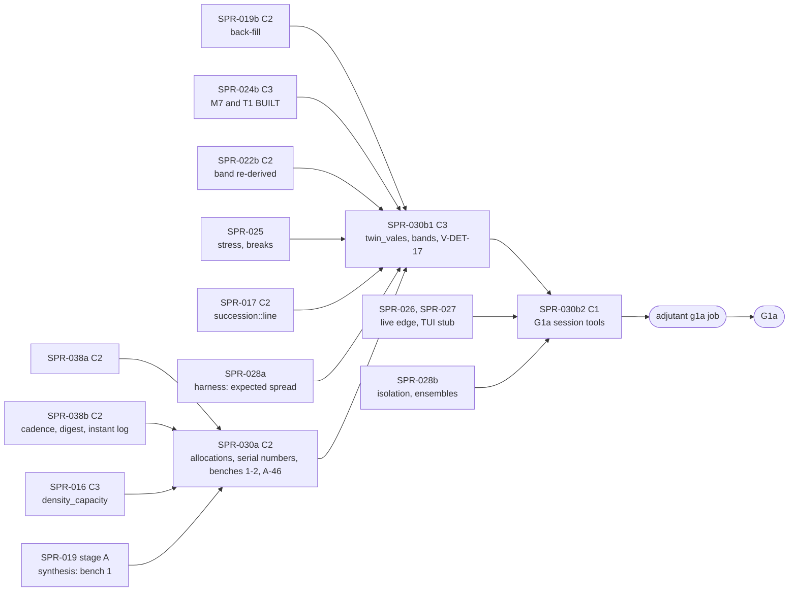

> **BLUF:** Closes P1.14 (`docs/11_roadmap.md:202`) and supplies most of G1a's scale evidence. **Priority 1** under D62 (the director's execution priorities of 2026-10-18: the engine core first, then the viewer, then era packs; `docs/decisions-log.md:7`): this plan carries G1a's determinism row on a dynastic fixture world (`:207`), its CRN row (`:210`), its envelope row (`:215`), its stream row's V-PERF-09 (`:218`) and its performance row (`:219`). Three stages, each its own PR, Tester pass and audit:
> - **Stage A, PR `SPR-030a`** (C2 with `[perf-baseline]`, by T-11's class: ruling G3), the machinery:
>   - `kingdom_10k` sets `density_capacity: 10000`, the C1 change REV-SPR-030 R1a reserved for this sprint (T-01);
>   - **BCK-002 A-32, part (i):** the machinery allocations of busy instants at 1 thread and the multi-thread level buffers to 0, stated as the delta after SPR-038a's quiet instant (T-02). **The persistent worker pool is not built here:** it becomes a P1b spike (ruling G2), because no P1a world has a parallel level and the workspace forbids `unsafe`;
>   - **A-45:** two serial numbers, the engine's overhead outside system jobs and the largest job's share, and the vitals line's per-run signals (T-03; ruling G7);
>   - **benches 1 and 2** at meso sizes (T-04; finding F-6);
>   - **A-46, the per-draw overhead** (T-11, moved here from the deleted stage M: ruling G1): a per-term callgrind breakdown first, then `PurposeId` cached in the spec purpose and the stream-reuse guard redesigned, with every draw bit-identical (G3).
> - **Stage B1, PR `SPR-030b1`** (C3: the golden-world corpus changes), the worlds:
>   - **`twin_vales` becomes the fifth golden world** (D57 item 3: no `manor` golden before this sprint), with its 300-year debug soak in the nightly under SPR-038b's inventory gate (ruling G8); thread invariance on it is declared vacuous, because every level is serial, and `smoke` stays the evidence (G8);
>   - **the population bands:** `twin_vales` and capped `kingdom_10k` against `specs/worldgen/project_population.py`'s regenerated golden, read by key and never typed (ruling G4), with a spread rule stated before the run;
>   - **V-DET-17 on the engine** by `specs/determinism/crn_pairing_v0.md` §6, at the seeds A-62's ruling E4 sets, with four engine mutants that must each fail for their own reason; the protocol's "Promote and Demote records" do not exist in channel A (finding F-1).
> - **Stage B2, PR `SPR-030b2`** (C1), the G1a session:
>   - `bin/g1a_scale.sh` in a **separate `adjutant` job** without `check_all` and with `timeout-minutes: 300` (ruling G20);
>   - **the G1a verdict pre-registered** (ruling G5): engine-only `rh-cli run kingdom_10k --years 1000 --check-cadence yearly`, no run directory, no viewers, 8 threads on one vCPU per physical core, 5 runs per seed at seeds 1–3, the verdict on the medians;
>   - V-PERF-09 measured separately with viewers and 5 paired runs; **A-67** by a rule whose byte clause is V-PERF-09's restated bound (ruling G6); **A-60 at scale** with T-08 (h)'s **measurement-gated residual**: if the run loop's digest still exceeds 10% of the G1a run after SPR-038b, BCK-002 A-68 is the follow-up (ruling G1); the named bound as a year-end sample; V-SCALE-01 at 10k; V-SAGA-15's stored bytes over 100 years; bench 3; D40's evidence.
>
> **What is no longer here** (REV-WAVE8, the Architect's rulings of 2026-10-18): **stage M is deleted** (G1). The incremental, hash-identical run-loop digest is SPR-038b's T-06, including `StreamHost::collect`'s second hash (SPR-038 ruling T2), and its residual is BCK-002 A-68, filed by SPR-038 (ruling T1) and decided here on T-08 (h)'s measurement. There is no SPR-030m. **The pool** is a P1b spike (G2).
>
> **Baselines.** Stage A moves no ladder (`smoke`, `solo`, `household`, `hamlet` byte-identical, an acceptance criterion) and re-records `allocations_v1.txt` lower and `instructions_v1.txt` with benches 1–2 and the draw cost (`[perf-baseline]`). Stage B1 **adds** `worlds/twin_vales/baselines/twin_vales_yearly_<Y>y.ladder` by `bin/regen_baseline.sh twin_vales` in its final `[C3]` commit, and a `rung twin_vales` allocation line; the four existing baselines are byte-identical; the corpus change is announced to the director before the merge (`docs/13` §4.2). Stage B2 moves nothing.
>
> - **Developer:** AGT-002-CORE (stage A's engine work in `rh-core` and `rh-sys-demography`; the engine mutants; the world's registration), with AGT-002-TOOLS for the benches, `perf_gate.py`, the CRN harness, the band and byte tools, the session script and its job. One Developer session may hold both roles.
> - **Testers, per stage:** AGT-003-DET (byte and draw identity, the ladders, the CRN pairs and mutants, the golden world), AGT-003-STAT (the band rule, the CRN statistic, the named bound, V-SAGA-15's measure, the verdict's statistics) and AGT-003-IF (the vitals format, `perf_gate.py`'s new gates, V-PERF-09's terms, A-67's measurements, the `adjutant` job). One session may hold them, on a different model from the Developer's.
> - **Size and class:** **about 10–12 agent-days** by the task inventory (ruling G22): **stage A about 3.35–3.85** (T-01 0.1, T-02 1.0, T-03 0.5, T-04 0.75, T-11 0.75–1.0, T-05 0.25–0.5), **C2** with `[perf-baseline]` if every draw stays bit-identical, else T-11 leaves the stage as its own C3 PR (G3); **stage B1 about 3.25–4.0** (T-06 1.75–2.0, T-07 1.25–1.5, T-09 0.25–0.5), **C3** by the corpus change; **stage B2 about 3.25–4.0** (T-08 3.0–3.5, T-13 0.25–0.5), **C1**. Each stage is near GOV-005 §3's norm of about 3; B1 and B2 are the split of the old stage B that the review asked for (D61 item 1). T-10 and T-12 were stage M's and are retired with it; their numbers are not reused.
> - **Status:** PLANNING, **revision 1**. Revision 0 (`dc39967`) had an independent review (REV-WAVE8: 0 BLK, 8 MAJ, 14 MIN across the three plans and D61; for this plan 3 MAJ, 6 MIN), and the Architect's rulings G1–G22 of 2026-10-18 are applied here (the last section maps each). It is written against `main` at `1950df8` (SPR-038's plan revision 3 and REV-SPR-038 closed, D60; D62; **A-62 merged as PR #94**, with its review's rulings E1–E12 and the regenerated fixture, projection and CRN goldens), PR #89 (`a4be717`, A-63's third CI part) and the revision-1 drafts of wave 7 (`b2c6fb1`: SPR-021a/b, SPR-022a/b) and the minds (`f791a38`: SPR-023, SPR-024a/b, SPR-025), with the cross-plan rulings X1–X13. It needs the director's plan approval (D61; GOV-005 §2: C2 and C3 work).

# SPR-030 — Determinism and performance at scale (WP P1.14)

- **Roadmap item:** `docs/11` P1.14 (`docs/11_roadmap.md:202`: "Golden runs on the M1/M2/M7 world (1,000 years); CRN pairing test (ADR-0026); meso benches (≤ 50k persons, ≤ 2,000 named actors) and `bench/serial_fraction`. The synthetic 1M benches move to Later with P3.10") · **Phase:** P1a; G1a's determinism (`:207`), invariants (`:208`), CRN (`:210`), envelope (`:215`), stream (`:218`) and performance (`:219`) rows; PRJ-002 §5.
- **Depends on, by task** (ruling G19; the split sprints of X8 and SPR-038's two stages; "merged" means on `main`):

| Task | Needs merged | Why |
|---|---|---|
| T-01 (stage A) | SPR-016 | The Registry carries `density_capacity` (`specs/systems/next/registry_delta.toml:15, :20`); the validator refuses the parameter until then (`specs/worldgen/fixture_worlds.md:131`) |
| T-02 (stage A) | SPR-038a | Its quiet instant at 1 thread is the starting point; T-02 states only the delta (G2) |
| T-03 (stage A) | SPR-038a | The vitals' timing points sit in the run loop SPR-038a rewrites |
| T-04 (stage A) | Bench 1: **SPR-019 stage A** (a synthesised world held at genesis); bench 2: none | Bench 1 measures M2 over a synthesised population (G19) |
| T-11 (stage A) | SPR-038b | Both edit `StepCtx` (`crates/rh-core/src/system.rs`): SPR-038b adds the instant log's readers there; T-11 then starts from that file (a textual order, not a semantic one) |
| T-06 (stage B1) | SPR-019b; **SPR-024b** (M7 and T1 join `BUILT` together: X6); SPR-025; SPR-022b (the band re-derived after it: G4, K21); SPR-028a (the expected-spread function of its harness contract) | Before 024b `rh-cli run twin_vales` runs M1, M2 and S3 only (REV-WAVE8 G19); a golden world must not move again under SPR-025's T1 change |
| T-07 (stage B1) | SPR-017 (`succession::line`); SPR-019b; SPR-024b | The affected set's line at genesis; the sovereigns' deaths under M7 and T1 |
| T-08 (stage B2) | Stage B1; SPR-038b (`--check-cadence`, `Engine::check_now()`, the incremental digest); SPR-026 and SPR-027 (the live edge, the stalled consumer, the TUI stub); SPR-020 (the envelope's tables); SPR-028b (its ensembles share the session) | The session measures the G1a build |

  - **D56 settled** (approved 2026-10-17): agnatic membership, vocations for later children, and A-62's elite read on the couple. The population band reads the projection under exactly that configuration, as A-62 regenerated it (PR #94).
  - **What the dependencies mean for the order** (X9, G19): stage A can land as soon as SPR-016, SPR-019 stage A and SPR-038b are on `main`, in any gap between C3 merges; B1 is the last C3 of P1a; B2 follows B1 and SPR-028b, and the `adjutant` session follows B2.
- **Binding contracts:**
  - `specs/worldgen/fixture_worlds.md` 0.5.1 (A-62's 0.5.0, and this revision's F-22 correction): §1 (`:7–21`), §2 (`twin_vales`, `:23–85`; the crude rates `:61`), §3.1–§3.3 (`kingdom_10k` `:87–99`, the named rule and the bound `:101–107`, the projection `:109–133`, R1a `:133`), §4 (`:135–147`), §5 D-01 to D-11 (`:149–163`), §6 (`:165–171`); `specs/manifest/examples/twin_vales.yaml`, `kingdom_10k.yaml`; `specs/worldgen/selftest_fixture_worlds.py`, `golden/fixture_worlds_v0.txt`; `specs/worldgen/project_population.py` and `golden/population_projection_v0.txt`, whose `baseline world twin_vales capacity default` and `baseline world kingdom_10k capacity 10000` blocks (D56's reading: `rule agnatic vocation later elite_read couple`, `regime t1`) the band reads by key, as A-62 regenerated them; REV-SPR-030 R1–R28.
  - `specs/determinism/crn_pairing_v0.md` 0.4.1 (0.4.0 is A-62's, with its review's E4: the tiers search seeds; 0.4.1 is this revision's F-22 sentence): §2 (`:11–15`), §3.1 and the tiers (`:19–29`, `:23`), §3.2 (`:31–42`), §3.3 (`:44–54`), §3.4 (`:56–70`), §4.3 the results (`:88–99`), §4.4 the controls (`:101–111`), §5 D-03 (`:119`) and D-08 (`:124`), §6 the Developer's run (`:126–131`); `selftest_crn_pairing.py` (`HORIZON_YEARS = 10` `:104`, `MIN_WINDOW_YEARS = 5` `:109`, `MIN_INFORMATIVE = 100` `:110`); `golden/crn_pairing_v0.txt` as A-62 regenerated it, whose `pair VALID` and `pair SKIPPED` lines name the reference's VALID and skipped seeds (`crn_pairing_v0.md:99`).
  - `docs/08` §1.3 (`docs/08_performance_and_capacity.md:67–86`), §1.4 (`:93`), §9 benches 1–3 (`:236–238`); `docs/09` V-DET-01, V-DET-02, V-DET-05, V-DET-12, V-DET-17 (`:115`), V-INV-02 (`:126`), V-INV-12 (`:136`), V-GOLD-01 (`:148`), V-PERF-04 (`:210`), V-PERF-09 (`:215`), V-PERF-11 (`:217`), V-DATA-04 (`:267`), V-SAGA-15 (`:420`), V-SCALE-01 (`:659`), V-SCALE-03 (`:661`); `docs/03` PERF-2 (`:243`), PERF-5 (`:246`), SIM-1 (`:44`).
  - `specs/stream/wire_v1.md` §6.1 (D42 (b), `:213–221`), §9's V-PERF-09 row (`:315`) and "the engine never waits" (`:316`); `specs/chronicle/envelope_v0.md` §9 (`:183–186`).
  - **SPR-038's plan** (`CODEX/05_PROJECT/SPR-038_PerInstantCost.md`, revision 3, on `main`): stage A's `ColumnId` slots, exact gating and zero allocations on a quiet instant (`:18–28`); stage B's `--check-cadence {every-change,yearly}` (default `every-change` in every build, `yearly` opt-in for G1a, recorded in `run.toml` and in the ladder header only when not the default), `Engine::check_now()`, the refusal of a cross-cadence replay (`:30–36`), the incremental digest with append marks and one digest per stop (`:37–40`, T-06 `:358–389`), the instant log (`:41`); its G1a arithmetic (`:159–172`: 35–71 s of digest per 1,000 years without a run directory, 70–142 s with one, "necessary, not sufficient") and A-68 (`:470`).
  - `crates/rh-bench` (`benches/alloc_budget.rs:1–30`; `baselines/allocations_v1.txt:9`; `baselines/instructions_v1.txt:12–16`: `raw_draws/raw_1000` 552,039, `step_draws/empty` 16,611, `rng_epoch0_1000` 1,257,191, `rng_epoch1_1000` 1,519,576), `bin/perf_gate.py` (`BENCH_TARGETS` `:70`, `ALLOC_GATED` `:574`), `bin/wall_trend.py`, `bin/bench_session.sh`, `.github/workflows/adjutant.yml` (its `session` job runs `bin/check_all.sh` then the bench session, `timeout-minutes: 120`, `:28–31`); `crates/rh-core/src/observe.rs:1–30`; `crates/rh-golden/src/vitals.rs`.
  - `bin/regen_baseline.sh` (`worlds="${1:-smoke solo household hamlet}"`, `:31`), `bin/golden_nightly.sh` (the debug soak list, `:107–115`), `bin/check_baseline.py`, `.github/workflows/nightly.yml` (the golden job, `timeout-minutes: 45`, `:91`), `worlds/hamlet/world.toml` and `inputs.toml` (the golden-world pattern).
  - BCK-002 1.21.1: A-32 (`:52`), A-45 (`:65`), A-46 (`:66`), A-60 (`:80`), A-62 (`:82`), A-63 (`:83`), A-66 (`:86`), A-67 (`:87`); A-68 as SPR-038's plan files it; `VER-SPR-026-TEST` GAP-1 (`origin/sprint/SPR-026-stream-v1`, `1a10dd2`).
  - ADR-0006, ADR-0025 item 3, ADR-0026, ADR-0030, ADR-0031; GOV-005 §6; GOV-008 (`:25`, `:30–31`: `adjutant` on demand; the Free plan's "about 2,000 Actions minutes a month", "nightly work runs on `adjutant`") and RUN-002 (`:23`: 16 vCPU = 8 physical cores; §5 `:74–77`: at least 5 runs per wall-clock bench, the median and spread).
- **System specs:** none changed by this plan. **Finding F-15** (stated, ruling G21): M2's `scale_behaviour` says the result is identical at every N "while the living count is at or under `density_capacity` (every P1a world)" (`specs/systems/next/M2.demography.odd.toml:544`, unchanged by A-62), but `kingdom_10k` starts at its capacity of 10,000 (R1a) and grows, so it runs above it from its first months; the parenthesis is false for the G1a world. **Proposed (8/10):** the Architect corrects it to "every P1a world but `kingdom_10k`, which runs at its capacity (R1a)" in the `next/M2` draft before SPR-015 freezes 0.3.0 (an `[[amends]]` record if the field is in the frozen slice); text only, no golden moves. This plan edits no system spec.
- **Rulings (binding):**
  - **REV-WAVE8 round 1, G1–G22** (the Architect, 2026-10-18), with SPR-038's S1–S16 and T1–T11, the cross-plan X1–X13 and A-62's E1–E12;
  - REV-SPR-030 R1 (a), R2, R3, R4, R7, R9, R10, R14, R16, R20, R22–R25;
  - D57 item 3; D56; RT-037 as adapted in SPR-019 0.3.1 T-07 (PR #87), with K21 (the manor band asserts only with the systems it was projected for, and is re-derived after 022b); D34; D42; D40;
  - REV-WAVE6 X1, X7, Z1; REV-WAVE5 W2, W3, X5; SPR-008's baseline rulings; SPR-009 rulings 2, 3 and 5.
- **Director items:** D61 (items 1, 2, 3, 5, 6, 8 and 9 touch this plan: the split, the corpus, the benches, A-67, the `adjutant` sessions and A-68, CI and the minutes, T-11's class and the pool).
- **Requirements covered:** DET-1, DET-2, DET-5 (the fifth golden world); DET-13; ADR-0026's CRN survival (V-DET-17); SIM-1 at 10k (V-SCALE-01); SIM-9's world (V-INV-12 on the fixture); PERF-4 (benches 1–2 in the regression gate); PERF-5's P1a variant (V-PERF-09); SAGA-10 (V-SAGA-15's P1a variant); the G1a performance default (`docs/11_roadmap.md:219`); V-PERF-11.

## Specs this sprint needs

| Spec | Exists? | Gap | Architect ruling | Needed by |
|---|---|---|---|---|
| **`kingdom_10k`'s capacity** | `fixture_worlds.md:131` and D-04 (`:154`) | None once SPR-016 is on `main` | **Ruled (REV-SPR-030 R1a).** Genesis does not read it, so `fixture_worlds_v0.txt` does not move; the projection already models the capped case | T-01 |
| **A-32's machinery allocations, part (i)** | V-PERF-11 (`docs/09:217`): "≤ the budget recorded per bench (default 0 for P0 machinery)"; `alloc_budget.rs:14–18` attributes each allocation to a site | Only the per-world totals are gated (`ALLOC_GATED`, `perf_gate.py:574`); SPR-038a takes a quiet instant at 1 thread to 0 at four sites (`SPR-038_PerInstantCost.md:27`) | **Ruled (G2, 85%).** Machinery means every site but `step <system>`. T-02 takes **busy instants** (births, deaths, due timers, commands) at 1 thread and the **multi-thread level buffers** at 4 threads to 0 allocations and 0 growths after the warm-up, stated as the delta from SPR-038a's figure; a per-site gate fails a machinery site above 0 by name. A residual the Developer cannot remove is recorded with its reason and ruled by the Architect | T-02 |
| **The persistent worker pool (A-32's other half)** | A-32 (`BCK-002_ArchitectBacklog.md:52`): "the pool must land before any real system runs hourly parallel levels" | `dispatch` runs `impl Fn + Sync` closures that borrow engine state (`crates/rh-core/src/engine.rs:1326–1350`); long-lived workers need `'static` jobs or lifetime erasure; the workspace sets `unsafe_code = "forbid"` (`Cargo.toml:22`) and `rh-core` takes no third-party dependency; and no P1a world has a parallel level (`--expect-serial` holds on every rung; the review's `hamlet` run: "526 levels, 0 with two or more jobs") | **Ruled (G2, 85%): not built in P1a.** A P1b spike (a reviewed dependency, or a dispatch redesign that owns its job data), before the first real system with hourly parallel levels, as A-32 says. BCK-002 A-32 is re-scoped by the Architect at this plan's approval | — |
| **The division of A-60 with SPR-038** | SPR-038's plan, revision 3, on `main` | Revision 0 of this plan was written against SPR-038 revision 0 (`fb5d68b`), where the digest was out of scope | **Ruled (G1, G9; 85%):** the table in "Division of A-60 with SPR-038" below. SPR-038a and SPR-038b own A-60's list and the run-loop digest; this sprint owns the rest of A-32 (i), A-45, A-46, benches 1–3 and the at-scale measurement, and decides A-68 on T-08 (h) | T-02, T-08, T-11 |
| **The run loop's digest after SPR-038b (formerly finding F-23)** | SPR-038b T-06: one plane-A `MerkleCache` across stops, also serving `StreamHost::collect` (`crates/rh-golden/src/stream.rs:540–551`; ruling T2), append marks, no clone except for keyframes and dumps; its arithmetic leaves 35–71 s per 1,000 years without a run directory (`SPR-038_PerInstantCost.md:159–172`) | F-23's count was right and SPR-038's earlier one short (36 digests a sim-year with a run directory today, `crates/rh-golden/src/run.rs:680`, `stream.rs:539–551`); SPR-038b's T2 makes it one per stop. Written log columns (the exit fields) and the agenda still re-hash | **Ruled (G1, 85%): no work here beyond a measurement.** T-08 (h) measures the digest's share of the G1a run after SPR-038b. **If it exceeds 10% of the run,** the follow-up is BCK-002 A-68: row-level dirty marks for log columns from the instant log's `inserted()` and `exited()` accumulated between stops, an incremental agenda digest, or `05.1` §6 item 6's release digest cadence (C3, because the ladder embeds the monthly chain); the Architect rules which, with T-08 (h)'s figures. No SPR-030m | T-08 |
| **The per-draw overhead (A-46; finding F-18)** | A-46 (`:66`): "about 690 per draw for the epoch lookup and the A-37 guard"; `instructions_v1.txt:12–16` | **A-46's attribution is incomplete** (REV-WAVE8 G3): at epoch 0 the epoch lookup misses an empty `BTreeMap` (`system.rs:455–459`), yet a draw costs 1,241 instructions against 552 raw. The per-draw terms are `purpose_id` (a linear `contains` over the declared purposes plus `PurposeId::of`, an `h64_bytes` of the purpose name, every draw: `system.rs:591–600`, `crates/rh-ids/src/rng.rs:125–131`) and the stream-reuse guard's `BTreeMap` insert per draw (`system.rs:567–589`, whose own comment calls it "most of a draw's cost") | **Ruled (G3, 75%).** T-11 begins with a **per-term callgrind breakdown** of `rng_epoch0_1000` and `rng_epoch1_1000`; then **`PurposeId` is cached in the spec purpose** (`PurposeId::of` is a `const fn`, so the generated purpose carries its id, and the declaration check moves to registration); **the guard's design is stated before code:** debug-only (compiled out of release as SPR-038b compiles out the write guards' value checks, with a test proving it), or per job (the `(purpose, entity)` pairs collected in a job-local vector, sorted and scanned once at the job's end). **Proposed (6/10): per job**, because the guard is a determinism refusal and release keeps it. **Class: C2 if every draw is bit-identical** (`gen_rng_golden.py --check`, the sampler goldens, `draws_golden`, the ladders); otherwise C3, and T-11 leaves stage A as its own PR (D61 item 9) | T-11 |
| **The serial numbers (A-45)** | A-45 (`:65`): the vitals' serial fraction "depends on the thread count and includes thread-spawn cost (90.7% at 1 thread, 47.8% at 4 on smoke)"; `docs/08` §1.3 (`:67–86`) | Revision 0's definition (the share outside levels with two or more jobs) is about 100% on every P1a world at 1 thread, since every level there is single-job (G7) | **Ruled (G7, 85%): two numbers**, both at 1 thread from the host's observer clock (tool plane; `observe.rs` carries no clock): **(1) the engine's overhead,** the share of wall time outside every system job (dispatch, merges, checks, the digest, the host's stops); **(2) the largest job's share,** the share of wall time in the single most expensive job of each instant, summed over the run (the bound on what parallel levels could save). At N threads the vitals line adds the parallel efficiency. The definitions go into `docs/08` §9 (the Architect's text) | T-03 |
| **Benches 1 and 2: their sizes (finding F-6)** | `docs/08` §9 (`:236–237`): `ledger_month_1M`, `timers_lifecycle_1M`, "From P1a"; §1.4 (`:93`) and PERF-2 (`docs/03:243`) | `docs/11` P1.14 (`:202`): "The synthetic 1M benches move to Later with P3.10" | **Accepted (round 1; D61 item 3, 70%):** meso sizes with the bench 7–8 pattern: instruction counts at 10k in the PR tier, wall clock at 50k on `adjutant` (1M an optional wall case); PERF-2's binding value moves with the scale-up; `docs/08` §1.4 and §9 and `docs/03` PERF-2 amended | T-04 |
| **Bench 3's gate (finding F-7)** | `docs/08` §9 (`:238`): "Fails above 20%"; `docs/11` G1a (`:219`): "serial share reported" | In P1a M2's monthly pass is one job, so a 20% budget fails by construction | **Accepted (round 1; D61 item 3, 70%):** bench 3 reports at G1a, from the session, and gates from G1b, with G7's two numbers; it needs `kingdom_10k` (SPR-019b) and runs M2 only until SPR-024b (G19), so it moves to stage B2's T-08 | T-08 |
| **`twin_vales` as a golden world** | D57 item 3; `fixture_worlds.md:165`; G1a (`docs/11:207`) | The PR-tier length; whether `kingdom_10k` is golden; thread invariance on a serial world | **Accepted (round 1; D61 item 2, 75%):** `twin_vales` is the fifth golden world; the PR tier runs **Y = 300 years** yearly at 1 thread if one release run takes ≤ 20 s on a hosted runner (measured in T-06 and recorded in the PR), else **Y = 100**. **Thread invariance is declared vacuous on it** (G8): its dispatch line ("N levels, 0 with two or more jobs", `run.rs:37`, `:224`) is asserted, `smoke` (≥ 5% parallel levels) is the thread-invariance evidence, and the N-thread run is kept only in the weekly tier as a regression. **`kingdom_10k` is not a golden world;** **`manor` stays a test world** | T-06 |
| **`twin_vales`' debug soak (SPR-038 ruling S3)** | SPR-038b T-05: every world that registers a ledger-writing system has a debug run in `golden_nightly.sh`, and an inventory gate refuses a world without one; the gate binds `twin_vales` once it has a `worlds/` directory (ruling T8) | Revision 0 put the 1,000-year debug run weekly | **Ruled (G8, 85%):** T-06 adds `twin_vales` (300 years, debug, invariants every `Bookkeeping`) to the nightly debug soak beside `household` and `hamlet` (`bin/golden_nightly.sh:107–115`), in the same commit as `worlds/twin_vales/`, so SPR-038b's gate passes; the 1,000-year debug run stays weekly | T-06 |
| **`twin_vales`' committed input** | `worlds/hamlet/inputs.toml` ("a golden input must exercise the path it claims") | Which person | **Proposed (8/10): V-DET-17's input** at the PR-tier seed of T-07 (the first VALID engine seed in 1–4), placed at that seed's `T_IN`, so the golden run is the pair's run B and exercises ADR-0025 item 3 on a sovereign; if no seed in 1–4 is VALID, founder 0 as `hamlet`'s | T-06, T-07 |
| **V-DET-17 on the engine (finding F-1)** | `crn_pairing_v0.md` §6 (`:126–131`) | The engine's S extension reads "the Promote and Demote records of channel A" (`:52`, `:128`); none exists: M7's `[[emits]]` lists ten kinds (`specs/systems/next/M7.dynasty.odd.toml:349–385`) and `Promote` is a command to T1 | **Accepted (round 1; G4, 85%).** A release test in `rh-golden` steps both runs instant by instant and reads `person.named` from the engine's tables after every instant (a test host, never engine code: X1); everyone named at any instant joins S. N4's candidate lists are replayed before each Month pulse by **the same function M2's partnering step calls** (`rh-sys-demography`, made `pub` and read-only), so the replay is not a second implementation (G4). `crn_pairing_v0.md` §3.3 and §6 amended (the Architect's text). **The seeds are A-62's ruling E4:** the PR tier takes the first VALID engine seed in 1–4; E4's nightly rule (at least 2 VALID seeds, searching seeds 1–12) runs in the weekly tier for the minutes (G20); every SKIPPED seed's run-A deaths digest is pinned (R25) | T-07 |
| **The CRN engine mutants** | `crn_pairing_v0.md` §4.4's five model mutants on the reference (`:101–111`, its outcome table regenerated by A-62) | The engine needs its own, compiled out of every baseline build (A-52) | **Proposed (8/10): four `mutant-*` features, weekly,** on the PR-tier seed's run A, each failing for its own reason (R25): `mutant-crn-noop-input`, `mutant-crn-global-epoch`, `mutant-crn-position-key`, `mutant-crn-rekey-2pct` (T-07). The reference's `shift-one-day` stays the reference's | T-07 |
| **The population band rule** | RT-037 as adapted (SPR-019 0.3.1 T-07); `project_population.py`'s docstring (`:58`); `docs/09` §1.2 rule 2 | Revision 0 typed the projection's numbers, which A-62 regenerated (G4; PR #94), and its noise term divided by P(y) for both sexes, which understates a single seed's spread (the drafter's re-check below) | **Proposed (7/10), pre-registered here; no number is typed.** `population_band.py` reads P(y) from the regenerated golden's block (`baseline world <w> capacity <c> …`, line `year <y> population 
`) and the expected spread from SPR-028a's harness (`expected_spread`, the single builder). The band at year y is **ln N(y) − ln P(y) ∈ [−h(y), +h(y)]** with h(y) = 5 s(y) + ε(y), where **s(y)² = (b + d)(1 − e^(−r y)) / (r F₀)** is the relative variance of a linear birth-and-death process (F₀ the women alive at the start, b and d the stationary crude birth and death rates of the compiled schedule at the golden's `r_c`), 5 = four standard deviations times 1.25 for what the formula omits, and ε = 5% per century of horizon (uncapped) or a flat 5% (capped). **Checked by the drafter** against a female-line Leslie Monte Carlo of the compiled e0-30 schedule (the review's `mc.py`, 1,000–2,000 replicates): the formula's s(y) is within 5% of the simulated sd of ln N at 100–500 years and 15% low at 1,000 years for 500 women, hence the 1.25. **The band asserts only when the run's registered systems are M1, M2, S3, M7 and T1** (read from the ladder header's `systems` line), else it reports NOT APPLICABLE by name; it is re-derived from the golden as regenerated after 022b (G4, mirroring K21) | T-06, T-08 |
| **The named bound's measurement** | `fixture_worlds.md:107` (R7) | Observers carry no state (`observe.rs:8–12`); a per-instant count is O(rows) per instant (X1) | **Accepted (round 1; G5):** the host counts `person.named` at each yearly stop; **the bound is a year-end sample**, so the assertion is "the maximum of the year-end counts ≤ 500", stated as such. On a fail, `dormancy_degrees` drops to 1 (a C1 manifest change) | T-08 |
| **V-SAGA-15's P1a variant (finding F-17)** | `envelope_v0.md:186` ("fixed here for SPR-030"); SPR-020 `:325` | PRJ-002 §5 gave the variant to SPR-020 and SPR-025 | **Accepted (round 1; G21):** `bin/envelope_bytes.py` (T-08) implements §9's measure, its reference being check 6 of `selftest_envelope.py`; PRJ-002 §5's row is corrected in this revision | T-08 |
| **The fixture worlds' event rates (finding F-22)** | `fixture_worlds.md:61`, `:99` and `crn_pairing_v0.md:99` said 2.1% a year (A-62 kept it) | The 2.1% is a closed cohort's rate from an M2-only run with no births; the review reproduced a stationary CDR of 3.28% at e0 29.95 | **Accepted (round 1) and done in this revision, at the Architect's instruction** (C0, specs prose; no golden reads it): `fixture_worlds.md` 0.5.1 (`:61`, `:99`) and `crn_pairing_v0.md` 0.4.1 (`:99`) give the stationary rates (about 3.3% deaths and 3.4% births a year at e0 30) and say why the reference's rate is lower. T-08 records the measured crude rates of `kingdom_10k` beside them | T-08 |
| **V-PERF-09's memory term (finding F-5)** | `wire_v1.md:315` | The seal queue is uncounted (`VER-SPR-026-TEST` GAP-1: peak 16.0 to 25.0 MB on `solo` while `LiveEdge::bytes()` said 1.84 MB) | **Accepted (round 1; G6, 75%):** the seal queue is a stated term of the bound, counted with SPR-009's counting allocator; `wire_v1.md` §9 restated by the Architect (no wire byte changes) before T-08 | T-08 |
| **A-67: when the live edge needs a byte cap** | A-67 (`:87`) | Revision 0's two clauses were 50 times apart (about 1 MB of records a year at 10k makes 64 MiB about 85 unsealed years, so the byte clause never fired first), and its outcome left V-PERF-09's verdict open (G6) | **Ruled (G6, 75%; D61 item 5):** A-67 **fires** if, on `kingdom_10k` at seeds 1–3 over 1,000 years with V-PERF-09's viewers attached, the unsealed years exceed 4 at any instant, or **V-PERF-09's restated memory bound** (window + seal queue + V × 1 MiB + the thread allowance) fails. **If A-67 fires, V-PERF-09 is FAIL at G1a until the cap lands** (a D42 amendment: option (b) with a byte cap under which the host thread waits for its own seal, never for a viewer; a reviewed `wire_v1.md` §6.1 change before any code; a follow-up C2 sprint), **unless the director waives it.** This sprint measures; it does not build the cap | T-08 |
| **The G1a verdict (ruling G5)** | `docs/11:219`: "≤ 60 s on 8 cores"; RUN-002 §5 | Revision 0 left open which time, which seeds, which topology and which statistic | **Ruled (G5, 80%), pre-registered before the session:** `rh-cli run kingdom_10k --seed s --years 1000 --threads 8 --check-cadence yearly`, **engine only** (no `--run-dir`, no `--socket`, no viewers; `--out` to a ladder), on `adjutant` with **one vCPU per physical core** (`taskset` to 8 vCPUs on distinct cores, the sibling map from `lscpu -e` recorded in the report), **5 runs per seed at seeds 1–3** (RUN-002 §5), **PASS iff each seed's median is ≤ 60 s**; every run's time, the spread and the medians printed. V-PERF-09 is measured separately (T-08 (f)) | T-08 |
| **What a missed 60 s means** | `docs/11:219` | This sprint measures; SPR-038 optimises | **Accepted (round 1):** T-08 records the verdict with every term (the two serial numbers, the per-instant cost, the digest's share, peak RSS). A miss is a G1a finding: A-68 (if (h) says the digest is the cause), another follow-up, or the director's go / iterate call; it does not hold this sprint open. The criterion is not relaxed here | T-08 |
| **The session's job (ruling G20)** | `.github/workflows/adjutant.yml`'s `session` job runs `bin/check_all.sh` (30+ minutes) and the bench session before any appended step, within `timeout-minutes: 120` (`:28–31`) | The G1a runs and ensembles are about 3–5 hours (the review's estimate: `kingdom_10k` 32 seeds × 1,000 years is 4 waves of 5–30 minutes) | **Ruled (G20, 80%):** a **separate `g1a` job** in `adjutant.yml` (a `workflow_dispatch` input selects it), **without `check_all`**, `timeout-minutes: 300`, running `bin/g1a_scale.sh` and then SPR-028b's `bin/g1a_ensembles.sh`; the `session` job is unchanged | T-08 |
| **CI (X10, G20)** | PR #89's three parts; its first run: core 10:00, golden 7:10, stream 7:32 | Revision 0 stated two parts | **Ruled (G20, 80%):** the "CI by part" section below | T-05, T-09, T-13 |

## Division of A-60 with SPR-038 (ruling G1, G9)

| Item | SPR-038 (revision 3, on `main`; D60) | This sprint |
|---|---|---|
| Owned columns by `ColumnId` slots; compaction, `Ledger::check`, the invariants and the lagged snapshot only after a change; O(N + L) checks; positional compaction; zero allocations and no `format!` on a quiet instant at 1 thread | **SPR-038a** builds (its T-01 to T-04), with the `instant` bench | Measures at scale (T-08 (h)) |
| The check cadence as a run parameter (`--check-cadence {every-change,yearly}`), `Engine::check_now()`, the cross-cadence refusal; the write guards' value checks compiled out of release; the debug-soak inventory gate | **SPR-038b** builds (T-05) | Runs the G1a verdict with `--check-cadence yearly` (G5); (c)'s replay with the recorded cadence; adds `twin_vales` to the soak (T-06) |
| **The run loop's digest:** one cache across stops, `StreamHost::collect`'s second hash (ruling T2), append marks, no clone except for keyframes and dumps | **SPR-038b** builds (T-06) | **Measures its share at scale (T-08 (h)); above 10% of the run, A-68 is the follow-up** (G1) |
| A-68 (an incremental agenda digest; row-level dirty marks for written log columns; the release digest cadence, C3) | Filed unconditionally (ruling T1) | Decided on T-08 (h)'s figures, by the Architect |
| The instant log (`inserted()`, `exited()`), the `DropReason` change | **SPR-038b** builds (T-07) | Nothing here (SPR-028b's residence forcer reads `inserted()`) |
| Machinery allocations: busy instants at 1 thread; the multi-thread level buffers | — | **Builds** (T-02 (i)) |
| The persistent worker pool | — (its out-of-scope list, `:472`) | **Not built in P1a** (G2): a P1b spike |
| A-46, the per-draw overhead | — | **Builds** (T-11, stage A) |
| A-45's serial numbers; benches 1–3 | — | **Builds** (T-03, T-04; bench 3 in T-08) |
| The G1a verdict (≤ 60 s) | "Necessary, not sufficient" (`:52`) | **Records** (T-08 (a)) |

SPR-038a lands before stage A's T-02 and T-03; SPR-038b before T-11 and stage B2 (the dependency table).

## CI by part (X10; ruling G20)

**The base** is PR #89's first CI run (`a4be717`): **core 10:00, golden 7:10, stream 7:32**, with SPR-038a's and SPR-038b's own additions on top. Sums are gate sums on one runner; the ×1.5 column is the slow-runner budget. **Run-directory readers go to `stream`**, which builds its own release `rh-cli` and its own `solo`, `household` and `hamlet` run directories (`stream_inputs`, `bin/check_all.sh` on PR #89).

| Stage | Part `core` | Part `golden` | Part `stream` | ×1.5 (core / golden / stream) |
|---|---|---|---|---|
| A | +2 s: the vitals format tests; T-11's unit tests | +55 s: benches 1–2 under valgrind in `perf_gate.py gate`, run twice by the repeatability gate (+50 s); the machinery-site gate in `alloc-gate` (+5 s) | — | +3 s / +83 s / — |
| B1 | +3 s: the CRN harness's and the band's unit tests and controls | +31 s: `twin_vales`' Y-year run at 1 thread (≤ 20 s by the golden-world row's rule) and its baseline gate; the CRN pair at the PR-tier seed (two 10-year runs and the analysis, about 10 s) | — | +5 s / +47 s / — |
| B2 | +3 s: `envelope_bytes.py`'s unit tests and its `budget-bloat` control; `g1a_scale.sh --dry-run` | — | +3 s: `envelope_bytes.py` on `hamlet`'s run directory (reported, the tool's smoke check) | +5 s / — / +5 s |
| **Total** | **+8 s** | **+86 s** | **+3 s** | **+12 s / +129 s / +5 s** |

**Off the PR tier, and the minutes (GOV-008).** The Free plan gives "about 2,000 Actions minutes a month" and says nightly heavy work runs on `adjutant` (`GOV-008_Infrastructure.md:31`). The last scheduled nightly (run `39015254184`, 2026-10-17) took **43 minutes** (golden 32.2, ignored tests 10.4), so a daily hosted nightly already costs about 1,300 minutes a month when `main` moves every day. This plan therefore adds:
- **to the daily nightly, only S3's obligation:** `twin_vales`' 300-year debug soak in the golden job's debug-soak loop, which had 12.8 minutes of headroom under its 45-minute timeout on that run. The Developer measures it on a hosted runner; above 8 minutes, the Architect rules between a 100-year nightly soak with the 300-year run weekly and a timeout raise;
- **a weekly hosted workflow `.github/workflows/dynastic.yml`** (a `schedule` once a week and `workflow_dispatch`, `timeout-minutes: 45`): `twin_vales`' 1,000-year monthly ladders at 1 thread × 3 and at N threads once (the dispatch line asserted; G8), the yearly cut of a Y-year monthly run equal to the baseline (GAP-6), three 300-year run directories (seeds 1–3) with replay, sift and the twin, `check_segments.py`, V-DATA-04, V-INV-12's genealogy clause and the band, the 1,000-year debug run, the CRN search (at least 2 VALID seeds in 1–12) and the four CRN mutants' builds, and stage A's machinery-control build. About 4.3 runs a month: **at most about 195 minutes a month at its timeout**, about 130 at an expected 30 minutes;
- **the session on `adjutant`** (T-08), which costs no hosted minutes.

The Actions timing API reports 0 billable ms for run `39015254184`, so whether these minutes are charged needs the director's billing page; the plan budgets against GOV-008's figure as written (D61 item 8).

## Compliance (every task)

| Rule | This sprint |
|---|---|
| Change class (`docs/13` §4.2) | **Stage A: C2** with `[perf-baseline]`: T-11 is RNG machinery (`docs/13:97`: "any change to the determinism machinery itself (RNG, …)"), routed as C2 by the Architect's ruling G3 because every draw stays bit-identical; if any draw moves, T-11 leaves the stage as its own C3 PR and stage A is C1. T-01 to T-04 are C1 (no contract, Registry or plane-A behaviour change; the manifest's capacity line moves no golden). **Stage B1: C3** by the corpus change ("or one that changes the golden-world corpus, is announced"); no existing `state_hash` moves; it contains C1 (the CRN harness, the band tool) and test-only `mutant-*` features. **Stage B2: C1** (tools, a workflow job, measurements) |
| Planes touched (ADR-0024) | **A:** `rh-core` (stage A: level and phase buffers; the draw path and the guard; stage B1: one mutant feature), `rh-sys-demography` (N4's candidate-list function made `pub` and called by the step; two mutant features), the generated skeletons (the cached `PurposeId`, by `bin/gen_skeletons.py`). **Tool:** `rh-bench`, `rh-golden` (the vitals, the CRN test, the yearly named count, `twin_vales`' registration), `bin/` (`perf_gate.py`, `regen_baseline.sh`, `golden_nightly.sh`, `population_band.py`, `envelope_bytes.py`, `g1a_scale.sh`), `specs/manifest/examples/kingdom_10k.yaml`, `worlds/twin_vales/`, the workflows. **B, C:** none |
| Owned columns written | None new. Stage A changes how the engine moves data, never what a system writes |
| Reads (via `rh-contracts`) | None new. The CRN test and the named count read `engine.tables()` between instants, in the host |
| RNG purposes added | None. T-11 caches existing purposes' ids; the mutants re-key existing purposes by design and never reach a baseline (A-52) |
| Golden-hash effect | **Stages A and B2: none** (`smoke`, `solo`, `household`, `hamlet` byte-identical at 1 and N threads, headers included; every `draws_golden` line equal). **Stage B1: one baseline added** (`twin_vales`); the four others byte-identical |
| Fixed-point quantities | None new. The band and the CRN statistic are computed in the tool plane: ρ² exactly in rationals (`crn_pairing_v0.md:66`), the band with its inputs printed |
| Determinism lints (GOV-003 §2, §6) | Must pass. No new dependency; no `unsafe` (`Cargo.toml:22`); no thread pool (G2); the merge order and `Notice::worker` (`k % threads`) unchanged |
| Tests that gate this sprint | V-PERF-11 (the machinery sites at 0), V-PERF-04 (benches 1–2; the draw cost), V-DET-01 and V-DET-02 (`smoke` with the new buffers; `twin_vales` in the weekly tier; 10k in the session), V-DET-05, V-DET-12, V-DET-17, V-GOLD-01 (five worlds), V-INV-02 (the nightly soak), V-INV-12's genealogy clause, V-DATA-04 (P1a variant), V-SCALE-01 (10k), V-SCALE-04, V-SAGA-15 (P1a variant), V-PERF-09 (P1a variant, under G6's rule), plus `bin/check_all.sh`. **Reported, not gated:** bench 3, the G1a time's terms (the verdict is recorded, G5), A-67's measurements, A-60 and the digest at scale, D40's evidence, the realised counts of `fixture_worlds.md` §6 |
| Docs updated in the same stage | `bin/check_all.sh` and `python/tests/test_check_all_inventory.py` (same commit); `CLAUDE.md` (benches, the site gate, `twin_vales`' runs and baseline line, the CRN engine test, `population_band.py`, `envelope_bytes.py`, the session script); `docs/08` §1.3, §1.4 and §9 (F-6, F-7, G7: the Architect); `docs/03` PERF-2 (the director's ruling on F-6); `docs/09` V-PERF-09 (F-5's term), V-DET-17, V-SAGA-15 and V-SCALE-01 method lines; `wire_v1.md` §9 (F-5); `crn_pairing_v0.md` §3.3 and §6 (F-1); `fixture_worlds.md` §6; `worlds/twin_vales/README.md`; BCK-002 A-32 (part (i) done, the pool re-scoped to P1b), A-45 and A-46 (done), A-60, A-67 and A-68 (measured; the outcomes); PRJ-002's rows |

**Rules carried from P0–SPR-019 (every task):**
- **Hash-neutral means byte-identical:** stage A's acceptance is the four ladders, every channel-A segment of the golden run directories, every `draws_golden` line and the tail snapshots byte-identical at 1 and N threads.
- **A positive control fails for the right reason;** every planted mutant fails a named check, and the plan says why it is observable.
- **A test input exercises the path it claims, and a probe asserts it:** the CRN pair's re-sample ran (S11's path, printed as the reference prints it); the band checks run on years the run reached and on a run with the systems it was projected for; the session's viewer was behind the window at least once; a "thread invariance" claim names a level with two or more jobs, or is declared vacuous.
- **No O(rows) work per instant** (REV-WAVE6 X1): the named count is yearly; the CRN test's per-instant reads are in a test host.
- **Mutants never make a baseline** (A-52); **baselines are regenerated only by their tools**, in the final commit, with `[C3]` or `[perf-baseline]` at the end of its subject and a `perf-baseline-reason:` line in the PR body.
- **No typed golden numbers:** every projection, fixture and CRN figure a gate uses is read from its regenerated golden by key (G4); a plan or PR may quote one only beside its golden line.
- **Python tests read no CI environment variable.**
- **CI time (W42, Z1, X10):** per part of three, ×1.5 for slow runners, against PR #89's base; each new gate in exactly one part; run-directory readers in `stream`.
- **Merge `origin/main` when main moves;** **batch pushes at task boundaries;** **one commit per task** (GOV-005 §4).

## Tasks

**Stage A** (`SPR-030a`) is T-01 to T-04, T-11 and T-05. **Stage B1** (`SPR-030b1`) is T-06, T-07 and T-09. **Stage B2** (`SPR-030b2`) is T-08 and T-13. T-10 and T-12 were stage M's and are retired (G1).

### Stage A: the machinery

#### T-01: `density_capacity: 10000` in `kingdom_10k.yaml` (R1a; 0.1 day)
- **Deliverable:** the line in `specs/manifest/examples/kingdom_10k.yaml`'s `systems: M2.demography` (with its comment: R1a); `fixture_worlds.md` §3.1's table and §6 say it is done.
- **Acceptance:** `manifest_v0.py validate` and the Rust loader accept the manifest (V-WC-04 parity unchanged); `selftest_fixture_worlds.py --tier pr` and `project_population.py --check` pass unchanged; `python/tests/test_fixture_worlds_cases.py` passes; no golden world moves.
- **Status:** [ ] not started

#### T-02: Machinery allocations to 0, part (i) (A-32; G2; 1.0 day)
- **Deliverable:**
  - **The delta after SPR-038a:** the per-instant and per-phase containers that a busy instant still allocates (the fired pulses, the due timers by system, the plan's levels, the merge buffers, the inserts' row buffers, the commands' queues) become engine fields reused with `clear()`, keeping their capacity; maps whose nodes allocate become sorted vectors. At 4 threads, the per-level result vectors of `dispatch` (`engine.rs:1326–1350`) are reused across levels; the `std::thread::scope` per parallel level stays (the pool is P1b, G2).
  - **The machinery-site gate:** `alloc_budget.rs` prints, per world and thread count, each machinery site's totals; `perf_gate.py alloc-gate` fails any machinery site above 0 allocations or 0 growths, naming the site; `alloc-record` writes the lower totals.
  - **A planted control:** `mutant-alloc-machinery` (a `String` allocated per busy instant in the merge) fails the new gate with its site named (built weekly, in `dynastic.yml`).
- **Acceptance:**
  - **Allocations:** after the 2-year warm-up, every machinery site of `smoke` at 1 and 4 threads and of `solo`, `household` and `hamlet` at 1 thread counts 0 allocations and 0 growths over the measured year, **busy instants included** (the probe counts the measured window's births, deaths, due timers and commands, each at least 1 on `hamlet`); `smoke` at 4 threads holds levels with two or more jobs (`--require-parallel 5`), so the multi-thread buffers are exercised; the per-world totals equal the systems' own step allocations; the planted control fails by name; the existing control (a system that zero-fills a buffer per tick) still fails the totals. The PR states SPR-038a's figures and this task's side by side.
  - **Hash-neutral:** the four ladders, the golden run directories' segments and the tail snapshots byte-identical at 1 and N threads; the thread-leak control (`--leak-thread`) and the parallel-level floor control still fail.
- **Status:** [ ] not started

#### T-03: The serial numbers and the vitals' per-run signals (A-45; G7; 0.5 day)
- **Deliverable:** the vitals line gains, at 1 thread, **(1) the engine's overhead** (the share of wall time outside every system job) and **(2) the largest job's share** (per instant, the single most expensive job's wall time; summed over the run, as a share), both from the host's observer clock; at N threads, the parallel efficiency; and GOV-006 §2's per-run signals: build, Registry version, manifest hash and seed, wall time, peak RSS, stream bytes per channel, keyframes written, the counters (SPR-015's). Each field is `key=value`, so readers parse by key (SPR-028's harness reads them so).
- **Acceptance:** on `smoke` at 1 thread both numbers repeat to 0.5 percentage point in three runs on one machine; both are defined at 1 thread, so a 4-thread run prints the parallel efficiency instead of them (A-45's old figure moved from 90.7% to 47.8% because it mixed the two); on `hamlet` (every level single-job) the largest job's share is printed and the old "outside two-job levels" figure is gone; a planted vitals line without `peak_rss` fails its format test; the counters change no hash (the SPR-015 observer check, repeated).
- **Status:** [ ] not started

#### T-04: Benches 1 and 2 at meso size (F-6; 0.75 day)
- **Deliverable:**
  - **Bench 1, `ledger_month`** (needs SPR-019 stage A): one Month instant of M2 over N living persons of a synthesised world held at genesis, M2 only; instruction counts at N = 10,000 in the PR tier (`BENCH_TARGETS`), wall clock at 50,000 (and 1,000,000 when the session's memory allows) in `bin/bench_session.sh`. It reports the instructions per draw (A-46's figure on a real step).
  - **Bench 2, `timers_lifecycle`:** `rh-core`'s agenda and lifecycle queues under stub systems: 10⁴ timers popped and their commands applied in `(phase, PersonId)` order in one month, and 4 × 10⁴ (the crisis load), instruction counts in the PR tier.
- **Acceptance:** the new cases are identical in two runs on one commit; a planted 15% slowdown in bench 1's hazard loop fails `REGRESSION ledger_month/…`; bench 1's draw count equals the living persons times the draws per person the M2 spec states for a Month pulse (`specs/systems/next/M2.demography.odd.toml:540`: one death draw each, one conception draw per married susceptible woman, one marriage draw per eligible unmarried woman), counted by the bench; the wall cases run in stage A's `adjutant` session (the existing `session` job) and are recorded as trend files.
- **Status:** [ ] not started

#### T-11: The per-draw overhead (A-46; F-18; G3; 0.75–1.0 day)
- **Deliverable:**
  - **First, the breakdown:** callgrind's per-function inclusive counts for `draws/step_draws/rng_epoch0_1000` and `rng_epoch1_1000`, attributed to `purpose_id` (the `contains` and `PurposeId::of`), the guard (`take`), the epoch lookup, `stream_key` and the raw draw, committed as `artifacts/perf/a46_breakdown.txt` and quoted in the PR before any code change. **If a term other than these dominates, the Developer stops and the Architect restates the target.**
  - **`PurposeId` cached in the spec purpose:** the generated purpose (`bin/gen_skeletons.py`, `lint_odd.py --rust`) carries its `PurposeId` as a constant (`PurposeId::of` is a `const fn`, `crates/rh-ids/src/rng.rs:125–131`), and the declared-purpose check moves to registration (a purpose of the system's own spec is declared by construction; a foreign purpose is still refused by name).
  - **The guard,** with its design stated in the PR's first commit (the specs table's row; proposed: per job): the `(purpose, entity, how)` uses collected in a job-local vector, sorted and scanned once at the job's end, refusing `StreamReuse` with the same message; or compiled out of release with a test that proves it.
  - **The epoch:** unchanged at epoch 0 (an empty-map miss); at epoch 1, one lookup per draw as now.
- **Acceptance:**
  - **Bit identity (the class condition, G3):** `bin/gen_rng_golden.py --check`, `bin/gen_sampler_reference.py --check` and the sampler goldens, `draws_golden` (every re-sample case), `bin/gen_skeletons.py --check`, the four ladders and `solo`'s and `hamlet`'s committed-input runs byte-identical.
  - **The cost:** at epoch 0 at most 1.5 × the raw draw (552 instructions), and at epoch 1 at most that plus the epoch lookup's measured cost; proposed 6/10, and restated after the breakdown if the breakdown says otherwise; the figure recorded either way.
  - **The guard still refuses:** the existing stream-reuse tests fail as before with the same message (a stream after a draw, a draw after a stream, in one step), including a reuse split across the job's first and last draw.
  - **A planted control:** `mutant-purpose-id-collide` (the cached id of one purpose replaced by another's) fails `draws_golden` by name.
- **Status:** [ ] not started

#### T-05: Stage-A gates, CI, docs, the `[perf-baseline]` commit (W42, Z1, X10; 0.25–0.5 day)
- **Deliverable:** the gates of the "CI by part" table's stage-A row; the final commit, subject ending `[perf-baseline]`: `allocations_v1.txt` by `alloc-record`, `instructions_v1.txt` by `record` (benches 1–2 added; the draw cost lower; bench 7, bench 8 and SPR-038's lines unchanged within R-8's band); the PR title `SPR-030a: … [perf-baseline] [C2]`, with a `perf-baseline-reason:` line; the inventory test; `CLAUDE.md`; the stage's docs.
- **Acceptance:** every gate in exactly one part; **CI:** within the stage-A row's ×1.5 budgets (+3 s core, +83 s golden); **nightly candidates if a part is over:** the repeatability re-run of benches 1–2 and bench 2's crisis case; no existing gate moves part. The Tester's pass and the audit are recorded in `VER-SPR-030-TEST` and `VER-SPR-030` (stage A).
- **Status:** [ ] not started

### Stage B1: the worlds

#### T-06: `twin_vales`, the fifth golden world; its soak; the population bands (G4, G8; 1.75–2.0 days)
- **Deliverable:**
  - `worlds/twin_vales/world.toml` (the manifest path and its pinned SHA-256, the Registry, the inputs), `inputs.toml` (the input row, written after T-07's run A at the PR-tier seed, with its probe record in comments as `hamlet`'s), `README.md`; `rh-golden`'s registration; `bin/regen_baseline.sh` gains `twin_vales` (Y years, 1 thread, `--expect-serial`, since every level is serial).
  - **The PR tier** (part `golden`): the Y-year yearly run at 1 thread into `$GOLDEN/twin_vales_run`, `check_baseline.py` against the new baseline, the dispatch line asserted ("0 with two or more jobs"); Y by the golden-world row's measurement.
  - **The nightly debug soak** (S3, G8): `twin_vales` for 300 years in `bin/golden_nightly.sh`'s debug loop (`:107–115`), invariants every `Bookkeeping`, in the same commit as `worlds/twin_vales/`, so SPR-038b's inventory gate passes on this PR.
  - **The weekly tier** (`.github/workflows/dynastic.yml`, new; the "CI by part" section): `bin/golden_nightly.sh --world twin_vales` (the script refactored into per-world functions), the 1,000-year monthly ladders at 1 thread × 3 and N threads once, the yearly cut of a Y-year monthly run equal to the baseline (GAP-6), three 300-year run directories (seeds 1–3) with replay, sift, the SQL twin, `check_segments.py`, V-DATA-04 with the back-filled exemption, V-INV-12's genealogy clause and the band; the 1,000-year debug run. **Ladders are compared within one cadence** (G8): every ladder here is `every-change`, and the G1a run's `yearly` ladder (its header names the cadence, S1) is never compared with them.
  - **The band:** `bin/population_band.py <run-dir>… --world <w> --capacity <c>` reads `STEP_DIGEST.living` at each of the golden block's years from the sealed segments, P(y) from `specs/worldgen/golden/population_projection_v0.txt` by key and s(y) from `rehoboam_calib`'s `expected_spread` (SPR-028a), and applies the band rule of the specs table; it prints the rule's inputs and each year's verdict, and NOT APPLICABLE by name unless the run's `systems` line is M1, M2, S3, M7 and T1. The projection is the golden as regenerated after 022b; if 022b changes a mechanic the projection models, its PR regenerates the golden (K21's pattern), and this task reads it.
  - The `rung twin_vales` line of `allocations_v1.txt` by `alloc-record`.
- **Acceptance:**
  - **The world is deterministic:** the weekly monthly ladders equal over three repeats; the yearly cut equals the baseline; replay from `run.toml` and the journal is byte-identical (V-DET-04); a keyframe resume at year 100 equals the continuous run (V-DET-05). **Thread invariance is declared vacuous here** (G8): the PR names `smoke` as the evidence, and the N-thread run is a regression check only.
  - **The genesis is the fixture's:** the run's genesis person, marriage, household and house_member digests equal `fixture_worlds_v0.txt`'s `_sha256` lines for seed 1 (SPR-019b T-07's test, run on this build).
  - **The four other worlds unchanged:** `smoke`, `solo`, `household` and `hamlet` byte-identical, headers included.
  - **The soak:** the 300-year debug run reports 0 invariant violations and its ladder equals the release run's; SPR-038b's inventory gate fails on a planted copy of `worlds/twin_vales/` with the soak line removed.
  - **The band holds on a correct build:** at seeds 1–3, `twin_vales`' living count at every golden-block year up to 300 lies inside the band. **Its spread is checked before the gate turns on:** AGT-003-STAT runs 32 seeds of `twin_vales` for 100 years once (a weekly dispatch) and reports the standardised deviations (ln N(y) − ln P(y)) / s(y); the gate turns on only if none exceeds 4 in absolute value and their standard deviation is at most 1.25.
  - **The band is not vacuous:** the same world built with `mutant-m2-fertility-x2` (SPR-019b T-07's feature, renamed by the Architect under F-20) leaves it by year 100; the PR prints the mutant's measured r and the band's upper edge at year 100 from the golden (by the drafter's computation from A-62's golden and the formula, any r above about 0.6% a year clears it); NOT APPLICABLE is printed for a run of `twin_vales` built without M7 (a planted systems line).
  - **The corpus change is complete:** `worlds/` has five directories; `regen_baseline.sh`, `golden_nightly.sh`, `check_baseline.py`'s gates and the rung-style tests know `twin_vales`; the baseline line in `CLAUDE.md`.
- **Status:** [ ] not started

#### T-07: V-DET-17 on the engine (F-1; G4; 1.25–1.5 days)
- **Deliverable:**
  - `crates/rh-golden/tests/crn.rs` (release): for a seed, run A of `twin_vales` for 10 years stepping instant by instant; the sovereigns' deaths and causes from channel A; the target by `crn_pairing_v0.md` §3.2 (the primogeniture sovereign, else the tanistry one, else SKIPPED; a death that is not M2's rejected, R22); `T_IN` the day before the target's run-A death at 06:07; run B with the scope-only input at `T_IN`; both runs' death instants from the life-course log, right-censored at the horizon.
  - **S** by §3.3 on the engine's genesis (the title's line through `succession::line`, the target's house, the realm's houses' members, the realm's named at world start, their spouses and household members), then everyone with `person.named` true after any instant of either run (F-1). **U** the living at `T_IN` in both runs minus S; |U| reported.
  - **The verdict:** VALID by (a)–(e) with the power floor; every informative pair on U identical; ρ² exactly in rationals and its floor (cov > 0, ρ² ≥ 0.81) reported; the partnering clause: N4's lists replayed before each Month pulse in both runs **through the function M2's step calls** (G4); for every U woman whose list and eligibility are identical at each of her draws, the same marriage and the same births (gated); every other differing marriage reported with the person responsible.
  - **The seeds (A-62 E4):** the PR tier runs the first engine seed in 1–4 that is VALID; the weekly tier searches seeds 1–12 in order and needs at least 2 VALID; every SKIPPED seed's run-A deaths digest is pinned in `crates/rh-golden/tests/crn_skips.txt`, so a seed that turns VALID or SKIPPED between builds fails by name (R25).
  - **The four engine mutants**, each a `mutant-*` feature, weekly, on the PR-tier seed's run A (the specs table's mutant row).
  - `crn_pairing_v0.md` §3.3 and §6 amended for F-1 (the Architect's text).
- **Acceptance:**
  - **On a correct build:** at the PR-tier seed the pair is VALID, every informative pair on U is identical, |U| ≥ 100 after S's extension, and the partnering clause holds; the weekly run finds at least 2 VALID seeds in 1–12.
  - **The re-sample path ran:** the target's death instants differ between the runs (validity (b)), and the test prints what S11 did (a hit and its day, or a miss and the later death).
  - **The mutants, each for its reason:** `mutant-crn-noop-input` gives INVALID (equal target deaths); `mutant-crn-global-epoch`, `mutant-crn-position-key` and `mutant-crn-rekey-2pct` each give a VALID pair with at least one differing pair on U, named by `PersonId`. Each is observable because the re-keyed or re-positioned persons' monthly death draws change from `T_IN`, and over at least five sim-years at a crude death rate near 3.3% some die in one run and not the other; the reference's counts for its versions of these mutants are `crn_pairing_v0.md` §4.4's table as A-62 regenerates it, quoted beside their lines, never typed.
  - **Agreement with the reference where the model applies:** the validity rule's arithmetic, the statistic and the mutant reasons are the reference's, and the reference's own gate stays green; the engine's U, S and death instants are not compared with the M2-only reference (§3.5).
  - **The replay is not a second implementation:** a planted reversal of the helper's list (`mutant-n4-helper-order`) changes M2's own partnering outcomes (`rh-sys-demography`'s `m2_system` test fails by name), which shows that the step calls the function the replay calls.
- **Status:** [ ] not started

#### T-09: Stage-B1 gates, CI, docs and the final `[C3]` commit (W42, Z1, X10; 0.25–0.5 day)
- **Deliverable:** the gates of the stage-B1 row; `dynastic.yml`; the final commit, subject ending `[C3]`: `worlds/twin_vales/baselines/twin_vales_yearly_<Y>y.ladder` by `bin/regen_baseline.sh twin_vales` and the `rung twin_vales` allocation line by `alloc-record`; the PR title `SPR-030b1: … [perf-baseline] [C3]` with a `perf-baseline-reason:` line; the corpus change announced to the director before the merge; the inventory test; `CLAUDE.md`; the docs.
- **Acceptance:** every gate in exactly one part; **CI:** within the stage-B1 row's ×1.5 budgets (+5 s core, +47 s golden); the daily nightly's addition is the debug soak alone, measured and within the golden job's headroom or ruled; `dynastic.yml`'s first run is green and within 45 minutes; **nightly candidates if a part is over:** the CRN pair (then weekly only, with the PR tier keeping the band's unit tests); no existing gate moves part.
- **Status:** [ ] not started

### Stage B2: the G1a session

#### T-08: The G1a session: tools, the separate `adjutant` job, and the measurements (a)–(j) (G1, G5, G6, G20; 3.0–3.5 days)
- **Deliverable:**
  - **`bin/g1a_scale.sh`** (with `--dry-run`, which prints each command and the pre-registered rules and runs nothing), and **a separate `g1a` job in `.github/workflows/adjutant.yml`** (selected by a `workflow_dispatch` input; `runs-on: [self-hosted, adjutant]`; `timeout-minutes: 300`; **no `check_all`**): builds release once, runs `bin/g1a_scale.sh`, then SPR-028b's `bin/g1a_ensembles.sh`, and uploads `artifacts/g1a/`. The existing `session` job is unchanged. The session is planned at about 2.5–4 hours of runs (D61 item 6).
  - `bin/envelope_bytes.py` (the V-SAGA-15 row); `bin/population_band.py` (T-06) used on `kingdom_10k`; the host's yearly `person.named` count and its transition count (`rh-golden`).
  - **(a) The G1a verdict, as pre-registered (G5):** the specs table's row, exactly: engine only, `--check-cadence yearly`, 8 threads pinned one per physical core, 5 runs per seed at seeds 1–3, PASS iff each seed's median ≤ 60 s; beside it, reported: the same with a run directory (one run per seed), peak RSS, the two serial numbers (T-03), the per-instant cost.
  - **(b) The named bound:** the year-end count of `person.named` at seeds 1–3; the maximum of the year-end samples ≤ 500, asserted and labelled a year-end sample (G5).
  - **(c) V-SCALE-01 at 10k:** seed 1's monthly ladders (`every-change`) at 1, 2, 4 and 8 threads equal; replay from `run.toml` and the journal equal at 8 threads (V-DET-04) and a keyframe resume at year 500 equal to the continuous run (V-DET-05), each **with the run's recorded cadence** (SPR-038b refuses a cross-cadence replay by name); 0 invariant violations; the dispatch line printed (a 10k level with two or more jobs makes this real evidence; none makes it vacuous, said so).
  - **(d) The capped band:** the living count at every golden-block year of seeds 1–3 inside the band (`kingdom_10k`, capacity 10000).
  - **(e) V-SAGA-15, P1a variant:** `envelope_bytes.py` over years 0–100 of seeds 1–3: ≤ 40 bytes per event.
  - **(f) V-PERF-09, P1a variant, measured separately:** seed 1 with a run directory, **5 paired runs** (headless, then with `rh-cli tail --live`, the TUI stub and one stalled consumer pinned by `taskset` to vCPUs on cores the engine does not use, alternating); throughput (sim-years per wall second) median ratio ≥ 95%; the host's live bytes ≤ peak `LiveEdge::bytes()` + the seal queue's bytes (F-5) + V × 1 MiB + the stated thread allowance, every term printed; the ladder identical; the stalled consumer, resumed after the run, reads everything from the sealed segments (contiguous `seq`, digests equal).
  - **(g) A-67:** in (f)'s attached runs and a headless `--socket` run at seeds 1–3: the maximum unsealed years, peak window and seal-queue bytes, seal throughput against sim-years per wall second, the seal-latency distribution; **the A-67 rule of the specs table applied (G6): if it fires, V-PERF-09 is recorded FAIL until the cap lands or the director waives it.**
  - **(h) A-60 at scale, with the measurement-gated residual (G1):** callgrind over one sim-month resumed from the keyframes of years 100, 500 and 1,000 (and genesis from a full run's `--keyframes` year 0), giving instructions per instant against the living count and the life-course rows, beside SPR-038's `instant` bench; the wall per instant over the run; and **the run loop's digest share** of (a)'s run and of the run-directory run. **If the digest exceeds 10% of either,** A-68 is recorded as triggered with its terms (the written log columns, the agenda, the stops), and the Architect rules its form (the specs table's digest row); otherwise A-68 is recorded as not needed for G1a.
  - **(i) The realised counts** of `fixture_worlds.md` §6 at seeds 1–3: the house-member share and members against the projection's; depositions, murders by path (M7 and the agenda), `INTERREGNUM_CRISIS` by route, **`person.named` transitions between year-end samples** (0→1 and 1→0 per person: a lower bound on applied `Promote` and `Demote`, F-1), plus T1's applied-command counters if SPR-023 exposes them through `StepCtx::count`; successions with a stand-in; V-INV-03's agenda path (R20, R24: the gap reported if no agenda murder occurs); the crude birth and death rates (F-22).
  - **(j) D40's revisit evidence and bench 3:** r on `twin_vales` (300 years) and `kingdom_10k` (uncapped and capped) against the projection, with V-SF-24 and V-SF-25 from SPR-028's report; bench 3 (`bench/serial_fraction`): an instrumented sim-year of `kingdom_10k` at 1 thread from its year-500 keyframe, G7's two numbers per phase, reported, not gated (F-7).
- **Acceptance:**
  - (b), (c), (d) and (e) hold at every seed; (f)'s throughput, memory, ladder and catch-up clauses hold, unless (g)'s rule fired, in which case V-PERF-09's FAIL is recorded as A-67's outcome, not hidden;
  - (a)'s verdict is recorded exactly as pre-registered, with no change of threads, pinning, seeds or statistic after the first run; (g)'s outcome and (h)'s figures, with A-68's decision, are recorded in `VER-SPR-030` and BCK-002 A-60, A-67 and A-68;
  - **Non-vacuous:** (b)'s assertion fails by name on a planted series with one year at 501; (e)'s tool, on a copy of seed 1's first-year segment with every `event_role` row duplicated fifty times (the reference's `budget-bloat` pattern), exceeds 40 and fails; (d)'s band, applied to an uncapped `kingdom_10k` run, fails before year 1,000 (the uncapped golden block's population leaves the capped band; the PR prints both golden lines); (c)'s ladder comparison fails on a run with `--leak-thread`; `g1a_scale.sh --dry-run` prints the pre-registered rules verbatim, and a test compares them with this plan's text;
  - the `g1a` job's dry run on a hosted runner (with `--dry-run`, as a `workflow_dispatch` test of the YAML) passes; the session's report is attached to the PR, and its wall time fits the job's 300 minutes with SPR-028b's ensembles.
- **Status:** [ ] not started

#### T-13: Stage-B2 gates, CI and docs (W42, Z1, X10; 0.25–0.5 day)
- **Deliverable:** the gates of the stage-B2 row; the inventory test; `CLAUDE.md` (the session script, `envelope_bytes.py`); the docs of the compliance table; the PR title `SPR-030b2: … [C1]`.
- **Acceptance:** every gate in exactly one part; within the stage-B2 row's ×1.5 budgets (+5 s core, +5 s stream); no existing gate moves part; no hosted minute is added beyond the PR tier.
- **Status:** [ ] not started

## Director items, and what changes under the alternative

| Item | Planned | Under the alternative |
|---|---|---|
| **Size and split** (D61 item 1, 65%) | **Three PRs:** SPR-030a (C2, about 3.35–3.85 days), SPR-030b1 (C3, about 3.25–4.0), SPR-030b2 (C1, about 3.25–4.0); about 10–12 days in all; **no stage M** (G1) | **(i)** One stage B of about 6.5–8 days, well above GOV-005 §3's norm (the review's G22). **(ii)** T-08's tools in B1: the C3 PR holds longer, and the C3 slot with it |
| **The corpus** (D61 item 2, 75%) | `twin_vales` the fifth golden world, PR tier at 300 or 100 years by measurement, weekly at 1,000 years; `kingdom_10k` not golden; `manor` a test world | **(i)** `kingdom_10k` golden: a 1,000-year baseline no hosted runner recomputes. **(ii)** `manor` as the PR-tier dynastic golden: cheaper, but G1a's determinism row names the dynastic fixture world |
| **Benches** (D61 item 3, 70%) | Meso sizes; PERF-2's binding with the scale-up; bench 3 reported at G1a, gated from G1b | Build the 1M synthetics now (about +1 day; wall only on `adjutant`) |
| **A-67** (D61 item 5, 60%) | G6's rule: A-67 fires on more than 4 unsealed years or a failed restated V-PERF-09 bound; firing makes V-PERF-09 FAIL at G1a until the cap lands, unless waived | **(i)** Build the cap now, without the evidence A-67 asks for. **(ii)** Restate PERF-5 to exclude the seal queue: memory then grows with the run |
| **The sessions and A-68** (D61 item 6, 70%) | The `g1a` job (no `check_all`, 300 minutes; about 2.5–4 hours of runs) once SPR-030b2 and SPR-028b are on `main`, and about 45 minutes in the existing `session` job for stage A's wall benches; A-68 decided on T-08 (h) | Hosted runners only: no reference-class evidence for ≤ 60 s on 8 cores or V-PERF-09 |
| **CI and minutes** (D61 item 8, 75%) | +8 s core, +86 s golden, +3 s stream (×1.5: +12, +129, +5); daily nightly: the `twin_vales` debug soak only; weekly `dynastic.yml` (≤ about 195 minutes a month at its timeout) | Everything off the PR tier on `adjutant` only: no hosted minutes, but `twin_vales`' weekly determinism evidence waits for a session each time |
| **T-11's class and the pool** (D61 item 9: 75%, 85%) | T-11 C2 if every draw is bit-identical, else its own C3 PR; the pool a P1b spike | T-11 as C3 regardless: it waits for the serial slot with nothing to bisect. The pool now: needs `unsafe` or a dependency for no P1a gain |
| **D40's revisit** (no decision now) | The evidence (T-08 (j)) goes to the director at G1a | — |

## Out of scope (explicit)
- **The run loop's digest** (SPR-038b T-06; its residual is A-68, decided here on T-08 (h)); **optimising the per-instant cost** (SPR-038); **the persistent worker pool** (P1b spike, G2); **building the live edge's byte cap** (if A-67's rule fires: a D42 amendment and a follow-up sprint).
- **V-GOLD-03's 32-seed CRN-paired stylized-fact ensemble** (SPR-028a, finding F-8); the demography bands as gates (SPR-028a); V-SF-22 (SPR-028b).
- **The 1M synthetic benches as gates** (Later with P3.10, F-6); bench 3 as a gate (G1b, F-7); the wall-clock gate on `adjutant` (A-43's preconditions).
- **A `kingdom_10k` golden baseline**; a `manor` golden; the `village` rung (P1b: `fixture_worlds.md` D-08).
- **Changing any model parameter**, D40 included; a catalyst in either fixture world (D-02).
- **Sealing held-out bands** (A-04), the coupling sweep (V-SF-23), V-PERF-01 (G1b's kingdom).

## Verification assignment (Testers)

| Tester | What to verify, from which contract | Report |
|---|---|---|
| AGT-003-DET | T-02, T-11, T-06, T-07, T-08 (c), written from `05.1` §6, ADR-0025 item 3, ADR-0026 and `crn_pairing_v0.md` before reading the code:<ul><li>**stage A:** the four worlds byte-identical from their own base and head builds at 1, 2, 4 and N threads; every `draws_golden` line and the RNG goldens equal; a stream-reuse plant of their own across a job's first and last draw;</li><li>**stage B1:** `twin_vales`' ladders, replay and keyframe resume on two machines; the vacuity of thread invariance confirmed from the dispatch line; V-DET-17 recomputed by their own script from the two runs' life-course logs and their own S (the line from `effect_ref.py` on the genesis rows), every pair on U compared, the partnering clause on three women of their choice; the four mutants killed for their reasons, plus one of their own (an input that re-samples the target's spouse as well);</li><li>**stage B2:** (c)'s replays with the recorded cadence, and a cross-cadence replay refused</li></ul> | `VER-SPR-030-TEST`, one report per stage |
| AGT-003-STAT | T-06, T-08 (a), (b), (d), (e), (j):<ul><li>the band rule's s(y) recomputed from the compiled schedule and their own Leslie simulation before reading the runs; the false-alarm rate from 32 seeds of `twin_vales` at 100 years;</li><li>the G1a verdict's medians from the raw run times, against the pre-registration;</li><li>the named bound from their own count over a keyframe's `person.named`;</li><li>V-SAGA-15's measure on their own DuckDB query against `envelope_v0.md` §9;</li><li>D40's evidence and the projection's fit stated honestly, nothing tuned</li></ul> | As above |
| AGT-003-IF | T-03, T-04, T-05, T-11's figures, T-08 (f), (g), (h), the `g1a` job:<ul><li>the vitals' per-run signals against GOV-006 §2, read by key;</li><li>`perf_gate.py`'s new benches and the machinery-site gate with plants of their own;</li><li>V-PERF-09's terms recomputed from the session's raw counters, the seal-queue term included; A-67's rule applied to the raw seal log;</li><li>the digest's share and A-68's decision against (h)'s raw callgrind output;</li><li>the `g1a` job: no `check_all` step, the 300-minute timeout, the dry run</li></ul> | As above |

## Merge route

- **Class and conditions.** **SPR-030a: C2** with `[perf-baseline]` (G3's condition: every draw bit-identical; else T-11 leaves as its own C3 PR), merged by the Architect after green CI, the Tester pass and the audit; no ladder moves; outside the one-C3 slot. **SPR-030b1: C3**, merged after the Tester pass, the audit and **the announcement of the corpus change to the director**, who may veto (GOV-005 §6; `docs/13` §4.2); the PR title and the final commit's subject end `[C3]`. V-GOLD-03's comparison is SPR-028a's: the Architect runs its dispatch for SPR-030b1 (it adds a world and moves none, so the comparison on the four existing worlds must be EQUIVALENT with zero differences). **SPR-030b2: C1**, after the Tester pass and the audit.
- **One C3 open for merge at a time (GOV-005 §4.1).** The order (75%; X9 as G19 restates it):

  - **SPR-030a** after SPR-038b, SPR-016 and SPR-019 stage A, in any gap between C3 merges.
  - **SPR-030b1 is the last C3 of P1a:** after SPR-024b (the last C3 before it) and SPR-025.
  - **SPR-030b2** after SPR-030b1 and SPR-028b; then the session.
- **Shared files.** With SPR-038: `engine.rs`, `system.rs`, `rh-bench`, `perf_gate.py`, the two baseline files, `golden_nightly.sh`. With SPR-028: `bin/check_all.sh`, `adjutant.yml` (SPR-028b's script, called by this plan's `g1a` job), the inventory test. With SPR-019b: `fixture_worlds.md`, `project_population.py`, the fertility mutant (F-20). With SPR-029: `rh-golden/src/cli.rs`. The second to merge resolves the textual conflicts and re-records its baselines with the tools.
- **What each stage re-verifies after merging `origin/main`:** all three CI parts; the baselines re-recorded by the tools if a merged sprint moved them; `twin_vales`' genesis digests against `fixture_worlds_v0.txt` as then on `main`; the CRN pair at the PR-tier seed; the band against the projection golden as then on `main`.
- **Rung checkpoint** (GOV-007 §3.5): when `twin_vales` first runs green as a golden world, the director may watch it through `rh-cli tail` for 15–30 minutes.

## Risks

| Risk | Likelihood and effect | Mitigation |
|---|---|---|
| The G1a run misses 60 s | Medium after SPR-038: the digest's residual (35–71 s per 1,000 years by SPR-038's arithmetic, without a run directory), M2's serial monthly pass, and M7's and T1's own work | Pre-registered verdict; T-08 (h) sizes the digest's share and A-68 is ready; the director's go / iterate call at G1a; the criterion is not relaxed here |
| T-11 cannot keep every draw bit-identical | Low: caching a `const` id and moving a check change no key | T-11 leaves stage A as its own C3 PR (G3); stage A merges as C1 without it |
| The live edge's window grows with the run on `kingdom_10k` | Likely, by SPR-026's GAP-1 | G6's rule; V-PERF-09 FAIL recorded until the cap lands or a waiver |
| `twin_vales` is too slow for the PR tier, or its debug soak for the nightly | Medium | Y = 100 by rule; the soak's length is the Architect's ruling above 8 minutes |
| The band fails a correct build | Low to medium: the formula is 15% low at 1,000 years against the female-line simulation, and the simulation itself omits the second sex and the marriage market | The 1.25 factor; AGT-003-STAT's 32-seed false-alarm estimate before the gate turns on; the fallback is RT-037's: a 64-seed engine range frozen with the Architect's approval |
| Fewer than 2 VALID CRN seeds in 1–12 in the engine | Low to medium (the reference finds its second VALID seed only at the sixth seed after A-62: `crn_pairing_v0.md:99`) | The weekly gate fails rather than pass vacuously; the Architect revises the protocol |
| Hosted minutes run out | Unknown: the timing API reports 0 billable ms, and GOV-008's figure may be stale | Nothing heavy daily; the weekly workflow's cap; `adjutant` as the fallback (D61 item 8) |

## Blockers

| # | Blocker | Status |
|---|---|---|
| 1 | SPR-038a and SPR-038b not merged (stage A; the session) | Open |
| 2 | SPR-016 and SPR-019 stage A not merged (T-01; bench 1) | Open |
| 3 | SPR-017, SPR-019b, SPR-022b, SPR-024b, SPR-025, SPR-026, SPR-027, SPR-028a and SPR-028b not merged (stages B1 and B2, by task) | Open |
| 4 | A-62 (PR #94): the regenerated goldens, E4's seeds, G10's M2 expect (1); F-15's M2 text | A-62 merged; F-15 open |
| 5 | The Architect's text for F-1 (`crn_pairing_v0.md`), F-5 (`wire_v1.md` §9), G7 (`docs/08` §9), and A-32's re-scope (F-22 is done in this revision) | Open |
| 6 | The director's rulings (D61) and the `adjutant` sessions (RUN-002) | Open |

## Completion

- [ ] All tasks meet their acceptance criteria, stage by stage.
- [ ] `bin/check_all.sh` passes on each stage's PR; each part's time is reported; `dynastic.yml` and the nightly debug soak are green on stage B1's head.
- [ ] Tester verdicts are PASS (DET, STAT, IF) per stage.
- [ ] Architect audits `VER-SPR-030` are PASS per stage, stage B2's with the session's report: the G1a verdict as pre-registered and its terms, the named bound, V-SCALE-01 at 10k, the bands, V-SAGA-15, V-PERF-09 and A-67's outcome, A-60 and the digest's share with A-68's decision, D40's evidence.
- [ ] No open DEF- against this sprint.
- [ ] The merge route matches the CI-detected change class (C2, C3, C1); the corpus change was announced before stage B1 merged; the four existing baselines are unchanged; the allocation and instruction baselines were written by their tools.
- [ ] BCK-002 A-32 (part (i)), A-45 and A-46 are done, the pool is a P1b item; A-60, A-67 and A-68 carry the measurements; `crn_pairing_v0.md`, `wire_v1.md` §9, `docs/08` and `docs/03` carry F-1, F-5, F-6, F-7 and G7; PRJ-002's rows link this plan.

## Revision 1: the Architect's rulings applied (REV-WAVE8 round 1)

| Ruling | What changed here |
|---|---|
| G1 | Stage M deleted (old T-10, T-12; their numbers retired); the digest is SPR-038b's (division table); T-08 (h) gains the measurement-gated residual and A-68's decision; T-11 moved to stage A |
| G2 | T-02 is part (i) only, stated as the delta after SPR-038a; the pool is a P1b spike (specs table; out of scope) |
| G3 | T-11: per-term breakdown first; `PurposeId` cached in the spec purpose; the guard's design stated; C2 only with every draw bit-identical, else its own C3 PR |
| G4 | No typed numbers (the band reads the golden by key; the CRN mutants' counts cited by table); A-62 E4's seeds; the band asserts only with M1, M2, S3, M7, T1 and is re-derived after 022b; the step calls the N4 helper. Also: the band's spread corrected (F₀ in the denominator), checked against a Leslie simulation |
| G5 | The G1a verdict pre-registered (the specs table's row; T-08 (a)); V-PERF-09 separate with 5 paired runs; the named bound a year-end sample; (c)'s replay with the recorded cadence; (i) counts `person.named` transitions |
| G6 | A-67's byte clause replaced by V-PERF-09's restated bound; firing means V-PERF-09 FAIL until the cap or a waiver |
| G7 | Two serial numbers (T-03) |
| G8 | Thread invariance declared vacuous on `twin_vales`; its 300-year debug soak nightly with SPR-038b's inventory gate; ladders compared within one cadence |
| G9 | SPR-038a and SPR-038b cited with `--check-cadence` |
| G19 | Dependencies by task, against the split sprints (bench 1 needs SPR-019 stage A; bench 3 moved to T-08, after SPR-019b) |
| G20 | CI per three parts; run-directory gates in `stream`; the minutes arithmetic; the separate `g1a` job (no `check_all`, 300 minutes) |
| G21 | F-15 stated (System specs); F-17 applied in PRJ-002 §5 |
| F-22 | Corrected in `fixture_worlds.md` 0.5.1 (`:61`, `:99`) and `crn_pairing_v0.md` 0.4.1 (`:99`), at the Architect's instruction |
| A-62 merged | Citations moved to `1950df8`'s lines; the goldens read by key; E4's seeds as merged |
| G22 | Stages A, B1 and B2; about 10–12 days |
