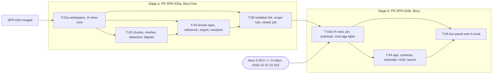

> **BLUF:** the first sprint of the viewer lane (priority 2, D62), **in two stages in one plan, as SPR-038 has. Each stage is its own PR, Tester pass and audit.**
>
> - **Stage a, PR `SPR-033a`** (Bevy-free; about 2.5 agent-days; starts when SPR-026 merges):
>   - the `viewer/` workspace with `rh-view-core`, which is integer-only;
>   - the binary greedy mesher on `binary-greedy-meshing` =0.5.2, with an oracle of our own;
>   - **`hamlet`'s real terrain:** a written definition (`specs/viewer/terrain_v0.md`, the task's first commit), a Python reference run as a differential on a few hundred columns, an export from worldgen-lite's exact reference checked against the committed golden, and a voxelizer;
>   - the `viewer-isolation` lint rule;
>   - the viewer's CI job, on PR #89's scope framework.
> - **Stage b, PR `SPR-033b`** (about 2.3–2.7 agent-days):
>   - **Bevy `=0.20.0` enters the viewer's lock at or after 2026-10-22 22:31Z** (two weeks after its release), with `viewer/rust-toolchain.toml` at rustc 1.97.1, which 0.20.0 requires; the engine's toolchain does not move;
>   - the app: orbital, fly and first-person walking cameras;
>   - **a level-of-detail controller that measures render work, not the presented interval;**
>   - the HUD and the FPS bench;
>   - a live panel over `A.sock`, locally or through an SSH tunnel from `adjutant`.
>
> - **What the director sees.**
>   - After stage a: nothing on screen, but the terrain's digests, golden-checked.
>   - After stage b: **a real Rehoboam world, not a demo:** `hamlet`'s terrain, four regions, four settlement seats and five routes, at 0.35 m voxels with the measured fallback, and the running world's date, living, births and deaths.
>   - Buildings and residents are SPR-034's; the scrubber is SPR-035's.
> - **Merge acceptance (ruling A6).** Stage b merges on its headless gates, the Tester's pass and the Architect's audit. The P51 FPS report is posted afterwards and is not a merge condition. At stage b's merge the director is asked for one 10-minute run ("it opens and renders") before SPR-034 builds on it.
> - **Boundaries.** Tool plane, read-only. No engine crate depends on `viewer/`, the render and window stack never enters the engine's lock, `#![deny(unsafe_code)]` (V-R3D-14, V-VIEW-04). Procedural assets (D53).
> - **Who.** Developer: AGT-002-TOOLS. Testers per stage: AGT-003-IF and AGT-003-DET, one session, on a different model from the Developer's. The Red Team audits.
> - **Class.** C1 per stage (tool plane; no plane-A state, hash or golden moves).
> - **Status:** PLANNING, **revision 2** (v1.5.0). It applies the Architect's rulings of round 2 on the independent re-check of `2afe53a` (0 BLK, 3 MAJ, 10 MIN, 4 NIT in all; this plan AFTER SMALL FIXES): **V3** (the two-week rule is the viewer workspace's own), **V4 and V4b** (the CI tables count `ci.yml`, PR runs are cold, the fallback is a weekly schedule for the Bevy half), **V6** (one named allow in `rh-view-core`), **V7** (`rh-protocol` in `rh-view-core`), **V12** (the controller's back-off), **V14** (stage b's sum and T-01b's heading), **V16** (water in the reduction) and **V17** (the cache key, the cron, two toolchains). Revision 1 (v1.4.0) applied round 1's A1–A20 and B1 on the review of `c51f07c`. Task ids are kept from v1.3.0: stage a is T-01a, T-02, T-03 and T-06; stage b is T-01b, T-04 and T-05. It needs the Architect's approval as a C1 plan (GOV-005 §2) and goes to the director in D63.
> - **Optional for the director now:** running Bevy's own 3D example from a throwaway checkout on the P51 retires risk 1 (Maxwell, driver 580) with no repository change.

# SPR-033 — The voxel viewer: the Bevy-free core (a) and the Bevy app (b)

- **Roadmap item:** `PRJ-003` §4 (SPR-033); `docs/11` viewer lane V.1 · **Phase:** viewer lane (priority 2, D62; tool plane)
- **Developer:** `AGT-002-TOOLS`
- **Testers:** `AGT-003-IF` and `AGT-003-DET` per stage (one session, on a different model from the Developer's). The Red Team audits.
- **Depends on:**
  - **Stage a:**
    - **SPR-026 merged** (D62's start condition; stage a reads none of its code);
    - on `main`: worldgen-lite's exact reference, templates and golden (PR #52); `specs/manifest/manifest_v0.py` and the `python/` environment; `worlds/<rung>/world.toml`; **PR #89** (`f00cf17`: three CI parts, the scope framework, the two-way inventory).
  - **Stage b:**
    - stage a merged;
    - Bevy 0.20.0 two weeks old (2026-10-22 22:31Z);
    - `rh-protocol` on `main` (SPR-026: frames, canonical JSON, `control::request`, `cursor::Catchup`) and `rh-cli run … --socket`.
  - **Not** SPR-027, SPR-018 (the geography comes from the reference), SPR-015 or SPR-020.
- **Binding contracts:**
  - ADR-0036 §1–§5; ADR-0030 (harnesses); ADR-0031 (fidelity by zoom); ADR-0035 directive 5 as amended by ADR-0036;
  - PRJ-003 §2 (invariants; the path list as ruled at A11), §3, §5 (V-VIEW-01 to V-VIEW-05), as the Architect revises them at the close (v1.4.1);
  - `specs/stream/wire_v1.md` §1–§6 (the client's side: the three stream methods);
  - `specs/worldgen/worldgen_lite.md`, `specs/systems/M1.regions.odd.toml` `[algorithm.worldgen_lite]`, `specs/systems/S3.migration.odd.toml` `[algorithm.residence_f0]`, `specs/worldgen/golden/worldgen_lite_v0.txt`;
  - **`specs/viewer/terrain_v0.md`** (new: the first commit of T-03);
  - `bin/ci_scope.py` and `bin/check_all.sh` as PR #89 left them, including the chain's merge rule (`check_all.sh` lines 14–17);
  - GOV-003 (architecture lints); ADR-0021 as amended (licences: ledger only); D53; the viewer workspace's two-week rule (A12, V3).
- **Requirements covered:**
  - R3D-11, part: the separate process, the workspace, read-only, deterministic content;
  - R3D-2, part: terrain from a seed hierarchy, versioned;
  - V-VIEW-02 to V-VIEW-04 (PRJ-003 §5), and V-VIEW-01's ladder clause.

## What the director sees, by stage

| Shown | After | Source | Exact? |
|---|---|---|---|
| `hamlet`'s terrain (256 × 256 cells), land and sea, at 0.35 m inside the bubble and coarser beyond | b (a: digests only) | worldgen-lite W1–W5, the exact reference, from `hamlet`'s pinned manifest (seed 42) | Yes: the raster's SHA-256 equals the golden's `elevation_sha256` |
| Its four regions (a tint you can toggle) and four settlement seats (a stone plaza at each) | b | W6–W8 | Yes: `regions_sha256` and the `seats` line |
| Its five routes, drawn straight from seat to seat | b | W9 decides which routes exist, not their path (M1 F1, P1b) | The edge set, yes; the line is plane-B staging, labelled so |
| Founders per settlement at genesis, as labels | b | S3 F0 R1–R3 (the golden's `residence` line) | Yes, at genesis only |
| A live panel: the run's history tuple, date, tip, living, births and deaths this year, the last sealed year | b | `A.sock` (SPR-026) | Yes. Until SPR-015 merges, `hamlet` has no births and its 60 founders die out within about a century; the panel shows exactly that |
| `twin_vales`' terrain, regions, seats and routes (geography only) | b | the same reference, from `twin_vales.yaml` (seed 1); no golden case | Reproducible: the export tool runs the reference twice |

**Not shown in SPR-033:**
- buildings, residents, households, houses and titles: SPR-034, and only what the stream can carry (SPR-034 F1);
- history before the HUD connected: catch-up is SPR-034's. A viewer sent behind restarts from the live edge and says how many records it skipped;
- scrubbing (SPR-035);
- people moving, fields (P1b, V.2).

## Specs this sprint needs

| Spec | Exists? | Gap | Ruled (round 1) or proposed | Needed by |
|---|---|---|---|---|
| **The Bevy pin and the two-week rule** | **The rule is the viewer workspace's own:** the red team's text in v1.2.0's T-01, as ruled at A12. It is not repository practice (V3): the engine's `twox-hash` 2.1.5, published 2026-10-04, entered the root lock on 2026-10-16 (`9c051fe`), 12 days later. PRJ-003 §3 names Bevy 0.20 | Checked against crates.io on 2026-10-18: `bevy` 0.20.0 was published 2026-10-08T22:31Z and declares `rust-version = 1.97.1`, as do `wesl` and `wgsl-parse`; 0.19.1 (2026-08-13) declares 1.95. The engine pins 1.97.0. A fresh resolve holds 88 packages under 14 days old (the review's count) | **Ruled (Bevy row; A12; V3):**<ul><li>wait for `=0.20.0`, entering the lock at or after 2026-10-22 22:31Z;</li><li>`viewer/rust-toolchain.toml` at 1.97.1, in stage b only;</li><li>**the two-week rule applies to the viewer's direct pins only:** a crate the viewer names in a `Cargo.toml` is at least 14 days old when it enters `viewer/Cargo.lock`, checked offline by `viewer/tools/lock_age.py`;</li><li>transitive versions are what cargo resolves, recorded in a lock-age table;</li><li>**the engine's lock is not covered,** and no GOV-003 line states the rule (V3).</li></ul>The Architect states it in PRJ-003 | T-01a, T-01b |
| **The chunk shape** | PRJ-003 §3: 64×64×32 | Binary greedy meshing keeps one 64-bit mask per column with one voxel of padding at each end, so an axis holds at most 62 voxels (`CS_P = CS + 2 ≤ 64`) | **62³ chunks (64³ padded)**, DEPEND on `binary-greedy-meshing` =0.5.2 (MIT, no dependencies, no `unsafe`, `no_std`). Its `fast_mesh` takes both an opaque and a transparent mask, and air is id 0. PRJ-003 §3 is the Architect's (v1.4.1) | T-02 |
| **The terrain's definition** | None. 30 m ÷ 0.35 m is 600/7, not an integer, so sampling, rounding and route draping need pinning | An independent oracle for the voxelization | **Ruled (A5):** `specs/viewer/terrain_v0.md` is T-03's first commit. It defines the cell-to-voxel mapping, the interpolation and its rounding, materials, the shell, plazas and route draping. `specs/viewer/terrain_ref.py` (stdlib) computes SplitMix64-chosen columns of `hamlet` into `specs/viewer/golden/terrain_v0_columns.txt`, and the Rust voxelizer must reproduce every line | T-03 |
| **The worldgen-lite export** | The reference computes every raster; nothing writes it out | A file the viewer reads, from the manifest the engine runs | `rehoboam-worldgen-lite-export v0`:<ul><li>`<world>.toml`: format, templates version, case `template seed R K`, manifest path and SHA-256 (the pin of `worlds/<world>/world.toml` when there is one), sea level, seats, edges, routes, land counts, **the scale constants of `terrain_v0`** (F4, as the review suggested), and, when the manifest gives the whole population, each founder's `PersonId` (the reference's `founder(world_seed, k)`) with its settlement;</li><li>two little-endian `u16` rasters.</li></ul>Generated into `target/viewer/exports/`, never committed: the committed golden is the oracle | T-03 |
| **The physical scale** | Worldgen-lite has no metres per cell and no metres per elevation unit | — | Plane-B constants of `terrain_v0`, written into the export: **30 m per cell, 1/64 m per elevation unit** (`hamlet` 7.68 km and 130.8 m of land relief; `twin_vales` 3.84 km and 611.9 m, as the review recomputed). M1 F1 (SPR-032, P1b) should own a scale (F4) | T-03 |
| **The level reduction and its seams** | — | v1.3.0's majority rule lost routes and plazas at L1 (A7) | **Ruled (A7):** a surface-preserving reduction (the section below). Beyond the voxel rings, seats and routes are render-only overlay lines on the heightfield. The seams are stated | T-02, T-04 |
| **The level-of-detail controller** | D62: 0.35 m by default "with a measured level-of-detail fallback" | v1.3.0 measured the presented interval, which vsync pins at 16.7 ms, so step-up could never fire (A2) | **Ruled (A2):** the controller measures render work, with thresholds relative to the refresh interval, and a vsync-capped synthetic series must step up (the section below) | T-04 |
| **V-VIEW-03's scene** | "a 64×64 diorama with 50 animated actors, at 0.35 m" | At 0.35 m a 64×64 diorama is 22.4 m square: one plot | The bench scene of the protocol below (F3). PRJ-003 §5 is the Architect's (v1.4.1) | T-04 |
| **Fonts and LUTs** | D53: procedural or CC0 assets only | Bevy's `default_font` embeds Fira Mono (SIL OFL 1.1) | **Ruled (A15):** the feature set drops glTF, `ktx2` and the LUT features, so no LUT is embedded. The camera uses a tonemapper that needs no LUT (`AcesFitted`), with FXAA, not SMAA. The font remains F11 | T-01b, T-04 |
| **Wayland** | — | The `wayland` feature needs `libwayland-dev` at build time (the drafter's measurement; the review could not reproduce it without building Bevy) | **Ruled (A10):** X11 by default; `wayland` an opt-in feature of `rh-view`, for a machine that has the package | T-01b |
| **The isolation rule's names** | — | v1.3.0 banned `bevy_*` from the root lock, which would block an engine PR adopting `bevy_ecs` (`docs/07`: Trial) (A3) | **Ruled (A3, A11):** rule (b) names the render and window stack explicitly; a passing fixture puts `bevy_ecs` in the root lock; rule (e) is a forward allow-list of the viewer's path dependencies | T-06 |
| **The catch-up machine after `stream.behind`** | `Catchup` (SPR-026) cannot skip history | — | **Ruled (A8):** stage b restarts `Catchup` from a fresh `stream.status`'s `live.next_seq`. SPR-026's owner is asked for a skip input only if that proves insufficient | T-05 |
| **The CI trigger** | PRJ-003 §5 | A `main` push trigger fires about 10 times a day (B1). Every viewer PR push also runs `ci.yml`'s part core, and all three parts when the diff leaves the viewer's paths (V4) | **Ruled (B1; V4, V4b):**<ul><li>pull requests on the viewer's own paths;</li><li>no push trigger on `main`;</li><li>a scheduled run twice a week (F17, ruled at the close) and `workflow_dispatch`, with the cache saved only by runs on `main`, so PR runs restore what `main` saved;</li><li>**the fallback when caches churn:** the Bevy half of the job moves to a weekly hosted schedule plus dispatch, and the Bevy-free half keeps running on pull requests (the cost section).</li></ul> | T-06, T-01b |

## Compliance (every task)

| Rule | This sprint |
|---|---|
| Change class (`docs/13` §4.2) | **C1 per stage.** A tool workspace outside the engine's, one architecture-lint rule (stage a), one CI workflow (stage a), a scope rule in `bin/ci_scope.py` (stage a). No contract, Registry, event or IF change; no plane-A behaviour |
| Planes touched (ADR-0024) | **Tool:**<ul><li>stage a: `viewer/` (`rh-view-core`), `viewer/tools/export_worldgen_lite.py`, `specs/viewer/`, `bin/lint_arch.py`, `bin/check_viewer.sh`, `bin/ci_scope.py`, `.github/workflows/viewer.yml`;</li><li>stage b: `rh-view`.</li></ul>**B:** the terrain content the viewer builds, in its memory only. **A, C:** none; plane A is read through `A.sock` only (stage b) |
| Owned columns written | None |
| Reads (via `rh-contracts`) | None. The live panel reads channel A's frozen prefix and `STEP_DIGEST` over `A.sock` |
| RNG purposes added | None. The terrain has no random draw (the reference's draws are plane A's, already made). The placeholder figures' loops and the colour jitter are render-only, from a hash of position, never content |
| Golden-hash effect | **None** on any engine ladder. New and plane B, each regenerated only by its tool: `viewer/golden/terrain_v0.txt` and `specs/viewer/golden/terrain_v0_columns.txt` |
| Fixed-point quantities | The terrain is integer (`i64`), and `rh-view-core` denies `clippy::float_arithmetic` crate-wide. Floats live only in `rh-view`'s rendering and cameras, never hashed |
| Determinism lints (GOV-003 §2) | **The engine's are unchanged and must pass.** **In `viewer/`:**<ul><li>`unsafe_code = "deny"` workspace-wide;</li><li>`#![forbid(unsafe_code)]` in `rh-view-core`;</li><li>`#![deny(unsafe_code)]` in `rh-view`, because Bevy's derive macros carry their own `allow`, which `forbid` would refuse.</li></ul>The root `clippy.toml` applies, since clippy walks up to it. **`rh-view-core` takes exactly one named allow, and only from SPR-034 on: `std::process::Command` in `source.rs`, through which SPR-035's materializer spawns too (V6).** Every other ban of the root `clippy.toml` holds there (`HashMap`, `HashSet`, `Instant`, `SystemTime`, the `std::env` reads): the clock, the command line and the environment are `rh-view`'s. Expect many use-site allows with reasons in `rh-view` (Bevy's float math, frame timing; F10) |
| Assets | Procedural only. `check_viewer.sh`'s assets check finds no image, model or sound file under `viewer/`, except what F11's ruling allows |
| Tests that gate this sprint | **Stage a:**<ul><li>V-R3D-14: `viewer-isolation` and its fixtures, two must-FAIL and one must-PASS (`bevy_ecs`); the root lock unchanged;</li><li>the terrain reference differential;</li><li>V-R3D-13's method on the terrain digest: two runs, 1 and 4 threads, debug and release;</li><li>the mesher's differential;</li><li>the scope tests;</li><li>`bin/check_all.sh` (parts core, golden, stream as `ci_scope` decides) and `bin/check_viewer.sh`.</li></ul>**Stage b:**<ul><li>the headless app test;</li><li>the controller's synthetic series, the back-off's included (V12);</li><li>the live client against a fake host;</li><li>V-VIEW-01's ladder clause (Tester).</li></ul>**Reported, not gated:** V-VIEW-03 (FPS on the P51, after the merge), V-VIEW-01's throughput, the mesher's per-chunk time, the CI job's minutes |
| Docs updated in the same sprint | **Stage a:** `CLAUDE.md` (the viewer's checks); `docs/09` V-R3D-14's method line; `05.0` §6 (`viewer/` built); RUN-001 (the viewer's Python export). **Stage b:** RUN-001 (the Vulkan check, the release build, the FPS protocol), `05.0` §6 (`rh-view`). PRJ-003 is the Architect's (v1.4.1) |

**Rules carried from the engine's sprints (every task):**
- **A positive control fails for the right reason;** its line in `bin/check_viewer.sh` matches the message.
- **Every probe exercises its path, and asserts it:** the export really ran the reference; the controller really stepped; the panel really received `stream.behind`.
- **Generated files are regenerated by their tool, never typed:** the export, both terrain goldens, the viewer's lock, the lock-age table.
- **No wall-clock gate on a shared runner** (GOV-002 tier 10).
- **Cargo runs with its working directory in `viewer/`** (A13): rustup's toolchain file, the target directory and the environment are found from the working directory. Never `--manifest-path viewer/Cargo.toml`.
- **One commit per task.** **Merge `origin/main` when it moves,** by `check_all.sh`'s merge rule (lines 14–17), then `python -I bin/check_all_selftest.py inventory`.
- **Every new gate is in exactly one place:** the isolation lint's controls in `check_all.sh` part core, with `REQUIRED_GATES` in the same commit; everything else in `bin/check_viewer.sh`.

## Levels, rings, seams and the level-of-detail controller (D62; rulings A2, A7)

**Levels.**
- L0 is the canonical content at 0.35 m. L1 (0.70 m) and L2 (1.40 m) are 2×2×2 reductions of the level below.
- **The reduction is surface-preserving (A7), and water counts as a surface (V16):**
  - a coarse voxel is non-air when at least one of its 8 children is non-air, water included;
  - it takes the material of its top-most non-air layer of children: the most frequent material among that layer's non-air children, ties to the lowest id;
  - it is water, and so transparent to the mesher, exactly when that material is water.

  A road, a plaza, a roof or the sea's surface therefore survives at L1 and L2.
- The reduction is integer and a pure function, so every level is reproducible.
- The red team's 0.65 m and 1.0 m tiers are not power-of-two multiples of 0.35 m and would need resampling, so they are not used (F3).

**Rings and notches,** around the camera's ground point:

| Notch | L0 (0.35 m) within | L1 (0.70 m) within | L2 (1.40 m) within | Beyond |
|---|---|---|---|---|
| 0 (default) | 90 m | 360 m | — | heightfield mesh from the cell raster (30 m), with seats and routes as overlay lines |
| 1 | 45 m | 360 m | — | as above |
| 2 | — | 360 m | — | as above |
| 3 | — | 180 m | 360 m | as above |
| 4 | — | — | 360 m | as above |

**Seams, stated (A7).**
- Where two levels meet, the coarser chunk's surface can stand up to one coarse voxel higher (the any-child rule), leaving steps of at most 0.70 m or 1.40 m.
- Where the voxel rings meet the heightfield, the heightfield's 30 m facets can leave gaps of up to a few metres on steep ground.
- Version 1 adds no skirts and no stitching; the legend says so.
- **What the reduction and the rings never change:** voxel content. V-R3D-13's digest is always over L0 content of the fixed bubble.

**The controller (`--lod auto`, the default; A2).**
- **What it measures: render work, never the presented interval.** For each frame, `W = max(CPU render work, GPU work)`:
  - **CPU render work:** the frame's update and render-graph time, excluding the swap-chain acquire and the present wait;
  - **GPU work:** from timestamp queries, through Bevy's render diagnostics, when the adapter has the timestamp-query feature (the M2200 on Vulkan does).

  The report says which sources were available. Without GPU timestamps, `auto` mode presents immediately during calibration.
- **The refresh interval `R`:** the monitor's, read from the window system (16.7 ms on the P51's 60 Hz panel).
- **Calibration at start:** a fixed 10-second orbit at 60 m around the focus seat, at notch 0, after the bubble has loaded. If at most 5% of frames have `W > R`, notch 0 stays. Otherwise the viewer moves down one notch and measures 5 seconds more, until it fits or reaches notch 4.
- **Adaptation while viewing,** over windows of 120 frames:
  - **step down one notch** when more than 5% of a window's frames have `W > R`, two windows running;
  - **step up one notch** when the window's p95 of `W` stays under `0.6 R`, ten windows running.
- **The back-off (V12).** Without one, a notch costing more than 1.67× the next (1 ÷ 0.6) cycles: up after ten windows under `0.6 R`, down two windows later, about every 12 windows. So after a step-down that follows a step-up into the same notch, the step-up wait into that notch doubles: 20, 40, then 80 windows, the cap (8×). The longer wait is kept until the viewer restarts.
- **`--lod fixed:<notch>`** disables all three, for measurement.
- **Reported:** every change prints one line, on stdout and in the HUD, for example `lod 12.4s R=16.7ms W.p95=18.2ms miss=7.5% notch 0->1 (miss > 5% over 2 windows)`. At exit, a summary gives the time at each notch and the final notch. The FPS report carries both.

## Task graph



## Tasks

### Stage a: the Bevy-free core (PR `SPR-033a`, C1, about 2.5 agent-days)

#### T-01a: The `viewer/` workspace and `rh-view-core` (0.3 day)
- **Deliverable:**
  - **`viewer/Cargo.toml`, its own `[workspace]`:**
    - members `rh-view-core`; `resolver = "3"`; edition 2024; `rust-version = "1.97"`;
    - `[workspace.lints]`: `unsafe_code = "deny"`; clippy `pedantic` as a warning; `unwrap_used`, `expect_used`, `panic` and `allow_attributes_without_reason` denied, as in the engine;
    - `[profile.dev] debug = "line-tables-only"` and `[profile.dev.package.rh-view-core] opt-level = 2` (A9), so debug tests are not slow.
  - **No `viewer/rust-toolchain.toml` in stage a:** rustup walks up to the root's 1.97.0, which builds `rh-view-core`. Stage b adds the file.
  - **`viewer/.cargo/config.toml`:** `[build] target-dir = "../target/viewer"`.
    - The build stays under the root's `target/`, which `lint_arch`'s clippy-config crawl skips (F13).
    - Cargo merges the root's `.cargo/config.toml` when run from `viewer/` (A13), so a C build keeps `CFLAGS=-ffp-contract=off`.
  - **`rh-view-core`:**
    - `#![forbid(unsafe_code)]` and `#![deny(clippy::float_arithmetic)]`;
    - labels `[package.metadata.rehoboam] plane = "tool"`, `kind = "tool"`;
    - dependencies, every direct pin at least 14 days old when it enters the lock (A12):
      - `binary-greedy-meshing = "=0.5.2"` (2026-01-07);
      - `twox-hash = "=2.1.5"` with `xxhash3_128`, default features off (the engine's pin);
      - dev-dependency `sha2 = "=0.11.0"` (2026-03-25; 0.11.1 is from 2026-10-12, too young).
    - **No path dependency** in stage a.
  - **The lock:**
    - seeded by `cp Cargo.lock viewer/Cargo.lock`, then the first resolution with its working directory in `viewer/`;
    - cargo keeps every seeded version and adds the new packages (measured on a probe: every shared package kept the root's version);
    - no `cargo update` afterwards except `-p` for a named package.
  - **The lock-age table (A12):** `viewer/lock_age.txt`, committed, and generated only by `viewer/tools/lock_age.py --write` (stdlib; it asks crates.io's API for each version's publication date) whenever the lock changes. One row per package: name, version, publication date, the date it entered the lock, and whether it is a direct pin. **`--check` runs offline** in `check_viewer.sh`, so the gate never depends on the network: the table lists exactly the lock's packages, and every direct pin was at least 14 days old when it entered the lock. A failure names the package. Transitive ages are recorded, never gated.
  - **`cargo deny`,** from `viewer/` with the root's configuration: `cargo deny check --config ../deny.toml bans sources` (crates.io only, no wildcards); `cargo deny list` writes `artifacts/viewer_licence_ledger.txt`, which never fails (ADR-0021 as amended).
- **Acceptance:**
  - `cargo build`, `cargo nextest run` and `cargo clippy --workspace --all-targets --locked -- -D warnings`, all run from `viewer/`, are clean.
  - **The root `Cargo.lock` is byte-identical to the merge base's,** and `cargo metadata --locked` at the root succeeds.
  - The deny check passes and the ledger is written. **`lock_age.py --check` passes: no direct pin was under 14 days when it entered the lock.**
- **Status:** [ ] not started

#### T-02: Chunks, the mesher, the level reduction and the digests (0.6 day)
- **Deliverable (`rh-view-core`):**
  - **`chunk.rs`:**
    - 62³ chunks stored padded to 64³ as `u16` material ids, in the crate's ZXY order; air is id 0;
    - chunk coordinates per level;
    - padding filled from the neighbours, so a face on a chunk boundary is culled exactly when its neighbour is solid;
    - `palette_v0`: air, water, sand, grass, dirt, rock, packed earth, stone, plus reserved ids for SPR-034's building materials.
  - **`mesh.rs`:**
    - an adapter over `binary_greedy_meshing::Mesher::<62>::fast_mesh` with its opaque and transparent masks (water is transparent);
    - each quad's corners packed into 32-bit vertices: 6 + 6 + 6 bits of position, 3 bits of face, 11 bits of material;
    - meshing on N threads, with results ordered by chunk coordinate, never by completion.
  - **`lod.rs`:** the surface-preserving reduction of the section above (A7).
  - **`digest.rs`:**
    - **the content digest:** XXH3-128 over the generator versions, the bubble's definition (focus settlement, centre, radius) and each L0 chunk's coordinates and interior, in coordinate order;
    - **the mesh digest:** XXH3-128 over each chunk's quads and vertex buffer, bound to the mesher crate's version and the packing version (PRJ-003 §5's second check).
- **Acceptance:**
  - **Face culling:** unit tests on a solid cube, a hollow box, a single voxel, a one-voxel tunnel, and faces on each of the six chunk boundaries with solid and empty neighbours.
  - **The differential (our own oracle):**
    - A naive mesher emits one 1×1 quad per visible face. Over 1,000 fixed-seed SplitMix64 chunks (density 0–100%, 1–16 materials, with and without water), the greedy quads cover exactly the oracle's faces: each once, with its material and direction, no overlap and no gap.
    - A planted `mutant-mesh-drop-face` must FAIL by name.
  - **Determinism:** quads, vertices and both digests are equal across two runs and across 1 and 4 meshing threads.
  - **The reduction:**
    - exact on all-solid and all-empty chunks;
    - a one-voxel road on the surface survives at L1 and L2, a test case;
    - unit tests for the top-layer and tie rules, and a shore case: a coarse voxel whose top-most non-air children are water and sand takes the more frequent, and is transparent exactly when that is water (V16);
    - a planted `mutant-lod-majority` (v1.3.0's rule) must FAIL the road test by name.
  - **Reported, not gated:** the mean time to mesh one chunk on one core: a check that meshes 200 terrain chunks, timed by `check_viewer.sh`'s per-check timer and divided by 200. `rh-view-core` reads no clock (V6). The red team's bound was 3.0 ms; the crate's own figures are 65–300 µs.
- **Status:** [ ] not started

#### T-03: `hamlet`'s real terrain: the spec, the reference, the export and the voxelizer (0.9 day)
- **Deliverable, in this order:**
  1. **`specs/viewer/terrain_v0.md` (the first commit; A5),** with the companion `.md`'s usual shape: a BLUF, the rules, and what each rule owes to its source. It defines:
     - **The mapping.** World voxel `x` lies in cell `floor(x × 7 / 600)`, since 30 m ÷ 0.35 m = 600/7. The interpolation uses cell centres at voxel `(600i + 300) / 7` as exact rationals, carried as integers scaled by 7.
     - **The interpolation.** Bilinear over the four nearest cell centres, clamped at the raster edge, in `i64` with the numerator and denominator stated. The rounding is floor, with the one division at the end.
     - **Heights.** `h = floor(e × 100 / 2,240)` voxels (64 elevation units per metre, 0.35 m per voxel).
     - **Materials:**
       - below sea level, water up to sea level over a seabed;
       - land within 2 m above sea level is sand;
       - a column more than 3 voxels above any 4-neighbour is rock;
       - otherwise grass over 3 voxels of dirt.
     - **The shell:** 6 voxels below the surface, empty beneath.
     - **Plazas:** a square of 34 × 34 voxels (11.9 m) centred on the seat cell's centre, levelled at the column height at that centre.
     - **Routes:** a strip 4 voxels wide along the digital line (integer Bresenham on voxel columns) from seat to seat, for every export edge, draped (surface material replaced, height unchanged). The order of drawing: by edge, then along the line.
     - **What the scale constants are, and that they come from the export.**
  2. **`specs/viewer/terrain_ref.py`** (stdlib, `python -I`):
     - It loads the worldgen-lite reference by path, generates `hamlet`'s case in-process, and computes the columns of the spec for 400 SplitMix64-chosen voxel positions (seed fixed in the file): height, material stack and route or plaza flag.
     - `--write` writes `specs/viewer/golden/terrain_v0_columns.txt`; `--check` must reproduce it.
     - `--control route-order`, which draws routes in reverse edge order, must FAIL with `STALE`.
     - `ruff` and `mypy` clean under the root's configuration.
  3. **`viewer/tools/export_worldgen_lite.py`** (the repository's `python/.venv` interpreter, `-I`):
     - **`--world <name>`:** reads `worlds/<name>/world.toml`, checks the manifest's SHA-256 against its pin (the engine's rule, SPR-011 ruling 16), and reads the manifest through `specs/manifest/manifest_v0.py`'s loader. **`--manifest <path>`:** for a manifest with no `world.toml` yet (`twin_vales`).
     - Loads `specs/worldgen/selftest_worldgen_lite.py` by path, as `selftest_fixture_worlds.py` does, and runs `generate`, plus `placement` when the manifest gives the whole population.
     - Writes the export format of the specs table into `--out`.
     - **`--check`:** compares every golden line of the case (`elevation_sha256`, `land`, `seeds`, `regions_sha256`, `land_cells`, `seats`, `edges`, `routes`, `graph`, `residence`). For the rung worlds, the population read from the manifest must equal the reference's own constant (`SOLO`, `HOUSEHOLD`, `HAMLET`). A case with no golden line is computed twice and must agree with itself. A difference prints `STALE: <line>`.
     - **`--control shifted-seed`** must FAIL with `STALE`.
  4. **`rh-view-core::export`:** reads the format and refuses, by name, a file whose raster length, header or scale constants disagree with `terrain_v0`.
  5. **`rh-view-core::terrain` (`terrain_v0`):** the spec, exactly. Chunks are generated on demand from pure functions and dropped after meshing; only meshes are kept.
  6. **`viewer/golden/terrain_v0.txt`:** the L0 and L1 content digests of `hamlet`'s settlement-1 bubble (90 m), with `terrain_v0`'s version. Written only by `cargo run --bin terrain_golden -- --write` (from `viewer/`); `--check` compares.
- **Acceptance:**
  - **The reference differential (A5):** a Rust test reads `specs/viewer/golden/terrain_v0_columns.txt` and reproduces all 400 columns from the export, line for line. `terrain_ref.py --check` passes, and its control fails.
  - **The export:**
    - `--check` passes on `hamlet` against `desert_fringe 42 256 4`, including `residence`, on `solo` (`flat 1 64 1`), on `household` (`flat 7 64 1`), and on `twin_vales` (self-agreement; geography only, its population being SPR-019's);
    - the `shifted-seed` control fails;
    - a Rust test reads the golden file and checks that the exported rasters' SHA-256 equals its lines (`sha2`).
  - **The terrain golden:**
    - the digests equal `viewer/golden/terrain_v0.txt`;
    - a changed digest under an unchanged `terrain_v0` version fails by name: **a generator change bumps its version and regenerates both goldens through their tools**;
    - a planted `mutant-terrain-off-by-one` (the height rounding shifted by one) fails by name.
  - **V-R3D-13's method on the terrain:** equal digests across two runs, 1 and 4 threads, and debug and release builds of the test.
- **Status:** [ ] not started

#### T-06: The isolation rule, the scope rule and the viewer's CI job, on PR #89 (0.7 day)
- **Deliverable:**
  - **`bin/lint_arch.py`, rule `viewer-isolation`** (V-R3D-14, V-VIEW-04). It reads offline from `cargo metadata --no-deps`, the root `Cargo.lock` and, with `tomllib`, the manifests under `viewer/`. It refuses:

    | Clause | Refused |
    |---|---|
    | (a) | A root member with a dependency of any kind whose path lies under `viewer/` |
    | (b) **(A3)** | A root lock holding a package of the render and window stack, named explicitly in `VIEWER_ONLY_PACKAGES`: `bevy`, `bevy_internal`, `bevy_render`, `bevy_winit`, `bevy_window`, `bevy_pbr`, `bevy_core_pipeline`, `bevy_ui` and every `bevy_ui_*` crate, `wgpu` and every `wgpu-*` crate, `winit`, `naga`, and `rh-view` and `rh-view-core`. **Never a `bevy_*` pattern:** `bevy_ecs` is the engine's planned ECS (`docs/07`, Trial) and passes, as do `bevy_reflect` and Bevy's other non-render crates |
    | (c) | A root member whose manifest lies under `viewer/` |
    | (d) | A `viewer/Cargo.toml` without its own `[workspace]` |
    | (e) **(A11)** | A path dependency of a viewer crate, of any kind, that is not on the forward allow-list: `rh-protocol`, `rh-stream`, `rh-worldgen`, `rh-snapshot`, `rh-golden` and `rh-ids` (PRJ-003 §2 as ruled), `rh-core` as a dev-dependency only, and the viewer's own crates |

    **Fixtures in `tests/lint_fixtures/viewer_isolation/`:**
    - `member_dep/`, `lock_has_render_stack/` and `viewer_path_dep/` (a viewer crate on `rh-cli`) each FAIL by the rule's name;
    - `lock_has_bevy_ecs/` must PASS.

    A viewer rule never blocks an engine PR (D62): clauses (a) to (c) fire only on an engine change that reaches the viewer, and (d) and (e) read only `viewer/`.
  - **`bin/check_all.sh`, part core:**
    - the four fixture lines, under PR #89's rules;
    - the new names in `python/tests/test_check_all_inventory.py`'s `REQUIRED_GATES` in the same commit;
    - `python -I bin/check_all_selftest.py inventory` green.
  - **`bin/ci_scope.py` (A4), on PR #89's framework:**
    - `VIEWER_ONLY`: `viewer/`, `specs/viewer/`, `bin/check_viewer.sh`, `.github/workflows/viewer.yml` and `python/tests/test_viewer_workflow.py`;
    - `decide` skips the golden and stream parts when every changed file is documentation or `VIEWER_ONLY`; the core part, which runs `viewer-isolation`, always runs;
    - the verdict names the viewer files;
    - `--no-renames` stays: a file moved from `crates/` into `viewer/` lists both paths, so golden still runs.

    **New tests in `python/tests/test_ci_scope.py`:**
    - a viewer-only diff skips golden and stream;
    - a diff with one `crates/` file runs them;
    - **a rename from `crates/` into `viewer/` runs golden**;
    - a viewer file plus a documentation file skips.
  - **`bin/check_viewer.sh`:** fail-fast, writing `artifacts/viewer_report.md` (commit, branch, each check with PASS or FAIL and its time, the verdict; no report, no pass). Cargo runs with its working directory in `viewer/`. In order:
    1. `cargo fmt --check`;
    2. clippy `-D warnings`;
    3. deny, the ledger and `lock_age.py --check`;
    4. `terrain_ref.py --check` and its control;
    5. the export `--check` for `hamlet`, `solo`, `household` (`--world`) and `twin_vales` (`--manifest`), and its control;
    6. `cargo nextest run --locked`;
    7. the release run of the digest tests and `terrain_golden --check`;
    8. the planted controls, each FAILING by name: `mutant-mesh-drop-face`, `mutant-lod-majority`, `mutant-terrain-off-by-one`, and `mutant-unsafe`, which must fail to compile on `unsafe_code`;
    9. the assets check;
    10. the root lock against the merge base, when the diff touches only viewer paths;
    11. **`df -h` and the repository's Actions cache usage**, printed into the report.
  - **`.github/workflows/viewer.yml` (B1):**
    - **Triggers:**
      - `pull_request` on `viewer/**`, `specs/viewer/**`, `bin/check_viewer.sh`, `.github/workflows/viewer.yml` and `python/tests/test_viewer_workflow.py`;
      - **`schedule`: twice a week, Monday and Thursday at 04:43 UTC** (`43 4 * * 1,4`; V17; F17 ruled by the Architect at the close, 75%, until the director answers D61 item 8's allowance question; daily is a one-field change): off the hour, and off `nightly.yml`'s 03:17 and `advisories.yml`'s 05:17;
      - `workflow_dispatch`;
      - **no push trigger.**
    - **The scheduled run:**
      - it runs the whole of `check_viewer.sh` on `main`, catching engine changes that break the viewer, as a priority-2 follow-up and never a blocker;
      - **when `main` has not moved since the last successful scheduled run,** it only restores the cache and stops, in about a minute, which keeps the cache alive (GitHub evicts a cache unused for 7 days). **This is rare while `main` moves daily** (D61 item 8: the PR tier ran 462 times in 7 days), so the cost section counts every scheduled run as a full warm run (V4).
    - **One job:** `ubuntu-24.04`, `timeout-minutes: 30`, PR runs cancelled by a newer push.
    - **The cache (V4, V17):** `Swatinem/rust-cache` with `workspaces: viewer -> ../target/viewer`, **no `key` of its own** and **`save-if: ${{ github.ref == 'refs/heads/main' }}`**:
      - rust-cache keys on its own hash of every `Cargo.lock` and `Cargo.toml` and of every installed `rustc`, and on a lock change restores the newest entry of the same job by prefix, so only changed dependencies rebuild. An explicit `hashFiles('viewer/Cargo.lock')` would duplicate that hash and defeat the prefix fallback;
      - only runs on `main` save: the schedule, and a dispatch on `main`, which the Architect can start after a lock change to warm the next pull request. **A PR run restores what `main` last saved and saves nothing,** so a PR whose lock adds packages builds them on every push;
      - rust-cache keeps crates.io dependencies only: the viewer's own crates, and from SPR-034 the engine's path crates, rebuild on every run.
    - **Tools:** the toolchain installed before rust-cache (`rustup toolchain install`, here the root's 1.97.0, since stage a has no `viewer/rust-toolchain.toml`); prebuilt `cargo-nextest` and `cargo-deny`; uv with `uv sync --frozen --project python`.
    - **Then:** `bin/check_viewer.sh`, uploading the report and the ledger.
    - **The workflow's pins go in a new file, `python/tests/test_viewer_workflow.py`** (A4): the trigger lists, no `push`, the schedule (and that no other workflow's cron has its minute and hour), the `save-if`, no `hashFiles` in the cache step, and the timeout.
  - **The decision rule (B1, as V4b restates it):**
    - **A run counts as cold** when rust-cache restored nothing at all, not even by prefix; the report prints the restore result (exact, prefix or none). A PR run whose lock adds packages restores by prefix and builds only the new ones: that is expected, not churn.
    - **If two of five consecutive viewer runs are cold,** the Architect splits the job (a C1 edit; no director action): the Bevy-free half keeps running on pull requests and on the schedule, and the Bevy half moves to a weekly hosted schedule plus dispatch (the cost section). `adjutant.yml` is not the fallback: it is dispatch-only and runs only while the director has the VM started (about $0.83 an hour, RUN-002).
  - **Docs:** the compliance table's list.
- **Acceptance:**
  - `lint_arch` is green on the workspace; the three fixtures FAIL by the rule's name and `lock_has_bevy_ecs` passes.
  - The scope tests pass; the inventory is green both ways.
  - The viewer job is green on the PR.
  - **Its cold time, `df -h` and the cache usage are in the PR,** against the estimate below. Every PR run is cold, since no cache exists before the merge (V4).
  - **The warm time is measured after the merge, on `main`** (V4): the first run there saves the cache, cold; the next full run (the next scheduled run on a moved `main`, or a dispatch) restores it. That time is reported to the Architect, as the FPS report is (A6), and is not a merge condition.
- **Status:** [ ] not started

**Stage a's size and cut order.** T-01a 0.3, T-02 0.6, T-03 0.9, T-06 0.7: **2.5 agent-days.** If it runs long:
1. `twin_vales`' export (0.05 day).
2. The restore-only shortcut of the scheduled run (0.1 day): it then runs in full each time, as it nearly always does while `main` moves daily (V4).

Nothing in the differentials, the golden checks, the isolation rule or the scope tests is cut.

### Stage b: the Bevy app (PR `SPR-033b`, C1, about 2.3–2.7 agent-days)

#### T-01b: `rh-view`, the Bevy pin, the toolchain, the lock-age table and the job's Bevy half (0.65 day: 0.3 for the crate, the pin and the toolchain; 0.35 for the job)
- **Deliverable:**
  - **`viewer/rust-toolchain.toml`:** channel 1.97.1, components `rustfmt` and `clippy`, profile minimal; the workspace's `rust-version` becomes 1.97.1.
  - **`rh-view-core` gains `rh-protocol` as a path dependency** (V7; on rule (e)'s allow-list), so T-05's client compiles in `rh-view-core::live`. T-05's fake host is test code on `rh-protocol`'s dispatcher under `rh-view-core/tests/`; anything more it needs is a dev-dependency.
  - **`viewer/rh-view`:**
    - a member; `#![deny(unsafe_code)]`; labels `tool`/`tool`;
    - **a hand-rolled argument parser** (A18): no `clap`;
    - **dependencies:**

      | Dependency | Pin and features |
      |---|---|
      | `bevy` | **`=0.20.0`**, default features off, with exactly `std`, `default_app`, `multi_threaded`, `bevy_winit`, `x11`, `bevy_render`, `bevy_core_pipeline`, `bevy_pbr`, `bevy_anti_alias` (for FXAA), `bevy_ui`, `bevy_ui_render`, `bevy_text`, `default_font`, `free_camera` and `pan_orbit_camera` (A15). These select `bevy_pbr` and `bevy_core_pipeline` directly, with no `3d_bevy_render` or `3d_api`, and so no `bevy_gltf`, `gltf_animation`, `ktx2`, `zstd_rust`, `tonemapping_luts` or `smaa_luts` |
      | `rh-view-core` | path (it carries `rh-protocol` for the live client; V7) |

    - **an opt-in `wayland` feature** (A10), off by default, for a machine with `libwayland-dev`.
  - **Bevy enters the lock at or after 2026-10-22 22:31Z.** The lock-age table records it, and the direct-pin check refuses it before then.
  - **The job gains the Bevy half** (0.35 day, in the heading's figure: the Bevy build 0.3, the two halves 0.05):
    - **Two halves (V4b):** `bin/check_viewer.sh --part core|app`; no flag runs both. `core` is everything that builds without Bevy: `rh-view-core` (cargo with `-p rh-view-core`), the terrain reference, the export, the lock checks and the planted controls of stage a, and from SPR-034 on the run-based gates. `app` is `rh-view`'s build, clippy over the workspace, the headless app test, the controller's series with `mutant-lod-no-backoff` (V12), and `mutant-unsafe` on `rh-view`. The workflow runs them as two steps of the one job, so V4b's fallback moves one step into a weekly job.
    - **One job, two toolchains (V17):** the workflow installs the viewer's 1.97.1 (`rustup toolchain install` in `viewer/`) and the root's 1.97.0, both before rust-cache. rust-cache keys on every installed `rustc`, so the root's toolchain is installed from stage b on, although only SPR-034's `rh-cli` builds with it: adding it then would start a new cache line.
    - The triggers, the cache step and the `save-if` stay as stage a set them; the report gives the cold time in the PR and the warm time after the merge, as T-06's do (V4).
- **Acceptance:**
  - `cargo build`, `nextest` and `clippy -D warnings` from `viewer/` are clean.
  - `cargo tree -e features` (from `viewer/`) shows none of `bevy_gltf`, `ktx2`, `zstd_rust`, `tonemapping_luts` or `smaa_luts`.
  - The root lock is unchanged, and `viewer-isolation` is green.
  - **The cold build of this feature set is measured and reported.** The 178 s of v1.3.0 was for the larger set and was not reproduced by the review. Every PR run of stage b is cold for Bevy: `main`'s cache is stage a's, and the second toolchain starts a new cache line (V4).
  - `check_viewer.sh --part core` builds no Bevy crate (`cargo tree` of its targets, asserted), and the two parts together run every check of the unsplit script.
- **Status:** [ ] not started

#### T-04: The app: rendering, three cameras, the controller, the HUD and the bench (1.25–1.65 days, with V12's back-off)
- **Deliverable (`rh-view`):**
  - **The command line:**
    - `--world <name>` (reads `target/viewer/exports/<name>.toml`) or `--export <path>`;
    - `--focus <settlement>`;
    - `--lod auto|fixed:<0-4>`; `--present vsync|immediate`; `--gpu high-performance|low-power` (default high-performance);
    - `--effects` from `shadows`, `ssao`, `atmosphere` (default `shadows`);
    - `--fullscreen`; `--bench fps --duration <s> --out <file>`;
    - T-05's `--run-dir`, `--socket` and `--headless-client`.
  - **Rendering:**
    - a directional sun with two shadow cascades, ambient light, distance fog and a plain sky colour;
    - **`AcesFitted` tonemapping and FXAA,** which need no LUT;
    - SSAO and the atmosphere only when asked;
    - chunk meshes at L0, L1 and L2, and the heightfield beyond the rings, with **seats and routes as overlay lines** (A7);
    - per-vertex material colours with a ±6% lightness jitter hashed from the voxel position (render-only);
    - a region tint, toggled with `R`.
  - **Three cameras** (`Tab` cycles; spectator only):

    | Mode | What it is |
    |---|---|
    | **Orbit** (kept) | Bevy's `pan_orbit_camera` |
    | **Fly** | Bevy's `free_camera`: WASD, mouse look, Shift fast, Q and E down and up |
    | **Walk (first person at ground level; V.1, D62)** | The fly camera with its eye held 1.6 m above the canonical L0 column top, read from `rh-view-core` even where a coarser level is drawn. It steps up at most 0.7 m, falls to the surface off an edge, and holds 1.4 m/s (Shift: 4 m/s) |

  - **The controller** of the section above (A2, with V12's back-off), using Bevy's render diagnostics for GPU timestamps when the adapter offers them.
  - **The HUD:**
    - FPS and `W`'s p95;
    - the notch; the camera mode;
    - the focus settlement with its founders at genesis;
    - the provenance line (`terrain: worldgen-lite exact reference, hamlet seed 42; M1 F0 in the engine is SPR-018`);
    - the seam note;
    - T-05's panel.
  - **`--bench fps`,** V-VIEW-03's scene (F3):
    - **The bubble:** the focus settlement's at notch 0.
    - **A fixed 120-second camera path:** 40 s of orbit at 60 m, 40 s of flight at 120 m, 40 s of walking through the plaza and along a route.
    - **The load:** 50 placeholder figures on keyed idle loops, 1.75 m tall, labelled "load test, not simulation". People moving is P1b's (ADR-0036 §5).
    - **The report** below.
  - **A headless app test** (no window, no GPU): `MinimalPlugins` and the viewer's data systems without the render plugins. It loads `hamlet`'s export, spawns the bubble's chunk entities with their `Mesh` assets, and asserts the count and that every mesh's digest equals `rh-view-core`'s.
- **Acceptance (headless; A6):**
  - The headless app test passes in CI.
  - **The controller's synthetic series** (no GPU):
    - **a vsync-capped series** (presented interval constant at `R`, `W` at `0.4 R`) steps up after ten windows;
    - a series with 7% of frames at `W = 1.1 R` steps down after two windows;
    - 4% does not;
    - `fixed:` never steps;
    - **a notch costing twice the next (V12):** `W` at `0.55 R` on notch 1 and `1.1 R` on notch 0. The step-ups into notch 0 come 10, 20, 40, 80, 80, … windows apart, and over 2,000 windows the missed frames stay under 5%; the rule without the back-off misses about 17% (2 windows in every 12). A planted `mutant-lod-no-backoff` fails it by name;
    - each step prints its line, and the test asserts the lines.
  - **The walk camera's height rule:** unit tests on eye height, the 0.7 m step and the fall.
  - **The report's format** is pinned by a test on a synthetic run.
- **Status:** [ ] not started

#### T-05: The live panel over IF-0 (0.4 day)
- **Deliverable (`rh-view-core::live`, shown by `rh-view`):**
  - **The client:**
    - a thread on a `std::os::unix::net::UnixStream`, with `rh-protocol`'s framing, `control::request` and canonical JSON;
    - it sends `stream.status`, `stream.subscribe {"from": "live"}`, and `stream.unsubscribe` on exit; nothing else.
  - **Records:** RECORDS frames are split by `rh-protocol::records`' frozen-prefix checks into `(kind, seq, tick)`. `STEP_DIGEST`'s `living`, `births`, `deaths` and `state_hash` are parsed by position (`canonical_v0.md` §3).
  - **Notifications:**
    - `stream.sealed` records the last sealed year;
    - **`stream.behind` (A8):** the client drops its `Catchup`, asks `stream.status` again and starts a fresh `Catchup` from `live.next_seq`, adding the skipped seqs to a counter ("catch-up arrives in SPR-034");
    - `stream.end` shows `finished` or `aborted`.
  - **Connection loss:** retried with the `Catchup` backoff; `run_nonce` and `history` compared. A different history stops the client with an error.
  - **The panel:**
    - the connection state;
    - the history tuple;
    - the sim date (from `calendar.minutes_per_year`);
    - the tip's tick and seq;
    - living, and births and deaths this sim-year;
    - the last sealed year;
    - the records skipped;
    - a warning when the export's manifest digest is not the run's `manifest_hash` (compared in the stream's form). Then the terrain is another manifest's genesis, and the panel says so.
  - **Where the socket is:** `--run-dir DIR` connects to `DIR/stream/t0000000000/A.sock`; `--socket PATH` to a forwarded one. Both paths are checked against the 107-byte limit and refused by name.
  - **`rh-view --headless-client`:** the client with no window, to `stream.end`, printing the panel once per sealed year.
- **Acceptance:**
  - **Against a fake host in the test:** a thread serving `rh-protocol`'s dispatcher, with RECORDS frames built from `specs/stream/golden/canonical_v0.txt`.
    - The counts equal the lines'.
    - **A planted `stream.behind` is followed by a `stream.status` and a subscription from its `live.next_seq`;** the probe asserts both requests and the skipped count.
    - `stream.end` ends the panel; a changed `history` stops the client.
  - **`STEP_DIGEST` parsing** equals the golden lines.
  - **The request set:** exactly `stream.status`, `stream.subscribe` and `stream.unsubscribe`.
  - **Against the real host (the Tester's probe):**
    - `rh-cli run hamlet --years 200 --ladder yearly --socket --run-dir <short tmp>`, with `rh-view --headless-client` attached as soon as `A.sock` exists, reading to `stream.end`;
    - `python -I bin/check_baseline.py --baseline worlds/hamlet/baselines/hamlet_yearly_200y.ladder --recomputed <short tmp>/run.ladder` passes (V-VIEW-01's ladder clause);
    - the wall time with and without the client is reported (its throughput clause; SPR-030 gates V-PERF-09).
- **Status:** [ ] not started

**Stage b's size and cut order.** T-01b 0.65 (0.3, plus 0.35 for the job's Bevy half), T-04 1.25–1.65, T-05 0.4: 0.65 + 1.25 + 0.4 = 2.3 to 0.65 + 1.65 + 0.4 = 2.7, **about 2.3–2.7 agent-days.** The re-check put revision 1's tasks at 2.2–2.6 (V14); V4b's two halves and V12's back-off add 0.05 each. If it runs long, cut **effects first** (A15):
1. SSAO and the atmosphere flags (0.1 day).
2. L2 and notches 3–4 (0.15 day): the controller stops at notch 2, and the report says so.
3. The region tint (0.05 day).

The controller's synthetic series and the headless app test are never cut.

## How the director runs it (as planned; stage b)

Paths are examples. A run directory must be new; socket paths stay under 107 bytes (`wire_v1.md` §1). The pace flag needs SPR-027; until it merges, omit `--pace 1y`, and `hamlet` runs 200 years in about a second at `max`.

**Once per checkout, on the laptop:**
```bash
cd ~/Rehoboam
uv sync --frozen --project python
python/.venv/bin/python -I viewer/tools/export_worldgen_lite.py --world hamlet --out target/viewer/exports --check
cd viewer
cargo build --release -p rh-view                    # first build: measured in T-01b
cargo run --release --bin terrain_golden -- --check # this machine reproduces the terrain digests (A20)
cd ..
```

**A run on the laptop:**
```bash
# terminal 1: the engine, serving A.sock
cargo build --release -p rh-cli
install -d -m 0700 ~/rh-runs
target/release/rh-cli run hamlet --years 1000 --run-dir ~/rh-runs/hamlet-1 --socket --pace 1y

# terminal 2: the viewer
target/viewer/release/rh-view --world hamlet --run-dir ~/rh-runs/hamlet-1
```

**A run on `adjutant`, viewed on the laptop through an SSH tunnel to the Unix socket:**
```bash
# 0. Start the VM (RUN-002 §1). `adjutant` is the director's SSH host alias; REMOTE_HOME is the run
#    user's home on the VM, e.g. /home/director.
gcloud compute instances start adjutant --zone=us-central1-a --project=<project>
ssh adjutant 'cd ~/Rehoboam && git pull --ff-only && cargo build --release -p rh-cli && install -d -m 0700 ~/rh-runs'

# 1. One terminal: an interactive session (it keeps the VM awake: the idle shutdown counts `who`
#    logins), carrying the tunnel, with the run inside tmux so a dropped connection does not end it (F9).
install -d -m 0700 "$XDG_RUNTIME_DIR/rh"
ssh -t -o ExitOnForwardFailure=yes -o StreamLocalBindUnlink=yes \
    -L "$XDG_RUNTIME_DIR/rh/hamlet-A.sock:$REMOTE_HOME/rh-runs/hamlet-1/stream/t0000000000/A.sock" \
    adjutant 'tmux new-session -A -s rh-hamlet "cd ~/Rehoboam && target/release/rh-cli run hamlet --years 1000 --run-dir ~/rh-runs/hamlet-1 --socket --pace 1y"'

# 2. Another terminal: the viewer, on the forwarded socket (it retries until the run has made A.sock)
target/viewer/release/rh-view --world hamlet --socket "$XDG_RUNTIME_DIR/rh/hamlet-A.sock"

# 3. When done: let the run finish or press Ctrl-C inside tmux, then leave the session. A dropped
#    connection leaves the run in tmux (`ssh -t adjutant tmux attach -t rh-hamlet` with the same -L);
#    with no interactive login, the VM powers off after 30 idle minutes (RUN-002 §3 item 3).
```
Over IAP instead of Tailscale, replace `ssh … adjutant '…'` with `gcloud compute ssh adjutant --zone=us-central1-a --project=<project> --tunnel-through-iap -- -t -o ExitOnForwardFailure=yes -o StreamLocalBindUnlink=yes -L … '…'`. **On `adjutant` too,** `cd ~/Rehoboam/viewer && cargo run --release --bin terrain_golden -- --check` confirms the VM's build reproduces the terrain (A20), if the viewer is ever built there.

## The P51 measurements (after stage b's merge; not merge conditions, A6)

The machine: an i7-7820HQ (4 cores, 8 threads), 32 GB, a Quadro M2200 (4 GB, Maxwell, driver 580), Ubuntu 24.04.

**At stage b's merge: the 10-minute render check.** The director builds and runs the "Once per checkout" and "A run on the laptop" commands, and confirms the window opens and shows `hamlet`'s terrain and the panel. SPR-034 starts only after this.

**The FPS report (V-VIEW-03, reported; about 15 minutes, posted after the merge):**
1. **Conditions:**
   - on mains power, `powerprofilesctl set performance`, other applications closed;
   - `vulkaninfo --summary` lists the Quadro M2200. The P51 also has an Intel GPU; the viewer asks for the high-performance adapter and prints which one it got.
2. **`terrain_golden --check`** passes on the laptop (A20).
3. **Non-interference (V-VIEW-01's ladder clause):**
   ```bash
   target/release/rh-cli run hamlet --years 200 --ladder yearly --socket --run-dir ~/rh-runs/fps-ladder &
   target/viewer/release/rh-view --world hamlet --run-dir ~/rh-runs/fps-ladder --headless-client; wait
   python3 -I bin/check_baseline.py --baseline worlds/hamlet/baselines/hamlet_yearly_200y.ladder --recomputed ~/rh-runs/fps-ladder/run.ladder
   ```
4. **Three fixed runs at the default size:**
   ```bash
   for i in 1 2 3; do target/viewer/release/rh-view --world hamlet --bench fps --duration 120 \
       --lod fixed:0 --present immediate --fullscreen --out ~/rh-fps-notch0-$i.txt; done
   ```
5. **One run with the controller:** `--lod auto --out ~/rh-fps-auto.txt`.
6. **Optional:** `--effects shadows,ssao` and `--effects shadows,atmosphere`.
7. **Report:** the files go to the Architect. The median of the three notch-0 runs is the reported figure.

**What the viewer prints (A10):**
```text
rh-view fps report v0
build     commit <sha>  profile release  bevy 0.20.0  rustc 1.97.1
adapter   "Quadro M2200"  backend Vulkan  driver <version>  power high-performance  timestamps yes
session   x11|wayland (XWayland)  prime on-demand|nvidia  refresh 60 Hz (R = 16.7 ms)
display   1920x1080 fullscreen  present immediate  effects shadows  tonemapping AcesFitted  aa FXAA
world     hamlet  case desert_fringe 42 256 4  elevation_sha256 2e42840f…  terrain_v0 <content digest>
scene     focus 1  notch 0 (L0 90 m, L1 360 m, heightfield beyond)  actors 50 (load test)
geometry  chunks L0 <n> L1 <n> L2 <n>  quads <n>  triangles <n>  meshes <n>
segment   orbit  frames <n>  mean_fps <x>  p50_ms <x>  p95_ms <x>  p99_ms <x>  max_ms <x>  W.p95_ms <x>
segment   fly    …
segment   walk   …
overall   …
lod       start 0  end 0  changes 0        (or one `lod …` line per change, then the summary)
verdict   V-VIEW-03: MET | NOT MET (reported, not gated). MET = in every segment at notch 0, mean >= 60 FPS
          and at most 2% of frames over 17.5 ms (16.7 ms plus a 0.8 ms tolerance)
```

**Expectation (55%).** A Maxwell GPU draws the notch-0 bubble at 60 FPS at 1080p with two shadow cascades. That bubble is about 100 L0 and 400 L1 chunks: a few hundred thousand triangles after greedy merging. The risks are SSAO, the atmosphere, a 4K panel, and the Optimus path under XWayland. A miss is reported with the notch the controller chose.

## The CI cost of each stage (estimates on the 2-vCPU column, `ci.yml` included; T-06 and T-01b report the measured figures)

GitHub's hosted runners for a private repository on the Free plan have 2 vCPU, 7 GB of RAM and 14 GB of disk, and GitHub bills each job's time rounded up to the whole minute. **Every viewer push also runs `ci.yml` (V4):** its part core always runs in full, and `bin/ci_scope.py` skips golden and stream only when every changed file is documentation or `VIEWER_ONLY`.

**Per run:**

| Item | Stage a | Stage b | Basis |
|---|---|---|---|
| `ci.yml` on a PR push | **about 25 min:** all three parts, since stage a's diff holds `bin/`, `python/tests/` and `tests/lint_fixtures/` (and before T-06, `viewer/` is not yet `VIEWER_ONLY`) | **about 12 min:** core in full; golden and stream skip in under a minute each, billed a minute each | PR #89's first run: core 10:00, golden 7:10, stream 7:32 |
| The viewer job, cold | about 3–5 min (no Bevy; the Python environment; `rh-view-core` at `opt-level = 2`) | about 11–16 min (Bevy built twice, for the build and for clippy's check mode) | The drafter's 178 s cold Bevy build on 4 cores, scaled by about 1.8 for 2 vCPU, for the larger feature set. T-01b re-measures |
| The viewer job on a PR push | cold, 3–5 min: no cache exists before the merge | cold, 11–16 min: `main`'s cache is stage a's, and the second toolchain starts a new cache line | Only runs on `main` save the cache (T-06) |
| The viewer job warm (a full scheduled run on `main`) | about 2 min | about 4–7 min | crates.io dependencies come from the cache; the viewer's own crates rebuild |
| A scheduled run when `main` has not moved | about 1 min (restore only) | about 1 min | Rare while `main` moves daily, so the totals count every scheduled run as a full warm run |
| Actions cache | one entry, under 0.5 GB | one entry of about 1–1.5 GB | Saved by runs on `main` only. GitHub's limit is 10 GB per repository, shared with the engine's three parts |

**Totals.** About 15 pushes per stage: one commit per task, the merges of `main`, the fixes after the Tester and the audit. A superseded run is cancelled, but bills the minutes it used.

| | Stage a | Stage b |
|---|---|---|
| **The PR** | 15 × 25 (`ci.yml`) + 25 (`ci.yml` on the merge's push to `main`) + about 8 × 3–5 (the viewer job, from T-06's commit on) = 375 + 25 + 24–40 = **about 424–440 min** | 15 × (12 + 11–16) + 12 = 345–420 + 12 = **about 357–432 min** |
| **Each month after the merge** | about 9 scheduled runs (twice a week) × about 2 = **about 18 min** | 9 × 4–7 = **about 36–63 min** |

Against GOV-008's about 2,000 minutes a month on the Free plan (the real allowance is D61 item 8's question), stage a's PR is about a fifth of a month, nearly all of it `ci.yml`'s, as for any C1 change that edits `bin/`. SPR-034 and SPR-035 add their own rows.

**If caches churn (B1's rule, as V4b restates it).**
- A run counts as cold when rust-cache restored nothing, not even by prefix (T-06's report prints it).
- Two cold runs in five consecutive ones split the job, as a C1 edit by the Architect; the director does nothing:
  - the Bevy-free half (`check_viewer.sh --part core`: `rh-view-core`, the terrain, the export, the lock checks, and from SPR-034 on the run-based gates) keeps running on pull requests and on the schedule;
  - the Bevy half (`--part app`) moves to a weekly hosted schedule plus dispatch.
- **`adjutant.yml` is not the fallback:** it is dispatch-only, and runs only while the director has the VM started (about $0.83 an hour, RUN-002), so it cannot serve as a nightly.
- Before stage b the job is all Bevy-free, and the rule has nothing to move. The engine's caches win any cache contention (D62).

## Out of scope (explicit)
- **SPR-034's work:** buildings, residents and the grammar; the sealed-segment reader and catch-up; remote sealed reads.
- **`rh-worldgen` as a source.** The export is exact for the golden worlds; SPR-035's materializer checks the engine's genesis against it once SPR-018 lands (SPR-034 F5).
- **SPR-035's work:** the materializer, the watched-history cache, the scrubber.
- **The pace command from the viewer:** `rh-cli pace`, `pause` and `resume` over SSH (SPR-027; `control_v1.md` §7).
- **The camera director and channel C** (SPR-036). **Acting in the world** (SPR-037, V.3).
- **Wayland by default, Windows, macOS, WebGPU.**
- **Any engine crate change.** If one is needed, it goes through that crate's own sprint and class (ADR-0036 §6).
- **PRJ-003, `docs/11` and D63's text,** which are the Architect's (P1–P4, V9). There is no GOV-003 line: the two-week rule is the viewer workspace's own (V3).

## Verification assignment (Testers)

| Stage | Tester | What to verify, from which contract | Report |
|---|---|---|---|
| a | AGT-003-IF | Written from ADR-0036 §2, PRJ-003 §2 and §5, PR #89's scope rules and this plan's specs table, before reading the code:<ul><li>`viewer-isolation` with fixtures of their own: a dev-dependency on `viewer/`, `wgpu-core` in the root lock, `bevy_ecs` and `bevy_reflect` in the root lock (both must pass), and a viewer path dependency on `rh-sifter`;</li><li>the root lock byte-identical;</li><li>`forbid(unsafe_code)` with an `unsafe` block of their own;</li><li>the scope rule with renames and mixed diffs of their own;</li><li>the inventory both ways;</li><li>the workflow's pins;</li><li>the export against the golden with their own reading of it</li></ul> | `VER-SPR-033a-TEST` |
| a | AGT-003-DET | Written from `specs/viewer/terrain_v0.md` and ADR-0036 §2.4:<ul><li>**an independent terrain voxelizer of their own** (A5) on columns of their own choosing, including raster edges, plazas, route crossings and sea level;</li><li>their own naive mesher on their own seeds;</li><li>the surface-preserving reduction against their own implementation, with thin features;</li><li>the terrain digest across runs, threads and builds;</li><li>two mutants of their own (a material chosen by completion order; a route drawn in another order)</li></ul> | As above |
| b | AGT-003-IF | The client's request set and its handling of `stream.behind` (the restart from `live.next_seq`), `stream.end` and a changed history, against a host of their own on the reference's `Viewer`; the 107-byte refusals; the feature set (`cargo tree`); the lock-age table and the direct-pin rule | `VER-SPR-033b-TEST` |
| b | AGT-003-DET | The controller against synthetic series of their own, vsync-capped included, and one where a notch costs more than 1.67× the next (V12's back-off); the headless app's mesh digests; V-VIEW-01's ladder clause with `rh-view --headless-client` attached to `hamlet`, the throughput reported | As above |
| — | Red Team (audit) | The terrain, seats, routes and regions against the golden's numbers, after stage b. A visual finding is closed only by an automated check (ADR-0036 §4) | Red Team notes |

## Merge route

- **Class and conditions, per stage.** C1: green CI (`check_all.sh`'s parts as `ci_scope` decides, and the viewer job), the Tester's pass and the Architect's audit. **Stage b does not wait for the P51** (A6). No golden or baseline moves, so nothing is announced beyond the merge summary.
- **Contention (D62).** Neither stage takes the C3 slot. Each yields every merge slot, review hour and CI minute to priority 1, and merges in a gap.
- **Shared files.**
  - **Stage a** shares `bin/lint_arch.py`, `check_all.sh`, the inventory test, `bin/ci_scope.py`, `python/tests/test_ci_scope.py` and `CLAUDE.md` with every engine sprint. It merges `origin/main` by `check_all.sh`'s merge rule and runs the inventory check.
  - **Stage b** touches only `viewer/` and RUN-001.

## Risks

| # | Risk | Likelihood / effect | Mitigation |
|---|---|---|---|
| 1 | Bevy 0.20.0 or wgpu misbehaves on Maxwell with driver 580 (Vulkan) | Low–medium / high for V-VIEW-03 | The director's optional Bevy example now; the 10-minute render check at the merge; the report's adapter and session lines; `WGPU_BACKEND=gl`, or 0.20.x once a patch is 14 days old |
| 2 | 60 FPS at 0.35 m is missed on the M2200 | Medium / medium | The controller, reported per notch; effects measured separately and cut first. D62 makes it a reported target |
| 3 | SPR-026's merge slips | Low (its Tester passed) / schedule | Stage a needs none of its code |
| 4 | The job's minutes or cache crowd the engine's | Medium / medium | Viewer-only PR triggers; no push trigger; the cache saved by runs on `main` only, keyed by rust-cache's own hashes; the costs stated with `ci.yml` (V4); the two-in-five rule: the Bevy half to a weekly schedule (V4b); F17 |
| 5 | The reference export and SPR-018's Rust genesis disagree | Low / medium | Both are pinned to the same golden; SPR-035's materializer compares them |
| 6 | `binary-greedy-meshing` has a defect | Low / medium | Our oracle and the Tester's; MIT allows a port (about 0.5 day) |
| 7 | The two locks drift (transitive versions) | Medium / low | Seeded from the root lock; the lock-age table; the engine's direct dependencies are exact pins on both sides |
| 8 | A run or tunnel is left open on `adjutant` | Medium / cost | The run in tmux inside an interactive session; the idle shutdown once the director logs out |
| 9 | Without GPU timestamps the controller sees only CPU work | Low on the M2200 / medium | Immediate present during calibration; the report says which sources it had |

## Blockers

| # | Blocker | Status |
|---|---|---|
| 1 | SPR-026 not merged (D62's start condition, stage a) | Open |
| 2 | Bevy 0.20.0 younger than 14 days (stage b's `rh-view`) | Open until 2026-10-22 22:31Z |
| 3 | Stage a not merged (stage b) | Open |
| 4 | The Architect's approval of this C1 plan (GOV-005 §2), and D63 | Open |

## Completion

**Stage a (`SPR-033a`):**
- [ ] T-01a, T-02, T-03 and T-06 meet their acceptance; `specs/viewer/terrain_v0.md` was T-03's first commit.
- [ ] `bin/check_all.sh` (its parts as scoped) and `bin/check_viewer.sh` pass, with the reports attached.
- [ ] The Tester's verdict is PASS; the Architect's audit `VER-SPR-033a` is PASS.
- [ ] The root `Cargo.lock` is byte-identical to `main`'s; no direct pin is under 14 days.

**Stage b (`SPR-033b`):**
- [ ] T-01b, T-04 and T-05 meet their acceptance; Bevy entered the lock at or after 2026-10-22 22:31Z.
- [ ] `bin/check_viewer.sh` passes; the root lock is unchanged.
- [ ] The Tester's verdict is PASS; the Architect's audit `VER-SPR-033b` is PASS.
- [ ] At the merge, the director is asked for the 10-minute render check; the FPS report follows when the director has the time, and is not a merge condition.

## Findings for the Architect

| # | Finding | Recommendation | Ruling (rounds 1 and 2) |
|---|---|---|---|
| F1 | **Bevy 0.20.0 needs rustc ≥ 1.97.1 and is not 14 days old until 2026-10-22 22:31Z** | Wait for `=0.20.0`, with a viewer-only toolchain at 1.97.1 | Ruled: wait (75%); the split makes the wait free |
| F2 | **64×64×32 is not a binary-greedy-meshing shape** | 62³, DEPEND on the crate | Accepted (95% on the arithmetic, 80% on DEPEND); PRJ-003 §3 is the Architect's |
| F3 | **V-VIEW-03's "64×64 diorama" is one plot at 0.35 m;** 0.65 m and 1.0 m are not exact reductions | The bench scene; levels 0.35, 0.70 and 1.40 m | Accepted, with the surface-preserving reduction (A7) |
| F4 | **Worldgen-lite has no physical scale** | Plane-B constants, written into the export; M1 F1 should own a scale | Accepted, with the constants in the export file |
| F5 | **The terrain is the reference's until SPR-018** | Show it, labelled; SPR-035 compares | Accepted |
| F6 | **What fits in SPR-033** | As planned | Accepted, with the split (A1) |
| F7 | **The CI trigger** | PRs on viewer paths only | Ruled B1: no `main` push trigger; a scheduled run (twice a week by F17); save on `main` only; the two-in-five rule. V4 and V4b: `ci.yml` counted, PR runs cold, the fallback a weekly schedule for the Bevy half |
| F8 | **`ci_scope` treats viewer-only PRs as engine work** | Extend the skip | Ruled A4: on PR #89's framework, with the rename test |
| F9 | **`adjutant`'s idle shutdown counts `who` logins only** | `ssh -t` | Accepted, with tmux inside it |
| F10 | **The root `clippy.toml` applies to `viewer/`** | Keep it. `rh-view-core` takes one named allow (`std::process::Command` in `source.rs`, from SPR-034); `rh-view` will need many use-site allows with reasons (Bevy's float math, frame timing) | Accepted (A18's wording); V6: exactly that one allow in `rh-view-core` |
| F11 | **D53 and dependency data:** Bevy's `default_font` embeds Fira Mono (SIL OFL 1.1) | Rule that D53 covers world content, and that a font embedded in a dependency is that dependency's code, in the licence ledger; otherwise Unscii 16 (public domain, not `unscii-16-full`). The LUTs are gone with A15's feature set | **Ruled by the Architect at the close (80%; PRJ-003 v1.4.1 §8 item 12):** D53 covers world content; Bevy's embedded Fira Mono is dependency code, recorded in `artifacts/viewer_licence_ledger.txt` and allowed under ADR-0021 as amended. A font file the HUD ships itself is public domain or CC0 (Unscii 16, not `unscii-16-full`) |
| F12 | **Wayland needs a system package to build** | X11 by default | Ruled A10: `wayland` is an opt-in feature |
| F13 | **The clippy-config crawl and a `viewer/target/`** | `target-dir = "../target/viewer"` | Accepted, with cargo run from `viewer/` (A13) |
| F14 | **GOV-005 §2 and the director** | D63 asks only for what is the director's | Accepted; D63's restatement is the Architect's (P3) |
| F15 | **`sha2` 0.11.1 is six days old** (2026-10-12) | Pin `=0.11.0` (2026-03-25) as the dev-dependency | New in revision 1 |
| F16 | **Dropping `ktx2` and the LUT features changes the look:** no TonyMcMapface tonemapping and no SMAA | `AcesFitted` and FXAA; revisit if the red team's audit dislikes the look, since restoring the LUTs is a feature line and F11's ruling | New in revision 1 |
| F17 | **After SPR-034 the daily run is the job's largest steady cost.** It runs in full nearly every day, since `main` moves daily: 30 × 8–14.5 = 240–435 minutes a month after SPR-034, and 30 × 10.5–18.5 = 315–555 after SPR-035 (their cost sections), against GOV-008's about 2,000 | Run the full job twice a week (Monday and Thursday) plus dispatch: about 9 runs, so about 90–160 minutes a month after SPR-035. The cache, used every 3–4 days, is never evicted for age; an engine change that breaks the viewer is seen within 3–4 days instead of one, which priority 2 allows (D62) | **Ruled by the Architect at the close (75%): twice a week (Monday and Thursday) plus dispatch,** until the director answers D61 item 8's allowance question; daily is a one-field change of the cron |
| F18 | **The warm time cannot come from "the first daily run after the merge"** (V4's wording): no PR run saves, so the first run on `main` after the merge finds no entry for the new lock (at best the previous stage's, by prefix), builds what is new, and is the run that saves | Measure warm at the next full run on `main` (the next daily run, or a dispatch), as T-06's acceptance now says | New in revision 2 (85%) |
