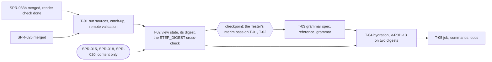

> **BLUF:**
> - **What.** The viewer starts reading the world's history, not just its tip.
>   - **The full IF-0 reader:** `rh-protocol`'s `Catchup` with `rh-stream`'s sealed-segment reader. A viewer sent behind reads the sealed years and rejoins with no gap and no duplicate. It works on a local run directory, or on a run on `adjutant`: the live edge through an SSH tunnel to `A.sock`, the sealed years through `rh-cli tail --canonical` over the same SSH connection. Remote paths are validated.
>   - **The view state** `view_state_v0`: the plane-B projection that hydration reads. It holds the settlements, the living persons with sex, birth, parents and settlement, and the residents per settlement. It is folded from the genesis export and channel-A records, and checked against every `STEP_DIGEST`. **It has a digest of its own.**
>   - **Building grammar v0** (E1, 1000–1500), from a written spec (`specs/viewer/grammar_v0_e1.md`) with a Python reference run as a differential. Dwellings on a plot grid along the seat's routes, a green and a well, a stone church past a population threshold, earth roads. Integer and keyed through `rh-ids` under plane-B purposes; growth-stable.
>   - **V-R3D-13 on two digests,** the view state's and the content's, in every clause: two runs, 1 and 4 hydration threads, debug and release builds, a run at 1 and 4 engine threads, and **rewind by re-reading** against forward play. **Non-vacuity is asserted:** the digests must change across the sampled ticks. Rewind through the materializer is SPR-035's.
> - **What it cannot show yet, plainly.** Channel A carries no household membership (`MARRIAGE` has an empty payload) and, until S3 F1 in P1b, no residence record (kind 7 was deferred, D57). Births have a settlement only once SPR-018 and SPR-020 give events their place, and births exist only once SPR-015 lands. Grammar v0 therefore reads residents per settlement, not households. Houses (M7) and titles wait for their records (F1).
> - **Boundaries.** Tool plane, read-only. Procedural assets only (D53).
> - **Who.** Developer: AGT-002-TOOLS. Testers: AGT-003-IF and AGT-003-DET, one session, on a different model from the Developer's. The Red Team audits.
> - **Size and class.** **About 4–4.5 agent-days,** stated honestly (ruling B7), **with a checkpoint after T-02:** the Tester's interim pass on T-01 and T-02 before T-03 starts, as SPR-015 has. **C1.**
> - **Status:** PLANNING, **revision 1** (v1.1.0). It applies the Architect's rulings of round 1 on the independent review of `c51f07c` (this plan AFTER SMALL FIXES): B1–B8, A5 for the grammar, and F6/F7 as the review answered them. It needs the Architect's approval as a C1 plan (GOV-005 §2), and goes to the director in D63.

# SPR-034 — Stream ingestion and plane-B procedural hydration

- **Roadmap item:** `PRJ-003` §4 (SPR-034); `docs/11` viewer lane V.1 · **Phase:** viewer lane (priority 2, D62; tool plane)
- **Developer:** `AGT-002-TOOLS`
- **Testers:** `AGT-003-IF` and `AGT-003-DET` (one session, on a different model from the Developer's). The Red Team audits.
- **Depends on:**
  - **Hard:**
    - **SPR-033b merged:** the workspace, chunks, mesher, terrain, export, app, cameras, live panel and job; the director's 10-minute render check done (SPR-033 ruling A6);
    - **SPR-026 merged:** `rh-protocol`'s `Catchup`, the host, `rh-cli tail --canonical --from-seq --to-seq` (`wire_v1.md` §6.3's sealed-read path) and `LiveEdge`.
  - **Soft, for content only** (the sprint builds and gates without them):

    | Sprint | What it adds |
    |---|---|
    | SPR-015 | births, marriages and households in plane A |
    | SPR-018 | M1 F0, S3 F0 and events' `place` in the engine |
    | SPR-020 | `Event.place` and the envelope |
    | SPR-027 | `rh-cli tail --digest`, a second twin of the fold's counts (B2) |

  - **Not** SPR-027's materializer.
- **Binding contracts:**
  - ADR-0036 §1, §2 (items 2, 4, 5), §4, §5;
  - R3D-2 and R3D-11 (`docs/03`); `docs/09` V-R3D-13, V-R3D-14;
  - `specs/stream/wire_v1.md` §1–§6 and §9 (the viewer's side), with `golden/wire_v1.txt`'s `scenario catchup`;
  - `specs/stream/canonical_v0.md` §1, §3, §4; `channel_a_v0.sql` (record kinds 2–6);
  - `05.10` §5–§7;
  - `specs/systems/S3.migration.odd.toml` `[algorithm.residence_f0]` (genesis only);
  - `05.1` §6 item 2 (the keyed hash `H`), as ADR-0036 §2.4 applies it to plane B;
  - **`specs/viewer/grammar_v0_e1.md`** (new: the first commit of T-03), and `specs/viewer/terrain_v0.md` (SPR-033);
  - D53.
- **Requirements covered:**
  - R3D-11: reads channel A; content a keyed function of the state at the tick and the generator version;
  - R3D-2, part: versioned generators from a seed hierarchy and the snapshot;
  - STR-3: a viewer cursor with catch-up;
  - V-VIEW-02 (PRJ-003 §5).

## Specs this sprint needs

| Spec | Exists? | Gap | Ruled (round 1) or proposed | Needed by |
|---|---|---|---|---|
| **The view state and its digest** | ADR-0036 §2.4: content is a function of "the state at the tick" | Which part of the state, from which records; and a check that is not lossy (B2: the content digest sees residents only as `ceil(residents / 5)`) | `view_state_v0` (T-02): settlements; living persons `{id, sex, birth_tick, mother, father, settlement?}`; residents per settlement; the unplaced count. Only what the genesis export and channel A determine exactly. **Nothing is inferred:** the viewer never applies a plane-A rule such as S3's "newborn takes the mother's settlement". **Ruled (B2):** its digest, XXH3-128 over the persons sorted by `PersonId` and then the settlements' counts, is compared in every V-R3D-13 clause | T-02, T-04 |
| **Households, houses and titles in the stream** | `M2.demography` (next 0.3.0): `MARRIAGE` roles husband and wife, payload empty; household membership is a column. Kind 7 `RESIDENCE_INTERVAL` is deferred to S3 F1 (D57, BCK-002 A-61). `EntityKind::Household` exists, unused | A hydration that read households could not be equal under rewind and forward play | Grammar v0 reads residents per settlement (F1). **Ruled (B6):** the backlog item lists both forms: (i) household roles in the existing casts (`BIRTH`, `MARRIAGE`, `DEATH` naming the household, `entity_kind` 2); (ii) a kind-8 record of membership changes **sharing A-61's format bump** with kind 7. The second is preferred: channel A's first format bump happens once | T-02, T-03 |
| **The place namespace** | After SPR-018 and SPR-020, `BIRTH` carries `place_id`, an opaque `PlaceId` | Which `PlaceId` values are settlements, and their ids | **Ruled (B3):** the mapping from `PlaceId` to a settlement id is a table pinned with SPR-018's and SPR-020's owners (F8). A value the table does not map is unplaced, with one warning per value; it is never guessed | T-02 |
| **Founders' residence at genesis** | S3 F0's placement is in the golden's `residence` line; the engine's `person.residence` exists only after SPR-018; the stream has no residence record in P1a | Where `view_state_v0` gets founders' settlements | SPR-033's export: each founder's `PersonId` (the reference's `founder(world_seed, k)`) with its settlement, for worlds whose population the manifest gives in full. For a synthesised population (`twin_vales`) it is unknown until SPR-035's materializer | T-02 |
| **Newborns' settlement** | After SPR-018 and SPR-020, `BIRTH`'s `place_id` | Before then, none | The `BIRTH` event's `place_id` (through B3's table), whose target role is the child. Before SPR-018 the child is unplaced and counted as such | T-02 |
| **The settlement seed and plane-B purposes** | ADR-0036 §2.4: `H(world_seed, purpose, entity, tick-bucket, k)` "with plane-B purposes registered like any other" | No plane-B registry exists | `rh-ids`' keyed hash under the system id `rh-view`, branch salt 0, epoch 0, tick 0. Purposes in `rh-view-core/src/purposes.rs`: `settlement_plan`, `plot_order`, `building_form`, `building_dims`, `church_site`. A test refuses a duplicate name, or a system id that is reserved or a Registry one. `rh-ids` is on SPR-033's rule (e) allow-list (PRJ-003 §2 as ruled, A11) | T-03 |
| **The grammar's definition** | None | An independent oracle for the plans and the voxels (A5 applied to SPR-034) | **Ruled (A5):** `specs/viewer/grammar_v0_e1.md` is T-03's first commit. `specs/viewer/grammar_ref.py` (stdlib, using `bin/gen_rng_golden.py`'s RNG reference as the worldgen reference does) writes `specs/viewer/golden/grammar_v0_e1_plans.txt`, and the Rust grammar must reproduce every line | T-03 |
| **Remote sealed reads** | `wire_v1.md` §6.3 already names `rh-cli tail --canonical --from-seq --to-seq` as the sealed-read path (the review's answer to v1.0.0's F7) | On the laptop, `adjutant`'s run directory is not on disk | `ssh <host> <rh-cli> tail <run-dir> --canonical --from-seq a --to-seq b`, sharing one connection through `ControlMaster`. Each year is checked against its `stream.sealed` digest or segment row. **Ruled (B4):** remote paths are validated (the specs below) | T-01 |
| **The engine binary in the viewer job** | SPR-033's job builds only `viewer/` | Catch-up, V-R3D-13 across engine threads and the ladder probe need real runs | The job builds `rh-cli` from the root workspace and runs `hamlet`: 30 sim-years per case, and one 200-year run for the ladder probe. **Ruled (B5):** T-05 measures the debug engine's 200-year run. If it takes over 2 minutes, the job builds `rh-cli` in release instead. `df -h` is in the report. No build profile enters history (ADR-0006's tuple has none), and the ladder probe checks it against the release-recorded baseline | T-01, T-04, T-05 |

## Compliance (every task)

| Rule | This sprint |
|---|---|
| Change class (`docs/13` §4.2) | **C1.** `viewer/`, `specs/viewer/` and the viewer job only. No engine crate changes |
| Planes touched (ADR-0024) | **Tool:** `rh-view-core` (`source`, `view_state`, `purposes`, `grammar`, `hydrate`), `rh-view` (figures, HUD), `specs/viewer/grammar_*`, the viewer job, `bin/check_viewer.sh`. **B:** the view state and the hydrated content, in the viewer's memory only. **A:** read through `A.sock`, the sealed segments (`rh-stream`'s reader) and `rh-cli tail`; never written. **C:** none |
| Owned columns written | None |
| Reads (via `rh-contracts`) | None. Channel-A records: `LIFE_ENTRY`, `LIFE_EXIT`, `EVENT` (`BIRTH`'s `place_id` and roles), `STEP_DIGEST`, `KEYFRAME` |
| RNG purposes added | **Plane B only,** in `rh-view-core/src/purposes.rs`: `settlement_plan`, `plot_order`, `building_form`, `building_dims`, `church_site`. Keyed by `rh-ids` under the system id `rh-view`, never in plane A's Registry, never drawn by plane A |
| Golden-hash effect | **None** on any engine ladder. New and plane B, each regenerated only by its tool: `viewer/golden/hydrate_v0.txt` (generator-only) and `specs/viewer/golden/grammar_v0_e1_plans.txt` |
| Fixed-point quantities | None; content is integer. `rh-view-core` keeps `clippy::float_arithmetic` denied |
| Determinism lints | The engine's are unchanged. In `viewer/`: SPR-033's lints. No `HashMap` or `HashSet` in `rh-view-core` (the root `clippy.toml` bans them). Hydration results are ordered by `(settlement, chunk)`, never by completion. Cargo runs with its working directory in `viewer/` (SPR-033 A13) |
| Assets | Procedural only (D53). SPR-033's assets check keeps running; the grammar adds palette entries, never files |
| Tests that gate this sprint | V-R3D-13: all five clauses of T-04, each on the view-state and content digests, with non-vacuity. The catch-up probes (V-STR-05's method, the viewer as the client). The view state against every `STEP_DIGEST`. The grammar's reference differential. Growth stability. The remote path's validation. The planted controls. V-VIEW-01's ladder clause, now in the job. `bin/check_viewer.sh`, and `bin/check_all.sh` part core (`viewer-isolation`) |
| Docs updated in the same sprint | `CLAUDE.md` (the new viewer checks); `docs/09` V-R3D-13's method line; `viewer/README.md` (sources, remote mode, the view state's limits). PRJ-003 and the backlog items are the Architect's |

**Rules carried from SPR-033 (every task):**
- A positive control fails by name.
- A probe asserts its path: the sleeper really went behind; the sealed read really ran over the SSH stub; the hydration really ran on four threads; the digests really changed.
- Generated files only through their tools.
- No wall-clock gate.
- One commit per task.
- Merge `origin/main` when it moves.

## Task graph



## Tasks

#### T-01: The run source and catch-up, local and remote (0.9 day)
- **Deliverable (`rh-view-core::source`):**
  - **`RunSource`:**
    - **`Local { run_dir }`:** the live edge at `run_dir/stream/t0000000000/A.sock`. Sealed reads through `rh-stream`'s `read_channel_a` and `canonical::render`, so both sources hand the fold canonical lines.
    - **`Remote { host, run_dir, rh_cli }`:**
      - **The live edge** through a forwarded socket: `--socket PATH` (the director's tunnel, SPR-033), or, if absent, a tunnel the viewer spawns, `ssh -N -o ExitOnForwardFailure=yes -o StreamLocalBindUnlink=yes -L <local>:<run_dir>/stream/t0000000000/A.sock <host>`, killed on exit and on drop.
      - **Sealed reads:** `ssh <host> <rh_cli> tail <run_dir> --canonical --from-seq a --to-seq b`.
      - Every `ssh` runs with `-o ControlMaster=auto -o ControlPath=$XDG_RUNTIME_DIR/rh-view/cm-%C -o ControlPersist=60 -o BatchMode=yes`.
      - The HUD warns that a tunnel the viewer spawns does not keep `adjutant` awake (SPR-033 F9).
    - **Validation (B4):**
      - `run_dir` and `rh_cli` must be absolute, ASCII, and free of whitespace and shell metacharacters; anything else is refused by name before any `ssh` runs;
      - the remote command passes each path single-quoted;
      - the local forwarded socket path and the remote socket path are each checked against the 107-byte limit (`wire_v1.md` §1) and refused by name.
    - `std::process::Command` lives in `source.rs` alone, with a use-site `allow` and its reason.
  - **Catch-up:** `rh_protocol::cursor::Catchup` drives every connection.
    - Sent behind, the client reads `[cursor, sealed_last_seq]` from the source and subscribes again from `sealed_last_seq + 1`.
    - A resumed host (`future_seq` while not finished) is retried with the machine's backoff.
    - A changed `history` stops the viewer with an error naming both tuples.
    - Every sealed year read, and every year received live, is checked against its `stream.sealed` digest or its segment row's `canonical_digest` (XXH3-128 over the bodies, `rh-stream::canonical::digest`). A mismatch stops the viewer by name.
  - **The command line:** `--run-dir DIR` (local), or `--remote HOST --remote-run-dir DIR [--remote-rh-cli PATH] [--socket PATH]`.
  - **Dependencies:** `rh-stream` and `rh-ids` join `rh-view-core` as path dependencies, both on SPR-033's rule (e) allow-list.
- **Acceptance** (in the viewer job, on the job's `rh-cli`):
  - **The sleeper (V-STR-05's method):**
    - a client stops reading until two more years have sealed (asserted through a second connection's `stream.status`);
    - it is sent behind (it asserts `stream.behind`), reads the sealed years, rejoins and reads to `stream.end`;
    - its seqs are exactly `0..next_seq`, and every year's digest matches.
  - **Jump to live:** `first_seq = live.next_seq`, nothing duplicated.
  - **Kill and resume:** the host killed with `kill -9` mid-year and resumed from its 10-year keyframe (SPR-013 T-09). The client backs off on `future_seq`, verifies the re-emitted year, and ends with the same seqs and digests.
  - **The remote path, on an `ssh` stub** first on `PATH`. The stub runs the remote command locally; for `-L a:b` it links `a` to `b`, then waits to be killed; it records its arguments.
    - The remote source gives the same lines as the local one.
    - The test asserts the stub saw the tunnel and the `tail` invocations, with `ControlMaster` and single-quoted paths.
  - **Validation (B4):** a run directory with a space, one with `;`, a relative path and a 108-byte socket path are each refused by name, and the stub records that no `ssh` ran.
  - **Read-only:**
    - the client's request set is exactly the three stream methods;
    - the run directory's tree and SHA-256s are unchanged after a sealed read;
    - the run's ladder equals `worlds/hamlet/baselines/hamlet_yearly_200y.ladder` with the viewer's client attached (V-VIEW-01's ladder clause, a gate in the job).
- **Status:** [ ] not started

#### T-02: The view state, its digest and its fold (0.7 day)
- **Deliverable (`rh-view-core::view_state`, version `view_state_v0`):**
  - **The state:**

    | Part | Contents |
    |---|---|
    | Settlements | `id` (1-based, worldgen-lite's), region, seat cell, routes |
    | Persons | the living, keyed by `PersonId`: `sex`, `birth_tick`, `mother`, `father`, `settlement: Option<u32>` |
    | Derived | residents per settlement; the unplaced count |

  - **Its sources, in order:**
    1. **The genesis export** (SPR-033's format: each founder's `PersonId` and settlement, where the manifest gives the whole population).
    2. **Every channel-A record with `tick ≤ T`, in `seq` order:**

       | Record | Effect |
       |---|---|
       | `LIFE_ENTRY` | adds a person; a founder takes the export's settlement |
       | `EVENT BIRTH` | sets the child's settlement from `place_id`, through B3's table; an unmapped value leaves the child unplaced, with one warning per value |
       | `LIFE_EXIT` | removes the person |

  - **The tick rule:** "state at T" means after Bookkeeping of T, the materializer's meaning (SPR-027 W37) and the last record of T's instant.
  - **An incremental form for forward play:** apply one record, report which settlements' inputs changed.
  - **The view-state digest (B2):** XXH3-128 over the version, then every living person in `PersonId` order (`id, sex, birth_tick, mother, father, settlement or none`), then every settlement's residents, then the unplaced count.
  - **The `STEP_DIGEST` cross-check:** at every Month pulse the fold's living count equals `STEP_DIGEST.living`, and its births and deaths since the previous digest equal `births` and `deaths`. A mismatch stops the viewer by name. **When SPR-027 is on `main`,** `rh-cli tail --digest` is a second, independent twin of the same counts (B2).
- **Acceptance:**
  - **The cross-check** holds at every Month pulse of `solo`, `household` and `hamlet`: 30 sim-years each in the PR job, 200 in `check_viewer.sh --full` (the Tester's run, attached to the PR). The `tail --digest` twin runs too, once SPR-027 is on `main`.
  - **Incremental against batch:** the incremental and batch forms give the same state and the same view-state digest at 50 SplitMix64-chosen ticks.
  - **Planted controls, each failing by name:**
    - `mutant-fold-skip-exit` (one `LIFE_EXIT` ignored) fails the cross-check;
    - `mutant-fold-infer-mother` (a newborn given its mother's settlement when `place_id` is absent) fails the unit test that unplaced births stay unplaced;
    - `mutant-digest-unsorted` (persons hashed in insertion order) fails the incremental-against-batch test.
  - **Unit tests** on a fixture of canonical lines: a founder, a birth with a mapped place, an unmapped place and no place, a death, a same-instant birth and death.
- **Status:** [ ] not started

**Checkpoint (B7).** T-01 and T-02 are pushed, and the Tester's interim pass on them is recorded in `VER-SPR-034-TEST` before T-03 starts.

#### T-03: Building grammar v0: the spec, the reference and the grammar (1.6–1.9 days)
- **Deliverable, in this order:**
  1. **`specs/viewer/grammar_v0_e1.md` (the first commit; A5).** It defines:
     - **Inputs, and only these:**
       - the settlement's id, seat cell, region and route bearings;
       - `terrain_v0` under its plots;
       - `residents(s, T)`;
       - the generator version.

       No tick enters except through `residents`.
     - **The plan (`settlement_plan`, keyed on the settlement):**
       - a main street from the seat along the bearing of its longest route (a keyed bearing for a settlement with no route);
       - lanes perpendicular every 24–36 m (keyed);
       - an infinite, fixed sequence of candidate plots ordered by `plot_order`: 12–20 m by 20–30 m, frontage on a street, skipping water and slopes over 1 in 3;
       - the green and a well at the seat.

       All in integer voxel units, with each rounding stated.
     - **Dwellings:**
       - `n = ceil(residents / 5)` (a design value: about five per dwelling in E1);
       - dwelling `k` on plot `k` for `k < n`, so growth adds the next plot and decline empties the highest;
       - exact growth stability.
     - **Forms (E1, 1000–1500; F4):**
       - a cruck-framed longhouse (single storey, 10–14 m by 5–6 m) or a box-framed cottage (7–9 m by 4–5 m): wattle-and-daub walls on a stone sill, a thatched roof pitched 45–55°, a door on the street side, a smoke opening, dimensions keyed in 0.35 m steps;
       - a stone church (nave, chancel, west tower) on a `church_site` plot beside the green once residents reach 40 (a design value; plane-B staging);
       - no Tudor jettying, no brick chimneys (E2).
     - **Roads:** the main street and lanes in packed earth, 4 voxels wide, draped as `terrain_v0` drapes routes.
     - **Overlaps:** where two buildings claim a voxel, the lower plot index wins.
     - **Determinism:** every draw is `rh-ids`' keyed hash with the system id `rh-view`, branch salt 0, epoch 0, tick 0, the purpose, the settlement or plot as entity, and a fixed `k` per choice (fixed draw counts, no rejection loops).
  2. **`specs/viewer/grammar_ref.py`** (stdlib, `python -I`):
     - it loads `bin/gen_rng_golden.py`'s RNG reference and SPR-033's terrain reference by path, as the worldgen reference loads its own;
     - it computes the plans of `hamlet`'s four settlements at residents 0, 5, 20, 39, 40 and 60 (bearings, lanes, the first `n` plots' rectangles, each dwelling's form and integer box, roof pitch step, door side, the church's boxes), and the SHA-256 of the voxel arrays of three buildings;
     - `--write` writes `specs/viewer/golden/grammar_v0_e1_plans.txt`; `--check` reproduces it;
     - `--control lower-plot-loses` (overlaps to the higher plot index) must FAIL with `STALE`.
  3. **`rh-view-core::grammar` (`grammar_v0_e1`) and `purposes.rs`:** the spec, exactly. The palette gains timber, daub, thatch, sill stone, church stone and earth. No texture or model; colour is per material, with SPR-033's render-only jitter.
- **Acceptance:**
  - **The reference differential (A5):** a Rust test reads `grammar_v0_e1_plans.txt` and reproduces every plan line and the three SHA-256s. `grammar_ref.py --check` passes, and its control fails.
  - **Unit tests per form:**
    - the footprint lies inside its plot;
    - the door faces the street;
    - the roof closes over the walls;
    - the church appears exactly when residents ≥ 40;
    - no building on water.
  - **Growth stability:** for `n` from 0 to 60, the content outside plot `n` is identical between `n` and `n + 1`, compared as voxel arrays over the settlement's chunks; decline too, from `n + 1` to `n`.
  - **Purposes:** names unique; `rh-view` not among `rh_core::register::RESERVED_SYSTEM_IDS` nor the Registry's system ids (`rh-core` as a dev-dependency, on rule (e)'s list).
  - **SPR-033's assets check** passes with the grammar in place.
  - **Reported:** the time to generate and mesh one settlement plan at 0.35 m, against the red team's 35 ms.
- **Status:** [ ] not started

#### T-04: Hydration and V-R3D-13 on two digests (0.6 day)
- **Deliverable (`rh-view-core::hydrate`; `rh-view`):**
  - **The bubble's content:** `terrain_v0` plus `grammar_v0_e1` at `view_state_v0(T)`, at L0 in the bubble and reduced for L1 and L2 (SPR-033's surface-preserving rule). Hydration runs per settlement and chunk on N threads. Results merge in `(settlement, chunk)` order, with the spec's overlap rule, never by timing.
  - **Forward play** re-hydrates only the settlements whose inputs changed.
  - **The content digest:** SPR-033's, now covering the buildings and every generator version.
  - **Residents** are drawn as standing figures at their dwelling's door, up to one per resident, with no movement. They show who lives there, not where anyone is (ADR-0036 §5; movement is P1b's).
  - **The HUD:** per settlement, residents, dwellings, the church, the unplaced count; the generator versions; the source (local or remote).
  - **`viewer/golden/hydrate_v0.txt`:** the generator's golden, independent of any run. It holds the content digests of `hamlet`'s settlement-1 bubble for fixed view states built from the genesis export with 0, 5, 20, 40 and 60 residents. Written only by its tool's `--write`; a changed digest under an unchanged generator version fails by name.
- **Acceptance: V-R3D-13, at the end of sim-years 1, 5, 10, 20 and 30 of the job's `hamlet` run, and at 10 SplitMix64 ticks between them.** **In every clause both digests are compared, the view state's and the content's (B2):**
  1. **Two runs** of the viewer.
  2. **1 and 4 hydration threads.**
  3. **Debug and release builds** of the digest test.
  4. **The run at `--threads 1` and `--threads 4`:** identical streams (V-STR-01), so equal digests.
  5. **Rewind by re-reading against forward play:**
     - forward: the client follows the live edge from seq 0, folding and hydrating incrementally, recording both digests as each tick passes;
     - rewind: after `stream.end`, the viewer rebuilds the state at each tick by a batch fold from genesis through the sealed segments and hydrates from scratch.

  **Non-vacuity (B2):** across the 15 sampled ticks, the view-state digest takes at least 8 distinct values and the content digest at least 3. Over 30 years `hamlet`'s founders die, so residents and dwellings fall; the test asserts the counts it observed.

  **Planted controls, each failing by name:**
  - `mutant-reverse-merge` (overlaps to the higher plot index) fails clause 2's companion test against the spec's rule;
  - `mutant-incremental-stale` (forward play skips a settlement whose residents changed) fails clause 5;
  - `mutant-digest-constant` (a content digest that ignores the buildings) fails non-vacuity.
- **Status:** [ ] not started

#### T-05: The job, the commands and the docs (0.3 day)
- **Deliverable:**
  - **`bin/check_viewer.sh`** gains:
    - the build of `rh-cli` from the root workspace (debug, or release under B5's rule);
    - the `hamlet` runs: 30 sim-years at 1 and 4 threads with `--socket`, and the 200-year ladder probe;
    - T-01's probes, T-02's cross-check, T-03's differential and T-04's clauses;
    - the new controls;
    - `--full` for the 200-year cross-checks;
    - `df -h` before and after the engine build (B5).
  - **The workflow (B1):**
    - no new pull-request path;
    - no push trigger;
    - the daily scheduled run covers engine changes on `main` as SPR-033 set it up;
    - `rust-cache` also caches the root workspace's `target/` for the engine, keyed on the root lock and saved by the schedule only.
  - **Docs:** the compliance table's list; `viewer/README.md` with the commands below.
- **Acceptance:**
  - The viewer job is green.
  - **B5's measurement** is in the PR: the debug engine's 200-year `hamlet` run time and the profile chosen.
  - Its cold and warm times and `df -h` are reported against the estimate below.
  - The `--full` run's report is attached.
- **Status:** [ ] not started

**Size (B7).** T-01 0.9, T-02 0.7, T-03 1.6–1.9, T-04 0.6, T-05 0.3: **about 4.1–4.4 agent-days**, stated as 4–4.5, with the checkpoint after T-02. **Cut order** if it runs long:
1. The church and its tower (0.2 day), to the next viewer sprint.
2. The viewer-spawned tunnel (0.1 day): `--socket` stays required for remote runs.
3. Incremental re-hydration (0.1 day): forward play re-hydrates the whole bubble at each changed sim-month, and clause 5 then compares two batch paths, which the PR says.

Never cut: the differentials, the cross-check, the two-digest clauses and non-vacuity.

## How the director runs it (as planned, in addition to SPR-033's)

**A run on `adjutant`, with history:** start the run and the tunnel exactly as in SPR-033 (terminal 1, the `ssh -t` session with the run in tmux). Then:
```bash
target/viewer/release/rh-view --world hamlet \
    --remote adjutant --remote-run-dir "$REMOTE_HOME/rh-runs/hamlet-1" \
    --remote-rh-cli "$REMOTE_HOME/Rehoboam/target/release/rh-cli" \
    --socket "$XDG_RUNTIME_DIR/rh/hamlet-A.sock"
```
The viewer reads the years it missed through `rh-cli tail` over the shared SSH connection, then follows the live edge.

**A finished run, local or remote:** the same command after `stream.end` folds the whole history from the sealed years, and the cameras roam the end state.

## The CI job's cost, after this sprint (estimate on the 2-vCPU column; T-05 reports the measured figures)

| Item | Added | Basis |
|---|---|---|
| `rh-stream`, `rh-ids` and the engine crates they read, in the viewer's build | about 1–1.5 min cold, nothing warm | 40 s measured for 71 crates on a 4-core sandbox, scaled for 2 vCPU |
| `rh-cli` from the root workspace | about 2–4 min cold, under 1 min warm | Its closure is most of `crates/` |
| The `hamlet` runs and probes | about 2–4 min in debug (B5 measures; release if over 2 min for the 200-year probe) | Release `hamlet` takes about 1 s per 200 years; the debug factor is unmeasured |
| **A cold run / a warm run** | **about 15–20 min / 6–9 min** | SPR-033b's figures plus the above |
| **Minutes per active month** | **about 350–700**; more if caches churn, when the two-in-five rule moves the job to `adjutant` | About 45 PR runs and 30 daily runs, most daily runs restore-only when `main` has not moved |
| Actions cache | plus about 0.5 GB for the engine's target | Saved by the schedule only |

## Out of scope (explicit)
- **The materializer, the watched-history cache, the scrubber,** and rewind through the materializer (SPR-035).
- **Households as houses, dynastic houses, titles, halls and towers at title seats.** They wait for channel-A records (F1), or for SPR-035's materializer at materialized ticks only.
- **People moving, fields, mills** (V.2, with P1b's systems).
- **`rh-worldgen` as a source** (F5).
- **Channel C** (SPR-036). **The pace command** (`rh-cli pace` over SSH).
- **PRJ-003 and the backlog items,** which are the Architect's.

## Verification assignment (Testers)

| Tester | What to verify, from which contract | Report |
|---|---|---|
| AGT-003-IF | Written from `wire_v1.md` §6, REV-SPR-026 R15 and R23, `canonical_v0.md` and this plan's specs table, before reading the code. **At the checkpoint (T-01, T-02):**<ul><li>catch-up with a sleeper, a jumper and a kill-and-resume of their own, R15's four orderings forced by their own host;</li><li>the remote path with their own `ssh` stub, including one that fails mid-read (the viewer must stop by name, never show a partial year) and paths of their own that validation must refuse;</li><li>the view state against a DuckDB query of their own over the sealed segments (living per settlement at chosen ticks);</li><li>the cross-check with a dropped record of their own;</li><li>an unmapped `place_id` of their own.</li></ul>**At the close:** the assets check with a planted `.png`; the job's pins | `VER-SPR-034-TEST` (the interim and final passes) |
| AGT-003-DET | Written from ADR-0036 §2.4, `docs/09` V-R3D-13, `specs/viewer/grammar_v0_e1.md` and this plan:<ul><li>**an independent grammar implementation of their own for at least one form and the plot order** (A5);</li><li>the five clauses on both digests at ticks of their own, with a non-vacuity count of their own;</li><li>growth stability with their own sequence, decline included;</li><li>the keyed draws (a fixed count per choice; the same plan for the same residents at different ticks);</li><li>two mutants of their own (a `BTreeMap` keyed with a thread index; a grammar choice keyed by tick)</li></ul> | As above |
| Red Team (audit) | The villages: plausibility for E1, the street and plot logic, growth. Each finding becomes a check (ADR-0036 §4) | Red Team notes |

## Merge route

- **Class and conditions.** C1: green CI, the Tester's interim and final passes, and the Architect's audit. Nothing is announced beyond the merge summary.
- **Contention (D62).** Priority 1 wins every merge slot, review hour and CI minute.
- **Shared files.** Only `viewer/`, `specs/viewer/`, `bin/check_viewer.sh`, the workflow and `CLAUDE.md`.
- **After SPR-015, SPR-018 or SPR-020 merge:** the viewer job's daily run shows the new content (births, places). The cross-check and the five clauses compare paths of one run with each other, so they need no regeneration; the hydration golden depends on the generator only. A new record kind that breaks the fold is a priority-2 follow-up, never a condition on the engine PR.

## Risks

| # | Risk | Likelihood / effect | Mitigation |
|---|---|---|---|
| 1 | The villages look thin: residents are the only input, households are not in the stream | High / medium (the red team's audit) | F1's backlog item (B6; BCK-002 A-71); SPR-035's household panel at materialized ticks; the HUD states what is unknown |
| 2 | SSH sealed reads are slow over IAP | Medium / low | `ControlMaster`; reads per sealed year in one call; the read cost reported |
| 3 | An engine change moves `hamlet`'s history | High over P1a / none for the gates | Every run-based check compares two paths of one run; the hydration golden depends on the generator alone |
| 4 | The fold misses a record kind a later engine sprint adds | Medium / medium | The cross-check stops the viewer by name; unknown kinds are skipped only after the frozen prefix is checked |
| 5 | The grammar's thresholds look wrong to the red team | Medium / low | Design values in the spec, versioned; a change bumps `grammar_v0_e1` and regenerates both goldens through their tools |
| 6 | `twin_vales` shows no founders' settlements until SPR-035 | Certain / low | Stated in the HUD |
| 7 | The `PlaceId` namespace is not pinned when SPR-018 lands | Medium / low | Unmapped values are unplaced with a warning (B3); F8 asks for the pin |
| 8 | The hosted runner's 14 GB of disk fills with two targets | Medium / medium | `df -h` in the report; a release engine target is smaller than a debug one with debug information; the two-in-five rule |

## Blockers

| # | Blocker | Status |
|---|---|---|
| 1 | SPR-033b not merged, or the director's 10-minute render check not done | Open |
| 2 | SPR-026 not merged | Open |
| 3 | The Architect's approval of this C1 plan (GOV-005 §2), and D63 | Open |

## Completion

- [ ] T-01 to T-05 meet their acceptance; the checkpoint's interim Tester pass is recorded; `grammar_v0_e1.md` was T-03's first commit.
- [ ] `bin/check_viewer.sh` (with `--full` attached) and `bin/check_all.sh` part core pass; the reports are attached.
- [ ] The Tester's final verdict is PASS; the Architect's audit `VER-SPR-034` is PASS.
- [ ] No open DEF- against this sprint; the root `Cargo.lock` is unchanged.

## Findings for the Architect

| # | Finding | Recommendation | Ruling (round 1) |
|---|---|---|---|
| F1 | **Channel A cannot carry households, M7 houses or titles** as it stands | Grammar v0 reads residents per settlement; a backlog item for P1b | Accepted, with B6: the item lists both forms, preferring a kind-8 record that shares A-61's format bump. **Filed by the Architect as BCK-002 A-71** |
| F2 | **Residence before SPR-018 is genesis-only; births before SPR-015 do not exist** | Content-only edges in PRJ-003 §6 | Accepted (in PRJ-003 v1.4.0) |
| F3 | **Plane-B purposes have no registry; PRJ-003 §2's list lacks `rh-ids`** | Purposes under the system id `rh-view`; `rh-ids` on the list | Accepted; `rh-ids` and `rh-core` (dev) are on rule (e)'s list (A11) |
| F4 | **"Tudor houses" are outside E1** | Cruck and box-framed dwellings, a stone church | Accepted |
| F5 | **`rh-worldgen` is not needed in SPR-034** | Off the dependencies; SPR-035 compares the engine's genesis with the export | Accepted |
| F6 | **The engine build in the job widens what the job tests** | Debug engine in the job | Ruled B1 (no push trigger, the daily run) and B5 (measure, release if slow) |
| F7 | **R23's `tail` path as a public interface** | — | Withdrawn: `wire_v1.md` §6.3 already names it |
| F8 | **`BIRTH.place_id` is an opaque `PlaceId`,** and the settlement mapping is not pinned anywhere | Ask SPR-018's and SPR-020's owners to pin the settlement namespace of `PlaceId` in their sprints, as a table the viewer reads | New in revision 1 (B3) |
| F9 | **The checkpoint after T-02** costs the Tester a second session | Accept it: T-03 is the largest task, and the fold it builds on should be verified first | New in revision 1 (B7) |
