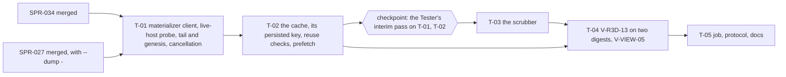

> **BLUF:**
> - **What.** The director can scrub through a run's history.
>   - **The timeline scrubber:** a bar of sim-years with the keyframes, the watched ranges and the live tip. **Live** follows the tip, **history** holds a past tick while the run goes on, and **play** advances through history at a chosen rate. Nothing the scrubber does reaches the run.
>   - **The watched-history cache** (D62): the view state at every tick the viewer has received, as checkpoints and a delta log, plus a content-addressed store of hydrated chunks and meshes. Scrubbing back within watched history needs no materializer and no new I/O. It is plane B, never authoritative, in RAM by default, and may spill to `/dev/shm`. **A persisted entry is keyed to the run's sealed history,** and verified against it before reuse (C2).
>   - **Unwatched jumps through SPR-027's materializer:**
>     - the run's own `rh-cli materialize` runs as a subprocess, on the laptop or on `adjutant` over the SSH connection SPR-034 shares;
>     - the viewer checks the dump's plane digest against the published `STEP_DIGEST` hash itself, then folds forward to the exact tick;
>     - while the bar is dragged through unwatched history, previews snap to keyframes; the exact tick is materialized on release;
>     - **beside a live run, nothing is prefetched** (C1).
>   - **V-R3D-13's last clause:** rewind through the materializer, forward play and scrubbing back through the cache give the same view-state digest and the same content digest at fixed ticks, with non-vacuity asserted (C3).
>   - **V-VIEW-05, as PRJ-003 restates it:** within watched history, ≤ 250 ms from the cache (the red team's aim is one frame); into unwatched history, reported against world size.
> - **Honest expectation.**
>   - Within watched history: one or two frames on a cache hit, and well under 250 ms when a settlement must be re-hydrated.
>   - Unwatched jumps: sub-second on the rungs, and **seconds at 10,000 people**. A jump there is a keyframe plus up to 10 sim-years (about 3,600 instants) of replay: 4–15 s at today's per-instant cost, and about an order of magnitude less if SPR-038's targets hold. 250 ms is not reachable for them by any cache the plan allows.
> - **Who.** Developer: AGT-002-TOOLS. Testers: AGT-003-DET and AGT-003-IF, one session, on a different model from the Developer's. The Red Team audits.
> - **Size and class.** **About 4 agent-days,** stated honestly (ruling C9), **with a checkpoint after T-02:** the Tester's interim pass on the materializer client and the cache before the scrubber is built. **C1.**
> - **Status:** PLANNING, **revision 2** (v1.2.0). It applies the Architect's rulings of round 2 on the independent re-check of `2afe53a` (this plan AFTER SMALL FIXES): **V1** (40-year `hamlet` runs, sampled in years 1–30, and an input script of its own for the different-history control), **V2** (no pty on the data path: cancellation by a pidfile), **V4** (the CI table with `ci.yml`), **V5** (the run helpers move to T-01 and T-02), **V6** (the materializer spawns through `source.rs`), **V10** (the persisted key always holds the chain head and the state hashes), **V11** (the live-host probe at `--pace 1y`) and **V13** (`from_dump` ignores `person.residence`). Revision 1 (v1.1.0) applied round 1's C1–C9 and B1 on the review of `c51f07c`. It needs the Architect's approval as a C1 plan (GOV-005 §2), and goes to the director in D63.

# SPR-035 — The materializer hookup and the timeline scrubber

- **Roadmap item:** `PRJ-003` §4 (SPR-035); `docs/11` viewer lane V.1 · **Phase:** viewer lane (priority 2, D62; tool plane)
- **Developer:** `AGT-002-TOOLS`
- **Testers:** `AGT-003-DET` and `AGT-003-IF` (one session, on a different model from the Developer's). The Red Team audits.
- **Depends on:**
  - **SPR-034 merged:** run sources (local and remote), catch-up, `view_state_v0` and its digest, grammar v0, hydration, the digests.
  - **SPR-027 merged:** `rh_golden::materialize(run_dir, tick)` and `rh-cli materialize <run-dir> --tick T | --at-digest <seq> [--dump <file>] [--hash-only]`, **with the `--dump -` the Architect adds to its T-02** (C8). Also:
    - the state after Bookkeeping of `T` (W37);
    - the refusal of a tick with no published hash;
    - the rule that a materialize writes nothing;
    - `rh_golden::dump::Dump` with `parse` and `digest`;
    - the seek time it reports at the farthest tick from a keyframe, this sprint's baseline;
    - `--pace`, used by the live-host probe.
  - **Measured on, not required:** SPR-038 (per-instant cost) and SPR-030 (`twin_vales` and `kingdom_10k` runnable). Without them the 10k figure is a projection, and the PR says so.
- **Binding contracts:**
  - ADR-0036 §1–§4; ADR-0030 (items 3 and 5: the materializer and the buffer); ADR-0025 (scrubbing never acts; an act in the past forks, and the viewer has none);
  - `05.10` §1, §4; PRJ-003 §2, §3 (the watched-history cache row), §5 (V-VIEW-05);
  - D62 (the cache; `/dev/shm` allowed for it; authoritative runs keep disk and fsync);
  - `docs/09` V-R3D-13, and V-STR-02 (the materializer's equality, relied on, not re-proved);
  - `rehoboam-dump v1` (`crates/rh-golden/src/dump.rs`).
- **Requirements covered:**
  - R3D-11 (the same content whether a tick is reached by rewind or by forward play);
  - STR-2 (the exact state at any tick, consumed);
  - V-VIEW-02 and V-VIEW-05 (PRJ-003 §5).

## Specs this sprint needs

| Spec | Exists? | Gap | Ruled (round 1) or proposed | Needed by |
|---|---|---|---|---|
| **Where the replay runs** | PRJ-003 §2 lets the viewer link `rh-golden` and call `rh_golden::materialize` in process (D-7) | `engine_build` is `rh-golden <version>` plus the built systems (`crates/rh-golden/src/world.rs:256`): it names no commit, so the viewer cannot tell whether its own linked engine replays the run's history. A run on `adjutant` is not on the laptop's disk | **Default:** the run's own `rh-cli materialize` as a subprocess, where the run is (locally, or over SSH on `adjutant`'s eight cores). **The viewer compares `Dump::digest().hash` with the `STEP_DIGEST` record's `state_hash`** (C8). **`--materialize in-process`:** local runs only, allowed after the linked engine reproduces the `state_hash` of the run's nearest keyframe, refused by name otherwise (F1). `rh-golden` is linked in every build, for `Dump` (C6) | T-01 |
| **The dump on standard output** | SPR-027 T-02 had `--dump <file>` | — | **Ruled (C8):** the Architect adds `--dump -` to SPR-027 T-02: the dump alone on stdout, the report on stderr. If SPR-027 lands without it, the viewer uses a temporary file on the remote | T-01 |
| **Materializing beside a live run** | Nothing tests a materialize or a prefetch beside the authoritative host (C1) | Prefetch on by default would load `adjutant` during a live run | **Ruled (C1):** a live-host probe (T-01). **`--prefetch` defaults to `none` while the run is live** (`stream.status` `pace.state` is `running` or `paused`), and to `keyframes` once it has finished | T-01, T-02 |
| **The unsealed tail and genesis** | A tick in the year being written has no sealed records; tick 0 has no genesis keyframe and no published hash (C4) | — | **Ruled (C4):** a tick in the unsealed tail is served from the live window the client received, or refused by name. A tick before the first `STEP_DIGEST` is served by the fold from genesis. The genesis cross-check materializes at the first `STEP_DIGEST` and compares the founders alive there with the export | T-01 |
| **Cancelling a remote materialize** | Killing `ssh` without a pty leaves the remote `rh-cli` running (C5) | **A pty corrupts the dump** (V2): it has one output stream, merges stderr into stdout and turns `\n` into `\r\n` (the re-check: `line1\nline2\n` plus a stderr line arrived as `line1\r\nline2\r\nreport\r\n`) | **Ruled (V2, replacing C5's `-tt`): no pty on the data path.** The data command runs with `-T`, its remote side `sh -c 'echo $$ > <pidfile>; exec timeout 900 <rh-cli> materialize …'`: `exec` hands the shell's PID to `timeout`, and GNU `timeout` passes a TERM on to `rh-cli`. A cancel sends `ssh <host> 'kill $(cat <pidfile>)'` over the same multiplexed connection (`ControlMaster`). `timeout 900` stays the backstop. The director verifies once on `adjutant` that a cancellation leaves no `rh-cli materialize` and no pidfile behind | T-01 |
| **Residence after S3 F1** | S3 F1 (P1b) moves people; until kind 7 exists the stream carries no move (C7) | A dump's `person.residence` would then differ from the fold's, for founders too once one moves (V13) | **Ruled (C7, as V13 revises it): `from_dump` ignores `person.residence` altogether.** Founders are placed from the genesis export, everyone else from their `BIRTH` place (SPR-034's fold), so a materialized state and the fold agree whatever S3 does. Moves are not shown until channel A carries them, and the HUD says so. F8 is the viewer lane's recommendation that S3 F1's moves ship with kind 7, not a constraint on the engine (D62) | T-01 |
| **What the cache holds, and its persisted key** | D62: "a cache of the history it has shown", plane B, `/dev/shm` allowed | `engine_build` cannot tell two engine builds apart (C2) | The section below: view-state checkpoints and a delta log, and hydrated content addressed by its inputs. **Ruled (C2, V10):** a persisted entry's key **always** holds the run's sealed-history chain head and its first and last `state_hash`, and adds the builder's commit when `run.toml` records it (BCK-002 A-70). A reuse verifies each checkpoint's origin digests first | T-02 |
| **Households at materialized ticks** | A dump holds `person.household` (after SPR-015) and M7's columns (after SPR-021); the stream does not (SPR-034 F1) | Whether the scrubber may show them | Not in grammar v0. A materialized tick may show a household panel in the HUD, labelled "from the materialized state at <tick>", never in either digest (F4) | T-03 |
| **The scrub latency's measurement** | PRJ-003 §5 V-VIEW-05; SPR-027 T-02 reports a seek time | How it is measured and reported | `--bench scrub` (T-04): from the input event to the first frame whose bubble is fully meshed and uploaded, by class, with the world's living count and where the replay ran | T-04 |

## The watched-history cache (D62)

**What it holds, and why:**

| Option | For | Against |
|---|---|---|
| (a) Materialized states (`Dump`s) at watched ticks | Exact, every table | Several MB per tick at 10,000 people (the text form about 7 MB). Every watched tick is impossible, so scrubbing between them needs a fold anyway |
| (b) Hydrated voxel content per tick | Display is immediate | About 60 MB of raw voxels per bubble per tick, tied to one bubble and one camera; wasteful, since content changes rarely |
| **(c) The view state, as checkpoints and a delta log, plus hydrated content addressed by its inputs** | **Small** (KB to tens of MB). **Exact** for every watched tick. **Independent of the camera.** Repeated configurations hydrate once | A content miss costs a re-hydration (tens of ms per settlement) |

**Recommendation: (c)** (75%; accepted). A dump enters the cache only as the source of a checkpoint: the viewer converts it to `view_state_v0` at once and drops the dump.

**The history layer.**
- **The in-memory key:** the run's history digest, `XXH3-128(engine_build, registry_version, manifest_hash, world_seed)`, with `timeline_id` and `view_state_v0`'s version.
- **The persisted key (C2):** that digest, plus:
  - **the sealed-history chain head:** `C_y = XXH3-128(C_{y−1} ‖ canonical_digest of sealed year y)` over the sealed channel-A years the entry covers, from `stream.sealed` or the segment rows;
  - the first and last `state_hash` it covers;
  - **the builder's commit, when the run's `run.toml` records it** (BCK-002 A-70). It is added, never a substitute: the chain head and the state hashes are always in the key (V10).

  Two runs with equal tuples but different histories, whether from another engine build or another input journal, therefore never share an entry.
- **Entries:**
  - **checkpoints `V(t)`:** every keyframe tick (each 10 sim-years) of every watched decade, plus yearly checkpoints for the 20 sim-years either side of the last scrub position;
  - **the delta log:** the records the view state reads (`LIFE_ENTRY`, `LIFE_EXIT`, `BIRTH`'s place), per sim-year, as packed integers;
  - **the coverage:** the seq ranges the viewer has received and verified against their sealed digests ("watched").
- **Every checkpoint records its origin and its view-state digest.** The origin is either a verified fold (its seq range and the years' `canonical_digest`s) or a materialized state (its `state_hash`).
- **On reuse from `/dev/shm`,** each checkpoint's origin is checked against the run before its first use: the years' digests against the run's segment rows (or `stream.sealed`), a `state_hash` against the run's `STEP_DIGEST` record. A failure deletes the entry and recomputes it.
- **Lookup:** the nearest checkpoint at or before `t`, plus at most 10 sim-years of deltas. At 10,000 people that is about 8,000 deltas, well under a millisecond.

**The content layer.**
- **Key:** `(terrain_v0, grammar_v0_e1, settlement id, XXH3-128 of the grammar's effective inputs)`. Grammar v0 reads residents only through the dwelling count `ceil(residents / 5)` and the church flag, so the inputs hashed are the seat, the routes, that count and that flag. A settlement has as many entries as its distinct village forms: at most 14 for 60 residents (13 dwelling counts, one with and without the church).
- **Entries:** the settlement's chunks (run-length encoded `u16` voxels) and their meshes, per level.

**Budgets and eviction:**

| Layer | Default budget | Eviction |
|---|---|---|
| History | 256 MiB of RAM | Yearly checkpoints farthest from the cursor first, then decadal checkpoints, oldest first. Deltas go last: when they alone pass half the budget, the oldest sim-years outside the visible part of the bar are dropped and marked unwatched, so a jump there goes through the materializer |
| Content | 512 MiB of RAM | Least recently drawn first; the current bubble's entries are pinned |

**The memory it needs** (`view_state_v0` is about 40 bytes per living person; a delta about 16–41 bytes):

| World | Living | Watched span | History layer | Content layer (all forms of the focus settlement) |
|---|---|---|---|---|
| `hamlet` | 60 | 200 years | under 1 MB | about 20–40 MB |
| `twin_vales` | about 1,500 | 300 years | about 3 MB | about 50 MB per settlement |
| `kingdom_10k` | 10,000 | 1,000 years | about 80 MB: 100 decadal checkpoints at 0.4 MB, 40 yearly, deltas about 22 MB | bounded by the budget |

The P51 has 32 GB, Bevy uses 1–2 GB, and the bubble's meshes live on the GPU's 4 GB.

**`/dev/shm` (opt-in, D62):**
- **Turning it on:** `--cache-dir /dev/shm/rh-view-$UID` lets evicted checkpoints and content entries spill to tmpfs, up to `--cache-shm-max` (default 2 GiB). Ubuntu sizes `/dev/shm` at half of RAM, 16 GB on the P51.
- **Each file's header:** format, the persisted key above, the generator versions, and the payload's XXH3-128. A file whose header, key or payload does not match is deleted and recomputed.
- **Cleanup:** the directory is `0700` and removed at exit unless `--keep-cache`.
- **What it buys:** a viewer restart keeps the watched history.
- **What it never is:** authoritative. Every entry can be re-derived by a fold or a materialize. Nothing in it is read by plane A or written into the run directory, and authoritative runs keep their disk and fsync (D62).

**Prefetch (C1).**
- **`--prefetch keyframes|none`:** the default is `none` while the run is live and `keyframes` once `stream.end` has arrived (or the run directory is finished).
- When enabled and the viewer is idle, it materializes keyframe ticks outward from the cursor, nearest first, one at a time, under `nice` (remotely as well), stopping at the history budget.
- After a pass, previews while dragging through unwatched history are immediate.

## Compliance (every task)

| Rule | This sprint |
|---|---|
| Change class (`docs/13` §4.2) | **C1.** `viewer/` and its job. SPR-027's `--dump -` is the Architect's edit (C8) |
| Planes touched (ADR-0024) | **Tool:** `rh-view-core` (`materialize`, `cache`, `timeline`), `rh-view` (the scrubber), the job. **B:** the cache, in RAM and optionally `/dev/shm`. **A:** read through `rh-cli materialize` (a subprocess that writes nothing, SPR-027 T-02) or, opt-in, `rh_golden::materialize`; never written. **C:** none |
| Owned columns written | None |
| Reads (via `rh-contracts`) | None. The dump's tables `person.*` and `life_course.*`, read through `rh_golden::dump::Dump`; **never `person.residence` into the view state** (V13). The genesis cross-check alone reads it, once per run, as a check |
| RNG purposes added | None |
| Golden-hash effect | **None** on any engine ladder. `viewer/golden/hydrate_v0.txt` is untouched: every path gives the same digests, which is the point |
| Fixed-point quantities | None |
| Determinism lints | SPR-033's. The cache uses `BTreeMap` only. `rh-view-core::materialize` starts every process through `source.rs`, whose `std::process::Command` is the crate's one allow (V6). Wall-clock reads (latency, eviction by last draw) live in `rh-view`'s timing module, with use-site allows; no clock value enters content, a digest or a cache key. Cargo runs from `viewer/` |
| Tests that gate this sprint | V-R3D-13's rewind clause by the materializer and the cache, on both digests with non-vacuity (T-04). The cache's exactness and integrity, the persisted key and the reuse checks included (T-02). The materializer client's digest check and refusals, and the live-host probe (T-01). The planted controls. `bin/check_viewer.sh`. **Reported:** V-VIEW-05 |
| Docs updated in the same sprint | `CLAUDE.md`; `docs/09` V-R3D-13's method line (rewind); `viewer/README.md` (the scrubber, the cache, `/dev/shm`, the remote materializer, prefetch); RUN-001 (the scrub protocol, the cancellation check). PRJ-003's cache row is the Architect's |

**Rules carried from SPR-033 and SPR-034 (every task):**
- A positive control fails by name.
- A probe asserts its path: the jump really materialized from the nearest keyframe; the scrub really hit the cache with no subprocess; the live run really ran while the viewer materialized.
- No wall-clock gate.
- One commit per task.
- Merge `origin/main` when it moves.

## Task graph



## Tasks

#### T-01: The materializer client, beside a live run too (1.05 days: 0.9, plus 0.1 for V2's cancellation route and its stub cases, plus 0.05 for the runs moved from T-05; V5)
- **Deliverable (`rh-view-core::materialize`):**
  - **`Materializer::Subprocess` (the default):**
    - **Local:** `<rh-cli> materialize <run-dir> --at-digest <seq> --dump -`.
    - **Remote (V2):** over SSH with SPR-034's `ControlMaster` and validated paths, **with `-T` and never a pty**, the remote command being one string:
      `sh -c 'echo $$ > <pidfile>; exec timeout 900 <rh-cli> materialize <run-dir> --at-digest <seq> --dump -'`
      - the paths in it are the validated ones (B4: absolute, ASCII, no whitespace, no shell metacharacter), so the single quotes carry them unchanged;
      - the pidfile is `/tmp/rh-view-<viewer pid>-<n>.pid` on the remote, `<n>` a counter;
      - prefetch adds `nice -n 10` after `exec`, which keeps the PID;
      - the dump arrives on stdout byte for byte, and the report on stderr goes to the viewer's log, never into the dump.
    - **Spawning (V6):** `materialize` builds the argument list and starts it through `source.rs`'s spawning function, so `std::process::Command` stays in that one file.
    - **The binary:** `<rh-cli>` is `--rh-cli PATH` locally and `--remote-rh-cli PATH` remotely. Before first use, `rh-cli build-info` must print `mutants: none`, or the viewer refuses the binary by name.
    - **For a requested tick `T`** (the tick rules of C4):
      1. **A tick in the unsealed tail** (the year being written) is served from the live window the client received when it covers `T`, and is refused by name otherwise.
      2. **A tick before the first `STEP_DIGEST`** is served by the fold from genesis (SPR-034).
      3. **Otherwise the viewer:**
         - reads the sealed year that holds `T` through its source;
         - takes the last `STEP_DIGEST` at or before `T` (seq `d`, tick `m`, `state_hash` `h`) and materializes at `d`;
         - parses the dump with `Dump::parse`;
         - **checks that `Dump::digest().hash` equals `h`** (C8), refusing by name if not: a transport, toolchain or build difference has shown up;
         - converts the dump to `view_state_v0` with `from_dump`: the living rows of `person.*` and their `life_course` fields. **`person.residence` is never read** (V13): founders take the genesis export's settlement, everyone else the fold's `BIRTH` place;
         - folds the records of `(m, T]` from that sealed year.
    - **Keyframe previews:** `--tick K` at a `KEYFRAME` marker's tick, with no replay.
    - **Cancellation (V2):** when the cursor moves on, a local subprocess is killed. For a remote one the viewer sends `ssh <host> 'kill $(cat <pidfile>)'` over the same multiplexed connection, only while its local `ssh` child is still running; GNU `timeout` passes the TERM on to `rh-cli`. The viewer removes the pidfile (`ssh <host> rm -f <pidfile>`) when the materialize ends either way, and `timeout 900` is the backstop. At most one materialize runs at a time.
  - **`Materializer::InProcess`** (`--materialize in-process`, local runs only): `rh_golden::materialize`. It is refused by name unless materializing the run's nearest keyframe tick in process first gives the `KEYFRAME` record's `state_hash` (F1).
  - **The genesis cross-check (C4):** once per run, the state materialized at the first `STEP_DIGEST` gives the settlements of the founders alive then. When `person.residence` exists (SPR-018 on `main`), they must equal the genesis export's. This checks the engine against the reference the viewer has shown since SPR-033. **It is a check, not a source:** nothing from it enters the view state (V13). It is exact while S3 is at F0, where nobody moves; F9 asks what it reads once S3 F1 can move a founder in the first month.
- **Acceptance** (in the viewer job, on its `rh-cli` and SPR-034's 40-year `hamlet` run directory; every sampled tick in sim-years 1–30, V1):
  - **Equality:** at 20 SplitMix64-chosen ticks, `from_dump` plus the fold equals SPR-034's fold from genesis, as structures, view-state digests and content digests.
  - **The path is real:** a probe asserts the replay started from the nearest keyframe (SPR-027's report) and that at least one tick lies 9 or more sim-years past its keyframe.
  - **The tick rules (C4):**
    - a tick in the unsealed tail is served from the window when the client holds it, and refused by name when it does not;
    - a tick in the first month is served by the fold, and the probe asserts no subprocess ran.
  - **The live-host probe (C1; V11), its runs added to `check_viewer.sh`'s Bevy-free half by this task (V5):**
    - `rh-cli run hamlet --years 40 --ladder yearly --socket --pace 1y --run-dir <short tmp>` runs with the viewer's client attached, beside a headless `rh-cli run hamlet --years 40 --ladder yearly --run-dir <other tmp>`. At `1y`, one sim-year per wall-second (`05.1` §4.4's bands are sim-time per wall-second), the paced run lasts at least 40 wall-seconds; v1.1.0's `10y` lasted 3, too short for ten materializations to overlap it;
    - while it runs, the viewer materializes at 10 ticks of years already sealed, in sim-years 1–30, and prefetches keyframes, which the probe forces on;
    - **the run's ladder is byte-identical** to a headless run's;
    - **the run directory is byte-identical** to the headless run's, except `run.log`'s wall-clock and nonce fields, the sockets and the lock files;
    - with prefetch at its default, a probe asserts no prefetch ran while `pace.state` was `running`.
  - **The digest check:** a planted `mutant-dump-flip` (one byte of the received dump flipped) is refused by name.
  - **The binary check:** a planted `rh-cli` whose `build-info` reports a mutant is refused by name.
  - **The remote path,** through SPR-034's `ssh` stub, gives the same view states. The stub records `-T`, the `sh -c` string with its pidfile and `timeout 900`, and refuses `-t` and `-tt` on a data command (V2).
  - **Cancellation through the stub (V2):** the `kill` goes over the stub; the probe asserts that the fake `rh-cli` ended and that the pidfile is gone.
  - **Byte equality (V2):** a fake `rh-cli` behind the stub writes a multi-line dump to stdout and a multi-line report to stderr. The bytes the viewer receives equal the dump file's, and the report reaches the viewer's log. A stub mode that does what a pty does (stderr into stdout, `\n` to `\r\n`) must make the viewer refuse the dump by name.
  - **The in-process path** gives the same view states as the subprocess. Its refusal is tested with `mutant-inprocess-stale`.
  - **Read-only:** after 20 materializations, the tree and SHA-256s of a finished run directory are unchanged (SPR-013 T-10's form).
  - **Reported:** the materialize time by keyframe distance (0, 2, 5 and 9 sim-years) on `solo` (55 sim-years), `household` (30) and `hamlet` (40), from `rh-cli`'s own report, and the dump's size. The parse time comes with T-04's latency report, from `rh-view`'s timing module (`rh-view-core` reads no clock; V6).
- **Status:** [ ] not started

#### T-02: The watched-history cache (1.05 days: 1.0, plus 0.05 for the second run moved from T-05; V5)
- **Deliverable (`rh-view-core::cache`):**
  - the two layers, their keys (the persisted one included), budgets, eviction, the `/dev/shm` spill with its header and reuse checks, and prefetch with its live default;
  - the coverage set of watched, verified seq ranges;
  - the options `--cache-budget-history`, `--cache-budget-content`, `--cache-dir`, `--cache-shm-max`, `--keep-cache` and `--prefetch`.
- **Acceptance:**
  - **Exactness:** for 200 SplitMix64 ticks in watched history, the cached `V(t)` equals a fresh fold (structure and view-state digest), and the content from the cache equals a fresh hydration (content digest).
  - **No subprocess on a hit:** a probe counts materialize calls during 100 watched scrubs; the count must be 0.
  - **Eviction under a small budget** (1 MiB history, 4 MiB content):
    - the order is as specified;
    - an evicted watched year becomes unwatched, and a scrub there materializes (asserted);
    - the result is still exact.
  - **`/dev/shm`** (against a temporary directory in CI):
    - a file with a changed byte, a wrong history digest, a wrong generator version or **a wrong chain head** (C2) is deleted and recomputed, never used (each asserted);
    - **a kept cache presented to a second run of the same tuple but a different history** is refused by its chain head. The second run is `rh-cli run hamlet --years 40 --inputs viewer/tests/fixtures/hamlet_input_y12.toml`: its own script, one input on founder 0 (alive until sim-year 34) at a tick in sim-year 12, off every pulse boundary as `worlds/hamlet/inputs.toml` places its own. Its `INPUT` record changes sealed year 12's `canonical_digest`, so every chain head from year 12 on differs, inside the years the entry covers. A second run with the world's own script could not fire the control: both runs would carry only the input of sim-year 34, outside those years (V1). This task adds the run to `check_viewer.sh` (V5);
    - **a checkpoint whose origin `state_hash` no longer matches the run's `STEP_DIGEST`** is refused on reuse;
    - the directory is `0700` and removed at exit unless `--keep-cache`.
  - **Planted controls, each failing by name:**
    - `mutant-cache-neighbour` returns the checkpoint of the following sim-year; it fails exactness;
    - `mutant-shm-trust` skips the header check; it fails the tampered-file test;
    - `mutant-key-tuple-only` keys persisted entries by the tuple alone; it fails the second-run test.
  - **Reported:** the memory per layer after `hamlet`'s 200 years, and a projection for `kingdom_10k` from the per-person sizes.
- **Status:** [ ] not started

**Checkpoint (C9).** T-01 and T-02 are pushed, and the Tester's interim pass on them is recorded in `VER-SPR-035-TEST` before T-03 starts.

#### T-03: The timeline scrubber (0.8 day)
- **Deliverable (`rh-view`; `rh-view-core::timeline`):**
  - **The bar,** along the bottom of the window:
    - sim-years from genesis to the tip;
    - keyframe ticks;
    - watched ranges shaded, and prefetched keyframes dotted;
    - the cursor and the live tip;
    - a hover showing the date.
  - **Modes:**

    | Mode | Behaviour |
    |---|---|
    | **Live** | The cursor follows the tip on the live edge |
    | **History** | The cursor holds a past tick; the HUD shows "viewing <date>, tip <date>". The run continues |
    | **Play** | The cursor advances from a past tick at 1 sim-month, 1 sim-year or 10 sim-years per second, folding forward: the cache in watched history, sealed records beyond, never the materializer after its starting point |

  - **Keys:** `←`/`→` one sim-month; `Shift` one sim-year; `PgUp`/`PgDn` one keyframe (10 sim-years); `Home` genesis; `End` or `L` live; `Space` play or pause the playback (not the run).
  - **Dragging into unwatched history:**
    - previews snap to keyframe ticks (prefetched ones are immediate);
    - on release the exact tick is materialized, with a progress line and an estimate from the last materialize's time per sim-year;
    - a new position cancels the pending one.
  - **The household panel (F4):** at a materialized tick, the HUD may list the focus settlement's households from the dump, labelled with that tick. It is never drawn into content or a digest.
  - **Read-only:** no scrub, play or pause sends anything to the run. Pacing the run stays `rh-cli pace` over SSH (SPR-027).
- **Acceptance:**
  - **The mode machine,** tested without a GPU on scripted inputs: live → history → play → live, with the cursor's ticks asserted at each step and the client's request set unchanged.
  - **Keyframe snapping:** during a scripted drag only keyframe ticks are requested; on release exactly one exact materialize runs.
  - **Cancellation:** a second release before the first completes kills the first (asserted).
  - **The headless app test** (SPR-033's) drives the bar through a scripted scrub and asserts that the displayed chunks' digests equal the view state's hydration at each stop.
- **Status:** [ ] not started

#### T-04: Rewind equals forward play (V-R3D-13) on two digests, and the scrub latency (V-VIEW-05) (0.8 day)
- **Deliverable:**
  - **The V-R3D-13 test, on `hamlet`'s 40-year run directory** (V1): at the end of sim-years 1, 5, 10, 20 and 30, and at 10 SplitMix64 ticks between them, by five paths:

    | Path | How the tick is reached |
    |---|---|
    | **F**, forward | SPR-034's live fold from seq 0, digests recorded as the tick passes |
    | **S**, re-read | SPR-034's batch fold through the sealed segments |
    | **R**, rewind by the materializer | Materialize at the last `STEP_DIGEST` at or before the tick, then fold forward |
    | **K**, rewind from the keyframe | Materialize at the `KEYFRAME` at or before the tick, then fold forward |
    | **C**, scrub back through the cache | Scrub from the tip back to the tick |

    **Each path yields the view-state digest and the content digest** (C3). The paths run at 1 and 4 hydration threads, and in debug and release builds of the test.
  - **`--bench scrub`, the scrub-latency protocol (V-VIEW-05):**
    - **The scenario:** a finished run, of which the bench watches only the last third (`--watch-from`, by default two thirds of the way through), so the first two thirds are unwatched. Then 100 scrubs to SplitMix64 ticks in watched history, and 20 jumps into unwatched history at keyframe distances 0, 2, 5 and 9 sim-years, with prefetch off.
    - **The measure:** from the input event to the first frame whose bubble is fully meshed and uploaded.
    - **The report:** per class (cache hit; content miss; unwatched at each distance), the p50, p95 and maximum; the world's living count; where the replay ran; and, for the unwatched class, its parts (`rh-cli`'s time, transfer, parse and digest, the fold, hydration, upload). Written to `--out`.
- **Acceptance:**
  - **Equality:** `F = S = R = K = C` on both digests at every tick, thread count and build.
  - **Non-vacuity (C3):** across the 15 ticks, at least 8 distinct view-state digests and 3 distinct content digests, asserted.
  - **Planted controls, each failing by name:**
    - `mutant-materialize-early` (the `STEP_DIGEST` before the right one) fails R;
    - `mutant-fold-from-keyframe-twice` (the keyframe's own instant folded again) fails K;
    - `mutant-from-dump-residence` (reads `person.residence`, against V13) fails a unit test on a synthetic dump in which a founder's `person.residence` differs from the export's settlement and a newborn's from its unmapped `BIRTH` place: `from_dump` plus the fold must equal the fold. The case is synthetic, so the control works today, before SPR-018.
  - **The latency report** is in the PR, from the viewer job (headless: the data path without upload) and, after the merge, from the director's P51 (the full measure; not a merge condition, as SPR-033's A6).
  - **V-VIEW-05's within-watched figure** is reported against 250 ms. A p95 above 250 ms is reported with its parts, never hidden; it is not a gate (D62).
- **Status:** [ ] not started

#### T-05: The job, the protocol and the docs (0.3 day)
- **Deliverable:**
  - **`bin/check_viewer.sh`** gains T-03's and T-04's tests and controls. The live-host probe and the `solo` and `household` run directories are T-01's, and the second `hamlet` run with its input script T-02's, so the Tester's checkpoint runs them in CI (V5).
  - **The workflow:** unchanged (B1: viewer-path PRs and the scheduled run, twice a week by SPR-033 F17; no push trigger; the cache saved by runs on `main` only).
  - **The docs** of the compliance table, with the commands below.
- **Acceptance:** the viewer job is green; its cold time is in the PR, against the estimate below, and the warm time is measured after the merge, on `main`, as SPR-033 T-06's is (V4).
- **Status:** [ ] not started

**Size (C9, V2, V5).** T-01 1.05, T-02 1.05, T-03 0.8, T-04 0.8, T-05 0.3: 1.05 + 1.05 + 0.8 + 0.8 + 0.3 = **4.0 agent-days**, with the checkpoint after T-02. Revision 1's 3.8 gains 0.1 for V2's cancellation route and its stub cases, and 0.1 for moving the run helpers before the checkpoint. **Cut order** if it runs long:
1. `/dev/shm` spill (0.2 day): RAM only, which D62 permits. The persisted key then waits with it.
2. Prefetch (0.15 day): previews then snap to keyframes at their materialize cost.
3. The in-process materializer (0.1 day). This saves code and tests, not build time, since `rh-golden` stays linked for `Dump` (C6).
4. The household panel (0.05 day).

Never cut: the five-path equality on both digests, non-vacuity, the cache's exactness, the live-host probe.

## Unwatched jumps: the latency to expect (projections; T-01 and T-04 measure the runnable worlds)

| World | Living | A jump's replay | Projected materialize-and-show | Basis |
|---|---|---|---|---|
| `solo`, `household` | 1–5 | ≤ 10 sim-years (about 3,600 instants) | well under 0.5 s | SPR-027 T-02 reports the figure; release `solo` runs 200 years in under 1 s |
| `hamlet` | 60 at genesis | ≤ 10 sim-years | under 0.5 s | as above |
| `twin_vales` | about 1,500 | ≤ 10 sim-years | about 1–3 s | interpolated; runnable after SPR-030's genesis |
| `kingdom_10k` | 10,000 | ≤ 10 sim-years | **4–15 s today; about an order of magnitude less if SPR-038's targets hold** | SPR-038: a quiet instant at N = 10⁴ takes 1.12 ms at L = 10⁴ and 3.99 ms at L = 1.1 × 10⁵, so 3,600 instants make 4–14 s. Its target is ≤ 20,000 instructions per quiet instant. Add about 0.3–1 s for the keyframe, the dump (about 7 MB of text, compressed by SSH) and its parse |

**What this means for V-VIEW-05.** The 250 ms aim holds within watched history (the cache), and for unwatched jumps on the rungs. At 10,000 people it does not hold for unwatched jumps: the replay alone is seconds. Prefetched keyframes (on a finished run) make dragging immediate at keyframe granularity, and the exact tick follows in seconds. If that is too slow for the director, the remedy is ADR-0030's "revisit when": delta records for hot columns, or keyframes every sim-year for viewed runs. That is an engine decision with storage and C3 consequences, not a viewer one.

## The CI cost, after this sprint (estimates on the 2-vCPU column, `ci.yml` included)

`ci.yml` costs about 12 minutes a push, as for SPR-034 (V4). The viewer job grows (minutes):

| Item | Cold | A PR run | Warm (a full scheduled run on `main`) | Basis |
|---|---|---|---|---|
| SPR-034's job | 17–27 | 8–14.5 | 8–14.5 | SPR-034's cost section; once it has merged, `main`'s entry holds its dependencies |
| `rh-golden` and the crates it reads, linked in every viewer build (C6), in debug and in release for the digest test | 1–2 | 1–2: its dependencies are new to the viewer's lock | 0.5–1: the path crates rebuild on every run (SPR-034 F10) | Built in the viewer's own target with the viewer's toolchain: nothing is shared with SPR-034's `rh-cli`, which revision 1 assumed |
| The materialize probes, the live-host probe (at least 40 wall-seconds at `1y`), the `solo` and `household` run directories and the second `hamlet` run | 2–3 | 2–3 | 2–3 | Debug, under SPR-034's B5 rule |
| **The viewer job** | **20–32** | **11–19.5** | **10.5–18.5** | 17 + 1 + 2 = 20 to 27 + 2 + 3 = 32; 8 + 1 + 2 = 11 to 14.5 + 2 + 3 = 19.5; 8 + 0.5 + 2 = 10.5 to 14.5 + 1 + 3 = 18.5 |

**Totals.** About 15 pushes: the PR costs 15 × (12 + 11–19.5) + 12 = 345–472.5 + 12 = **about 357–485 minutes**. Each month after the merge, the scheduled runs (twice a week, SPR-033 F17 as ruled) cost about 9 × 10.5–18.5 = **about 95–167 minutes**, the lane's steady cost from then on (daily would be 315–555). If caches churn, SPR-033's rule applies (V4b): this sprint's gates are in the Bevy-free half, except the scrubber's headless app test.

## How the director runs it (as planned)

**A local run:** SPR-033's two terminals. The viewer now uses the `rh-cli` that wrote the run:
```bash
target/viewer/release/rh-view --world hamlet --run-dir ~/rh-runs/hamlet-1 --rh-cli target/release/rh-cli
```

**A run on `adjutant`:** SPR-033's terminal 1 (the `ssh -t` session, the run in tmux), then:
```bash
target/viewer/release/rh-view --world hamlet \
    --remote adjutant --remote-run-dir "$REMOTE_HOME/rh-runs/hamlet-1" \
    --remote-rh-cli "$REMOTE_HOME/Rehoboam/target/release/rh-cli" \
    --socket "$XDG_RUNTIME_DIR/rh/hamlet-A.sock" \
    --cache-dir "/dev/shm/rh-view-$(id -u)"        # optional: keeps watched history across viewer restarts
```
While the run is live nothing is prefetched; after `stream.end`, keyframes are prefetched on `adjutant`'s CPU.

**Once, on `adjutant` (V2; about 5 minutes with the VM's start):** with a finished run, start an unwatched jump in the viewer and press `Home` before it completes. Then:
```bash
ssh adjutant 'pgrep -af "[r]h-cli materialize" || echo none; ls /tmp/rh-view-*.pid 2>/dev/null || echo none'
```
It must print `none` twice: the pidfile's `kill` ended the remote `rh-cli materialize`, and the pidfile is gone. (The brackets keep `pgrep -f` from matching the remote shell's own command line.)

**The scrub-latency measurement (V-VIEW-05; on the P51, about 10 minutes, after the merge):** with a finished `hamlet` run (and later `twin_vales` and `kingdom_10k`, after SPR-030):
```bash
target/viewer/release/rh-view --world hamlet --run-dir ~/rh-runs/hamlet-1 --rh-cli target/release/rh-cli \
    --bench scrub --present immediate --fullscreen --out ~/rh-scrub-hamlet.txt
```
The same against a run on `adjutant` (with the `--remote` options) gives the remote figures. The files go to the Architect.

## Out of scope (explicit)
- **Delta records for hot columns, or denser keyframes** (ADR-0030's "revisit when"): engine work, only if the reported latency is unacceptable.
- **Households, houses and titles in the content** (SPR-034 F1). The HUD panel at materialized ticks is the most this sprint shows.
- **Pace commands from the viewer:** `rh-cli pace`, `pause` and `resume` over SSH (SPR-027).
- **Forks and acting in the past** (P2.7, V.3; ADR-0025). The scrubber only reads.
- **The camera director and channel C** (SPR-036).
- **SPR-027's text and the backlog item for the builder's commit,** which are the Architect's (C2, C8).

## Verification assignment (Testers)

| Tester | What to verify, from which contract | Report |
|---|---|---|
| AGT-003-DET | Written from R3D-11, `docs/09` V-R3D-13, ADR-0036 §2.4, D62 and this plan's cache section, before reading the code. **At the checkpoint (T-01, T-02):**<ul><li>the materializer client at ticks of their own, including a tick on a keyframe, on a Month pulse, one minute after one, in the first month and in the unsealed tail;</li><li>the live-host probe with a run and a pace of their own (the run's horizon past its world's input, V1);</li><li>the cache's exactness under budgets of their own and a forced eviction storm;</li><li>tampered `/dev/shm` files of their own (truncated, wrong version, another run's chain head, a checkpoint whose origin hash no longer matches);</li><li>a dump of their own altered at a table boundary.</li></ul>**At the close:**<ul><li>the five paths on both digests at ticks of their own;</li><li>a non-vacuity count of their own;</li><li>two mutants of their own (a checkpoint keyed without the generator version; a delta log that drops a same-instant birth and death)</li></ul> | `VER-SPR-035-TEST` (the interim and final passes) |
| AGT-003-IF | Written from SPR-027 T-02 (with `--dump -`), `control_v1.md` §7 (nothing here is a controller), `05.10` §4 and this plan's specs table:<ul><li>the subprocess protocol: arguments, stdout and stderr, exit codes, no pty (`-T`), the pidfile and `timeout` (V2), cancellation leaving no orphan and no pidfile locally and through the `ssh` stub, and a multi-line dump with a stderr report of their own arriving byte-equal;</li><li>the refusals: a mutant `rh-cli`, a mismatched in-process build, a dump that fails its digest, an unsealed tick outside the window;</li><li>the read-only check;</li><li>the prefetch default against `pace.state`;</li><li>the mode machine's inputs;</li><li>the latency report's method</li></ul> | As above |
| Red Team (audit) | Scrubbing and play on `hamlet` and, when runnable, `twin_vales`: the latency as felt, the timeline's legibility. A finding becomes a check (ADR-0036 §4) | Red Team notes |

## Merge route

- **Class and conditions.** C1: green CI, the Tester's interim and final passes, and the Architect's audit. The P51 latency report is posted after the merge and is not a condition. Nothing is announced beyond the merge summary.
- **Contention (D62).** Priority 1 wins every merge slot, review hour and CI minute.
- **SPR-027's `--dump -`** is the Architect's edit to SPR-027 T-02 (C8). If SPR-027 lands without it, the temporary-file fallback is used and the PR says so.

## Risks

| # | Risk | Likelihood / effect | Mitigation |
|---|---|---|---|
| 1 | Unwatched jumps at 10,000 people take seconds | Certain until SPR-038 and SPR-030 measure; high after | Stated in the plan and D63. Prefetch on finished runs, keyframe previews, and the engine's own remedies, which are the Architect's to rule on |
| 2 | The viewer's `Dump` parser and the engine's renderer drift | Low / medium | The parser is `rh-golden`'s own, and the digest check fails on any drift |
| 3 | The in-process materializer replays different code from the run's | Medium if used / high | Off by default; refused unless it reproduces a keyframe's hash (F1) |
| 4 | `/dev/shm` holds stale or foreign entries | Low / medium | The header, the persisted key with the chain head, reuse checks of each origin, removal at exit |
| 5 | A remote materialize outlives its cancellation | Low after V2 / low (CPU) | The pidfile's `kill` over the multiplexed connection, with `timeout 900` as the backstop; no pty, so the dump is never corrupted; the director's one-time check on `adjutant` |
| 6 | A materialize slows a live run on `adjutant` | Low / medium | The live-host probe; no prefetch while live; one materialize at a time, under `nice` |
| 7 | S3 F1's moves reach plane A before kind 7 | Medium in P1b / low | `from_dump` ignores `person.residence` (V13): founders from the export, everyone else from the `BIRTH` place, so the fold and a materialized state always agree. Moves stay unseen until kind 7, and the HUD says so; F8 is a recommendation to the engine lane, not a constraint |

## Blockers

| # | Blocker | Status |
|---|---|---|
| 1 | SPR-034 not merged | Open |
| 2 | SPR-027 not merged (`materialize`, `--pace`, ideally `--dump -`) | Open |
| 3 | The Architect's approval of this C1 plan (GOV-005 §2), and D63 | Open |

## Completion

- [ ] T-01 to T-05 meet their acceptance; the checkpoint's interim Tester pass is recorded.
- [ ] `bin/check_viewer.sh` and `bin/check_all.sh` part core pass; the reports are attached.
- [ ] The Tester's final verdict is PASS; the Architect's audit `VER-SPR-035` is PASS.
- [ ] No open DEF- against this sprint; the root `Cargo.lock` is unchanged; the director's one-time cancellation check on `adjutant` is recorded.

## Findings for the Architect

| # | Finding | Recommendation | Ruling (rounds 1 and 2) |
|---|---|---|---|
| F1 | **`engine_build` does not name a commit** | Replay with the run's own `rh-cli`; verify the dump's digest in the viewer; in process only after a keyframe's hash is reproduced | Accepted. The backlog item (the builder's commit in `run.toml`) is the Architect's (C2): **filed as BCK-002 A-70**. **The persisted key always holds the sealed-digest chain head and the first and last `state_hash`, and adds the builder's commit when `run.toml` has it** (V10) |
| F2 | **`--dump <file>` cannot stream a dump over SSH cleanly** | `--dump -` | Accepted; the Architect edits SPR-027 T-02 (C8) |
| F3 | **What the cache holds** | View-state checkpoints and deltas, and content by its inputs | Accepted; the persisted key gains the sealed-history chain head and the state hashes (C2) |
| F4 | **Households and M7 data exist only at materialized ticks** | A labelled HUD panel, never in a digest | Accepted |
| F5 | **V-VIEW-05's 250 ms cannot hold for unwatched jumps at 10,000 people** | A reported target, with the parts broken down | Accepted |
| F6 | **SPR-027's seek figures cover the rungs only** | SPR-030 reports the 10k figure with its G1a run | Accepted |
| F7 | **Prefetch on by default** | — | Disagreed by the review; ruled C1: off while the run is live, on for a finished run |
| F8 | **S3 F1's moves before kind 7 would split the fold from the materialized state** (C7) | `from_dump` ignores `person.residence` (V13). **The viewer lane recommends,** without requiring it of the engine (D62), that S3 F1's moves ship with kind 7, so the viewer can fold them: a recommendation beside BCK-002 A-61, the Architect's text | New in revision 1; reworded at V13 |
| F9 | **V13 leaves synthesised worlds' founders unplaced.** For `twin_vales` the export has no placement (SPR-034's specs table), and `from_dump` no longer reads residence, so its founders are never placed; the genesis cross-check also reads `person.residence`, which stops being genesis once S3 F1 can move a founder in the first month | Take a founder's genesis settlement once from the dump's `residence_interval` row whose `from_tick` is 0 (S3's interval table, in plane A after SPR-018: a founder's first interval opens at 0), never from `person.residence`: exact at genesis whatever S3 does later. The same row serves the genesis cross-check | New in revision 2 (70%). **Accepted by the Architect at the close (70%)**: once, from the `residence_interval` row with `from_tick` 0, and only as the founder's genesis placement |
