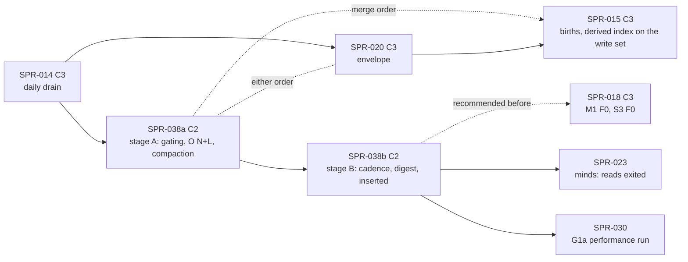

> **BLUF:** Removes the fixed per-instant engine overhead that SPR-014 exposed when it bound M2's `Day`/`Vital` drain to every day start (BCK-002 A-60: about 360 instants a year where there were 12–14), and the costs that grow with the life-course log, **in two stages in one plan, as SPR-019 has. Each stage is its own PR, Tester pass and audit.**
>
> - **Stage A, PR `SPR-038a`** (C2, exact, about 3 agent-days; T-01 to T-04):
>   - the before-figures and the `instant` bench, with release `every-change` priced on the CI gates;
>   - owned columns moved by `ColumnId` slots, every put-back still taking a new version;
>   - compaction, `Ledger::check`, each system's `invariants()` and the lagged-read snapshot run only after a change, with **`every-change` semantics in every build**;
>   - the write guards' pre-images copied at a column's first `write()`, which removes SPR-014's known narrowing;
>   - `Ledger::check` and M2's `invariants()` in O(N + L);
>   - positional compaction;
>   - no `format!` and no allocation on a quiet instant;
>   - the test that the cached plane hash equals the full hash after every instant.
>   - Merges after SPR-014, in either order with SPR-020, **before SPR-015** (CI's core part is at 14:48 against a 15:00 hard limit).
> - **Stage B, PR `SPR-038b`** (C2, about 3–3.5 agent-days; T-05 to T-08):
>   - **the check cadence as a run parameter**, `--check-cadence {every-change,yearly}`, whose default is `every-change` in every build;
>   - `Engine::check_now()` at run end and before each keyframe;
>   - cross-cadence replay and resume refused by name;
>   - the write guards' O(rows) value checks compiled out of release, with a test that proves it (SPR-007's pattern);
>   - a debug soak of every world that registers a ledger-writing system, with an inventory gate;
>   - **the month-end digest made incremental and hash-identical** (one plane-A Merkle cache across stops, no clone except for keyframes and dumps);
>   - **the instant log** (P1a shared ruling X1): an engine-owned, per-instant record, read-only to steps, filled only at the serial merges and outside every hash, keyframe and journal. It holds (a) `inserted()`, consumed by SPR-018, and (b) `exited()`, consumed by SPR-023. SPR-021's EVO-002 later adds (c) without changing (a) or (b);
>   - one-sim-year `solo` and `hamlet` benches and a greedy-writer case in the gate;
>   - "do not dispatch a job without work", only as the fallback if the quiet-instant target is missed.
>   - Lands in any gap after stage A, before SPR-018 if possible, **before SPR-023** (it consumes `exited()`), and before SPR-030 in any case.
>
> **Behaviour-neutral: no baseline moves in either stage.** Every ladder, channel-A file, keyframe, `draws_golden` line and `m2_system` figure stays byte-identical, before and after.
>
> **Targets (70%):**
> - a quiet instant costs at most 20,000 instructions on the bench's arena, about 4× the stub floor, and the same within 5% at 10⁴ ledger rows and 10⁵ log rows;
> - zero allocations on a quiet instant;
> - `solo` at most 23k instructions per instant, every rung at least 4× faster;
> - the debug `m2_system` gate's target is set from T-01's measurement (probably ≤ 30 s, from 82 s);
> - CI's per-part median step time is lower in every part (`core`, `golden`, `stream`, assuming PR #89), with each added gate within its ×1.5 budget.
>
> **G1a:** SPR-038 is **necessary** for G1a. With positional compaction and the incremental digest it is expected to remove the terms the core controls, but **SPR-030 measures whether it is sufficient**. T-01 states the arithmetic after both stages.
>
> - **Developer:** AGT-002-CORE (`rh-core`, `rh-sys-demography`'s `invariants()`, `rh-snapshot`'s cache use), with AGT-002-TOOLS for `rh-bench`, `rh-golden`'s run loop and flag, `bin/perf_gate.py`, `bin/golden_nightly.sh` and the gates. One session may hold both.
> - **Testers, per stage:** AGT-003-DET (byte identity, the gates' exactness, the cache, the cadence, the release compile-out) and AGT-003-IF (the C2 surfaces: the `05.1` sentences, `WorldTables`' consumers, the run parameter and its records, the instant log). One session may hold both, on a different model from the Developer's.
> - **Size and class:** about 6.25–7 agent-days in all: stage A about 3 (T-01 0.75, T-02 1.0, T-03 1.0, T-04 0.25–0.5), stage B about 3–3.5 (T-05 1.0, T-06 1.0, T-07 0.75–1.0, T-08 0.5). **Both stages are C2 with `[perf-baseline]`.** Each changes `rh-core`'s contract with systems or hosts and `05.1`'s text, no `state_hash` moves, and each records or re-records the perf baselines with the tool.
> - **Status:** PLANNING, **revision 1.** The Architect's rulings S1–S16 on the independent review of revision 0 (`fb5d68b`) are applied. It needs the director's plan approval (D60; GOV-005 §2: C2 work).
>
> **Review record:** REV-SPR-038, which the Architect writes at close, holds the independent review of revision 0 (0 BLK, 7 MAJ, 7 MIN, 2 NIT; the diagnosis reproduced, the drafter's finding 3 verified as a G1a blocker) and the rulings S1–S16 applied here. Every `S` id in this plan is that review's.

# SPR-038 — Per-instant engine cost, stages A and B (BCK-002 A-60)

- **Roadmap item:** no `docs/11` WP of its own. It is engine machinery that SPR-030's G1a performance run needs: P1.14's criterion, 1,000 years of a 10k-person dynastic world in ≤ 60 s on 8 cores (`docs/11:189`; PRJ-002 §5). BCK-002 A-60 (`CODEX/05_PROJECT/BCK-002_ArchitectBacklog.md:80`) places it before SPR-030's performance run · **Phase / rung:** P1a; `smoke`, rungs 0–2, and a fixed-size 10k synthetic
- **Code cites** are to `sprint/SPR-014-lifecycle-queues` at `921d372` (PR #83), the code this sprint changes, unless they are marked `main` (`3e2e6ef`).
- **Depends on (the precondition head):**
  - **Stage A:**
    - **SPR-014 merged** (PR #83): the daily drain, `AccessSpec::drain_only` (`access.rs:195–199`), the row insert (`engine.rs:1447–1513`), and A-60's first part (`1bd05a6`).
    - **SPR-020 in either order** (PR #84: 111 changed lines in `engine.rs`, 185 in `system.rs` and 89 in `register.rs` on its branch). Whichever lands second rebases. SPR-020's cause writes at the merge mark stage A's write set (the coordination row).
    - **Before SPR-015:** SPR-015 may be developed in parallel; it merges `main` after stage A and hooks its derived index (W4) onto stage A's write set (S6).
  - **Stage B:** stage A merged; SPR-015 not required; before SPR-018 if possible (its T-05 then measures on the cheaper engine), and before SPR-030 in any case.
  - **Independent of** SPR-016, SPR-017, SPR-026 and SPR-027.
- **Binding contracts:**
  - `05.1` §2 rule 2: draining (`main`'s `05.1_simulation_core.md:73`) and "Ledger rows enter by insert" (`:77`); §4.1; §4.2 row 11 `Bookkeeping` (`:171`); §6 items 5 and 6 (`:263–265`: hashes "monthly in CI and debug builds and yearly (configurable) in release builds"); §9 (`:333–343`).
  - **SPR-011 ruling 5** (`SPR-011_WalkingSkeleton.md:34`): compaction at the start of `Bookkeeping`, an append-only life-course log, exit fields written once. Both stages keep its semantics exactly.
  - **SPR-007 T-04** (`SPR-007_HashesKeyframesJournal.md:45, :81`): the unsynced guard runs in debug only, proved by `crates/rh-snapshot/tests/guard.rs:49` and `:96` and gated in `check_all.sh` (`main`:1253).
  - **SPR-007 T-01 and the Merkle cache** (`main`'s `crates/rh-snapshot/src/hash.rs`):
    - `chunk_hash` (`:162`), `table_root` (`:181`), `TableDigest::of` (`:208`), `MerkleCache::update_world` (`:515`), `PlaneDigest::from_tables` (`:311`);
    - VER-SPR-007 DEF-1: identity and versions;
    - `state_digest` (`crates/rh-snapshot/src/state.rs:103–115`).
  - **SPR-009** rulings 2, 3 and 5, R-7 and R-8. `bin/perf_gate.py` (`main`): `LIMIT_PERCENT` `:65`, `BENCH_TARGETS` `:70`, `alloc_compare` `:651–683` (a decrease passes and is kept, `:680`). `crates/rh-bench/README.md:32–34`: a perf-baseline PR merges by rebase, never squash.
  - `docs/08` §9 (`:229–249`).
  - `docs/09`: V-PERF-04 (`:210`), V-PERF-11 (`:217`), V-INV-01 (`:125`: "After every pulse"), V-INV-02 (`:126`), V-INV-04 (`:128`), V-SCALE-01 (`:659`), V-DET-01, V-DET-02, V-DET-05.
  - `docs/03`: SIM-8 (`:51`: "Violations shall fail the run in debug and CI builds"), DET-11 (`:75`), PERF-4 (`:245`).
  - `specs/systems/S3.migration.odd.toml` (`main`): `:130–136`, `:154` (the hand-off "left to the sprint") and `:165` (R4).
  - `bin/golden_nightly.sh` (`main`): the V-INV-02 debug soak, `:108–116`, over `household` and `hamlet` only (`:111`).
- **System spec:** none is changed. INV-M2-01, 02 and 04 state properties "after every Bookkeeping", independent of where they are checked. S3 is read, not edited.
- **Rulings (binding):**
  - **REV-SPR-038, S1–S16 and the Architect's restated D60** (2026-10-18);
  - BCK-002 A-60;
  - REV-WAVE6 X1, X7 and Z1 (`REV-WAVE6-plans.md:44, :50, :60`);
  - REV-WAVE5 W4, W31 and W42 (`REV-WAVE5-plans.md:59, :78, :84`);
  - **the P1a shared rulings of 2026-10-18** (REV-WAVE7, REV-MINDS): X1 (the instant log: one builder, this sprint's stage B, for parts (a) and (b)), X9 (the merge-order graph) and X10 (CI by role across three parts, assuming PR #89).
- **Director items:** D60, the Architect's restatement, with a confidence per item.
- **Requirements covered:**
  - PERF-4: the gated benches, including real `solo` and `hamlet` years;
  - SIM-8: violations fail the run in debug and CI builds, at `every-change` by default in every build, with a debug soak of every ledger-writing world;
  - SIM-4 and EVO-1: every write of a ledger column is checked by its pre-image, and the narrowing is gone;
  - DET-11's pattern: the value checks compiled out of release, with a test.

## The cost today (SPR-014's measurement, reproduced by the review)

| What | Figure | Where in the code |
|---|---|---|
| Instants per sim-year | about 360, against 12–14 before SPR-014 | M2 0.2.3's drain-only `Day`/`Vital` (`demography.rs:422–426`) |
| Instructions per instant, `solo` (callgrind, glibc malloc) | 93k (SPR-014's Developer); **92k reproduced** by the review on `921d372` | `run_instant` (`engine.rs:849–947`) |
| Moving owned columns out and back | 36% (40% in the review); `memcmp` about 20% self | `job_inputs` builds a `BTreeMap<&'static str, Column>` per job (`:278`, `:1186–1201`). `WorldTables` is a `BTreeMap<String, (u64, Column)>` (`world.rs:47–52`): `take` drops the key (`:144–146`), `insert` allocates one (`:105–109`), at the put-back (`engine.rs:1287`) |
| Ledger write guards per M2 job | 24% (about 16% in the review) | For a job with work, `Ledger::guard` clones `person.id` and the ten `life_course.*` columns (`ledger.rs:274–276, :283–285`), and the check compares them (`:369–456`). Per call: about 15k fixed (before `1bd05a6` removed its 19 `String` copies) |
| `Ledger::check` and `compact` at every `Bookkeeping` | 12% (13% in the review) | `engine.rs:881`, `:1079`. A `BTreeMap` of open entries over the whole log (`ledger.rs:209–215`); `compact` collects every column anew (`:155–165`) |
| M2's `invariants()` | O(L) + O(N log N) + O(D log N), with L log rows, N living and D dead | `demography.rs:535–592`, a binary search per closed row (`:564–568`) |
| **Growth with L at N = 10⁴** (the review's 10⁴-founder probe) | a quiet day takes 1.12 ms at L = 10⁴ and 3.99 ms at L = 1.1 × 10⁵; a death day 1.31 and 10.07 ms. At L = 1.1 × 10⁵: 44M instructions per instant, of which M2's invariants are 19.3M, `run_passes` 15.6M, `Ledger::check` 8.8M and compaction 0.7M | — |
| **Compaction and insert per event, at N = 10⁴** (the review's microbenchmark, at 9 / 15 / 25 `person.*` columns) | current collect 71 / 109 / 309 µs; in-place retain 63 / 93 / 161; **scan then positional `Vec::remove` 11 / 17 / 26**; insert 7 / 12 / 22. Over 333k deaths per 1,000 years: 24 / 36 / 103 s now and 3.5 / 5.6 / 8.5 s positional | `ledger.rs:144–167` |
| **`person.*` columns per world** | 9 today (M2 0.2.3). 14 after SPR-015 (M2 0.3.0 adds `household`, `parity`, `last_birth_tick`, `conceived_tick`, `unborn_father`: `specs/systems/next/M2.demography.odd.toml`), 15 with S3's `residence` (SPR-018), 16 with M7's `vocation` (SPR-021) and 17 with T1's `named` (SPR-023). Ten `life_course.*` columns throughout | — |
| `format!` per instant | 2.2% | `engine.rs:936–944`, a ring of 1,000 `String`s (`crash.rs:35`) |
| **The month-end digest** (the drafter's finding 3, **verified as a G1a blocker**) | `snapshot()` 4.2 ms plus `state_digest` 4.3 ms = 8.5 ms per stop at 1.19M cells. Stops fall at every month end, and with `--run-dir` at every month start too: 12,000–24,000 per 1,000 years, so **102–200 s, about 270 s at L = 3 × 10⁵**, against G1a's 60 s | `rh-golden/src/run.rs:683`: `state_digest(&engine.snapshot())`; `engine.rs:383` clones every table |
| Allocations per instant (V-PERF-11, glibc) | about 60 on the rungs | `allocations_v1.txt:12–14`: `solo` 21,420 in 360 ticks |
| The stub floor | `draws/step_draws/empty`: 16,611 committed, **17,833 on SPR-014's head** (the baseline is stale). It covers two instants (`advance_until(1440)` is inclusive, `engine.rs:693`) plus a 1,000-step loop, so about **5k per instant** on the arena | `instructions_v1.txt:13` |
| Wall time, 200 years headless | `solo` 0.074 → 0.875 s, `household` 0.079 → 0.873, `hamlet` 0.106 → 1.029 | — |
| M2's system gates | 59 s → 294 s, then 227 s. **The debug `m2_system` gate takes 82 s on CI** (run 39078266492; 99 s in `376a47a`'s message), against about 4 s before SPR-014, and sits in part golden (`check_all.sh:1408–1409`) | — |
| CI, `check_all` step | SPR-014's head `921d372` (run 39078266492): core 14:48, golden 11:11. PR #83's earlier run 39077091382 had golden at 8:13, a 36% swing. `main` `39b8d76` (run 39073315181): core 11:38, golden 6:28 | — |

## Specs this sprint needs

| Spec | Exists? | Gap | Architect ruling | Stage, task |
|---|---|---|---|---|
| **Column storage and moves by index** | `WorldTables`: a public name-based API (`world.rs:96–147`) used by `rh-snapshot`, `rh-worldgen`, `rh-golden` and `rh-bench`. Columns are created only in `Engine::new` (`engine.rs:326–331`) | A string-keyed `BTreeMap` operation and a `String` allocation per take and put-back | **Proposed (80%):**<ul><li>name-sorted slots `{name, version, Option<Column>}` and `ColumnId`s resolved in `Engine::new`;</li><li>crate-private, O(1), allocation-free `take_at` and `put_at`; a moved-out column reads as absent, as today;</li><li>the public API and name-order iteration unchanged;</li><li>**in stage A every put-back still takes a new version**;</li><li>a view's owned columns are a reused `Vec` in write order;</li><li>`Ledger` keeps `ColumnId`s;</li><li>`insert_rows` works by id.</li></ul> | A, T-02 |
| **Positional compaction** (S4) | `compact` rebuilds every `person.*` column with `collect` (`ledger.rs:155–165`) | O(N · C) per death; "in place" saves almost nothing (the review's microbenchmark) | **Ruled (S4):**<ul><li>one scan of `person.alive` for the dead rows' positions;</li><li>then a positional removal per column;</li><li>the same rows kept in the same order, and a new version for every column it changes;</li><li>`death/n10k_*` is gated on it.</li></ul> | A, T-02 |
| **The cache equals the full hash** (S11) | `MerkleCache::update_world` is used only by tests and benches. `rh-golden` hashes in full at every stop (`run.rs:683`), so a missing version bump is invisible | No test can fail on the version discipline | **Ruled (S11):**<ul><li>in the per-instant test, a plane-A `MerkleCache` kept across instants equals `PlaneDigest::of_world` after every instant;</li><li>the mutant `mutant-compact-keeps-version` fails it.</li></ul>Stage A owns it, because positional compaction lands there. It guards stage B's cache too | A, T-02 |
| **The write set and the gates, `every-change` semantics in every build** | No record of which columns a step wrote. `SystemView::write` (`world.rs:260–267`) is the only mutable path a step has | — | **Proposed (85%):**<ul><li>`write()` sets the column's written flag, a field behind `&mut self` (W31);</li><li>every core write path marks its columns: put-back by the flags, insert, compaction, SPR-020's cause writes, construction, restore. Every mutable slot accessor takes the set.</li><li>**The gates, each keyed "since it last ran":**<ul><li>compaction when `person.alive` was written or rows were inserted;</li><li>`Ledger::check` when any ledger column was written, inserted or compacted;</li><li>each system's `invariants()` when any column was;</li><li>a lagged column's snapshot re-copied when that column was written.</li></ul></li><li>**Exact for every run:** compaction of a table with no dead row changes nothing (`ledger.rs:150–152`); the checks are pure functions of `&WorldTables` (W31); an unwritten lagged column equals its copy.</li><li>**S12:**<ul><li>a test-only `Gating::Off` runs every check, compaction and snapshot copy at every instant. It is the reference for the differential test.</li><li>It is separate from the read-only cadence of stage B.</li></ul></li></ul> | A, T-03 |
| **The narrowing removed** (A-60; `ledger.rs:249–253`; `tests/lifecycle_queues/guard.rs:12`, mode 2) | `1bd05a6` keeps only row counts for a job without work | Remove it, or prove it safe | **Ruled (85%; S12):**<ul><li>the guard's pre-image of a guarded column (`person.id`, every `life_course.*`) is copied at the column's **first `write()` in the job**;</li><li>a job that writes no guarded column pays nothing;</li><li>every write is value-checked, whatever the job's work. In stage A this holds in every build; stage B compiles the value checks out of release.</li><li>Mode 2 becomes a refusal by name.</li><li>**No separate no-work refusal:** it is redundant with the pre-image. "Do not dispatch a job without work" is held only as the stage-B fallback (T-07).</li></ul> | A, T-03; B, T-07 (fallback) |
| **`Ledger::check` and M2's `invariants()` in O(N + L)** | `ledger.rs:209–243`; `demography.rs:564–568` | 19.3M + 8.8M instructions per call at L = 1.1 × 10⁵ (the review) | **Proposed (75%):** sorted `Vec`s and one merge over sorted ids, with **the same results, names and detail text** on every table. The current functions stay as test oracles | A, T-03 |
| **The diagnostic record and a quiet instant's allocations** | A `format!` per instant (`engine.rs:936–944`). The plan is cloned per phase (`:896`), and the per-phase and per-level `Vec`s are fresh | V-PERF-11's default is 0 | **Proposed (70%):**<ul><li>fixed-size records rendered byte-identically by `diagnostics()`;</li><li>the plan borrowed;</li><li>buffers kept across instants.</li></ul>A-32 (`BCK-002:52`) keeps the worker pool and the multi-thread buffers. **S16:** zero allocations is asserted in `instant/quiet/*` through the arena's bump offset (`alloc_count::Arena`, `crates/rh-bench/src/alloc_count.rs:142`), which must not move across the measured instant | A, T-02 |
| **The check cadence as a run parameter** (S1) | Release builds use no cadence today. `05.1` §6 item 6 makes release hashing "configurable" | A default of `yearly` for every release binary would hit CI's release golden runs; SIM-8 says "debug and CI builds" | **Ruled (S1):**<ul><li>`CheckCadence { EveryChange, Yearly }` governs the read-only state invariants (`Ledger::check`, the systems' `invariants()`). The queue-age, stale-timer and future-event checks run at every `Bookkeeping`, as today.</li><li>`rh-cli run --check-cadence {every-change,yearly}` and `RunArgs::check_cadence`.</li><li>**The default is `every-change` in every build and host.** `yearly` is opt-in, for production and the G1a run, and means the first `Bookkeeping` at or after each year boundary.</li><li>It is recorded in `run.toml` (an absent field reads as `every-change`) and in the crash artifact.</li><li>In the ladder header it appears **only when it is not the default**, as `leak thread` does (`ladder.rs:36`), so every default ladder and baseline stays byte-identical.</li><li>T-01 prices release `every-change` on the CI gates. `rh-golden` is edited.</li></ul> | B, T-05; T-01 prices |
| **`check_now`, persistent violations, and cross-cadence replay** (S2) | `yearly` would leave the last partial year unchecked: `year_end_in` is `year·mpy − 1` (`rh-golden/src/run.rs:368`), and a keyframe cut at a year end comes before the check. `provenance.build` carries no profile (`rh-golden/src/world.rs:256`, `rh-golden/src/run.rs:299`). `Engine::replay` (`engine.rs:733–780`) returns `NoFailure` or `Mismatch` across profiles | — | **Ruled (S2):**<ul><li>`Engine::check_now()` runs every state invariant once, O(N + L). Hosts call it at run end and before each keyframe, whatever the cadence.</li><li>A replay or resume whose cadence differs from the run's recorded one is refused by name.</li><li>The crash artifact also records whether the value checks were compiled in, and a replay in a build that cannot reproduce the failure is refused by name, on S2 (iii)'s evidence.</li><li>"Fails at the same instant" is claimed only for **violations that persist**. A transient violation that heals before a yearly check is not caught under `yearly`; that is the opt-in's stated cost.</li></ul> | B, T-05 |
| **The value checks compiled out of release; the debug soak obligation** (S3) | The nightly debug soak covers only `household` and `hamlet` (`bin/golden_nightly.sh:111`). `solo` (M2) has none, and `twin_vales`, `kingdom_10k` and `manor` (M7, S3, T1) have no debug run anywhere | The compile-out rests on every ledger-writing system running under the full guards somewhere | **Ruled (S3):**<ul><li>the write guards' O(rows) value checks (A-2, the life-course rules, DEF-3, DEF-6) run under `cfg(debug_assertions)`, with `LEDGER_VALUE_CHECKS == cfg!(debug_assertions)` and a release test in SPR-007's form;</li><li>G-1, the row counts and the log's length run in every build;</li><li>**every world that registers a ledger-writing system has a debug run in `golden_nightly.sh`.** A check in `python/tests/test_check_all_inventory.py` reads each `worlds/*/world.toml`'s systems, which are the manifest's or the template's `default_systems`. It also reads each spec's `[[owns]]` of `person.*` or `life_course.*`. It refuses a world that registers such a system and is absent from the debug soak;</li><li>its first finding, `solo`, joins the soak here;</li><li>**`twin_vales` (300 years) joins in the sprint that first makes its genesis runnable** (SPR-019b, or SPR-030 at the latest), and the gate enforces it then.</li></ul> | B, T-05 |
| **The incremental, hash-identical month-end digest** (S5) | `state_digest` hashes each world column with `TableDigest::of` (`chunk_hash` + `table_root`; `hash.rs:162, :181, :208`), and `MerkleCache::update_world` (`:515`) uses the same two functions over versioned dirty chunks | 8.5 ms per stop, of which half is the clone | **Ruled (S5; 75%), stage B, C2 (not a C3 sprint):**<ul><li>the run loop keeps one plane-A `MerkleCache` across stops;</li><li>the world columns go through the cache, borrowed from `engine.tables()`, with no clone;</li><li>the engine tables are encoded at each stop as now (`main`'s `state.rs:109–113`);</li><li>the two are combined into the same `PlaneDigest` (`from_tables`);</li><li>`engine.snapshot()` is cloned only for a keyframe or a dump.</li><li>Every ladder and baseline stays byte-identical, guarded by S11's test, which here compares cached and full at every stop in debug and at every rung and keyframe in release.</li><li>**For the cache to skip a column, the put-back gives a new version only when the column's written flag is set.** The core's own writes always do. This is exact by the write set: an unwritten column is unchanged. Its guard is S11's test and `mutant-compact-keeps-version`.</li><li>**What stays O(L) per stop:** a written `life_course.*` column is re-hashed in full, because a version marks every chunk (`hash.rs:480–483`). T-01 and T-08 state that residual.</li><li>If the Architect reads version-on-write as hashing machinery (C3 by `docs/13` §4.2), or any part of the digest cannot be made identical, **that part becomes BCK-002 A-68** (a C3 digest-cadence item before SPR-030), and stage B keeps the rest: the clone removed, the cache over columns versioned as in stage A.</li></ul> | B, T-06 |
| **The instant log** (S13; P1a shared ruling X1, 65%) | S3's R4 scans every row at each day start (`S3.migration.odd.toml:154`), and the spec allows the hand-off. SPR-023 needs this instant's exits, and SPR-021 needs this instant's merged events (A-59) | No engine-owned per-instant record; three plans proposed three mechanisms | **Ruled (S13 85%; X1 65%): one engine-owned record in `rh-core`, built here:**<ul><li>**Shape:** `InstantLog { inserted, exited }`, a field of the engine, read by steps through `StepCtx::inserted()` and `StepCtx::exited()` (`&[PersonId]`), never written by a step.</li><li>**Filled only at the serial merges**, in the merge's canonical order (`05.1` §2 rule 4), so its content is thread-invariant.</li><li>**Cleared at the instant's end.** It is in no `EngineState`, plane hash, keyframe or journal: a keyframe is cut after `Bookkeeping`, so nothing in it outlives its instant.</li><li>**(a) `inserted()`:** the person rows inserted at the merges so far this instant, in ascending row order, kept by a **sorted insert** at each merge's row insert and filtered at compaction.</li><li>**(b) `exited()`:** the persons whose `person.alive` went from 1 to 0 at a merge so far this instant, in merge order and ascending `PersonId` within a merge. They are found by scanning `person.alive` **only at a merge where `person.alive` was written** (stage A's write set), and a person already listed is not listed twice.</li><li>**(c) is SPR-021's** (T-02, under EVO-002): the events merged so far this instant, by (kind, target), with their `EventId`s. The log is built to EVO-002's text if EVO-002 has merged by T-07, and otherwise to this plan's text, which EVO-002 then extends. Adding (c) adds a field, its fill at the event merge and its accessor, and changes neither (a) nor (b): T-07 pins their outputs so the extension is checked.</li><li>**Consumers:** SPR-018 T-03 (S3's selector reads `inserted()`) and SPR-023 (T1 reads `exited()`). SPR-038's completion does not depend on either conversion; the Architect adds one line to each plan.</li><li>S3's equivalence with R4 holds while every insert precedes the reader in its instant, asserted on the reader's side in debug.</li></ul> | B, T-07 |
| **The benches** (A-60; S9, S10, S16) | `rh-bench` has no ledger bench. `draws/empty` is a stale two-instant stub | A bench that varies N and L independently, plus real worlds | **Proposed (75%):**<ul><li>**stage A's `crates/rh-bench/benches/instant.rs`**: a stub `B1.ledger` with M2's 19 column names. Its `Month`/`Vital` step rewrites one `person.spouse` cell with its own value, so a held year ends with one full check. It has a drain-only `Day`/`Vital` with an empty inbox and a `Day`/`Vital` death timer.</li><li>**Seven cases:** `quiet/n1_l1`, `quiet/n10k_l100k`, `death/n10k_l10k`, `death/n10k_l100k`, `insert/n10k_l100k`, `year/n10k_l10k`, `year/n10k_l100k` ("the genesis held for a year", at `kingdom_10k`'s genesis size and at a late size).</li><li>**Stage B adds (S10)** one-sim-year `rungs/solo_year` and `rungs/hamlet_year` with real M2 (`rh_bench::rungs`), and `instant/greedy_writer/n10k_l100k`: a stub that calls `write()` on all its columns at a quiet instant without changing them.</li><li>`05.1` says `write()` is for writing (T-07).</li><li>`BENCH_TARGETS` gains `instant` at stage A's close and `rungs` at stage B's. Both are unnumbered, like `draws`, with lines in `docs/08` §9.</li><li>**S9:** every figure is stated on one allocator. The 93k and 60-allocation figures are glibc's; the gates run on the arena (`main`'s `perf_gate.py:230–231`). T-01 states both for `solo`.</li></ul> | A, T-01; B, T-07 |
| **Coordination with SPR-015 and SPR-020** | SPR-015 T-02's `apply(&mut Index, &MergedWrites)` runs after every level's merge. SPR-020 T-05 keeps "the rows of every column with a `cause_column`" | Per-level O(rows) if built by diffing | **Proposed (70%):**<ul><li>`MergedWrites` and the cause guard read stage A's write set, since SPR-015 merges after stage A (S6);</li><li>SPR-020's cause writes at the merge mark it;</li><li>only S6 (P1b) declares a `cause_column` (`S6.artifacts.odd.toml:92–110`)</li></ul> | A, T-03 |
| **The class** | `docs/13` §4.2 (`:88–97`) | — | **Proposed (75%): both stages are C2 with `[perf-baseline]`:**<ul><li>stage A changes `rh-core`'s write-set contract and `05.1` §9's gating text;</li><li>stage B adds the run parameter, `check_now`, `inserted()` and `05.1` §4.2 and §9's cadence text;</li><li>no `state_hash`, hash layout, phase order, RNG, compaction semantics or journal changes;</li><li>stage B's version-on-write is hash-identical by S11's test (with the A-68 fallback above).</li></ul>CI detects C1, and the declared C2 wins | — |
| **CI** (S6, S15; X10) | Core 14:48 against the 15:00 hard limit; golden 11:11 (8:13 on another run). PR #89 (A-63 as built, `arch/ci-third-job`) splits the tier into `core`, `golden` and `stream` and moves about 295 s out of core: on its branch the release q(15) and V-DATA-04 gates and the perf gates sit in golden, the debug `m2_system` gate in core, and the rungs' stream, tail, sift and replay runs in stream | Relief must reach core soon | **Proposed (75%), assuming PR #89 has merged (X10):**<ul><li>each stage lists its gates by role in each of the three parts (the CI-gates table below), and budgets them by **gate-time sums on one runner, ×1.5** for slow runners;</li><li>stage A lands before SPR-015;</li><li>**the improvement is measured as S15 rules:** the ratio of the median per-part `check_all` step times over 3 CI runs each of the PR head and the merge base;</li><li>K24's base is replaced by PR #89's first CI run;</li><li>no gate moves to the nightly tier;</li><li>the debug `m2_system` gate returns to core at stage A's close if SPR-014's move has put it in golden and core's budgeted sum stays under 12:00</li></ul> | A, T-04; B, T-08 |

## Targets (70%; on one machine for base and head, median of 3; CI figures as S15's ratio)

| Measure | Today | Target | Stage, how |
|---|---|---|---|
| A quiet instant (only a drain-only binding fires, its inbox is empty, no timer is due, no input is queued), on the arena | about 92k per instant averaged over `solo` (glibc); the bench is new | **≤ 20,000 instructions**, about 4× the stub floor of about 5k | A: `instant/quiet/n1_l1` |
| The same at N = 10⁴, L = 10⁵ | 3.99 ms per quiet day at L = 1.1 × 10⁵ (the review) | **≤ 1.05 × the N = 1 case** | A: `quiet/n10k_l100k` ÷ `quiet/n1_l1` |
| Allocations on a quiet instant, 1 thread | about 60 (glibc) | **0** (the arena's bump offset unchanged; the gates run on the arena, `main`'s `perf_gate.py:230–231`) | A: `instant/quiet/*` |
| A death at N = 10⁴ | 71 µs compaction, plus O(L) clones and checks | **positional compaction**. Its figure is gated: in stage A at `death/n10k_*`; in stage B, in release, **no term in L** (`death/n10k_l100k` ≤ 1.05 × `death/n10k_l10k`) | A and B: iai-callgrind |
| `solo`, instructions per instant over 200 years | 92k (glibc) | **≤ 23k** (≥ 4×), stated on glibc and on the arena (S9) | A: callgrind; B: the `rungs/solo_year` gate |
| Wall time per rung, 200 years, headless, release | 0.875 / 0.873 / 1.029 s | **each ≤ ¼ of the merge base's** | A, re-measured in B |
| The debug `m2_system` gate | 82 s on CI | **set from T-01's measurement** (expected ≤ 30 s), recorded in the PR before T-02 starts | A |
| M2's system gates, summed | 227 s | **≤ 90 s** | A |
| CI per part (`core`, `golden`, `stream`, after PR #89) | core 14:48, golden 11:11 on SPR-014's head (two parts); PR #89's first CI run is the base | **median ratio head ÷ base < 1 in every part** (3 runs each), with the added gates within their ×1.5 budgets | A and B |
| The month-end digest per stop at N = 10⁴, L = 1.1 × 10⁵ | 8.5 ms | **no clone; unchanged columns skipped.** The O(L) residual of written log columns is reported | B: T-06 |
| **G1a arithmetic** | 102–270 s of digest, plus compaction and checks | stated by T-01 for "after stage A" and "after both stages", re-measured by T-08. **SPR-030 measures sufficiency** | A: T-01; B: T-08 |

**A missed target is reported with its figure, and the Architect rules. No target is lowered silently.** The quiet-instant fallback is stage B's "do not dispatch a job without work" (T-07).

## CI gates by part (X10; PR #89's three parts assumed)

Each gate is in exactly one part. The time is a gate-time estimate on one runner, and the budget is ×1.5.

| Stage | Part | Gate, by role | Estimate (budget ×1.5) | Effect on the part |
|---|---|---|---|---|
| A | core | **Exactness:** `rh-core` `per_instant`: the differential test against `Gating::Off`, the planted violations, S11's cache test and the O(N + L) oracles | about 20 s (30 s) | added |
| A | core | **Debug system:** the debug `m2_system` gate, back from golden only if SPR-014 moved it there, at its T-01 target | ≤ 30 s (45 s) | moved; from 82 s |
| A | golden | **Positive controls:** four mutant rebuilds of `rh-core` (`compact-keeps-version`, `unmarked-put-back`, `late-pre-image`, `stale-lagged-snapshot`) | about 6–10 s each, 24–40 s (60 s) | added |
| A | golden | **Performance:** `instant` inside V-PERF-04 and its repeatability run | about 15–30 s per run, twice (90 s) | added |
| A | golden | **Release system:** q(15) and V-DATA-04 (PR #89 placed them here), now with gated checks | from T-01's pricing | falls: these are most of M2's 227 s |
| A | stream | **Rung runs:** the rungs' stream, tail, sift and replay runs, every rung at least 4× faster | — | falls |
| B | core | **Contract:** `ledger_release` (the release compile-out) and the soak inventory check | about 15 s (25 s) | added |
| B | golden | **Cadence:** the `yearly` and refusal tests on the rungs, and `check_now` | about 15 s (25 s) | added |
| B | golden | **Positive control:** `mutant-put-back-keeps-version` | about 8 s (12 s) | added |
| B | golden | **Performance:** `rungs` (`solo_year`, `hamlet_year`) and `greedy_writer` inside V-PERF-04, twice | about 30–60 s (90 s) | added |
| B | golden | **Digest:** the cached digest equal to the full one at every stop, asserted inside the golden runs | inside the runs | falls: the clone and the unchanged columns go |
| B | stream | **Instant log:** its consumer, thread-invariance and outside-every-hash tests | about 10 s (15 s) | added |
| B | nightly | **Soak:** `solo`'s debug run joins `golden_nightly.sh` | about 5–10 s | nightly only |

**Nightly candidates, if a part's median does not fall:** three of stage A's four mutant rebuilds (`unmarked-put-back` stays), the `instant` and `rungs` repeatability runs, and stage B's mutant.

## Compliance (every task)

| Rule | This sprint |
|---|---|
| Change class (`docs/13` §4.2) | **C2 with `[perf-baseline]` per stage.** PR titles: `SPR-038a: per-instant engine cost, stage A [perf-baseline] [C2]` and `SPR-038b: per-instant engine cost, stage B [perf-baseline] [C2]` |
| Planes touched (ADR-0024) | **A:**<ul><li>`rh-core`: `world.rs`, `engine.rs`, `ledger.rs`, `system.rs` (the instant log's accessors, B), `crash.rs` (the record, A; the cadence and value-check fields, B);</li><li>`rh-sys-demography`: `invariants()` only, same results (A);</li><li>`rh-snapshot`: no layout change; the cache is used by the run loop (B).</li></ul>**Tool:**<ul><li>`rh-golden`: `RunArgs::check_cadence`, `run.toml`, the ladder header's optional line, `check_now` calls, the cached digest (B);</li><li>`rh-cli`: the flag (B);</li><li>`rh-bench`: `instant` (A), `rungs` and `greedy_writer` (B);</li><li>`bin/perf_gate.py`, `bin/check_all.sh`, `bin/golden_nightly.sh` (B), and the inventory test (A, B).</li></ul>**B and C:** none |
| Owned columns written | None by a system. `rh-core`'s compaction and row insert are unchanged in effect (SPR-011 ruling 5; `05.1` §2 rule 2) |
| Reads (via `rh-contracts`) | None new. The instant log is an engine record, not a column (B) |
| RNG purposes added | None |
| Golden-hash effect | **None in either stage.** No file under `worlds/*/baselines/` changes. The ladder header gains a cadence line only for a non-default run |
| Fixed-point quantities | None |
| Determinism lints (GOV-003 §2, §6) | Must pass:<ul><li>no `HashMap`;</li><li>no interior mutability: the flags are `&mut self` fields (W31);</li><li>no float;</li><li>every mutant is a `mutant-*` feature, refused by `rh-cli run` and `regen_baseline.sh` (A-52)</li></ul> |
| Tests that gate this sprint | **A:** V-DET-01, 02, 05; V-INV-01 (the differential test against `Gating::Off`; planted violations); V-GOLD-01; V-PERF-04 (`instant`); V-PERF-11; and S11's cache test. **B:** those, plus V-INV-02 (the soak, `solo` added) and the inventory check; the release compile-out test; the cross-cadence refusals; the cache equal to the full hash at every stop and keyframe; V-PERF-04 (`rungs`, `greedy_writer`). Both with `bin/check_all.sh` |
| Docs updated | **A:**<ul><li>`05.1` §9 preamble (the gating: checks are pure functions of the tables, run after a change);</li><li>`docs/08` §9 (`instant`);</li><li>`crates/rh-bench/README.md`;</li><li>`ledger.rs`'s docs (the narrowing gone);</li><li>`CLAUDE.md` and `check_all.sh` with the inventory test;</li><li>BCK-002 A-60 updated (part 2 done).</li></ul>**B:**<ul><li>`05.1` §4.2 row 11 and §9 (the cadence parameter, `check_now`, the compile-out);</li><li>`05.1` §2 rule 2 (`inserted`; "`write()` is for writing");</li><li>`docs/03` SIM-8 and `docs/09` V-INV-01's wording (S14): "after every change (`05.1` §9) in debug and CI runs, at the run's cadence otherwise";</li><li>`docs/09` V-INV-02 (the soak obligation) and V-SCALE-01 (the cadence of a 10k run);</li><li>`docs/08` §9 (`rungs`);</li><li>BCK-002 A-60 closed, with A-68 filed if S5's fallback is used, and A-32's split noted;</li><li>SPR-018's one line, by the Architect.</li></ul>The `docs/03` text is put to the director in D60 |

**Rules carried from P0–SPR-020 (every task):**
- **Measure first.** T-01 is pushed before any change to `rh-core`, and its figures are re-taken after every merge of `origin/main`.
- **Byte identity at every task boundary,** against the merge base's binaries (T-04's and T-08's lists).
- **Property tests vary world size and seed:** three sizes (1, 60, 600 rows; plus 10⁴ in release) and eight seeds, fixed-seed SplitMix64.
- **A positive control fails for the right reason** (`fail:<text>`).
- **A probe asserts the path.** `Engine::check_stats()` counts compactions, ledger checks, invariant runs and snapshot copies. Like `DispatchStats` (`engine.rs:244–263`), it is an observation that never enters state. Each case asserts its path through it: a quiet case ran no check; a death case compacted one row; a year case ran one full check.
- **Python tests read no CI environment variable.** **No statistical gate.**
- **Every new gate is in exactly one `check_all.sh` part,** with the inventory test in the same commit.
- **Perf baselines come only from `perf_gate.py record` and `alloc-record`,** in a `[perf-baseline]` commit with a `Reason:` line and `perf-baseline-reason:` in the PR body, never typed. Each stage's PR merges by rebase, never squash.
- **No new third-party crate.** **One commit per task.** **Merge `origin/main` when main moves,** and re-run every part.

## Tasks

**Stage A (PR `SPR-038a`)** is T-01 to T-04. **Stage B (PR `SPR-038b`)** is T-05 to T-08 and starts from `main` after stage A has merged.

### Stage A: exact gating, O(N + L) checks, positional compaction (C2, about 3 agent-days)

#### T-01: The `instant` bench, the before-figures, the CI pricing and the G1a arithmetic (AGT-002-TOOLS; S1, S5, S8, S9)
- **Deliverable:**
  - **`crates/rh-bench/src/instant.rs` and `benches/instant.rs`:** the fixture and the seven cases of the specs table.
    - The fixture uses only `rh-core`'s public API, so it compiles on the merge base.
    - Each case's setup advances to the instant before the measured one.
    - Each case asserts its path (on the base, through the tables and `dispatch_stats()`).
    - It is run directly, **not yet in `BENCH_TARGETS`**: `perf_gate.py check` fails on a bench missing from the baseline, and T-04 records it.
  - **The before-figures,** in the PR body and in `VER-SPR-038a`, on the merge base, with their commands:
    - the seven cases and the sweep N ∈ {1, 10², 10³, 10⁴} × L/N ∈ {1, 10};
    - `draws`, benches 7 and 8;
    - `alloc_budget`'s lines and sites;
    - the per-rung wall times;
    - `solo`'s instructions per instant **on glibc and on the arena** (S9);
    - one year of real M2 on the 10,000-founder world of `rh-worldgen`'s q(15) test;
    - each system's `invariants()` per call at N = 10⁴, L = 10⁵;
    - SPR-015's hook per level, if SPR-015 is on `main`;
    - the month-end digest per stop at the `year` sizes;
    - each M2 gate's time, the debug `m2_system` gate included, from which **its stage-A target is set and recorded before T-02 starts** (S8).
  - **The pricing of release `every-change` on the CI gates** (S1): for each release gate that runs M2 (q(15), V-DATA-04, the rungs), its busy-instant count × the per-check cost after stage A's O(N + L) rewrite, as a projected gate time. The review's estimate for q(15) is about 45 s of CPU, about 12 s on 4 cores.
  - **The G1a arithmetic** (S5): for `kingdom_10k`'s 1,000 years (about 360k instants, 333k deaths, 12,000–24,000 stops), the engine's per-instant overhead, compaction, the checks and the digest, as three columns: today, after stage A, and after both stages (with `every-change` and with `yearly`). This states what remains for SPR-030 to measure.
- **Acceptance:**
  - The bench gives identical counts on two runs and on the base and this commit.
  - Every path probe holds.
  - Every figure is recorded with its command.
  - The debug `m2_system` target is in the PR.
- **Status:** [ ] not started

#### T-02: Columns by index, the record, zero allocations, positional compaction, and the cache test (AGT-002-CORE; S4, S11, S16)
- **Deliverable:**
  - **`world.rs`:** slots, `ColumnId`, `take_at` and `put_at`, every put-back still taking a new version; the view's owned `Vec`; name-based `read` and `write` keep their checks and errors as a linear scan over the entry's writes.
  - **`engine.rs`:** write ids resolved in `Engine::new`; `job_inputs`, the put-back, `check_owned_columns` and `insert_rows` by id; the entry's `person.*` set computed once.
  - **`ledger.rs`:**
    - `ColumnId`s;
    - **positional compaction**: one scan of `person.alive` for the dead positions, then a positional removal per `person.*` column, with the same rows in order and a new version for each changed column.
  - **The record:** fixed-size records rendered byte-identically by `diagnostics()`, with the `FATAL` line as text.
  - **The buffers:** the plan borrowed; `fired`, `due`, `passes`, the binding pass's groups, `guards`, `inputs`, `outcomes` and `outboxes` kept across instants (the multi-thread path is A-32's).
  - **S11:** `crates/rh-core/tests/per_instant.rs` keeps a plane-A `MerkleCache` across the instants of random worlds and asserts that it equals `PlaneDigest::of_world` after every instant. `mutant-compact-keeps-version` (positional compaction keeps the old version) fails it.
- **Acceptance:**
  - **Byte identity** against the merge base (T-04's list).
  - **The record:** random records render equal through the old `format!` and the new renderer, and an injected `solo` crash artifact is byte-identical to the base's, `diagnostics` included.
  - **Zero allocations:** in `instant/quiet/*`, the arena's bump offset does not move across the measured instant (S16). A planted allocation in the quiet path fails by name.
  - **Compaction:** `death/n10k_*` falls by at least the review's ratio at 9 columns (about 6×). Random worlds compact the same rows as the base's `collect`, compared column by column.
  - **S11:** cached equals full after every instant on three sizes and eight seeds, and the mutant fails it.
  - **Consumers unedited:**
    - `rh-snapshot`'s `hash`, `golden`, `keyframe` and `guard` tests pass;
    - `rh-worldgen`'s `genesis` and `keyframe` pass;
    - `rh-golden`'s tests and `rh-bench`'s other benches pass;
    - `gen_hash_golden.py --check` is unchanged.
- **Status:** [ ] not started

#### T-03: The write set, the gates with `every-change` semantics, the pre-image at first write, and the O(N + L) checks (AGT-002-CORE; S12)
- **Deliverable:**
  - **The write set:** flags set by `write()`; one engine bitset per "since" consumer; every core write path marks its columns, including SPR-020's cause writes; every mutable slot accessor takes the set.
  - **The gates:** compaction, `Ledger::check`, each `invariants()` and the lagged snapshot, each "since it last ran"; the queue-age, stale-timer and future-event checks at every `Bookkeeping`; the same semantics in every build.
  - **`Gating::Off`**, test-only (S12), and `Engine::check_stats()`.
  - **The guards:** the pre-image copied at the first `write()` of a guarded column in a job. **The narrowing is removed**, and the value checks run in every build in this stage.
  - **`Ledger::check` and M2's `invariants()` in O(N + L)**, with the current functions kept as test oracles.
  - **SPR-015's hook:** if SPR-015 has already merged in a rebase, its `MergedWrites` reads the write set.
  - **The `05.1` §9 preamble sentence** (the Architect's): "The core's ledger invariants and each system's `invariants()` are pure functions of the tables; `rh-core` runs them, and compacts the ledger and copies a lagged column, only after a column they cover was written, inserted or compacted since they last ran."
  - **Three mutants:**
    - `mutant-unmarked-put-back`: the put-back ignores `person.alive`'s flag;
    - `mutant-late-pre-image`: the pre-image is taken at the put-back;
    - `mutant-stale-lagged-snapshot`.
- **Acceptance:**
  - **Byte identity** against the merge base, in release and in debug.
  - **The differential test** (`per_instant.rs`): random worlds, three sizes and eight seeds, with stub systems writing random ledger and non-ledger columns at random instants, many instants quiet, lagged readers, inserts, deaths and drain-only bindings. Gated and `Gating::Off` give equal state hashes, events, commands and agenda after every instant. `check_stats` shows checks skipped on quiet instants and run on every changed one.
  - **Planted violations,** one per invariant and guard rule (unsorted ids, a dead row left, two open entries, an open entry without a row, an entry field changed, an exit field written twice, an open append with a non-open value, a closed append for a living person, an id changed, a system invariant broken). Each fails by name at **the same instant with the same error** gated as under `Gating::Off`.
  - **The narrowing:** `guard.rs` mode 2 (`:12`, `:157`) becomes a refusal by name, renamed `a_drain_without_work_that_writes_is_refused_by_name`.
  - **The O(N + L) checks:** the same results, names and text as the oracles on every random table and planted violation.
  - **Mutants:** each fails a named gate for its reason:
    - `unmarked-put-back`: a dead row survives, the hash differs at that instant, and the `solo` ladder fails;
    - `late-pre-image`: the entry-field refusal;
    - `stale-lagged-snapshot`: the differential test's lagged reader.
  - **Lints:** `lint_forbidden` and `lint_arch` green (W31's hidden-state rule).
- **Status:** [ ] not started

#### T-04: Stage A's evidence, baselines, CI and docs (AGT-002-TOOLS with AGT-002-CORE; S6, S15)
- **Deliverable:**
  - **The byte-identity record** against the merge base, with both binaries on one machine:
    - the four PR-tier ladders at 1 and N threads (`check_baseline.py`), with no baseline file changed;
    - the nightly ladders on the head (`golden_nightly.sh`, the debug soak equal to release);
    - every segment and keyframe of the three rungs' run directories (SHA-256);
    - `tail --canonical`, `replay` REPLAY EQUAL, and the tail snapshots;
    - `draws_golden` and its mutants;
    - `m2_system`'s figures;
    - `gen_hash_golden.py --check`.
  - **The baselines, by the tools:** `BENCH_TARGETS` gains `instant`; `perf_gate.py record` and `alloc-record` (`draws` and the budgets fall); a `[perf-baseline]` commit with a reason.
  - **The after-figures** against T-01's, and the G1a arithmetic's "after stage A" column re-measured.
  - **The gates:**
    - as the CI-gates table's stage-A rows place them across `core`, `golden` and `stream` (X10), with the inventory test in the same commit.
  - **The docs** of the compliance table's A list.
- **Acceptance:**
  - Every byte-identity item is equal.
  - The stage-A targets are met, or reported for a ruling.
  - `perf_gate.py integrity` passes for both baselines.
  - **CI (S15, X10):** the median of 3 `check_all` step times per part, head ÷ base, is below 1 in every part, and each added gate is within its ×1.5 budget.
- **Status:** [ ] not started

### Stage B: the cadence, the compile-out, the incremental digest, the instant log (C2, about 3–3.5 agent-days)

#### T-05: The check cadence as a run parameter, `check_now`, the refusals, the compile-out and the soak obligation (AGT-002-CORE with AGT-002-TOOLS; S1, S2, S3, S14)
- **Deliverable:**
  - **The cadence and the run parameter:**
    - `CheckCadence { EveryChange, Yearly }` and `Engine::set_check_cadence`, default `EveryChange` in every build;
    - `RunArgs::check_cadence` and `rh-cli run --check-cadence {every-change,yearly}`;
    - `run.toml`'s `check_cadence` (absent reads as `every-change`);
    - the crash artifact's cadence and value-checks fields;
    - the ladder header's `check-cadence yearly` line, written only when it is not the default.
  - **`Engine::check_now()`:** every state invariant once. `rh-golden`'s run loop calls it at run end and before each keyframe it writes.
  - **The refusals:** `Engine::replay` and `rh-cli replay` or `--resume` refuse, by name, a cadence different from the run's recorded one and an artifact whose value checks this build cannot reproduce.
  - **The compile-out:** the value checks under `cfg(debug_assertions)` (`LEDGER_VALUE_CHECKS`); G-1, the row counts and the log's length in every build.
  - **The soak obligation:**
    - `solo` joins `golden_nightly.sh`'s debug soak (`:111`);
    - the inventory check in `python/tests/test_check_all_inventory.py`, with a planted world fixture that registers M2 without a soak, which must FAIL.
  - **The text, the Architect's:**
    - `05.1` §4.2 row 11: "Invariants (after every change by default; yearly when the run sets it, with a full check at run end and before each keyframe: §9)";
    - `05.1` §9: the cadence, `check_now`, and the compile-out sentence;
    - S14's `docs/03` SIM-8 and `docs/09` V-INV-01 wording, proposed for D60.
- **Acceptance:**
  - **Default runs unchanged:** every ladder, segment and keyframe is byte-identical to stage A's. A default run's `run.toml` gains only its `check_cadence` line.
  - **Under `yearly`:**
    - a planted persistent violation fails at the first yearly check at or after it, or at `check_now` (run end, keyframe);
    - a planted transient violation that heals passes, as documented;
    - the 200-year run's last partial year is checked by `check_now`.
  - **The refusals:** a cross-cadence replay, a cross-cadence resume, and a debug value-check artifact replayed in release are each refused by name.
  - **The release compile-out** (`crates/rh-core/tests/ledger_release.rs`, `--release`): `LEDGER_VALUE_CHECKS == cfg!(debug_assertions)`; a planted entry-field write passes in release and is refused in debug; a row-count change is refused in both. The `check_all` line is "release builds compile the ledger value checks out".
  - **The inventory check** passes on `main`'s four worlds once `solo` is in the soak, and fails on the planted fixture.
- **Status:** [ ] not started

#### T-06: The incremental, hash-identical month-end digest (AGT-002-TOOLS with AGT-002-CORE; S5, S11)
- **Deliverable:**
  - **The cache in the run loop:**
    - `rh-golden`'s run loop keeps one plane-A `MerkleCache`;
    - at each stop it updates the cache from `engine.tables()` (borrowed, through a crate-level helper in `rh-snapshot` that also encodes the engine tables, as `state_digest` does) and builds the `PlaneDigest`;
    - `engine.snapshot()` is called only for a keyframe or a dump.
  - **Version on write:** the put-back gives a new version only to a column whose written flag is set; every core write still versions.
  - **S11, extended:** cached equals full at every stop in debug, and at every rung and keyframe in release, as an assertion in the run loop that fails the run by name.
  - **The fallback:** if the Architect rules version-on-write C3, or any part of the digest cannot be made identical, that part is filed as **BCK-002 A-68** (C3, before SPR-030), and this task keeps the rest.
- **Acceptance:**
  - Every ladder, rung and baseline is byte-identical.
  - The `smoke` ladder over 1,000 years is equal at 1 and N threads.
  - `mutant-compact-keeps-version` and a planted missing put-back version (`mutant-put-back-keeps-version`) each fail S11's check by name.
  - **The digest per stop** at the `year` sizes: no clone; unchanged columns skipped (the cache's `rehashed_chunks` counter, `main`'s `hash.rs:549`); the residual of written log columns reported.
  - The G1a arithmetic's digest term is re-measured.
- **Status:** [ ] not started

#### T-07: The instant log, the real-world benches, the greedy writer, and the no-dispatch fallback (AGT-002-CORE with AGT-002-TOOLS; S8, S9, S10, S12, S13; X1)
- **Deliverable:**
  - **The instant log** (the specs table's row): `InstantLog` in `rh-core`, with `StepCtx::inserted()` and `StepCtx::exited()`.
    - It is filled at the serial merges: (a) by a sorted insert at each row insert, filtered at compaction; (b) by a scan of `person.alive` at each merge where the write set shows it written.
    - It is cleared at the instant's end, and is in no `EngineState`.
    - It has the `05.1` §2 rule 2 sentences (the Architect's, to EVO-002's text if EVO-002 has merged): what the log holds, that it is filled at the merges, read-only to steps, cleared at the instant's end and outside every hash, keyframe and journal, and that EVO-002 adds (c).
  - **Two consumer tests:**
    - for `inserted()`, a stub selector of S3's shape (a `Day`/`Vital` binding after the inserter by a `same_instant` edge, with a `debug_assert_eq!` against the zero-marked scan);
    - for `exited()`, a stub of T1's shape that reads the instant's exits in a later phase (`Agenda`) and records them in a column of its own.
  - **A thread-invariance test** and **an outside-every-hash test** (acceptance).
  - **The benches:** `rungs/solo_year` and `rungs/hamlet_year` (real M2, one sim-year, the arena) and `instant/greedy_writer/n10k_l100k`; `BENCH_TARGETS` gains `rungs`.
  - **The `05.1` §2 rule 2 sentence on `write()`** (the Architect's): "`SystemView::write` is for writing: taking it marks the column written, so a step that takes it without writing pays for the checks and the hashing its write would need."
  - **The fallback, only if T-04's quiet-instant figure is above 20,000:**
    - a drain-only job with an empty inbox is not dispatched;
    - the `05.1` §4.1 sentence;
    - the observer's notices and the dispatch counts restated.
- **Acceptance:**
  - **`inserted()`:**
    - on random worlds (three sizes, eight seeds), with inserts at earlier levels and phases and same-instant newborn deaths, it equals the scan at every read and stays in ascending row order;
    - a planted insert after the reader fails the reader's assertion by name.
  - **`exited()`:**
    - on the same worlds, with deaths by timers, by drained `ScheduleDeath` commands and in several levels, it equals the persons whose `person.alive` was 1 at the instant's start and is 0 at the read;
    - no person appears twice;
    - a newborn who dies in its birth instant is in both lists;
    - the scan runs only at merges where `person.alive` was written, shown by `check_stats`.
  - **Thread invariance:** at 1, 2, 4 and N threads, every read of both lists and their content at each instant's end are identical.
  - **Outside every hash:**
    - two runs, one whose stub consumers read the log and one with the reads removed, give equal state hashes after every instant, equal keyframe bytes and an equal journal;
    - `EngineState` has no field for the log;
    - the four default ladders are byte-identical.
  - **Ready for (c):** a test pins (a)'s and (b)'s outputs on a fixed world, so that EVO-002's addition of (c) is checked against it.
  - **Allocations:** the log allocates nothing in steady state.
  - **The benches:** `rungs/solo_year` meets `solo`'s ≤ 23k per instant on the arena (S9). The greedy writer's figure is reported against `quiet/n10k_l100k`.
  - **The fallback,** if built: byte identity, and the quiet-instant target met.
- **Status:** [ ] not started

#### T-08: Stage B's evidence, baselines, CI and docs (AGT-002-TOOLS with AGT-002-CORE; S5, S15)
- **Deliverable:**
  - T-04's byte-identity record against stage A's merged head, plus a `yearly` run of each rung whose ladder (header line apart) equals the default's.
  - The baselines by the tools (`rungs` added; the `death` and `rungs` counts and the budgets re-recorded).
  - **The after-figures**, and the G1a arithmetic's "after both stages" column, re-measured on the 10k synthetic. **It is not a G1a verdict:** SPR-030 measures.
  - **The gates:**
    - as the CI-gates table's stage-B rows place them (X10), with the inventory test in the same commit.
  - The docs of the compliance table's B list.
- **Acceptance:**
  - Byte identity.
  - The targets met or reported.
  - Perf integrity.
  - **CI (S15, X10):** the median ratio is below 1 in every part against stage A's head, each added gate within its ×1.5 budget.
  - BCK-002 A-60 is closed (A-68 filed if T-06's fallback is used).
- **Status:** [ ] not started

## Director items, and what changes under the alternative

D60 as the Architect restated it (REV-SPR-038 rulings), with a confidence per item:

| Item | Planned | Under the alternative |
|---|---|---|
| **1. Two stages** (70%): A (exact gating, O(N + L) checks, positional compaction; C2; about 3 days) and B (the cadence parameter, the compiled-out value checks, the incremental digest, `inserted()`; C2; about 3 days) | Each stage is its own PR, Tester pass and audit. Stage A relieves CI before SPR-015 | One PR of about 6–7 days: CI's core part stays at the hard limit until it lands, and the review round is larger |
| **2. The release rule** (80%) | <ul><li>The guards' O(rows) value checks are compiled out of release, with a test (SPR-007).</li><li>The row-count and log-length checks stay in every build.</li><li>The invariant cadence is a run parameter, default `every-change`, with `yearly` an explicit opt-in for production and G1a.</li><li>A debug soak is required of every world that registers a ledger-writing system.</li><li>SIM-8's and V-INV-01's text is reworded to match (S14).</li></ul> | **Default `yearly` in release:** CI's release runs would check yearly, against SIM-8's "CI builds". **Everything in every build:** the O(L) value checks stay on every write in G1a's run |
| **3. The narrowing removed** (85%) | A pre-image at the first `write()` checks every write. There is no separate refusal; "do not dispatch" is the fallback | Keep the narrowing, a known hole |
| **4. The instant log as an API only** (85%; its shape X1, 65%) | (a) `inserted()` and (b) `exited()`, built here with consumer, thread-invariance and outside-every-hash tests. S3's conversion is SPR-018 T-03's, T1's use is SPR-023's, and (c) is SPR-021's under EVO-002 | Keep S3's O(N) scan (about 3 s per 1,000 years at 10k), and let SPR-023 and SPR-021 each build their own record (three mechanisms, against X1's one-builder rule) |
| **5. Merge order** (70%; X9) | SPR-014, then SPR-020 and stage A in either order, then SPR-015. Stage B in any gap after A, before SPR-018 if possible, before SPR-023 (its `exited()` consumer), before SPR-030 in any case | After SPR-015: core has no headroom while SPR-015 adds its own gates |
| **6. G1a** (75%) | SPR-038 is **necessary**. With positional compaction and the incremental digest it is expected to remove the terms the core controls; **SPR-030 measures whether it is sufficient**. T-01 and T-08 state the arithmetic | — |

## Out of scope (explicit)
- **A-68, only if T-06's fallback is used:** version-on-write ruled C3, or a part of the digest that cannot be made identical, or a release cadence for the ladder's monthly digests (`05.1` §6 item 6), each C3, before SPR-030.
- **Chunk-level dirty marks for written log columns:** a written column re-hashes in full. They would need row-level write tracking through `SystemView`, which is a new API. T-06 reports the residual.
- **A-32's worker pool and multi-thread level buffers** (SPR-030).
- **Lazy compaction** (it would change SPR-011 ruling 5's semantics).
- **A-28's exact lags.**
- **SPR-020's cause guard on S6** (P1b): it follows the pre-image rule when S6 arrives.
- **S3's conversion to `inserted()`** (SPR-018 T-03), **T1's use of `exited()`** (SPR-023), and **the log's part (c)** (SPR-021 T-02 under EVO-002).
- **`twin_vales`' debug soak itself:** SPR-019b or SPR-030, under T-05's gate.
- **Any model change, any baseline move, any spec text change** beyond the Architect's `05.1` sentences and S14's wording.

## Verification assignment (Testers)

| Tester | What to verify, from which contract | Report |
|---|---|---|
| AGT-003-DET | **Stage A** (T-02, T-03, T-04), written from `05.1` §9 as amended, SPR-011 ruling 5 and ADR-0006 before reading the code:<ul><li>byte identity on all four worlds with their own builds;</li><li>their own differential harness against `Gating::Off`, with a planted unmarked write it must catch;</li><li>positional compaction against `collect` on random worlds;</li><li>S11's cache test with their own missing version bump;</li><li>the O(N + L) checks against the oracles;</li><li>zero allocations through the arena;</li><li>the figures at their own sizes (N = 3,000, L = 50,000);</li><li>the mutants, plus two of their own (compaction gated on `person.id`; the snapshot refreshed only for ledger columns, against a non-ledger lagged read).</li></ul>**Stage B** (T-05 to T-08):<ul><li>a persistent and a transient violation under `yearly`, and `check_now` at run end and at a keyframe;</li><li>the cross-cadence and cross-profile refusals;</li><li>the release compile-out;</li><li>the cached digest equal to the full one at every stop on all four worlds, with their own planted missing version;</li><li>the instant log on their own worlds: `inserted()` against the scan, `exited()` against the alive column's start and end, at 1, 2, 4 and N threads, and the hashes and keyframes equal with and without readers</li></ul> | `VER-SPR-038a-TEST`, `VER-SPR-038b-TEST` |
| AGT-003-IF | **Stage A:** `WorldTables`' public API unchanged for every consumer, whose tests pass unedited; the `05.1` §9 preamble against the code. **Stage B:**<ul><li>the run parameter in `RunArgs`, `rh-cli`, `run.toml`, the crash artifact and the ladder header, only when not the default;</li><li>a pre-SPR-038 run directory replays unchanged;</li><li>the inventory check with a fixture of their own;</li><li>the instant log's order, clearing and read-only access, with consumers of their own for (a) and (b), and the `05.1` text against EVO-002's if it has merged;</li><li>the `05.1`, `docs/03` and `docs/09` texts against the code</li></ul> | As above |

## Merge route

- **Class and conditions, per stage.**
  - Each stage is C2 with `[perf-baseline]`: green CI, an independent Tester pass and the Architect's audit (`VER-SPR-038a`, `VER-SPR-038b`; GOV-005 §6, `GOV-005_DevelopmentLifecycle.md:98`), then the Architect merges.
  - Each merges by rebase, never squash (`crates/rh-bench/README.md:34`).
  - Neither moves a golden world, so nothing is announced beyond the merge summary.
- **Neither is in the one-C3 slot** (GOV-005 §4.1). The order (70%):

- **Shared files:**
  - **With SPR-020:** `engine.rs`, `system.rs` and `register.rs`; the cause writes mark the write set.
  - **With SPR-015:** the derived-index hook reads the write set, and SPR-015 rebases after stage A.
  - **With SPR-018:** S3's step (its T-03 adopts `inserted()`).
  - **With SPR-023:** T1 reads `exited()`.
  - **With SPR-021:** EVO-002 adds the log's part (c), and the `05.1` text is EVO-002's if it has merged first.
  - **With SPR-021:** M7's `person.vocation` is under the gates and the pre-image.
  - **With SPR-019b and SPR-030:** `twin_vales` and the soak gate.
  - **With every C3 that re-records `allocations_v1.txt` or `instructions_v1.txt`:** re-record by the tool after merging `main`, never a hand merge.
  - **With all of them:** `check_all.sh` and the inventory test.
- **What each stage re-verifies after merging `origin/main`:** every part's median; the byte-identity record against the new base; the figures; the baselines re-recorded by the tools.
- **What the next sprints take from it:**
  - **SPR-015:** the write set for its hook.
  - **SPR-018:** `inserted()`, the gates and the cache.
  - **SPR-023:** `exited()`.
  - **SPR-021:** the instant log to extend with (c).
  - **SPR-019b and SPR-030:** the soak obligation for `twin_vales`.
  - **SPR-030:** the benches, `--check-cadence yearly` for the G1a run, `check_now`, the incremental digest, the G1a arithmetic, and A-68 if it was filed.

## Risks

| # | Risk | Likelihood / effect | Mitigation |
|---|---|---|---|
| 1 | A write path does not mark the write set, so a gate skips a check, compaction or snapshot copy | Low / high: a silent change in history or a missed violation | <ul><li>Every mutable slot accessor takes the set.</li><li>The differential test runs against `Gating::Off`.</li><li>The `unmarked-put-back` and `stale-lagged-snapshot` mutants, and the Tester's own.</li><li>Byte identity on four worlds and the nightly ladders</li></ul> |
| 2 | A missing version bump makes the cached digest stale (stage B), or makes positional compaction stale (stage A) | Low / high: a wrong ladder | S11's test after every instant, at every stop and at every keyframe; `mutant-compact-keeps-version` and `mutant-put-back-keeps-version` |
| 3 | Release lets a system's write-rule bug through after the compile-out | Medium (by design) / medium | The debug soak of every ledger-writing world, enforced by the inventory check. The PR tier's debug suites. The row-count and log-length checks in every build. The default `every-change` invariants in every build |
| 4 | **The profile and cadence exposures (S2, replacing the drafter's finding 5):** <ul><li>a ladder's `failed {tick}` line (`run.rs:670`) differs between a debug and a release run for a write-guard violation;</li><li>a crash artifact replays as `NoFailure` or `Mismatch` across profiles;</li><li>bisecting a release CI ladder against a debug one names a different failure</li></ul> | Medium / low | The artifact records the cadence and the value checks, and a cross-cadence or cross-profile replay is refused by name. Under the default cadence the invariants' failures agree across profiles; only write-guard violations differ, by design |
| 5 | The targets are missed (quiet instant above 20k; the debug `m2_system` target) | Medium / low | Reported with figures for a ruling. The quiet instant has the "do not dispatch" fallback (T-07) |
| 6 | **G1a stays over budget after both stages:** the residual O(L) digest of written log columns, compaction's O(N · C) per death, M7 and T1's own work | Medium / high for SPR-030 | T-01 and T-08's arithmetic. A-68 is the named next step. D60 says SPR-038 is necessary, not sufficient |
| 7 | SPR-020 and stage A conflict in `engine.rs` | High / low | Whichever lands second rebases. Byte identity is re-proved after every merge |
| 8 | Perf baselines churn with every C3 | High / low | Re-recorded by the tool after each merge, never hand-merged |
| 9 | CI variance (a 36% swing in one hour) hides the gain | High / low | S15's ratio of medians over 3 runs each, and one-machine figures for the targets |

## Blockers

| # | Blocker | Status |
|---|---|---|
| 1 | SPR-014 not merged (PR #83): blocks stage A | Open |
| 2 | Stage A not merged: blocks stage B | Open |
| 3 | The Architect's rulings on the "proposed" rows and the `05.1` sentences | Open: ruled with the plan's approval |
| 4 | The director's plan approval, and S14's `docs/03` wording (D60; GOV-005 §2) | Open |

## Completion

**Stage A (`SPR-038a`):**
- [ ] T-01 to T-04 meet their acceptance. The before-figures were taken on the merge base before any engine change, and the debug `m2_system` target was set before T-02.
- [ ] `bin/check_all.sh` passes, with S15's medians in the PR.
- [ ] The Tester verdicts are PASS, and the Architect's audit `VER-SPR-038a` is PASS.
- [ ] Merged as C2 by rebase, with no baseline file changed. The narrowing is gone from `ledger.rs` and `guard.rs`.

**Stage B (`SPR-038b`):**
- [ ] T-05 to T-08 meet their acceptance. The default ladders are byte-identical, the incremental digest equals the full one at every stop, and the instant log's (a) and (b) pass their consumer, thread-invariance and outside-every-hash tests.
- [ ] `bin/check_all.sh` passes, with S15's medians in the PR.
- [ ] The Tester verdicts are PASS, and the Architect's audit `VER-SPR-038b` is PASS.
- [ ] Merged as C2 by rebase. `05.1` carries the Architect's sentences, D60's `docs/03` and `docs/09` wording is applied, BCK-002 A-60 is closed, and A-68 is filed if T-06's fallback was used.
