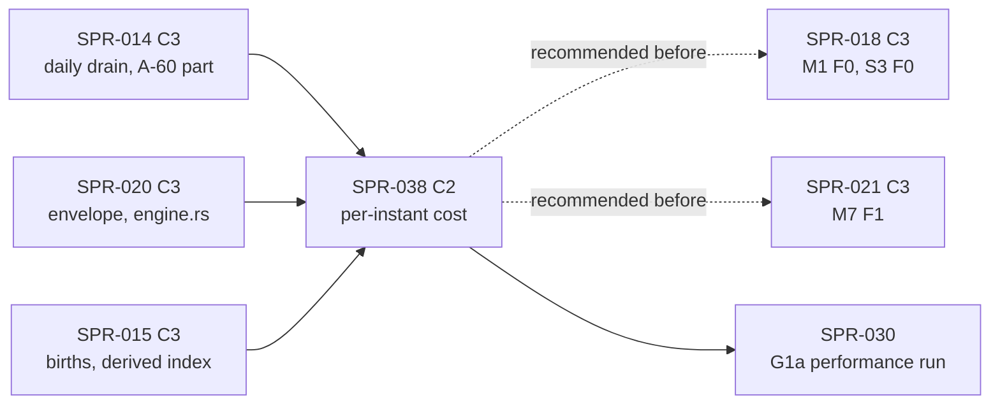

> **BLUF:** Removes the fixed per-instant engine overhead that SPR-014 exposed when it bound M2's `Day`/`Vital` drain to every day start (BCK-002 A-60: about 360 instants a year where there were 12–14).
>
> **Scope:**
> - **Owned columns move by index, not by name.** A job's columns are taken and returned through column slots resolved once when the engine is built, with no `String` key and no `BTreeMap` per job.
> - **Every check runs only after a change.** Compaction, `Ledger::check`, each system's `invariants()` and the lagged-read snapshot run or refresh only when a column they cover was written, inserted or compacted since they last ran.
> - **No `format!` and no per-phase allocation on a quiet instant.** A quiet instant at 1 thread allocates nothing.
> - **A release-build rule for the checks** (D60 item 2, 75%):
>   - the ledger write guards' O(rows) value checks run in debug and test builds only, compiled out of release with a test that proves it (SPR-007's unsynced-guard pattern);
>   - their O(1) parts run in every build;
>   - the state invariants run after every change in debug builds, and yearly in release unless a run asks for every change.
> - **SPR-014's known narrowing is removed.** A drain-only binding with an empty inbox must do nothing, and `rh-core` refuses it by name in every build if it does. Debug builds check every write.
> - **`StepCtx::inserted()`** hands a step the rows inserted earlier in the instant, so S3's newborn selector is O(births), not O(persons).
> - **A per-instant bench** measures the cost against the ledger's and the life-course log's row counts.
>
> **Behaviour-neutral: no baseline moves.** Every ladder, channel-A file, keyframe, `draws_golden` line and `m2_system` figure stays byte-identical, before and after.
>
> **Targets (proposed, 70%):**
> - a quiet instant costs **at most 20,000 instructions**, and the same within 5% at 10⁴ ledger rows and 10⁵ life-course rows (from about 93k per instant today);
> - a busy instant in release has no term in the life-course log's size;
> - each rung runs **at least 4× faster** than the merge base;
> - M2's system gates fall from 227 s to **at most 90 s**, and the debug `m2_system` gate returns to part core at **at most 15 s**.
>
> **CI:** both parts' gate-time sums must fall against the merge base, measured; no gate moves to the nightly tier.
>
> - **Developer:** AGT-002-CORE (`rh-core`, `rh-sys-demography`'s `invariants()`), with AGT-002-TOOLS for `rh-bench`, `bin/perf_gate.py` and the gates. One session may hold both.
> - **Testers:** AGT-003-DET (byte identity, the gates' exactness, the cadence, the release compile-out) and AGT-003-IF (the C2 surfaces: the no-work rule, `StepCtx::inserted`, the `05.1` sentences, the consumers of `WorldTables`). One session may hold both, on a different model from the Developer's.
> - **Size and class:** **about 3.25–3.5 agent-days** by the task inventory (T-01 0.5, T-02 1.0, T-03 1.0, T-04 0.25–0.5, T-05 0.5), as one sprint. The alternative is a C1/C2 split (D60 item 1).
>   - **C2 with `[perf-baseline]`.** It changes `rh-core`'s system contract (the no-work rule, `StepCtx::inserted`) and `05.1`'s statement of where the invariants run, and no `state_hash` moves.
>   - **Not C3:** the hash layout, the column versions the Merkle cache reads, the phase order, the RNG, compaction's semantics and the journal are untouched. The specs table's class row explains.
>   - **`[perf-baseline]`:** the new bench's baseline is recorded, and the faster instruction counts and the lower allocation budgets are re-recorded, each by `bin/perf_gate.py` with a reason line (SPR-009 ruling 3).
> - **Status:** PLANNING, revision 0. It needs the director's plan approval (D60; GOV-005 §2: C2 work).

# SPR-038 — Per-instant engine cost (BCK-002 A-60)

- **Roadmap item:** no `docs/11` WP of its own. It is engine machinery that SPR-030's G1a performance run needs: P1.14's criterion, 1,000 years of a 10k-person dynastic world in ≤ 60 s on 8 cores (`docs/11:189`; PRJ-002 §5). BCK-002 A-60 places it as "its own small sprint after wave 5", before SPR-030's performance run (`CODEX/05_PROJECT/BCK-002_ArchitectBacklog.md:80`) · **Phase / rung:** P1a; `smoke`, rungs 0–2, and a fixed-size 10k synthetic
- **Code cites** are to `sprint/SPR-014-lifecycle-queues` at `921d372` (PR #83), the code this sprint changes, unless they are marked `main` (`3e2e6ef`).
- **Depends on (the precondition head):**
  - **SPR-014 merged** (PR #83): the daily drain, `AccessSpec::drain_only` (`access.rs:195–199`), the row insert (`engine.rs:1447–1513`), and A-60's first part (`1bd05a6`: `&'static str` guard names, row counts only for a job without work).
  - **SPR-020 merged** (PR #84): its branch changes 111 lines of `engine.rs`, 185 of `system.rs` and 89 of `register.rs` (`git diff --stat` against `main`). Merging after it saves a second rebase of the same functions, and puts its emit checks in the before-figures.
  - **SPR-015 merged** (wave 5): births make busy instants. Every insert passes through the row-insert path, which T-03 instruments and T-04 hands to readers. SPR-015's derived-index hook (its T-02, W4) runs after every level's merge, so its per-instant cost must be in the before-figures (the specs table's coordination row).
  - **Independent of** SPR-016 (M2's mortality arithmetic, no engine change), SPR-017, SPR-026 and SPR-027.
  - **Recommended before SPR-018 and SPR-021** (wave 6), so that their own measurements (SPR-018 T-05's A-60 record; X1, X7) are taken on the cheaper engine. If SPR-018 is on `main` first, T-04 converts S3's selector (+0.25 day).
- **Binding contracts:**
  - `05.1` §2 rule 2: the draining part (`main`'s `05.1_simulation_core.md:73`) and "Ledger rows enter by insert" (`:77`); §4.1; §4.2 row 11 `Bookkeeping` (`:171`); §6 items 5 and 6 (`:263–265`: hashes "monthly in CI and debug builds and yearly (configurable) in release builds"); §9 (`:333–343`).
  - **SPR-011 ruling 5** (`SPR-011_WalkingSkeleton.md:34`): compaction at the start of `Bookkeeping`, append-only life-course log, exit fields written once. This sprint keeps its semantics exactly.
  - **The SPR-007 T-04 precedent** (`SPR-007_HashesKeyframesJournal.md:45, :81`): the unsynced guard runs in debug builds and is compiled out of release, proved by `crates/rh-snapshot/tests/guard.rs:49` (`the_guard_is_on_exactly_in_debug_builds`) and `:96` (`release_builds_compile_the_guard_out`), gated in `check_all.sh` (`main`:1253).
  - **SPR-009** rulings 2, 3 and 5, R-7, R-8: iai-callgrind on the arena, baselines regenerated by the tool only, the allocation budget. Also `bin/perf_gate.py` (`main`): `LIMIT_PERCENT` `:65`, `BENCH_TARGETS` `:70`, and `alloc_compare` `:651–683`, where a decrease passes and is kept (`:680`). And `crates/rh-bench/README.md:32–34`: a perf-baseline PR merges by merge commit or rebase, never squash.
  - `docs/08` §9 (`:229–249`).
  - `docs/09`: V-PERF-04 (`:210`), V-PERF-11 (`:217`, "default 0 for P0 machinery"), V-INV-01 (`:125`), V-INV-02 (`:126`, "with invariants enabled in debug builds, nightly"), V-INV-04 (`:128`), V-SCALE-01 (`:659`), V-DET-01, V-DET-02, V-DET-05.
  - `docs/03`: SIM-8 (`:51`: "Violations shall fail the run in debug and CI builds"), DET-11 (`:75`, the same phrase for the unsynced guard), PERF-4 (`:245`).
  - `specs/systems/S3.migration.odd.toml` (`main`): the `Day`/`Vital` binding with "work only when a row entered the ledger this instant" (`:130–136`), `scale_behaviour` (`:154`: the O(N) scan, and "rh-core's row-insert plumbing … may hand S3 the rows inserted this instant instead, a hash-neutral optimisation left to the sprint"), and R4 (`:165`).
- **System spec:** none is changed. M2's frozen texts stay as they are: INV-M2-01, 02 and 04 state properties "after every Bookkeeping", which do not depend on where they are checked. S3 is read, not edited, and its `scale_behaviour` already allows T-04.
- **Rulings (binding):**
  - BCK-002 A-60, the Architect's ruling (A) of 2026-10-17;
  - REV-WAVE6 X1 (`REV-WAVE6-plans.md:44`: nothing in M1 or S3 is O(cells) or O(rows) per instant) and X7 (`:50`: the lagged-column clones per instant);
  - REV-WAVE5 W4 (`REV-WAVE5-plans.md:59`: the derived index, whose debug invariant is checked "in debug builds and tests") and W31 (`:78`: no interior mutability in plane A) and W42 (`:84`: CI per part with nightly candidates);
  - REV-WAVE6 Z1 (`:60`: CI against measured state, budgeted for slow runners);
  - SPR-014's A-60 slice and the ruling that made its narrowing "known" (`ledger.rs:249–253`).
- **Director items:** D60, with five items, each with a recommendation and a confidence.
- **Requirements covered:**
  - PERF-4: the new bench, gated at 10%;
  - SIM-8: violations fail the run in debug and CI builds, which now covers a PR-tier debug rung run;
  - SIM-4 and EVO-1: the no-work rule of a drain-only binding, V-INV-04;
  - SIM-15: the cost is independent of the row count for jobs without work.

## The cost today (SPR-014's measurement; A-60)

| What | Figure | Where in the code |
|---|---|---|
| Instants per sim-year | about 360, against 12–14 before SPR-014 | M2 0.2.3's `Day`/`Vital` drain-only binding (`demography.rs:422–426`) |
| Instructions per instant (callgrind, `solo`, 100 years) | about 102k before `1bd05a6`, about 93k after | `run_instant` (`engine.rs:849–947`) |
| Moving owned columns out and back | 36%: `job_inputs` 23.7%, `WorldTables::insert` 11.9%; `memcmp` 19.9% self | `job_inputs` takes each of M2's 19 columns into a `BTreeMap<&'static str, Column>` (`:278`, `:1186–1201`). `WorldTables` is a `BTreeMap<String, (u64, Column)>` (`world.rs:47–52`), whose `take` drops the `String` key (`:144–146`) and whose `insert` allocates a new one (`:105–109`), at the put-back (`engine.rs:1287`) |
| Ledger write guards per M2 job | 24%: `Ledger::guard` 13.8%, `LifeCourseGuard::check` 6.2%, drops 3.7% | `ledger_guards` (`engine.rs:1317–1341`). For a job with work, `Ledger::guard` clones `person.id` and all ten `life_course.*` columns (`ledger.rs:274–276, :283–285`), and the check compares them row by row (`:369–456`). Per call: about 15k fixed (measured before `1bd05a6` removed its 19 `String` copies), and `check` 6.5k → 13.2k from `solo` to `hamlet` |
| `Ledger::check` and `Ledger::compact` at every `Bookkeeping` | 12%: 6.3% and 5.4%. Per call, check 6.6k → 10.6k and compact about 5.7k | `engine.rs:881`, `:1079`. `check` builds a `BTreeMap` of open entries over the whole log (`ledger.rs:209–215`). `compact` scans `person.alive` (`:150`). Both look columns up by `String` (`aligned`, `:500–520`) |
| M2's `invariants()` | 2.2% on `solo`: O(L) + O(N log N) + O(D log N) per call, with L log rows, N living and D dead | `demography.rs:535–592`: a binary search per closed row (`:564–568`) |
| `format!` per instant | 2.2% | the diagnostic record (`engine.rs:936–944`), kept as `String`s in a ring of 1,000 (`crash.rs:35`) |
| The month-end state digest | 2.3% | `rh-golden/src/run.rs:683`: `state_digest(&engine.snapshot())`, a full clone (`engine.rs:383`) and a full hash at every stop. **Out of scope** (see below) |
| `Vec<Job>` growth, the pulse list, the per-phase plan | the rest | `fired` (`:857`), `due` (`:883`), the plan cloned per phase (`:896`), `passes` (`:897`), `binding_pass`'s groups (`:1520`) |
| Allocations per instant (V-PERF-11) | about 60 per instant on the rungs | `allocations_v1.txt:12–14`: `solo` 21,420 in 360 ticks, `household` 21,492, `hamlet` 24,886 |
| Wall time, 200 years headless | `solo` 0.074 → 0.875 s, `household` 0.079 → 0.873, `hamlet` 0.106 → 1.029; `smoke` +3.7% | — |
| M2's system gates | 59 s → 294 s, then 227 s after `1bd05a6`. The debug `m2_system` gate went from about 4 s to about 99 s and moved to part golden (`376a47a`; `check_all.sh:1408–1409`) | — |
| CI, `check_all` step | SPR-014's head `921d372` (run 39078266492): core 14:48, golden 11:11. `main` at `39b8d76` before SPR-014 (run 39073315181): core 11:38, golden 6:28 | — |

**What grows with the world:** four terms.
- The guard's clones are O(L) per job with work (L is the life-course log's row count).
- `Ledger::check` is O(L + N log N).
- M2's `invariants()` is O(L + D log N).
- `compact` is O(N) per instant.

The log is append-only and never compacted (ADR-0007), so L grows without bound. On `kingdom_10k` (10,000 persons, e0 30), L reaches about 3 × 10⁵ by year 1,000, and deaths land on most day starts, so almost every instant is busy. The drafter's estimate: at L ≈ 10⁵, the guard, `Ledger::check` and M2's `invariants()` cost about 10⁷ instructions per busy instant. Over 1,000 years that is about 3 × 10¹² instructions: more than ten times G1a's 60-second budget, and serial. T-01 measures this, and the targets below make it vanish in release.

## Specs this sprint needs

| Spec | Exists? | Gap | Architect ruling | Needed by |
|---|---|---|---|---|
| **Column storage and moves by index** | `WorldTables` is a `BTreeMap<String, (u64, Column)>` with a public name-based API (`insert`, `get`, `version`, `names`, `columns`, `identity`; `world.rs:96–147`). `rh-snapshot`, `rh-worldgen`, `rh-golden` and `rh-bench` use it. Columns are created only in `Engine::new` (SPR-005 G-c; `engine.rs:326–331`) | Every take and put-back of an owned column costs a string-keyed `BTreeMap` operation and a `String` allocation | **Proposed (80%):**<ul><li>`WorldTables` keeps its columns as slots sorted by name, each `{name, version, Option<Column>}`.</li><li>A `ColumnId` (u32) is resolved once in `Engine::new` for each `Entry`'s writes and reads and for the ledger's columns.</li><li>`take_at` and `put_at` are crate-private, O(1), and allocate nothing; a moved-out column reads as absent, exactly as `take` does today.</li><li>The public name-based API is unchanged, iteration stays in name order, and **every put-back still gives the column a new version**, so `rh-snapshot`'s Merkle cache (`hash.rs:457–527`), the plane hash and the keyframes see no difference.</li><li>A view's owned columns are a `Vec` in the order of the entry's writes, reused across instants, never a `BTreeMap`.</li><li>`Ledger` keeps `ColumnId`s, not `Vec<String>` (`ledger.rs:74–78`).</li><li>`insert_rows` works by id (`engine.rs:1499–1510`), with each entry's own `person.*` set computed once (`:1464–1470`).</li></ul>**Not here:** bumping a version only on a real write, which would let the Merkle cache skip unchanged columns. That changes the hashing machinery's dirty tracking (SPR-007 T-01; VER-SPR-007 DEF-1), so it is C3 by `docs/13` §4.2 and goes with the month-end digest item | T-02 |
| **Where the checks run: the release-build rule** (A-60: "decide whether the ledger guards and `Ledger::check` belong in release builds at all") | The guards and `Ledger::check` run in every build at every instant (`engine.rs:1078–1080`, `:1300–1305`). The precedents:<ul><li>the unsynced guard runs in debug only (SPR-007);</li><li>`05.1` §6 item 6 hashes monthly in CI and debug builds and yearly in release;</li><li>V-INV-02 runs "invariants enabled in debug builds";</li><li>SIM-8 and DET-11 say "debug and CI builds";</li><li>SPR-015's derived-index invariant is "debug builds and tests" (W4)</li></ul> | At `kingdom_10k` scale the O(L) checks are the dominant per-instant term. `05.1` does not say which build runs which check | **Proposed (75%; D60 item 2), three classes:**<ol><li>**Write guards' value checks** (SPR-011 ruling 5's per-step rules: A-2 ids unchanged, G-1 no death after compaction, entry fields never change, exit fields written once by the closing step, DEF-3 open values, DEF-6 closed appends). They run in **debug and test builds only** (`cfg(debug_assertions)`), compiled out of release, with `LEDGER_VALUE_CHECKS == cfg!(debug_assertions)` and a release test in SPR-007's form. They check system code against the core's write rules: every system runs under them in the PR tier's debug suites and in the nightly 1,000-year debug soak, whose ladder must equal the release ladder (`bin/golden_nightly.sh:108–116`). **G-1 stays in every build**: it is O(N), and only for a job that writes `person.alive` in `Bookkeeping`, which no P1a system does.</li><li>**O(1) structural checks in every build:** each owned ledger column's row count is unchanged; the log never shrinks; the no-work rule (next row).</li><li>**State invariants** (`Ledger::check`, the core's agenda, event and queue-age checks, and each system's `invariants()`):<ul><li>debug and test builds check them at every `Bookkeeping` after a change (exact: next row);</li><li>release builds check them **at the first `Bookkeeping` at or after each year boundary, and after construction or restore**, by default;</li><li>`Engine::set_check_cadence(EveryChange)` brings release to the debug cadence for a run that wants it, such as a test that expects a failure at a precise instant;</li><li>`EveryInstant`, the pre-SPR-038 behaviour with no gating, is the reference mode for T-03's differential test.</li></ul>The queue-age check depends on `t`, so it runs at every `Bookkeeping` in every build; it costs O(queued commands).</li></ol>**The cadence changes no history:** checks are read-only. A violating run fails at the same instant in every debug build, and in release at the next yearly check (a different crash artifact: `build` differs anyway). The cadence is engine configuration, outside the history tuple, every hash and the ladder. **`05.1` text (the Architect's, in the PR):** §4.2 row 11 and a §9 preamble, worded as in T-03 | T-03 |
| **The write set and the gates** (A-60: "run `Ledger::check`/`compact` only after a level that moved a ledger column") | The engine has no record of which columns a step wrote. `SystemView::write` hands out `&mut Column` (`world.rs:260–267`), the only mutable path a step has | — | **Proposed (85%):**<ul><li>`SystemView::write` sets the column's written flag, a plain field behind `&mut self` (no `Cell`: W31). The flags return with the columns.</li><li>Every core write path marks its columns: the put-back (by the flags), the row insert, compaction, SPR-020's cause writes at the merge, construction and restore. **By construction there is no other way to reach a slot mutably**: every mutable slot accessor takes the write set.</li><li>The gates, each "since it last ran", never "this instant":<ul><li>compaction runs when `person.alive` was written or rows were inserted since the last compaction;</li><li>`Ledger::check` runs when any ledger column was written, inserted or compacted since the last check;</li><li>each system's `invariants()` runs when any column was written, inserted or compacted since the last check, since it takes the whole `&WorldTables` (`system.rs:1057`);</li><li>a lagged column's snapshot is re-copied when that column was written since its copy (X7's clones).</li></ul></li></ul>**Why it is exact:**<ul><li>Compaction of a table with no dead row changes nothing; it already returns early and keeps every version (`ledger.rs:150–152`).</li><li>`Ledger::check` and `invariants()` are pure functions of the tables (`&self`, no time, no interior state: W31), so equal tables give the same verdict.</li><li>A lagged snapshot of an unwritten column equals the column.</li><li>"Since it last ran", never "this instant", so no write can fall unseen between two runs of a gate.</li></ul> | T-03 |
| **The known narrowing** (A-60; `ledger.rs:249–253`; `tests/lifecycle_queues/guard.rs:12`, mode 2: an empty drain writes an exit field and passes) | `1bd05a6` keeps only the row counts for a job without work. Its reason was that "an empty drain writes nothing", which nothing checks | Remove it, or prove it safe | **Proposed (80%; D60 item 3): removed, in two parts:**<ul><li>**(a) The no-work rule, every build, O(1).** A drain-only binding whose inbox is empty after the dead-key drop has no work. Its step must take no write access, emit nothing, submit nothing, set or cancel no timer, insert no row and draw nothing. `rh-core` checks the view's flags, the outbox and the taken set, and refuses a breach by name, naming the system, the binding and the first breach. Mode 2 becomes a refusal in every build.</li><li>**(b) Debug builds check every write.** The guard's pre-image of a guarded column (`person.id`, every `life_course.*`) is copied at the **first `write()` of that column in that job**, not before the step for "jobs with work". A job that never writes a guarded column pays nothing, and every write of one is value-checked, whatever the job's work.</li></ul>Together, the narrowed case either does nothing, which is then exact, or fails by name. **`05.1` §2 rule 2 sentence (the Architect's):** "A binding whose only step is a drain (`AccessSpec::drain_only`) has no work at an instant where its inbox is empty; its step then writes, emits, submits, schedules, inserts and draws nothing, and `rh-core` refuses a breach by name." **Alternative (named, not built):** do not dispatch a job without work at all. That is cheaper still, but it changes the observer's notices, the dispatch counts and `05.1` §4.1's "the firing bindings run". It is the fallback lever if T-05 misses the quiet-instant target | T-03 |
| **`Ledger::check` and M2's `invariants()` in O(N + L)** | `Ledger::check` builds a `BTreeMap` of open entries (`ledger.rs:209–243`). INV-M2-02 binary-searches the ledger once per closed row (`demography.rs:564–568`), O(D log N) with D unbounded | At 10k persons and 10⁵ log rows the yearly release check would cost tens of millions of instructions: the drafter's estimate, measured in T-01 | **Proposed (75%):** sorted `Vec`s and one merge over sorted ids in both, with **the same results, names and detail text** on every table, the first violation included. A differential property test keeps the current functions as test oracles: random tables, three sizes, eight seeds, every planted violation of each invariant. M2's other invariants (SPR-015's INV-M2-06/07/10/12/13, SPR-016's 20/21) are measured per call in T-01. One above O((N + L) log N) is reported, not changed here | T-03 |
| **The diagnostic record and a quiet instant's allocations** | Each instant `format!`s one line into a `VecDeque<String>` of up to 1,000 (`engine.rs:800–805, :936–944`). The plan is cloned per phase (`:896`). `fired`, `due`, `passes`, the binding pass's groups, and the level's `guards`, `inputs`, `outcomes` and `outboxes` are fresh `Vec`s | V-PERF-11's default for machinery is 0 (`docs/09:217`). SPR-014 T-08 expected "the empty daily drain should allocate nothing in steady state", and it allocates about 60 | **Proposed (70%; D60 item 1 names the split with A-32):**<ul><li>The ring holds fixed-size records (tick, the fired pulses in `pulses_at` order, the four counts and the agenda length) and a text variant for the cold `FATAL` line (`:714`). `diagnostics()` renders them **byte-identically** to today's strings, which crash artifacts and `Engine::replay` compare.</li><li>The phase's plan is borrowed, not cloned.</li><li>Every per-phase and per-level buffer is kept across instants, as `inboxes` already is (`:236–238`).</li><li>**A quiet instant at 1 thread allocates nothing.**</li></ul>BCK-002 A-32 (`BCK-002:52`, SPR-030) keeps the persistent worker pool and the buffers of multi-thread levels (scoped-thread spawns) | T-02 |
| **S3's newborn selector** (A-60; X1) | S3's R4 scans every ledger row for `person.residence = 0` at each day start: 3.6 × 10⁶ compares a year at 10k (`S3.migration.odd.toml:154`). The spec allows the hand-off (same line) and says the zero rows are "exactly the rows inserted in this instant" (`:165`) | No core API hands a step the instant's inserts | **Proposed (65%; D60 item 4):**<ul><li>`StepCtx::inserted() -> &[PersonId]`: the ids inserted by the merges of earlier levels and phases of this instant that are still ledger rows, ascending, kept in an engine buffer cleared at each instant. It is never stored, hashed or keyframed. A keyframe is cut after `Bookkeeping`, so nothing pends across a restore.</li><li>S3's step reads it, and in debug builds `debug_assert`s that it equals R4's scan.</li><li>**`05.1` §2 rule 2 sentence (the Architect's):** "A step reads, through `StepCtx::inserted`, the `PersonId`s of the ledger rows that the merges of earlier levels and phases of this instant inserted, ascending; the list is derived from the merges and is never stored or hashed."</li><li>**Equivalence with R4** holds while every insert precedes S3's step in its instant: births are M2's, in `Vital`, at day starts, with M2 → S3 by the `same_instant` edge (`:165`). The debug assertion fails closed if a later system breaks that.</li><li>If SPR-018 has not merged, T-04 ships the API and a consumer test, and the Architect adds one line to SPR-018 T-03 at this plan's approval (S3 reads `inserted()`). If SPR-018 has merged, T-04 converts `rh-sys-migration`'s step.</li></ul>**Alternative:** keep the scan, about 2–4 instructions per row, roughly as large as the whole quiet-instant target at 10⁴ persons, and file the hand-off later | T-04 |
| **The benches** (A-60: "measure per-instant cost against row count on a fixed-size synthetic (`kingdom_10k`'s genesis held for a year)") | `rh-bench`'s `draws` measures one instant of a one-column stub world (`draws/step_draws/empty` = 16,611; `instructions_v1.txt:13`). No bench has a ledger. `kingdom_10k`'s genesis needs SPR-019 (wave 7) | A bench that varies N and L independently: L is unbounded, N is not | **Proposed (75%):**<ul><li>**`crates/rh-bench/benches/instant.rs`** (iai-callgrind, the arena allocator, the `draws` pattern), with its fixture in `crates/rh-bench/src/instant.rs`.</li><li>**The fixture:** a stub system `B1.ledger` that owns M2's 19 column names, so the core's ledger rules apply in full. It has a `Month`/`Vital` step that rewrites one `person.spouse` cell with its own value (a change for the gates, none for the state, so a held year ends with exactly one full check), a drain-only `Day`/`Vital` binding with an empty inbox, and a `Day`/`Vital` death timer for the busy cases. The tables are built directly: N living rows and L log rows, of which L − N are closed.</li><li>**Seven gated cases:**<ul><li>`quiet/n1_l1` and `quiet/n10k_l100k`: one quiet day start;</li><li>`death/n10k_l10k` and `death/n10k_l100k`: one day start with one death, so a compaction;</li><li>`insert/n10k_l100k`: one birth through the row insert;</li><li>`year/n10k_l10k` and `year/n10k_l100k`: one whole sim-year of a size held fixed, so 360 quiet day starts, 12 month steps and one yearly check. This is "the genesis held for a year" at `kingdom_10k`'s genesis size (L ≈ N) and at a late size.</li></ul></li><li>`BENCH_TARGETS` gains `instant`, gated at 10% by V-PERF-04. The bench is unnumbered, like `draws` (SPR-011 T-02), with one line in `docs/08` §9.</li><li>**Reported, not gated:**<ul><li>a sweep of N ∈ {1, 10², 10³, 10⁴} × L/N ∈ {1, 10} (`RH_INSTANT_SWEEP=1`);</li><li>one sim-year of real M2 on the 10,000-founder world of `rh-worldgen`'s q(15) test (`m2_system`), with wall time and callgrind;</li><li>`kingdom_10k`'s own genesis held for a year, if SPR-019 is on `main` by T-05.</li></ul></li></ul> | T-01 |
| **Coordination with SPR-015's derived index and SPR-020's cause guard** | SPR-015 T-02 calls each owner's `apply(&mut Index, &MergedWrites)` after every level's merge (W4). SPR-020 T-05 keeps "the rows of every column with a `cause_column`" before each level that writes one | Each is another per-level O(rows) term if built by diffing columns | **Proposed (70%):**<ul><li>`MergedWrites` and the cause guard read the write set: no diff of an unwritten column, and no hook call for a system that wrote nothing.</li><li>If SPR-015's code diffs columns, T-03 gates it by the write set (same results; its debug rebuild invariant is the check).</li><li>No P1a column declares a `cause_column` (only S6, P1b: `S6.artifacts.odd.toml:92–110`), so SPR-020's guard costs nothing on P1a worlds. When S6 arrives it follows rule (b) above: copy at the first write.</li></ul> | T-01, T-03 |
| **The class** | `docs/13` §4.2 (`:88–97`) | C1 is "inside one crate, no change to contracts … or plane-A behaviour". C3 includes "any change to the determinism machinery itself (… hashing, phase order …)" | **Proposed (75%): C2 with `[perf-baseline]`.** Not C1: it changes `rh-core`'s contract with every system (the no-work rule, `StepCtx::inserted`) and `05.1`'s §2, §4.2 and §9 text. Not C3: no `state_hash` moves, and none of the hash's layout, its versions and dirty marks, the phase order, the RNG, compaction's semantics or the journal changes. CI detects C1 (no hash change, no path under `specs/` or `rh-contracts`), and the declared C2 wins | — |
| **CI** | Measured above. A-63 (`BCK-002:83`), the third PR-tier job, is approved but not built | This sprint should lower both parts | **Proposed (75%):**<ul><li>gate-time sums from the check reports (per-gate seconds), on the PR head and on the merge base, each run twice on CI;</li><li>no gate moves to the nightly tier;</li><li>the debug `m2_system` gate moves back to part core;</li><li>part core gains a 200-year debug `hamlet` run equal to its release baseline: the PR-tier subset of V-INV-02, under SIM-8's "debug and CI builds";</li><li>the mutant rebuilds go in part golden, as SPR-014's did</li></ul> | T-05 |

## Targets (proposed, 70%; measured on one machine for base and head, median of 3; CI figures reported)

| Measure | Today (SPR-014's head) | Target | How |
|---|---|---|---|
| A quiet instant: only a drain-only binding fires, its inbox is empty, no timer is due and no input is queued | about 93k instructions per instant averaged over `solo` (all instants). The bench is new: T-01 records the base | **≤ 20,000 instructions** (`instant/quiet/n1_l1`, release) | iai-callgrind |
| The same at 10⁴ ledger rows and 10⁵ log rows | O(N + L) today (check, compact, invariants at every `Bookkeeping`) | **≤ 1.05 × the N = 1 case** (O(1) in rows) | `quiet/n10k_l100k` ÷ `quiet/n1_l1` |
| A busy instant with one death, in release | O(L) clones and checks | **no term in L:** `death/n10k_l100k` ≤ 1.05 × `death/n10k_l10k`. The figure is reported; its O(N) term is compaction's | iai-callgrind |
| The yearly release check at 10⁴ / 10⁵ | — | reported, with its cost amortized per instant and a projection to `kingdom_10k`'s 1,000 years | `year/n10k_l100k` |
| Allocations on a quiet instant, 1 thread, steady state | about 60 (`allocations_v1.txt:12–14`) | **0** | `alloc_budget`'s per-site report |
| Instructions per instant averaged over 200 years of `solo` | about 93k | **≤ 25,000** | callgrind on `rh-cli run solo --years 200 --out` |
| Wall time per rung, 200 years, headless, release | 0.875 / 0.873 / 1.029 s (0.074 / 0.079 / 0.106 before SPR-014) | **each ≤ ¼ of the merge base's** (expected about 0.15–0.25 s) | median of 5, same machine |
| M2's system gates, summed | 227 s (59 s before SPR-014) | **≤ 90 s** | the check report's per-gate seconds |
| The debug `m2_system` gate | about 99 s, in part golden | **≤ 15 s, back in part core** | as above |
| CI, each part's gate-time sum | core 14:48, golden 11:11 (`check_all` steps, run 39078266492) | **lower than the merge base's, both parts.** Expected about −1 to −2 min in core and −0.5 to −1.5 min in golden, net of the new gates | two CI runs each |

**A missed target is reported with its figure, and the Architect rules on it. No target is lowered silently.** The fallback lever for the quiet instant is the specs table's "do not dispatch a job without work".

## Compliance (every task)

| Rule | This sprint |
|---|---|
| Change class (`docs/13` §4.2) | **C2 with `[perf-baseline]`** (the specs table's class row). PR title: `SPR-038: per-instant engine cost [perf-baseline] [C2]` |
| Planes touched (ADR-0024) | **A:**<ul><li>`rh-core`: `world.rs`, `engine.rs`, `ledger.rs`, `system.rs` (`StepCtx::inserted`, the no-work check), `crash.rs` (the record);</li><li>`rh-sys-demography`: `invariants()` only, same results;</li><li>`rh-sys-migration`: T-04, only if SPR-018 has merged.</li></ul>**Tool:**<ul><li>`rh-bench`: `instant`, its fixture and the `alloc_budget` sites;</li><li>`bin/perf_gate.py` (`BENCH_TARGETS`), `bin/check_all.sh`, `python/tests/test_check_all_inventory.py`.</li></ul>**B and C:** none. **`rh-snapshot`, `rh-golden`, `rh-stream` and `rh-worldgen` are not edited.** Their tests are the consumer contract of `WorldTables`' unchanged public API |
| Owned columns written | None by a system. `rh-core`'s compaction and row insert are unchanged in effect (SPR-011 ruling 5; `05.1` §2 rule 2) |
| Reads (via `rh-contracts`) | No new read. S3 reads `StepCtx::inserted()`, an engine list, not a column (T-04) |
| RNG purposes added | None |
| Golden-hash effect | **None.** Every baseline under `worlds/*/baselines/` is unchanged. A difference is a defect to fix, never a regeneration |
| Fixed-point quantities | None |
| Determinism lints (GOV-003 §2, §6) | Must pass:<ul><li>no `HashMap`;</li><li>no interior mutability: the written flags are fields behind `&mut self` (W31's `hidden-state` rule);</li><li>no float;</li><li>every mutant is a `mutant-*` feature, refused by `rh-cli run` and `regen_baseline.sh` (A-52)</li></ul> |
| Tests that gate this sprint | V-DET-01 and V-DET-02 (all four worlds, 1 and N threads); V-DET-05 (keyframes byte-identical; resume = continuous); V-INV-01 (the differential and planted-violation tests); V-INV-02 (its new PR subset: the debug `hamlet` run); V-INV-04 (the no-work rule); V-GOLD-01 (no baseline moves); V-PERF-04 (`instant` gated; benches 7, 8 and `draws` re-recorded by the tool); V-PERF-11 (rung and smoke budgets re-recorded lower by the tool); and `bin/check_all.sh` |
| Docs updated in the same sprint | <ul><li>`05.1` §2 rule 2 (the no-work rule; `StepCtx::inserted`), §4.2 row 11 and §9 (the cadence): the Architect's wording, approved in the PR;</li><li>`docs/08` §9 (the `instant` line);</li><li>`docs/09`: V-PERF-04's method (`instant`), V-INV-02's PR subset, V-SCALE-01's note that a release run checks invariants yearly unless set;</li><li>`crates/rh-bench/README.md` (the row);</li><li>`ledger.rs`'s module docs (the narrowing text removed);</li><li>`CLAUDE.md`'s checks; `check_all.sh` and the inventory test (same commit);</li><li>BCK-002 A-60 closed, with A-32's split noted;</li><li>PRJ-002's row;</li><li>SPR-018's one line, by the Architect at approval, if SPR-018 has not merged</li></ul> |

**Rules carried from P0–SPR-020 (every task):**
- **Measure first.** T-01 lands, and is pushed, before any change to `rh-core`. Its before-figures are taken on the merge base and re-taken after every merge of `origin/main`.
- **Byte identity is checked at every task boundary,** not only at the end (T-02's and T-03's acceptance), against the merge base's binaries.
- **Property tests vary world size and seed:** three sizes (1, 60, 600 rows; plus 10⁴ in release) and eight seeds, fixed-seed SplitMix64, no new crate.
- **A positive control fails for the right reason:** each `check_all` line matches its message (`fail:<text>`).
- **A test input exercises the path it claims, and a probe asserts it.** The engine reports `Engine::check_stats()`: compactions, ledger checks, invariant runs and snapshot refreshes. Like `DispatchStats` (`engine.rs:244–263`), it is an observation that never enters state. Every bench case and test asserts its path through it:
  - a quiet case really ran no check;
  - a death case really compacted one row;
  - a year case really ran the full check once.
- **Python tests read no CI environment variable.** **No statistical gate.**
- **Every new gate is in exactly one `check_all.sh` part,** with the inventory test updated in the same commit.
- **Perf baselines are regenerated only by `bin/perf_gate.py record` and `alloc-record`,** in a commit whose subject ends `[perf-baseline]` with a `Reason:` line, and the PR body carries `perf-baseline-reason:`. Never typed (SPR-009 ruling 3). The PR merges by rebase, never squash (`crates/rh-bench/README.md:34`).
- **No new third-party crate.** **One commit per task** (GOV-005 §4). **Merge `origin/main` when main moves,** and re-run both parts.

## Tasks

T-01 comes first and is pushed alone. T-02 and T-03 each end with the full byte-identity check. T-05 comes last.

#### T-01: The per-instant bench and the before-figures (AGT-002-TOOLS; the specs table's bench row)
- **Deliverable:**
  - **`crates/rh-bench/src/instant.rs` and `benches/instant.rs`:** the fixture and the seven cases of the specs table.
    - The fixture is built only from `rh-core`'s public API, so it compiles on the merge base.
    - Each case's setup advances to the instant before the measured one, so the measured instant is steady state.
    - It asserts the case's path: no timer due, no input and an empty inbox for `quiet`; one dead row for `death`; one inserted row for `insert`; the year's instant count for `year`. On the base, which has no `check_stats`, it asserts these through the tables and `dispatch_stats()`.
  - `crates/rh-bench/Cargo.toml`: the target, with `required-features = ["arena-alloc"]`. It is run directly (`cargo bench -p rh-bench --features arena-alloc --bench instant`), **not yet added to `BENCH_TARGETS`**: `perf_gate.py check` fails on a bench missing from the baseline, and the baseline is recorded once, in T-05.
  - **The before-figures,** in the PR body and later in `VER-SPR-038`. All are on the merge base, with the commands that produced them:
    - the seven cases and the reported sweep;
    - `draws`, benches 7 and 8;
    - `alloc_budget`'s rung and smoke lines with its per-site report;
    - the per-rung wall times (median of 5);
    - instructions per instant over 200 years of `solo` (callgrind);
    - the 10,000-founder M2 year (wall time and callgrind);
    - the per-call cost of each registered system's `invariants()` at N = 10⁴ and L = 10⁵;
    - SPR-015's hook per level and S3's scan per day start (from a stub with S3's shape if SPR-018 is not on `main`);
    - the month-end digest per stop at the `year` sizes (for the out-of-scope item);
    - the M2 gate times;
    - the base's CI gate-time sums, from two CI runs.
- **Acceptance:**
  - The bench builds and runs on the merge base and on this commit with identical counts (no engine change yet).
  - Two runs of the bench give identical counts.
  - Every case's path probe holds.
  - The figures are recorded with their commands.
  - Its baseline is **not** recorded here. T-05 adds `instant` to `BENCH_TARGETS` and records it on the final engine; a base figure would only be re-recorded. The existing gates stay green at every push: V-PERF-04 passes a speed-up and V-PERF-11 a decrease (`perf_gate.py:680`).
- **Status:** [ ] not started

#### T-02: Columns by index, the diagnostic record, and a quiet instant that allocates nothing (AGT-002-CORE; the specs table's storage and allocation rows)
- **Deliverable:**
  - **`world.rs`:**
    - name-sorted slots `{name, version, Option<Column>}`, `ColumnId`, crate-private `take_at` and `put_at` (O(1), no allocation);
    - the public name API unchanged, and **every put-back still taking a new version**;
    - `SystemView`'s owned columns as a `Vec` in write order, reused per entry;
    - `read` and `write` by name keep their checks and errors (`UndeclaredRead`, `UnownedWrite`, `MissingColumn`), as a linear scan over the entry's writes (M2 has 19).
  - **`engine.rs`:**
    - each `Entry`'s write ids resolved in `Engine::new`;
    - `job_inputs` and the put-back by id;
    - `check_owned_columns` by id;
    - `insert_rows` by id with the entry's `person.*` set precomputed.
  - **`ledger.rs`:** `Ledger` keeps `ColumnId`s; `is_person` and `is_life_course` are an id lookup, not a string scan.
  - **The record:** fixed-size records in a ring of `DIAGNOSTIC_RECORDS`, preallocated, rendered by `diagnostics()` byte-identically; the `FATAL` line as text.
  - **The buffers:**
    - the phase plan borrowed;
    - `fired`, `due`, `passes`, the binding pass's groups, `guards`, `inputs`, `outcomes` and `outboxes` kept across instants and cleared;
    - the multi-thread path unchanged beyond that (A-32's).
- **Acceptance:**
  - **Byte identity** against the merge base (the list in T-05) at this task's head.
  - **The record:** a property test renders random records, every count and pulse set, through both the old `format!` and the new renderer, and they are equal. A crash artifact from an injected failure on `solo` (the SPR-006 crash-replay harness) is byte-identical to the base's, `diagnostics` included.
  - **Allocations:** `alloc_budget`'s per-site report shows **0 allocations on a quiet instant at 1 thread** at the sites "instant setup and inputs", "phase start (timers due)", "level dispatch" and "merge". A planted `Vec::new()` push in the quiet path (the existing positive-control mechanism) fails by name.
  - **Instructions:** `instant/quiet/n1_l1` falls, and the record of which costs fell, by callgrind function, is in the PR.
  - **Consumers unchanged:** `rh-snapshot`'s `hash`, `golden`, `keyframe` and `guard` tests, `rh-worldgen`'s `genesis` and `keyframe`, `rh-golden`'s tests and `rh-bench`'s other benches pass unedited, and `bin/gen_hash_golden.py --check` is unchanged.
- **Status:** [ ] not started

#### T-03: The write set, the gates, the release-build rule and the narrowing removed (AGT-002-CORE; the specs table's rule, gate, narrowing and invariant rows)
- **Deliverable:**
  - **The write set:**
    - written flags set by `SystemView::write`;
    - one engine bitset per "since" consumer: compaction, `Ledger::check`, the invariants, each lagged column's snapshot;
    - every core write path marks its columns (put-back, insert, compaction, SPR-020's cause writes, construction, restore), and every mutable slot accessor takes the set.
  - **The gates:**
    - compaction, `Ledger::check`, each system's `invariants()` and the lagged snapshot refresh, each "since it last ran";
    - the queue-age, stale-timer and future-event checks every `Bookkeeping`, as today;
    - compaction in place (one pass per `person.*` column, no new `Vec`), with the same rows kept, in order.
  - **The cadence:**
    - `CheckCadence { EveryInstant, EveryChange, Yearly }` and `Engine::set_check_cadence`;
    - the default is `EveryChange` in debug and test builds and `Yearly` in release;
    - `Yearly` means the first `Bookkeeping` at or after each year boundary of the calendar (whether or not any system binds `Year`), and the first after construction or restore;
    - any build may set any cadence: a debug test may exercise `Yearly`, and the defaults apply unless a run sets one;
    - `Engine::check_stats()`.
  - **The write guards:**
    - pre-images copied at the first `write()` of a guarded column in a job;
    - the value checks (A-2, the life-course rules, DEF-3, DEF-6) under `cfg(debug_assertions)`, with `pub const LEDGER_VALUE_CHECKS: bool = cfg!(debug_assertions)`;
    - G-1 and the row-count and log-length checks in every build.
  - **The no-work rule** for drain-only bindings with an empty inbox, in every build, with its refusal message naming the system, the binding and the first breach.
  - **`Ledger::check` and M2's `invariants()`** in O(N + L) with identical results.
  - **SPR-015's hook** gated by the write set, if it diffs.
  - **The `05.1` sentences,** proposed in the PR for the Architect:
    - §2 rule 2: the no-work rule;
    - §4.2 row 11: "Invariants (after every change in debug and test builds; yearly in release, or after every change when the run sets it: §9)";
    - §9 preamble: "The core's ledger invariants and each system's `invariants()` are pure functions of the tables. They are checked at a `Bookkeeping` only when a column was written, inserted or compacted since the last check: at every such `Bookkeeping` in debug and test builds, and in release builds at the first `Bookkeeping` at or after each year boundary and after construction or restore, unless the run asks for every change. The write guards' value checks (§2 rule 2; SPR-011 ruling 5) run in debug and test builds; their row counts, the log's length and the no-work rule run in every build."
  - **Four mutants** (`mutant-*` features of `rh-core`):
    - `mutant-unmarked-put-back`: the put-back ignores `person.alive`'s flag;
    - `mutant-late-pre-image`: the pre-image is taken at the put-back;
    - `mutant-stale-lagged-snapshot`: the snapshot is never refreshed after the first instant;
    - `mutant-no-work-unchecked`.
- **Acceptance:**
  - **Byte identity** against the merge base (T-05's list) at this task's head, in release and in debug.
  - **The differential test** (`crates/rh-core/tests/per_instant.rs`):
    - **The world:** random worlds of three sizes and eight seeds. Stub systems write random ledger and non-ledger columns at random instants, many instants quiet, with lagged readers, inserts, deaths and drain-only bindings with and without commands.
    - **Equivalence:** run under `EveryInstant`, `EveryChange` and `Yearly`, the state hash after every instant and the events, commands and agenda are equal.
    - **Path probes:** `check_stats` shows that `EveryChange` skipped at least one check on a quiet instant, and ran one on every changed instant.
  - **Planted violations,** one per invariant and per guard rule:
    - unsorted ids, a dead row left, two open entries, an open entry without a row, an entry field changed, an exit field written twice, an open append with a non-open value, a closed append for a living person, an id changed, and a system invariant broken;
    - each fails by name at **the same instant and with the same error under `EveryChange` as under `EveryInstant`** in debug;
    - under `Yearly` in release, the state violations fail at the first year check at or after them, and a guard value violation passes, which is the documented compile-out.
  - **Release compile-out** (`crates/rh-core/tests/ledger_release.rs`, run with `--release`):
    - `LEDGER_VALUE_CHECKS == cfg!(debug_assertions)`;
    - a planted entry-field write passes in release and is refused in debug;
    - a planted row-count change is refused in both builds;
    - in SPR-007's form, with the `check_all` line `release builds compile the ledger value checks out`.
  - **The narrowing removed.** `tests/lifecycle_queues/guard.rs` mode 2 (`:12`, `:157`) becomes a refusal by name in both builds. The test is renamed `a_drain_without_work_that_writes_is_refused_by_name`. Five new modes are added, each refused by name: an empty drain that emits, that submits, that schedules a timer, that inserts, and that draws.
  - **M2's and the core's invariants:** the differential property test against the kept oracles. Same results, names and detail text on every random table and every planted violation.
  - **Mutants:** each fails a named gate for its reason:
    - `unmarked-put-back` fails the differential test (a dead row survives compaction; the state hash differs at that instant) and the `solo` ladder;
    - `late-pre-image` fails the debug entry-field refusal;
    - `stale-lagged-snapshot` fails the differential test's lagged reader;
    - `no-work-unchecked` fails mode 2.
  - **Lints:** `lint_forbidden` and `lint_arch` green, including W31's hidden-state rule on `rh-core`.
- **Status:** [ ] not started

#### T-04: The rows inserted this instant, for S3's selector (AGT-002-CORE; the specs table's S3 row)
- **Deliverable:**
  - `StepCtx::inserted() -> &[PersonId]`: the engine's per-instant buffer, filled at each merge's row insert and filtered at compaction.
  - A consumer test with a stub selector of S3's shape: a `Day`/`Vital` binding after an inserter by a `same_instant` edge, writing a zero-marked column for each new row.
  - The `05.1` sentence, proposed in the PR.
  - **If SPR-018 has merged:** `rh-sys-migration`'s `residence_at_birth` iterates `inserted()`, with `debug_assert_eq!` against R4's scan. Otherwise, SPR-018 T-03 reads it (the Architect's line at approval).
- **Acceptance:**
  - On random worlds (three sizes, eight seeds), with inserts at earlier levels and earlier phases of the same instant and same-instant deaths of newborns, `inserted()` equals the zero-marked scan at every step that reads it. A planted insert after the reader, which breaks the equivalence's condition, fails the reader's debug assertion by name (fail-closed).
  - A newborn compacted in the instant is absent from a later phase's list.
  - The buffer allocates nothing in steady state.
  - **If S3 has been converted:** `hamlet`'s ladder and channel A are byte-identical to the merge base's, and S3's per-day cost at 10⁴ rows is O(births) (callgrind on a quiet day start and on one with a birth).
- **Status:** [ ] not started

#### T-05: The evidence, the baselines by the tools, CI and the docs (AGT-002-TOOLS with AGT-002-CORE; the specs table's CI row; Z1)
- **Deliverable:**
  - **The byte-identity record** against the merge base, with the base's and the head's binaries on one machine:
    - the four PR-tier ladders at 1 and N threads, compared with `bin/check_baseline.py`, with no file under `worlds/*/baselines/` changed;
    - the nightly monthly ladders at 1, 2, 4 and N threads × 3 on the head (`bin/golden_nightly.sh`, including the debug soak, whose ladder must equal the release ladder);
    - every sealed segment and keyframe of the `solo`, `household` and `hamlet` run directories (200 years), SHA-256 equal;
    - `rh-cli tail --canonical` output equal;
    - `rh-cli replay` REPLAY EQUAL;
    - the tail display snapshots unchanged;
    - `draws_golden` passing with its golden file unchanged and its two mutants failing as before;
    - `m2_system`'s `--no-capture` figures (the q(15) values per seed, V-DATA-04's counts) equal, timing lines excluded;
    - `bin/gen_hash_golden.py --check` unchanged.
  - **The baselines, by the tools,** in one commit whose subject ends `[perf-baseline]`:
    - `BENCH_TARGETS` gains `"instant"`, and `perf_gate.py record` adds its seven cases and re-records `draws` and benches 7 and 8, which may fall;
    - `perf_gate.py alloc-record` re-records the smoke and rung budgets, which fall;
    - each with a `Reason:` line, and `perf-baseline-reason:` in the PR body.
  - **The after-figures,** against T-01's: every row of the targets table, and a **G1a projection**, which is engine overhead × 360k instants + yearly checks + compactions, on `kingdom_10k`'s 1,000 years.
  - **The gates:**
    - **Part core:**
      - `rh-core` `per_instant` and `ledger_release` (about 20 s);
      - the debug `hamlet` 200-year run against its baseline (`--expect-serial`; about 10–20 s; the V-INV-02 PR subset);
      - the debug `m2_system` gate moved back from part golden (about 15 s or less).
    - **Part golden:**
      - the four mutant controls (about 6–10 s each, as SPR-014's);
      - `instant` inside the existing V-PERF-04 gate and its repeatability run (about 30–60 s, twice).
    - The inventory test is updated in the same commit.
  - **The docs** of the compliance table.
- **Acceptance:**
  - **Byte identity:** every item of the record above is equal. Any difference is a defect.
  - **Targets:** every target is met, or reported with its figure for the Architect's ruling.
  - **Perf integrity:** `perf_gate.py integrity` passes for both baselines (exact for allocations) with the tag and reason. V-PERF-04 and V-PERF-11 pass on the head.
  - **CI (Z1):** both parts' gate-time sums are lower than the merge base's, from two CI runs each, budgeted ×1.5 for slow runners. **Nightly candidates if a part does not fall:** three of the four mutant rebuilds (`mutant-unmarked-put-back` stays) and the `instant` repeatability run. No gate moves otherwise.
  - The M2 gates meet their targets.
- **Status:** [ ] not started

## Director items, and what changes under the alternative

| Item | Planned | Under the alternative |
|---|---|---|
| **1. One C2 sprint of about 3.25–3.5 agent-days** (65%) | One PR, one Tester pass and one audit. The measurements, the byte-identity record and the baselines are shared by every task. A-32 keeps the worker pool and the multi-thread buffers; this sprint takes the single-thread quiet-instant allocations (70%) | **A split:** SPR-038a (C1, Architect-merged: T-01, T-02) relieves CI sooner. SPR-038b (C2: T-03, T-04) carries the contract and the release rule. The byte-identity record, the perf re-recording and a Tester's pass are done twice, and part of A-60's figure (the O(L) checks) waits for 038b |
| **2. The release-build rule** (75%) | The write guards' value checks are compiled out of release (SPR-007's pattern, with a test that proves it). Row counts, the log's length, G-1 and the no-work rule run in every build. The state invariants run after every change in debug, and yearly in release unless a run asks for every change. A PR-tier debug `hamlet` run joins the nightly debug soak as evidence | **(a) Keep everything in release, gated by change:** exact, and cheap on the rungs, but O(N + L) on nearly every instant of `kingdom_10k`, so the G1a run must opt out explicitly. **(b) Compile `Ledger::check` and the invariants out of release too:** cheapest, but a release run then never checks state, and V-SCALE-01's 10k run has no release evidence |
| **3. The narrowing removed by the no-work rule** (80%) | A drain-only job with an empty inbox must do nothing, refused by name in every build, and debug builds value-check every write by pre-image at the first write | **Do not dispatch such jobs at all:** cheaper, but the observer's notices, the dispatch counts and `05.1` §4.1 change. It is held as the fallback lever if the quiet-instant target is missed |
| **4. `StepCtx::inserted()` built here, for S3's selector** (65%) | S3's per-day cost becomes O(births), with a debug assertion against R4's scan. SPR-018 T-03 reads it if this sprint merges first; otherwise T-04 converts S3 | **Keep the O(N) scan:** about 3.6 × 10⁶ compares a year at 10k (S3's own estimate), comparable to the whole quiet-instant target, and file the hand-off for SPR-030 |
| **5. Order: after SPR-014, SPR-020 and SPR-015; before SPR-018 and SPR-021 if ready; outside the one-C3 slot** (75%) | It merges in a gap between C3 merges, as C2. SPR-018 and SPR-021 then measure on the cheaper engine, and every later CI run is faster | After SPR-018: T-04 converts S3, and SPR-018's T-05 records the higher per-instant cost |

## Out of scope (explicit)
- **The month-end state digest and the yearly keyframes at `kingdom_10k` scale.** `rh-golden`'s run loop clones and hashes the whole state at every month-end stop (`rh-golden/src/run.rs:683`; `engine.rs:383`).
  - Bench 7 hashes four columns of 10,000 rows (`crates/rh-bench/src/fixture.rs:27–35`) in 2,311,755 instructions (`instructions_v1.txt`, `state_full/rows_10k`): about 58 instructions per row, before the clone.
  - `kingdom_10k`'s state holds ten log columns of 10⁵ to 3 × 10⁵ rows, so 1–3 × 10⁶ rows: about 6 × 10⁷ to 2 × 10⁸ instructions per stop. Over 12,000 month-end stops in 1,000 years that is about 10¹² instructions, **more than G1a's whole budget.** That is the drafter's estimate; T-01 measures it at the `year` sizes.
  - A fix needs versions bumped only on write and the Merkle cache in the run loop, or a release cadence for the ladder's monthly digests (`05.1` §6 item 6). Both change the hashing machinery or the ladder format, so they are C3.
  - **Proposed:** the Architect files it as a BCK-002 item for SPR-030's preparation (A-32's lane), with T-01's figure.
- **`WorldTables::version` bumped only on write** (the same item).
- **A-32's persistent worker pool and multi-thread level buffers** (SPR-030).
- **Skipping the dispatch of jobs without work** (director item 3's alternative).
- **Lazy compaction**, a change to SPR-011 ruling 5's semantics: dead rows would stay visible after their instant.
- **A-28's exact lags**, and any change to what a lagged read sees.
- **SPR-020's cause guard on S6** (P1b): the rule is stated in the specs table, and the code comes with S6.
- **Any model change, any baseline move, any spec text change** beyond the Architect's `05.1` sentences.

## Verification assignment (Testers)

| Tester | What to verify, from which contract | Report |
|---|---|---|
| AGT-003-DET | T-02, T-03, T-04, T-05, written from `05.1` §2 rule 2, §9 (as amended), SPR-011 ruling 5 and ADR-0006 before reading the code:<ul><li>**byte identity**, re-run with their own base and head builds on all four worlds: ladders at 1 and N threads, segments, keyframes, replay, tail; and the nightly ladders on the head;</li><li>**the gates' exactness**, with their own differential harness: a stub world with writes at random instants, and their own planted unmarked write that the harness must catch;</li><li>**the cadence:** their own planted violations detected at the same instant under `EveryChange` as under `EveryInstant`, and at the next year check under `Yearly`;</li><li>**the release compile-out:** their own guard violation refused in debug and passing in release, and a row-count breach refused in both;</li><li>**the no-work rule:** their own variants of an empty drain that writes, emits, submits, schedules, inserts or draws;</li><li>**the figures,** re-measured with their own sizes (N = 3,000, L = 50,000) for the O(1) and no-L claims, and the quiet instant's allocation count;</li><li>the four mutants killed for their reasons, plus two of their own (compaction gated on `person.id` instead of `person.alive`; the lagged snapshot refreshed only for ledger columns, against a non-ledger lagged read)</li></ul> | `VER-SPR-038-TEST` |
| AGT-003-IF | T-02, T-03, T-04, written from the `05.1` sentences and `docs/13` §4.1:<ul><li>the `05.1` text against the code (§2 rule 2's no-work rule and `inserted`; §4.2 and §9's cadence);</li><li>`WorldTables`' public API unchanged for `rh-snapshot`, `rh-worldgen`, `rh-golden`, `rh-bench` and `rh-contracts`, with their tests passing unedited;</li><li>`CheckCadence` outside the history tuple, every hash and the ladder header;</li><li>`StepCtx::inserted`'s order and filtering, with a consumer test of their own;</li><li>S3's conversion, if it was done, against R4</li></ul> | As above |

## Merge route

- **Class and conditions.** C2 with `[perf-baseline]`:
  - green CI, an independent Tester pass and the Architect's audit (`VER-SPR-038`; GOV-005 §6, `GOV-005_DevelopmentLifecycle.md:98`), and the Architect merges;
  - the PR title is `SPR-038: per-instant engine cost [perf-baseline] [C2]`;
  - it merges by rebase, never squash, because a perf baseline changes (`crates/rh-bench/README.md:34`);
  - no golden world changes, so nothing is announced beyond the merge summary.
- **Outside the one-C3 slot** (GOV-005 §4.1). The order (75%):

- **Shared files:**
  - **With SPR-015:** `engine.rs` (the derived-index hook), `ledger.rs` and the row insert.
  - **With SPR-018:** S3's step (T-04), and `rh-core` only if its binding-free line is needed.
  - **With SPR-021:** M7 owns `person.house` and `person.vocation`, both ledger columns under the guard and the gates, and reuses the derived index.
  - **With SPR-017:** `rh-registry` reads tables only through the public API, which is unchanged.
  - **With every C3 that re-records `allocations_v1.txt` or `instructions_v1.txt`:** the file conflicts, and the resolution is always the tool's re-record after merging `origin/main`, never a hand merge.
  - **With all of them:** `check_all.sh` and the inventory test.
- **What this sprint re-verifies after merging `origin/main`:**
  - both parts;
  - the byte-identity record against the new merge base;
  - the before- and after-figures;
  - the perf baselines, re-recorded by the tools;
  - T-04's equivalence if S3 has arrived.
- **What the next sprints take from it:**
  - **SPR-018 and SPR-021:** the cheaper instant, the gates and the no-work rule, and S3's `inserted()`.
  - **SPR-030:** the `instant` bench, `CheckCadence::Yearly` for the G1a run, the G1a projection, and the out-of-scope digest item.

## Risks

| # | Risk | Likelihood / effect | Mitigation |
|---|---|---|---|
| 1 | A gate skips a check or a refresh it should have run: a write path that does not mark the write set | Low / high: a silent difference in history (stale lagged read, uncompacted dead row) or a missed violation | <ul><li>Every mutable slot accessor takes the write set, so the rule holds by construction.</li><li>The differential test runs against `EveryInstant`.</li><li>The `unmarked-put-back` and `stale-lagged-snapshot` mutants, and the Tester's own planted unmarked write.</li><li>The byte-identity record on all four worlds and the nightly ladders</li></ul> |
| 2 | Release lets a system bug through that the per-instant guard would have caught | Medium (by design) / medium | <ul><li>Every system runs under the full guards in the PR tier's debug suites, the new debug `hamlet` run and the nightly 1,000-year debug soak, whose ladder must equal release.</li><li>Release keeps the O(1) checks and the yearly state check.</li><li>Under the alternative (a), release keeps every check, gated</li></ul> |
| 3 | The targets are missed (quiet instant above 20k) | Medium / low | The figure is reported and the Architect rules. The fallback lever is not dispatching jobs without work (director item 3's alternative), which needs a `05.1` §4.1 sentence |
| 4 | SPR-015's derived-index hook or SPR-020's code adds per-instant work this plan did not see | Medium / medium | Both are merged first, so T-01's before-figures include them. The specs table's coordination row gates SPR-015's hook by the write set |
| 5 | Release tests that expect a failure at a precise instant: V-DET-11's case of "a perturbation that breaks an invariant later" (`rh-golden/tests/golden.rs:9`) | Medium / low | Such a test sets `CheckCadence::EveryChange`. T-03 lists every release test that observes a failure tick, found by a grep for `failed` and `Invariant` in release-run tests |
| 6 | Perf baselines churn: every C3 of waves 5–6 re-records `allocations_v1.txt` | High / low | They are re-recorded by the tool after each merge of `main`, never hand-merged. The integrity gate checks them |
| 7 | CI runner variance hides the gain | High / low | Gate-time sums from the per-gate seconds of the check reports, two runs each, rather than job wall times. One-machine figures for the targets |
| 8 | The month-end digest dominates G1a anyway | Medium / high for SPR-030 | Measured here, and filed for SPR-030 as C3 work (out of scope) |
| 9 | `WorldTables` slots change iteration or version behaviour that `rh-snapshot` relies on | Low / high | Name order and the version on every put-back are unchanged. `rh-snapshot`'s tests, the hash golden and the keyframe goldens pass unedited (T-02) |

## Blockers

| # | Blocker | Status |
|---|---|---|
| 1 | SPR-014 not merged (PR #83) | Open |
| 2 | SPR-020 not merged (PR #84) | Open |
| 3 | SPR-015 not merged (wave 5) | Open |
| 4 | The Architect's rulings on the specs table's "proposed" rows and the `05.1` sentences | Open: ruled with the plan's approval |
| 5 | The director's plan approval (D60; GOV-005 §2) | Open |

## Completion

- [ ] All tasks meet their acceptance criteria. T-01's before-figures were taken on the merge base before any engine change.
- [ ] `bin/check_all.sh` passes. The report is attached, with each part's gate-time sum against the merge base's.
- [ ] The Tester verdicts are PASS (DET, IF).
- [ ] The Architect's audit `VER-SPR-038` is PASS, with the byte-identity record, the before- and after-figures, the G1a projection and the targets met or ruled.
- [ ] No open DEF- against this sprint.
- [ ] The merge route matches the declared class (C2), the PR title carried `[perf-baseline] [C2]`, it was merged by rebase, and no file under `worlds/*/baselines/` changed.
- [ ] `05.1` carries the Architect's sentences. BCK-002 A-60 is closed, with the out-of-scope digest item filed and A-32's split noted. SPR-014's narrowing is gone from `ledger.rs` and `guard.rs`.
