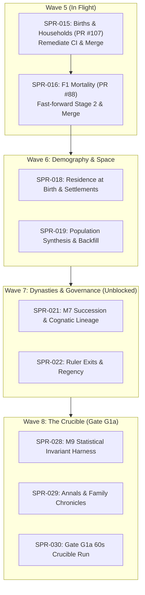

# HANDOFF: Rehoboam, 2026-10-20 (Architect Project Management & Roadmap Snapshot)

> **Read this first, then `AGENTS.md` and `CLAUDE.md`.** This file is an authoritative snapshot of in-flight work for the developer or agent picking up the project. The repository's own records (CODEX, `docs/`, PRs) are authoritative; this file tells you where they are and what to do next, in order.
>
> - **How to work alongside the other agents** is codified in:
>   - `CODEX/10_GOVERNANCE/GOV-009`: Git and GitHub (branches, commits, PRs, merges);
>   - `GOV-010`: CI;
>   - `GOV-011`: ownership, independence, records and handoffs.
>
>   `CLAUDE.md` binds every agent whatever its vendor; `GEMINI.md` points here.
> - **main:** `775f9391` (the merge of PR #124, 2026-10-20); check it with `git ls-remote origin main`.
> - **Priority (the director's D62, binding):**
>   - **P1:** the engine core (P1a "Bloodlines", gate G1a), which wins every contention for CI minutes, review time and merge slots.
>   - **P2:** the voxel viewer lane.
>   - **P3:** era packs, after G2.
> - **Director Decisions:** D58, D59, D61, and D63 are **RATIFIED and APPROVED** (`docs/decisions_pending.md`, `docs/decisions-log.md`). Wave 7, Minds, Wave 8, and Viewer plans are APPROVED. Decisional queue is 100% clear.

---

## 1. What you need to know in five minutes

- **What it is.** Rehoboam is a deterministic historical-simulation engine (Rust workspace in `crates/`), with exact Python reference implementations of every algorithm (`specs/`), executable contracts, and a strict governance model in `CODEX/`. The plan is in `docs/` (start with `docs/00_executive_summary.md`). The director (a human, they/them) owns ADRs, `docs/11_roadmap.md`, the D-items and the non-negotiables in `CLAUDE.md`.
- **How work runs** (ADR-0032; `AGENTS.md`, `CODEX/80_AGENTS/`, `CODEX/10_GOVERNANCE/`):
  - **The Architect** (`AGT-001`) writes or commissions plans and spec PRs, rules on findings, audits every sprint and merges every PR.
  - **A Developer** (`AGT-002-CORE` or `AGT-002-TOOLS`) implements a sprint on `sprint/SPR-NNN-*`.
  - **A Tester** (`AGT-003-*`), on a different model from the Developer's, verifies independently and writes `CODEX/40_VERIFICATION/VER-SPR-NNN-TEST.md`.
  - **Every plan and spec PR** gets an independent review, recorded as `REV-*`.
  - **The Architect's audit** is `VER-SPR-NNN.md`.
- **The checks.** Run `bin/check_all.sh` (three parts: `--part core`, `--part golden`, `--part stream`; CI runs them as parallel jobs). Every gate also runs on a planted violation that must FAIL. `CLAUDE.md` lists every check. The Python environment: `uv sync --frozen --project python`, then `python/.venv/bin/python`.
- **Hard rules you will hit:**
  - **Determinism:** keyed RNG only, fixed point for thresholds, no `HashMap` iteration in authoritative code.
  - **Generated files are never typed.** Golden baselines change only in a `[C3]` commit via `bin/regen_baseline.sh`. The amendments lock changes only via `lint_odd.py --next … --write-amendments-lock`. Goldens change only via each reference's `--write`.
  - `CODEX/00_INDEX/MANIFEST.yaml` is generated and **never committed**.
  - **Merging `main` into a sprint branch:** `bin/check_all.sh` and `python/tests/test_check_all_inventory.py` conflict often. Resolve **by gate name** (rule at `bin/check_all.sh:14–17`): keep every gate from both sides, each in exactly one part. A plain text merge can silently drop a re-wrapped gate; `python -I bin/check_all_selftest.py inventory` must say "both ways".
  - **Git (GOV-009):**
    - never push to `main`;
    - never force-push, and never rebase or amend a pushed branch;
    - bring `main` in with `git merge origin/main`;
    - merge PRs with a merge commit, pinned to the full head SHA that CI passed (`gh pr merge <N> --merge --match-head-commit <sha>`).
  - **PR body:** follow `.github/pull_request_template.md`: Sprint (with the new `Agent:` line), Compliance, Tasks, Verification, Merge route.
  - **Commits:** follow GOV-009 with your own tool's attribution trailers. Put no model identifiers anywhere else in the repository.
  - **Disk:** a cargo `target/` is 8–11 GB, and two concurrent `check_all` runs filled a 40 GB container today. Run one cargo-building `check_all` at a time per machine, and delete `target/` dirs you no longer need.
  - **CI time:** each part's target is 12 minutes, the hard limit 15.

---

## 2. State of `main` and what merged on 2026-10-18 / 2026-10-20

| PR | What | Commit |
|:---|:---|:---|
| #124 | **SPR-028**: Validation Harness Contract, Reference & Calibration Package T-01/T-02 (`spec/SPR-028-validation-contract`; REV-SPR-028-harness, REV-SPR-028-calib) | `775f939` |
| #123 | **SPR-027**: Stream Materializer (`sprint/SPR-027-stream-materializer`) | `c452fd8` |
| #107 | **SPR-015**: M2 Births & Households Stage B (`sprint/SPR-015-births-f1`; VER-SPR-015) | `8bd963b` |
| #120 | **A-69**: Deny added keys on frozen entries by default in `lint_odd.py` | `059b09a` |
| #111 | **SPR-033a**: Bevy Voxel Viewer Core (Bevy-free core, greedy mesher, hamlet terrain golden, isolation lint, viewer CI) (`sprint/SPR-033a-viewer-core`; VER-SPR-033a) | `7083e64` |
| #119 | **A-73**: Ignore agent worktrees in `lint_arch` and `lint_forbidden` (`tools/A-73-worktree-lint-skip`) | `39d6bfb` |
| #118 | Fix cargo-deny advisories (`deny.toml`) and nightly ignored-test panic (`rh-manifest`) | `4d3d14e` |
| #117 | Owed plan edits (SPR-027, SPR-028, SPR-038) and Wave 6 dispatch briefs | `50ed8cf` |
| #116 | Backlog triage of A-42, A-69, A-70, A-72, A-73, and A-81 note | `562386c` |
| #115 | VER-SPR-038a backfill record (DRAFT) & Tester commission brief | `143f1e5` |
| #114 | Probe record corrections, Director rulings of 2026-10-18, `.gitignore` `docs/red_team/games/` | `2deb172` |
| #113 | Red-team Batch 09 dossier & probe B09-01 only | `07a3430` |
| #112 | Handoff refresh, status report, BCK-002 A-78..A-82 | `736e8e5` |
| #83 | **SPR-014**: Lifecycle Queues (`sprint/SPR-014-lifecycle-queues`) | `d0e82c5` |
| #104 | **SPR-038a**: Per-Instant Cost Reduction Stage A (`sprint/SPR-038a-per-instant-cost`) | `5e01601` |
| #84 | **SPR-020**: Event Envelope in Engine (`sprint/SPR-020-envelope`) | `16a8559` |
| #82 | **SPR-026**: World Stream v1 Live Edge (`sprint/SPR-026-stream-v1`) | `fbfa53b` |
| #90 | **SPR-017**: Registry Effect Language v0 (`sprint/SPR-017-effect-language`) | `3824601` |

---

## 3. Active Fleet, Branches & Pull Requests

| Branch @ head | Node / Role | State & PR | Next Action |
|:---|:---|:---|:---|
| `sprint/SPR-016-mortality-f1` | **Exuberant** / Agent 2 `AGT-002-CORE` | PR #88: Stage 3 complete; merged healed `origin/main` (`775f9391`). | CI running; Architect audit (`VER-SPR-016.md`) and merge |
| `sprint/SPR-028-ensembles` | Adjutant Agent 1 `AGT-002-TOOLS` | Sprint branch: T-01 & T-02 merged via PR #124. Dispatched for T-03 (Ensembles, G1a demography gates, V-GOLD-03). | Implement `rehoboam_calib ensemble`, `fixture-demography_1000`, open draft PR |
| `sprint/SPR-021a-…` | Queued (`AGT-002-CORE`) | No branch. Queued behind SPR-016 and SPR-019 stage A (D58 item 5). | Dispatch to `AGT-002-CORE` upon SPR-016 merge |
| `arch/red-team-batch-04` @ `63046c9` | Red Team | **Do not open a PR from it.** Carries `tools/asset_ripper`, 7 copyrighted PDFs and a viewer HTML that ADR-0036 and the licence rules keep out | Red Team retires it |

---

## 4. Key Records & Directives

- **Verification Records:**
  - [`CODEX/40_VERIFICATION/REV-SPR-028-harness.md`](file:///home/bdavidriggins/Documents/Rehoboam/CODEX/40_VERIFICATION/REV-SPR-028-harness.md): T-01 approved.
  - [`CODEX/40_VERIFICATION/REV-SPR-028-calib.md`](file:///home/bdavidriggins/Documents/Rehoboam/CODEX/40_VERIFICATION/REV-SPR-028-calib.md): T-02 approved.
  - [`CODEX/40_VERIFICATION/VER-SPR-016.md`](file:///home/bdavidriggins/Documents/Rehoboam/CODEX/40_VERIFICATION/VER-SPR-016.md): Stage 3 audit drafted.
- **Status report:** [`docs/handoff/2026-10-18/pm_status_report.md`](file:///home/bdavidriggins/Documents/Rehoboam/docs/handoff/2026-10-18/pm_status_report.md).
- **Roadmap & Plans:**
  - `CODEX/05_PROJECT/PRJ-002_P1aPlan.md` (P1a "Bloodlines" plan through Gate G1a).
  - `CODEX/05_PROJECT/SPR-028_ValidationHarness.md` (Validation harness plan, T-01 & T-02 done).
  - `docs/decisions-log.md` (ratified Director decisions D58, D59, D61, D63).

---

## 5. What to do next, in order (Crucible Roadmap)

### 1. Close Wave 5: SPR-015 & SPR-016
1. **SPR-015 (M2 F1 Births, PR #107):** work order revision 2, in order (also: implement the six Batch 09 traps as Rust tests against the engine):
   1. Finish T-01: remove `next/M2`, strip M2 from `next/registry_delta.toml`, update the README, regenerate the lock with its tool.
   2. Regenerate the registry fixture.
   3. Explain the +62% quiet-instant cost before any baseline moves.
   4. Snapshot and baselines in the final `[C3] [perf-baseline]` commit only.
   5. Full local `bin/check_all.sh`; Tester pass (different model); Architect audit (`VER-SPR-015`); merge pinned to the head SHA.
2. **SPR-016 (M2 F1 Mortality, PR #88):** after SPR-015 merges, merge `main` (232 commits) by gate name, run the inventory self-check, finish stage 2, Tester, audit, merge.
3. **Records (A-78):** backfill `VER-SPR-038a`; commission independent Tester passes on SPR-020 and SPR-038a.

### 2. Wave 6: Demography & Space (scope from the sprint documents; read them, not this summary)
1. **SPR-018** (`SPR-018_WorldgenLite.md`): M1.regions F0 (elevation raster, regions, seats, routes); `S3.migration` F0 in a new `rh-sys-migration` (residence at genesis and at birth); the manifest validator's two household refusals; bench 4.
2. **SPR-019** (`SPR-019_PopulationSynthesis.md`): population synthesis v0 from the manifest's `population` marginal (D46) and the dynastic back-fill; stage A comes before SPR-021a (D58 item 5).

### 3. Wave 7: Dynasties (the specs are on `main`: AN-0, AN-1, T-00b merged)
1. **SPR-021a/b** (`SPR-021_SuccessionF1.md`): T-01 promotes M7 0.6.0 with the Registry's M7 defaults; T-02 builds the instant log's merged events in `rh-core`; the system crate is `rh-sys-dynasty`. Follow the plan's own task list. Known gap to close: M7 0.3.4 lacks a `person.id` read (SPR-017's Tester).
2. **SPR-022a/b** (`SPR-022_RulerExitsDormancyF1.md`): ruler-exit hazards, murder timer, feud stock, deposition and claims, regencies.

### 4. Wave 8: Gate G1a
1. **SPR-028** (`SPR-028_ValidationHarness.md`), **SPR-029** (`SPR-029_FamilyAnnals.md`), **SPR-030** (`SPR-030_ScaleAndGoldens.md`).
2. **G1a performance bar:** `kingdom_10k`, 1,000 sim-years in at most 60 s. See the status report §1: expect a miss; SPR-030a's probe decides A-68.

### 5. P2 Viewer Lane Execution
1. **SPR-033a (PR #111):** the red stream job was rerun once on 2026-10-18; if it fails again on `ConnectionRefused`, file under A-81. Then audit and merge.
2. **SPR-033b:** Stage Bevy 0.20 application once 14-day lock age criterion matures (2026-10-22).
3. **SPR-034 & SPR-035:** Stream ingestion and timeline scrubber hookup to SPR-027's materializer (branch now on `origin`).
