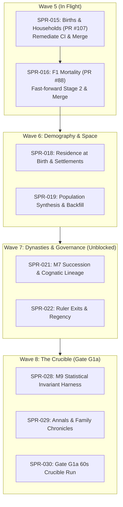

# HANDOFF: Rehoboam, 2026-10-18 (Architect Project Management & Roadmap Snapshot)

> **Read this first, then `AGENTS.md` and `CLAUDE.md`.** This file is an authoritative snapshot of in-flight work for the developer or agent picking up the project. The repository's own records (CODEX, `docs/`, PRs) are authoritative; this file tells you where they are and what to do next, in order.
>
> - **How to work alongside the other agents** is codified in:
>   - `CODEX/10_GOVERNANCE/GOV-009`: Git and GitHub (branches, commits, PRs, merges);
>   - `GOV-010`: CI;
>   - `GOV-011`: ownership, independence, records and handoffs.
>
>   `CLAUDE.md` binds every agent whatever its vendor; `GEMINI.md` points here.
> - **main:** `01690f6d` (the merge of PR #110, 2026-10-18); check it with `git ls-remote origin main`.
> - **Priority (the director's D62, binding):**
>   - **P1:** the engine core (P1a "Bloodlines", gate G1a), which wins every contention for CI minutes, review time and merge slots.
>   - **P2:** the voxel viewer lane.
>   - **P3:** era packs, after G2.
> - **Director Decisions:** D58, D59, D61, and D63 are **RATIFIED and APPROVED** (`docs/decisions_pending.md`, `docs/decisions-log.md`). Wave 7, Minds, Wave 8, and Viewer plans are APPROVED. Decisional queue is 100% clear.

---

## 1. What you need to know in five minutes

- **What it is.** Rehoboam is a deterministic historical-simulation engine (Rust workspace in `crates/`), with exact Python reference implementations of every algorithm (`specs/`), executable contracts, and a strict governance model in `CODEX/`. The plan is in `docs/` (start with `docs/00_executive_summary.md`). The director (a human, they/them) owns ADRs, `docs/11_roadmap.md`, the D-items and the non-negotiables in `CLAUDE.md`.
- **How work runs** (ADR-0032; `AGENTS.md`, `CODEX/80_AGENTS/`, `CODEX/10_GOVERNANCE/`):
  - **The Architect** (`AGT-001`) writes or commissions plans and spec PRs, rules on findings, audits every sprint and merges every PR.
  - **A Developer** (`AGT-002-CORE` or `AGT-002-TOOLS`) implements a sprint on `sprint/SPR-NNN-*`.
  - **A Tester** (`AGT-003-*`), on a different model from the Developer's, verifies independently and writes `CODEX/40_VERIFICATION/VER-SPR-NNN-TEST.md`.
  - **Every plan and spec PR** gets an independent review, recorded as `REV-*`.
  - **The Architect's audit** is `VER-SPR-NNN.md`.
- **The checks.** Run `bin/check_all.sh` (three parts: `--part core`, `--part golden`, `--part stream`; CI runs them as parallel jobs). Every gate also runs on a planted violation that must FAIL. `CLAUDE.md` lists every check. The Python environment: `uv sync --frozen --project python`, then `python/.venv/bin/python`.
- **Hard rules you will hit:**
  - **Determinism:** keyed RNG only, fixed point for thresholds, no `HashMap` iteration in authoritative code.
  - **Generated files are never typed.** Golden baselines change only in a `[C3]` commit via `bin/regen_baseline.sh`. The amendments lock changes only via `lint_odd.py --next … --write-amendments-lock`. Goldens change only via each reference's `--write`.
  - `CODEX/00_INDEX/MANIFEST.yaml` is generated and **never committed**.
  - **Merging `main` into a sprint branch:** `bin/check_all.sh` and `python/tests/test_check_all_inventory.py` conflict often. Resolve **by gate name** (rule at `bin/check_all.sh:14–17`): keep every gate from both sides, each in exactly one part. A plain text merge can silently drop a re-wrapped gate; `python -I bin/check_all_selftest.py inventory` must say "both ways".
  - **Git (GOV-009):**
    - never push to `main`;
    - never force-push, and never rebase or amend a pushed branch;
    - bring `main` in with `git merge origin/main`;
    - merge PRs with a merge commit, pinned to the full head SHA that CI passed (`gh pr merge <N> --merge --match-head-commit <sha>`).
  - **PR body:** follow `.github/pull_request_template.md`: Sprint (with the new `Agent:` line), Compliance, Tasks, Verification, Merge route.
  - **Commits:** follow GOV-009 with your own tool's attribution trailers. Put no model identifiers anywhere else in the repository.
  - **Disk:** a cargo `target/` is 8–11 GB, and two concurrent `check_all` runs filled a 40 GB container today. Run one cargo-building `check_all` at a time per machine, and delete `target/` dirs you no longer need.
  - **CI time:** each part's target is 12 minutes, the hard limit 15.

---

## 2. State of `main` and what merged on 2026-10-18

| PR | What | Commit |
|:---|:---|:---|
| #83 | **SPR-014**: Lifecycle Queues (`sprint/SPR-014-lifecycle-queues`) | `d0e82c5` |
| #104 | **SPR-038a**: Per-Instant Cost Reduction Stage A (`sprint/SPR-038a-per-instant-cost`) | `5e01601` |
| #84 | **SPR-020**: Event Envelope in Engine (`sprint/SPR-020-envelope`) | `16a8559` |
| #82 | **SPR-026**: World Stream v1 Live Edge (`sprint/SPR-026-stream-v1`) | `fbfa53b` |
| #90 | **SPR-017**: Registry Effect Language v0 (`sprint/SPR-017-effect-language`) | `3824601` |
| #105 | Ratify Director decisions D58, D59, D61, D63 | `2fc58c3` |
| #106 | **AN-0**: Multi-Segment Chronicle Fold (`arch/AN-0-annals-fold`; REV-AN0 CLOSED) | `1a412f8` |
| #108 | **AN-1**: Annals Fixtures for M7 F1 (`arch/AN-1-annals-m7-fixtures`; REV-AN1 CLOSED) | `d50f1af` |
| #109 | **T-00b**: M7 0.6.0 Amendments for SPR-022 (`arch/M7-0.6-T-00b`; REV-T00b CLOSED) | `6b1970d` |
| #110 | Update HANDOFF.md with AN-0, AN-1, and T-00b merges [C0] | `01690f6` |

---

## 3. Active Fleet, Branches & Pull Requests

| Branch @ head | Node / Role | State & PR | Next Action |
|:---|:---|:---|:---|
| `sprint/SPR-015-births-f1` @ `5ee789f` | **Exuberant** (`100.115.214.32`) `AGT-002-CORE` | **Cooking Stage B** ([PR #107](https://github.com/BigRigVibeCoder/Rehoboam/pull/107)). Stage A audited (`VER-SPR-015-INTERIM.md`). Red team Probe B09-01 passed 6/6 traps. | Apply CI fixes from [`exuberant_stage_b_work_order.md`](file:///home/bdavidriggins/Documents/Rehoboam/docs/handoff/2026-10-18/exuberant_stage_b_work_order.md), finish T-04, run `check_all`, and push `[C3]` commit. |
| `sprint/SPR-016-mortality-f1` @ `da6c74d` | Developer `AGT-002-CORE` | **Stage 1 PASS; Stage 2 Staged** ([PR #88](https://github.com/BigRigVibeCoder/Rehoboam/pull/88)). Brass relational logit mortality and infant knots ready. | Fast-forward and rebase/merge `main` immediately upon SPR-015 merge. |
| `sprint/SPR-027-stream-materializer` | **Adjutant Agent 1** (`100.101.50.50`) `AGT-002-TOOLS` | **In Progress** implementing Task T-03 (`crates/rh-golden/src/governor.rs`). | Complete pace governor, wire `control.sock`, execute `V-STR-02` suite. |
| `sprint/SPR-033a-viewer-core` @ `17f6ca7` | **Adjutant Agent 2** (`100.101.50.50`) `AGT-002-TOOLS` | **Stage A 100% Complete** ([Draft PR #111](https://github.com/BigRigVibeCoder/Rehoboam/pull/111)). Passed 22/22 gates in `bin/check_viewer.sh`. | Architect audit and merge. Prep brief for SPR-033b. |
| `arch/pm-agenda-wave5-wave7` | **Architect** (Local Session) `AGT-001` | **Active PM Orchestration & Roadmap Agenda**. | Coordinate PR #107 CI remediation, unblock SPR-016, and sequence Wave 6/7. |

---

## 4. Key Records & Directives

- **Interim Audits:**
  - [`CODEX/40_VERIFICATION/VER-SPR-015-INTERIM.md`](file:///home/bdavidriggins/Documents/Rehoboam/CODEX/40_VERIFICATION/VER-SPR-015-INTERIM.md): Stage A/B audit, Red Team probe results, and CI failure triage for PR #107.
- **Work Orders & Briefings:**
  - [`docs/handoff/2026-10-18/exuberant_stage_b_work_order.md`](file:///home/bdavidriggins/Documents/Rehoboam/docs/handoff/2026-10-18/exuberant_stage_b_work_order.md): Detailed remediation steps for Exuberant to turn PR #107 green.
  - [`docs/handoff/2026-10-18/viewer_lane_briefing.md`](file:///home/bdavidriggins/Documents/Rehoboam/docs/handoff/2026-10-18/viewer_lane_briefing.md): Roadmap for P2 viewer lane (SPR-033a/b, SPR-034, SPR-035).
- **Red Team Dossiers:**
  - [`docs/red_team/RT-2026-10-18-batch-09-dossier.md`](file:///home/bdavidriggins/Documents/Rehoboam/docs/red_team/RT-2026-10-18-batch-09-dossier.md): RT-039 (Childbirth Death Race), RT-040 (60s Stream Crucible), RT-041 (Feudal Epistemic Horizons).
  - [`tests/probes/probe_fertility_adversarial_traps.py`](file:///home/bdavidriggins/Documents/Rehoboam/tests/probes/probe_fertility_adversarial_traps.py): Probe B09-01 covering all 6 adversarial traps.
- **Roadmap & Plans:**
  - `CODEX/05_PROJECT/PRJ-002_P1aPlan.md` (P1a "Bloodlines" plan through Gate G1a).
  - `CODEX/05_PROJECT/PRJ-003_BevyVoxelViewer.md` (P2 Viewer lane plan).
  - `docs/decisions-log.md` (ratified Director decisions D58, D59, D61, D63).

---

## 5. What to do next, in order (Crucible Roadmap)

### 1. Close Wave 5: SPR-015 & SPR-016
1. **SPR-015 (M2 F1 Births, PR #107):**
   - Exuberant applies the 3 fixes in `exuberant_stage_b_work_order.md`:
     1. Sync `tests/registry_effect/registry_absolute_primogeniture.toml` with `specs/manifest/registry_v0.toml`.
     2. Update solo snapshot via `RH_UPDATE_SNAPSHOTS=1 cargo nextest run -p rh-golden --release --test tail`.
     3. Re-record instruction baselines via `python -I bin/perf_gate.py record`.
   - Complete T-04 (partnering N1–N7, `apply_marry`, households H3/H4).
   - Push `feat(SPR-015): complete Stage B births & households [C3] [perf-baseline]`.
   - Architect audits (`VER-SPR-015`) and merges with merge commit pinned to head SHA.
2. **SPR-016 (M2 F1 Mortality, PR #88):**
   - Bring `main` into `sprint/SPR-016-mortality-f1`.
   - Fast-forward Stage 2: Brass relational logit mortality schedule, infant knots, density modifiers.
   - Independent Tester verification, Architect audit (`VER-SPR-016`), and merge commit.

### 2. Execute Wave 6: Demography & Space
1. **SPR-018: Residence at Birth & Settlements:**
   - Implement `S3.settlements` F0 residence algorithm (`specs/worldgen/selftest_worldgen_lite.py`).
   - Tie newborn person residence to maternal household settlement.
2. **SPR-019: Population Synthesis & Dynastic Backfill:**
   - Execute population synthesis v0 and dynastic backfill reference.
   - Author manor fixture world (`specs/manifest/examples/manor.yaml`).

### 3. Execute Wave 7: Dynasties & Governance
*All spec prerequisites (AN-0, AN-1, T-00b) and Director decisions (D58) are merged into `main`.*
1. **SPR-021a/b: M7 Succession & Cognatic Lineage:**
   - Promote M7 0.6.0 from `next/` to authoritative frozen spec.
   - Implement agnatic, cognatic, and elective succession laws in `rh-sys-dynasty`.
2. **SPR-022a/b: Ruler Exits & Regency:**
   - Implement interregnum crises, minority regencies, abdication, and deposition.

### 4. Execute Wave 8: The Crucible (Gate G1a)
1. **SPR-028: M9 Statistical Invariant Harness:** Multi-seed demographic stability checks.
2. **SPR-029: Family Annals & Chronicles:** Template-based natural language chronicles.
3. **SPR-030: Gate G1a Crucible:** 10,000 persons, 1,000 sim-years in $\le 60$s on `kingdom_10k`.

### 5. P2 Viewer Lane Execution
1. **SPR-033a (PR #111):** Audit and merge Draft PR #111 (Bevy-free core).
2. **SPR-033b:** Stage Bevy 0.20 application once 14-day lock age criterion matures (2026-10-22).
3. **SPR-034 & SPR-035:** Stream ingestion and timeline scrubber hookup to Adjutant 1's materializer (SPR-027).
