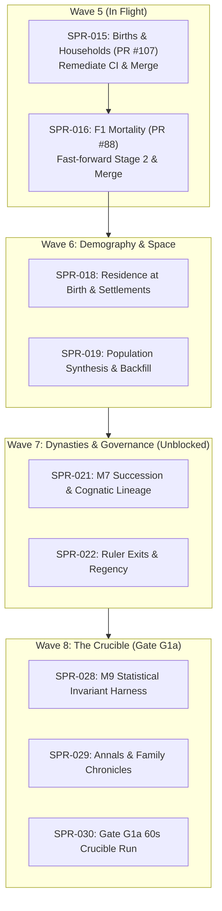

# HANDOFF: Rehoboam, 2026-10-18 (Architect Project Management & Roadmap Snapshot)

> **Read this first, then `AGENTS.md` and `CLAUDE.md`.** This file is an authoritative snapshot of in-flight work for the developer or agent picking up the project. The repository's own records (CODEX, `docs/`, PRs) are authoritative; this file tells you where they are and what to do next, in order.
>
> - **How to work alongside the other agents** is codified in:
>   - `CODEX/10_GOVERNANCE/GOV-009`: Git and GitHub (branches, commits, PRs, merges);
>   - `GOV-010`: CI;
>   - `GOV-011`: ownership, independence, records and handoffs.
>
>   `CLAUDE.md` binds every agent whatever its vendor; `GEMINI.md` points here.
> - **main:** `01690f6d` (the merge of PR #110, 2026-10-18); check it with `git ls-remote origin main`.
> - **Priority (the director's D62, binding):**
>   - **P1:** the engine core (P1a "Bloodlines", gate G1a), which wins every contention for CI minutes, review time and merge slots.
>   - **P2:** the voxel viewer lane.
>   - **P3:** era packs, after G2.
> - **Director Decisions:** D58, D59, D61, and D63 are **RATIFIED and APPROVED** (`docs/decisions_pending.md`, `docs/decisions-log.md`). Wave 7, Minds, Wave 8, and Viewer plans are APPROVED. Decisional queue is 100% clear.

---

## 1. What you need to know in five minutes

- **What it is.** Rehoboam is a deterministic historical-simulation engine (Rust workspace in `crates/`), with exact Python reference implementations of every algorithm (`specs/`), executable contracts, and a strict governance model in `CODEX/`. The plan is in `docs/` (start with `docs/00_executive_summary.md`). The director (a human, they/them) owns ADRs, `docs/11_roadmap.md`, the D-items and the non-negotiables in `CLAUDE.md`.
- **How work runs** (ADR-0032; `AGENTS.md`, `CODEX/80_AGENTS/`, `CODEX/10_GOVERNANCE/`):
  - **The Architect** (`AGT-001`) writes or commissions plans and spec PRs, rules on findings, audits every sprint and merges every PR.
  - **A Developer** (`AGT-002-CORE` or `AGT-002-TOOLS`) implements a sprint on `sprint/SPR-NNN-*`.
  - **A Tester** (`AGT-003-*`), on a different model from the Developer's, verifies independently and writes `CODEX/40_VERIFICATION/VER-SPR-NNN-TEST.md`.
  - **Every plan and spec PR** gets an independent review, recorded as `REV-*`.
  - **The Architect's audit** is `VER-SPR-NNN.md`.
- **The checks.** Run `bin/check_all.sh` (three parts: `--part core`, `--part golden`, `--part stream`; CI runs them as parallel jobs). Every gate also runs on a planted violation that must FAIL. `CLAUDE.md` lists every check. The Python environment: `uv sync --frozen --project python`, then `python/.venv/bin/python`.
- **Hard rules you will hit:**
  - **Determinism:** keyed RNG only, fixed point for thresholds, no `HashMap` iteration in authoritative code.
  - **Generated files are never typed.** Golden baselines change only in a `[C3]` commit via `bin/regen_baseline.sh`. The amendments lock changes only via `lint_odd.py --next … --write-amendments-lock`. Goldens change only via each reference's `--write`.
  - `CODEX/00_INDEX/MANIFEST.yaml` is generated and **never committed**.
  - **Merging `main` into a sprint branch:** `bin/check_all.sh` and `python/tests/test_check_all_inventory.py` conflict often. Resolve **by gate name** (rule at `bin/check_all.sh:14–17`): keep every gate from both sides, each in exactly one part. A plain text merge can silently drop a re-wrapped gate; `python -I bin/check_all_selftest.py inventory` must say "both ways".
  - **Git (GOV-009):**
    - never push to `main`;
    - never force-push, and never rebase or amend a pushed branch;
    - bring `main` in with `git merge origin/main`;
    - merge PRs with a merge commit, pinned to the full head SHA that CI passed (`gh pr merge <N> --merge --match-head-commit <sha>`).
  - **PR body:** follow `.github/pull_request_template.md`: Sprint (with the new `Agent:` line), Compliance, Tasks, Verification, Merge route.
  - **Commits:** follow GOV-009 with your own tool's attribution trailers. Put no model identifiers anywhere else in the repository.
  - **Disk:** a cargo `target/` is 8–11 GB, and two concurrent `check_all` runs filled a 40 GB container today. Run one cargo-building `check_all` at a time per machine, and delete `target/` dirs you no longer need.
  - **CI time:** each part's target is 12 minutes, the hard limit 15.

---

## 2. State of `main` and what merged on 2026-10-18

| PR | What | Commit |
|:---|:---|:---|
| #83 | **SPR-014**: Lifecycle Queues (`sprint/SPR-014-lifecycle-queues`) | `d0e82c5` |
| #104 | **SPR-038a**: Per-Instant Cost Reduction Stage A (`sprint/SPR-038a-per-instant-cost`) | `5e01601` |
| #84 | **SPR-020**: Event Envelope in Engine (`sprint/SPR-020-envelope`) | `16a8559` |
| #82 | **SPR-026**: World Stream v1 Live Edge (`sprint/SPR-026-stream-v1`) | `fbfa53b` |
| #90 | **SPR-017**: Registry Effect Language v0 (`sprint/SPR-017-effect-language`) | `3824601` |
| #105 | Ratify Director decisions D58, D59, D61, D63 | `2fc58c3` |
| #106 | **AN-0**: Multi-Segment Chronicle Fold (`arch/AN-0-annals-fold`; REV-AN0 CLOSED) | `1a412f8` |
| #108 | **AN-1**: Annals Fixtures for M7 F1 (`arch/AN-1-annals-m7-fixtures`; REV-AN1 CLOSED) | `d50f1af` |
| #109 | **T-00b**: M7 0.6.0 Amendments for SPR-022 (`arch/M7-0.6-T-00b`; REV-T00b CLOSED) | `6b1970d` |
| #110 | Update HANDOFF.md with AN-0, AN-1, and T-00b merges [C0] | `01690f6` |

---

## 3. Active Fleet, Branches & Pull Requests

| Branch @ head | Node / Role | State & PR | Next Action |
|:---|:---|:---|:---|
| `sprint/SPR-015-births-f1` @ `cda5d16` | **Exuberant** (`100.115.214.32`) `AGT-002-CORE` | PR #107 (draft): T-01..T-04 committed. **CI red on all three parts** (core, golden, stream). T-01 incomplete (`next/M2` not removed). No Tester pass yet. | Work order revision 2: [`exuberant_stage_b_work_order.md`](file:///home/bdavidriggins/Documents/Rehoboam/docs/handoff/2026-10-18/exuberant_stage_b_work_order.md). Evidence: `VER-SPR-015-INTERIM.md` |
| `sprint/SPR-016-mortality-f1` @ `da6c74d` | Developer `AGT-002-CORE` | PR #88 (draft): stage 1 only, Tester PASS on stage 1. **232 commits behind `main`.** | Held until SPR-015 merges; then merge `main` by gate name (expect conflicts in the M2 spec and `check_all`) |
| `sprint/SPR-027-…` | `AGT-002-TOOLS` | **No remote branch exists.** `pm_inbox.md` reports a local T-03 in progress; unverified | Owner pushes it, or the Architect reassigns |
| `sprint/SPR-033a-viewer-core` @ `17f6ca7` | `AGT-002-TOOLS` | PR #111 (draft): core, golden and viewer checks green; **stream red** on `serve::probe_c…` `ConnectionRefused` (suspected flaky test, A-81) | Rerun once; audit and merge |
| `arch/pm-agenda-wave5-wave7` | Architect `AGT-001` | PR #112 (draft): this record, the status report, BCK-002 A-78..A-82 | Merge when reviewed |
| `arch/red-team-batch-04` @ `63046c9` | Red Team | **43 commits ahead of `main`, no PR.** Holds Batch 09 dossier and probe `B09-01` | Open a PR (A-80) |

---

## 4. Key Records & Directives

- **Status report (read this for the full picture):** [`docs/handoff/2026-10-18/pm_status_report.md`](file:///home/bdavidriggins/Documents/Rehoboam/docs/handoff/2026-10-18/pm_status_report.md): sprint ledger, code status, findings, governance gaps, backlog, next seven days.
- **Interim audit:** [`CODEX/40_VERIFICATION/VER-SPR-015-INTERIM.md`](file:///home/bdavidriggins/Documents/Rehoboam/CODEX/40_VERIFICATION/VER-SPR-015-INTERIM.md) (DRAFT; no pass given).
- **Work orders and briefings:**
  - [`exuberant_stage_b_work_order.md`](file:///home/bdavidriggins/Documents/Rehoboam/docs/handoff/2026-10-18/exuberant_stage_b_work_order.md) (revision 2).
  - [`viewer_lane_briefing.md`](file:///home/bdavidriggins/Documents/Rehoboam/docs/handoff/2026-10-18/viewer_lane_briefing.md): P2 lane (SPR-033a/b, 034, 035).
- **Red-team files** (on `arch/red-team-batch-04` only; not on `main`): `docs/red_team/RT-2026-10-18-batch-09-dossier.md` (RT-039..041) and `tests/probes/probe_fertility_adversarial_traps.py` (B09-01, reported 6 of 6 by the Red Team; not re-run by the Architect).
- **Roadmap & Plans:**
  - `CODEX/05_PROJECT/PRJ-002_P1aPlan.md` (P1a "Bloodlines" plan through Gate G1a).
  - `CODEX/05_PROJECT/PRJ-003_BevyVoxelViewer.md` (P2 Viewer lane plan).
  - `docs/decisions-log.md` (ratified Director decisions D58, D59, D61, D63).

---

## 5. What to do next, in order (Crucible Roadmap)

### 1. Close Wave 5: SPR-015 & SPR-016
1. **SPR-015 (M2 F1 Births, PR #107):** work order revision 2, in order:
   1. Finish T-01: remove `next/M2`, strip M2 from `next/registry_delta.toml`, update the README, regenerate the lock with its tool.
   2. Regenerate the registry fixture.
   3. Explain the +62% quiet-instant cost before any baseline moves.
   4. Snapshot and baselines in the final `[C3] [perf-baseline]` commit only.
   5. Full local `bin/check_all.sh`; Tester pass (different model); Architect audit (`VER-SPR-015`); merge pinned to the head SHA.
2. **SPR-016 (M2 F1 Mortality, PR #88):** after SPR-015 merges, merge `main` (232 commits) by gate name, run the inventory self-check, finish stage 2, Tester, audit, merge.
3. **Records (A-78):** backfill `VER-SPR-038a`; commission independent Tester passes on SPR-020 and SPR-038a.

### 2. Wave 6: Demography & Space (scope from the sprint documents; read them, not this summary)
1. **SPR-018** (`SPR-018_WorldgenLite.md`): M1.regions F0 (elevation raster, regions, seats, routes); `S3.migration` F0 in a new `rh-sys-migration` (residence at genesis and at birth); the manifest validator's two household refusals; bench 4.
2. **SPR-019** (`SPR-019_PopulationSynthesis.md`): population synthesis v0 from the manifest's `population` marginal (D46) and the dynastic back-fill; stage A comes before SPR-021a (D58 item 5).

### 3. Wave 7: Dynasties (the specs are on `main`: AN-0, AN-1, T-00b merged)
1. **SPR-021a/b** (`SPR-021_SuccessionF1.md`): T-01 promotes M7 0.6.0 with the Registry's M7 defaults; T-02 builds the instant log's merged events in `rh-core`; the system crate is `rh-sys-dynasty`. Follow the plan's own task list. Known gap to close: M7 0.3.4 lacks a `person.id` read (SPR-017's Tester).
2. **SPR-022a/b** (`SPR-022_RulerExitsDormancyF1.md`): ruler-exit hazards, murder timer, feud stock, deposition and claims, regencies.

### 4. Wave 8: Gate G1a
1. **SPR-028** (`SPR-028_ValidationHarness.md`), **SPR-029** (`SPR-029_FamilyAnnals.md`), **SPR-030** (`SPR-030_ScaleAndGoldens.md`).
2. **G1a performance bar:** `kingdom_10k`, 1,000 sim-years in at most 60 s. See the status report §1: expect a miss; SPR-030a's probe decides A-68.

### 5. P2 Viewer Lane Execution
1. **SPR-033a (PR #111):** rerun the red stream job once (A-81), audit, merge.
2. **SPR-033b:** Stage Bevy 0.20 application once 14-day lock age criterion matures (2026-10-22).
3. **SPR-034 & SPR-035:** Stream ingestion and timeline scrubber hookup to SPR-027's materializer (no remote branch yet).
