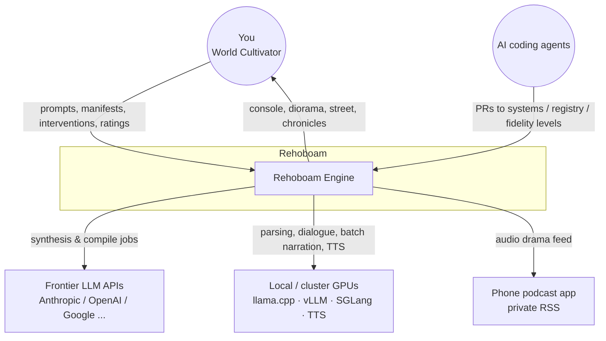
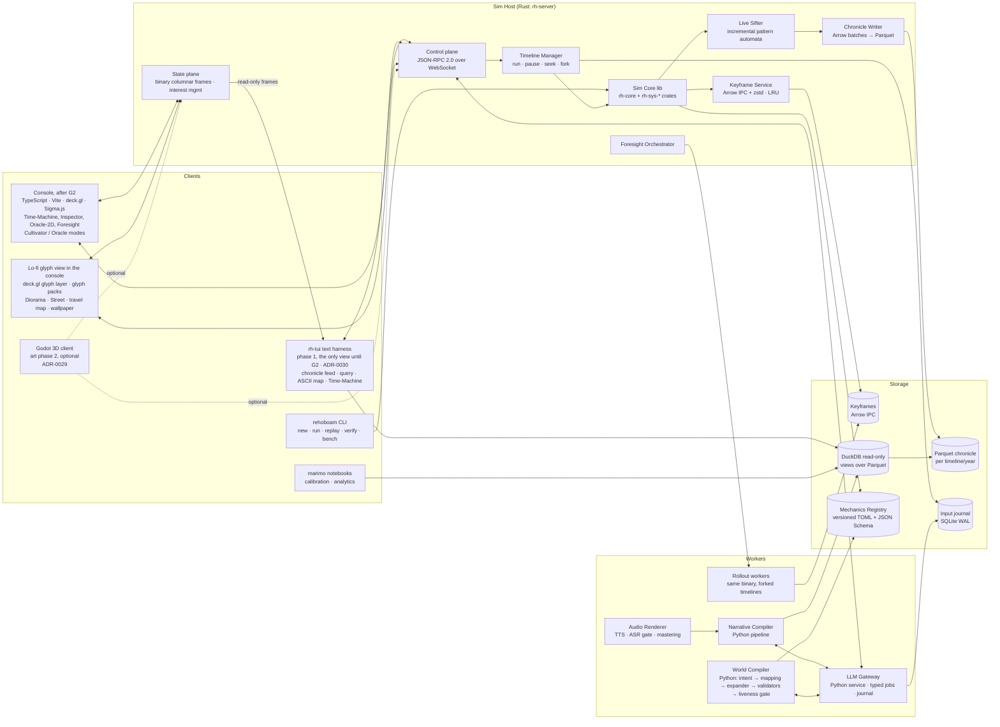
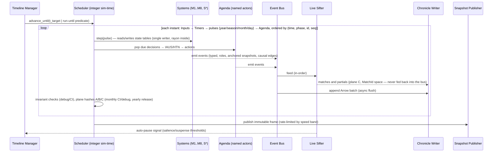

# 05.0 — Architecture Overview

*Status: Draft v1.1 (2026-10-15). This is the entry point to the architecture set. Detailed specs: 05.1 Simulation Core · 05.2 World Model & Data · 05.3 Cognition & Epistemics · 05.4 Narrative Intelligence · 05.5 World Compiler & DSL · 05.6 LLM Platform · 05.7 Presentation Clients · 05.8 Audio · 05.9 Interfaces (ICD). Decisions are recorded in `06_adr/`.*

---

## 1. Architectural principles

These follow from design drivers D1–D7.

1. **A single authoritative writer per timeline.** One simulation thread owns world state and parallelises internally (rayon, fixed chunking). Everything else reads **immutable snapshot frames**.
2. **Three planes of state (ADR-0024).** Plane A is authoritative (`state_hash`). Plane B is observation: pins, the facts ledger, hydrated presentation (`observation_hash`). Plane C is narrative: sift matches, significance, visibility (`narrative_hash`). A never reads B or C. The only path into A is a journaled material input.
3. **Event-sourced truth.** World history is `f(engine_build, registry_version, manifest_hash, seed, input_journal)`. The chronicle and keyframes are derived and cacheable. The journal and manifest are the canonical record.
4. **LLMs sit at the edge, behind typed gates.** LLM outputs enter the world only as journaled, schema-validated inputs. Models never hold a write handle on state.
5. **Representation, time and presentation are separate axes.** The draft's "strata" conflated three independent things; they are split apart in §2.
6. **Systems are plugins.** Each simulation system is a crate behind the `SystemModel` trait, with declared state, clocks, invariants, parameter bounds and fidelity level. Systems interact through shared state tables and the event bus, never through direct calls.
7. **Scale out with timelines.** Extra compute goes to forks (Foresight, what-ifs, calibration ensembles) and to model fidelity. The world itself is never sharded across processes.
8. **Polyglot by role.** Rust is authoritative and fast. Python handles orchestration, LLMs, analytics and calibration. TypeScript drives the console. GDScript and Rust-gdext drive the 3D client.

## 2. Three orthogonal axes

The draft's three "strata" (macro / regional ECS / collapsed reality) fused three separate concerns. Rehoboam keeps them apart.

```
         REPRESENTATION TIER          TEMPORAL RESOLUTION              PRESENTATION LoD
         (what state exists)          (how often it updates)           (how it is shown)
         ─────────────────────        ────────────────────────         ───────────────────
 T−1     Off-map compartments         Season / year                    —
 T0      Ledger row (every person)    Month (+ daily when active)      Heatmaps, counts, map glyphs
 Pop     Pop aggregates (beliefs,     Month / season                   Region overlays
         morale per region×class×faith)
 T1      Named actor (full mind)      Event-driven agenda              Portraits, genealogy, map tokens
 T2c     Crowd proxy (sampled T0)     5–10 Hz in bubble only           VAT MultiMesh / impostors
 T3      Embodied (hydrated)          10–20 Hz in bubble only          Rigged kitbash, animation
 T4      Conversant                   Turn-based                       Close-up + dialogue + TTS
 Spec.   Spectacle (dragons, armies)  T1 clock, interpolated           Visible to draw distance
```

- A person can be **T0 and T1 at once**: a named actor still has a ledger row.
- **T2c, T3 and T4 are views** over T0/T1 rows inside the bubble, held in plane B. They are never separate people, and authority never moves to the bubble: deaths, births and other outcomes are **scheduled timers** in plane A that fire whether or not anyone is watching (ADR-0025).
- **Pinned ≠ T1.** Pinning (plane B) keeps what you have seen of a person stable. It does not give them a mind. T1 promotion happens only by simulation criteria or a journaled input (ADR-0024).
- T3 and T4 exist only at **Live** speed. Faster speed bands collapse the bubble to T2c and Spectacle.
- On-map demography is always per person (T0). Only off-map compartments (T−1) are aggregate, and people crossing in or out are materialised or absorbed by an adapter.
- Temporal resolution is set **per system and per activity**, not per tier. An epidemic steps daily only in affected regions while it is active.

## 3. System context (C4 level 1)



## 4. Containers (C4 level 2)



| Container | Language | Responsibility | Notes |
|---|---|---|---|
| **rh-core** (+ `rh-sys-*` crates) | Rust | Authoritative state, systems, scheduler, RNG, invariants, event emission | No I/O. Hosted by the CLI, the server, the Python wheel, and (P5+) a GDExtension. |
| **rh-server** | Rust (tokio, axum) | Timeline manager, control and state planes, sifter, chronicle writer, keyframes, Foresight orchestration | One authoritative timeline per process. Forks run as separate worker processes. |
| **Rollout workers** | Rust (same binary) | Foresight Monte-Carlo, what-if previews, calibration ensembles | Scale horizontally across cores and nodes. Each worker is stateless apart from its keyframe input. |
| **LLM Gateway** | Python | Typed job API, routing (local/cluster/frontier), constrained decoding, journaling, budgets | The only process that talks to models. |
| **World Compiler** | Python | NL → intent + mapping table → expander → validators → liveness gate → deterministic calibration → manifest; background certification; gap reports | Calls the core through the Python wheel (`rh-py`) for burn-in runs. |
| **Narrative Compiler** | Python | Digest → plan → bible → scenes → QA → exporters | Batch, resumable, reports costs. |
| **Audio Renderer** | Python | Audio-drama TTS, ASR gate, mastering, RSS | Offline. |
| **World Stream** (ADR-0030; `05.10`) | Rust (in `rh-server`) | The engine's primary output: an ordered, append-only, sequenced stream per timeline (channel A world, channel C narrative). Sealed segments are the Parquet chronicle; the live edge is served over a socket; the materializer rebuilds exact state at any tick | Viewers hold their own cursors; actions land at the tip. Nothing a viewer does slows the engine |
| **rh-tui** (phase-1 harness; ADR-0030) | Rust (ratatui) | Reads the World Stream: chronicle feed, query prompt with causal-ancestor tree, ASCII map, keyboard Time-Machine, vitals, G2 rating form | The only interactive view until G2. A separate process that reads frames and the chronicle; the engine never waits for it (PERF-5). |
| **Console** | TypeScript | Time-Machine UI, causal inspector, map, Foresight, Oracle-2D, ratings | Built after G2 (ADR-0030). Served by the server on localhost. Packaging via Tauri is optional. |
| **Lo-fi glyph view** (art phase 1; ADR-0029) | TypeScript (console) | Diorama (also a Lively web wallpaper), Street-level with `@` and a dialogue panel, Oracle travel map, Time-Machine map skin. Glyph packs per era and culture keyed by Registry IDs | Same process as the console; decides nothing |
| **Godot client** (art phase 2, optional) | GDScript + Rust gdext (`rh-godot`) | Diorama, Street, Oracle-3D. Content generation from seed + snapshot. Crowd LoD. Audio | Separate process (crash isolation, independent pausing). |

## 5. The tick pipeline



**Phase order within a tick** is fixed and documented in `05.1` §4. It is part of the determinism contract.

## 6. Repository and crate layout (target)

```
rehoboam/
├── crates/
│   ├── rh-core/            # World, tables, scheduler, RNG, time, invariants, SystemModel trait
│   ├── rh-ids/             # typed IDs, keyed hashing (H), counter RNG
│   ├── rh-events/          # event schema, causal edges, Arrow builders
│   ├── rh-registry/        # Mechanics Registry loader + validation + effect-language evaluator (05.5 §2.1)
│   ├── rh-contracts/       # contract crates: column types + read accessors per owning system (05.1 §2)
│   ├── rh-sys-regions/     # M1  region graph, terrain, routes
│   ├── rh-sys-demography/  # M2  ledger vital events, households, partnering; S3 migration; life-course log
│   ├── rh-sys-agri/        # M3  agriculture, seasons, climate shocks
│   ├── rh-sys-economy/     # M4  goods, markets, trade, wages, rents, taxes
│   ├── rh-sys-contagion/   # M5  metapop SEIRS, covert compartment, testing, fear
│   ├── rh-sys-polity/      # M6  SDT core, legitimacy, instability, revolts
│   ├── rh-sys-dynasty/     # M7  succession, dynast hazards, claims
│   ├── rh-sys-war/         # M8  campaigns, supply, battles, sieges
│   ├── rh-sys-culture/     # S1/S2 religion, ideology, tech diffusion, knowledge fronts
│   ├── rh-sys-ecology/     # S4  wild prey, livestock grazing, predators (dragons) with energetics
│   ├── rh-worldgen/        # heightmaps, rivers, region graph, burgs, settlement plans (shared with rh-godot)
│   ├── rh-minds/           # T1 cognition: traits, values, emotions, IAUS, HTN, beliefs, channels
│   ├── rh-sifter/          # pattern DSL compiler + incremental matcher
│   ├── rh-snapshot/        # keyframes (Arrow IPC), state hashing, journal I/O
│   ├── rh-protocol/        # wire formats (control schemas, binary frames)
│   ├── rh-server/          # host: timelines, planes, foresight orchestration
│   ├── rh-cli/             # headless tools
│   ├── rh-py/              # PyO3 bindings (maturin wheel)
│   ├── rh-tui/             # optional ratatui terminal client (contract tests, headless viewing)
│   └── rh-godot/           # gdext extension for the optional 3D art phase 2
├── python/
│   ├── rehoboam_llm/       # gateway, job schemas, providers, journal
│   ├── rehoboam_compiler/  # world compiler (intent, expander, validators, gap reports)
│   ├── rehoboam_narrative/ # narrative compiler + exporters
│   ├── rehoboam_audio/     # audio-drama renderer
│   └── rehoboam_calib/     # stylized facts, sensitivity analysis, notebooks
├── console/                # TypeScript web app, including the lo-fi glyph view and glyph packs
├── client_godot/           # Godot project
├── registry/               # Mechanics Registry (TOML) + JSON Schemas
├── worlds/                 # reference manifests (golden worlds)
├── specs/                  # machine-readable specs (schemas, DDL, pattern examples)
├── docs/                   # this plan
└── research/               # research dossiers
```

## 7. Mapping from the draft

| Draft component | Replaced by | Why |
|---|---|---|
| `engine/substrate.py` (NumPy Laplacian + Poisson chunks) | `rh-sys-regions`, `rh-sys-demography`, `rh-sys-agri`, … plus raster fields for physical hazards | DR-C3 |
| `engine/ecs.py` (Flecs/Python) | `rh-core` tables + `bevy_ecs` (pinned) for T1 + `SocialGraph` store | DR-M2, ADR-0002 |
| `engine/hydrator.py` (SQLite bbox) | `rh-server` bubble manager (plane B views) + in-memory grid hash + scheduled outcomes and material inputs (ADR-0025) | DR-C6, DR-M12 |
| `cognition/human_mind.py`, `hive_mind.py` | `rh-minds` (generic core + overlays; hive as a channel) | DR-M8, DR-M9, DR-M16 |
| `cognition/dialogue_worker.py` | LLM Gateway `dialogue.*` jobs (plan-then-realise) | DR-M6 |
| `narrative/sifter.py` (Datalog) | `rh-sifter` (DSL → incremental automata) + DuckDB SQL twins | DR-M4 |
| `narrative/db.py` (SQLite/DuckDB + delete compaction) | `rh-events` + Chronicle Writer (Parquet) + DuckDB views + salience tiering | DR-C4 |
| `narrative/compiler.py` | `rehoboam_narrative` pipeline | DR-M13 |
| `interface/server.py` (FastAPI JSON-RPC) | `rh-server` (JSON-RPC control plane + binary state plane) | DR-M12 |
| `interface/oracle.py` | `rh-minds` persuasion + `rh-server` Oracle verbs + Foresight | DR-M7 |
| `config/schema.py` | `registry/` + `specs/manifest` + `rehoboam_compiler` | DR-C2 |
| `client_godot/` | `client_godot/` + `rh-godot` | kept; content pipeline added (DR-M10) |
