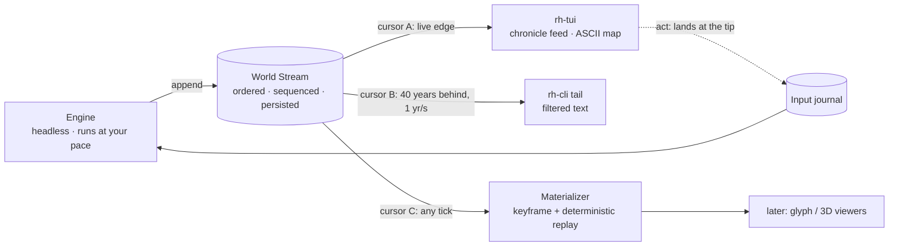

# 05.10 — The World Stream

*Status: Draft v1.0 (2026-10-16). Decision: ADR-0030. Interfaces: `05.9` IF-0. Tests: `09` V-STR. Requirements: `03` STR-1 to STR-5.*

## 1. The idea in one paragraph

The engine runs headless and **streams its world**: one ordered, append-only record of everything that happens, in the order it happens. Nothing else is its job in phase 1.

A viewer **taps** the stream. It keeps its own **cursor** and its own **buffer**, so it can watch live, fall behind, rewind or play at any speed, without the engine knowing or caring. Viewers hold all the presentation ability (text now, glyphs or 3D later), so they can be upgraded without touching the engine.

When you **act**, the action lands at the **tip**: the newest moment of the world, whatever moment you happen to be watching. Acting at an earlier moment is not an action; it is a deliberate **fork** (ADR-0025).



## 2. Two kinds of contact with the world

| | Viewing | Acting |
|---|---|---|
| **Where** | At *your* cursor, anywhere in the stream | At the **tip**, the engine's current tick |
| **Rate** | Your playback rate | The engine's pace, which you set |
| **Effect on the world** | None. A viewer only reads | A journaled material input, applied at the next tick boundary |
| **Effect on the engine's speed** | None. The engine never waits for a viewer (PERF-5) | None beyond the input's own consequences |
| **Determinism** | Not an input to history | Recorded with its exact tick; replay reproduces it |

**You must always see where the tip is.** Every harness shows a status line: the tip's date, the tip's pace, your cursor, and how far behind the tip you are. Acting while behind shows the landing date first ("this will land at 1352-04-02, the tip, 9 years after what you are watching"), because at MAX the tip can move several years per second.

Three ways to act:
1. **Now:** the action lands at the next tick boundary after the tip.
2. **Scheduled:** the action lands exactly at a future tick you name ("when the tip reaches 1360-01, do X"). It is journaled when issued and applied when the tip reaches it.
3. **At a past moment:** not an action. It is a **fork**, a new timeline branching at that tick (`timeline.fork`), which runs alongside the original.

## 3. Pace is your setting

- The engine's pace is a **speed band** (Live, 1 h/s … 1 decade/s) or **MAX** (as fast as the hardware allows) (`05.1` §4).
- Pace never changes what happens, only how fast it happens. Speed bands change publication cadence and how far the engine advances per wall interval, never the simulation for a given input journal. At MAX a late deliberation consult resolves through its journaled fallback (`05.3` §8).
- **No viewer can slow the engine.** The only things that set its pace are your pace setting and the two play styles below, both of which you choose.

**Two play styles:**
- **Watch** (the default). The engine runs at its pace. Your viewer buffers and may fall behind. An auto-pause (`05.4` §2.3) pauses **your playback**, not the world.
- **Play.** You stay at the live edge, and an auto-pause **pauses the tip** so you can act at the moment that matters. You choose this style when you want to intervene: Oracle play, or the street-level inhabitant. It is a pace command you issue, not back-pressure from a viewer.

Street-level viewing needs Live playback (`05.2`: the bubble exists only at the Live rate). In the stream model that is **your playback rate**, not the engine's: you can walk a street in 1347 at Live speed while the tip runs at MAX in 1390.

## 4. What the stream carries: the fidelity contract

The stream has two channels. Plane B never enters it, because observation detail is derived on the viewer side.

| Channel | Plane | Records | Reproducible? |
|---|---|---|---|
| **A: world** | A | Every authoritative **event** (actors, act class, target, place, tick, causal edges, anchored snapshot values) in emission order; every **input** at its applied tick; a **step digest** per macro step (population, prices, era state, Ψ components per region; plane hashes); **keyframe markers** (pointers to full snapshots, every 10 sim-years and at auto-pauses) | **Byte-identical** for the same build, Registry, manifest, seed and journal, at any pace (V-STR-01) |
| **C: narrative** | C | Sift matches (partial, complete, expired, killed; `05.4`), significance, suspense, visibility | Reproducible for a given pattern-library version; can be re-sifted with another (ADR-0024) |

**The fidelity promise:**
- **Everything the simulation decides is in channel A**, exactly: every birth, death, marriage, move, decision, war, price and verdict, with its causes.
- **Any state at any tick can be rebuilt exactly.** The materializer takes the nearest keyframe and replays deterministically from it. The rebuilt state is checked against the engine's state hash (V-STR-02).
- **What is not in the stream is generated, not lost.** Street positions, faces, idle movement and conversation text are plane-B hydration: a deterministic function of the stream, the seed and the Registry. Every viewer that hydrates the same place and moment sees the same thing, and none of it feeds back.

**Volume.**
- At 1M persons the world makes about 21k named events per simulated month (`08` §1), roughly 5–15 MB of stream per simulated year.
- At MAX that is several MB per wall-second: far too fast to read raw. The "Matrix rain" you watch is always **filtered**, by significance, place, person, pattern or channel.

## 5. Record and transport

- **Record header:** `timeline_id`, `seq` (contiguous per channel), `tick`, `channel`, `kind`, then the payload.
  - In channel A, `seq` follows emission order, so the EventId order *is* the stream order.
  - Channel C records reference channel-A EventIds and never interleave with them.
- **Encoding:** Arrow IPC record batches. JSON Lines is an optional export for scripts.
- **Transport:**
  - **Live edge:** the newest segment is held in memory and served over WebSocket or a local socket.
  - **Sealed segments:** one per sim-year per channel, on disk as Parquet. They are the chronicle (`05.2`, ADR-0007). **The chronicle is the stream at rest.**
- **Cursors:**
  - A viewer's cursor is just `(timeline_id, channel, seq)`, kept by the viewer.
  - A viewer that falls behind the in-memory edge reads sealed segments instead, with no gaps and no duplicates (V-STR-05).
  - "Jump to live" moves the cursor to the tip.
- **Forks** are separate timelines with their own streams, sharing history up to the branch tick.

## 6. Phase 1: what you see (text only, no GUI)

`rh-cli tail` and the `rh-tui` chronicle panel render channel A, with channel C as annotations. This is an illustrative sample, not real output.

```text
TIP 1351-07 ▶ MAX 8.2 y/s │ YOU 1342-11 ▶ 1 mo/s (8y8m behind) │ val_khor · seed 5EED │ filter: sig ≥ 0.6
1342-11-03  Khor Vale     FAMINE_DECLARED  2nd shortfall in a row · grain ×1.9            sig .71
1342-11-19  Ashford       DEATH    Aldric the Elder (61) · hunger         ← FAMINE_DECLARED 11-03
1342-12-02  Ashford       RIOT     market of Ashford · net buyers 64%     ← grain ×1.9
1342-12-02  ⚑ open   famine_to_succession_crisis   A=Khorvath IV  S=Edric (19)   suspense .42
1343-02-08  Old Keep      COERCE   Khorvath IV → Edric · confined        ← motivated_by fear .71
1343-02-08  ⚑ match  authority_purges_successor    A=Khorvath IV  S=Edric                 ⏸ auto-pause
```

Zoom works by filter, not by graphics: follow one person (`--follow Edric`), one place (`--place Ashford`), one pattern, or the world digest (`--digest region`), which prints the per-step population, prices and Ψ per region as a compact table.

## 7. Engine obligations (binding from P1.0)

1. **One writer.** Only the engine appends to channel A; only the sifter appends to channel C.
2. **No hidden state changes.** Every plane-A change is either an event in channel A or produced by deterministic replay from a keyframe. A system that changes state without emitting through the event API fails the plane-isolation lint (V-STR-02).
3. **Never wait for a reader.** Appending is non-blocking. Readers that cannot keep up read sealed segments later; nothing is dropped from the stream.
4. **Pace is a control command, not an input.** It is logged in the run log, never in the input journal.
5. **Hydration is off the tick path.** It runs on the viewer side or in a materializer process, never on the engine's simulation threads (ADR-0030).

## 8. Tests (`09` V-STR)

| ID | What it proves |
|---|---|
| V-STR-01 | The channel-A stream is byte-identical across runs, thread counts and paces (MAX vs 1 yr/s) |
| V-STR-02 | State rebuilt by the materializer at random ticks equals the engine's state hash; no hidden state changes |
| V-STR-03 | Viewers at 1×, at 100×, rewinding, and one stalled change neither the stream nor the engine's throughput (with V-PERF-09) |
| V-STR-04 | An action taken while 10 years behind lands at the tip, is journaled with that tick and replays exactly. A scheduled action lands on its tick. A past-tick action is refused unless issued as a fork |
| V-STR-05 | A cursor that falls off the live edge continues from sealed segments with contiguous `seq`: no gaps, no duplicates |
