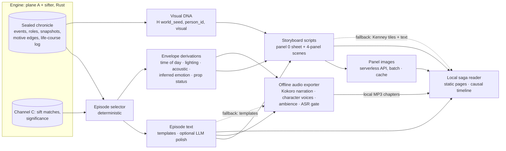

# 05.11 — The Saga Chronicle Pipeline: Text, Storyboards, Panels, Voices and the Local Reader

*Status: Draft v1.0 (2026-10-16). Decisions: ADR-0035 (the saga engine; §6 the engine only engines, §7 the pipeline, §7a the event envelope), ADR-0034 (LLMs describe, never decide), ADR-0017 (narrative compiler), ADR-0019 (audio, as amended), ADR-0024 (planes). Requirements: `03` SAGA-5 to SAGA-10, AUD-3, NAR-5. Tests: `09` V-SAGA-07, V-SAGA-08, V-SAGA-12, V-SAGA-14, V-SAGA-15, V-AUD-03, V-AUD-04, V-AUD-07. Phases: `11` P2 (text and audio v0) and P3 (storyboards, panels, drama, the reader).*

---

## 0. Rules that hold at every stage

**The principle (ratified 2026-10-16; ADR-0035 §5a): the engine simulates ontological truth (matter, space, time, state, the causal graph); downstream tools generate perception (pixels, prompts, dialogue, sound, prose).** Everything in this document is perception, built from the truth the chronicle records.

1. **Plane C, downstream of the engine.** The pipeline is a set of Python tools in `python/`. They read the sealed Parquet chronicle (or tail the World Stream) and write files. They never call the engine, and plane A never reads anything they make (ADR-0024, ADR-0035 §6).
2. **Narrator out, never decide** (ADR-0034). Models describe what the simulation did. No model output enters plane A.
3. **Provenance everywhere.** Every sentence, panel and audio line carries the event IDs it shows, plus the build, Registry version, pattern-library version and the model and prompt that made it (NAR-5).
4. **A template fallback at every stage.** Every stage can run with no model at all. A season of templated text, tile-and-text storyboards and one narrator voice is a complete, if plain, product.
5. **Local only.** The output is a folder of files: text, storyboard scripts, images, MP3 chapters and the reader's pages. Nothing is served or published. **The local Web Graphic Novel / Storyboard Reader is the only presentation surface for sagas.**
6. **Batch and asynchronous.** Media are made after a saga is compiled, never while the engine runs. The engine never waits for media and never knows what an image or audio file is.

## 1. Pipeline



Everything right of the engine box is plane C and lives in `python/`: `rehoboam_narrative` (episode text and prose), `rehoboam_saga` (selection, envelope derivations, visual DNA, storyboards, panels, the map export), `rehoboam_audio` (the offline audio exporter) and `rehoboam_reader` (the local reader). Model calls go through the LLM gateway (`rehoboam_llm`), which is outside the engine too.

## 2. Episodes and seasons

- **A season** is one simulated century of one world (or one era, if you choose). **An episode** is one saga arc or a few linked ones: a vow from oath to end, a relic's passage, a succession war.
- **Selection is deterministic.** Episodes are chosen from completed sift matches (saga packs, P2.4) ranked by significance (`05.4` §3), with arc diversity across the season. The selection is a pure function of the chronicle, the pattern-library version and the selector version, so a season can be regenerated exactly.
- **Each episode has a manifest:** its match IDs, its event IDs, the timeline, build, Registry and pattern-library versions, and a content hash. Every later artefact points back to it.

## 3. Stages

| # | Stage | Input → output | Generator | Fallback | Gate | Phase |
|---|---|---|---|---|---|---|
| 1 | Episode selection | Matches + significance → episode manifests | Deterministic | — | Reproducible manifests | P2 |
| 2 | Episode text | Manifest + chronicle → templated chronicle text with provenance | Templates (`05.4` §5); optional `chronicle.polish` | Templates | V-NAR-05 provenance | P2 (templates), P3 (polish, prose forms) |
| 3 | Envelope derivations | Envelope facts (`05.2` §4.1a: roles, place, cell, weather, emotion, instrument, contaminant flags, motive edges) → time of day, lighting, acoustic, inferred emotion, prop status ("blood dripping" from the blood flag) | Deterministic rules and Registry tables | — | V-SAGA-15 | P2 (audio), P3 (panels) |
| 4 | Visual DNA | Person id, genealogy, visible state → locked visual tokens | Deterministic (§5) | — | V-SAGA-14 | P3 |
| 5 | Storyboard scripts | Climax matches + envelope + tokens → storyboard YAML (§4) | Deterministic structure; optional `storyboard.*` LLM captions (CT0–CT2 only) | Templated captions | Schema-valid; every panel has event IDs | P3 |
| 6 | Panel images | Storyboard panels → images | Serverless image API, batch (§6) | Kenney tiles and glyphs with captions | V-SAGA-08 (report) | P3, once D29 is decided |
| 7 | Voices and mix | Episode text (and P3 dialogue lines) → voice tracks, ambience, MP3 chapters | Offline audio exporter (§7) | Text only for a failing line | V-SAGA-07, V-AUD-03, V-AUD-04, V-AUD-07 | P2 (narration), P3 (drama) |
| 8 | The local reader | All of the above → static pages | `rehoboam_reader` (§8) | — | V-SAGA-12, V-HUM-13 | P2 (audio reader), P3 (graphic novel) |

## 4. Storyboard script schema

A storyboard script is plain data, one file per episode. **Each scene uses a four-panel framing** (inspired by Wildermyth), and each panel is filled from the event envelope (`05.2` §4.1a). **Panel 0 is the character sheet** of each protagonist, generated once (§5).

| Panel | Purpose | Shot | Filled from |
|---|---|---|---|
| 0 | Character sheet (once per protagonist) | Full figure, neutral pose | Visual DNA tokens; the visual style card |
| 1 | **Staging** | Wide, atmosphere | Place and place type; time of day, lighting, weather; the cast present (witnesses) |
| 2 | **Confrontation** | Medium, tension | Actor and target; their emotional vectors; the motive edge (why they are here) |
| 3 | **Climax** | Close-up, the act | The verb and act class; the instrument (an artifact); prop status |
| 4 | **Consequence** | Aftermath | The outcome events (a death, a relic passing, a vow sworn or broken); the next causal edge |

```yaml
storyboard_version: 1
episode_id: "e3f1…"                      # content hash of the episode manifest
provenance:
  timeline_id: 0
  engine_build: "…"                      # from the chronicle segment headers
  registry_version: "0.1.0"
  pattern_library_version: "…"
  match_ids: ["…"]
style_card: dark_fantasy_ink             # Registry [visual_style_cards]
cast:
  - person_id: "H64(…)"
    sheet: "sheets/<person_id>-<age_band>.png"   # panel 0; generated once, reused
    tokens: [long_face, ruddy, auburn, broad, scar_left_cheek, house_brooch]
scenes:
  - scene_id: 1
    events: [10411, 10422, 10430]        # EventIds this scene shows
    panels:
      - n: 1                             # staging
        shot: wide
        place: { place_id: 88, place_type: great_hall }
        time_of_day: dusk                # derived (plane C) from the tick and calendar
        lighting: torchlight_low         # derived from time of day, place type, weather
        weather: storm                   # anchored snapshot, only if M3 simulated it
        cast_present: ["H64(…)", "H64(…)"]
        caption: { text: "…", tier: CT0, events: [10411] }
      - n: 2                             # confrontation
        shot: medium
        actors:
          - { person_id: "H64(…)", role: actor, emotion: { occ: anger, intensity: 0.8, source: simulated } }
          - { person_id: "H64(…)", role: target, emotion: { occ: fear, intensity: 0.5, source: inferred } }
        motive: { edge: RETALIATION_FOR, inciting_event: 9120 }
        caption: { text: "…", tier: CT0, events: [10422, 9120] }
      - n: 3                             # climax
        shot: close_up
        verb: REVENGE
        instrument: { artifact_id: "…", kind: weapon }
        prop_status: [blood_dripping]    # derived from the verb and outcome
        caption: { text: "…", tier: CT0, events: [10430] }
      - n: 4                             # consequence
        shot: wide
        outcomes: [10431, 10432]         # e.g. DEATH, ARTIFACT_PASSED
        caption: { text: "…", tier: CT1, events: [10431, 10432] }
    links: { timeline: "reader/timeline.html#e10430" }   # click-through to the causal timeline
```

- **Canon tiers apply** (`05.4` §6.1). Captions are CT0 or CT1; optional dialogue in a panel is CT2 and goes into the embellishment ledger. A panel never shows a CT3 invention.
- **The prompt for panels 1–4 describes only the setting and the action.** Identity comes from the reference (panel 0), not from words in the prompt (§5).

## 5. Visual DNA, character sheets and the visual style card

**Visual DNA** (SAGA-9) is a **pure plane-C function of plane-A facts**, computed the way virtual telemetry is: on demand, never stored in plane A.
- `visual = H(world_seed, person_id, "visual")`, using the engine's keyed hash with a **plane-C purpose** (golden vectors shared with `rh-ids`). It never consumes a plane-A random draw, so computing it cannot change history (V-SAGA-14).
- It unpacks into **locked tokens:** physiognomy, colouring, hair, build and signature items, drawn from the Registry's visual vocabulary for the person's culture and era (`registry_v0.toml` `[visual_vocabulary.*]`). No LLM invents a visual description.
- **Heritable.** A child's base tokens derive from the parents' tokens with a keyed variation, so dynasties resemble one another; a founder's come from the hash alone.
- **Visible state is layered on top** from plane-A facts: age (from the birth tick), scars and injuries (from harm events), artifacts borne (S6), office regalia (M7 titles) and health.

**Character sheets and consistency** (SAGA-6; R-32):
- **Panel 0 is a canonical character sheet,** generated once, when an actor first becomes a sifted saga's protagonist, and again only when an age band or a signature item changes.
- **Later panels are conditioned on that reference,** by reference embedding or image-to-image. **Candidates to evaluate in P3:** InstantID, PuLID and IP-Adapter (`14` §S). They are not decided; V-SAGA-08 reports how well each keeps a character recognisable.
- The panel prompt describes only the setting and the action.

**The first visual style card, `dark_fantasy_ink`** (beside the prose style cards, WP P4.3 in P3):
- no photorealism;
- a dark-fantasy graphic novel: heavy ink, cross-hatching, high-contrast chiaroscuro, muted watercolour wash, bold angular silhouettes, textured paper;
- **no living artist's name** in the card, in any prompt or in any document. The style is described in these terms only.

## 6. Panel images

- **Rendering is asynchronous and batched,** after a saga is compiled, through a **serverless image API**. Candidates: fal.ai, Replicate and Together AI; models FLUX.1 [dev] or SDXL. Which provider, and the monthly budget, is open (`12` Q24, D29; default: a serverless API in batch, no GPU VM).
- **Cost: about $0.005–0.015 per panel,** so a 10-panel chapter costs about $0.10–0.15. **Estimate, verify at P3:** prices, terms and model availability change.
- **Images are plane C,** with provenance (provider, model and version, seed, prompt hash, reference-image id) and a **content-addressed cache**, so a panel is rendered once.
- **They are not bit-reproducible across providers.** That is acceptable for narration: the storyboard script, not the pixels, is the reproducible artefact, and it regenerates exactly.
- **Fallback:** the panel drawn from Kenney CC0 tiles and glyphs with its caption, in the reader.

## 7. Voices and the offline audio exporter

The **offline audio exporter** (`python/rehoboam_audio`) reads the chronicle and the episode text, synthesises the voice tracks, mixes ambience, and writes **local MP3 chapters**. The engine never writes audio.

| Part | Choice | Phase | Notes |
|---|---|---|---|
| Narration | **Kokoro-82M** (Apache-2.0, `14` §S) | P2 | Faster than real time on a CPU, so it runs on the laptop. To be evaluated |
| Character voices | **Chatterbox or Qwen3-TTS** | P3 | Designed voices only, no cloning of real people (`05.8`); voice assignment is deterministic, `voice_id = f(person_id, demographic bucket)`. To be evaluated |
| Soundscapes | Ambience beds and one-shots from **CC0 or CC-BY libraries**, recorded in the provenance ledger | P2 (beds), P3 (one-shots) | Chosen from the envelope's place type, acoustic, weather and time of day |
| QA | ASR round trip per line (WER, proper nouns against the cast list); best of 3, then text | P2 | V-SAGA-07 |
| Mastering | −16 LUFS integrated, ≤ −1 dBTP | P2 | V-AUD-03 |
| Output | MP3 per chapter with ID3 chapter marks (CHAP/CTOC), a VTT transcript, AI-disclosure text, and the episode's provenance | P2 | V-AUD-07, V-SAGA-12 |

## 8. The local saga reader

**The local Web Graphic Novel / Storyboard Reader** (`python/rehoboam_reader`) is the only presentation surface for sagas (SAGA-7).
- **Static pages** generated from the sealed chronicle and the pipeline's outputs, opened from a local folder. It needs no server and never contacts the engine (V-SAGA-12).
- **P2 (reader v0):** the episode list, the MP3 chapter player, the episode text with every sentence linked to its events.
- **P3:** storyboards and panels, prose sagas, and the **causal timeline**: scrub along it, and click any panel or sentence through to its events and their typed causes.
- The text Time-Machine (`rh-tui`) stays as the keyboard tool for watching and rating; the reader is for listening and reading.

**Other downstream consumers** follow the same rules: the **Azgaar export** (P2 candidate, WP P2.16) writes the region graph and province state as an Azgaar Fantasy Map Generator map file for a browser map, and the **P5 diorama** (`console/`) reads the stream. Neither calls the engine.

## 9. Provenance and the planes

- Every artefact (text, script, sheet, panel, line, chapter) records: the episode manifest hash; the event IDs it shows; the generator (template version, or model, version, seed and prompt hash); the reference ids it was conditioned on; the licence of any asset used.
- **Plane C only.** The pipeline's outputs are never read by plane A. The `narrative_hash` covers the deterministic artefacts (manifests, texts from templates, storyboard scripts, visual DNA tokens); model outputs are recorded by provenance and cached, not hashed for determinism.
- **Visual DNA and the envelope derivations are deterministic,** so the reader always shows the same face tokens, light and acoustics for the same event.

## 10. Template fallback at every stage

| Stage | Without a model |
|---|---|
| Episode text | Templated Annals and Chronicle (`05.4` §5) |
| Storyboard captions | Templated captions from the envelope |
| Panels | Kenney CC0 tiles and glyphs, composed by panel type, with the caption |
| Narration | Text in the reader (and the OS voice, if you want one) |
| Character voices | The narrator voice reads the line |
| Prose sagas | The saga form from templates (ADR-0017) |

## 11. Hardware and cost

| Resource | Fact | Consequence |
|---|---|---|
| The laptop (ThinkPad P51, Quadro M2200 **4 GB**) | Too small for local SDXL or FLUX image generation | Images go to a serverless API |
| The laptop's CPU (4 cores) | Kokoro-82M runs faster than real time on a CPU (to be verified at P2) | Narration renders locally, offline |
| `adjutant` (Google Cloud VM, 8 cores, 64 GB) | **No GPU**; runs on demand | Not used for images; it can batch CPU TTS if the laptop is busy |
| Character voices (P3) | Chatterbox has a CPU path; Qwen3-TTS may need a GPU (not verified) | Evaluate on the CPU first; a hosted TTS service is the fallback (`12` Q25) |
| Images (P3) | About $0.005–0.015 per panel (**estimate, verify at P3**) | A 10-panel chapter ≈ $0.10–0.15; a season of 8 chapters ≈ $1–1.20, before retries |

**Recommendation:** a serverless image API in batch, no GPU VM (D29). Confidence: medium. It needs no operations work, and a season's images cost about $1 at the estimate above. A GPU VM on demand stays the fallback if API terms, quality or consistency fail.

## 12. Verification

| Test | What it checks |
|---|---|
| V-SAGA-07 | TTS with an ASR round trip |
| V-SAGA-08 | Panel consistency against panel 0 (report first) |
| V-SAGA-12 | The offline export and the local reader |
| V-SAGA-14 | Visual DNA: deterministic, heritable, plane C, no plane-A draws |
| V-SAGA-15 | The envelope: only simulated facts stored; derivations reproducible |
| V-AUD-03, V-AUD-04, V-AUD-07 | Loudness, intelligibility, export |
| V-NAR-05 | Sentence provenance |
| V-HUM-13 | The G3 season, rated by you |
