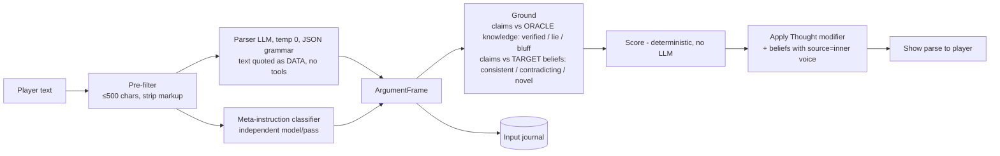

# 05.3 — Cognition, Epistemics, Persuasion and Foresight

*Status: Draft v1.0 (2026-10-15). Sources: R04, R05, R09. Decisions: ADR-0012, 0013, 0014, 0015.*

---

## 1. Minds by tier

| Tier | Population | State | Decision mechanism | Cadence | LLM |
|---|---|---|---|---|---|
| **Masses (pops)** | 100k–10M persons via ~10³–10⁴ pops (region × class × faith) | Distributions of morale, fear, needs satisfaction, faction loyalty; **belief shares** per tracked proposition; omen credibility | Difference equations: needs → unrest; compartment rumour flow (ignorant → spreader → stifler); bounded-confidence drift; Granovetter thresholds (M6) | Month (+ event interrupts) | None at runtime |
| **T1 Named actors** | 1k–5k (rulers, great houses, officers, clergy, hive nodes, dragons, pinned) | Psychological core (§2) + overlays; beliefs; memories; relationships | **Event-driven IAUS** chooses goals and stratagems; **bounded HTN** decomposes them; places and institutions advertise | CK3-style polling, 1–12 months per decision type, plus interrupts. 1–5 Hz inside the bubble | Optional *pivotal consult* (§8) |
| **T3 Embodied** | ≤ 200 in the bubble | T0 row + T1 mind if named; otherwise a generated "light mind" seeded from the pop distributions (§1.1) | T1 decides intent; a behaviour tree executes it at frame rate | 10–20 Hz | No |
| **T4 Conversant** | 1–3 | As T3 + dialogue buffer | **The sim plans the speech act; the LLM realises it** (§8) | Turn-based | Local model |

### 1.1 Light minds for unnamed persons
When an unnamed ledger person is hydrated or spoken to, they get a light mind:

- **Traits** from `H(seed, id, "trait", k)`, mapped through the pop's trait distribution.
- **Beliefs** seeded from the pop's belief shares. Whether this person holds a proposition is a keyed Bernoulli draw, so it is stable across visits.
- **Memories** synthesised as references to *real* region and household events since birth: famines, raids, deaths of kin.

If the conversation reveals anything, the person is pinned and the light mind is promoted into a persisted T1-lite record (facts ledger).

## 2. The generic psychological core

The core is setting-agnostic. Values are fixed-point.

| Component | Representation | Dynamics | Source |
|---|---|---|---|
| Traits | 6 × HEXACO (i8, −100..100) | Static (tiny drift with age optional) | Ashton & Lee |
| Values | 10 × Schwartz basic values (i8) | Slow drift from culture and experience | Schwartz |
| Mood | PAD (3 × i16) | Pulled by emotions; decays to a trait-derived baseline (ALMA) | Gebhard |
| Emotions | ≤ 8 OCC slots {type, intensity u8, half-life} | Appraisal of events against goals and standards; exponential decay | OCC, GAMYGDALA |
| Needs | 5–7 meters (sustenance, safety, belonging, esteem, autonomy, purpose…) | Decay + satisfaction from actions and advertisements | Sims, DF |
| Opinions | Per relationship edge: list of `OpinionModifier {source_event, magnitude, decay}`; opinion = Σ | Each modifier decays or expires | CK3 |
| Thoughts | `Thought {vector deltas, half-life, stack_limit, stack_mult, source}` | Timed modifiers. This is where whispers and omens land | RimWorld |
| Beliefs | Sparse store (§4) | Updated by channels | Talk of the Town (Ryan et al. 2015) |
| Memories | References to `event_id` + encoding intensity | ACT-R base-level activation `B = ln Σ t_j^{−d}` | Anderson & Schooler |

**Setting overlays** are declared in the manifest and Registry as *derived read-outs* that the UI and the sifter can use:

| Overlay | Derivation (initial definitions; tune in calibration) |
|---|---|
| Despair | Mood region P < θ for > τ, plus unmet needs |
| Paranoia | Trait (low Agreeableness, high Emotionality) + state (fear + suspicion beliefs). **It also sets the accusation criterion** |
| Hubris | Low Honesty-Humility + high Dominance + success streak |
| Filial Piety | Tradition + Benevolence values × kin-edge weight |
| Corruption | Accumulated corrupt acts gated by low Honesty-Humility (setting stat) |

The five draft vectors survive as **UI readouts**. The simulation runs on the core.

## 3. Decision architecture

1. **Decision types.** Each type has an IAUS consideration set and a polling interval. Examples: `choose_stratagem`, `respond_to_threat`, `marry`, `appoint`, `rebel`, `purge`, `confess`, `investigate`.
2. **IAUS scoring.** Score = ∏ response_curve_i(input_i) × compensation factor, over candidate (action, target) pairs. Inputs come from mind state, beliefs (*not* world truth), relationships and anchored world state.
   - Selection is **top-k weighted** with keyed RNG. The pure argmax looks robotic.
   - The **top contributors and the margin over the runner-up** are logged as `motivated_by` edges.
3. **HTN.** Small method libraries expand a stratagem into a plan, e.g. `assassinate(rival)` → recruit agent → acquire poison → gain access → act. Plans are re-planned **only on interrupts**.
4. **Advertisements.** Places and institutions (temple, tavern, court, market) advertise need satisfaction, Sims-style, for low-level activity choice.
5. **Contingent unlocking.** Registry actions declare which past-event roles they can reference: a `revenge` action unlocks for victims of a `harm` event. These references become *contingency* causal edges. This is the narratability lever (R02 §R2).

**Cost.** 5,000 actors × 30 options × 5 considerations ≈ 750k curve evaluations, ≈ 1 ms in Rust (R03 measured 0.81 ms for a toy). Event-driven decisions at monthly cadence over 1,000 years total about 6×10⁷ decisions, ≈ 60–300 CPU-s.

## 4. Epistemics

### 4.1 Belief record
`Belief {subject, predicate, object|value, conf: i8 log-odds, evidence: {observation, reflection, statement, eavesdrop, transference, confabulation, lie, mutation}, source_agent, channel, t_acquired, t_last_reinforced, event_ref, lineage_ptr}`

### 4.2 Update rule
`conf += trust(source) × fidelity(channel) × relevance × skepticism(Paranoia, in-group)`, all clamped.

- A contradicted belief triggers dissonance appraisal (anger or shame).
- Low-activation memories become eligible for **mutation** or **transference** (seeded), which produces misremembering.

### 4.3 Channels (the hive is one of them)

| Channel | Latency | Fidelity per hop | Trust weight | Reach | Notes |
|---|---|---|---|---|---|
| Witness (co-presence) | 0 | High; drops with distance and stress | Self ≈ 1 | Place × time | Witness sets come from co-presence. Raycasts only in the bubble |
| Testimony / gossip | Hours–days | 0.6–0.9 + distortion | Relationship trust | Social-graph neighbours | Driven by "tell" actions |
| Document / decree | Days–weeks | ≈ 1 content, low interpretation | Institutional legitimacy | Literate subset | Forgery = a lie on an artifact |
| Crowd (sermon, market) | Days | Low | Faction affinity | Pops | Compartment flows into pop belief shares |
| Oracle whisper | 0 | 1 (gated by the parse) | Trust in the "inner voice" | One target | §6 |
| **Hive** | **0** | **1** | **1** | **All drones and mimics** | One shared store; members have no copies of their own |

### 4.4 Distortion operators
These are deterministic transforms on structured propositions, each applied with a seeded probability:

- **Leveling:** drop an attribute.
- **Sharpening:** scale a magnitude.
- **Assimilation:** substitute an actor consistent with the listener's stereotypes and out-group.

Each transform yields a new `variant_id` linked to the original through `lineage_ptr`. That lineage is what lets the chronicle show *how* a rumour mutated.

### 4.5 Theory of mind
- Depth-1 beliefs ("X believes P") are stored only for **flagged propositions**: plots, affairs, mimic suspicion, secrets.
- Depth-2 ("X believes Y suspects me") is stored only for active schemes.
- **Suspicion** is a Bayesian posterior over each other actor's hidden type (human or mimic, loyal or plotter), updated with the likelihood of their observed actions under each type's policy.

## 5. Hive and mimics

- **Hive objective:** `U = Σ w_b·biomass + Σ w_i·g(infiltrated) − λ·Σ drones_lost − μ·E[exposure_cost]`, discounted at γ, with concave g.
- **Mimic utility** = cover maintenance (act as their pre-capture self) + covert objectives. Both are gated by local risk, measured as witness density and suspicion of them.
- **Tells**, each with its own sensitivity and specificity:
  - **Impossible-knowledge events**: an action draws on hive-only knowledge.
  - **Behavioural drift**: the KL divergence of recent action choices from the pre-capture baseline.
  - **Physical tests**, which are imperfect and carry se/sp.
- **Detection dynamics** (M5 coupling):
  - Positives = τ_test·(se·I_c + (1−sp)·S).
  - At low prevalence, PPV collapses: 0.1% prevalence with a 99%/99% test makes 91% of positives false.
  - Paranoia lowers investigators' accusation criterion.
  - Purges of false positives cut legitimacy and raise fear.
  - Hive test-evasion lowers the effective se.

  None of this is scripted. The witch-hunt spiral emerges from these rules.

## 6. Whisper Counsel: parse, don't inject



**ArgumentFrame.** `{appeals: [type ∈ {evidence, value(v), fear, hope, authority, kinship, threat, promise, social_proof}], target_vectors: [...], requested_action?: registry_action_id, claims: [(s, p, o)], references: [entity/event names], meta_instruction: bool}`. When the two passes disagree, the weaker reading wins.

**Scoring** (no LLM):

```
p_central  = σ(a·Openness + b·Involvement − c·Despair − d·Stress)
central    = evidence_strength × VAF_congruence(target value ranking, invoked value)
peripheral = trust(inner_voice) × emotional_fit(current OCC state)
raw        = p_central·central + (1−p_central)·peripheral
Δ          = raw × 1/(1 + k·n_recent_same_vector)               # habituation
           × min(1, c_max·(1 − e^(−Foresight_spent/F₀)))         # cap
           × r,  r ~ Beta(α(Hubris, Agreeableness), β(Paranoia)) # seeded resistance
if requested_action violates target's top values or autonomy → Δ := −Δ (reactance)
if meta_instruction → Δ := 0; Paranoia += m; memory("uncanny voice")
```

**Apply.** A `Thought` modifier with half-life, stack limit and stacking multiplier. Verified claims become beliefs with `channel = whisper`. A **caught lie** is a claim that contradicts a high-confidence target belief, and it erodes trust in the voice.

**Show.** *"Heard as an appeal to filial duty, citing the famine of 409. She already doubted the fire."* Showing the parse turns guessing into play and makes injection visibly pointless.

**Worst case (SEC-1).** A perfect argument is already capped, so the worst injection gets at most the cap, and it is penalised in-world.

### 6.1 Pierce the Veil and Plant Omen
- **Pierce the Veil** reveals hidden state (hive membership, secret loyalties) **to the player only**. To act on it, the player has to convince someone in-world: counsel backed by evidence the target can verify.
- **Plant Omen** uses a pop-level Bayesian-persuasion receiver with a per-pop **omen credibility**. Omens shift morale and fear through compartment flows. Credibility decays with frequency and with portents that fail. Priests (T1) *interpret* omens according to their faction's utility, so the same omen can be spun two ways.
- **Forbidden Ward** (fantasy registries only) is a physical-field effect at a coordinate, with duration in sim-time.

## 7. Foresight: Monte-Carlo prophecy

1. **The prophecy.** You write a predicate over the future, e.g. `crowned(Valen) before 1250 AND NOT civil_war(realm, 1240..1250)`. A prophecy DSL shares its grammar with the sifter.
2. **Fork.** The Foresight Orchestrator forks the canonical timeline at the current tick. Rollout *k* uses `branch_salt = k` for `t ≥ fork_tick`.
3. **Run.** N rollouts (default 256) run headless at MAX on rollout workers. They scale horizontally across cores and nodes.
   - The run is truncated at the predicate's horizon.
   - Fidelity is reduced where the predicate cannot be affected (hinterland regions run at F0).
4. **Estimate.** `P = hits/N` with a Wilson interval. **Failure-path clustering** groups failing rollouts by their sifted-arc signatures ("regicide 41%, campaign death 22%, partition war 19%").
5. **Intervention evaluation.** The candidate intervention runs on the **same salts** as the baseline (common random numbers). The paired difference ΔP has far lower variance than two independent ensembles.
6. **Calibration.** Back-test on historical forks of past timelines. Events forecast at probability *p* must occur at rate *p* ± tolerance (reliability diagram in CI).
7. **The game mechanic.** Running Foresight costs the Oracle **Foresight**, which regenerates per sim-time. The cost scales with N and horizon. Larger ensembles on more compute buy tighter intervals, which is a direct use of unbounded compute.
8. **The canonical timeline is never changed by Foresight.** Only journaled interventions change it.

## 8. LLM touchpoints in cognition

| Touchpoint | Input | Output (schema) | Authority |
|---|---|---|---|
| **Dialogue planning** | *Simulation*: speaker beliefs (activation-ranked), secrets, relationship to the listener, current emotion, utility of lying | `SpeechPlan {act: reveal/conceal/lie/deflect/gossip/ask/threaten/promise, belief_ids[], conceal_ids[], stance, emotion}`, decided by the simulation (IAUS over speech acts) | Authoritative (sim) |
| **Dialogue realisation** | SpeechPlan + persona card (voice sheet) + belief texts for `belief_ids` only + last turns | Prose (streamed) | Cosmetic |
| **Claim check** | Prose → extracted claims | Each claim maps to `belief_ids ∪ planned_lies` or is rejected and regenerated (≤ 2), then falls back to a template | Gate |
| **Speech-act extraction (player utterance)** | Player text | `SpeechAct {type, subject, predicate, object, evidence_refs}` | Material, journaled |
| **Pivotal consult** (optional, T1) | Scoped context + **legal-action menu (enum)** + utility ranking | `{action_id, rationale ≤ 40 words}` → validated; fallback = utility argmax | Journaled input |
| **Whisper parser** | §6 | ArgumentFrame | Journaled input |

**Determinism.** Every LLM output that changes state is journaled with (model ID, weights hash, prompt hash, output). On replay it is read from the journal and never regenerated. Batch-invariant inference is *not* required, because outputs are recorded rather than reproduced.
