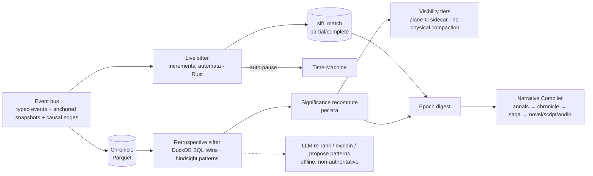

# 05.4 — Narrative Intelligence: Sifting, Significance, Chronicles and the Narrative Compiler

*Status: Draft v1.1 (2026-10-15; revised after the red-team review). Sources: R02, R08, R10, R07, red-team RT-C4, RT-m5, RT-m6, RT-m7. Decisions: ADR-0008, 0009, 0017, 0024, 0035. Pattern examples: `specs/sifting/patterns.example.toml`.*
*v1.2 (2026-10-16), ADR-0035: saga pattern families (§2.2); the audio chronicle and the graphic chronicle join the forms (§5); the first visual style card (§6.2). The media pipeline is `05.11`.*

---

## 1. Pipeline overview



## 2. The sifting pattern language

Design goals:
- Patterns are **setting-agnostic**: they are written over abstract roles and act classes.
- State reads are **temporally anchored**.
- Patterns **compose**.
- Partial matches can be matched **incrementally**.
- Every pattern has a **SQL twin** that can be validated.

### 2.1 Vocabulary (Registry-defined; see `specs/manifest/registry_v0.toml`)
- **Act classes:** `harm, aid, promise, betray, coerce, conceal, reveal, infect_convert, succeed_to, depose, flee, accuse, purge, marry, birth, death, discover, test, rebel, trade, raid, bond`.
- **Abstract roles:** `authority, successor, kin, ally, rival, subordinate, member, host, guest, investigator, suspect, any`. Degree of kinship and faction membership are expressed as **attributes** (e.g. `is_self_or_kin(R, V)@e2`), not role parameters.
- **Verbs:** concrete, system-emitted event types (Registry `[verbs]`, e.g. `FAMINE_DECLARED`, `REVENGE`), each mapped to act classes. A clause matches exactly one of: an act class, a verb, or a `match_event` emitted by another pattern. Consuming a `match_event` imports that match's role bindings.
- **Anchored attributes:** `attr(args)@e`, the value captured in `event_snapshot` for the event bound to `e`. Attributes are **declared and typed in the Registry `[attributes]`** (`q8_8`, `int`, `bool`, `enum`). Enum attributes are compared to symbolic values, which are stored as integer codes. A bare or undeclared read is a compile error.
- **Lehnert-style affect markers** are derived per participant: + / − / M (mental).
- The **world compiler** maps concrete verbs and titles onto this vocabulary. For example, `ISSUE_COMMAND{PURGE_DISTRICT}` → verb `PURGE` (act classes `purge + harm`), and `High_King` → `authority`, `Crown_Prince` → `successor`.

### 2.2 Shape of a pattern (TOML surface; compiled to automata)

The canonical examples live in `specs/sifting/patterns.example.toml` and are checked by `specs/sifting/lint_patterns.py`. The linter enforces a closed key set, so misspelled keys are errors rather than being silently ignored. Two of them:

```toml
[[pattern]]
id = "authority_purges_successor"
version = 1
tellability = 0.9
roles = { A = "authority", S = "successor" }
  [[pattern.clause]]
  bind = "e1"
  act = ["coerce", "harm", "purge"]
  initiator = "A"
  target = "S"
  where = ["succession_rank(S, A)@e1 == 1", "fear(A)@e1 >= 0.6"]
  require_edge = { into = "e1", kind = "motivated_by", from_state = "fear(A)" }
  [pattern.emit]
  match_event = "successor_purged"

[[pattern]]
id = "trust_then_betrayal"
version = 1
tellability = 0.8
roles = { A = "any", B = "any" }
  [[pattern.clause]]
  bind = "e1"
  act = ["aid", "promise"]
  initiator = "A"
  target = "B"
  where = ["trust(B, A)@e1 >= 0.6"]
  [[pattern.clause]]
  bind = "e2"
  act = ["harm", "betray", "conceal"]
  initiator = "A"
  target = "B"
  after = "e1"
  within_days = 3650
  [[pattern.unless]]          # a reconciliation between e1 and e2 cancels the arc
  act = ["aid"]
  initiator = "B"
  target = "A"
  between = ["e1", "e2"]
  [pattern.emit]
  match_event = "betrayal_arc"
```

**Saga pattern families** (ADR-0035; Registry packs `vow_arc`, `relic_chain`, `betrayal`, `succession_war`, `corrupted_bearer`; WP P2.4):
- **Vow arcs:** `VOW_SWORN` → pursuit (acts with a `VOW_OF` motive edge) → `VOW_FULFILLED`, `VOW_BROKEN` or `VOW_VOIDED`.
- **Relic chains:** successive `ARTIFACT_PASSED` events of one artifact, by mode (inheritance, theft, gift, loss), ending in `ARTIFACT_FOUND` or `ARTIFACT_DESTROYED`.
- **Revenge:** a harm, then a `RETALIATION_FOR` act against the culprit.
- **Betrayal:** trust or a public vow, then a `betray` act against the ally.
- **Succession war:** a contested succession, claims pressed, a civil war.
- **The corrupted bearer:** `BEARER_CORRUPTED`, then acts the overlay drives, then the bearer's fall.

Further pattern families for the initial library:
- **Succession:** heir crisis, child king and regency, usurpation, partition war.
- **Covert hive:**
  - *mimic sabotage observed by kin*;
  - *false-positive purge of a notable's child*;
  - *impossible knowledge noticed*.
- **Reversal:** fall from power, rise from obscurity.
- **Irony:** a victim benefits the hidden enemy; a loyal heir is suspected.
- **Revenge chains:** harm → `REVENGE` verb (act class `harm`) referencing the harm, with `contingent` edges.
- **Sacrifice and last stand.**
- **Plague-era witch-hunt.**
- **Famine → riot → crackdown.**
- **Dragon slaying for legitimacy.**

### 2.3 Runtime (live sifter)
1. Patterns compile to **partial-match automata**. A trigger index is keyed by `(act_class, abstract role binding)`, and each stage keeps a map from join keys to partial matches.
2. Partial matches expire through a timer wheel at the window end. An `unless` event kills partial matches that share its key; killed partials keep status `killed` and the killing event (`sift_match.closed_by_event_id`), which redemption arcs need. **Clause order is the kernel order:** each clause's event has a strictly greater EventId than the previous one (Winnow, Kreminski et al. 2021). `unless.between` defaults to [first clause, last clause]. An event that both completes a match and matches an `unless` *completes* it, because `between` is strict, as in the SQL twin. Winnow's own matcher kills it, which disagrees with its compiled form (R12 §19). An `unless` may `bind` its event and carry anchored `where` reads of itself and of kernel events bound at or before `between[0]`.
3. **Match semantics are declared per pattern** (RT-C4). "All combinations" semantics flood on clustered data. In the repo's clustered fixture (1,000 named actors, ~20 partners each, Zipf-weighted ties, ~10 events per actor-year; `specs/chronicle/selftest.py`), `trust_then_betrayal` under "all" produced **79 matches per 1,000 events, 4.5× the 17.5 under the default** `latest` + `clear_binding`. On a uniform random fixture the two are indistinguishable (1.4 per 1,000), which is why uniform fixtures hide the problem. Even 17.5 per 1,000 is far above any sensible budget for one pattern, so budgets and dedupe (below) still matter.
   - `selection = "latest" | "earliest" | "all"` says which open partial a completing event pairs with. `latest` is the usual choice. It must be declared: the linter rejects a pattern that omits it.
   - `on_complete = "clear_binding" | "consume" | "keep"` says what happens to open partials after a match. The usual choice, `clear_binding`, discards every open partial for that binding. It must be declared too.
   - `dedupe = { key = [roles], bucket_days = N }` allows at most one match per binding per time bucket.
   - These are expressible in the SQL twin (`LAG`, `ROW_NUMBER() … QUALIFY`). **Twins exist so far** for `all` + `keep`, `latest` + `clear_binding` and `dedupe` on a two-clause pattern (`specs/chronicle/schema.sql`). `earliest`, `consume` and patterns of three or more clauses still need twins.
   - **Patterns with more than two clauses** must use `all` + `keep` (Winnow's fork-and-accept, the only rule defined for N stages) until per-stage semantics exist; the linter enforces this. Candidate rule, to be accepted only once a three-stage twin passes: intermediate stages fork; `selection` applies at completion only; `clear_binding` discards only partials whose role variables are all bound and equal; under `latest`, a partial with every role bound advances directly.
   - Winnow's default semantics (fork on every advancing event, keep the parent, no time windows) are our `all` + `keep` without windows: 99.3 matches per 1,000 events on the clustered fixture, and an unbounded pool on the uniform one (21,269 partials, still growing). Windows and declared semantics are what bound the pool (R12 §19).
4. **Pruning is declarative only:** windows, `unless`, death tolerance and the semantics above. `death_tolerant = [roles]` lists the role variables whose death does *not* kill an open partial; the death of any other bound role kills it, as an implicit `unless` the twin expresses with `NOT EXISTS`. There is no "drop after K inactive events" heuristic (proposed by Winnow's authors). It is twin-expressible as a window in global event count, but it would make matches depend on unrelated event volume: world size, or activity in other regions.
5. **Firing-rate budget.** Each pattern declares an expected firing rate per century per 100k persons. CI fails a pattern that exceeds 3× its budget on the reference ensembles. It also reports **precision@K** against your labelled story-worthy set. A pattern that fires on a large share of events is detecting noise, not stories.
6. **Fixtures are clustered.** Twin and budget tests run on realistic clustered chronicles (repeated interaction among partners), not uniform random ones.
7. A completed match is written as a `sift_match` row (plane C) and emitted as a `match` event (MatchId space) that higher-order patterns can consume.
8. **Suspense** (live, plane C; a hypothesis tested at G2, after Dramatis, O'Neill & Riedl 2014; R12 §20).
   - **Gate.** A partial match has suspense only if its pattern declares a `threatened_role`: the bound role for whom completion is a negative outcome. Dramatis looks for an escape only once a bad outcome is expected. It also needs the partial to have bound its `surface_from` clause (default: the penultimate clause), which gates `sift.partial` too: Winnow narrates a partial only from a chosen stage.
   - **Escape routes.** The pattern's `unless` clauses, plus the death of any bound role not listed in `death_tolerant`, are its escape routes.
   - **Estimate.** Over the remaining window W, with piecewise-constant Registry hazards h_c (the declared `completion_hazard`) and h_u (the sum over escape routes), p_c = h_c/(h_c + h_u)·(1 − e^{−(h_c + h_u)W}), in fixed point. This is a standard competing-risks form, not taken from the papers.
   - **Score.** suspense = stakes × p_c, set to 0 once p_c ≥ `p_certain` (default 0.95), because suspense requires uncertainty.
   - **Oracle mode.** Dramatis uses *perceived* likelihood. True hazards would let the timing of a pause leak hidden state, so suspense pauses are off in Oracle mode until a belief-based p_c exists (Q23). Cultivator mode shows the true state and is unaffected.
   - **Rate limiter.** Suspense auto-pauses are capped at ≤ 1 per simulated decade, and all auto-pauses together stay within the MOE-1 budget of ≤ 10 per simulated century.
   - **Validation.** The form is unvalidated: Dramatis was checked only by ordinal agreement on 3 authored story pairs. G2 reports suspense pauses separately (`09` §3.4.1).
9. **Throughput target:** ≥ 10⁷ events/s per core (Rust). R10 measured 2.2 M events/s for one pattern with an optimised pure-Python matcher; the repo's simpler reference matcher (`specs/chronicle/selftest.py`) runs at ≈ 0.3–0.4 M events/s. The live sifter must stay within PERF-3.
10. **Determinism.** The sifter is a deterministic function of the event stream plus the **pattern-library version**. Its state is **not** part of the authoritative state hash, and `match` events use a **separate ID space** (`MatchId`), so editing a pattern never renumbers simulation events or changes golden baselines (good for S4). `MatchId = H64(pack, pattern_id, pattern_version, event_ids, bindings)` is content-addressed (the exact bytes: `specs/stream/channel_c_v0.sql` R5, XXH3-64; the bindings are part of it because one event tuple can complete several matches of one pattern when several entities fill a role, SPR-013), so it is stable across re-sifts and comparable with the twin's. A sifter that lags (on a worker thread) triggers a pause, then a seek back to the match tick.
   - **Re-sifting is a feature.** Any timeline can be re-sifted with any pattern-library version, because plane C never feeds plane A (ADR-0024).
   - **Exception: feedback curation.** If a pattern's matches are allowed to influence simulation behaviour (e.g. a completed betrayal arc raises an NPC's grudge), that pattern is promoted into the **Registry rule set**. It then runs inside `rh-core`, is part of the state hash, and changes to it follow the golden-baseline process.

### 2.4 Validation
- Every pattern ships with:
  - a **DuckDB SQL twin**: self-joins plus `NOT EXISTS` for `unless`, and interval joins for anchored attributes;
  - a **clustered fixture chronicle** with expected matches;
  - a declared **firing-rate budget**.
- CI replays recorded chronicles and asserts the live and SQL match sets are identical. R10's prototype demonstrated this (6,073 = 6,073), and so does `specs/chronicle/selftest.py`: three declared semantics (`all`, `latest` + `clear_binding`, and `dedupe`) on a uniform and a clustered fixture, each with identical SQL-twin and incremental match sets.
- **Why-not debugging** (after Felt's `whyNot`): twins are emitted as one view per clause and per `unless`, so a query for an expected-but-missing match names the first clause that fails (V-SIFT-14).
- An escalation path exists for recursive or aggregate rules, e.g. "a feud transitive over kin". It embeds `differential-dataflow` (MIT) or `dbsp` in-process. Never a DB server.

### 2.5 LLM role (offline, non-authoritative)
- Re-rank the top-K matches per era for presentation.
- Write a one-paragraph *explanation* of a match subgraph. This becomes chronicle text, with provenance.
- **Propose new patterns** as TOML for human review. Each proposal runs against the SQL twin and its precision@K is reported before it can be accepted.

## 3. Significance (retroactive)

Significance is plane C. It is computed per event as a vector of components, stored in `sig_component`, and recomputed each **era** (default: one simulated century; configurable).

| Component | Operationalisation |
|---|---|
| Tellability | Registry prior per act class (death, betrayal, coronation, infection) |
| Rarity / surprise | StU: mean likelihood of the match's properties among matches of the same pattern, *conditioned on actor traits* (avoids the correlated-rarity trap). It enters significance as a **percentile within (pattern, era), saturating at the 99th**, never as raw −log p over open-ended causal chains: chain-level improbability selected ever-longer chains and inexplicable outliers, and world rarity is not narrative surprise (Lessard et al. 2026, R12 §20) |
| **Consequence** | Significance-weighted descendant count (PageRank on the reversed causal DAG). This is the "minor slight → war" metric. Computed as a **percentile within (act class, era)**, so classes with structurally many descendants (migrations, wars) do not dominate; Lessard et al. dropped raw "high-effect" counts for that reason |
| Centrality | Degree and betweenness of participants in the kin, ally and faction graphs |
| Stakes | Δ in basic needs, offices and life (state diff) |
| Reversal | Sign change of status or affect within a window |
| Irony | Knowledge asymmetry: a truth that is visible to the audience but unknown to an affected participant (needs the `knowledge` table) |
| Suspense | The area under the live suspense curve over the partial's open interval (Dramatis compares stories by this area); 0 for patterns without a `threatened_role` |
| Kernel-ness | Lies on a contingency path to a high-significance anchor |

**Hindsight retention** (plane C; bounded per RT-m7). When an event's combined significance crosses θ, walk backward from it, marking events **retained-visible** in the per-timeline visibility sidecar:
- follow `contingent` edges, plus the **single top `motivated_by`** edge per node;
- stop at Registry-declared **root event kinds** (births, natural disasters, coronations), or at depth ≤ 12.

This is Labov's narrative pre-construction, done mechanically and with a bound. It never changes plane A.

**Retention and visibility.**
- Named-actor events are never physically compacted. Low-salience events are hidden by the visibility sidecar, which works per timeline and so stays compatible with forks that share segments.
- Rarity base rates are kept as counts per (pattern, era).

**Salience for presentation** combines significance with **your ratings**. The rating tool's history trains a lightweight preference model (logistic regression over the components) that personalises auto-pause thresholds. This is a direct feedback loop on MOE-1.

## 4. Drama-management policy

- **No hidden director inside the simulation.** Pacing lives in presentation: auto-pause thresholds, Diorama camera choice, arc selection for the compiler. Intervention policies are recast as curation (R02 §R4).
- **Pressure is diegetic and declared** in the manifest: climate variance, succession law, hive growth rate, catalyst initial conditions. All of it appears in the causal inspector.
- **Optional storyteller modes** (RimWorld-style) are allowed only for game modalities. They are named and opt-in, logged as `director` edges, and off in "pure" runs.
- **Bad runs are bugs.** The bad-run rate (MOE-6) is tracked per manifest. Fixing it means adding contingent unlocking, coupling systems or adjusting pressure. It never means scripting outcomes.

## 5. Chronicle forms (cheap → expensive)

| Form | Generator | LLM? | Default for |
|---|---|---|---|
| **Annals** | Templates over matches and significant events ("In the 12th year of Khorvath IV, …") | No | Every era, always available offline |
| **Chronicle** | Grouped arcs with causal "because" clauses from edges; templated, with optional LLM polish | Optional | Time-Machine sidebar, epoch summaries |
| **In-world documents** | Decrees, letters, sermons and propaganda generated from events, with a *biased narrator* model (faction stance, knowledge-limited). Caves-of-Qud style, but grounded in the true record | Yes (bounded) | Epigraphs, artefacts, Diorama posters |
| **Saga** (5–20k words) | Full pipeline, lighter plan | Yes | Arcs that fail the novel gate |
| **Novella / Novel** | Full pipeline (§6) | Yes | Epochs that pass the story-shape gate |
| **Screenplay** | Same plan → structured scenes → Fountain renderer | Yes | Selected arcs |
| **Audio-drama script** | Screenplay JSON → TTS manifest | Yes | Selected arcs (`05.8`) |
| **Audio chronicle** (ADR-0035) | Episode text → the offline audio exporter → local MP3 chapters | Narration from P2 (TTS only); drama in P3 | Every season (`05.11` §7) |
| **Graphic chronicle** (ADR-0035) | Climax matches + event envelope → four-panel storyboard scripts → panels | Optional (images); storyboards work without | Every season (`05.11` §4–6) |

## 6. The Narrative Compiler pipeline (novel-class)

| # | Stage | Input → output | Default model | Quality gate |
|---|---|---|---|---|
| 0 | Digest + story-shape gate | Matches, top-significance events, 1-hop causal neighbourhood, actor state snapshots (traits, goals, beliefs, relationships) → digest | Deterministic + small model | Protagonist(s) in ≥ 5 backbone events; causal graph mostly connected. Else route to Saga or Chronicle |
| 1 | Story selection | Digest → 3 proposals (logline, theme, POV set, start and stop, form) | Frontier (e.g. Claude Opus 5.5) | Cross-family pairwise judge + coverage heuristic; you may pick |
| 2 | Discourse plan (JSON schema) | Chapters, POVs, scene/summary/flashback per event, reveal schedule, thread table, tension curve, epigraph sources | Frontier | Schema-valid; ≥ 95% backbone coverage or justified omissions; causal parents precede or are flashed back; no epistemic leaks; no tension plateau > 3 chapters |
| 3 | Bible | Voice sheets (from traits and values), places, culture lexicon (from the sim's culture generator), style card, canon ledger, empty embellishment ledger, ban lists | Frontier | Every named entity traces back to the sim |
| 4 | Beats | Scene beats (goal / conflict / outcome; sequel beats), each referencing event IDs or a licensed embellishment type | Frontier | Each beat typed CT0/CT1/CT2 |
| 5 | Scene drafting (parallel, batchable) | Style card + public-domain exemplars + bible extract + **scene fact sheet with entry state** + beats + recent-phrase avoid list → prose + sidecar of new CT2 claims | Frontier (batch API) | Length ±20% |
| 6 | Scene QA | Claims → graph and ledger check + NLI (MiniCheck-class, local) + style metrics + slop and repetition density | Small model + local NLI + code | **0 CT0/CT1 contradictions, 0 CT3 inventions**; ≤ 2 auto-fix loops, then escalate |
| 7 | Critique → revision | Chapter rubric (EQ-Bench longform criteria + LAMP taxonomy) | Cross-family critic | Rubric ≥ threshold; re-run stage 6 |
| 8 | Book pass | Whole manuscript → proposed issues → fixes verified against the graph; cross-chapter n-gram dedupe; line edit | 1M-context model | 0 critical continuity issues |
| 9 | Exporters | Structured scenes → EPUB/Markdown (+ optional annotated "chronicle notes"), Fountain (validated through screenplain or afterwriting), radio script + TTS manifest | Deterministic | Parse round-trip, page count, voice-map completeness |

### 6.1 Canon policy (R08 §5)

Canon tiers are labelled **CT0–CT3** to keep them distinct from the representation tiers T0–T4.

| Tier | Content | Rule |
|---|---|---|
| **CT0 Canon** | Events, ordering, deaths and births, locations, kinship, possessions, recorded motives, per-actor knowledge, **facts ledger** | Immutable; any contradiction blocks |
| **CT1 Derived** | Ages, distances, travel times, seasons, weather (if simulated) | Computed and injected; contradiction blocks |
| **CT2 Licensed embellishment** | Dialogue wording, gestures, sensory detail, interiority consistent with traits, needs and beliefs; unnamed extras; trivia that changes no sim variable | Allowed. Anything later scenes depend on goes into the embellishment ledger |
| **CT3 Forbidden** | New named agents with agency, new deaths or relationships, consequential objects, motives contradicting the record, knowledge a character lacks, events after the epoch | Blocked |

### 6.2 Style cards (no named authors)
A style card is a versioned JSON object with these fields:
- prose density and sentence-length targets;
- dialogue ratio, POV and tense, register;
- figurative budget and interiority depth;
- exposition policy and chapter-opening device;
- lexicon seeds from the sim's cultures;
- ban list (slop phrases plus other authors' coined terms);
- 2–4 **US public-domain** exemplars.

Starter cards:
- *Mythic Chronicle* (Eddison, Morris, Malory);
- *Deep Time* (Stapledon);
- *Saga* (Icelandic saga translations);
- *Historian* (Gibbon, Crawley's Thucydides);
- *Ensemble Space-Opera* (E. E. Smith, Wells);
- *Noir City* (Hammett-era public-domain pulp, e.g. *Red Harvest* (1929), which is US public domain as of 2025).

**Visual style cards** (ADR-0035) sit beside the prose cards. The first is `dark_fantasy_ink`: no photorealism; a dark-fantasy graphic novel with heavy ink, cross-hatching, high-contrast chiaroscuro, muted watercolour wash, bold angular silhouettes and textured paper. No living artist's name appears in a card or a prompt (`05.11` §5).

Adherence is measured stylometrically, with Burrows' Delta against the exemplar set plus pairwise judging. Herbert-style epigraphs come from **in-world documents** generated from the chronicle.

### 6.3 Expected quality (honest bar)
Fluent, consistent, genre-competent first drafts with recurring tics, below a good mid-list novelist (R08 §TL;DR 10). Rehoboam's distinctive strength is **consistency and consequence**: zero plot holes by construction, plus causal depth that ungrounded generation can't fake. Cost for a 100k-word novel is about $28 with batching and caching on R08's recommended configuration, which uses a same-family critic. With a cross-family critic (e.g. GPT-6.1 Sol) the estimate is about $28–35, and the premium configuration is about $67 (R08 §10). Since compute is unbounded for you, **best-of-N plans** and **multiple revision passes** are cheap quality levers.

## 7. Evaluation (see `09_verification_and_validation.md`)

- **Sifter:** the random-window control (V-HUM-11: equal-span windows from the same seed, rendered identically and interleaved blind, after Behrooz et al. 2015); precision@K against your labelled "story-worthy" sets; retelling studies.
- **Evaluation rendering.** Every comparison of selections (G2 items, MOE-2 chronicles, V-HUM-11) uses the template rendering (Annals, or the Chronicle without LLM polish), never LLM text. Narration alone moved identical events from 3rd to 12th of 12 (Lessard et al. 2026). V-HUM-12 (P4) measures the story and narration effects separately.
- **Compiler:**
  - fidelity (contradictions, forbidden inventions, backbone coverage, causal fidelity, epistemic leaks);
  - prose (HANNA's six criteria, slop density, cross-book similarity);
  - your blind ratings.
- **LLM-as-judge** is for regression triage only: cross-family, position-swapped and length-controlled.
