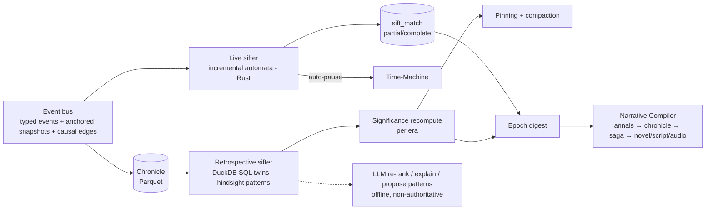

# 05.4 — Narrative Intelligence: Sifting, Significance, Chronicles and the Narrative Compiler

*Status: Draft v1.0 (2026-10-15). Sources: R02, R08, R10, R07. Decisions: ADR-0008, 0009, 0016, 0017. Pattern examples: `specs/sifting/patterns.example.toml`.*

---

## 1. Pipeline overview



## 2. The sifting pattern language

Design goals:
- Patterns are **setting-agnostic**: they are written over abstract roles and act classes.
- State reads are **temporally anchored**.
- Patterns **compose**.
- Partial matches can be matched **incrementally**.
- Every pattern has a **SQL twin** that can be validated.

### 2.1 Vocabulary (Registry-defined)
- **Act classes:** `harm, aid, promise, betray, coerce, conceal, reveal, infect_convert, succeed_to, depose, flee, accuse, purge, marry, birth, death, discover, test, rebel, trade, raid`.
- **Abstract roles:** `authority, successor, kin(degree), ally, rival, subordinate, member(faction), host, guest, investigator, suspect`.
- **Anchored attributes:** `attr@e`, the value captured in `event_snapshot` for the event bound to `e`. A bare `attr` is a compile error.
- **Lehnert-style affect markers** are derived per participant: + / − / M (mental).
- The **world compiler** maps concrete verbs to act classes, e.g. `ISSUE_COMMAND{PURGE_DISTRICT}` → `coerce + harm(collective)`, and concrete titles to abstract roles, e.g. `High_King` → `authority`, `Crown_Prince` → `successor`.

### 2.2 Shape of a pattern (TOML surface; compiled to automata)

```toml
[[pattern]]
id = "authority_purges_successor"
version = 1
tellability = 0.9
description = "An authority coerces or harms their designated successor, motivated by fear."
roles = { A = "authority", S = "successor" }

[[pattern.clause]]          # e1
bind = "e1"
act = ["coerce", "harm"]
initiator = "A"
target = "S"
where = ["succession_rank(S, A)@e1 == 1", "fear(A)@e1 >= 0.6"]
edge = { to = "e1", kind = "motivated_by", from_state = "fear(A)" }   # require motivation edge

[pattern.window]
max_span_days = 0           # single-event pattern

[[pattern]]
id = "trust_then_betrayal"
version = 1
tellability = 0.8
roles = { A = "any", B = "any" }
[[pattern.clause]]
bind = "e1"
act = ["aid", "promise"]
initiator = "A"
target = "B"
where = ["trust(B, A)@e1 >= 0.6"]
[[pattern.clause]]
bind = "e2"
act = ["harm", "betray", "conceal"]
initiator = "A"
target = "B"
after = "e1"
within_days = 3650
[[pattern.unless]]          # a reconciliation between e1 and e2 cancels the arc
act = ["aid"]
initiator = "B"
target = "A"
between = ["e1", "e2"]
[pattern.emit]
match_event = "betrayal_arc"   # consumable by higher-order patterns
```

Further pattern families for the initial library:
- **Succession:** heir crisis, child king and regency, usurpation, partition war.
- **Covert hive:**
  - *mimic sabotage observed by kin*;
  - *false-positive purge of a notable's child*;
  - *impossible knowledge noticed*.
- **Reversal:** fall from power, rise from obscurity.
- **Irony:** a victim benefits the hidden enemy; a loyal heir is suspected.
- **Revenge chains:** harm → `revenge` act referencing the harm, with `contingent` edges.
- **Sacrifice and last stand.**
- **Plague-era witch-hunt.**
- **Famine → riot → crackdown.**
- **Dragon slaying for legitimacy.**

### 2.3 Runtime (live sifter)
1. Patterns compile to **partial-match automata**. A trigger index is keyed by `(act_class, abstract role binding)`, and each stage keeps a map from join keys to partial matches.
2. Partial matches expire through a timer wheel at the window end. An `unless` event kills partial matches that share its key.
3. Pruning:
   - inactive partial matches are dropped after K events;
   - a partial is dropped when a participant dies, unless the pattern tolerates death;
   - matching advances directly once all roles are bound.

   Winnow measured 912 ms per event with naïve partials (R02 §1), so pruning is mandatory.
4. A completed match is written as a `sift_match` row and emitted as a `match` event that higher-order patterns can consume.
5. **Suspense** is computed from open partial matches whose completion would be high-stakes, and it can trigger an auto-pause *before* the climax.
6. **Throughput target:** ≥ 10⁶ events/s per core. R10 measured 2.2 M events/s for one pattern in pure Python. The live sifter must add ≤ 10% to MAX-speed run time (PERF-3).
7. **Determinism:** the sifter consumes events in emission order and is part of the state hash. A sifter that lags (on a worker thread) triggers a pause, then a seek back to the match tick.

### 2.4 Validation
- Every pattern ships with:
  - a **DuckDB SQL twin**: self-joins plus `NOT EXISTS` for `unless`, and interval joins for anchored attributes;
  - a **fixture chronicle** with expected matches.
- CI replays recorded chronicles and asserts the live and SQL match sets are identical. R10's prototype demonstrated this: 6,073 = 6,073.
- An escalation path exists for recursive or aggregate rules, e.g. "a feud transitive over kin". It embeds `differential-dataflow` (MIT) or `dbsp` in-process. Never a DB server.

### 2.5 LLM role (offline, non-authoritative)
- Re-rank the top-K matches per era for presentation.
- Write a one-paragraph *explanation* of a match subgraph. This becomes chronicle text, with provenance.
- **Propose new patterns** as TOML for human review. Each proposal runs against the SQL twin and its precision@K is reported before it can be accepted.

## 3. Significance (retroactive)

Significance is computed per event as a vector of components, stored in `sig_component` and recomputed each era:

| Component | Operationalisation |
|---|---|
| Tellability | Registry prior per act class (death, betrayal, coronation, infection) |
| Rarity / surprise | StU: mean likelihood of the match's properties among matches of the same pattern, *conditioned on actor traits* (avoids the correlated-rarity trap) |
| **Consequence** | Significance-weighted descendant count (PageRank on the reversed causal DAG). This is the "minor slight → war" metric |
| Centrality | Degree and betweenness of participants in the kin, ally and faction graphs |
| Stakes | Δ in basic needs, offices and life (state diff) |
| Reversal | Sign change of status or affect within a window |
| Irony | Knowledge asymmetry: a truth that is visible to the audience but unknown to an affected participant (needs the `knowledge` table) |
| Suspense | Open partial matches with high stakes |
| Kernel-ness | Lies on a contingency path to a high-significance anchor |

**Hindsight pinning.** When an event's combined significance crosses θ, walk the `contingent` and `motivated_by` edges backward until reaching an event that "needs no explanation", and pin everything on the path. This is Labov's narrative pre-construction, done mechanically.

**Salience for presentation** combines significance with **your ratings**. The rating tool's history trains a lightweight preference model (logistic regression over the components) that personalises auto-pause thresholds. This is a direct feedback loop on MOE-1.

## 4. Drama-management policy

- **No hidden director inside the simulation.** Pacing lives in presentation: auto-pause thresholds, Diorama camera choice, arc selection for the compiler. Intervention policies are recast as curation (R02 §R4).
- **Pressure is diegetic and declared** in the manifest: climate variance, succession law, hive growth rate, catalyst initial conditions. All of it appears in the causal inspector.
- **Optional storyteller modes** (RimWorld-style) are allowed only for game modalities. They are named and opt-in, logged as `director` edges, and off in "pure" runs.
- **Bad runs are bugs.** The bad-run rate (MOE-6) is tracked per manifest. Fixing it means adding contingent unlocking, coupling systems or adjusting pressure. It never means scripting outcomes.

## 5. Chronicle forms (cheap → expensive)

| Form | Generator | LLM? | Default for |
|---|---|---|---|
| **Annals** | Templates over matches and significant events ("In the 12th year of Khorvath IV, …") | No | Every era, always available offline |
| **Chronicle** | Grouped arcs with causal "because" clauses from edges; templated, with optional LLM polish | Optional | Time-Machine sidebar, epoch summaries |
| **In-world documents** | Decrees, letters, sermons and propaganda generated from events, with a *biased narrator* model (faction stance, knowledge-limited). Caves-of-Qud style, but grounded in the true record | Yes (bounded) | Epigraphs, artefacts, Diorama posters |
| **Saga** (5–20k words) | Full pipeline, lighter plan | Yes | Arcs that fail the novel gate |
| **Novella / Novel** | Full pipeline (§6) | Yes | Epochs that pass the story-shape gate |
| **Screenplay** | Same plan → structured scenes → Fountain renderer | Yes | Selected arcs |
| **Audio-drama script** | Screenplay JSON → TTS manifest | Yes | Selected arcs (`05.8`) |

## 6. The Narrative Compiler pipeline (novel-class)

| # | Stage | Input → output | Default model | Quality gate |
|---|---|---|---|---|
| 0 | Digest + story-shape gate | Matches, top-significance events, 1-hop causal neighbourhood, actor state snapshots (traits, goals, beliefs, relationships) → digest | Deterministic + small model | Protagonist(s) in ≥ 5 backbone events; causal graph mostly connected. Else route to Saga or Chronicle |
| 1 | Story selection | Digest → 3 proposals (logline, theme, POV set, start and stop, form) | Frontier (e.g. Claude Opus 5.5) | Cross-family pairwise judge + coverage heuristic; you may pick |
| 2 | Discourse plan (JSON schema) | Chapters, POVs, scene/summary/flashback per event, reveal schedule, thread table, tension curve, epigraph sources | Frontier | Schema-valid; ≥ 95% backbone coverage or justified omissions; causal parents precede or are flashed back; no epistemic leaks; no tension plateau > 3 chapters |
| 3 | Bible | Voice sheets (from traits and values), places, culture lexicon (from the sim's culture generator), style card, canon ledger, empty embellishment ledger, ban lists | Frontier | Every named entity traces back to the sim |
| 4 | Beats | Scene beats (goal / conflict / outcome; sequel beats), each referencing event IDs or a licensed embellishment type | Frontier | Each beat typed T0/T1/T2 |
| 5 | Scene drafting (parallel, batchable) | Style card + public-domain exemplars + bible extract + **scene fact sheet with entry state** + beats + recent-phrase avoid list → prose + sidecar of new T2 claims | Frontier (batch API) | Length ±20% |
| 6 | Scene QA | Claims → graph and ledger check + NLI (MiniCheck-class, local) + style metrics + slop and repetition density | Small model + local NLI + code | **0 T0/T1 contradictions, 0 T3 inventions**; ≤ 2 auto-fix loops, then escalate |
| 7 | Critique → revision | Chapter rubric (EQ-Bench longform criteria + LAMP taxonomy) | Cross-family critic | Rubric ≥ threshold; re-run stage 6 |
| 8 | Book pass | Whole manuscript → proposed issues → fixes verified against the graph; cross-chapter n-gram dedupe; line edit | 1M-context model | 0 critical continuity issues |
| 9 | Exporters | Structured scenes → EPUB/Markdown (+ optional annotated "chronicle notes"), Fountain (validated through screenplain or afterwriting), radio script + TTS manifest | Deterministic | Parse round-trip, page count, voice-map completeness |

### 6.1 Canon policy (R08 §5)

| Tier | Content | Rule |
|---|---|---|
| **T0 Canon** | Events, ordering, deaths and births, locations, kinship, possessions, recorded motives, per-actor knowledge, **facts ledger** | Immutable; any contradiction blocks |
| **T1 Derived** | Ages, distances, travel times, seasons, weather (if simulated) | Computed and injected; contradiction blocks |
| **T2 Licensed embellishment** | Dialogue wording, gestures, sensory detail, interiority consistent with traits, needs and beliefs; unnamed extras; trivia that changes no sim variable | Allowed. Anything later scenes depend on goes into the embellishment ledger |
| **T3 Forbidden** | New named agents with agency, new deaths or relationships, consequential objects, motives contradicting the record, knowledge a character lacks, events after the epoch | Blocked |

### 6.2 Style cards (no named authors)
A style card is a versioned JSON object with these fields:
- prose density and sentence-length targets;
- dialogue ratio, POV and tense, register;
- figurative budget and interiority depth;
- exposition policy and chapter-opening device;
- lexicon seeds from the sim's cultures;
- ban list (slop phrases plus other authors' coined terms);
- 2–4 **US public-domain** exemplars.

Starter cards:
- *Mythic Chronicle* (Eddison, Morris, Malory);
- *Deep Time* (Stapledon);
- *Saga* (Icelandic saga translations);
- *Historian* (Gibbon, Crawley's Thucydides);
- *Ensemble Space-Opera* (E. E. Smith, Wells).

Adherence is measured stylometrically, with Burrows' Delta against the exemplar set plus pairwise judging. Herbert-style epigraphs come from **in-world documents** generated from the chronicle.

### 6.3 Expected quality (honest bar)
Fluent, consistent, genre-competent first drafts with recurring tics, below a good mid-list novelist (R08 §TL;DR 10). Rehoboam's distinctive strength is **consistency and consequence**: zero plot holes by construction, plus causal depth that ungrounded generation can't fake. Cost for a 100k-word novel: about $28 with batching and caching on the recommended configuration, and about $67 premium (R08 §10). Since compute is unbounded for you, **best-of-N plans** and **multiple revision passes** are cheap quality levers.

## 7. Evaluation (see `09_verification_and_validation.md`)

- **Sifter:** blind pairwise preference against a random baseline; precision@K against your labelled "story-worthy" sets; retelling studies.
- **Compiler:**
  - fidelity (contradictions, forbidden inventions, backbone coverage, causal fidelity, epistemic leaks);
  - prose (HANNA's six criteria, slop density, cross-book similarity);
  - your blind ratings.
- **LLM-as-judge** is for regression triage only: cross-family, position-swapped and length-controlled.
