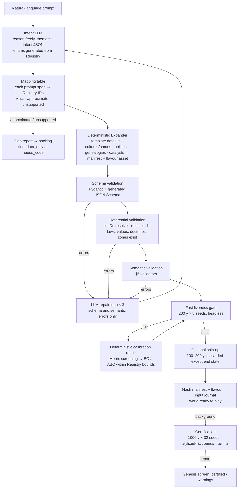

# 05.5 — World Compiler, Mechanics Registry and the World DSL

*Status: Draft v1.1 (2026-10-15). Sources: R05, R09, R02. Decisions: ADR-0010 (amended), ADR-0024. Machine-readable artefacts: `specs/manifest/registry_v0.toml`, `specs/manifest/manifest_v0.py` (Pydantic v2), `specs/manifest/examples/*.yaml`.*

*v1.1 changes: the burn-in is split into a fast liveness gate and a background certification run (RT-M9). Calibration repair is deterministic, never the LLM. A mapping table makes every approximation visible (RT-M10). A small Registry effect language lets data-only extensions land without code (RT-M12). The §3 example now matches `val_khor.yaml`. The energetics rule is corrected to divide by the metabolism multiplier.*

---

## 1. Principles

1. **The Registry is the language.** A manifest can only reference what the engine implements: systems, archetypes, act classes, roles, verbs, attributes, goods, technologies, governments, succession laws, institutions, channels and pattern packs. Free strings never carry semantics.
2. **Small intent, deterministic bulk.** The LLM writes a short *intent*. A deterministic expander generates the full world. No LLM ever writes 100,000 citizens.
3. **Valid means simulable *and* plausible.** Schema validity is necessary but not sufficient. Every compiled world must pass semantic validators, a fast liveness gate, and (in the background) a certification run against the stylized facts.
4. **What the Registry can't express is reported, not faked.** Every prompt span is mapped to an exact, approximate or unsupported Registry construct. Approximate and unsupported mappings become **gap reports**, which feed the engine's evolution (success criterion S4).
5. **Hand-authoring comes first.** Manifests are human-readable YAML that you can write and diff directly. The LLM is an optional front end.
6. **The LLM never tunes numbers.** Parameter repair after a failed burn-in is a deterministic search inside Registry bounds. The LLM only fixes schema and semantic errors it caused.

## 2. Mechanics Registry

The Registry is versioned (semver). The v0 file is `specs/manifest/registry_v0.toml`; the engine will load `registry/*.toml`. The JSON Schema for manifests is **generated from it**, as are the enums used in constrained decoding and the sifter's attribute and verb types (`05.4`).

| Registry section | Entries (examples) | What an entry declares |
|---|---|---|
| `systems` | `M1.regions`, `M2.demography`, `M5.contagion`, `S4.ecology`, … | Fidelity levels, parameter schema with **bounds**, clocks, emitted event types, owned columns |
| `archetypes` | `human`, `apex_predator`, `hive_node` (later `beast_of_burden`, `automaton`) | Ledger table, components, life history (lifespan, fertility), energetics, capabilities (`flying`, `bondable`, `covert_capable`) |
| `act_classes` | `harm`, `aid`, `betray`, `infect_convert`, `succeed_to`, … | Default tellability, affect signature, roles |
| `roles` | `authority`, `successor`, `subordinate`, `kin`, `investigator`, `suspect`, … | Binding rules from concrete titles and relations |
| `verbs` | `ISSUE_DECREE`, `ARREST`, `PURGE`, `REVENGE`, `BLOOD_TEST`, `RAID_LIVESTOCK`, `SUCCEED`, `FAMINE_DECLARED` | Act-class mapping, role slots, preconditions, effects (§2.1), which past-event roles can be referenced (**contingent unlocking**) |
| `attributes` | `fear`, `trust`, `suspicion` (q8.8); `succession_rank` (int); `in_realm`, `is_parent`, `knows_event` (bool); `test_result` (enum) | Type, arity, owning plane (A or B), which system writes it. The sifter's anchored attributes (`attr(args)@eN`) must name one of these |
| `goods` | grain, livestock, timber, ore, cloth, tools/arms, luxuries; modern: energy, medicine, test kits, services | Production function, perishability, base price |
| `technologies` | heavy plough, crop rotation, printing, gunpowder, germ theory, PCR testing… | DAG edges, effects on A, k₀, W, IFR, test se/sp |
| `governments` | `feudal_monarchy`, `oligarchic_council`, `theocracy`, `municipal_democracy`, `tribal_confederation` | Authority and successor roles required, legitimacy sources, M6 parameter defaults |
| `succession_laws` | `primogeniture`, `ultimogeniture`, `seniority`, `partition`, `elective`, `tanistry`, `sortition` | Eligibility rule and ordering (§2.1 expressions), M7 hooks |
| `institutions` | `standing_army`, `testing_mandate`, `quarantine_law`, `guild_charter`, `inquisition` | Mechanics hooks and parameter bounds |
| `channels` | `witness`, `testimony`, `document`, `crowd`, `whisper`, `hive` | Latency, fidelity, trust, and reach parameters |
| `overlays` | `paranoia`, `filial_piety`, `despair`, `hubris`, `corruption`, `dragon_sympathy` | Derivation formula over the psychological core (§2.1 expressions) |
| `values` | Schwartz basic values: `tradition`, `power`, `benevolence`, `conformity`, … | The keys allowed in `Culture.value_bias` |
| `doctrine_tags` | `divine_kingship`, `fire_rites`, `ancestor_veneration`, `dragon_kinship`, … | Faith mechanics hooks (legitimacy, taboo, overlay bias) |
| `heightmap_templates` | `caldera_with_passes`, `river_delta_city`, `archipelago`, `mountain_valleys`, … | Generator recipe for `rh-worldgen` |
| `climate_zones` | `temperate_continental`, `mediterranean`, `monsoon`, … | Harvest variance defaults and seasonality |
| `pattern_packs` | `succession`, `revenge`, `famine`, `irony`, `dragon_age`, `covert_infiltration`, `plague_era`, `witch_hunt`, … | Sifting patterns (`05.4`) |
| `style_cards` | `mythic_chronicle`, `deep_time`, `saga`, `historian`, `ensemble_space_opera`, `noir_city` | Narrative style (`05.4` §6.2) |
| `templates` | `feudal_realm`, `merchant_republic`, `modern_metropolis` | **Starting state** (not an era lock; ADR-0027): default system sets, fidelity profiles, initial era-state vector, permitted horizons |
| `era_state`, `eras` | Era-state variables (owner, scope, type); era labels as predicates over them | Era-sensitive parameters are effect-language functions of `era_state`; labels are for presentation and validation only (ADR-0027) |

### 2.1 Registry effect language (data-only extensions)

Without this, every new law, overlay or verb needs Rust, and "the Registry grows with your imagination" (S4) stalls on agent time. With an unrestricted scripting language, determinism and the single-writer rule (`05.1` §2) break. The compromise is a **small, typed, total expression language**:

| Property | Rule |
|---|---|
| Types | `bool`, `int`, `q8.8`/`q16.16` fixed point, enums from the Registry, `EntityRef` of a declared archetype |
| Arithmetic | Fixed point only. Saturating. No floats, no division by a non-constant without a guard |
| Iteration | Only over declared relations (`kin(n)`, `members(polity)`, `subjects(title)`, `adults(region)`), with a declared upper bound. No recursion, no unbounded loops. Every expression terminates |
| Reads | Plane-A columns the declaring system is allowed to read (checked against the scheduler's read sets) |
| Effects | Only typed **lifecycle and state commands** already defined by the owning system (`set_title_holder`, `adjust_opinion`, `schedule_outcome`, `emit_event`). Effects are queued, never applied inline |
| Randomness | Only via the keyed RNG with a declared `purpose` string. No ambient RNG |
| Evaluation | Interpreted by a deterministic evaluator in `rh-registry`, with a compile-time check. Hot expressions can be lowered to Rust later without changing results (a golden test pins them) |

Examples:

```toml
[succession_laws.sortition_citizenry]           # a data-only extension from a gap report
eligible  = "adults(core_regions(polity)) where citizen(p)"
order     = "rng_permutation(purpose = \"sortition\")"
on_accede = "adjust_legitimacy(polity, -0.2 within elites(polity))"

[overlays.dragon_sympathy]
derive    = "clamp(0.5 * value(benevolence) + 0.3 * bonded_count(self) - 0.2 * fear(self, any(apex_predator)), 0, 1)"
```

New **systems** are still code. Expressions cannot add columns, clocks or event types. A gap report therefore carries `kind: data_only | needs_code` (§6). A `data_only` gap can be closed by editing the Registry and running the tests. A `needs_code` gap becomes an agent work package (`13`).

## 3. The manifest (v0 structure)

The full schema is in `specs/manifest/manifest_v0.py`. This excerpt is from the reference world `specs/manifest/examples/val_khor.yaml`:

```yaml
manifest_version: 0
registry_version: "0.1.0"
world:
  id: val_khor
  display_name: "The Caldera of Val-Khor"
  template: feudal_realm
  seed: 1207
  calendar: {days_per_year: 360, months: 12, seasons: 4, epoch_label: "Year of the Sun-Spire"}
  horizon: {years: 1000, label: historical}           # historical | speculative
  fidelity_profile: {M2.demography: F1, M3.agriculture: F1, M4.economy: F1, M6.polity: F1, M7.dynasty: F1, M8.war: F1}
  # trajectory: {technologies: [...], institutions: [...]}   # required when label = speculative
geography:
  raster_resolution: 1024
  region_count: 600
  heightmap_template: caldera_with_passes
  climate: {zone: temperate_continental, harvest_sigma: 0.2, autocorr: 0.1, spatial_share: 0.6, volcanic_rate: 0.004}
  ecology: {livestock_kg_per_capita: 150, wild_prey_tonnes: 4000}
peoples:
  - archetype: human
    population: 100000
    class_shares: {commoner: 0.86, burgher: 0.10, elite: 0.04}
    cultures:
      - {id: khori, name: "Khori", naming_seed: "harsh consonants, mountain clans, sun imagery", value_bias: {tradition: 0.4, power: 0.2}}
    faiths:
      - {id: sun_spire, name: "Church of the Sun-Spire", doctrine_tags: [divine_kingship, fire_rites]}
  - archetype: apex_predator
    variant: dragon
    population: 12
    params: {mass_kg: 5000, metabolism_multiplier: 0.5, flying: true, bondable: true}
polities:
  - id: house_khorvath
    name: "Kingdom of the Sun-Spire"
    government: feudal_monarchy
    succession_law: primogeniture
    titles: {authority: High_King, successor: Crown_Prince, subordinate: Castellan}
    dynasties: [{id: khorvath, name: "House Khorvath", generations: 3}]
systems:
  M2.demography: {e0: 32, tfr: 5.2, eps_f: 0.4, eps_m: 1.5, elite_fertility_mult: 1.2}
  M6.polity: {tax_rate: 0.15, psi_threshold: 1.8, ...}
institutions: [standing_army]
technologies: [heavy_plough]
catalysts:                    # initial conditions + probabilities, never forced outcomes
  - kind: dynastic_tension
    polity: house_khorvath
    initial: {opinion_successor_of_authority: 20, opinion_authority_of_successor: -30, fear_authority: 0.5, heir_age_years: 24}
  - kind: artifact
    name: "The Ember Crown"
    polity: house_khorvath
    holder_role: successor
    effects: [{overlay: dragon_sympathy, holder_delta: 0.4}]
overlays: [paranoia, filial_piety, hubris, dragon_sympathy]
narrative:
  pattern_packs: [succession, revenge, famine, dragon_age, irony]
  default_style_card: mythic_chronicle
presentation: {era_art: early_medieval, palette: ember_and_slate}
```

Notes:
- `macro_dimensions` from the draft is replaced by `raster_resolution` plus `region_count`. Both are fidelity knobs.
- Catalysts name a **polity and a role**, not a person. The expander binds them to concrete persons when it generates the genealogy, so a catalyst survives a re-roll of names.
- The draft's `CatalystRule{trigger_event, consequence_action}` is replaced by **catalysts as initial conditions** plus **pattern packs**: drama is detected rather than scripted. If a world needs a mechanic the Registry lacks, that gap is reported (§6).
- **Micro-scale sections (ADR-0028).** `cast` names persons the expander must create exactly (with `protagonist` and `deep` flags and initial attribute values); `households` carry holdings in Registry goods, children and servants; `off_map_actors` are outsiders who can enter (raiders, caravans); `agents` are in-world intervening agents with Registry verb sets, scoped by a `wager` catalyst with stages and `spare_life`. The reference is `specs/manifest/examples/uz_job.yaml`.
- `months` is fixed at 12 in v0, because the M3 harvest calendar and the monthly macro tick assume it.
- `population` is capped at 10M per people. Above 2M the validator warns that the run is outside the P1–P5 performance envelope (`08`).
- **Flavour text is stored, not interpreted.** `naming_seed`, display names and descriptive prose are written to a **flavour asset** (`flavour/<world_id>.toml`, hashed into the manifest). The naming and chronicle generators read it. A lint in CI fails the build if any `rh-sys-*` or `rh-core` crate depends on the flavour asset types, so prose can never change a simulation outcome.
- **Integers are 64-bit.** The engine stores integers in at most 64 bits, so every integer field of the manifest is bounded to `i64` (SPR-004 DEF-2 ruling).
- **The manifest language is YAML 1.1 as `PyYAML` reads it** (SPR-004 GAP-1 ruling): `yes`/`no`/`on`/`off` are booleans, `010` is octal, `1:30` is base 60, and `1e3` (no dot, no exponent sign) is a string. A leading byte order mark is ignored. A tab outside quoted scalars, block scalars and comments, a `?` inside a plain scalar in a flow collection, and an empty implicit key (`: value`) are refused, although YAML 1.2 allows them. Explicit `!!binary`, `!!set` and `!!timestamp` tags are out of contract: the Rust loader refuses them. **Line breaks** are `\n`, `\r`, `\r\n` and, as in YAML 1.1, NEL (U+0085), LS (U+2028) and PS (U+2029) (SPR-004 DEF-11 ruling): each ends a line and a comment. Inside scalar content NEL folds like `\n`, while LS and PS are kept as themselves where `\n` would fold to a space. The Rust loader refuses LS or PS inside a folded (`>`) block scalar, which `PyYAML` reads; nothing the expander writes contains one. **Continuation lines are indented** (SPR-004 GAP-8 / DEF-12, out of contract; BCK-002 A-23): a line that continues a flow collection or a quoted scalar must be indented more than its parent block key. `PyYAML` also accepts it at the parent's column (`a: [1,` / `2]`); the Rust loader refuses it, as YAML 1.2 does, and the expander writes indented YAML.

### 3.1 Registry well-formedness

The Rust loader (`rh-registry`, SPR-004) refuses a Registry that breaks any of these rules, before any manifest is read; the Python reference does not check them (SPR-004 GAP-5 ruling).

| Rule | Refused example |
|---|---|
| `registry_version` is a string `MAJOR.MINOR.PATCH` in ASCII digits | `"0.1"`, `1`, `"٠.١.٠"` |
| A typed section has only its known fields. Typed sections are those the validators read: `systems`, `archetypes`, `templates`, `baskets`, `era_state`, `eras`, `attributes`, `verbs` and the id lists (`governments` … `climate_zones`). A section's spec freezing makes it typed. | an unknown field in a verb |
| Every other top-level entry is a table (a section) and loads generically; an `ids` entry there is an array of unique strings, and any `act_classes` resolve to `[act_classes]` | a top-level scalar; `ids = ["a", "a"]` |
| Bounds are exactly `[lo, hi]`, finite, numeric, with `lo <= hi`; `horizon_years` is exactly `[min, max]` with `1 <= min <= max` | `[0.04, 0.35, 99.0]`, `[2.0, 1.0]`, `[0.0, inf]` |
| A system declares at least one fidelity level, each one of `F0`–`F3`, without duplicates | `fidelity_levels = ["F9"]` |
| Ids are unique within each id list and within `eras` | `goods.ids = ["grain", "grain"]` |
| References resolve: basket goods are in `[goods]`, a basket's `mediterranean` substitute exists, verb act classes and references are in `[act_classes]`, `eras.frontier` is in `eras.ids` | `act_classes = ["bless"]` |
| Attribute types are `q8_8`, `int`, `bool` or `enum`, and only an `enum` carries `values`; era-state variables are `q8_8` or `q16_16` | `type = "float"` |
| Required fields are present: `fidelity_levels`; a template's `default_systems`, `horizon_years` and `modern`; an archetype's `ledger` and `capabilities` | a template without `horizon_years` |

### 3.2 Authored numbers enter plane A only as fixed point

The manifest and the Registry are authored with decimal numbers, and the load-time front end (`rh-manifest`, tool plane; SPR-004 ruling A) validates them as the reference does, in floats. That is a load-time gate, not history. The boundary binds the first sprint that feeds a Registry or manifest number into plane A:

- An authored number enters plane A only as a fixed-point value (`rh_core::fixed`); plane A never sees an `f64`.
- The tool crate compiles it at load time with one rule: the exact decimal value of the literal as written, rounded half to even (the `rh_core::fixed` rule), never through an intermediate `f64`.
- A value that does not fit its fixed-point type is a load error, never a clamp.
- No plane-A crate depends on `rh-manifest` (`bin/lint_arch.py`, plane-A closure), and `rh-manifest` is pinned to the tool plane by name.

## 4. Compile pipeline



### 4.1 Intent and mapping table

**The Intent object** is deliberately small, roughly 20–60 fields, and has three parts:

1. **Template:** one Registry choice.
2. **Overrides:** bounded numbers and enums.
3. **Flavour seeds:** names and short prose. These go into the flavour asset and are never mechanics.

All fields are enums or bounded numbers, so constrained decoding is reliable (R05 §5). The model reasons first, in a free text field or a thinking block, and is then constrained. That ordering is the CRANE finding.

Alongside the Intent, the LLM emits a **mapping table**. Every content-bearing span of the prompt gets one row:

| Prompt span | Registry IDs | Mapping | Note |
|---|---|---|---|
| "feudal system" | `templates.feudal_realm`, `governments.feudal_monarchy` | exact | |
| "father-son succession catalyst" | `catalysts.dynastic_tension`, `succession_laws.primogeniture` | exact | |
| "dragons that bond with riders" | `archetypes.apex_predator{dragon}`, `capability.bondable`, `overlays.dragon_sympathy` | **approximate** | bonding is only an overlay; auto-files a gap |
| "the dragons remember old oaths" | — | **unsupported** | files a gap; nothing is invented |

Rules:
- An `approximate` or `unsupported` row **always** files a gap report. The Genesis screen shows the table, so you can see exactly what was approximated before you press run.
- A deterministic checker verifies that every Registry ID in the table exists and that every ID used by the Intent appears in the table. A model cannot silently map "lottery succession" to `primogeniture`.

**Model choice.** The best available frontier model with native structured outputs: a compile costs well under $0.10. The local fallback is the resident model through llguidance. Free tiers are never a dependency.

**Adversarial evaluation (`INTENT` suite, `09`).** The INTENT test set includes an adversarial subset of prompts that ask for things the Registry cannot express, phrased to tempt a near-miss mapping. Targets: **gap recall ≥ 0.9** (an unsupported concept produces a gap) and **silent approximation ≤ 5%** (an approximate mapping marked `exact`).

### 4.2 Burn-in: liveness gate, calibration, certification

The draft's single "200 years × 8 seeds" check is split, because a 200-year run cannot see the 1,000-year failure modes (secular-cycle periods, dynasty extinction rates, tail exponents) and a 1,000-year × 32-seed run is too slow to block play.

| Stage | Runs | Blocks play? | Checks | Typical cost at 100k |
|---|---|---|---|---|
| **Liveness gate** | 200 y × 8 seeds | Yes | No extinction or explosion; vital-rate guard; ≥ 2 completed arcs per century (MOE-6 guard); bad-run rate ≤ 1/8; no invariant violations | ≈ 60 s wall on 8 cores (≈ 1 CPU-min per seed; `08`) |
| **Calibration repair** | Morris screening, then Bayesian optimisation or ABC over the parameters it flags | Only when the gate fails | Re-runs the gate. Parameters move **only within Registry bounds**. Each changed value is logged with its before/after and shown on Genesis | Minutes to tens of minutes; capped at 30 gate runs |
| **Spin-up** (optional) | 100–200 y | Yes, if chosen | Lets age structure, wealth and opinion networks relax away from the expander's synthetic start. The end state becomes year 0 | ≈ 10–20 s |
| **Certification** | 1000 y × 32 seeds | **No**; runs in the background | Stylized-fact bands (cycle and phase statistics on N/K, Clauset–Shalizi–Newman tail fits, censoring-aware statistics; calibration vs held-out bands, CI-based pass/fail, `09` §3.1). Each band is tagged as *identity* (follows from the model's equations) or *emergent* | ≈ 160 CPU-min (≈ 5 CPU-min per seed); ≈ 20 min wall on 8 cores |

If certification fails after you have started playing, the world is labelled "uncertified" on Genesis with the failing bands. Nothing is rolled back: it is your world and the report is information.

## 5. Validators (initial set)

| Validator | Rule |
|---|---|
| Carrying capacity | Initial population ≤ 1.2 × Σ K_region, given land, yield and technology |
| Population range | Each people 1 ≤ N ≤ 10M (error outside); total > 1M is a warning (above the 1M target range, ADR-0028) |
| Cast and agents | Cast ids unique; cast + children + servants ≤ population; household heads are cast members; holdings are Registry goods; agent verbs exist in the Registry; a wager's stages use only verbs its agent holds |
| Vital-rate guard | Pre-modern burn-in mean r ∈ [−0.1, +0.3] %/yr unless a technology trajectory is declared |
| Energetics | **Predator standing biomass ≤ 0.009 × (livestock + wild-prey biomass) ÷ metabolism multiplier** (Carbone ratio). A lower multiplier (slower metabolism) supports more predator mass |
| Capabilities | Every capability in `params` (`flying`, `bondable`, `covert_capable`) is permitted by the archetype |
| Registry vocabulary | `value_bias` keys ∈ `values`; `doctrine_tags` ∈ `doctrine_tags`; `heightmap_template` and `climate.zone` exist |
| Horizon | Each template declares the horizon range over which its *starting* state is plausible without forecasting beyond the technological frontier (`feudal_realm` and `merchant_republic` 50–3,000 y; `modern_metropolis` 1–50 y). Outside that range, `horizon.label = speculative` is required. A world may pass through any era the engine supports within its horizon (ADR-0027); reaching the engine frontier is a runtime gap report, not a validation error |
| Trajectory | `label = speculative` requires `world.trajectory {technologies, institutions}`: the dated technologies and institutions the world is expected to reach |
| Succession | Every polity has an authority, a law, and an eligible successor pool > 0 |
| Covert contagion | If a covert compartment is present, the testing technology and channel exist, and `test_sensitivity` ∈ [0.5, 0.999] and `test_specificity` ∈ [0.9, 0.9999] (M5 bounds) |
| Overlays | Every overlay's derivation type-checks in the effect language (§2.1) against the psychological core |
| Narrative liveness | Checked by the liveness gate (§4.2), not statically |

## 6. Gap reports

```json
{
  "gap_id": "gap-2026-10-15-0007",
  "prompt_fragment": "succession by lottery among all citizens",
  "mapping": "approximate",
  "closest_supported": "succession_laws.sortition (council members only)",
  "approximation_used": "sortition among council (flagged in manifest)",
  "kind": "data_only",
  "proposed_registry_change": {
    "section": "succession_laws",
    "id": "sortition_citizenry",
    "expression": "see §2.1 example",
    "affected_systems": ["M7.dynasty", "M6.polity"],
    "tests": ["eligibility pool", "legitimacy shock", "elite revolt hazard"],
    "estimate_agent_days": 0.5
  }
}
```

Gap reports are filed into `backlog/gaps/`. A `data_only` gap is closed by a Registry edit plus tests. A `needs_code` gap becomes an agent work package (`13_agentic_development_playbook.md`). Over time the Registry grows in whatever direction your imagination pushes it.

## 7. Worked mappings (draft prompts → Registry)

**"100,000 people in a feudal system with dragons, driven by a father-son succession catalyst"**
- Template: `feudal_realm`.
- `peoples`: human 100k plus `apex_predator{dragon}`, bounded by energetics. The draft's 45 five-tonne dragons are 225 t of predator. A 100k-person realm's livestock is about 15,000 t, which supports 0.009 × 15,000 ÷ 1 ≈ 135 t at metabolism ×1. So the validator rejects the draft unless wild prey is declared or the multiplier is lowered. This exact case is checked in `specs/manifest/examples/invalid_draft_style.yaml`. The reference world `val_khor.yaml` declares 4,000 t of wild prey and uses metabolism ×0.5: 0.009 × 19,000 ÷ 0.5 ≈ 342 t supportable against 60 t for 12 dragons.
- Polity: `feudal_monarchy` with `primogeniture`.
- Catalyst: `dynastic_tension` on `house_khorvath`, with initial opinion and fear values.
- Artefact catalyst: the Ember Crown (`overlay: dragon_sympathy`, held by the successor).
- Pattern packs: `succession`, `dragon_age`, `revenge`, `irony`.
- Gap report (likely, `needs_code`): "dragon-bonding" mechanics beyond an overlay. Proposed as `capability.bondable` behaviour plus an `act_class.bond` verb.

**"A modern 1-million-person city with an infiltrating hive-mind virus discoverable only via blood tests"**
- Template: `modern_metropolis`. Horizon 10 years, label historical; day/week clocks.
- Contagion: M5 with a covert compartment (latent ∞, chronic), `channel.hive`, a `technology.blood_assay` with `test_sensitivity` 0.95–0.99 and `test_specificity` 0.98–0.999, a `testing_mandate` institution, and fear coupling.
- Archetypes: human 1M plus a `hive_node` capability on infected persons.
- Pattern packs: `covert_infiltration`, `plague_era`, `witch_hunt`.
- The base-rate dynamics produce the detection spiral without scripting it: at 1% prevalence and sp 0.995, a third of positives are false.
