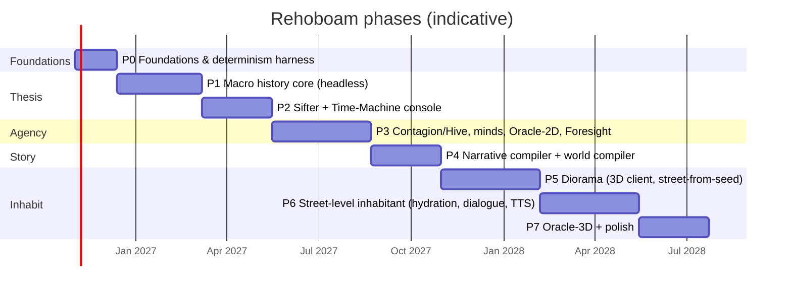

# 11 — Roadmap: Phases, Gates and Work Packages

*Status: Draft v1.0 (2026-10-15). Durations are **agent-assisted estimates for one director working with AI coding agents**. Treat them as planning ranges, not commitments. Every phase ends with a **gate** of verification, validation and a go / iterate / pivot decision (`09` §5). Phases run in order; work inside a phase runs in parallel across agents.*

---

## Phase map

The timeline totals about 18–20 months to the full vision. **P0–P2, the thesis test, takes about 7 months.** Spikes SPK-1 to SPK-3 for 3D risk run in parallel with P3 and P4 so that P5 starts de-risked.

---

## P0 — Foundations and determinism harness (≈ 4–6 weeks)

**Goal.** Build the skeleton that every later phase leans on. Nothing interesting is simulated yet, but everything is reproducible, measurable and agent-friendly.

| WP | Work package | Output |
|---|---|---|
| P0.1 | Repo bootstrap | Cargo workspace (crate stubs per `05.0` §6), Python package skeletons, `CLAUDE.md`/`AGENTS.md`, CI (fmt, clippy, nextest, cargo-deny, licence checks) |
| P0.2 | `rh-ids` | Typed IDs, keyed hash `H`, counter RNG (ChaCha8 streams + SplitMix64), branch salts |
| P0.3 | Samplers | Vendored binomial (BTPE + inversion), Poisson (PTRS), normal (ziggurat), Beta/Gamma, each with golden vectors |
| P0.4 | `rh-core` skeleton | `SimTime`, calendar, pulses, phase order, the `SystemModel` trait, `AccessSpec` conflict checker, agenda heap, event bus with `EventDraft`, invariant framework |
| P0.5 | Snapshot and hash | Chunked Merkle xxh3, Arrow IPC keyframe write/read, SQLite journal, unsynced guard |
| P0.6 | Golden-run CI | A `smoke` world with dummy systems; hash ladder at thread counts 1/2/4/N; nightly cross-platform matrix |
| P0.7 | Benchmark harness | criterion benches + regression gate; Rerun logging hooks; Textual TUI stub |
| P0.8 | Registry v0 | TOML loader, JSON Schema generation, manifest v0 loader (from `specs/manifest`) |

**Gate G0**
- The `smoke` world produces identical hashes across thread counts and repeated runs.
- A keyframe round-trip passes.
- The Registry and manifest examples validate.
- CI runs in under 15 minutes.

---

## P1 — Macro history core, headless (≈ 10–12 weeks)

**Goal.** A world that lives for 1,000 years and reproduces the stylized facts.

| WP | Work package | Output |
|---|---|---|
| P1.1 | `rh-worldgen` v1 | Azgaar-style world generation: Voronoi, heightmap templates, climate, rivers, biomes, cultures, burgs, states, Urquhart routes |
| P1.2 | Population synthesis | Iterative proportional fitting from manifest marginals → ledger; great houses with 3-generation genealogies |
| P1.3 | M2 Demography F1 | Age-specific hazards (Brass logit on Coale–Demeny West), density and entitlement modifiers, binomial draws, births by age-specific fertility, households (minimal), lineage table, dead-row compaction |
| P1.4 | M3 Agriculture & climate F1 | Seasons, AR(1) spatial anomalies, volcanic shocks, seed reserve, spoilage |
| P1.5 | M4 Economy F1 | 6–8 goods, regional markets, price rule, arbitrage, wages/rents/taxes, entitlement |
| P1.6 | M6 Polity F1 | Structural-demographic core: elites, fiscal state, legitimacy, Ψ, instability with overshoot; Granovetter revolts |
| P1.7 | M7 Succession & dynasts F1 | Succession-law enum, hazard model calibrated to Eisner, regencies, claims; named-actor tier with a minimal mind (traits, needs, opinions) and IAUS for core decisions |
| P1.8 | M1 Regions F1 | Route modes and costs, settlement growth |
| P1.9 | Event emission and Chronicle Writer | Typed events, roles, anchored snapshots, causal edges (contingent / motivated_by), Parquet segments, DuckDB views |
| P1.10 | M9 Validation harness | Stylized-fact bands, 32-seed ensembles, Morris screening, auto-generated run report |
| P1.11 | Reference manifests | `val_khor` (no dragons yet), `delta_republic` |
| P1.12 | Python wheel | `rh-py` with burn-in API; marimo calibration notebooks |

**Gate G1**
- MOP-1: 1,000 years at 100k in ≤ 2 min.
- Stylized facts ≥ 90% across 32 seeds (MOP-5).
- Invariants hold across 1,000 years.
- Coupling 1 (famine → succession), **truncated at the regency / civil-war onset** because M8 war and S3 migration arrive in P3 (the full chain is tested at G3), and coupling 4 (elite overproduction) each appear in ≥ x% of seeds and are absent in ≥ y%. x and y are set at G1 and logged in the decisions log.
- **[H] You read 3 seeds' annals and judge whether "history happens".**

---

## P2 — Sifter and Time-Machine console: the thesis test (≈ 8–10 weeks)

**Goal.** Watch centuries pass, get stopped at the moments that matter, and understand why each one happened.

| WP | Work package | Output |
|---|---|---|
| P2.1 | Pattern DSL v1 | TOML surface, compiler, anchoring lint, act-class and role vocabularies |
| P2.2 | Live sifter | Partial-match automata, pruning, match events, suspense, auto-pause signal |
| P2.3 | SQL twins + twin CI | DuckDB equivalents for every pattern; recorded-chronicle fixtures |
| P2.4 | Pattern packs v1 | Succession, revenge, famine, reversal, irony, elite feud, about 25 patterns in total |
| P2.5 | Significance v1 | Components, per-era recompute, hindsight pinning, compaction into collections and archive |
| P2.6 | `rh-server` v1 | Timelines (run, pause, seek, fork), keyframe cache, JSON-RPC control plane, Arrow data endpoints |
| P2.7 | Console v1 | Time-Machine (speed bands, run-until, overview and detail lanes), map (deck.gl), causal inspector (Sigma), person/place views, Annals, rating tool |
| P2.8 | Annals and Chronicle (templated) | Template engine over matches and edges; provenance links |
| P2.9 | Branching | What-if forks with override inputs; timeline diff view |
| P2.10 | Facts ledger v1 | `facts_ledger` writes on `entity.*` display; pin-on-reveal (05.2 §6); MOE-3 re-open probe (DATA-7) |
| P2.11 | Save versioning | Arrow-schema versioning, keyframe migrations, and the save-compatibility corpus in CI (DET-10, MOE-4) |

**Gate G2 (the thesis gate)**
- **[H] MOE-1 ≥ 3 events rated ≥ 4 per century** (median over 10 seeds).
- MOE-2 ≥ 80% preference for curated over random chronicles.
- MOE-6 bad-run rate < 10%.
- MOP-3 and MOP-4 met.
- Twin tests green.
- **If G2 fails, iterate inside P1/P2: simulation couplings, contingent unlocking, patterns. Do not proceed to 3D.**

---

## P3 — Agency: contagion and hive, minds, Oracle-2D, Foresight (≈ 12–14 weeks)

| WP | Work package | Output |
|---|---|---|
| P3.1 | M5 Contagion F1 | Metapopulation SEIRS (Euler-multinomial), radiation mobility, fear coupling, testing (se/sp), covert compartment |
| P3.2 | `rh-minds` v1 | Full psychological core, overlays, IAUS + HTN, Thoughts, opinions, ACT-R memory, light minds |
| P3.3 | Epistemics v1 | Belief store, channels (including hive), distortion operators, ToM for flagged propositions, Bayesian suspicion, impossible-knowledge events |
| P3.4 | Hive and mimics | Hive objective, mimic cover utility, tells, detection spiral |
| P3.5 | M8 Campaign war F1 | Supply, attrition, Helmbold battles, sieges, camp disease |
| P3.6 | Should-systems: S1.culture, S2.technology, S3.migration, S4.ecology | Religion and ideology, technology diffusion, migration, ecology (dragons as T1 with energetics) |
| P3.7 | Oracle verbs | Movement and travel; Whisper (parse → ground → score → show, with the LLM gateway v1); Pierce; Omen; Ward |
| P3.8 | Foresight | Prophecy DSL, rollout workers, Wilson CI, failure clustering, common-random-number A/B, reliability-diagram CI |
| P3.9 | LLM Gateway v1 | Job API, adapters (local llama.cpp, frontier), journaling, ARG-300 eval, red-team corpus |
| P3.10 | Scale-up | 1M-person optimisation pass; PERF-1 (P3) and PERF-2 |
| P3.11 | Reference world | `aethelgard` (modern hive, 10 years) |
| P3.12 | Pivotal-consult A/B | Opt-in LLM consult from legal-action menus, pre-batched; A/B against the utility argmax on MOE-1 (COG-8) |
| ∥ SPK-1 | Crowds spike | Godot: 50 rigged + 3,000 VAT + impostors at 1440p; 60 FPS on a 3060-class card |
| ∥ SPK-2 | Street-from-seed spike | Same town on two machines; > 90% of buildings stable under growth |

**Gate G3**
- Coupling 2 (plague → purge) and coupling 3 (hive spiral) are emergent and not forced.
- Foresight is calibrated (±0.05).
- The red-team corpus is green.
- MOE-1 ≥ 6 per century.
- MOP-1 at 1M in ≤ 10 min.
- **[H]** Oracle play sessions: whispers feel consequential but not controlling.

---

## P4 — Narrative compiler and world compiler (≈ 8–10 weeks)

| WP | Work package | Output |
|---|---|---|
| P4.1 | Digest and story-shape gate | Epoch digest builder; gate heuristics |
| P4.2 | Pipeline stages 1–9 | Selection, plan, bible, beats, scenes (batch), QA (graph + NLI), critique, book pass, exporters (EPUB/MD/Fountain/TTS manifest) |
| P4.3 | Style cards v1 | Five cards with public-domain exemplars; stylometric metrics |
| P4.4 | In-world documents | Biased-narrator documents with provenance |
| P4.5 | NOVEL-20 eval | Fixed epochs, metrics, judge harness |
| P4.6 | World compiler | Intent schema, expander, validators, burn-in integration, repair loop, gap reports; INTENT-100 eval |
| P4.7 | Audio-drama pipeline (optional within P4) | Voice bible, TTS rendering with ASR gate, mastering, RSS |
| P4.8 | Offline mode | Local or cluster fallback for every job kind; full offline play test (LLM-8) |
| ∥ SPK-3 | Wallpaper spike | Windows 11 24H2 host; power budget |

**Gate G4**
- Zero CT0/CT1 contradictions on NOVEL-20.
- **[H]** Blind saga A/B against an ungrounded baseline.
- INTENT-100 ≥ 90% / 98%.
- At least 3 gap reports converted into merged Registry entries, proving the S4 loop.

---

## P5 — Living Diorama: first 3D client (≈ 12–14 weeks)

| WP | Work package | Output |
|---|---|---|
| P5.1 | `rh-godot` | Frame decoder → MultiMesh; settlement plans via the shared `rh-worldgen` |
| P5.2 | Terrain and towns | Upsampled terrain, carved rivers, ward and tensor streets, shape-grammar buildings, WFC kit infill |
| P5.3 | Crowd LoD | Rig / VAT / impostor / aggregate tiers; rendezvous-hash kitbash |
| P5.4 | Binary state plane | Interest management, deltas, interpolation |
| P5.5 | Camera director | Vantages, salience scoring, dissolves |
| P5.6 | Systemic audio | AudioTelemetry, beds, one-shots, power policy |
| P5.7 | Wallpaper host | WorkerW + Lively package; macOS desktop window; throttling |
| P5.8 | Art bible v1 | Palette atlases, LUTs, tilt-shift; re-shading pipeline; provenance log |
| P5.9 | Replay mode | The Diorama renders a computed history (laptop-friendly) |

**Gate G5**
- Spike targets hold in the product build.
- R3D-5 power budgets are met.
- **[H]** Diorama believability sessions show a trend toward zero "fake" moments.

---

## P6 — Street-level Inhabitant (≈ 12–14 weeks)

| WP | Work package | Output |
|---|---|---|
| P6.1 | Hydration bubble | Rings, leases and decrees, pins, stub depth cap, alibi promotion, boundary flux |
| P6.2 | Schedules and errands | T0 templates, flows, concrete errands tied to stock and plots, venue advertisements |
| P6.3 | Dialogue | SpeechPlan IAUS, realisation with cached prefixes, claim check, speech-act extraction, facts-ledger writes from dialogue |
| P6.4 | Local model selection | RP-200 eval across candidate models and hardware tiers |
| P6.5 | Speech | Designed-voice bank, CPU TTS, ASR push-to-talk, latency masking |
| P6.6 | Interiors | Lazy room templates |
| P6.7 | Avatar and "a reason to walk" | Investigations (find the mimic, find the plotter) as scenario templates |

**Gate G6**
- The observer-invariance test passes with live hydration.
- RP-200 gates pass.
- **[H]** Interrogation sessions show 0 hard contradictions.
- End-to-end voice latency ≤ 2 s.

---

## P7 — Oracle-3D and polish (≈ 8–10 weeks)

Contents:
- the strategic travel map with time compression;
- Oracle verbs in 3D scenes;
- Foresight visualisation in 3D;
- the prophecy loop;
- performance and accessibility polish.

**Gate G7: [H]** the full-vision acceptance session, covering scenarios OS-1 through OS-11 in `04`.

---

## Continuous tracks (all phases)

- **Fidelity ratchet.** Gap reports and F(n) → F(n+1) upgrades run as work packages, each gated by the EVO-3 consistency tests.
- **Technology radar refresh** every quarter (`07` §3).
- **Risk review** at every gate (`10`).
- **Model re-evaluation** every quarter: RP-200, ARG-300, INTENT-100, NOVEL-20.

## Kill / pivot criteria

| Condition | Response |
|---|---|
| G2 fails after 3 iteration cycles | Pivot from "emergent history" toward a **storylet hybrid**: authored vignettes cast onto simulated people, in the style of Wildermyth and CK3. The deterministic engine stays as the substrate. |
| SPK-1 fails | Change the 3D scope to a 2.5D isometric diorama, or re-assess Unreal for the client only. The simulation is unaffected. |
| RP-200 cannot pass with local models | Move street-level dialogue to cluster or frontier models, keeping the same plan-then-realise architecture, or use templated dialogue only. |
