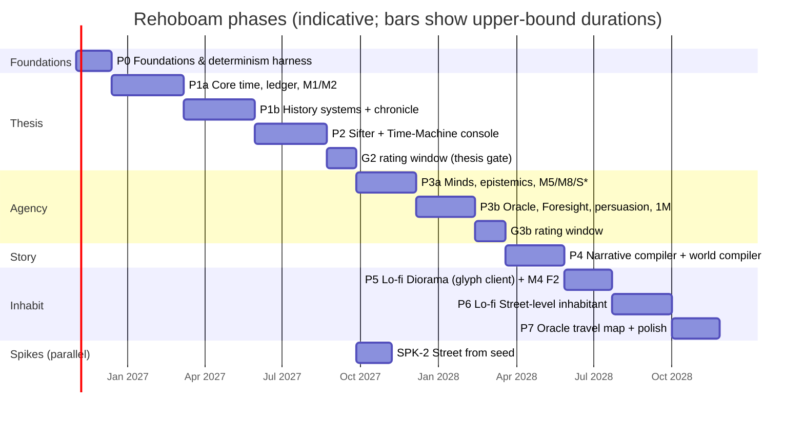

# 11 — Roadmap: Phases, Gates and Work Packages

*Status: Draft v1.1 (2026-10-15). Durations are **agent-assisted estimates for one director working with AI coding agents**. Treat them as planning ranges, not commitments. Every phase ends with a **gate** of verification, validation and a go / iterate / pivot decision (`09`, phase gates). Phases run in order; work inside a phase runs in parallel across agents, up to the limit the review-hours budget allows.*
*v1.1 changes: P1 split into P1a and P1b (16–24 weeks in total) and P3 into P3a and P3b; new WP P5.0 (M4.economy at F2) before street-level errands; a review-hours budget sized to one human reviewer; numeric thresholds for every gate, fixed before its phase starts; rating windows for G2 and G3b; WPs aligned with ADR-0024–0026 and the v1.1 architecture; total re-estimated at ≈ 22–28 months.*

---

## Phase map

| Phase | Duration | Gate |
|---|---|---|
| P0 | 4–6 weeks | G0 |
| P1a | 8–12 weeks | G1a |
| P1b | 8–12 weeks | G1b |
| P2 | 10–12 weeks, then the G2 rating window (3–5 weeks) | G2 (thesis) |
| P3a | 8–10 weeks | G3a |
| P3b | 8–10 weeks, then the G3b rating window (3–5 weeks) | G3b |
| P4 | 8–10 weeks | G4 |
| P5 | 6–8 weeks (lo-fi, ADR-0029) | G5 |
| P6 | 8–10 weeks | G6 |
| P7 | 6–8 weeks | G7 |
| **Total** | **80–108 weeks ≈ 19–25 months** (was 94–122 with the 3D client) | |
| Era packs E2–E4 (interleaved) | +20–40 weeks of calendar | — |
| Art phase 2: 3D client (optional) | +18–24 weeks | — |

- **P0 to the G2 decision, the thesis test, takes about 33–47 weeks (8–11 months).**
- v1.0 estimated 18–20 months in total and 7 months to G2. The difference comes from four changes:
  - P1 is split, and the calibration work in P1b is no longer squeezed.
  - P2 and P3 gained work packages from the red-team review: plane isolation, save versioning, persuasion balance.
  - The G2 and G3b rating windows are now explicit.
  - Every duration is sized to the review-hours budget below.
- **Cross-check.** `14` estimates ≈ 140 person-weeks of build after reuse. At the review-limited throughput of ≈ 2–3 concurrent workstreams, that is ≈ 50–70 weeks of build. The rest of the schedule is calibration and design iteration (P1b, P2), gate windows and spikes.
- **Spikes.** SPK-2 (street from seed) runs in parallel with P3a/P3b, because settlement plans feed the glyph view. SPK-1 (crowds) and SPK-3 (application wallpaper) belong to the optional 3D art phase 2 (ADR-0029). The small WebView2 wallpaper spike is inside P5.7.

---

## Review-hours budget

You are the only human reviewer of agent output. **The plan assumes ≤ 6 h/week of your review time outside rating windows** (`12` Q16). Rating windows at gates are counted separately.

**Where the hours go (a typical week):**

| Item | Unit cost | Per week |
|---|---|---|
| WP approval: a one-page WP spec (`13` §2, §5) | 10–15 min | 6–10 WPs → 1–2.5 h |
| Director-route PRs: breaking C2, out-of-tolerance C3, determinism machinery, ADR touches (`13` §4.2) | 30–60 min | 1–3 → 0.5–3 h |
| Spot audit of auto-merged PRs (one per active workstream) | 15–20 min | 2–3 → 0.5–1 h |
| Weekly digest: merged PRs, bench and ensemble trends, perf re-baselines (`08` §9), open risks | 30 min | 0.5 h |

**How work packages are sized to it:**
1. **Small specs.** A WP spec fits on one page and can be approved in ≤ 15 min. A WP is ≤ 3 agent-days (`13` §2).
2. **Auto-merge by default.** Each WP is designed to land through an auto-merge route: C0, C1, additive C2, or C3 within tolerance (`13` §4.2–4.4). A WP expected to need your review is flagged at approval, and at most 2 such WPs are open at once.
3. **Throughput cap.** At most 10 WP approvals a week. That gives ≈ 2–3 concurrent workstreams on average, not the 3–6 that `13` §5 allows. The durations above assume this.
4. **Rating windows replace review time.** During a gate's rating window, nothing that needs your review merges. Agents work only on C0/C1 items (benches, tests, performance, test debt) and on spikes.
5. **Throttling.** If review time exceeds the budget for 2 consecutive weeks, new WP approvals pause until the queue drains (R-25).

**Rating time at gates (outside the weekly budget):**

| Gate | [H] activity | Your time |
|---|---|---|
| G1b | Run reports of 3 seeds | ≈ 3–6 h |
| G2 | Pre-registered protocol (V-HUM-09 in `09`): 10 seeds × 3–4 h of blind rating, re-presentations ≥ 7 days later, ≥ 20 chronicle pairs | **≈ 30–40 h** (3–5-week window) |
| G3b | The G2 protocol with fresh held-out seeds, plus 3 Oracle play sessions | **≈ 30–40 h** (3–5-week window) |
| G4 | Blind saga A/B, 10 pairs | ≈ 8–12 h |
| G5 | Diorama believability sessions | ≈ 6–10 h |
| G6 | Interrogation sessions | ≈ 6–10 h |
| G7 | Full-vision acceptance (OS-1 to OS-11) | ≈ 10–15 h |

---

## Gate thresholds: numbers before the phase

- **Fixed in advance.** Every gate's numbers are fixed **before its phase starts** and logged in `decisions-log.md`. The numbers below are the defaults; you may change any of them before the phase begins.
- **Mid-phase changes.** A change after the phase has started needs a logged director ruling with a reason. A change after results are seen voids that gate run.
- **G2 is pre-registered.** Its protocol (V-HUM-09 in `09`) is frozen before the first rating (WP P2.13).
- **Test IDs.** Gate bullets cite `09` test IDs, which stay stable when `09` is re-sectioned.

### Coupling thresholds (`05.1` §8; V-COUP in `09`)

A coupling is **possible** when the chain completes in at least *x*% of seeds, and **not forced** when it is absent in at least *y*% (V-COUP). Each ensemble is 32 seeds. Pre-modern runs are 200 years after spin-up, so that "absent" stays meaningful: over 1,000 years almost any possible chain occurs somewhere. `aethelgard` runs are 10 years. Gates use point estimates; Clopper–Pearson intervals are reported.

| Test | Coupling | Gate | Run | *x* (possible) | *y* (not forced) |
|---|---|---|---|---|---|
| V-COUP-01 | Famine → unrest → succession crisis, **truncated at regency or civil-war onset** | G1b | 200 y | ≥ 20% | ≥ 20% |
| V-COUP-01 | The same, full chain (armies eat the grain; M8) | G3a | 200 y | ≥ 10% | ≥ 30% |
| V-COUP-02 | Plague → paranoia → purge → labour revolt | G3a | 200 y | ≥ 10% | ≥ 30% |
| V-COUP-03 | Hive detection spiral (`aethelgard`) | G3a | 10 y | ≥ 25% | ≥ 25% |
| V-COUP-04 | Elite overproduction → 40–60-year violence wave | G1b | 200 y | ≥ 20% | ≥ 20% |
| V-COUP-05 | Dragon raids → famine pockets, inside the energetics bound (`val_khor` with dragons) | G3a | 200 y | ≥ 20% | ≥ 20% |

---

## P0 — Foundations and determinism harness (≈ 4–6 weeks)

**Goal.** Build the skeleton that every later phase leans on. Nothing interesting is simulated yet, but everything is reproducible, measurable and agent-friendly.

| WP | Work package | Output |
|---|---|---|
| P0.1 | Repo bootstrap | Cargo workspace (crate stubs per `05.0` §6, including `rh-contracts`), Python package skeletons, `CLAUDE.md`/`AGENTS.md`, CI (fmt, clippy, nextest, cargo-deny, licence checks), architecture lints (dependency graph, plane isolation, flavour asset), merge queue (`13` §4.4) |
| P0.2 | `rh-ids` | Typed IDs, keyed hash `H`, counter RNG (ChaCha8 streams + SplitMix64), branch salts and salt lineage (`05.1` §6.9), genealogical `PersonId` derivation with deterministic collision rehash (ADR-0026) |
| P0.3 | Samplers | Vendored binomial (BTPE + inversion), Poisson (PTRS), normal (ziggurat), Beta/Gamma, each with golden vectors |
| P0.4 | `rh-core` skeleton | `SimTime` (i64 minutes, signed epoch), calendar, pulses, phase order, the `SystemModel` trait, `AccessSpec` conflict checker, derived scheduler (topological order, declared lags), agenda heap for decisions and timers, lifecycle command queues, event bus with `EventDraft`, invariant framework |
| P0.5 | Snapshot and hash | Three plane hashes (chunked Merkle xxh3 with dirty tracking), Arrow IPC keyframe write/read, SQLite journal (push and pull inputs), unsynced guard |
| P0.6 | Golden-run CI | A `smoke` world with dummy systems; hash ladder at thread counts 1/2/4/N; divergence bisect tool v0 (`13` §4.5); nightly cross-platform matrix |
| P0.7 | Benchmark harness | criterion benches and the regression gate (> 10% slowdown fails; no automatic re-baseline, `08` §9); serial-fraction instrumentation; Rerun logging hooks; Textual TUI stub |
| P0.8 | Registry v0 | TOML loader, JSON Schema generation, manifest v0 loader (from `specs/manifest`), column-ownership declarations and their lint |

**Gate G0**
- **Determinism** (V-DET-01, V-DET-02): the `smoke` world gives identical plane-A hashes at 1, 2, 4 and N threads and over 3 repeats, every sim-month for 1,000 years.
- **Keyframes** (V-DET-05): write, load, advance 10 years; the result equals a continuous run.
- **Samplers** (V-DET-09): golden vectors are bit-equal.
- **Bisect** (V-DET-11): the divergence bisect tool names the injected month, table and row.
- **Specs** (V-WC-04): `val_khor.yaml` and `aethelgard.yaml` validate and `invalid_draft_style.yaml` fails.
- **Lints** (V-PLN-01, V-DET-19, V-INSP-03): zero violations.
- **CI** (V-PERF-04): per-PR CI runs in ≤ 15 min, and baselines are recorded for benches 4, 7 and 8 (`08` §9).

---

## Build strategy: generic machinery, one era of content, skeleton first

*(Director's question: "focus the era on one, or generic? Make sure the engine works, then iterate fidelity.")*

1. **The machinery is generic from day one,** because retrofitting it is expensive and building it is cheap:
   - determinism, time, IDs, planes, journal;
   - the Registry and effect language;
   - era-state hooks (ADR-0027) and scale profiles (ADR-0028).
2. **Content and calibration cover one era first: E1 "agrarian"**, meaning every pre-industrial organic economy from antiquity to about 1700. The era is chosen by its mechanics, not its date or place. It covers:
   - the biblical Land of Uz (`uz_job`, micro);
   - a medieval feudal realm (`val_khor`, macro);
   - fantasy variants (dragons).

   All three share the same Malthusian, pastoral-agrarian, dynastic substrate. E1 has the best data we have verified (R12) and the smallest mechanism set. Lo-fi art suits it naturally.
3. **Walking skeleton first (WP P1.0), then fidelity, one system at a time.** Every later WP deepens one system (F0 → F1 → F2) while the whole loop stays green: world → ledger → events → chronicle → sifter → console → lo-fi view, at N = 1 and N = 100k.
4. **The engine proves itself before it widens.** Scale is proven early, because it is cheap (N = 1 … 1M from P1). Eras are proven late, because they are expensive (packs after G3b).

## P1a — Core time, ledger and demography (≈ 8–12 weeks)

**Goal.** Living people on a real map: a ledger, genealogies and vital events that run for 1,000 years, deterministically and at scale. WP IDs are stable across the P1a/P1b split.

| WP | Work package | Output |
|---|---|---|
| **P1.0** | **Walking skeleton (first 2–3 weeks)** | The thinnest end-to-end loop at F0. Manifest → `rh-worldgen` stub → ledger (born, ages, dies) → scheduled outcomes → events → chronicle (Parquet) → a trivial sifter pattern → console Time-Machine with scrub and a lo-fi glyph view → journal replay. Runs **at N = 1, 60 (`uz_job` skeleton) and 100k** on the same binary, with plane hashes in CI from day one. Every later WP must keep this loop green |
| P1.1 | `rh-worldgen` v1 | Azgaar-style world generation: Voronoi, heightmap templates, climate, rivers, biomes, cultures, burgs, states, Urquhart routes |
| P1.2 | Population synthesis | Iterative proportional fitting from manifest marginals → ledger. Founders are `H64(seed, "founder", k)`, with pre-epoch births. Great houses with 3-generation genealogies |
| P1.3 | M2 Demography F1 | Age-specific hazards (Brass relational logit on the Brass General Standard, fixed-point odds form, golden vectors in `specs/demography/`), density modifiers (the entitlement hook is stubbed until P1.5), binomial draws, births by age-specific fertility, **minimal partnering (fathers)**, households (minimal), genealogical IDs `H64(mother, parity)`, life-course log; dead rows leave the ledger at once |
| P1.8 | M1 Regions F1 | Route modes and costs, settlement growth |
| P1.13 | Scheduled outcomes and lifecycle queues | Intra-pulse outcome times as agenda timers; lifecycle commands applied in `(phase, PersonId)` order; no back-dating (ADR-0025); `rh-contracts` v0 for the M1/M2 columns |
| P1.14 | Determinism and performance at scale | Golden runs on the M1/M2 world (1,000 years); CRN pairing test (ADR-0026); synthetic 1M world with `bench/ledger_month_1M`, `bench/timers_lifecycle_1M` and `bench/serial_fraction`; a 100-year 1M storage measurement (`08` §1, §6) |

**Gate G1a**
- **Determinism** (V-DET-01, V-DET-02, V-DET-12): identical plane-A hashes at 1/2/4/N threads, every sim-month for 1,000 years, on `smoke` and the M1/M2 world; no back-dating.
- **Invariants** (V-INV-01, V-INV-02, V-INV-11): 0 violations over a 1,000-year debug soak, covering population conservation, acyclic genealogy, life-course consistency and valid IDs; pre-epoch founders round-trip.
- **Identity and life-course** (V-DATA-04, V-DATA-05): every `PersonId` ever emitted has exactly one life-course entry and matches its rule; forced collisions resolve identically on every run.
- **CRN pairing** (V-DET-17): per-person death-time correlation ≥ 0.9 at 10 years for unaffected lineages across a paired fork.
- **Demography bands** (V-SF-01, V-SF-02; identity bands): on a 32-seed ensemble, the estimates lie inside the bands:
  - long-run growth r ∈ [−0.1, +0.3]%/yr, with population ∈ [0.3, 5]·K;
  - child mortality to age 15 of 35–55%.
- **Performance:**
  - 1,000 years at 100k with M1 + M2 in ≤ 60 s on 8 cores, half of MOP-1, leaving the rest for P1b;
  - serial share ≤ 20% on the synthetic 1M month (`08` §1.3);
  - the PERF-2 inputs are measured and logged.

---

## P1b — History systems, chronicle and first stylized facts (≈ 8–12 weeks)

**Goal.** A world that lives for 1,000 years and reproduces the stylized facts.

| WP | Work package | Output |
|---|---|---|
| P1.4 | M3 Agriculture & climate F1 | Seasons, AR(1) spatial anomalies, volcanic shocks, seed reserve, spoilage |
| P1.5 | M4 Economy F1 | 6–8 goods, regional markets, price rule, arbitrage, wages/rents/taxes, entitlement (feeds M2's entitlement modifier) |
| P1.6 | M6 Polity F1 | Structural-demographic core: elites, fiscal state, legitimacy, Ψ, instability with overshoot; Granovetter revolts |
| P1.7 | M7 Succession & dynasts F1 | Succession-law enum; competing ruler-exit hazards (murder, deposition, battle, natural) as functions of institutional state, calibrated to Eisner, Blaydes & Chaney and Kokkonen & Sundell (R12); feud stock after a regicide; regencies, claims, great-house dormancy (SIM-9). Named-actor tier (T1) with a minimal mind (traits, needs, opinions), IAUS for core decisions, and same-instant agenda semantics (`05.1` §4.3) |
| P1.9 | Event emission and Chronicle Writer | Typed events, roles, anchored snapshots, causal edges (contingent / motivated_by), Parquet segments including the life-course log, DuckDB read-only views |
| P1.10 | M9 Validation harness | Stylized-fact bands (identity vs emergent tags), cycle and phase statistics on N/K (the spectral test is report-only, R12 §12), Clauset tail fits, censoring-aware lifespans, 32-seed ensembles, Morris screening, auto-generated run report |
| P1.11 | Reference manifests | `val_khor` (no dragons yet), `delta_republic`, and the sealed **held-out manifest** for G2: hand-authored, hash committed, never run before G2 (V-HUM-09) |
| P1.12 | Python wheel | `rh-py` with the liveness-gate and certification APIs (`05.5` §4.2); marimo calibration notebooks |
| P1.15 | Registry effect language v0 | The typed, total evaluator in `rh-registry` (`05.5` §2.1); succession-law eligibility and ordering; verb effects as queued commands; a golden test |
| P1.16 | Era-state hooks (ADR-0027) | The era-state vector in the contract crates; every era-sensitive parameter of M2, M4, M6, M7 declared as a Registry function of it (agrarian range calibrated only); the era-label classifier (plane C); a lint that fails if a mechanic reads the label. About 1–2 weeks, mostly interface work |

**Gate G1b** (the v1.0 G1)
- **MOP-1** (V-PERF-01): 1,000 years at 100k in ≤ 2 min on 8 cores.
- **MOP-5** (V-SF): on the certification ensemble (32 seeds × 1,000 years per manifest), ≥ 90% of the P1-applicable non-soft bands pass and every identity band passes. V-SF-09 (war severity), V-SF-11 (post-plague wages) and V-SF-12 (hive testing) need P3 systems and are deferred to G3a.
- **Invariants** (V-INV-02, V-INV-03, V-INV-12): 0 violations over 1,000 years; one death path; great houses tracked from world start.
- **Couplings:** V-COUP-01 (truncated) and V-COUP-04 meet their thresholds in §Coupling thresholds.
- **Agenda** (V-COG-04): same-instant semantics hold; first-applied rate unbiased by entity ID (TOST, δ = ±0.05).
- **Liveness gate and certification** (V-WC-05, V-WC-07, V-PERF-07; `08` §2):
  - liveness gate ≤ 90 s wall at 100k on 8 cores (target 60 s);
  - certification ≤ 30 min wall (target 20 min).
- **PERF-2** is set from the P1 measurements and logged. It replaces the provisional band in `08` §1.4.
- **[H] You read the run reports of 3 seeds** and judge whether "history happens". Pass: yes for ≥ 2 of 3.

---

## P2 — Sifter and Time-Machine console: the thesis test (≈ 10–12 weeks, then the G2 rating window)

**Goal.** Watch centuries pass, get stopped at the moments that matter, and understand why each one happened.

| WP | Work package | Output |
|---|---|---|
| P2.1 | Pattern DSL v1 | TOML surface, compiler, anchoring lint, act-class, role and attribute vocabularies |
| P2.2 | Live sifter | Partial-match automata, declarative pruning, declared match semantics (selection, on_complete, dedupe), match events, suspense with its rate limiter, auto-pause signal (`05.4` §2.3) |
| P2.3 | SQL twins + twin CI | DuckDB equivalents for every pattern; clustered recorded-chronicle fixtures |
| P2.4 | Pattern packs v1 | Succession, revenge, famine, reversal, irony, elite feud: about 25 patterns, each with a firing-rate budget. Bad-run metric (MOE-6) wired into the liveness gate |
| P2.5 | Significance v1 | Components, per-era recompute, bounded hindsight retention, per-timeline visibility sidecar (plane C), rarity base rates |
| P2.6 | `rh-server` v1 | Timelines (run, pause, read-only seek, fork); keyframe service (10-year permanent keyframes, yearly LRU with a RAM tier, capture at auto-pause); JSON-RPC control plane; Arrow data endpoints |
| P2.7 | Console v1 | Time-Machine (speed bands, run-until, overview and detail lanes), map (deck.gl), causal inspector (Sigma), person/place views, Annals, rating tool. Cultivator mode only; Oracle mode arrives with P3.7 |
| P2.8 | Annals and Chronicle (templated) | Template engine over matches and edges; provenance links |
| P2.9 | Branching | What-if forks with override inputs; material-input dependency scopes with timer cancel and re-sample; acting in the past forks (ADR-0025); timeline diff view |
| P2.10 | Facts ledger v1 | Pins and `facts_ledger` (plane B, `05.2` §3.3), written on `entity.*` display; MOE-3 re-open probe (DATA-7) |
| P2.11 | Save versioning | Arrow-schema versioning, keyframe migrations, and the save-compatibility corpus in CI (DET-10, MOE-4) |
| P2.12 | Observer invariance and plane isolation | Three plane hashes recorded per timeline; console fuzz of pins, facts and inspections with `state_hash` unchanged (DET-6, binding from P2); read-set checks against the Registry's plane tags (`05.5` §2) |
| P2.13 | G2 protocol and rating instrumentation | The pre-registered protocol (V-HUM-09 in `09`): frozen build, Registry version, held-out manifest hash, seed derivation, pause thresholds, preference-model hash, presentation order and analysis script, logged before the first rating; blind interleaving of arms; intra-rater re-presentation; blind chronicle-pair generator for MOE-2 (coupled run against coupling-ablated run) |
| P2.14 | Coupling-ablation harness | The G2 and MOE-2 baseline arm (V-HUM-09): every cross-system contract read is served from an independent seed's recorded run of the same manifest. A test-harness feature only, never available in play |

**Gate G2 (the thesis gate).** The decision rule is the pre-registered protocol V-HUM-09 in `09`, fixed before P2 starts. 10 seeds (7 on the tuned manifests, 3 on the held-out manifest), 2 simulated centuries per seed, the engine against its coupling-ablated baseline, rated blind (≈ 3–4 h per seed).
- **[H] Pass criterion** (primary analysis, default pause selection):
  - the lower 80% bound of the mean treatment rating is ≥ 2.5 on the 1–5 scale; **and**
  - the lower 80% bound of the paired difference, treatment minus coupling-ablated, is > 0.
- **Diversity guard:** no single pattern family accounts for more than 40% of the treatment items rated ≥ 4.
- **Validity:** intra-rater κ ≥ 0.4, blinding intact, no protocol deviation. Otherwise the run is void and repeated.
- **[H] P2 targets of `01`** (V-HUM-01–V-HUM-03):
  - MOE-1: ≥ 3 events rated ≥ 4 per century (median over seeds), precision ≥ 0.5, within the pause budget of ≤ 10 auto-pauses per century;
  - MOE-2: ≥ 80% preference for the coupled run's chronicle over the coupling-ablated run's, over ≥ 20 blind pairs;
  - MOE-6: bad-run rate < 10% on 32 seeds (point estimate; the Clopper–Pearson interval is reported).
- **P2 verification suites green:**
  - MOP-3 scrub < 100 ms (V-TM-03);
  - MOP-4 drop-in ≤ 10 s worst case at 100k, ≈ 0.3 s typical (V-TM-04; `08` §2);
  - PERF-3: the live sifter adds ≤ 10% to run time at 100k (V-PERF-03);
  - twin equivalence and firing-rate budgets (V-SIFT-01, V-SIFT-03), with precision@K reported (V-SIFT-04);
  - observer invariance (V-DET-06, V-PLN-03, V-PLN-05, V-TM-10): 0 `state_hash` changes;
  - acting in the past and input scope (V-DET-13, V-DET-14);
  - save compatibility (V-GOLD-04).
- **If G2 fails, iterate inside P1/P2: simulation couplings, contingent unlocking, patterns. Do not proceed to 3D.**

---

## P3a — Minds, epistemics and the remaining systems (≈ 8–10 weeks)

**Goal.** People with minds who know different things, in a world with plague, war, culture and dragons. No LLM is needed in P3a.

| WP | Work package | Output |
|---|---|---|
| P3.1 | M5 Contagion F1 | Metapopulation SEIRS (Euler-multinomial), radiation mobility, fear coupling, testing (se/sp), covert compartment; per-person status consistent with the counts |
| P3.2 | `rh-minds` v1 | Full psychological core, overlays (in the effect language), IAUS + HTN, Thoughts, opinions, ACT-R memory; light minds as pure functions of plane A |
| P3.3 | Epistemics v1 | Bounded belief stores (T1 only), channels (including hive), distortion operators, ToM for flagged propositions, sparse Bayesian suspicion, impossible-knowledge events; knowledge rows and diffusion fronts (`05.2` §4.1) |
| P3.4 | Hive and mimics | Hive objective, mimic cover utility, tells, detection spiral |
| P3.5 | M8 Campaign war F1 | War onset hazard (force ratio × contagion, no global cooldown); war aggregation as space-time components; supply, attrition, Helmbold battles, sieges, camp disease; severity emerges from escalation (R12) |
| P3.14 | Endogenous institutions (ADR-0027) | The Registry institution-transition graph; adoption by emulation, reform under fiscal stress, regime change after breakdown; transitions as events with causal edges; `exec_constraint`, `fiscal_capacity`, `succession_institutionalisation` dynamics |
| P3.6 | Should-systems: S1.culture, S2.technology, S3.migration, S4.ecology | Religion and ideology, technology diffusion, migration, ecology (dragons as T1 with energetics) |
| P3.11 | Reference worlds | `aethelgard` (modern hive, 10 years); dragons added to `val_khor` |

**Gate G3a**
- **Couplings:** the full V-COUP-01, and V-COUP-02, V-COUP-03 and V-COUP-05, meet their thresholds in §Coupling thresholds. They must be emergent, not forced.
- **MOP-5** (V-SF): ≥ 90% of all non-soft bands pass and every identity band passes, now including:
  - V-SF-09: war severity α ∈ [1.3, 1.9];
  - V-SF-11: a post-plague real-wage rise;
  - V-SF-12: more than 50% of detentions false positive at prevalence < 1% with se/sp = 0.99.
- **Cognition and epistemics** (V-COG-01–V-COG-08, V-DATA-06): green; knowledge fronts agree exactly with the brute-force reference.
- **Ecology** (V-INV-13): predator biomass never exceeds the energetics bound.
- **Knowledge volume** (V-DATA-12, V-PERF-08; synthetic 100-year 1M run; `08` §5–6):
  - knowledge rows plus fronts ≤ 3 GB per century;
  - T1 belief stores ≤ 600 MB at 5k actors;
  - a compressed keyframe ≤ 0.5 GB.

---

## P3b — Oracle, Foresight, persuasion and scale (≈ 8–10 weeks, then the G3b rating window)

**Goal.** You can act: travel, whisper, read probable futures, and run at 1M.

| WP | Work package | Output |
|---|---|---|
| P3.7 | Oracle and its verbs | Oracle entity with its own belief store; Cultivator and Oracle console modes (`05.3` §6.2); movement and travel; Whisper (parse → ground → score → show, through the LLM gateway); Pierce; Omen; Ward |
| P3.8 | Foresight | Prophecy DSL, rollout workers, belief-resampled forks in Oracle mode, Wilson CI, failure-path clustering, common-random-number A/B, validity tests (exchangeability, reduced-cost bias, scoring; `05.3` §7.6) |
| P3.9 | LLM Gateway v1 | Job API; adapters (local llama.cpp, cluster, frontier); journaling of push and pull inputs; structured generation with Registry enums (LLM-1/2/3); ARG-300 eval; red-team corpus (LLM-6/7) |
| P3.10 | Scale-up | 1M optimisation pass against the serial-fraction budget; PERF-1 (P3), PERF-2 and PERF-3 at 1M; Foresight batch at 1M (`08` §1, §3) |
| P3.12 | Deliberation-consult A/B | Opt-in deliberation consults as pull inputs due at t + D, with a journaled fallback (`05.3` §8); A/B against the utility argmax on MOE-1 (COG-8) |
| P3.13 | Persuasion balance | Leverage bands, parameter sweeps, and the adversarial player bot as a CI gate (`05.3` §6.3) |
| ∥ SPK-2 | Street-from-seed spike | Same town on two machines; > 90% of buildings stable under growth |

**Gate G3b** (the v1.0 G3)
- **[H] MOE-1 ≥ 6 events rated ≥ 4 per century** (V-HUM-01), median over 10 seeds, with precision ≥ 0.7 and ≤ 10 auto-pauses per century, under the G2 protocol with fresh held-out seeds.
- **[H] Oracle play** (V-HUM-07): 3 sessions of about 1 h. You rate "whispers feel consequential but not controlling" ≥ 4/5 in ≥ 2 of them.
- **Foresight validity** (V-FOR; `05.3` §7.6), on a panel of ≥ 200 back-test predicates:
  - V-FOR-01 exchangeability: rank-histogram and PIT χ² p ≥ 0.01, with ≥ 400 continuations per quantity;
  - V-FOR-02 reduced-cost bias: the 90% CI of ΔP lies inside ±0.03 for every predicate;
  - V-FOR-03 scoring: Brier skill score > 0 (lower 95% bound) and Spiegelhalter |Z| ≤ 1.96.
- **Oracle mode** (V-ORA-09, V-ORA-10): 0 leaks; Oracle-mode Foresight is TOST-equivalent across a secret the Oracle lacks (δ = ±0.03).
- **LLM-facing** (V-LLM-02, V-LLM-03):
  - ARG-300 field F1 ≥ 0.85 and meta-instruction recall ≥ 0.95;
  - red-team corpus: no state delta beyond the documented caps.
- **Persuasion** (V-ORA-07, V-ORA-08):
  - a strong, verified whisper on a receptive target moves ΔP by 5–15 points, and a weak or bluffed one by < 3;
  - the adversarial bot never exceeds the cap envelope.
- **Pull inputs** (V-DET-15, V-COG-09): replay hard-fails on a missing, extra or mismatched answer; the fallback is journaled.
- **Scale** (V-PERF-01–V-PERF-03, V-PERF-06; `08` §1, §3):
  - PERF-1 (P3) [P]: 1,000 years at 1M in ≤ 15 min on 8 cores;
  - PERF-2 as set at G1b;
  - PERF-3: the sifter adds ≤ 20% at 1M;
  - batch Foresight at 1M (N = 64 × 50 years) in ≤ 60 min on the desktop.
- **Preference model** (V-HUM-10): hold-out Spearman ρ ≥ 0.4.
- **SPK-2:** reported, with its pass/fail recorded.

---

## P4 — Narrative compiler and world compiler (≈ 8–10 weeks)

| WP | Work package | Output |
|---|---|---|
| P4.1 | Digest and story-shape gate | Epoch digest builder; gate heuristics |
| P4.2 | Pipeline stages 1–9 | Selection, plan, bible, beats, scenes (batch), QA (graph + NLI), critique, book pass, exporters (EPUB/MD/Fountain/TTS manifest) |
| P4.3 | Style cards v1 | Five cards with public-domain exemplars; stylometric metrics |
| P4.4 | In-world documents | Biased-narrator documents with provenance |
| P4.5 | NOVEL-20 eval | Fixed epochs, metrics, judge harness |
| P4.6 | World compiler | Intent schema, mapping table, expander, validators, liveness gate with deterministic calibration repair and background certification (`05.5` §4.2), LLM repair loop for schema and semantic errors only, gap reports (`data_only` / `needs_code`); INTENT-100 with its adversarial subset |
| P4.7 | Audio-drama pipeline (optional within P4) | Voice bible, TTS rendering with ASR gate, mastering, RSS |
| P4.8 | Offline mode | Local or cluster fallback for every job kind; full offline play test (LLM-8) |

**Gate G4**
- **Canon** (V-NAR-01, V-NAR-02, V-NAR-08): 0 CT0/CT1 contradictions and 0 CT3 inventions on NOVEL-20; backbone coverage ≥ 95%; 0 epistemic leaks.
- **[H] Blind saga A/B** (V-HUM-05) against an ungrounded baseline, 10 pairs:
  - Rehoboam preferred on coherence and on surprise in ≥ 7 of 10 each;
  - preferred on engagement in ≥ 5 of 10, i.e. no regression.
- **INTENT-100** (V-WC-01, V-WC-02): template ≥ 90%; validity after repair ≥ 98%; gap recall ≥ 0.9; silent approximation ≤ 5%.
- **The S4 loop** (V-WC-13, V-WC-10): ≥ 3 gap reports converted into merged Registry entries, at least 1 of them `data_only` through the effect language.
- **LLM-8** (V-LLM-10): the full offline play test passes.
- **Compiler path at 100k** (V-WC-05–V-WC-07): liveness gate ≤ 90 s, calibration repair within Registry bounds, certification ≤ 30 min.

---

## P5 — Lo-fi Living Diorama: the glyph client (≈ 6–8 weeks; ADR-0029)

| WP | Work package | Output |
|---|---|---|
| P5.0 | M4.economy F2 | Household budgets and stocks, credit (`05.1` §3); EVO-3 consistency with F1 on conserved quantities and declared targets; supported-combinations matrix updated. Prerequisite for concrete errands in P6.2 (`05.2` §2). The only plane-A WP in P5: a C3 change with a CRN-paired ensemble (`13` §4.2) |
| P5.1 | Glyph layer | deck.gl `GlyphGridLayer` (instanced quads, CP437 atlas, palette indices, IF-4 binary attributes), started from `IconLayer`; shader pattern ported from wglt (MIT, code only) |
| P5.2 | World and settlement glyph tiles | `map.glyph_tiles` from regional aggregates and the chronicle (Z0); `rh-worldgen` settlement plans rasterised to glyph chunks, cached by settlement × generator version × override epoch (Z1) |
| P5.3 | Street glyph LoD | `bubble.subscribe(..., lod_profile: "glyph")`; cell snapping; one glyph per cell (named first) plus a count badge; ░▒▓ crowd shading |
| P5.4 | Binary state plane | Interest management and deltas; the TypeScript IF-4 decoder |
| P5.5 | 2D camera director | Vantage scoring from `05.7` §B5 applied to glyph views; slow cuts |
| P5.6 | Systemic audio (minimal) | Ambience beds and one-shots from AudioTelemetry; mute when hidden |
| P5.7 | Wallpaper | Lively **web** wallpaper package (pause on `livelyWallpaperPlaybackChanged`, 10–15 FPS cap); Plash on macOS. Includes the small spike: WebView2 localhost WebSocket and hidden-page timers |
| P5.8 | Glyph packs v1 | Pack format and CI lint (every Registry presentation key mapped); `medieval` pack from Bitlands (CC-BY 4.0); `ancient` pack for `uz_job`; Unscii panels |
| P5.9 | Replay mode | The Diorama renders a computed history (laptop-friendly) |

**Gate G5**
- **Glyph performance** (V-R3D-10): ≥ 10k cells at 60 FPS on the reference laptop iGPU in the browser; ≤ 15 FPS and ≈ 0 work when the wallpaper is covered.
- **The client decides nothing** (V-R3D-11): no FOV, pathing or randomness in client code (lint); identical frames for identical server streams.
- **DET-6, passive viewing** (V-DET-07): 0 `state_hash` changes with the Diorama attached for 100 sim-years.
- **P5.0** (V-SF, V-HYD-10): MOP-5 holds with M4 at F2; F1 ↔ F2 conserved quantities equal and declared targets TOST-equivalent on 32 CRN-paired seeds.
- **[H] Diorama believability** (V-HUM-06): ≤ 2 "fake" moments per 30-minute session, averaged over the last 3 sessions, with a falling trend.

---

## P6 — Lo-fi Street-level Inhabitant (≈ 8–10 weeks)

| WP | Work package | Output |
|---|---|---|
| P6.1 | Hydration bubble | Rings with hysteresis; positions and activities as views over schedules and scheduled outcomes (ADR-0025); pins and facts ledger (plane B); alibi generation; boundary flux with velocity prefetch; material-input scopes for your actions in the bubble |
| P6.2 | Schedules and errands | T0 schedule templates and flows; concrete errands tied to household stock and plots (needs P5.0); venue advertisements; behavioural flavour (ADR-0026) |
| P6.3 | Dialogue | SpeechPlan IAUS, realisation with cached prefixes, claim check, speech-act extraction (journaled material inputs), facts-ledger writes from dialogue; rendered in the Unscii panel with numbered options or free text |
| P6.4 | Local model selection | RP-200 eval across candidate models and hardware tiers |
| P6.5 | Speech (optional) | Designed-voice bank, CPU TTS, ASR push-to-talk, latency masking |
| P6.6 | Interiors | Lazy room templates rendered as glyph rooms |
| P6.7 | Avatar and "a reason to walk" | `@` movement via `player.act` (journaled; position arrives in the next frame); look mode via `entity.person` (plane B); investigations (find the mimic, find the plotter) and the `uz_job` scenario as templates |

**Gate G6**
- **DET-6 with live hydration** (V-DET-08, V-HYD-08): 0 `state_hash` changes; no NPC-originated material events.
- **Hydration consistency** (V-HYD-01–V-HYD-07; `05.2` §3.6): identity stability, conservation and temporal consistency hold 100%; distributional fidelity is TOST-equivalent within δ = ±0.02.
- **RP-200** (V-LLM-01; LLM-4/5): leak = 0 on concealment items; unsupported claims < 2%; TTFT p95 < 0.5 s on the reference GPU.
- **[H] Interrogation sessions** (V-HUM-04; MOE-3): 0 hard and < 1 soft contradiction per 20 people.
- **Voice latency** (V-AUD-05; AUD-4), if speech is enabled: end-to-end p95 ≤ 2 s.

---

## P7 — Oracle travel map and polish (≈ 6–8 weeks)

Contents:
- the strategic travel map (Z0 glyph tiles) with time compression;
- Oracle verbs from the map and in glyph scenes;
- Foresight visualisation in the console;
- the prophecy loop;
- performance and accessibility polish.

**Gate G7: [H]** the full-vision acceptance session (V-HUM-08), covering scenarios OS-1 through OS-11 in `04`, in the lo-fi presentation. Every scenario's acceptance criteria pass.

---

## Art phase 2 (optional): the 3D client (≈ 18–24 weeks; ADR-0018, deferred by ADR-0029)

Decided by you after using the lo-fi modalities. It brings back the Godot "painted miniature" WPs, with designs kept in `05.7` Part B: `rh-godot`, terrain and towns, crowd LoD, art bible, the WorkerW host, Oracle-3D. SPK-1 (crowds) and SPK-3 (application wallpaper) run at its start. About 40% of the lo-fi work carries over.

---

## Requirement phases

The phase in which each cross-cutting requirement in `03` becomes binding, and the WP that delivers it:

| Requirement | Binding from | Delivered by |
|---|---|---|
| SIM-3: M1, M2 / M3, M4, M6, M7, M9 / M5, M8 | P1a / P1b / P3a | P1.3, P1.8 / P1.4–P1.7, P1.10 / P3.1, P3.5 |
| SIM-12 should-have systems | P3 (P3a) | P3.6 |
| DET-6 observer invariance | **P2** (console and inspection); P5 (passive crowds); P6 (live hydration) | P2.12; G5; G6 |
| DET-12 three planes | P0 (lints, hashes); P2 (fuzz) | P0.1, P0.5; P2.12 |
| DET-13 no back-dating | P0 (core); P1a (scheduled outcomes) | P0.4; P1.13 |
| DET-14 acting in the past, input scope | P2 | P2.9 |
| DET-15 pull inputs | P3 (P3b) | P3.9, P3.12 |
| DATA-8 life-course log, genealogical IDs | P1 (P1a) | P0.2, P1.3 |
| DATA-9 knowledge fronts | P3 (P3a) | P3.3 |
| SIFT-8 match semantics and budgets | P2 | P2.2–P2.4 |
| DET-8 keyframe cadence and LRU | P2 | P2.6 |
| DET-10 save versioning | P2 | P2.11 |
| DATA-7 facts ledger | P2 | P2.10 |
| COG-1 to COG-7 | P3 (P3a) | P3.2–P3.4 |
| COG-8 deliberation consults | P3 (P3b) | P3.12 |
| LLM-1, LLM-2, LLM-3 gateway, journaling, structured outputs | P3 (P3b) | P3.9 |
| LLM-6, LLM-7 parser, red-team corpus | P3 (P3b) | P3.7, P3.9 |
| LLM-8 offline | P4 | P4.8 |
| LLM-4, LLM-5 TTFT, belief-scoped dialogue | P6 | P6.3, P6.4 |
| WC-3, WC-4 compile pipeline, gap reports | P4 | P4.6 |
| PERF-1, PERF-2, PERF-3 | P1 / P3 | G1b; G3b |

---

## Continuous tracks (all phases)

- **Fidelity ladder.** Gap reports and F(n) → F(n+1) upgrades run as work packages, each gated by the EVO-3 consistency tests (no ratchet: `05.1` §3).
- **Era packs (ADR-0027).** Each pack extends the technology frontier with Registry entries, era-state functions calibrated at the new range, system extensions, era-conditioned bands and a hindcast test (V-ERA). Existing worlds waiting at the frontier continue through a migration keyframe. Indicative order and timing (each about 6–10 weeks; it runs in parallel with P4–P7, inside the review-hours budget):

  | Pack | Adds | Earliest start | Key sources |
  |---|---|---|---|
  | E1 Agrarian (baseline) | Everything in P1–P3 | — | Reading list Tier A |
  | E2 Early modern | Gunpowder and fortification, print, the fiscal-military state (excise taxes and funded debt raise revenue capacity), absolutism and early parliaments, overseas trade, policing | After G3b | Tilly 1990; Dincecco 2009; Goldstone 1991 (Ch. 3 §C) |
  | E3 Industrial transition | Fossil energy, factories absorbing surplus labour, rail, steam shipping and fertiliser decoupling local grain prices from local population, telegraph, the mortality decline then the fertility decline (elite birth limitation first), urbanisation, office growth, franchise extension and power sharing | After E2 | Allen 2009; Wrigley 2010; Lee 2003; Galor & Weil 2000; Acemoglu & Robinson 2000; Goldstone 1991 (pp. 288–338, 460–461) |
  | E4 Modern | Electrification, mass politics and media, modern medicine, industrial and total war, coups and assassination | After E3 | Archigos; Powell & Thyne 2011; Goldstone et al. 2010; Turchin 2016; Braumoeller 2019 |
  | E5 Contemporary and beyond | Digital communication, contemporary demography; speculative and fantasy frontiers as declared Registry paths | After E4 | Per world |

  **Order (director, provisional): E2 → E3 → E4.**

  **Scope guardrails.** These keep the packs from swamping the thesis or the inhabitable modalities.
  1. **Nothing era-specific before G2** except the P1.16 hooks (1–2 weeks). The thesis is tested on agrarian worlds only.
  2. **A pack is simulation + Chronicle + Time-Machine + a glyph pack** (ADR-0029: a few days per era). Per-era *3D* content (architecture kits, clothing, vehicles) belongs only to the optional art phase 2. It is the biggest scope multiplier in the plan, so it is never bundled with a sim pack.
  3. **Minimum transition set.** A pack implements only the mechanisms needed to cross its transition plausibly (for E2/E3, Goldstone's damping list in R12 §8), validated by at most 10 era-conditioned bands plus one hindcast. Completeness is not a goal.
  4. **Population target 1 → 1M per world** (ADR-0028). A modern world is a city or region of up to 1M inside an off-map world system (T−1 compartments). National-scale modernity (tens to hundreds of millions) needs implicit individuals (ADR-0003) and is a stretch goal, not a requirement.
  5. **Cognition stays at 1–5k named actors.** Collective actors (parties, firms, unions, newspapers) arrive as M6 F2 factions in E4, not as more minds.
  6. **Kill criterion per pack.** If the hindcast cannot be passed within the pack's upper estimate plus 50%, ship what works with the frontier left where it was, and file the gap. Worlds wait at the frontier; nothing breaks.

  **Effort (sim-only, agent-assisted, within the review budget):**

  | Pack | Estimate | Why |
  |---|---|---|
  | E2 Early modern | 8–12 weeks | Mostly new Registry entries and fiscal-military mechanisms on existing systems |
  | E3 Industrial transition | **12–20 weeks; research-grade** | The demographic transition, escape from the Malthusian regime, an energy sector and 5–30× population growth. This is the hardest single item after G2 |
  | E4 Modern | 10–16 weeks | Mass politics, media channels, modern medicine and war, collective actors; scale pressure at the 1M target |
  | **Total** | **30–48 weeks** | Adds ≈ 20–40 weeks of calendar after G3b, because the packs share the same 2–3 workstreams as P4–P7. With the lo-fi client (ADR-0029), the program total moves from ≈ 19–25 months to **≈ 23–34 months** |

  **Recommended interleaving after G3b,** so time travel and inhabiting progress alternately:

  P4 (narrative compiler) → E2 → P5 lo-fi Diorama → E3 → P6 lo-fi Street-level → E4 → P7 → optional 3D art phase 2.

  Each era's art is a **glyph pack** (2–4 days), so art never gates an era pack.

  The Time-Machine and Chronicle work in every era from the day a pack lands, because they read events, not art.
- **Review-hours tracking.** Actual review time against the ≤ 6 h/week budget, reported in the weekly digest.
- **Technology radar refresh** every quarter (`07` §3).
- **Risk review** at every gate (`10`).
- **Model re-evaluation** every quarter: RP-200, ARG-300, INTENT-100, NOVEL-20.

## Kill / pivot criteria

| Condition | Response |
|---|---|
| G2 fails after 3 iteration cycles | Pivot from "emergent history" toward a **storylet hybrid**: authored vignettes cast onto simulated people, in the style of Wildermyth and CK3. The deterministic engine stays as the substrate. |
| SPK-1 fails (art phase 2 only) | Stay lo-fi, or go to a 2.5D isometric diorama; re-assess Unreal for the client only. The simulation is unaffected. |
| The glyph layer misses 10k cells at 60 FPS | Swap the renderer for beamterm (MIT, one instanced draw) or PixiJS; the IF-4 decoder and glyph packs are unchanged. |
| RP-200 cannot pass with local models | Move street-level dialogue to cluster or frontier models, keeping the same plan-then-realise architecture, or use templated dialogue only. |
| PERF-1 at 1M misses 15 min after P3.10 | Hold the scale ladder at 100k-class worlds until P5. Foresight at 1M stays batch-only (`08` §1, §3). |
| Review time above budget for 4 consecutive weeks | Cut to 2 concurrent workstreams and re-plan the remaining durations. Move more work onto auto-merge routes (`13` §4.2) before adding agents. |
