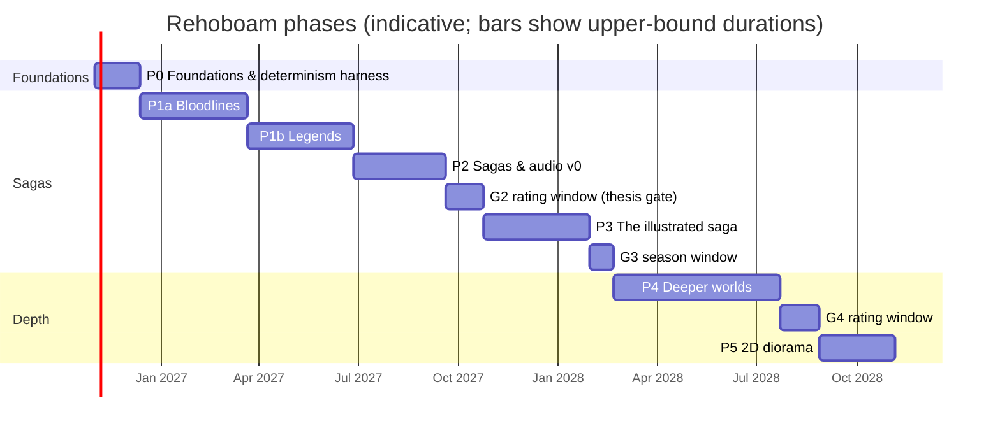

# 11 — Roadmap: Phases, Gates and Work Packages

*Status: Draft v1.6 (2026-10-16). Durations are **agent-assisted estimates for one director working with AI coding agents**. Treat them as planning ranges, not commitments. Every phase ends with a **gate** of verification, validation and a go / iterate / pivot decision (`09`, phase gates). Phases run in order; work inside a phase runs in parallel across agents, up to the limit the review-hours budget allows.*
*v1.6 (2026-10-16): rung 0 drops forks, which come with branching (P2.9); V-SAGA-15's P1a variant measures on the 10k dynastic world (D34).*
*v1.5 (2026-10-16): G0 rulings by the director. Rung 0 is ageing and death on day boundaries: a household's food comes with M3 and M4 in P1b, and daily life at `minutes` is Later (D31). P1.18 (`S5.daily_life` F1) and P1.8 (M1 F1) move to P1b, where the columns they read have owners (D33). P1.7 inherits titles and claims only; property inheritance moves to P1.5a (D35). G1a has one test list, the same as `09` §5, with P1a variants for tests that need systems or worlds P1a does not build; V-SAGA-16's stress-accounting identity gates G1a and its break band gates G1b (D34).*
*v1.4 (2026-10-16): G0 rulings by the director. P0.7 loses the Rerun logging hooks (a Rerun view, if wanted, is a downstream consumer of the World Stream) and the Textual TUI stub, which moves to P1.17. The G0 CI criterion records baselines for benches 7 and 8; bench 4's baseline moves to the first P1a sprint that builds a spatial field (M1 or M3).*
*v1.3 (2026-10-16): **ADR-0035, the saga engine** (ratified by the director the same day). New phases: P1a "Bloodlines", P1b "Legends", P2 "Sagas & audio v0", P3 "The illustrated saga", P4 "Deeper worlds", P5 "2D diorama", then Later / optional. Minds v0 and M7 move into P1a; artifacts, vows, mythic catalysts and secrets v0 are new in P1b; the economy and polity drop to low fidelity until P4; the audio chronicle moves to P2 as an offline exporter, played in a local reader (nothing served or published), and the graphic chronicle is new in P3; the cinematic event envelope joins P1.9 and stress and mental breaks join minds v0. Moved WPs keep their IDs and say where they came from. Custom 3D, Godot and VR WPs are marked **Cut (ADR-0035)**, not deleted.*
*v1.2 (2026-10-16): D27 (ADR-0034): WP P3.12 (deliberation-consult A/B) withdrawn; journals hold push inputs only; LLM-9 joins the gateway.*
*v1.1 changes: P1 split into P1a and P1b and P3 into P3a and P3b; a review-hours budget sized to one human reviewer; numeric thresholds for every gate, fixed before its phase starts; rating windows for G2 and G3b; WPs aligned with ADR-0024–0026.*

---

## Phase map

| Phase | Name | Duration | Gate |
|---|---|---|---|
| P0 | Foundations | 4–6 weeks (unchanged: SPR-001 to SPR-010) | G0 |
| P1a | Bloodlines | 10–14 weeks | G1a |
| P1b | Legends | 10–14 weeks | G1b |
| P2 | Sagas & audio v0 | 10–12 weeks, then the G2 rating window (3–5 weeks) | G2 (thesis) |
| P3 | The illustrated saga | 10–14 weeks, then the G3 season window (2–3 weeks) | G3 |
| P4 | Deeper worlds | 16–22 weeks, then the G4 rating window (3–5 weeks) | G4 |
| P5 | 2D diorama | 8–10 weeks | G5 |
| **Total** | | **≈ 76–105 weeks ≈ 18–24 months** | |
| Later / optional | 1M scale-up, M4 F2, era packs, the lo-fi street-level inhabitant | On your call | — |
| Cut (ADR-0035) | Every custom-3D, Godot and VR WP | — | — |

- **P0 to the G2 decision, the thesis test, takes about 37–51 weeks (9–12 months).** It was 33–47 weeks. Minds and M7 now come before the thesis gate, because the rated items are sagas.
- **P0 to the first season you listen to and read (G3) takes about 49–68 weeks (11–16 months).** Under v1.2 the first narrated saga came after P4, at about 19–25 months.
- **Cross-check.** `14` estimates ≈ 140 person-weeks of build after reuse. ADR-0035 moves ≈ 20–30 pw of economy, polity, war and 3D work out of the early phases and adds ≈ 15–25 pw of saga mechanics and chronicle pipeline (estimates). At ≈ 2–3 concurrent workstreams the totals above still hold.
- **Spikes.** SPK-2 (street from seed) runs before P5, because settlement plans drive the growth view. SPK-1 (crowds) and SPK-3 (application wallpaper) are **Cut (ADR-0035)**.

---

## Review-hours budget

You are the only human reviewer of agent output. **The plan assumes ≤ 6 h/week of your review time outside rating windows** (`12` Q16). Rating windows at gates are counted separately.

**Where the hours go (a typical week):**

| Item | Unit cost | Per week |
|---|---|---|
| WP approval: a one-page WP spec (`13` §2, §5) | 10–15 min | 6–10 WPs → 1–2.5 h |
| Director-route PRs: breaking C2, out-of-tolerance C3, determinism machinery, ADR touches (`13` §4.2) | 30–60 min | 1–3 → 0.5–3 h |
| Spot audit of auto-merged PRs (one per active workstream) | 15–20 min | 2–3 → 0.5–1 h |
| Weekly digest: merged PRs, bench and ensemble trends, perf re-baselines (`08` §9), open risks | 30 min | 0.5 h |

**How work packages are sized to it:**
1. **Small specs.** A WP spec fits on one page and can be approved in ≤ 15 min. A WP is ≤ 3 agent-days (`13` §2).
2. **Auto-merge by default.** Each WP is designed to land through an auto-merge route: C0, C1, additive C2, or C3 within tolerance (`13` §4.2–4.4). A WP expected to need your review is flagged at approval, and at most 2 such WPs are open at once.
3. **Throughput cap.** At most 10 WP approvals a week. That gives ≈ 2–3 concurrent workstreams on average, not the 3–6 that `13` §5 allows. The durations above assume this.
4. **Rating windows replace review time.** During a gate's rating window, nothing that needs your review merges. Agents work only on C0/C1 items (benches, tests, performance, test debt) and on spikes.
5. **Throttling.** If review time exceeds the budget for 2 consecutive weeks, new WP approvals pause until the queue drains (R-25).

**Rating time at gates (outside the weekly budget):**

| Gate | [H] activity | Your time |
|---|---|---|
| G1a | Read the templated family history of 3 seeds | ≈ 2–4 h |
| G1b | Read the run reports and saga digests of 3 seeds | ≈ 3–6 h |
| G2 | Pre-registered protocol (V-HUM-09 in `09`): 10 seeds × 3–4 h of blind rating, re-presentations ≥ 7 days later, ≥ 40 chronicle pairs | **≈ 30–40 h** (3–5-week window) |
| G3 | Listen to and read one season of your world's saga (V-HUM-13), plus the blind saga A/B (V-HUM-05) and the story × narration factorial (V-HUM-12) | **≈ 15–25 h** (2–3-week window) |
| G4 | The G2 protocol with fresh held-out seeds, plus 3 Oracle play sessions | **≈ 30–40 h** (3–5-week window) |
| G5 | Diorama believability sessions | ≈ 6–10 h |

---

## Gate thresholds: numbers before the phase

- **Fixed in advance.** Every gate's numbers are fixed **before its phase starts** and logged in `decisions-log.md`. The numbers below are the defaults; you may change any of them before the phase begins.
- **Mid-phase changes.** A change after the phase has started needs a logged director ruling with a reason. A change after results are seen voids that gate run.
- **G2 is pre-registered.** Its protocol (V-HUM-09 in `09`) is frozen before the first rating (WP P2.13).
- **Test IDs.** Gate bullets cite `09` test IDs, which stay stable when `09` is re-sectioned.

### Coupling thresholds (`05.1` §8; V-COUP in `09`)

A coupling is **possible** when the chain completes in at least *x*% of seeds, and **not forced** when it is absent in at least *y*% (V-COUP). Each ensemble is 32 seeds. Pre-modern runs are 200 years after spin-up, so that "absent" stays meaningful: over 1,000 years almost any possible chain occurs somewhere. Hive runs are 10 years. Gates use point estimates; Clopper–Pearson intervals are reported.

| Test | Coupling | Gate | Run | *x* (possible) | *y* (not forced) |
|---|---|---|---|---|---|
| V-COUP-01 | Famine → unrest → succession crisis, **truncated at regency or civil-war onset** | G1b | 200 y | ≥ 20% | ≥ 20% |
| V-COUP-01 | The same, full chain (armies eat the grain; M8) | G4 | 200 y | ≥ 10% | ≥ 30% |
| V-COUP-02 | Plague → paranoia → purge → labour revolt | G4 | 200 y | ≥ 10% | ≥ 30% |
| V-COUP-03 | Hive detection spiral (a meso hive world; `aethelgard` at full scale waits for P3.10) | G4 | 10 y | ≥ 25% | ≥ 25% |
| V-COUP-04 | Elite overproduction → 40–60-year violence wave (needs M6 F1, P1.6) | G4 | 200 y | ≥ 20% | ≥ 20% |
| V-COUP-05 | Dragon raids → famine pockets, inside the energetics bound | G4 | 200 y | ≥ 20% | ≥ 20% |

The saga mechanics have their own "possible, not forced" test, V-SAGA-10, gated at G1b (below).

---

## P0 — Foundations and determinism harness (≈ 4–6 weeks; unchanged)

**Goal.** Build the skeleton that every later phase leans on. Nothing interesting is simulated yet, but everything is reproducible, measurable and agent-friendly. P0 is planned in full as SPR-001 to SPR-010 (`CODEX/05_PROJECT/BCK-001`).

| WP | Work package | Output |
|---|---|---|
| P0.1 | Repo bootstrap | Cargo workspace (crate stubs per `05.0` §6, including `rh-contracts`), Python package skeletons, `CLAUDE.md`/`AGENTS.md`, CI (fmt, clippy, nextest, cargo-deny, licence checks), architecture lints (dependency graph, plane isolation, flavour asset), merge queue (`13` §4.4) |
| P0.2 | `rh-ids` | Typed IDs, keyed hash `H`, counter RNG (ChaCha8 streams + SplitMix64), branch salts and salt lineage (`05.1` §6.9), genealogical `PersonId` derivation with deterministic collision rehash (ADR-0026) |
| P0.3 | Samplers | Vendored binomial (BTPE + inversion), Poisson (PTRS), normal (ziggurat), Beta/Gamma, each with golden vectors |
| P0.4 | `rh-core` skeleton | `SimTime` (i64 minutes, signed epoch), calendar, pulses, phase order, the `SystemModel` trait, `AccessSpec` conflict checker, derived scheduler (topological order, declared lags), agenda heap for decisions and timers, lifecycle command queues, event bus with `EventDraft`, invariant framework; fixed-point and money types (`rh-core::fixed`, SPR-010) |
| P0.5 | Snapshot and hash | Three plane hashes (chunked Merkle xxh3 with dirty tracking), Arrow IPC keyframe write/read, SQLite journal (push inputs), unsynced guard |
| P0.6 | Golden-run CI | A `smoke` world with dummy systems; hash ladder at thread counts 1/2/4/N; divergence bisect tool v0 (`13` §4.5); nightly cross-platform matrix |
| P0.7 | Benchmark harness | criterion benches and the regression gate (> 10% slowdown fails; no automatic re-baseline, `08` §9); serial-fraction instrumentation. (Rerun logging hooks dropped from P0 and the Textual TUI stub moved to P1.17: director, G0 rulings) |
| P0.8 | Registry v0 | TOML loader, JSON Schema generation, manifest v0 loader (from `specs/manifest`), column-ownership declarations and their lint |

**Gate G0**
- **Determinism** (V-DET-01, V-DET-02): the `smoke` world gives identical plane-A hashes at 1, 2, 4 and N threads and over 3 repeats, every sim-month for 1,000 years.
- **Keyframes** (V-DET-05): write, load, advance 10 years; the result equals a continuous run.
- **Samplers** (V-DET-09): golden vectors are bit-equal.
- **Bisect** (V-DET-11): the divergence bisect tool names the injected month, table and row.
- **Specs** (V-WC-04): `val_khor.yaml` and `aethelgard.yaml` validate and `invalid_draft_style.yaml` fails.
- **Lints** (V-PLN-01, V-DET-19, V-INSP-03): zero violations.
- **CI** (V-PERF-04): per-PR CI runs in ≤ 15 min, and baselines are recorded for benches 7 and 8 (`08` §9). Bench 4's baseline moves to the first P1a sprint that builds a spatial field, M1 or M3 (director, G0 rulings).

---

## Build strategy: generic machinery, one era of content, skeleton first

*(Director's question: "focus the era on one, or generic? Make sure the engine works, then iterate fidelity.")*

1. **The machinery is generic from day one,** because retrofitting it is expensive and building it is cheap:
   - determinism, time, IDs, planes, journal;
   - the Registry and effect language;
   - era-state hooks (ADR-0027) and scale profiles (ADR-0028).
2. **Content and calibration cover one era first: E1 "agrarian"**, meaning every pre-industrial organic economy from antiquity to about 1700. The era is chosen by its mechanics, not its date or place. It covers:
   - the biblical Land of Uz (`uz_job`, micro);
   - feudal kingdoms (the P1b saga worlds; `val_khor` at 100k later);
   - fantasy variants (relics, awakenings, dragons).

   All of them share the same dynastic substrate. E1 has the best data we have verified (R12) and the smallest mechanism set.
3. **The story is the dynasty, not the harvest (ADR-0035).** Demography, harvests, stores and polity are the pressure on the saga, built lean: enough to make famine, unrest and succession crises real, not a full economic history. Effort follows the director's emphasis: about 30% pressure, 40% dynasties, vows, betrayals and relics, 30% sifting and the chronicle.
4. **The complexity ladder (director's ruling D4, 2026-10-16; rung 4 re-aimed by ADR-0035).** Start with the simplest world that exercises the whole engine, and add one kind of complexity per rung. A rung is climbed only when everything on the one below is green: determinism, the World Stream tests, invariants and its own checks.

   | Rung | World | What it adds | What it proves |
   |---|---|---|---|
   | 0 | **`solo`**: one person (Ada), a 64×64 valley, 80 years | Life course (ageing and death on day boundaries), the World Stream, replay. Added on the same world in later phases: a household's food (M3, M4: P1b), virtual telemetry (P1.18: P1b) and daily life at `minutes` (Later) (D31, D33) | The engine loop end to end, with nothing hiding bugs |
   | 1 | `household`: about 5 people | Births, kinship, inheritance, shared stores | Demography and identity (ADR-0026) |
   | 2 | `hamlet`: about 60 (`uz_job` sits here) | Neighbours, named minds, a lordly house and its succession, off-map actors | Minds v0 and dynasties; family-history chronicles |
   | 3 | `village`: about 1k | A local lord, household and lord stores, tribute, the first relic and vow | Saga mechanics at small scale; the first statistical bands |
   | 4 | **kingdom**: about 10k–50k, 200–2,000 named actors | Great houses, polity-lite, succession wars, relic chains, mythic catalysts | Sagas form (G1b); the G2 thesis worlds |
   | Later | `val_khor` (100k), then 1M | Scale | Optional (P3.10) |

   Rungs 0–2 run in P1a, rungs 3–4 in P1b. The same binary runs every rung; only the manifest changes (ADR-0028). **The default saga world is meso.**

5. **Walking skeleton first (WP P1.0), then depth, one system at a time.** Every later WP deepens one system while the whole loop stays green: world → ledger → events → **World Stream** → sifter → text viewer (`rh-cli tail`, later `rh-tui`). Until G2 every view is text (ADR-0030); viewers read the stream at their own pace, actions land at the tip, and the engine never waits for a viewer (PERF-5).
6. **The engine only engines (ADR-0035 §6).** Engine crates hold no presentation, web UI, audio, image, TTS or LLM code. Their only output is the World Stream; their only input is the journal through IF-0. Every presentation tool (the chronicle pipeline, the map export, the offline audio exporter, the local saga reader) is a separate, offline consumer in `python/`; only the P5 diorama lives in `console/`.

---

## P1a — Bloodlines (≈ 10–14 weeks)

**Goal.** A family that lives, loves, dies and inherits on a small map, deterministically, with named minds, and a chronicle that reads as a family history. WP IDs are stable; moved WPs say where they came from.

| WP | Work package | Output |
|---|---|---|
| **P1.0** | **Walking skeleton (first 2–3 weeks)** | The thinnest end-to-end loop at F0. Manifest → `rh-worldgen` stub → ledger (born, ages, dies) → scheduled outcomes → events → chronicle (Parquet) → a trivial sifter pattern → World Stream v0 (channel A) and `rh-cli tail`, the text view of the stream (ADR-0030, `05.10`) → journal replay. Runs first on **`solo`** (rung 0: one person, one tiny valley; ageing and death on day boundaries, D31), then on `household` and `hamlet` on the same binary, with plane hashes in CI from day one. Every later WP must keep this loop green |
| P1.1a | Worldgen-lite (split from P1.1) | Regions, a few settlements, routes and a region graph from a manifest heightmap template; no climate, biome or culture generation yet. The full Azgaar-style P1.1 moves to P4 |
| P1.2 | Population synthesis | Iterative proportional fitting from manifest marginals → ledger. Founders are `H64(seed, "founder", k)`, with pre-epoch births. Great houses with 3-generation genealogies |
| P1.3 | M2 Demography F1 | Age-specific hazards (Brass relational logit on the Brass General Standard, fixed-point odds form, golden vectors in `specs/demography/`), density modifiers (the entitlement hook is stubbed until P1.5a), binomial draws, births by age-specific fertility, **partnering and marriage (fathers)**, households and kinship, genealogical IDs `H64(mother, parity)`, life-course log; dead rows leave the ledger at once. Lean: the dynasty substrate, not a demographic history |
| P1.7 | M7 Succession & dynasts F1 (moved from P1b) | Succession-law enum; competing ruler-exit hazards (murder, deposition, natural) as functions of institutional state, held at the manifest's reference state until M6-lite lands (P1.6a); titles and claims inherited through the death path (property inheritance comes with M4's holdings, P1.5a in P1b: D35); feud stock after a regicide; claims, regencies, great-house dormancy (SIM-9). **Immediate succession** (SAGA-13): a titleholder's death schedules succession arbitration in the same instant, at a later phase (legal heir, claims, military proximity, treasury control), which emits a succession or an interregnum-crisis event. Calibrated to Eisner, Blaydes & Chaney and Kokkonen & Sundell (R12). Gate: V-SAGA-19 |
| P3.2a | Minds v0 (moved from P3.2) | The `T1.minds` system (`rh-minds`; spec written before its sprint): named actors' HEXACO traits, ambition, relationships and opinion modifiers (CK3 style), a needs stub; event-driven IAUS for a few decision types (marry, seek office, press a claim, feud, swear and pursue a goal); same-instant agenda semantics (`05.1` §4.3). **Stress and mental breaks** (inspired by Crusader Kings 3's design; no code taken): stress is a `q8_8` column on a 0–100 scale that rises when a vow, kin loyalty or a value conflicts with the situation (it reads `S7.vows`'s vow-conflict signal from P1b); crossing the Registry threshold is a deterministic transition that schedules the break as a timer at a keyed delay; the act comes from the Registry break table, and stress drops. The full core, HTN, beliefs and memory are P3.2b (P4). Gate: V-SAGA-16 |
| P1.9 | Event emission and Chronicle Writer (moved from P1b) | Typed events, roles, anchored snapshots, causal edges (contingent / motivated_by), Parquet segments including the life-course log, DuckDB read-only views. **The cinematic event envelope** (ADR-0035 §7a; `05.2` §4.1a): event roles for cast and instrument (the S6 artifact used), weather and emotion as anchored snapshots once their systems simulate them, typed motive edges (`RETALIATION_FOR`, `JEALOUSY_OF`, `VOW_OF`, …) to the inciting event; about 35 bytes per event; presentational fields are derived downstream; `cell` coordinates where the world tracks cells and contaminant flags as anchored snapshots. **Provenance of change** (SAGA-15): damage and transformation states store their cause EventId in the value (`Ruin { cause }`, `Scar { cause, site }`); "what last happened here?" is a plane-B index over the Parquet chronicle by place, cell or entity, never a per-tile column. Gate: V-SAGA-15, V-SAGA-21 |
| P2.8a | Family annals v0 (split from P2.8) | Templates for births, marriages, deaths, successions, claims and feuds, rendered from the chronicle with provenance links, so a run reads as a family history. Plane C, in `python/` |
| P1.10 | M9 Validation harness (moved from P1b; v0) | The isolation harness (V-SF-22), the demography and dynasty bands first, censoring-aware lifespans, 32-seed ensembles, the auto-generated run report; the other bands land in P1b |
| P1.13 | Scheduled outcomes and lifecycle queues | Intra-pulse outcome times as agenda timers; lifecycle commands applied in `(phase, PersonId)` order; no back-dating (ADR-0025); `rh-contracts` v0 for the M1/M2/M7 and minds columns |
| P1.14 | Determinism and performance at scale | Golden runs on the M1/M2/M7 world (1,000 years); CRN pairing test (ADR-0026); meso benches (≤ 50k persons, ≤ 2,000 named actors) and `bench/serial_fraction`. The synthetic 1M benches move to Later with P3.10 |
| P1.15 | Registry effect language v0 (moved from P1b) | The typed, total evaluator in `rh-registry` (`05.5` §2.1); succession-law eligibility and ordering; verb effects as queued commands; a golden test |
| P1.17 | World Stream v1 (moved from P1b; ADR-0030, `05.10`) | Channels A and C, `seq` and segments (the Parquet chronicle as the stream at rest), the live edge over a socket, viewer cursors, `stream.subscribe` / `stream.status`, the materializer (keyframe + replay), the pace command, `rh-cli tail` filters (significance, place, person, pattern, regional digest); the Textual TUI stub, a read-only status view over the stream (moved from P0.7). Gate: V-STR-01–03, V-STR-05, V-PERF-09 |

**Gate G1a: a dynasty lives, dies and inherits deterministically, and the templated chronicle reads as a family history.** This is the one G1a test list; `09` §5 lists the same tests. Where a test needs a system or world that P1a does not build, its P1a variant, stated in its `09` row, applies (D34).
- **Determinism** (V-DET-01, V-DET-02, V-DET-12): identical plane-A hashes at 1/2/4/N threads, every sim-month for 1,000 years, on `smoke`, rungs 0–2 and a dynastic fixture world (a few great houses and titles, M6 held at neutral); no back-dating.
- **Invariants** (V-INV-01, V-INV-02, V-INV-03, V-INV-11, V-INV-12): 0 violations over a 1,000-year debug soak, covering population conservation, acyclic genealogy, life-course consistency, valid IDs, one death path (inheritance of titles and claims included) and great houses tracked from world start. P1a variants: V-INV-03 kills through M2, M7 and agenda actions (M5 and M8 are P4); V-INV-12 runs on the dynastic fixture world, not `val_khor`.
- **Identity and life-course** (V-DATA-04, V-DATA-05): every `PersonId` ever emitted has exactly one life-course entry and matches its rule. P1a variant: V-DATA-04 checks identity, parents, death and residence; occupation intervals wait for M4 (P1b).
- **CRN pairing** (V-DET-17): per-person death-time correlation ≥ 0.9 at 10 years for unaffected lineages across a paired fork.
- **Demography bands** (V-SF-01, V-SF-02, V-SF-02b) on a 32-seed ensemble.
- **Isolation** (V-SF-22): M2, M7 and `T1.minds` each pass alone under their declared forcing.
- **Minds** (V-COG-03, V-COG-04): IAUS cadence holds; the first-applied rate is unbiased by entity ID (TOST, δ = ±0.05).
- **Succession** (V-SF-06, V-SF-06b): reported at the reference institutional state; gated at G1b, once M6-lite supplies the state. **Immediate succession** (V-SAGA-19): every titleholder death ends its instant with a successor or a declared interregnum.
- **Envelope** (V-SAGA-15): channel A holds only simulated envelope fields, within the per-event byte budget. P1a variant: the bytes are measured on the 10k dynastic world over 100 years.
- **Stress** (V-SAGA-16): the stress-accounting identity holds exactly, and each threshold crossing schedules exactly one break timer. The break frequency is reported here and gated at G1b, on the kingdom ensemble.
- **Grief cascade** (V-SAGA-16b): on the `T1.minds` isolation fixture court, a murdered sovereign does not start a runaway chain of grief, breaks and deaths; the chain's branching ratio stays inside the bound `T1.minds` declares.
- **Stream** (V-STR-01–V-STR-03, V-STR-05, V-PERF-09). P1a variant: V-PERF-09 runs on the 10k dynastic world with `rh-cli tail`, the TUI stub and a stalled consumer; no hydration bubble and no 100k world.
- **Performance:** 1,000 years of a 10k-person dynastic world with ≤ 500 named actors in ≤ 60 s on 8 cores (default; fixed before P1a); serial share reported.
- **[H] You read the templated family history of 3 seeds.** Pass: "this reads as a family history" for ≥ 2 of 3.

---

## P1b — Legends (≈ 10–14 weeks)

**Goal.** Relics, oaths, curses and secrets, under the pressure of hunger and unrest, in a kingdom of 10k–50k with hundreds of named actors. Sagas form.

| WP | Work package | Output |
|---|---|---|
| **P1.19** | **Artifacts: `S6.artifacts` F1 (new)** | Spec `specs/systems/S6.artifacts.odd.toml` (draft). Unique artifacts with identity, kind, exactly one bearer or location, a fixed-point influence profile and a rumour reach; inheritance through the death path, theft, gifts, loss, finding, forging and destruction; influence on the bearer's mind only as `ApplyInfluence` lifecycle commands to `T1.minds`; events `ARTIFACT_FORGED`, `ARTIFACT_PASSED` (inheritance, theft, gift, trade, loss), `ARTIFACT_USED`, `ARTIFACT_FOUND`, `ARTIFACT_DESTROYED`, `BEARER_CORRUPTED`. **No spontaneous props** (SAGA-12): an origin event for every artifact, an unbroken bearer chain, and physical state (fixed-point charge, condition, contaminant flags, each change storing its cause). Gate: V-SAGA-02, V-SAGA-03, V-SAGA-13, V-SAGA-17, V-SAGA-21, V-SF-22 |
| **P1.20** | **Vows, grudges and quests: `S7.vows` F1 (new)** | Spec `specs/systems/S7.vows.odd.toml` (draft). Vows with vower, kind, target, `sworn_at` and status (active, fulfilled, broken, void); a bounded fixed-point priority into the vower's agenda that never enters a survival decision; strain under pressure and breaking, with opinion, honour and curse hooks; events `VOW_SWORN`, `VOW_FULFILLED`, `VOW_BROKEN`, `VOW_VOIDED`. Gate: V-SAGA-01, V-SAGA-09, V-SAGA-13, V-SF-22 |
| **P1.21** | **Mythic catalysts (new; extends ADR-0028 §3)** | Manifest catalyst kinds `awakening` (an entity wakes at a year), `inheritance` (a relic passes to a named role or kin of a cast member), `prophecy` (a proposition announced to named actors, with no power over outcomes), beside `artifact` and `wager`. Each is an initial condition or a scheduled, journaled material input with a scope; every consequence is simulated (SIM-16, WC-5). Schema and validator changes in `specs/manifest`. Gate: V-SAGA-04, V-SCALE-05 |
| **P1.22** | **Secrets v0 and the information horizon (new)** | Minimal epistemics in `T1.minds` (SAGA-4): every hidden or witnessed act creates a knowledge record held by `{actor, accomplices, witnesses}` (witnesses from S5 co-presence at `blocks` or `minutes`, a keyed witness hazard elsewhere). It spreads only through scheduled outcomes: a discovery timer whose hazard rises with evidence (contaminant marks, a missing item, a body) and patrols; an alarm within the settlement; eyewitness flight; news along the route graph at travel speed; testimony and confession. No actor reacts before it knows. Acoustic physics is deferred. Full epistemics is P3.3 (P4). Gate: V-SAGA-11, V-SAGA-18 |
| **P1.23** | **Fugitives (new)** | After a crime or a mental break, a named actor may become a fugitive (SAGA-14): flight as scheduled moves along the M1 route graph toward a border, a sanctuary or an ally, with an interception hazard per segment from garrisons and patrols, until arrival, capture or death. Movement is owned by `S3.migration` (residence and travel; spec in BCK-001 §3); tile paths only in focus regions and micro worlds. Gate: V-SAGA-20 |
| P1.4 | M3 Harvest F0/F1 | F0: an annual regional yield anomaly with rare multi-year regimes (volcanic shocks among them). F1, where the micro profile needs it: the household's own fields with the two-season portfolio, seed reserve and spoilage (`05.1` §3). Lean: famine pressure, not agronomy |
| P1.5a | M4 Economy F0 (split from P1.5) | Household and lord stores, holdings and wealth; property inherited through the death path (from P1.7, D35); tribute and rents in kind; entitlement against the subsistence floor (feeds M2's entitlement modifier); **stocks of mundane props** (tools, weapons, poisons) from which acts draw through a simulated acquisition event (SAGA-12). **No markets, prices or wages**; P1.5 (F1) moves to P4 |
| P1.6a | M6 Polity-lite (split from P1.6) | Legitimacy, unrest and a revolt hazard per polity; the institutional state M7's hazards read; regional conditions (famine, unrest, war) for S5 and S7. No elite dynamics or Ψ; P1.6 (the structural-demographic core) moves to P4 |
| P1.8 | M1 Regions F1 (moved from P1a, D33) | Route modes and costs, settlement growth. Fugitives (P1.23) are its first consumer; P1a builds only M1 F0, inside worldgen-lite (P1.1a) |
| P1.18 | `S5.daily_life` F1: virtual telemetry (moved from P1a, D33; ADR-0031) | The activity function over the life-course log and regional conditions; `rh-cli where <person> <date>` and `rh-cli who <place> <date>`; `DECISION_TRACE` records for named minds. Its reads of `person.occupation` (M4) and `region.conditions` (M6) have owners only from P1b. Gate: V-STR-07; `specs/stream/selftest_virtual_telemetry.py` behaviour reproduced in Rust |
| P1.11 | Reference manifests | `village` (rung 3), two saga worlds at kingdom scale (rung 4; e.g. `kingdom` and `delta_republic`, each with great houses, relics and a mythic catalyst), and the sealed **held-out manifest** for G2: hand-authored, hash committed, never run before G2 (V-HUM-09). `val_khor` waits for the optional 100k scale-up |
| P1.12 | Python wheel | `rh-py` with the liveness-gate and certification APIs (`05.5` §4.2); marimo calibration notebooks |
| P1.16 | Era-state hooks (ADR-0027) | The era-state vector in the contract crates; every era-sensitive parameter of M2, M4, M6, M7 declared as a Registry function of it (agrarian range calibrated only); the era-label classifier (plane C); a lint that fails if a mechanic reads the label. About 1–2 weeks, mostly interface work |

**Gate G1b: sagas form.**
- **Sagas form** (V-SAGA-10), on the kingdom ensemble (32 seeds × 200 years after spin-up; defaults fixed before P1b):
  - in ≥ 75% of seeds at least one vow is fulfilled and at least one is broken;
  - every vow kind that is sworn ≥ 10 times ends in at least two different terminal states across the ensemble (not forced);
  - relics change hands in ≥ 75% of seeds, through ≥ 2 transfer kinds;
  - ≥ 1 betrayal (a vow broken in betrayal, or a `betray` act against an ally) per seed-century in ≥ 50% of seeds.
- **Saga invariants and micro behaviour** (V-SAGA-01, V-SAGA-02, V-SAGA-03, V-SAGA-04, V-SAGA-09, V-SAGA-11, V-SAGA-13): 0 violations; the micro fixtures behave as declared.
- **Stress breaks** (V-SAGA-16): breaks per 100 named-actor-years inside the band the `T1.minds` spec declares, on the kingdom ensemble (reported at G1a; D34).
- **Ontological truth** (V-SAGA-17, V-SAGA-18, V-SAGA-20, V-SAGA-21): no spontaneous props; no reaction before knowledge; fugitives move continuously on the route graph; every damage or transformation resolves to its cause. 0 violations.
- **Plausibility bands** (MOP-5 on the gate bands of `09` §3.1 under ADR-0035): demography (V-SF-01, V-SF-02, V-SF-02b), dynasty and succession (V-SF-06, V-SF-06b, V-SF-06c, V-SF-07), famine (V-SF-03, V-SF-03a, V-SF-03c, V-SF-20b). ≥ 90% pass, every identity band passes, no held-out band fails definitively. The economic-history bands are reported, not gated.
- **Isolation and sweep:** V-SF-22 for every P1 system (M1, M2, M3, M4 F0, M6-lite, M7, `T1.minds`, S5, S6, S7); V-SF-23 reported.
- **Coupling:** V-COUP-01 (truncated) meets its thresholds above.
- **Invariants** (V-INV-02, V-INV-03, V-INV-12): 0 violations over 1,000 years.
- **Liveness gate and certification** (V-WC-05, V-WC-07, V-PERF-07; `08` §2) on the kingdom world: liveness ≤ 90 s wall on 8 cores (target 60 s); certification ≤ 30 min wall (target 20 min).
- **MOP-1** (V-PERF-01): 1,000 years of the kingdom world in ≤ 2 min on 8 cores. PERF-2 for the optional 1M scale-up is set from the P1 measurements and logged.
- **[H] You read the run reports and saga digests of 3 seeds** and judge whether "sagas happen". Pass: yes for ≥ 2 of 3.

---

## P2 — Sagas & audio v0: the thesis test (≈ 10–12 weeks, then the G2 rating window)

**Goal.** Watch centuries pass in the keyboard Time-Machine, get stopped at the moments that matter, understand why each one happened, and listen to the chronicle as local audio chapters in the reader.

| WP | Work package | Output |
|---|---|---|
| P2.1 | Pattern DSL v1 | TOML surface, compiler, anchoring lint, act-class, role and attribute vocabularies |
| P2.2 | Live sifter | Partial-match automata, declarative pruning, declared match semantics (selection, on_complete, dedupe), match events, suspense with its rate limiter, auto-pause signal (`05.4` §2.3) |
| P2.3 | SQL twins + twin CI | DuckDB equivalents for every pattern; clustered recorded-chronicle fixtures |
| P2.4 | Pattern packs v1: **saga packs** | Vow arcs (sworn → pursued → fulfilled or broken or lapsed), relic chains, revenge, betrayal, succession war, the corrupted bearer; plus famine, reversal and irony. About 25–30 patterns, each with a firing-rate budget. Bad-run metric (MOE-6) wired into the liveness gate. Gate: V-SAGA-05 |
| P2.5 | Significance v1 | Components, per-era recompute, bounded hindsight retention, per-timeline visibility sidecar (plane C), rarity base rates |
| P2.6 | `rh-server` v1 | Timelines (run, pause, read-only seek, fork); keyframe service (10-year permanent keyframes, yearly LRU with a RAM tier, capture at auto-pause); the IF-0 control and stream endpoint; Arrow data endpoints. No presentation serving (ADR-0035 §6) |
| P2.7 | Time-Machine harness v1 (text; ADR-0030) | Tip and scheduled inputs over `control.sock` (STR-4; moved from P1.17 by D47, 2026-10-17). `rh-tui` over the World Stream: status line (tip, pace, cursor, lag), Watch and Play styles, Time-Machine (speed bands, run-until, overview and detail lanes as text), ASCII map, causal inspector as an ancestor tree, person/place views, Annals, rating form. Cultivator mode only |
| P2.8 | Annals and Chronicle (templated) | Extends P2.8a: grouped saga arcs (by vow, relic and house) with causal "because" clauses; episode and season texts for the audio chronicle; provenance links |
| P2.9 | Branching | What-if forks with override inputs; material-input dependency scopes with timer cancel and re-sample; acting in the past forks (ADR-0025); timeline diff view |
| P2.10 | Facts ledger v1 | Pins and `facts_ledger` (plane B, `05.2` §3.3), written on `entity.*` display; MOE-3 re-open probe (DATA-7) |
| P2.11 | Save versioning | Arrow-schema versioning, keyframe migrations, and the save-compatibility corpus in CI (DET-10, MOE-4) |
| P2.12 | Observer invariance and plane isolation | Three plane hashes recorded per timeline; harness fuzz of pins, facts and inspections with `state_hash` unchanged (DET-6, binding from P2); read-set checks against the Registry's plane tags (`05.5` §2) |
| P2.13 | G2 protocol and rating instrumentation | The pre-registered protocol (V-HUM-09 in `09`): frozen build, Registry version, held-out manifest hash, seed derivation, pause thresholds, preference-model hash, presentation order and analysis script, logged before the first rating; blind interleaving of arms; intra-rater re-presentation; blind chronicle-pair generator for MOE-2; **the rated items are sagas**; the saga-mechanics ablation arm, report only (V-SAGA-06) |
| P2.14 | Coupling-ablation harness | The G2 and MOE-2 baseline arm (V-HUM-09): every cross-system contract read is served from an independent seed's recorded run of the same manifest. Plus the **saga-mechanics switch** (S6 and S7 off) for V-SAGA-06. Test-harness features only, never available in play |
| P3.9a | LLM gateway core (split from P3.9) | `python/rehoboam_llm`: job API, provider adapters, request/response logging, budgets; narrator and QA job kinds only, `tts.*` and `asr.*` first (LLM-1, LLM-9). Outside the engine (ADR-0034, ADR-0035 §6) |
| P4.7a | Offline audio exporter v0 (moved from P4.7, simplified) | A Python tool reads the chronicle, renders each episode's templated text with one narrator voice (Kokoro-82M on the CPU, to be evaluated; `05.11`), mixes ambience beds, and writes local MP3 chapters with a VTT transcript; ASR round-trip gate per line; loudness −16 LUFS; text-only fallback for a line that fails. Gate: V-SAGA-07, V-AUD-03, V-AUD-04 |
| P2.15 | Saga reader v0: the offline audio reader (new) | The first slice of the local Web Graphic Novel / Storyboard Reader (`python/rehoboam_reader`, static pages opened from a local folder): the episode list, the MP3 chapter player, the episode text with every sentence linked to its events. It never calls the engine. Gate: V-SAGA-12 |
| P2.16 | Azgaar export (candidate, new) | An offline exporter from the sealed chronicle's region graph and province state to an Azgaar Fantasy Map Generator map file, for an instant browser map with borders, rivers and relief. Taken up if the review budget allows |

**Gate G2 (the thesis gate).** The decision rule is the pre-registered protocol V-HUM-09 in `09`, fixed before P2 starts. 10 seeds (7 on the tuned saga manifests, 3 on the held-out manifest), 2 simulated centuries per seed, the engine against its coupling-ablated baseline, rated blind on template-only text (≈ 3–4 h per seed). **The rated items are sagas.**
- **[H] Pass criterion** (primary analysis, default pause selection):
  - the lower 80% bound of the mean treatment rating is ≥ 2.5 on the 1–5 scale; **and**
  - the lower 80% bound of the paired difference, treatment minus coupling-ablated, is > 0.
- **Diversity guard:** no single pattern family accounts for more than 40% of the treatment items rated ≥ 4. Vow arcs are one family, so sagas cannot pass on vows alone.
- **Saga-mechanics ablation** (V-SAGA-06): the same seeds with S6 and S7 off, rated in the same blind sessions; the paired difference is **reported, not gated**.
- **Validity:** intra-rater κ ≥ 0.4, blinding intact, no protocol deviation. Otherwise the run is void and repeated.
- **[H] P2 targets of `01`** (V-HUM-01–V-HUM-03):
  - MOE-1: ≥ 3 events rated ≥ 4 per century (median over seeds), precision ≥ 0.5, within the pause budget of ≤ 10 auto-pauses per century;
  - MOE-2: the V-HUM-02 rule on ≥ 40 blind pairs;
  - MOE-6: bad-run rate < 10% on 32 seeds (point estimate; the Clopper–Pearson interval is reported).
- **P2 verification suites green:**
  - MOP-3 scrub < 100 ms (V-TM-03);
  - MOP-4 drop-in ≤ 10 s worst case on the G2 worlds (V-TM-04; `08` §2);
  - PERF-3: the live sifter adds ≤ 10% to run time on the G2 worlds (V-PERF-03);
  - twin equivalence and firing-rate budgets (V-SIFT-01, V-SIFT-03, V-SAGA-05), with precision@K reported (V-SIFT-04);
  - observer invariance (V-DET-06, V-PLN-03, V-PLN-05, V-TM-10): 0 `state_hash` changes;
  - acting in the past and input scope (V-DET-13, V-DET-14);
  - save compatibility (V-GOLD-04);
  - the offline audio exporter and reader v0 (V-SAGA-07, V-SAGA-12; V-LLM-11 for the gateway core).
- **If G2 fails, iterate inside P1/P2: couplings, vows, relics, contingent unlocking, patterns. Do not start the illustrated saga (P3).**

---

## P3 — The illustrated saga (≈ 10–14 weeks, then the G3 season window)

**Goal.** Listen to your world's saga as a multi-voice drama, read it as prose and as an illustrated graphic chronicle, and scrub its causal timeline. Everything in P3 is plane C, downstream of the engine (`05.11`).

| WP | Work package | Output |
|---|---|---|
| P4.1 | Digest and story-shape gate (moved from P4) | Epoch digest builder; gate heuristics |
| P4.2 | Pipeline stages 1–9 (moved from P4) | Selection, plan, bible, beats, scenes (batch), QA (graph + NLI), critique, book pass, exporters (EPUB/MD/Fountain/TTS manifest). **Saga, chronicle and biography forms first;** the novel stays behind the story-shape gate |
| P4.3 | Style cards v1 (moved from P4) | Five prose cards with public-domain exemplars and stylometric metrics, plus **the first visual style card, `dark_fantasy_ink`** (`05.11` §5) |
| P4.4 | In-world documents (moved from P4) | Biased-narrator documents with provenance |
| P4.5 | NOVEL-20 eval (moved from P4) | Fixed epochs, metrics, judge harness |
| P4.7 | Audio drama, multi-voice (moved from P4; extends P4.7a) | Voice bible; per-actor designed voices (Chatterbox or Qwen3-TTS, to be evaluated); narrator plus dialogue lines; ASR and speaker-similarity gates; ambience beds and one-shots from CC0 or CC-BY libraries in the provenance ledger; mastering; local MP3 chapters for the reader |
| P4.8 | Offline mode (moved from P4) | A local or template fallback for every narrator job kind; the full offline read-and-listen test (LLM-8) |
| P3.9a | LLM gateway core (continued from P2) | Narrator and QA job kinds for prose, storyboards and images: `chronicle.polish`, `novel.*`, `docs.inworld`, `storyboard.*`, `image.*`, `qa.*`; structured outputs (LLM-3) |
| P3.16 | Storyboard scripts and visual DNA (new) | The sifter's climaxes become storyboard scripts (`05.11` §4 schema): four panels per scene (staging, confrontation, climax, consequence) filled from the event envelope, with deterministic cast lists; visual DNA for every named actor, a pure plane-C function (`05.11` §5); panels first rendered without an image model, as text-and-tile panels (Kenney tiles and glyphs). Gate: V-SAGA-14 |
| P3.17 | Panel images (new) | Asynchronous batch rendering after a saga is compiled, through the serverless image route you choose (D29); panel 0 is each protagonist's canonical character sheet, and later panels are conditioned on it (InstantID, PuLID and IP-Adapter evaluated); provenance and a cache per panel; the consistency report. Gate: V-SAGA-08 (report) |
| P3.18 | Web Graphic Novel / Storyboard Reader (new; extends P2.15) | `python/rehoboam_reader`: the local reader, the only presentation surface for sagas, generated from the sealed chronicle and the pipeline's outputs. Storyboards and panels, prose, audio chapters with transcripts, and the **causal timeline** (scrub, click a panel or sentence through to its events). Opened from a local folder; it never calls the engine |

**Gate G3: you listen to and read a season of your world's saga.**
- **[H] The season** (V-HUM-13): one season (a simulated century of one saga world, 6–10 episodes) as audio drama, prose and graphic chronicle. Pass: median episode rating ≥ 4 on "I want the next episode", and ≥ 70% of episodes rated ≥ 3 (defaults; fixed before P3).
- **Canon** (V-NAR-01, V-NAR-02, V-NAR-08): 0 CT0/CT1 contradictions and 0 CT3 inventions on NOVEL-20; backbone coverage ≥ 95%; 0 epistemic leaks.
- **[H] Blind saga A/B** (V-HUM-05) against an ungrounded baseline, 10 pairs: Rehoboam preferred on coherence and on surprise in ≥ 7 of 10 each, and on engagement in ≥ 5 of 10.
- **[H] Story × narration factorial** (V-HUM-12): reported before any claim that narration adds value.
- **Audio** (V-SAGA-07, V-AUD-03, V-AUD-04, V-AUD-07): every line passes the ASR gate or falls back to text; loudness and export valid.
- **Graphic chronicle** (V-SAGA-08, V-SAGA-14): the consistency report is produced; visual DNA is deterministic and leaves `state_hash` unchanged.
- **LLM-8** (V-LLM-10): the full offline read-and-listen test passes on templates alone.

---

## P4 — Deeper worlds (≈ 16–22 weeks, then the G4 rating window)

**Goal.** People who know different things, in a world with plague, war, markets, culture and dragons, and an Oracle who can act. The Architect may split P4 into P4a and P4b when planning it.

| WP | Work package | Output |
|---|---|---|
| P3.1 | M5 Contagion F1 (moved from P3a) | Metapopulation SEIRS (Euler-multinomial), radiation mobility, fear coupling, testing (se/sp), covert compartment; per-person status consistent with the counts |
| P3.2b | `rh-minds` v1 (rest of P3.2) | Full psychological core, overlays (in the effect language), IAUS + HTN, Thoughts, ACT-R memory; light minds as pure functions of plane A |
| P3.3 | Epistemics v1 (moved from P3a; extends P1.22) | Bounded belief stores (T1 only), channels (including hive), distortion operators, ToM for flagged propositions, sparse Bayesian suspicion, impossible-knowledge events; knowledge rows and diffusion fronts (`05.2` §4.1) |
| P3.4 | Hive and mimics (moved from P3a) | Hive objective, mimic cover utility, tells, detection spiral |
| P3.5 | M8 Campaign war F1 (moved from P3a) | War onset hazard (force ratio × contagion, no global cooldown); war aggregation as space-time components; supply, attrition, Helmbold battles, sieges, camp disease; severity emerges from escalation (R12) |
| P1.5 | M4 Economy F1 (moved from P1b) | 6–8 goods, regional markets, price rule, arbitrage, wages/rents/taxes, entitlement; above the P1.5a stores |
| P1.6 | M6 Polity F1 (moved from P1b) | Structural-demographic core: elites, fiscal state, legitimacy, Ψ, instability with overshoot; Granovetter revolts |
| P1.1 | `rh-worldgen` v1 (moved from P1a) | Azgaar-style world generation: Voronoi, heightmap templates, climate, rivers, biomes, cultures, burgs, states, Urquhart routes |
| P3.14 | Endogenous institutions (ADR-0027; moved from P3a) | The Registry institution-transition graph; adoption by emulation, reform under fiscal stress, regime change after breakdown; transitions as events with causal edges |
| P3.6 | Should-systems: S1.culture, S2.technology, S3.migration, S4.ecology (moved from P3a) | Religion and ideology, technology diffusion, migration, ecology (dragons as T1 with energetics) |
| P3.15 | `S5.daily_life` F2: authoritative `blocks` (ADR-0031; moved from P3a) | Focus regions and micro worlds at `blocks`: encounters as plane-A `ENCOUNTER` events; the migration path for changing a region's resolution. Gate: V-STR-06, V-STR-08 |
| P3.11 | Reference worlds (moved from P3a) | Dragons and a hive in the saga worlds; `aethelgard` and `val_khor` at full scale wait for P3.10 |
| P3.7 | Oracle and its verbs (moved from P3b) | Oracle entity with its own belief store; Cultivator and Oracle modes (`05.3` §6.2); movement and travel; Whisper (the gateway parses; the simulation grounds, scores, shows and applies); Pierce; Omen; Ward |
| P3.8 | Foresight (moved from P3b) | Prophecy DSL, rollout workers, belief-resampled forks in Oracle mode, Wilson CI, failure-path clustering, common-random-number A/B, validity tests (`05.3` §7.6) |
| P3.9 | LLM gateway v1: translators (rest of P3.9) | Journaling of translated inputs; translator job kinds; the LLM-9 check; structured generation with Registry enums (LLM-2/3); ARG-300 eval; red-team corpus (LLM-6/7) |
| P3.12 | **Withdrawn (ADR-0034).** Was: the deliberation-consult A/B | Retired by D27 |
| P3.13 | Persuasion balance (moved from P3b) | Leverage bands, parameter sweeps, and the adversarial player bot as a CI gate (`05.3` §6.3) |
| P4.6 | World compiler (moved from P4) | Intent schema, mapping table, expander, validators, liveness gate with deterministic calibration repair and background certification (`05.5` §4.2), LLM repair loop for schema and semantic errors only, gap reports (`data_only` / `needs_code`); INTENT-100 with its adversarial subset |

**Gate G4** (the v1.2 G3a, G3b and the world-compiler part of G4)
- **Couplings:** the full V-COUP-01, and V-COUP-02 to V-COUP-05, meet their thresholds above. They must be emergent, not forced.
- **MOP-5** (V-SF): ≥ 90% of all gate bands pass and every gate identity band passes, now including V-SF-03d, V-SF-04, V-SF-04b, V-SF-05, V-SF-09 (α ∈ [1.3, 1.9]), V-SF-09b, V-SF-09c and V-SF-12.
- **Cognition and epistemics** (V-COG-01–V-COG-08, V-DATA-06): green; knowledge fronts agree exactly with the brute-force reference.
- **Ecology** (V-INV-13): predator biomass never exceeds the energetics bound.
- **Knowledge volume** (V-DATA-12, V-PERF-08) at the largest world run in P4.
- **[H] MOE-1 ≥ 6 events rated ≥ 4 per century** (V-HUM-01), median over 10 seeds, with precision ≥ 0.7 and ≤ 10 auto-pauses per century, under the G2 protocol with fresh held-out seeds.
- **[H] Oracle play** (V-HUM-07): 3 sessions of about 1 h; "whispers feel consequential but not controlling" ≥ 4/5 in ≥ 2 of them.
- **Foresight validity** (V-FOR-01–V-FOR-03) on a panel of ≥ 200 back-test predicates; **Oracle mode** (V-ORA-09, V-ORA-10): 0 leaks.
- **LLM-facing** (V-LLM-02, V-LLM-03, V-LLM-11): ARG-300 field F1 ≥ 0.85 and meta-instruction recall ≥ 0.95; red-team corpus within caps; replay with the gateway disabled gives equal hashes.
- **Persuasion** (V-ORA-07, V-ORA-08).
- **World compiler** (V-WC-01, V-WC-02, V-WC-13, V-WC-10): INTENT-100 template ≥ 90%, validity after repair ≥ 98%, gap recall ≥ 0.9, silent approximation ≤ 5%; ≥ 3 gap reports turned into merged Registry entries, at least 1 `data_only`.
- **Preference model** (V-HUM-10): hold-out Spearman ρ ≥ 0.4.

---

## P5 — 2D diorama (≈ 8–10 weeks; ADR-0029, ADR-0035)

**Goal.** An ambient 2D view of the world to glance at: glyphs and CC0 tiles, a map, and settlements growing over centuries. It lives in `console/` and reads the stream; it never calls back into the engine.

| WP | Work package | Output |
|---|---|---|
| P5.1 | Glyph layer | deck.gl `GlyphGridLayer` (instanced quads, CP437 atlas, palette indices, IF-4 binary attributes), started from `IconLayer`; shader pattern ported from wglt (MIT, code only) |
| P5.2 | World and settlement glyph tiles | `map.glyph_tiles` from regional aggregates and the chronicle (Z0); `rh-worldgen` settlement plans rasterised to glyph chunks, cached by settlement × generator version × override epoch (Z1) |
| P5.3 | Street glyph LoD | `bubble.subscribe(..., lod_profile: "glyph")`; cell snapping; one glyph per cell (named first) plus a count badge; ░▒▓ crowd shading |
| P5.4 | Binary state plane | Interest management and deltas; the TypeScript IF-4 decoder |
| P5.5 | 2D camera director | Vantage scoring from `05.7` §C3 applied to glyph views; slow cuts |
| P5.6 | Systemic audio (minimal) | Ambience beds and one-shots from AudioTelemetry, mixed in the browser; mute when hidden |
| P5.7 | Wallpaper | A web wallpaper package (pause when covered, 10–15 FPS cap); the Linux host is chosen at P5 (`12` Q★3) |
| P5.8 | Glyph packs v1 | Pack format and CI lint (every Registry presentation key mapped); `medieval` pack from Bitlands (CC-BY 4.0); `ancient` pack for `uz_job`; Unscii panels |
| P5.9 | Replay mode | The Diorama renders a computed history (laptop-friendly) |
| P5.10 | Kenney CC0 tile packs (new) | A tile-pack format beside the glyph packs, keyed by the same Registry IDs; Kenney 2D packs (CC0; licence archived on download); the same layer draws glyphs or tiles |
| P5.11 | Settlement growth view (new) | A SimCity-style time-lapse of a settlement growing over centuries from its plan and the chronicle's overrides (fires, new keeps), scrubbable on the causal timeline |
| P5.12 | Watabou settlement layouts (candidate, new) | Watabou's Medieval Fantasy City Generator (GPL-3.0; allowed in personal-use mode) run out of process as a presentation-only layout source, seeded `H(world_seed, settlement_id)`; compared with `rh-worldgen` plans |
| P7.1 | 2D travel map (moved from P7) | The Z0 strategic map with time compression; Oracle verbs from the map |
| ∥ SPK-2 | Street-from-seed spike (moved; runs before P5.11) | Same town on two machines; > 90% of buildings stable under growth |

**Gate G5**
- **Glyph and tile performance** (V-R3D-10): ≥ 10k cells at 60 FPS on the reference laptop iGPU in the browser; ≤ 15 FPS and ≈ 0 work when the wallpaper is covered.
- **The client decides nothing** (V-R3D-11): no FOV, pathing or randomness in client code (lint); identical frames for identical server streams.
- **Pack completeness** (V-R3D-12): every Registry presentation key mapped in each glyph and tile pack.
- **Settlements** (V-R3D-01, SPK-2): stable towns under growth.
- **DET-6, passive viewing** (V-DET-07): 0 `state_hash` changes with the Diorama attached for 100 sim-years.
- **[H] Diorama believability** (V-HUM-06): ≤ 2 "fake" moments per 30-minute session, averaged over the last 3 sessions, with a falling trend.

---

## Later / optional

These keep their WP IDs. Each needs your decision to enter a phase.

| WP | Work package | Why later |
|---|---|---|
| P3.10 | Scale-up to 1M (moved from P3b) | The default saga world is meso. 1M optimisation, PERF-1 and PERF-2 at 1M, Foresight batch at 1M (`08` §1, §3); `val_khor` (100k) and `aethelgard` (1M) at full scale |
| P5.0 | M4.economy F2 | Household budgets and stocks, credit; needed only by street-level errands |
| P6.1–P6.7 | The lo-fi street-level inhabitant (old P6) | Hydration bubble, schedules and errands, dialogue (LLM-4, LLM-5), local model selection (RP-200), speech, interiors, avatar and investigation templates. These are 2D and text, not 3D, so they are not cut; but they serve a player, and you are a reader and listener. Gates G6 and V-HUM-04 (voice) apply if taken up |
| P7.2 | Oracle verbs in glyph scenes, the prophecy loop, accessibility polish (rest of old P7) | Follows P6 if taken up; G7 (V-HUM-08) applies then |
| E2–E5 | Era packs | Below |

## Cut (ADR-0035)

Kept here so the IDs are not reused.

| Item | Was | Status |
|---|---|---|
| Art phase 2: the Godot 3D client | `rh-godot`, terrain and towns, crowd LoD, art bible, the WorkerW host, Oracle-3D (ADR-0018; `05.7` Part B) | **Cut (ADR-0035)** |
| SPK-1 | Crowds spike (3D) | **Cut (ADR-0035)** |
| SPK-3 | Application-wallpaper power spike (3D) | **Cut (ADR-0035)** |
| Per-era 3D art packs | Architecture kits, clothing, vehicles | **Cut (ADR-0035)** |
| Any VR or street-level 3D view | Never planned as a WP; excluded permanently | **Cut (ADR-0035)** |

---

## Requirement phases

The phase in which each requirement group in `03` becomes binding, and the WP that delivers it. Every requirement points at a WP; withdrawn ones say so.

| Requirement | Binding from | Delivered by |
|---|---|---|
| SIM-3: M1 (F0), M2, M7, M9 / M1 F1, M3 (F0/F1), M4 (F0), M6 (lite) / M4 F1, M6 F1, M5, M8 | P1a / P1b / P4 | P1.1a, P1.3, P1.7, P1.10 / P1.8 (D33), P1.4, P1.5a, P1.6a / P1.5, P1.6, P3.1, P3.5 |
| SIM-7 agenda; SIM-9 great houses | P1a | P3.2a; P1.7 |
| SIM-12 should-have systems | P4 | P3.6 |
| SIM-14 endogenous institutions | P4 | P3.14 |
| SIM-16 agentive catalysts | P1b | P1.21 |
| SAGA-1 artifacts | P1b | P1.19 |
| SAGA-2 vows, grudges and quests | P1b | P1.20 |
| SAGA-3 mythic catalysts | P1b | P1.21 |
| SAGA-4 secrets v0 and the information horizon | P1b | P1.22 |
| SAGA-5 audio chronicle | P2 (narration) / P3 (drama) | P4.7a / P4.7 |
| SAGA-6 graphic chronicle | P3 | P3.16, P3.17 |
| SAGA-7 local saga reader | P2 (audio reader) / P3 (graphic novel) | P2.15 / P3.18 |
| SAGA-8 saga pattern packs | P2 | P2.4 |
| SAGA-9 visual DNA | P3 | P3.16 |
| SAGA-10 cinematic event envelope | P1a | P1.9 |
| SAGA-11 stress and mental breaks | P1a | P3.2a |
| SAGA-12 no spontaneous props | P1b | P1.19, P1.5a |
| SAGA-13 immediate succession | P1a | P1.7 |
| SAGA-14 fugitives | P1b | P1.23 |
| SAGA-15 provenance of change | P1a (envelope, index) / P1b (artifacts) | P1.9 / P1.19 |
| DET-6 observer invariance | **P2** (harnesses and inspection); P5 (passive diorama); Later (live hydration) | P2.12; G5; P6.1 |
| DET-12 three planes | P0 (lints, hashes); P2 (fuzz) | P0.1, P0.5; P2.12 |
| DET-13 no back-dating | P0 (core); P1a (scheduled outcomes) | P0.4; P1.13 |
| DET-14 acting in the past, input scope | P2 | P2.9 |
| DET-15 pull inputs: **withdrawn (ADR-0034)** | — | — |
| DATA-2, DATA-3, DATA-5 causal edges, snapshots, event rows | P1a | P1.9 |
| DATA-8 life-course log, genealogical IDs | P1a | P0.2, P1.3 |
| DATA-9 knowledge fronts | P4 | P3.3 |
| STR-1–STR-3 World Stream / STR-6 virtual telemetry | P1a / P1b (D33) | P1.0, P1.17 / P1.18 |
| STR-7 activity resolution | P4 | P3.15 |
| SIFT-8 match semantics and budgets | P2 | P2.2–P2.4 |
| DET-8 keyframe cadence and LRU | P2 | P2.6 |
| DET-10 save versioning | P2 | P2.11 |
| DATA-7 facts ledger | P2 | P2.10 |
| COG-1, COG-3 v0 (traits, opinions, IAUS) | P1a | P3.2a |
| COG-2 overlays (those artifacts and vows use) | P1b | P3.2a, P1.19 |
| COG-1, COG-3 full (core, HTN); COG-4–COG-7 | P4 | P3.2b, P3.3, P3.4 |
| COG-8 deliberation consults: **withdrawn (ADR-0034)** | — | — |
| LLM-1, LLM-9 gateway core; LLMs never decide | P2 | P3.9a |
| LLM-3 structured outputs | P3 | P3.9a, P4.2 |
| LLM-8 offline | P3 | P4.8 |
| LLM-2, LLM-6, LLM-7 translators, parser, red-team corpus | P4 | P3.9, P3.7 |
| LLM-4, LLM-5 TTFT, belief-scoped dialogue | Later | P6.3, P6.4 |
| NAR-1 Annals and templated Chronicle | P1a (family annals) / P2 | P2.8a / P2.8 |
| NAR-1 other forms; NAR-2–NAR-5 | P3 | P4.1–P4.5 |
| WC-3, WC-4 compile pipeline, gap reports | P4 | P4.6 |
| ORA-1–ORA-6, ORA-8, ORA-9; SEC-1 | P4 | P3.7, P3.8, P3.13 |
| ORA-7 Oracle-3D: **withdrawn (ADR-0035)** | — | — (the 2D travel map is P7.1) |
| AUD-1 systemic ambience | P5 | P5.6 |
| AUD-3 audio drama | P2 (narration) / P3 | P4.7a / P4.7 |
| AUD-2, AUD-4 NPC speech, voice latency | Later | P6.5 |
| R3D-2, R3D-7, R3D-8, R3D-10 settlements, camera director, replay, glyph and tile client | P5 | SPK-2, P5.11; P5.5; P5.9; P5.1–P5.10 |
| R3D-4, R3D-9 hydration rings, investigation templates | Later | P6.1, P6.7 |
| R3D-1, R3D-3, R3D-5, R3D-6 (3D client): **withdrawn (ADR-0035)** | — | — |
| PERF-1 / PERF-2 / PERF-3 | P1b (meso) / Later (1M) / P2 | G1b; P3.10; G2 |
| EVO-3 fidelity levels | P1b (per-level bands) / P1b–P4 (first second level) | P1.10; P1.4 or P1.5 |
| EVO-4 the engine only engines | P1a | BCK-002 A-14 (lint rule) |

---

## Continuous tracks (all phases)

- **Fidelity ladder.** Gap reports and F(n) → F(n+1) upgrades run as work packages, each gated by the EVO-3 consistency tests (no ratchet: `05.1` §3).
- **Era packs (ADR-0027; Later).** Each pack extends the technology frontier with Registry entries, era-state functions calibrated at the new range, system extensions, era-conditioned bands and a hindcast test (V-ERA). Existing worlds waiting at the frontier continue through a migration keyframe. Indicative order and timing (each about 6–10 weeks, after G4, inside the review-hours budget):

  | Pack | Adds | Earliest start | Key sources |
  |---|---|---|---|
  | E1 Agrarian (baseline) | Everything in P1–P4 | — | Reading list Tier A |
  | E2 Early modern | Gunpowder and fortification, print, the fiscal-military state (excise taxes and funded debt raise revenue capacity), absolutism and early parliaments, overseas trade, policing | After G4 | Tilly 1990; Dincecco 2009; Goldstone 1991 (Ch. 3 §C); Allen 2001 (hindcast V-ERA-08: the 1500–1750 wage divergence) |
  | E3 Industrial transition | Fossil energy, factories absorbing surplus labour, rail, steam shipping and fertiliser decoupling local grain prices from local population, telegraph, the mortality decline then the fertility decline (elite birth limitation first), urbanisation, office growth, franchise extension and power sharing | After E2 | Allen 2009; Wrigley 2010; Lee 2003; Galor & Weil 2000; Acemoglu & Robinson 2000; Goldstone 1991 (pp. 288–338, 460–461) |
  | E4 Modern | Electrification, mass politics and media, modern medicine, industrial and total war, coups and assassination | After E3 | Archigos; Powell & Thyne 2011; Goldstone et al. 2010; Turchin 2016; Braumoeller 2019 |
  | E5 Contemporary and beyond | Digital communication, contemporary demography; speculative and fantasy frontiers as declared Registry paths | After E4 | Per world |

  **Order (director, provisional): E2 → E3 → E4.**

  **Scope guardrails.** These keep the packs from swamping the sagas.
  1. **Nothing era-specific before G2** except the P1.16 hooks (1–2 weeks). The thesis is tested on agrarian worlds only.
  2. **A pack is simulation + Chronicle + Time-Machine + a glyph or tile pack** (a few days per era). Per-era 3D content is cut (ADR-0035).
  3. **Minimum transition set.** A pack implements only the mechanisms needed to cross its transition plausibly (for E2/E3, Goldstone's damping list in R12 §8), validated by at most 10 era-conditioned bands plus one hindcast. Completeness is not a goal.
  4. **Population target 1 → 1M per world** (ADR-0028), with the meso saga world as the default (ADR-0035). National-scale modernity is a stretch goal, not a requirement.
  5. **Cognition stays at 1–5k named actors.** Collective actors (parties, firms, unions, newspapers) arrive as M6 F2 factions in E4, not as more minds.
  6. **Kill criterion per pack.** If the hindcast cannot be passed within the pack's upper estimate plus 50%, ship what works with the frontier left where it was, and file the gap. Worlds wait at the frontier; nothing breaks.

  **Effort (sim-only, agent-assisted, within the review budget):**

  | Pack | Estimate | Why |
  |---|---|---|
  | E2 Early modern | 8–12 weeks | Mostly new Registry entries and fiscal-military mechanisms on existing systems |
  | E3 Industrial transition | **12–20 weeks; research-grade** | The demographic transition, escape from the Malthusian regime, an energy sector and 5–30× population growth. This is the hardest single item after G4 |
  | E4 Modern | 10–16 weeks | Mass politics, media channels, modern medicine and war, collective actors |
  | **Total** | **30–48 weeks** | Calendar after G4, on your call |

  The Time-Machine and the chronicle work in every era from the day a pack lands, because they read events, not art.
- **Review-hours tracking.** Actual review time against the ≤ 6 h/week budget, reported in the weekly digest.
- **Technology radar refresh** every quarter (`07` §3), including image and TTS models and serverless prices.
- **Risk review** at every gate (`10`).
- **Model re-evaluation** every quarter: ARG-300, INTENT-100, NOVEL-20, and from P3 the panel-consistency set (V-SAGA-08).

## Kill / pivot criteria

| Condition | Response |
|---|---|
| G2 fails after 3 iteration cycles | Pivot from "emergent history" toward a **storylet hybrid**: authored vignettes cast onto simulated people, in the style of Wildermyth and CK3. The deterministic engine stays as the substrate. |
| The saga-mechanics ablation (V-SAGA-06) shows no gain at G2 | Revisit the vow and relic designs before P3 (ADR-0035, revisit-when) |
| No evaluated reference method keeps characters recognisable (V-SAGA-08) after two image routes | Ship storyboards as text-and-tile panels; images stay optional (R-32) |
| Image or TTS spend exceeds your monthly budget for two consecutive seasons | Fewer panels per chapter, cheaper models, or storyboards without images (R-33) |
| The glyph layer misses 10k cells at 60 FPS | Swap the renderer for beamterm (MIT, one instanced draw) or PixiJS; the IF-4 decoder and the packs are unchanged. |
| The meso kingdom misses MOP-1 at G1b | Lower the named-actor cap or the cadence of minds decisions before cutting saga mechanics (`08` §1) |
| Review time above budget for 4 consecutive weeks | Cut to 2 concurrent workstreams and re-plan the remaining durations. Move more work onto auto-merge routes (`13` §4.2) before adding agents. |
| SPK-1 fails (art phase 2 only) | **Cut (ADR-0035)**: no 3D art phase remains |
