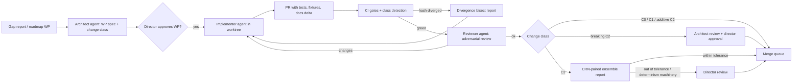

# 13 — Agentic Development Playbook

> **Since ADR-0032 (2026-10-16):** the process (roles, the work loop, sprints, defects, verification, planning) lives in `CODEX/10_GOVERNANCE/` (GOV-005, GOV-007, GOV-002). This document remains the **Rehoboam engineering supplement**: ownership rules, change classes, CI gates, the merge queue and golden-hash divergence (§4), the work-package fields now merged into `CODEX/_templates/template_sprint.md`, and context hygiene for agents.

*Status: Draft v1.1 (2026-10-15). How you and the AI coding agents build Rehoboam together. It implements ADR-0022.*
*v1.4 (2026-10-16): §4.3: the golden-run tiers follow SPR-011 ruling 16, the same text as GOV-002 tier 9.*
*v1.3 (2026-10-16): §3: one engine-crate list, matching `bin/lint_arch.py` and the crates' `[package.metadata.rehoboam]`; crates not yet built are marked (planned).*
*v1.2 (2026-10-16), ADR-0035: §3 gains the engine-purity rule (V-INSP-05, planned in `bin/lint_arch.py` as BCK-002 A-14); `rh-godot` is cut.*
*v1.1 changes: new governance rules in §4 (single-writer column ownership, contract crates, lifecycle command queues, change classes C0–C3, merge queue, divergence bisect), aligned with `05.1` §2 and §6; `rh-contracts` and `rh-worldgen` added to the dependency rules; the decisions log already exists.*

---

## 1. Roles

| Role | Who | Owns |
|---|---|---|
| **Director** | You | Vision, ADR approval, Registry semantics (what a mechanic *means*), phase gates, [H] ratings, approval of C3 changes that are out of tolerance or that alter the determinism contract (§4.2) |
| **Architect agent** | Claude (planning sessions) | Specs, ADR drafts, work-package decomposition, contract (C2) reviews, column-ownership changes, cross-cutting reviews, research updates |
| **Implementer agents** | Coding agents (parallel sessions or worktrees) | One work package each: code, tests, fixtures, bench, docs delta |
| **Reviewer agent** | An independent agent session | Adversarial review of each PR against spec, contracts, invariants and determinism rules |
| **CI** | Automation | Objective gates (§4.3), change-class detection (§4.2), the merge queue (§4.4) |

## 2. Work-package template

Every task an agent receives uses this template. It is stored in `backlog/wp/<id>.md`.

```markdown
# WP-<phase>.<n> — <title>
## Goal (one paragraph, outcome-oriented)
## Context links (specs/ADRs/research sections — exact paths)
## Change class (C0–C3, §4.2) and plane(s) touched (A/B/C)
## Interfaces touched (IF-x, crates, tables, events) — and those it must NOT touch
## Column ownership (columns this WP writes — must be owned by its system; columns it reads via contract crates)
## Requirements covered (IDs from docs/03)
## Invariants that must hold (from 05.1 §9 + system-specific)
## Determinism notes (RNG purposes to register, resample_on_fork flags, fixed-point fields, ordering, lifecycle commands)
## Fixtures & golden data (inputs; expected outputs or bands)
## Acceptance gates (tests to add; benches; stylized-fact bands if relevant)
## Out of scope (explicit)
## System spec (for system WPs: ODD-R path, and the sections implemented or changed; `docs/templates/system_spec_odd_r.md`)
## Size estimate (agent-days; >3 → split)
```

**Sizing rule.** A work package that touches more than one system crate, or takes more than 3 agent-days, is split. Cross-cutting changes go through the architect agent and an ADR.

## 3. Repository conventions (summarised in `CLAUDE.md`)

- **Crate boundaries are law.**
  - System crates (`rh-sys-*`) depend only on `rh-core`, `rh-ids`, `rh-sample`, `rh-events`, `rh-registry` and the contract crates (`rh-contracts` and any `rh-contract-*`, as `bin/lint_arch.py` allows) (`rh-sample`, the vendored samplers, by the SPR-003 Architect ruling of 2026-10-16).
  - Systems never import each other. They communicate through owned tables (read via contract crates), lifecycle commands and events (§4.1).
  - `rh-worldgen` (world generation and settlement plans) is an allowed dependency of `rh-server` (`rh-godot` is cut, ADR-0035). It follows the same determinism rules as authoritative code.
  - **The engine only engines (ADR-0035 §6; EVO-4).** Engine crates (`rh-core`, `rh-ids`, `rh-sample`, `rh-events`, `rh-registry`, `rh-manifest`, `rh-contracts`, `rh-snapshot`, `rh-cli`, `rh-sys-*` (planned), `rh-sifter` (planned), `rh-server` (planned), `rh-minds` (planned), `rh-worldgen` (planned)) contain no presentation, web UI, audio, image, TTS or LLM code and may not depend on media, HTTP-UI or LLM-client crates. One deny-list, kept in one place: for example `image`, `rodio`, `cpal`, `symphonia`, `reqwest`, `axum`, `tower-http`, `async-openai`, `tokenizers`. **Enforced** (V-INSP-05; BCK-002 A-14, SPR-011 T-00): rule `engine-purity` of `bin/lint_arch.py`, next to V-INSP-03, with the deny-list `ENGINE_DENY_LIST` there and nowhere else. It covers the transitive normal and build dependencies (from `Cargo.lock`) of every engine crate and of every plane-A crate; dev-dependencies are exempt. Presentation tools live in `python/`; only the P5 diorama lives in `console/`.
  - Plane-A crates never depend on plane-B or plane-C crates (`05.1` §6.7). No `rh-sys-*` or `rh-core` crate depends on the flavour-asset types (`05.5` §3).
  - `cargo-deny` and a dependency-graph lint enforce all of this.
- **Randomness:**
  - Use only `ctx.rng(purpose, entity, k)`.
  - Every purpose string is registered in the crate's `rng_purposes.rs`, and duplicates are caught at compile time. Purposes whose draws must be redrawn after a fork are flagged `resample_on_fork` in the Registry.
  - Never use `rand::thread_rng`, `StdRng` or `HashMap` iteration in authoritative code. Clippy lints and a custom grep gate enforce this.
- **Numerics:**
  - Threshold quantities are fixed-point types from `rh-core::fixed`.
  - Use `libm` for transcendentals and never call `mul_add`. `clippy.toml` disallows the `std` float transcendentals (`ln`, `exp`, `powf`, `sin`, ...) in every crate; `sqrt` is allowed, because IEEE 754 rounds it correctly.
  - Floats are allowed in one plane-A crate only, `rh-sample` (the samplers' float zone, SPR-003). Distributions are drawn there, from keyed streams, and come back as integers or fixed point; no other plane-A crate computes in floats (V-DET-19).
- **Events:**
  - New verbs, act classes and attributes need Registry entries first. Attributes a pattern reads are declared in the Registry `[attributes]`.
  - Emit roles and anchored snapshots for anything a pattern might read.
  - Record contingency edges whenever an action references a past event.
  - Never back-date: an outcome for a later instant is a timer that emits when it fires (ADR-0025).
- **Tests come with code:**
  - unit tests;
  - proptest invariants;
  - golden fixtures;
  - a bench if the code is on the hot path.
- **Docs delta.** Every PR updates the spec section it implements, or links the WP that will.
- **No silent baseline changes.** Golden baselines change only through a C3 PR that has passed its review route (§4.2) and the merge queue (§4.4).

## 4. Governance: ownership, change classes, CI and merging

### 4.1 Ownership and cross-system effects (`05.1` §2)

| Rule | What it means for an agent |
|---|---|
| **Single-writer column ownership** | Every column and relation has exactly one owning system, declared in the Registry with units and meaning. A WP may write only columns its system owns. Moving ownership is a C2 change reviewed by the architect agent. A lint checks every `AccessSpec` write set against the Registry. |
| **Contract crates** | `rh-contracts` holds, per owning system, the column types and read accessors, and **no implementation**. Other systems read through these accessors. Changing a contract is a C2 change. |
| **Lifecycle command queues** | Births, deaths, migrations, transfers of office or property, and infection-state changes are submitted as typed commands to queues owned by `rh-core`. The owner applies them in `(phase, PersonId)` order. A system that "needs to kill someone" submits a command; it never edits the ledger directly. |
| **Registry effect language** | Verb effects, succession rules and overlays are written in the typed, total effect language (`05.5` §2.1). Effects are queued commands, never inline writes. A `data_only` gap report is closed this way, without Rust. |
| **Derived scheduler** | System order inside a phase is derived from declared read and write sets. A backward dependency must be declared as a lag. Agents never hand-order systems. |

### 4.2 Change classes

Every PR declares a class. **CI detects the class independently and the higher one wins**: a golden-run hash change makes any PR C3, and a diff touching `rh-contracts`, Registry schemas or ownership, event schemas, or an IF-x contract under `specs/` makes it at least C2. A PR takes the highest class of any change in it.

| Class | Scope | Hash effect | Review route |
|---|---|---|---|
| **C0 — Docs and tests** | Docs, comments, tests, fixtures, benches, tooling that does not change a gate | None | Reviewer agent (light). Merge queue auto-merges on green. |
| **C1 — Internal** | Implementation inside one crate with no change to contracts, Registry semantics or plane-A behaviour. Includes performance work, refactors, and plane-B or plane-C changes (presentation, patterns, significance) | `state_hash` **unchanged** on every golden world. `observation_hash` or `narrative_hash` may change and are re-recorded in the PR | Reviewer agent (adversarial). Pattern changes also pass the twin test, firing-rate budget and precision@K report (`05.4` §2.3). Auto-merge. |
| **C2 — Contract change** | A contract crate, column ownership, Registry schema, event schema, IF-x interface, wire, keyframe or manifest schema | `state_hash` unchanged (otherwise it is also C3) | Architect agent plus reviewer agent. Contract tests of every consuming crate run. The Architect merges after an independent Tester pass and the audit. **Breaking changes** (major version, `05.9` IF-9) also need a migration. A change to an ADR needs your decision first; the merge that implements it is the Architect's. |
| **C3 — Determinism-affecting** | Anything that changes `state_hash` on a golden world: model changes, new or reordered RNG draws, parameter defaults, phase-order changes; and any change to the determinism machinery itself (RNG, samplers, fixed-point types, hashing, phase order, journal format) | Changes plane-A hashes | The PR declares the divergence: which systems, why, and the divergence bisect report (§4.5). CI runs the 32-seed CRN-paired stylized-fact ensemble, before against after. **The Architect merges** after an independent Tester pass and the audit (GOV-005 §6, director's ruling 2026-10-16). A change **out of tolerance** on a golden world, or one that changes the golden-world corpus, is announced to you with its evidence before the merge, and you may veto. |

Agents must not "fix" a failing golden run by re-recording baselines. Only an approved C3 PR moves a baseline, and the merge queue records the new baseline at merge.

### 4.3 CI gates (every PR unless noted)

| Gate | Tooling |
|---|---|
| Format, lint | `cargo fmt --check`, `clippy -D warnings`, ruff, eslint |
| Architecture lints | Dependency-graph lint (§3), plane-isolation lint, column-ownership lint against the Registry, flavour-asset lint |
| Unit + property tests | cargo-nextest, proptest, pytest + hypothesis |
| Determinism | Thread-count hash ladder on reference worlds (50 sim-years); observer-invariance fuzz of read-only APIs from P2 (DET-6) |
| Golden runs | Plane-A hash ladders on `worlds/`. PR tier: `solo` end to end, plus 200-year yearly ladders for the other reference worlds; nightly: the full 1,000-year monthly ladders at 1/2/4/N threads × 3 repeats (SPR-011 ruling 16; GOV-002 tier 9). The P0 `smoke` world keeps its 1,000-year yearly ladder on every PR (ADR-0006 amendment v1.1 item 10). On a mismatch, the divergence bisect tool runs automatically (§4.5) |
| Contracts | Protocol conformance, Python-binding parity, SQL-twin equivalence, consumer contract tests for changed contract crates |
| Performance | criterion benches against baseline (> 10% regression fails) |
| Licences | cargo-deny, pip-licenses, license-checker; provenance check for assets (ADR-0021) |
| Stylized facts | 32-seed CRN-paired ensemble on every C3 PR; full ensemble nightly |
| Sifter | Twin equivalence, firing-rate budgets (fail at > 3× budget) on clustered fixtures |
| LLM evals | RP-200, ARG-300, INTENT-100, red-team; on PRs that touch prompts or models |
| Persuasion balance | Adversarial player bot against the cap envelope (`05.3` §6.3); on PRs that touch whisper scoring |

### 4.4 Merge queue

- All merges to `main` go through a **merge queue**. Each PR is rebased on the queue head and re-runs the per-PR gates before it lands. Two PRs that are green on their own cannot produce a red `main` or an unreviewed hash change.
- **C3 PRs are serialised**: at most one C3 PR in the queue at a time, so every baseline change is attributable to one PR and one ensemble report.
- The queue writes the new golden baselines for an approved C3 PR at merge time. Nobody commits baselines by hand.
- A nightly failure on `main` freezes the queue for C1–C3 until the cause is found.
- **Where GitHub's merge queue is not available** (a private repository below Enterprise Cloud; GOV-008 §1), the same guarantees come from: required status checks with "require branches to be up to date before merging", so every PR re-runs its gates on the current `main` before it lands; merges done one at a time by the Architect, C3 PRs strictly serialised; and baselines written by the C3 PR's own final commit, generated by the bench and golden-run tools and checked by CI, never typed by hand. If even required checks are unavailable (a free plan), the Architect enforces "no green `check_report.md`, no merge" by hand.

### 4.5 When a golden-run hash diverges

1. CI runs the **divergence bisect tool** (`05.1` §6.6). It compares per-table Merkle roots between baseline and candidate and reports the first divergent month, table and row.
2. The report is attached to the PR. The implementer explains the divergence from it: an intended model change (declare C3), or a bug (fix it).
3. If the divergence appears on `main` without a code change (nightly, or across thread counts or platforms), it is treated as a **determinism leak**: the queue freezes and a WP is opened against R-03.

## 5. Workflow



**Parallelism**
- Work packages inside a phase are designed to touch disjoint crates and disjoint owned columns, so 3–6 agents can run concurrently **within ≈ 2–3 workstreams**. The binding limit is your review time, not agent count.
- **Review-hours budget.** The plan assumes ≤ 6 h/week of director review outside gate rating windows (`11`, ADR-0022, `12` Q16). WPs are sized for a ≤ 15-minute approval. Work that would exceed the budget waits; it is never auto-approved to keep pace.
- **Performance baselines** move only through a reviewed PR (`08`): a faster build never tightens or loosens a gate automatically.
- Integration WPs (server, console) follow the system WPs.
- Each agent works in its own git worktree and branch.

## 6. Prompts and context hygiene for agents

- Give agents **exact file paths** to the relevant spec sections, contracts and fixtures. Don't paste the whole plan.
- Require agents to **write the tests first** from the WP's acceptance gates, then implement.
- Require a **"determinism self-check"** section in each PR description: change class, RNG purposes added, `resample_on_fork` flags, fixed-point fields, lifecycle commands used, ordering assumptions.
- Agents must not "fix" failing golden runs by updating baselines. They must report the cause, using the bisect report.

## 7. Definition of Done (per WP)

- [ ] All acceptance gates in the WP pass, and CI is green.
- [ ] The declared change class matches the class CI detected.
- [ ] Invariants are added or extended. Property tests cover edge cases.
- [ ] RNG purposes are registered. No forbidden APIs are used. The WP writes only columns its system owns.
- [ ] Events are registered with roles, anchored snapshots and contingency edges where applicable.
- [ ] Benches are added for hot paths, with no regression.
- [ ] Spec and docs are updated. The Registry is updated if semantics or ownership changed.
- [ ] For system WPs: the ODD-R spec is updated and its completeness check passes. Edits to §2 ownership or §7.0 bounds are C2; edits to equations, defaults or RNG purposes are C3.
- [ ] The reviewer agent has signed off. The architect agent has signed off on C2. You have signed off where §4.2 requires it.

## 8. Knowledge base for agents

- `docs/` holds the plan; `specs/` holds machine-readable contracts.
- `research/` holds the evidence. Agents should cite it in PRs when they make modelling choices.
- `docs/decisions-log.md` is the running log of gate decisions, director rulings and approved out-of-tolerance C3 changes.
- `docs/14_reuse_inventory.md` lists what is reused from open source and under which licence.
- `backlog/gaps/` holds world-compiler gap reports; `backlog/wp/` holds work packages.
