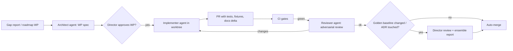

# 13 — Agentic Development Playbook

*Status: Draft v1.0 (2026-10-15). How you and the AI coding agents build Rehoboam together. It implements ADR-0022.*

---

## 1. Roles

| Role | Who | Owns |
|---|---|---|
| **Director** | You | Vision, ADR approval, Registry semantics (what a mechanic *means*), phase gates, [H] ratings, merge of anything that changes golden baselines |
| **Architect agent** | Claude (planning sessions) | Specs, ADR drafts, work-package decomposition, cross-cutting reviews, research updates |
| **Implementer agents** | Coding agents (parallel sessions or worktrees) | One work package each: code, tests, fixtures, bench, docs delta |
| **Reviewer agent** | An independent agent session | Adversarial review of each PR against spec, contracts, invariants and determinism rules |
| **CI** | Automation | Objective gates (§4) |

## 2. Work-package template

Every task an agent receives uses this template. It is stored in `backlog/wp/<id>.md`.

```markdown
# WP-<phase>.<n> — <title>
## Goal (one paragraph, outcome-oriented)
## Context links (specs/ADRs/research sections — exact paths)
## Interfaces touched (IF-x, crates, tables, events) — and those it must NOT touch
## Requirements covered (IDs from docs/03)
## Invariants that must hold (from 05.1 §9 + system-specific)
## Determinism notes (RNG purposes to register, fixed-point fields, ordering)
## Fixtures & golden data (inputs; expected outputs or bands)
## Acceptance gates (tests to add; benches; stylized-fact bands if relevant)
## Out of scope (explicit)
## Size estimate (agent-days; >3 → split)
```

**Sizing rule.** A work package that touches more than one system crate, or takes more than 3 agent-days, is split. Cross-cutting changes go through the architect agent and an ADR.

## 3. Repository conventions (summarised into `CLAUDE.md` at P0)

- **Crate boundaries are law.**
  - System crates depend only on `rh-core`, `rh-ids`, `rh-events` and `rh-registry`.
  - Systems never import each other; they communicate through tables and events.
  - `cargo-deny` and a dependency-graph lint enforce this.
- **Randomness:**
  - Use only `ctx.rng(purpose, entity, k)`.
  - Every purpose string is registered in the crate's `rng_purposes.rs`, and duplicates are caught at compile time.
  - Never use `rand::thread_rng`, `StdRng` or `HashMap` iteration in authoritative code. Clippy lints and a custom grep gate enforce this.
- **Numerics:**
  - Threshold quantities are fixed-point types from `rh-core::fixed`.
  - Use `libm` for transcendentals and never call `mul_add`.
- **Events:**
  - New verbs and act classes need Registry entries first.
  - Emit roles and anchored snapshots for anything a pattern might read.
  - Record contingency edges whenever an action references a past event.
- **Tests come with code:**
  - unit tests;
  - proptest invariants;
  - golden fixtures;
  - a bench if the code is on the hot path.
- **Docs delta.** Every PR updates the spec section it implements, or links the WP that will.
- **No silent baseline changes.** If golden hashes change, the PR must:
  - declare which systems changed;
  - attach the stylized-fact ensemble comparison (before vs after);
  - be approved by the director.

## 4. CI gates (every PR unless noted)

| Gate | Tooling |
|---|---|
| Format, lint | `cargo fmt --check`, `clippy -D warnings`, ruff, eslint |
| Unit + property tests | cargo-nextest, proptest, pytest + hypothesis |
| Determinism | Thread-count hash ladder on reference worlds (50 sim-years) |
| Golden runs | Yearly hash ladders on `worlds/` (1,000 years for `smoke`, 200 for the others on PRs; full nightly) |
| Contracts | Protocol conformance, Python-binding parity, SQL-twin equivalence |
| Performance | criterion benches against baseline (> 10% regression fails) |
| Licences | cargo-deny, pip-licenses, license-checker; provenance check for assets |
| Stylized facts | 32-seed ensemble; **nightly**, or on PRs labelled `affects-history` |
| LLM evals | RP-200, ARG-300, INTENT-100, red-team; on PRs that touch prompts or models |

## 5. Workflow



**Parallelism**
- Work packages inside a phase are designed to touch disjoint crates, so 3–6 agents can run concurrently.
- Integration WPs (server, console) follow the system WPs.
- Each agent works in its own git worktree and branch.

## 6. Prompts and context hygiene for agents

- Give agents **exact file paths** to the relevant spec sections, contracts and fixtures. Don't paste the whole plan.
- Require agents to **write the tests first** from the WP's acceptance gates, then implement.
- Require a **"determinism self-check"** section in each PR description: RNG purposes added, fixed-point fields, ordering assumptions.
- Agents must not "fix" failing golden runs by updating baselines. They must report the cause.

## 7. Definition of Done (per WP)

- [ ] All acceptance gates in the WP pass, and CI is green.
- [ ] Invariants are added or extended. Property tests cover edge cases.
- [ ] RNG purposes are registered. No forbidden APIs are used.
- [ ] Events are registered with roles, anchored snapshots and contingency edges where applicable.
- [ ] Benches are added for hot paths, with no regression.
- [ ] Spec and docs are updated. The Registry is updated if semantics changed.
- [ ] The reviewer agent has signed off. The director has signed off if baselines or ADRs changed.

## 8. Knowledge base for agents

- `docs/` holds the plan; `specs/` holds machine-readable contracts.
- `research/` holds the evidence. Agents should cite it in PRs when they make modelling choices.
- `docs/decisions-log.md` is the running log of gate decisions and director rulings (create it at P0).
- `backlog/gaps/` holds world-compiler gap reports; `backlog/wp/` holds work packages.
