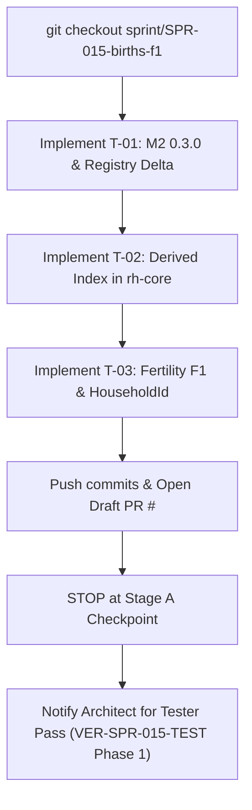

# Work Order: SPR-015 (M2 F1 Births)

- **Assignee:** Developer Exuberant (`AGT-002-CORE`)
- **Assigner:** Architect (`AGT-001`)
- **Date:** 2026-10-18
- **Priority:** Priority 1 (Engine Core Critical Path)
- **Branch:** `sprint/SPR-015-births-f1` (tracking `origin/sprint/SPR-015-births-f1`)
- **Base:** `main` (commit `38246015b7c6b516e50d6880f999a8a63c6de794`)
- **Plan Document:** [`CODEX/05_PROJECT/SPR-015_BirthsF1.md`](file:///home/bdavidriggins/Documents/Rehoboam/CODEX/05_PROJECT/SPR-015_BirthsF1.md) (Status: **APPROVED**)
- **Change Class:** **C3 `[perf-baseline]`**

---

## 1. Context and Objective

All Wave 4 and Phase 1a foundation PRs are merged to `main`:
- PR #83 (`SPR-014` Lifecycle Queues, C3)
- PR #104 (`SPR-038a` Per-Instant Cost Reduction Stage A, C2)
- PR #84 (`SPR-020` Event Envelope, C3)
- PR #82 (`SPR-026` World Stream v1 Live Edge, C2)
- PR #90 (`SPR-017` Registry Effect Language v0, C2)

You are commissioned to implement **SPR-015: M2 F1 Births**. This sprint introduces dynastic demography to the engine: age-specific fertility, Coale–Trussell conception modeling, pregnancy state, genealogical IDs at birth (`H64(mother, parity)`), runtime household tracking, and the derived per-system index in `rh-core`.

---

## 2. Stage A Scope (Immediate Tasks)

SPR-015 has a **hard checkpoint after Stage A**. Implement tasks T-01 through T-03, then pause for the Tester's interim verification pass before beginning Stage B.

### Task T-01: Promotion of M2 0.3.0 & Registry Delta Merge
1. **Spec Promotion:**
   - Move `specs/systems/next/M2.demography.odd.toml` over `specs/systems/M2.demography.odd.toml` with `status = "frozen"` and `spec_version = "0.3.0"`.
   - Update `next/README.md` step 4 and "Current contents": "promoted in SPR-015's PR; SPR-016 bumps to 0.3.1".
   - Regenerate `amendments.lock.toml` (M2's section leaves).
2. **Freeze Text Adjustments:**
   - Remove "0.3.0 is frozen in SPR-016's PR" from P1; record frozen in SPR-015.
   - Design values for `n(a)` and 105:100 sex ratio noted per D54.
3. **Registry Delta:**
   - Merge M2's section of `specs/systems/next/registry_delta.toml` into `specs/manifest/registry_v0.toml` (parameters `tfr`, `elite_fertility_mult`, `density_capacity`, `density_mortality_slope`, and verbs `BIRTH`, `MARRIAGE`).
   - Retain M7's section in `registry_delta.toml` (for SPR-021a). Do NOT bump `registry_version` yet (bumps in T-07).
4. **Tool & Skeleton Consistency:**
   - Update `specs/systems/S6.artifacts.odd.toml` read of `household.head` to point to `M2.demography`.
   - Run `bin/gen_skeletons.py` to regenerate the M2 Rust skeleton (`SPEC_VERSION = "0.3.0"`, `DRAINS`, `RngPurpose` discriminants 1–5).
   - Re-run `specs/annals/fixtures/gen_fixtures.py` and `selftest_annals_v0.py --write`.

### Task T-02: Derived Per-System Index in `rh-core` (C2)
1. **Architecture (Architect Ruling W4):**
   - In `rh-core`, provide a mechanism for systems to maintain a derived index without interior mutability (which is strictly forbidden in Plane A).
   - Systems declare an index type rebuilt at construction and restore via `build(&WorldTables) -> Index`.
   - A serial post-merge hook with `&mut Index` applies merged column writes.
   - The index is **never** hashed into `state_hash` and **never** written to keyframes.
2. **Invariant:**
   - In tests and debug builds, verify the incremental index equals a full rebuild from columns at every keyframe and run end.
   - Provide planted mutant `mutant-index-drop-update` to verify the invariant fails closed.

### Task T-03: Fertility F1 in `rh-sys-demography` & `HouseholdId` in `rh-ids`
1. **`HouseholdId`:**
   - Add typed `HouseholdId(u64)` to `rh-ids`, with `household/v1` H64 domain and rehash support.
2. **Fertility F1:**
   - Implement `[algorithm.fertility_f1]` (F0–F10) in `rh-sys-demography`: Coale–Trussell conception draws, 9-month pregnancy timer, `apply_birth` emitting `BIRTH`.
   - Elite fertility read on the couple per D56/A-62 (`house_member.person`).
3. **Reference Generators:**
   - Verify parity against `bin/gen_m2_f1_reference.py` and `selftest_m2_f1.py`.

---

## 3. Governance and Non-Negotiables

1. **Bitwise Determinism:**
   - 0.000 floating-point operations in Plane A (`rh-core`, `rh-sys-demography`, `rh-ids`, `rh-contracts`). Use `Fixed`, `Prob32`, and integer arithmetic.
   - Iteration order over entities MUST be strictly sorted by `PersonId` / `HouseholdId`. Never iterate un-ordered maps.
2. **Single Writer:**
   - `M2.demography` writes only its owned columns (`person.household`, `person.parity`, `person.last_birth_tick`, `person.conceived_tick`, `person.unborn_father`, `household.*`, `marriage.*`, `life_course.*`).
3. **Commit & PR Protocol (GOV-009):**
   - Format: `type(SPR-015): T-NN description` with `Why:`, `What:`, `Refs:`.
   - Never push directly to `main`.
   - Never rebase or force-push.
   - As soon as your first commit is pushed, open a draft PR on GitHub:
     - Title: `SPR-015: M2 F1 births [perf-baseline] [C3]`
     - Body: Use `.github/pull_request_template.md` with:
       `Agent: Developer (Exuberant), AGT-002-CORE`
4. **Verification:**
   - Run `bin/check_all.sh` locally.
   - Maintain the bidirectional inventory: `python -I bin/check_all_selftest.py inventory`.

---

## 4. Work Flow & Handoff Back to Architect

