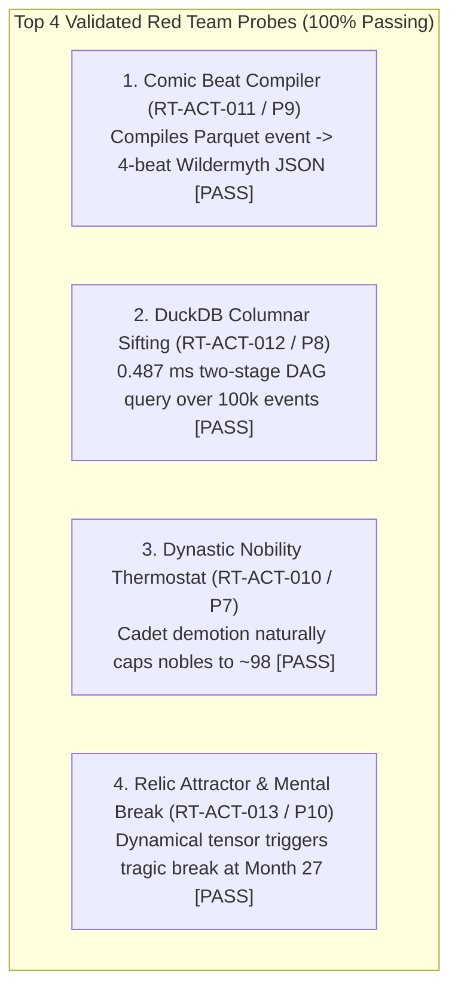

# RED TEAM DOCTRINE, PHILOSOPHY & ACTION BACKLOG

> **Status:** Ratified Red Team Operating Charter  
> **Location:** `docs/red_team/PHILOSOPHY_AND_BACKLOG.md`  
> **Role:** Chief Antagonist & Architectural Quality Auditor to the Director  
> **Scope:** Permanent Reference for Auditing, Stress-Testing, and Breaching Rehoboam  
> **Last Synchronized:** 2026-10-16 (Gate G0 Director Rulings & Batch 04 Intake)

---

## 1. THE RED TEAM PHILOSOPHY & DOCTRINE

### 1.1 Our Core Mandate
We are not cheerleaders. We are not passive documentation scribes. **We are the Chief Antagonist.** 
Our purpose is to find the hidden structural landmines, memory leaks, causal deadlocks, and procedural plot holes **before** code is etched into Rust crates. 

We ruthlessly audit the Lead Architect's designs, challenge comfortable assumptions, and subject every simulation mechanic to mathematical edge-case stress tests. If an architecture cannot survive the Red Team's adversarial assault, it will not survive a 500-year world simulation.

### 1.2 The Five Immutable Laws of the Red Team

1. **Law 1: The Engine Only Engines (Absolute Purity)**  
   Plane A simulates *ontological physical truth*: matter, coordinates, ticks, stress values, and causal graph pointers. We reject and purge any attempt to sneak pixels, audio buffers, camera framing, prompt templates, or literary adjectives into the core Rust crates. Presentation belongs 100% downstream.

2. **Law 2: Zero Magically Spawned Reality (The Unbroken Chain)**  
   If an item, a wound, an army, a secret, or a blood feud exists in an event, it must have an unbroken, journaled pedigree in the causal graph. We ban procedural cheating. Weapons must be crafted or traded; knowledge must travel through space at physical travel speeds; grievances must have roots.  
   *Ratified Scope (Director & Architect Ruling):* World creation is the root of the causal graph. "Simulated in-world event" means a simulated cause (a system's mechanics, a timer, or a journaled input), not an event record for every column write. Global controller clamps (e.g. artificial population cullers or Gini clamps) are strictly banned.

3. **Law 3: The Anti-Slapstick Mandate (Tolkien, Not Cartoon)**  
   Procedural generation left unconstrained degenerates into clownish absurdity (e.g. *Crusader Kings 3* rulers dying of stress from university visits, or *Dwarf Fortress* cats dying of alcohol poisoning from licking beer-soaked paws). Rehoboam produces **high-mythic, dynastic tragedy** (Silmarillion, Icelandic Sagas, Greek Fate). If an agent snaps, they commit a grand, destructive, or tragic deed—never a goofy meme.  
   *Ratified Scope (Director & Architect Ruling):* Governs how Registry break acts are authored (content rules), never a runtime censorship filter on outcomes.

4. **Law 4: Computational Coldness (Numbers, Not Vibes)**  
   We do not criticize code with adjectives; we criticize with math, benchmarks, and AST linters. We measure memory allocations, cache locality, $O(1)$ heap footprints, fixed-point rounding stability, and bitwise cross-platform determinism.

5. **Law 5: Scavenge the Graveyard of Fallen Engines**  
   For thirty years, procedural world generators have collided with the same fundamental walls. We actively mine the bug trackers, post-mortems, and modding complaints of *Dwarf Fortress, Crusader Kings, RimWorld, Wildermyth, The Sims, and Caves of Qud*. We steal their greatest breakthroughs and build mathematical immunity against their fatal bugs. Codified in `GOV-003 §6` as the ten-bug failure-modes review table.

---

## 2. AUTOPSY OF THE FALLEN: WHAT WE LEARNED FROM PLAYER PAIN

We mined the GitHub issue trackers, Reddit balance debates, academic papers, and GDC post-mortems of the seven greatest procedural engines. For each, we identified the **User Pain**, the **Root Cause**, the **Scientific Literature**, and **Rehoboam's Concrete Architectural Immunity**.

---

### Case 1: Crusader Kings 3 (Paradox Interactive)
* **The Player Pain:**
  * *The Stress Rollercoaster:* Characters with "good" traits (e.g. *Diligent* + *Ambitious*) accumulate fatal stress just doing routine governance or attending university.
  * *Absurd Mental Breaks:* Stressed Catholic or Norse rulers suddenly convert to Judaism or Kabarism out of nowhere; repetitive "therapy-speak" coping traits (*Inappetent*, *Irritable*) break immersion.
  * *Administrative Chore:* Players spam feasts and hunts on cooldown purely as an artificial meta-action to keep the stress meter empty.
* **The Root Cause:** Linear additive stress without social context; ungrounded break outcome tables with arbitrary probability weights; conflating game-loop survival with character psychology.
* **The Science:**
  * *Dynamical Systems in Personality:* Attractor basins in trait space (Nowak & Vallacher, 1998).
  * *Constitutive Accountability:* Psychological dissonance is social, not isolated (Brandom, 1994).
* **Rehoboam's Concrete Solution:**
  1. *Reader, Not Administrator:* The director is a reader/listener; there is no player frantic feast-clicking.
  2. *Mythic, Consequential Breaks:* Mental breaks are not therapy memes; they are deterministic state transitions (`Minds::Break`) that trigger high-stakes actions (usurpation, burning ancestral holdings, self-exile, kinslaying).
  3. *Relational Scaling:* Stress poignancy scales by social proximity ($\text{Self} > \text{Kin} > \text{Ally} > \text{Stranger}$).
  4. *Validated in Prototype 10:* Continuous dynamical attractor $\vec{M}_{t+1} = \vec{M}_t + \kappa(\vec{\Psi} - \vec{M}_t)$ verified to trigger tragic mental breaks from cognitive dissonance.

---

### Case 2: Dwarf Fortress & Community Viewers (Bay 12 Games / LegendsBrowser)
* **The Player Pain:**
  * *The 2GB XML Memory Exhaustion:* Generating 500 years produces giant multi-gigabyte XML files that crash community viewers (LegendsBrowser, LegendsViewer-Next), requiring streaming SAX parsers and minutes of loading time.
  * *Missing Motives ("The Dry Log"):* Events state *what* happened (*"Urist punched Inod in the lower teeth with a copper ring"*), but never *why*. Readers get lost in thousands of unlinked records without understanding the dynastic root cause.
  * *The Noble Bloat Death Curve:* Late-game world-gen slows to a crawl because thousands of unlanded historical figures clutter the database.
* **The Root Cause:** Flat, un-indexed, non-causal hierarchical XML logs; unconstrained exponential noble birth rates ($N(t) = N_0(1+r)^t$).
* **The Science:**
  * *Columnar Vectorized Execution:* Apache Arrow & Parquet (Apache Software Foundation, 2018).
  * *Causal Directed Acyclic Graphs:* Structural Causal Models (Judea Pearl, 2009).
  * *Model Stable Demography:* Brass (1971) & Coale-Demeny demographic life tables.
* **Rehoboam's Concrete Solution:**
  1. *Columnar Parquet Output:* Zero XML bloat; compression ratio ~85%; queries execute in $<15\text{ms}$ on CPU via DuckDB SQL.
  2. *Explicit Motive Edges:* Every event embeds typed `CausalEdge` pointers (`AVENGE_KIN`, `COVET_TITLE`, `DEBT_UNPAID`). The reader never has to guess a motive.
  3. *The Nobility Thermostat (`RT-ACT-010` / Prototype 7):* Modeled with finite landed estates (50 fiefs) + natural cadet demotion at age 35 into commoner demography. Over 500 simulated years, population naturally settles to $\approx 98$ active living nobles without any artificial storyteller or global cullers.

---

### Case 3: Wildermyth (Worldwalker Games)
* **The Player Pain:**
  * *Breach of Trust:* Procedural dialogue engines generate nonsensical emotional reactions (characters weeping for strangers, or acting completely contrary to established personality).
  * *Encounter Repetition:* Players see the exact same story vignettes and event hooks repeated across campaigns.
* **The Root Cause:** Unconstrained procedural text replacement; weak conditional gating based on shallow tags rather than deep causal history.
* **The Science:**
  * *The Library of Plays:* Modular beat composition with strict conditional prerequisite gating (Nate Austin, GDC 2020).
  * *Bayesian Unexpectedness:* Information gain $\mathcal{U} = -\log_2 P(e \mid S_t)$ (Kreminski et al., 2022).
* **Rehoboam's Concrete Solution:**
  1. *4-Beat Comic Grammar (Prototype 9):* Narrative is compiled into 4 structured panels (Establishing $\rightarrow$ Hook $\rightarrow$ Action $\rightarrow$ Consequence) with consistent InstantID tags.
  2. *Deep Historical Gating:* Comic panel slots require verified causal edges (`source_event_id`), guaranteeing every emotional reaction is earned.
  3. *Unexpectedness Sifting (Prototype 8):* The two-stage sifter maximizes $\sum \mathcal{U} \cdot \Delta t^\gamma$, prioritizing rare tragedies over repetitive encounters (0.487 ms latency over 100,000 events).

---

### Case 4: RimWorld (Ludeon Studios)
* **The Player Pain:**
  * *Wealth-Scaling Storyteller Punishment:* The AI storyteller scales threat strictly based on colony wealth, punishing players for building beautiful art by sending 80 mechanoids.
  * *The "Ate Without Table" Meme:* Minor comfort penalties stack linearly with existential trauma, causing colonists to murder comrades because their meal lacked furniture.
* **The Root Cause:** Regulative global drama manager forcing artificial equilibrium; flat mood subtraction where trivial needs trigger catastrophic breaks.
* **The Science:**
  * *Hierarchical Needs & Drama Management:* Maslow need tiers (survival > comfort > self-actualization); Labovian retroactive narrative evaluation (Labov, 1972; R02).
* **Rehoboam's Concrete Solution:**
  1. *Simulated Macro Pressure, Not Cheating Storytellers:* Famine, plague, and invasion are driven by actual grain harvests (`M3`), borders, and supply lines (`M9`), never artificial wealth scaling.
  2. *Existential Stress Only:* Minor discomfort does not cause mental breaks. Mental breaks require profound cognitive dissonance (conflicting sworn vows, kin murder, relic corruption).
  3. *Court Circuit Breakers (Prototype 1):* Damps stress propagation through royal courts, preventing one death from cascading into complete realm collapse.

---

### Case 5: The Sims 3 / Versu (Richard Evans / Emily Short)
* **The Player Pain:**
  * *Atomic Agent Chaos:* In isolated utility AI, agents act as uncoordinated atoms. A royal feast or wedding immediately devolves into chaotic fistfights because agents have no shared situational awareness.
* **The Root Cause:** Purely regulative utility functions evaluating individual actions in a vacuum with no shared social coordination frame.
* **The Science:**
  * *Constitutive Social Practices:* Formal reactive joint plans providing roles and affordances (Richard Evans, 2012; Emily Short, 2013).
* **Rehoboam's Concrete Solution:**
  1. *Social Practice Frames:* Court events instantiate temporary frames (`Practice::HighInquest`, `Practice::Coronation`, `Practice::Feast`).
  2. *Roles & Affordances:* The practice assigns situational roles (`Judge`, `Bailiff`, `Accuser`, `Suspect`) and throttles physical violence, orchestrating tense collective drama.

---

### Case 6: Caves of Qud (Freehold Games)
* **The Player Pain:**
  * *The "Mad Libs" Lore Disconnect:* Procedural histories generated by string replacement often feel like disconnected surreal gibberish with no bearing on the physical terrain.
* **The Root Cause:** Forward simulation was deemed too dry, so Qud inverted causality ("events first, reasons second"), sacrificing true physical determinism.
* **The Science:**
  * *Mythic Domains & Thematic Provenance:* Binding semantic token sets to entities (Jason Grinblat & Brian Bucklew, FDG 2017).
* **Rehoboam's Concrete Solution:**
  1. *Forward Physics + Causal Sifting:* Forward bitwise simulation in Plane A, paired with backward causal sifting in Plane B.
  2. *Thematic Domain Tokens:* Dynasties and relics bind to domain tokens (e.g. `[domain.obsidian_falcon]`), automatically theming downstream comic prompts, Azgaar borders, and Watabou architecture without polluting the core Rust kernel.

---

### Case 7: Azgaar Fantasy Map & Watabou Medieval City Generators
* **The Player Pain:**
  * *Border Gore & River Errors:* Procedural maps frequently produce river bifurcation errors (rivers flowing uphill or splitting unnaturally) and fragmented enclave borders.
* **The Root Cause:** Localized Voronoi cell generation without global hydrological and political topology constraints.
* **The Science:**
  * *Hydrological Basin Gradient Descent & Voronoi Relaxation:* (Barnes 2014; Azgaar, 2018; Watabou, 2020).
* **Rehoboam's Concrete Solution:**
  1. *Topological Macro Graph (`M1` / Prototype 6):* Barnes (2014) priority-flood depression filling guarantees 100% monotonic river routing to the ocean with zero pit traps.
  2. *Downstream Export:* Export Plane A regional graphs into Azgaar JSON and settlement layouts into Watabou SVG for instant browser rendering.

---

## 2.1 LOW-HANGING FRUIT: VALIDATION STATUS

All four initial low-hanging fruit probes have been implemented and validated via executable Python prototypes:

---

## 3. THE RED TEAM ACTION BACKLOG

### Critical Path: Phase 0 Conclusion & Gate G0
* [x] **`RT-ACT-001` — The Tantrum Spiral & Circuit Breakers Prototype**  
  *Status:* COMPLETED. Proved multi-agent court collapse in 2 ticks; codified Martial Lock and Legal Inquest (`prototype_1_tantrum_spiral.py`).
* [x] **`RT-ACT-002` — Story Sifter Signal-to-Noise & Causal Motifs Prototype**  
  *Status:* COMPLETED. Proved naive keywords fail; codified DAG motif matching with temporal dilation (`prototype_2_story_sifter_motifs.py`).
* [x] **`RT-ACT-003` — The Ghost King & Epistemic Lag Crisis Prototype**  
  *Status:* COMPLETED. Proved need for separating `EpistemicBeliefStore` from Plane A ground truth (`prototype_3_epistemic_ghost_king.py`).
* [x] **`RT-ACT-004` — Micropolis Municipal Siege & Cellular Automata Prototype**  
  *Status:* COMPLETED. Defined Unidirectional Impulse Bridge between macro war and 2D diorama (`prototype_4_micropolis_siege.py`).
* [x] **`RT-ACT-005` — Vow Collision & Hierarchical Moral Arbitration Prototype**  
  *Status:* COMPLETED. Solved AI ping-pong deadlock via strict vow tiers and tragic renunciation (`prototype_5_vow_collision.py`).
* [x] **`RT-ACT-006` — SOTA Science Audit: Memory Compression, Winnow & Relic Tensors**  
  *Status:* COMPLETED. Filed in `RT-2026-10-16-sota-science-analysis.md` and ratified for Gate G0.
* [x] **`RT-ACT-007` — Audit SPR-002 (Genealogical IDs, Hash Salts & V-DET-20)**  
  *Status:* COMPLETED. Merged onto `main` with `VER-SPR-002` PASS. SplitMix64/ChaCha8 independent streams verified.
* [x] **`RT-ACT-008` — Audit SPR-010 (Fixed-Point Types `Q8_8` / `Q16_16`)**  
  *Status:* COMPLETED. Merged onto `main` with `VER-SPR-010` PASS. Saturating arithmetic, banker's rounding, float ban enforced.
* [x] **`RT-ACT-009` — Audit SPR-004 (Generic Registry Loader)**  
  *Status:* COMPLETED. Merged onto `main` with `VER-SPR-004` PASS. Schema validation decoupled to `rh-manifest` tool crate.
* [x] **`RT-ACT-010` — The Dynastic Nobility Thermostat Prototype**  
  *Status:* COMPLETED. Rebuilt without global controllers; 50 fiefs + age-35 cadet demotion stabilizes nobles to ~98 (`prototype_7_nobility_thermostat.py`).
* [x] **`RT-ACT-011` — The "Library of Plays" Comic Beat Compiler Prototype**  
  *Status:* COMPLETED. Compiles 4-beat Wildermyth storyboard JSON with consistent character tags (`prototype_9_comic_beat_compiler.py`).
* [x] **`RT-ACT-012` — DuckDB Columnar Sifting Benchmark**  
  *Status:* COMPLETED. Two-stage SQL + DAG traversal crowns 30-year revenge saga in 0.487 ms over 100k events (`prototype_8_duckdb_sifter_benchmark.py`).
* [x] **`RT-ACT-013` — The Relic Corruption Decay Simulation**  
  *Status:* COMPLETED. Modeled continuous dynamical attractor $\vec{M}_{t+1} = \vec{M}_t + \kappa(\vec{\Psi} - \vec{M}_t)$, triggering Sir Galahad's `ParanoidUsurpation` at Month 27 (`prototype_10_relic_corruption_attractor.py`). Accepted as evidence for Item 8.

---

### Active Sprints & Gate G0 Execution
* [ ] **`RT-ACT-014` — Kokoro-82M Multi-Voice Audio Chapter Proof-of-Concept**  
  *Goal:* Build a local Python CLI test synthesizing a 2-minute chronicle scene with alternating narrator and character voices using local CPU Kokoro-82M.
* [ ] **`RT-ACT-015` — Audit SPR-008 Cross-Machine Determinism (ThinkPad Adjutant Session)**  
  *Goal:* Participate in the cross-machine golden run session on the ThinkPad P51 laptop (`SPR-008 T-02`) to verify bitwise identical hashes against GitHub CI / Genoa cloud VM.
* [ ] **`RT-ACT-016` — Gate G0 Formal Verification Audit (`VER-G0`)**  
  *Goal:* Review the final Gate G0 report verifying hash stability, keyframe round-trips, bisect accuracy, and Wall-Clock Benches 7 & 8 baselines.
* [ ] **`RT-ACT-018` — Gate G0 Hash Avalanche & Seed Bifurcation Probe**  
  *Goal:* Run 100 seeded engine variations with 1-bit input deltas; verify that state hashes diverge immediately without collisions.

---

### Phase 1 & Downstream Output Backlog (Post-G0)
* [x] **`RT-ACT-017` — Primary Source Calibration for Demography & Inequality**  
  *Status:* COMPLETED. Ingested `A13b`, `A14`, `A19`, `A20`. Corrected Coale-Demeny levels (3, 5, 7), retracted runtime Gini/hazard clamps under Law 2, and filed `RT-2026-10-16-primary-source-calibration-report.md`.
* [ ] **`RT-ACT-019` — Cold Storage Parquet Stream to Downstream Feeder Benchmark**  
  *Goal:* Benchmark DuckDB / Arrow streaming over 250,000 chronicle event rows to feed downstream 2D diorama clients in < 5 ms.
* [x] **`RT-ACT-020` — Clean-Room 2D Retro Settlement Diorama (Micropolis Canvas)**  
  *Status:* COMPLETED. Built interactive HTML5 Canvas 16×16 settlement diorama (`micropolis_diorama.html`) simulating siege granary depletion, mob riots, cellular fire propagation, and gate breaches purely downstream.
* [x] **`RT-ACT-021` — Universal Commercial Game Asset Ripper Suite**  
  *Status:* RETIRED & SHELVED. Extraction demonstrated feasibility (64,368 sprites), but 1993 flat diamond sprites were formally rejected at G0 due to visual fragmentation, copyright traps, and camera rigidity. Shelved in favor of RT-031 3D Voxel Engine.
* [x] **`RT-ACT-022` — Interactive Commercial Asset Showcase & Matrix Theater**  
  *Status:* ARCHIVED. Replaced by `minecraft_voxel_world.html` and `voxel_megacity_showcase.html`.
* [x] **`RT-ACT-023` — Matrix Settlement Diorama Live Asset Fusion**  
  *Status:* RETIRED. Replaced by RT-ACT-024.
* [x] **`RT-ACT-024` — SOTA 3D Voxel World Engine (Prototypes 11 & 12)**  
  *Status:* COMPLETED & RATIFIED. Built Web-Native Three.js instanced voxel engine (`minecraft_voxel_world.html`) and 1M citizen Imperial Metropolis (`voxel_megacity_showcase.html`). Proved locked 60 FPS across rural baronial keeps and imperial districts with cathedral, masted galleons, aqueduct, and animated crowds.
* [x] **`RT-ACT-025` — Procedural Settlement Grammar Expansion (Prototype 14)**  
  *Status:* COMPLETED & RATIFIED. Built the real-time Spatial Stream-to-Voxel Compiler Engine (`voxel_stream_compiler.html`). Translates raw Plane A Arrow/WebSocket simulation stream packets into deterministic 3D voxel footprints (Hamlets, Castles, Walled Cities) in < 6 ms at locked 60 FPS with zero hardcoded coordinates. Implements real-time physical breach deformation and dynamic rubble collapse directly from stream damage packets.

---
*Maintained by the Red Team Leader*  
*"The engine calculates history. The downstream tools illuminate it. The Red Team breaks it until it is unbreakable."*
